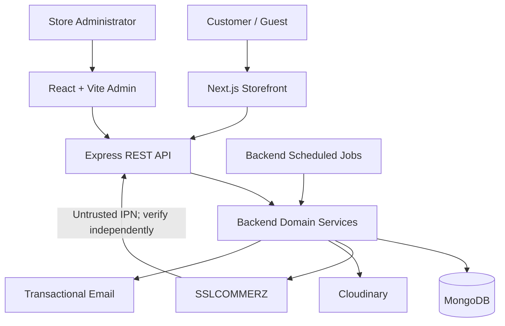

# SportZone

**Project:** Single-store sports e-commerce platform  
**Market:** Bangladesh · **Currency:** BDT  
**Applications:** Customer storefront · Administration portal · REST API  
**Status:** Documentation baseline — implementation and deployment not yet verified  
**Audience:** Developers, maintainers, and project collaborators  
**Last documentation review:** 16 October 2026

SportZone is a planned full-stack online store for sports equipment, sportswear, fitness products, and accessories. Customers will be able to browse products, place guest or account-based orders, pay through supported local channels, and manage post-purchase requests. A separate administration portal will support store operations.

> **Current state:** This README describes the approved project direction and the intended developer workflow; it is **not** a claim that the applications, repository scripts, external integrations, or production deployment are already running. Check the actual repository before following proposed commands.

---

## Contents

- [1. Project Overview](#1-project-overview)
- [2. Key Features](#2-key-features)
- [3. Technology Stack](#3-technology-stack)
- [4. System Architecture](#4-system-architecture)
- [5. Project Structure](#5-project-structure)
- [6. Prerequisites](#6-prerequisites)
- [7. Getting Started](#7-getting-started)
- [8. Development and Available Scripts](#8-development-and-available-scripts)
- [9. Environment Configuration](#9-environment-configuration)
- [10. Testing and Quality Assurance](#10-testing-and-quality-assurance)
- [11. Deployment and Operations](#11-deployment-and-operations)
- [12. Documentation and Project Guidelines](#12-documentation-and-project-guidelines)

---

## 1. Project Overview

SportZone serves **one Bangladesh-based sports retailer**, not a multi-vendor marketplace. The initial release is scoped to Bangladesh delivery, BDT pricing, a single administrator role, guest/registered checkout, and store-managed fulfillment. The backend remains authoritative for prices, discounts, delivery charges, stock, payment status, returns, and refunds.

| Area | Initial-release scope |
| --- | --- |
| Store | Single retailer; Bangladesh-only delivery |
| Customers | Guests and registered customers |
| Administration | One primary administrator role |
| Payments | SSLCOMMERZ-hosted bKash, Nagad, Rocket; store-managed Cash on Delivery (COD) |
| Delivery | Configurable zones/charges; manually maintained fulfillment status |
| Currency | BDT; monetary calculations and storage use integer poisha |

**Release gate:** The product baseline requires verified activation and acceptance of **bKash, Nagad, Rocket, and COD**. Unavailable online methods must not appear as active, and omitting a required method is **not** a substitute for an approved scope change. See [PRD](docs/PRD.md) §3.3 and [Implementation Plan](docs/IMPLEMENTATION_PLAN.md) §12.

## 2. Key Features

The following capabilities are **planned**, not asserted to be implemented.

| Customer storefront | Administration portal |
| --- | --- |
| Product catalog, categories, search, filters, variants | Products, categories, variants, images and inventory |
| Cart, wishlist, coupons and reviews | Orders, customers, delivery zones and charges |
| Customer accounts and guest checkout | Payment monitoring, COD records and reconciliation |
| Hosted online payment and COD | Coupons, reviews, returns and refunds |
| Order status, cancellation, returns and refund tracking | Store settings, policies, reports and audit history |
| Transactional updates and support/complaints | Operational exception handling |

The initial scope excludes multi-vendor selling, native mobile apps, automated courier integration, live GPS tracking, loyalty programs, and international shipping. Full scope and acceptance criteria live in the [PRD](docs/PRD.md).

## 3. Technology Stack

| Layer | Planned technology |
| --- | --- |
| Storefront | Next.js App Router, React, TypeScript, Tailwind CSS |
| Admin | React, Vite, TypeScript, Tailwind CSS |
| API | Node.js, Express, TypeScript; modular monolith |
| Database | MongoDB with Mongoose; transaction-capable replica set for transactional workflows |
| Authentication | Opaque, server-managed sessions using secure cookies |
| Payment | SSLCOMMERZ hosted checkout; backend-managed COD |
| Media | Cloudinary |
| Transactional email | Resend or approved equivalent |
| Repository | npm workspaces, Git, GitHub |
| Quality | Type checking, linting, unit/integration/contract/E2E checks |

Tool and package versions are **not pinned in this document**. Use supported, mutually compatible versions recorded in the implemented `package.json`, lockfile, and approved deployment baseline. The testing frameworks proposed in [Testing](docs/TESTING.md) must be confirmed before installation.

## 4. System Architecture

Both web applications use the **same Express REST API**. Only the backend connects to persistence and privileged third-party services. Next.js rendering is not a second commerce backend.



- **Public API base:** `/api/v1` for application contracts; operational health routes are specified separately in [API](docs/API.md).
- **Business authority:** Express validates identity, authorization, pricing, inventory, order state and financial transitions.
- **Consistency:** Critical writes use guarded state transitions, idempotency and database transactions where required.
- **Security:** Browser and gateway input are untrusted; session cookies, CSRF/Origin checks and server-side ownership checks apply.

Details: [Architecture](docs/ARCHITECTURE.md), [Database](docs/DATABASE.md), [API](docs/API.md).

## 5. Project Structure

The **target layout** below comes from the architecture and implementation plan. It is not an inventory of files independently verified in a checked-out code repository.

```text
sportzone/
├── storefront/                   # Next.js customer application
│   ├── src/
│   │   ├── app/
│   │   ├── components/
│   │   ├── features/
│   │   └── lib/
│   └── public/
├── admin/                        # React + Vite administration app
│   ├── src/
│   │   ├── app/
│   │   ├── features/
│   │   ├── components/
│   │   └── lib/
│   └── public/
├── backend/                      # Express API, domain services, Mongoose
│   └── src/
│       ├── modules/
│       ├── middleware/
│       ├── jobs/
│       ├── config/
│       └── shared/
├── docs/
│   ├── PRD.md
│   ├── ARCHITECTURE.md
│   ├── DESIGN.md
│   ├── DATABASE.md
│   ├── API.md
│   ├── IMPLEMENTATION_PLAN.md
│   ├── TASKS.md
│   ├── TESTING.md
│   └── OPERATIONS.md
├── AGENTS.md                     # Agent execution instructions (documented)
├── CHANGELOG.md                  # Documentation change history (created)
├── README.md
├── .env.example                  # Planned safe configuration template
├── .gitignore
└── package.json                  # Planned npm workspace definitions
```

Do not import Mongoose models or backend-only services into either frontend. Add shared pure contracts only if actual duplication warrants it.

## 6. Prerequisites

Before local development, provide the following as the relevant phases are implemented:

| Requirement | Readiness guidance |
| --- | --- |
| Git | Install a supported version and obtain repository access |
| Node.js and npm | Use versions approved by the committed project manifest and lockfile |
| MongoDB | Use an isolated, transaction-capable replica-set deployment for checkout/integration tests |
| Service accounts | Obtain approved **sandbox** credentials for required external integrations |
| Environment template | Confirm actual `.env.example` and per-application environment validation exist |
| Local origins | Confirm storefront, admin and API ports/origins from implemented configuration |

Never use production customer data, payment credentials, or production callback endpoints in local tests.

## 7. Getting Started

The setup sequence below is a **readiness checklist**, not a claim that current source code and scripts have been created.

1. Clone the approved SportZone repository using its actual URL, then open the repository root. The repository URL has not been supplied here.
2. Confirm the root `package.json` declares the intended npm workspaces and a lockfile is committed.
3. Install dependencies with `npm ci` **after** the lockfile and compatible Node/npm versions have been established.
4. Copy the actual example environment files to local, ignored configuration files as instructed by their comments. Populate only approved local/sandbox values.
5. Start the isolated MongoDB replica set, then validate required indexes and configuration using the implemented setup/migration tasks.
6. Start backend, storefront, admin and required job processes using **scripts that actually exist**; discover them with `npm run` and `npm run --workspace=<workspace-name>` after workspace names are verified.
7. Check `GET /api/v1/health/live` for a non-sensitive liveness response, then check `GET /api/v1/health/ready` **using authorized operational access**; readiness may return `503` until dependencies are healthy and must not be treated as public. Follow the [API health contract](docs/API.md) and exercise a public page and an authorized admin path without production data.

Once the repository foundation exists, these are the intended baseline commands:

```bash
# From the repository root, after package.json and a lockfile exist:
npm ci
npm run                 # Show root scripts actually available
npm run --workspace=storefront  # Inspect storefront scripts only if the workspace exists
```

**Do not assume** `npm run dev`, fixed port numbers, database seeding commands or a single `docker compose up` are available until they are implemented and verified. Add exact startup instructions to this section during the foundation phases.

## 8. Development and Available Scripts

The following is the **planned script interface** from the [Testing Specification](docs/TESTING.md) and [Operations Specification](docs/OPERATIONS.md), not a list of verified executable scripts.

| Proposed command | Intended responsibility |
| --- | --- |
| `npm run lint` | Lint configured workspaces |
| `npm run typecheck` | Type-check application code |
| `npm run test:unit` | Unit and component tests |
| `npm run test:integration` | API/database integration tests |
| `npm run test:contract` | HTTP/DTO and compatibility contracts |
| `npm run test:e2e` | Browser end-to-end tests |
| `npm run test:security` | Approved automated security checks |
| `npm run test:coverage` | Coverage reports with defined exclusions |
| `npm run build` | Build deployable workspaces |

Development startup and per-workspace commands must be added **only after** the corresponding scripts are implemented. CI must fail when a required declared check is missing; it must not silently skip the check.

## 9. Environment Configuration

Keep environment configuration **separate** for local, test, staging and production. Actual variable names and validation rules belong to implemented environment schemas and the operator-maintained register in [Operations](docs/OPERATIONS.md); do not treat illustrative names as installed configuration.

| Configuration group | Required boundary |
| --- | --- |
| Application origins and API endpoints | Approved hosts, TLS and credentialed CORS policy |
| MongoDB | Backend/worker-only connection and replica-set capability |
| Sessions / CSRF | Server-only signing or session material, separate role/host boundaries |
| SSLCOMMERZ | Sandbox vs live mode, approved merchant activation and return/IPN URLs |
| Cloudinary and email | Server-only credentials and verified callback/delivery configuration |
| Jobs and monitoring | Environment-isolated workers, leases, logs, health and alert configuration |

- **Never commit** secret-bearing `.env` files, credentials, customer data or private keys. Commit only sanitized `.env.example` templates containing placeholders and no real secrets.
- Browser-exposed `NEXT_PUBLIC_*` and `VITE_*` configuration must **not** contain secrets.
- Missing required configuration should fail backend/worker startup; an inactive gateway channel must remain unavailable to customers.
- Preserve production and staging separation, including database, provider credentials, callback targets and message recipients.

## 10. Testing and Quality Assurance

Testing is expected **throughout feature development**, not only in the final QA phase. Apply unit, integration, contract, database/concurrency, E2E, accessibility, security and recovery checks to relevant changes.

| Quality concern | Minimum documentation reference |
| --- | --- |
| Authentication, CSRF, access control | [API](docs/API.md), [Testing](docs/TESTING.md) |
| Stock, coupon and checkout concurrency | [Database](docs/DATABASE.md), [Testing](docs/TESTING.md) |
| Verified payments, COD, returns and refunds | [PRD](docs/PRD.md), [Testing](docs/TESTING.md) |
| Responsive layouts and theme/accessibility behavior | [Design](docs/DESIGN.md), [Testing](docs/TESTING.md) |
| Deployment recovery and financial reconciliation | [Operations](docs/OPERATIONS.md), [Testing](docs/TESTING.md) |

Test plans and mapped acceptance criteria are **not pass results**. Record executed commands, environment, outcomes, defects and evidence in the [task register](docs/TASKS.md). Provider sandbox and release checks need their own evidence and sign-off.

## 11. Deployment and Operations

The intended flow is **local development → isolated staging → gated production release → handover**. Build/deploy the storefront, admin portal, backend and scheduled jobs according to their actual runtime needs. Keep MongoDB, provider credentials and operational permissions restricted.

Before public launch, verify application security, migrations/indexes, monitoring, backups and restoration, safe job recovery, payment/refund reconciliation, operator content and required gateway channels. A release must satisfy **M7 Production Ready**; operational ownership and runbooks belong to **M8 Handover Accepted**.

Detailed deployment, rollback, monitoring, incident and disaster-recovery procedures: [Operations](docs/OPERATIONS.md). Production hosting, exact URLs, RPO/RTO, backup cadence, on-call ownership and external merchant activation remain pending approval/evidence; this README assigns none of them speculatively.

## 12. Documentation and Project Guidelines

The files in `docs/` are the source for their respective areas; this README is a **navigation and setup guide**, not a replacement for them.

| Document | Authority / purpose |
| --- | --- |
| [PRD](docs/PRD.md) | Product scope, business rules, customer rights and acceptance |
| [Architecture](docs/ARCHITECTURE.md) | System boundaries, ownership, security and reliability invariants |
| [Design](docs/DESIGN.md) | UI design system, page behavior and accessibility |
| [Database](docs/DATABASE.md) | Collections, indexes, persistence and transaction contracts |
| [API](docs/API.md) | HTTP endpoints, DTOs, security and callback contracts |
| [Implementation Plan](docs/IMPLEMENTATION_PLAN.md) | Phases, dependencies, milestones and execution strategy |
| [Tasks](docs/TASKS.md) | Stable task IDs, status, blockers and evidence links |
| [Testing](docs/TESTING.md) | Test cases, traceability, fixtures and verification criteria |
| [Operations](docs/OPERATIONS.md) | Deployment, secrets, maintenance, recovery and handover |

**Root guidance:** [AGENTS.md](AGENTS.md) is the proposed agent-execution baseline; [CHANGELOG.md](CHANGELOG.md) records documentation changes and future releases. These files are prepared as artifacts, not proof that the application repository has been assembled.

**Contribution workflow:** Check the current source documents and assigned task ID before making a change. Update affected data/API/test/operations contracts **before** implementing a feature slice. Validate affected code and UI behavior, record evidence, and obtain approval for scope or architecture changes. Follow actual repository branch, review and commit rules once established; none are invented here.

**Security and support:** Do not publish exploits, credentials or customer details in issues. Route potential incidents and customer/payment problems through the approved operations and support procedures when configured. License, public repository URL and maintainer contacts are **not yet provided**, so they are intentionally not claimed here.
