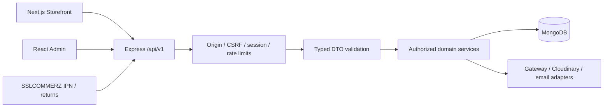
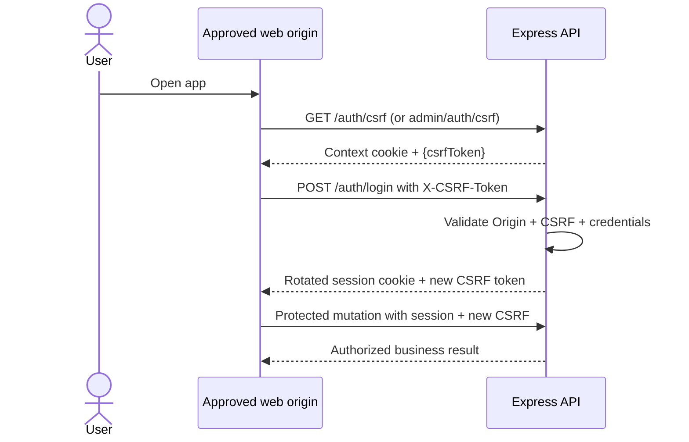
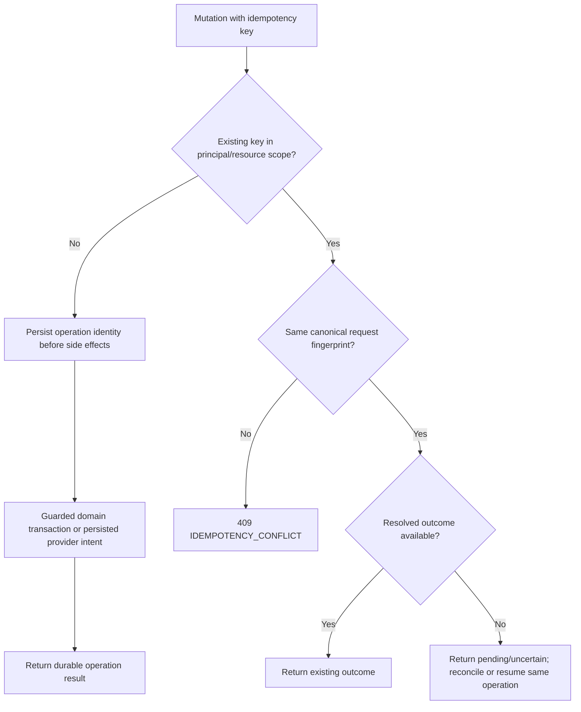

# SportZone — API design & specification

**Version:** 1.0\
**Status:** Final development baseline\
**Updated:** 23 October 2026

**Product reference:** [PRD](./PRD.md)\
**Technical references:** [Architecture](./ARCHITECTURE.md) · [Database](./DATABASE.md)\
**Interface reference:** [Design](./DESIGN.md)\
**Execution references:** [Implementation Plan](./IMPLEMENTATION_PLAN.md) · [Tasks](./TASKS.md)\
**Scope:** Single-store sports e-commerce platform for Bangladesh\
**Stack:** Node.js, Express, TypeScript; MongoDB/Mongoose behind domain services\
**Consumers:** Next.js storefront, React/Vite administration portal, controlled SSLCOMMERZ callbacks\
**Audience:** Backend/frontend engineers, reviewers, and development agents

This document defines the HTTP contracts for SportZone's authoritative Express API.
It defines routes, input/output DTOs, access controls, validation, errors, state-changing behavior, callbacks, and verification obligations.
The PRD governs product rules, Architecture governs system boundaries, and Database governs persistence and financial invariants. Implement the routes, DTOs, limits and response shapes in this specification.

---

## Contents

- [1. Purpose, scope & contract status](#1-purpose-scope--contract-status)
- [2. API architecture & ownership](#2-api-architecture--ownership)
- [3. HTTP conventions & versioning](#3-http-conventions--versioning)
- [4. Authentication, sessions & CSRF](#4-authentication-sessions--csrf)
- [5. Authorization & data exposure](#5-authorization--data-exposure)
- [6. Shared DTOs & response contracts](#6-shared-dtos--response-contracts)
- [7. Validation & error catalog](#7-validation--error-catalog)
- [8. Pagination, search & caching](#8-pagination-search--caching)
- [9. Identity, customer & guest access APIs](#9-identity-customer--guest-access-apis)
- [10. Catalog, cart, promotions & reviews APIs](#10-catalog-cart-promotions--reviews-apis)
- [11. Checkout, orders & delivery APIs](#11-checkout-orders--delivery-apis)
- [12. Payments, COD & gateway callbacks](#12-payments-cod--gateway-callbacks)
- [13. Returns, claims & refund APIs](#13-returns-claims--refund-apis)
- [14. Administration, support & reporting APIs](#14-administration-support--reporting-apis)
- [15. Idempotency, concurrency & recovery](#15-idempotency-concurrency--recovery)
- [16. External integrations & notifications](#16-external-integrations--notifications)
- [17. Security, performance & compatibility](#17-security-performance--compatibility)
- [18. Verification, traceability & change control](#18-verification-traceability--change-control)
- [Appendix A — Complete endpoint register](#appendix-a--complete-endpoint-register)
- [Appendix B — Integration configuration](#appendix-b--integration-configuration)
- [Appendix C — Endpoint definition checklist](#appendix-c--endpoint-definition-checklist)
- [Appendix D — Operation contract & DTO register](#appendix-d--operation-contract--dto-register)

---

## 1. Purpose, scope & contract status

### 1.1 Responsibility and precedence

| Source                                | Authoritative for                                                            | API obligation                                                      |
| ------------------------------------- | ---------------------------------------------------------------------------- | ------------------------------------------------------------------- |
| `PRD.md`                              | FR-01–FR-34, product/consumer rules and acceptance                           | Expose only approved capabilities; preserve payment/return policies |
| `ARCHITECTURE.md`                     | One Express business authority, auth boundaries, retry/state invariants      | No business writes in Next.js or admin; verify server-side          |
| `DATABASE.md`                         | Data models, enums, unique references, accounting and transaction guards     | Map allowlisted DTOs to persistence; never return raw models        |
| `DESIGN.md`                           | UI flows, loading/uncertain/error states, accessible feedback                | Provide enough status and stable errors for each view               |
| `IMPLEMENTATION_PLAN.md` / `TASKS.md` | Sequence, dependencies, verification evidence                                | Contract precedes each feature slice; not an implementation claim   |
| **`API.md`**                          | HTTP methods/routes, DTOs, permissions, failures, retries, webhook responses | Follow each source within its subject authority                     |

**Included:** guest/customer shopping, one admin role, Bangladesh delivery, BDT, COD and enabled SSLCOMMERZ hosted
bKash/Nagad/Rocket channels, after-sales, notifications, support, and essential operations. **Excluded:** multi-vendor,
courier API/tracking, international payments, loyalty, subscriptions, automatic exchanges, multi-level RBAC. Inactive
online channels remain hidden; **all three online channels and COD are mandatory launch acceptance** absent approved PRD
change (PRD §3.3).

### 1.2 Contract conventions

- Routes, DTOs, access rules, errors and retry behavior in this document govern `/api/v1` implementation.
- Database schemas and transaction invariants follow [Database](./DATABASE.md); product rules follow [PRD](./PRD.md).
- Environment values and service access are configured through [Operations](./OPERATIONS.md).
- Verify each feature with its contract, authorization, concurrency and recovery tests before acceptance.

## 2. API architecture & ownership

### 2.1 Runtime and request path

Source ownership and filenames follow [Architecture §§4–6](./ARCHITECTURE.md#4-project-structure).
Module regrouping changes no public URL, DTO, access/session/CSRF, cache/error or retry contract.
Runtime availability and activation are recorded in Tasks and Operations; an operation specification alone does not enable a route.



All DB access and financial decisions occur inside Express services; `storefront` and `admin` are presentations. Public
Next.js rendering may read public catalog DTOs. Callbacks are untrusted signals until independently validated with the
gateway. Scheduled jobs call shared services without bypassing invariants.

### 2.2 Module ownership

| Module                                                                 | Primary route namespace(s)                                                             | Ownership                                                             |
| ---------------------------------------------------------------------- | -------------------------------------------------------------------------------------- | --------------------------------------------------------------------- |
| `auth` (including guest access), `customers`                           | `/auth`, `/me`, `/guest-access`, `/admin/auth`                                         | Identity, scoped access and sessions                                  |
| `catalog`, `inventory`                                                 | `/products`, `/categories`, `/admin/products`, `/admin/categories`, `/admin/inventory` | Visibility, SKUs, stock movement                                      |
| `cart`, `promotions`, `reviews`                                        | `/cart`, `/wishlist`, `/coupons`, `/reviews`, `/admin/coupons`                         | Cart, quotas, verification, moderation                                |
| `checkout`, `orders`, `delivery`                                       | `/checkout`, `/orders`, `/delivery`, `/admin/orders`, `/admin/delivery`                | Snapshots, submissions, fulfillment, charge rules                     |
| `payments`, `refunds`, `returns`                                       | `/orders/{id}/payments`, `/payments`, `/claims`, `/refunds`, `/admin/...`              | Verification, collections, claims, payouts                            |
| `notifications`, `support`, `reporting`, `settings`, `media`, `health` | Operations defined in §§14, 16 and Appendix D                                          | Correspondence, reporting, configuration, authorized media and health |

Domain services coordinate cross-module mutations within MongoDB transactions. No external HTTP call occurs while a database transaction remains open.

**Implementation mapping:** Architecture §§4–6 define target filenames and ownership. Target catalog groups products/variants/categories; cart groups cart/wishlist;
promotions owns coupon operations; auth contains guest-access; reporting groups existing admin
aggregates. Delivery and media remain distinct owners. This mapping changes no URL, operation ID,
DTO, response/error, cookie, CSRF, idempotency or authorization contract. Implemented-path references
remain valid until verified migration. Controllers map HTTP inputs/results; services enforce domain
rules through public capabilities. Notification surfaces stay restricted. This specification and
executable validators/contract tests define the API; generated OpenAPI/Postman artifacts follow §18.3 and must be checked against them.

## 3. HTTP conventions & versioning

### 3.1 Transport and representation

| Item                | Contract                                                                                                                                                                                                                                   |
| ------------------- | ------------------------------------------------------------------------------------------------------------------------------------------------------------------------------------------------------------------------------------------ |
| Root                | `https://<configured-api-host>/api/v1` (deployment host configurable)                                                                                                                                                                      |
| Format              | UTF-8 JSON (`Content-Type: application/json`), except documented multipart uploads and gateway form POSTs                                                                                                                                  |
| Resource names      | Lowercase plural, hyphenated paths; JSON names `camelCase`; IDs serialized strings                                                                                                                                                         |
| Time                | ISO 8601 UTC instants ending `Z`; Bangladesh display derived from `Asia/Dhaka`                                                                                                                                                             |
| Currency            | Always `BDT`; **integer poisha** on every business API and internally; no floating-point money                                                                                                                                             |
| Status values       | Persisted `snake_case` enum values from Database v1.0; UI labels are presentation only                                                                                                                                                     |
| Creation            | `201 Created` + `Location` where appropriate; replay may return `200 OK` with same logical result                                                                                                                                          |
| Deletion            | Use `204 No Content` only where deletion/deactivation is an approved operation; no body                                                                                                                                                    |
| Concurrency         | `If-Match`/strong ETag for approved editable master records; backed by the `revision` CAS fields on category, product, variant, coupon, delivery-zone and charge-rule documents (Database v1.0); domain CAS for financial/stock operations |
| Request correlation | Server-issued `X-Request-Id` returned on every response; incoming value never trusted as evidence                                                                                                                                          |
| API evolution       | Additive compatible fields within `/api/v1`; incompatible changes require version review and consumer migration                                                                                                                            |

`GET` never mutates commerce state, and provider browser returns are not payment approvals. `POST` denotes
submissions/actions, `PATCH` limited updates, `PUT` idempotent item replacements where stated, `DELETE` removal of an
allowed customer-owned item—not financial evidence deletion. An endpoint not listed here is **not** automatically approved.

### 3.2 Headers

| Header            | Direction     | Rule                                                                                                 |
| ----------------- | ------------- | ---------------------------------------------------------------------------------------------------- |
| `Cookie`          | Browser → API | Host-only session/context cookie; use `credentials: 'include'` on browser fetch                      |
| `X-CSRF-Token`    | Browser → API | Required for every browser mutation including guest/auth submissions; not for provider IPNs          |
| `Idempotency-Key` | Client → API  | Required where indicated for checkout, payment retry, payout actions and replay-sensitive operations |
| `If-Match`        | Admin → API   | Required for declared revision-based master-record updates; strong ETag form `"<revision>"`          |
| `Cache-Control`   | API → caller  | `no-store` for identity, private, cart, order, payments, refunds and token/bootstrap responses       |
| `Retry-After`     | API → caller  | Optional integer seconds on throttling/transient service unavailability                              |

Paths use `{id}` in examples, but Express implementations bind `:id`. Route prefixes carry no entitlement: authentication and ownership checks are enforced independently.

### 3.3 Success and error envelopes

```json
{
  "data": { "id": "resource-id", "status": "pending" },
  "meta": { "requestId": "server-generated-request-id" }
}
```

```json
{
  "error": {
    "code": "OUT_OF_STOCK",
    "message": "Selected quantity is unavailable.",
    "details": [{ "field": "items[0].quantity", "code": "UNAVAILABLE" }]
  },
  "meta": { "requestId": "server-generated-request-id" }
}
```

`meta` may be omitted from minimal successful responses only by explicit contract; errors always include a safe code/message and request ID. Never expose DB stack traces, password/token hashes, payment credentials, raw provider payloads or user existence clues.

## 4. Authentication, sessions & CSRF

### 4.1 Session and cookie contract

| Cookie (host-only names) | Principal                           | Rules                                                                                           |
| ------------------------ | ----------------------------------- | ----------------------------------------------------------------------------------------------- |
| `sz_customer_sid`        | Registered customer                 | Opaque, hashed at rest; `HttpOnly`, `Secure`, approved `SameSite`, path `/`                     |
| `sz_admin_sid`           | Privately provisioned admin         | Separate credential and revocation path; never accepted by customer routes as customer identity |
| `sz_guest_order_sid`     | Verified single order               | Contains no raw order/customer info; server binds exact `orderId` and expiry                    |
| `sz_browser_ctx`         | Storefront pre-auth browser context | Short-lived; **no account or order authorization**; bound to CSRF token                         |
| `sz_admin_browser_ctx`   | Admin pre-auth browser context      | Separate audience and cookie; same host-only security attributes; no account authorization      |

Issue all cookies from the **API origin**, without a `Domain` attribute; environment-specific names/path prefixes may change only if security isolation is preserved.
Only `Secure` HTTPS production cookies; local testing may use a controlled development exception.
Expiry is checked server-side even before physical TTL cleanup.
Rotate after authentication or guest-proof exchange, revoke on logout and account suspension; invalidate sessions with `securityRevision`.
`GET /auth/csrf` supplies a token for the storefront/guest browser context or selected storefront session; `GET /admin/auth/csrf` separately scopes the admin origin/session.
If both storefront session kinds exist, the client chooses the applicable token by session kind and protected route.
No cache.

### 4.2 CSRF bootstrap, login and proof exchange



- Validate `Origin` against **exact** approved storefront/admin origins and verify the context/session-bound CSRF token for `POST`, `PUT`, `PATCH`, `DELETE`. Reject missing/mismatched Origins on browser mutations; do not permit wildcard credentialed CORS.
- `POST /auth/register`, `/auth/login`, recovery, guest checkout and guest-proof exchange require the same pre-auth protection. Password reset/recovery email flows always respond ambiguously about account existence.
- Refresh CSRF token after login, logout, privilege/security revision change or guest proof; client must not reuse stale tokens.
- The backend chooses the applicable cookie namespace from the **route and principal type**, not from a user-supplied role. Public registration always creates `customer`.
- IPN/provider returns are on explicitly segregated routes with no browser CSRF/Origin prerequisite; they **never** establish authenticated sessions or directly mark payments paid.

Persistence maps to Database §§5.2–5.6: authenticated sessions retain a private `csrfSecretHash`; pre-auth
`browserContexts.audience` is server-selected `storefront` or `admin`. Bootstrap/verification must preserve that audience
and route-selected session kind; neither a body role nor an unrelated valid context can switch namespaces. These private
fields add no public DTO properties. Validate protocol/replay behavior under Testing §§8–9, 12.

### 4.3 Authentication lifecycle expectations

| Scenario                           | Response / side effect                                                                                        |
| ---------------------------------- | ------------------------------------------------------------------------------------------------------------- |
| Authenticated `GET /auth/session`  | Return `{account:Account}` from the current valid customer session (§9.1)                                     |
| Unauthenticated session            | `401 AUTH_REQUIRED`, no user details                                                                          |
| Successful login                   | Rotate token; invalidate prior pre-auth context; issue session cookie plus new CSRF                           |
| Failed login or suspended identity | Same generic `401 INVALID_CREDENTIALS` response where enumeration would be possible                           |
| Logout                             | Idempotently revoke only the route's session type; clear cookie                                               |
| Password reset/change              | Single-use challenge consumption; advance security revision and invalidate affected sessions                  |
| Guest proof                        | Single-use challenge grants **one order** and explicitly expires; cannot be used as general customer identity |

### 4.4 Customer and administrator session contract

Session issuance accepts only the verified principal selected by the owning customer/admin authentication flow
and rechecks active role/status. No endpoint may issue a session from a client-supplied user ID alone.
Apply the session lifecycle below together with §4.5's route-selected Origin/CSRF controls.

| Concern               | Required contract                                                                                                                                                                                                                                                   |
| --------------------- | ------------------------------------------------------------------------------------------------------------------------------------------------------------------------------------------------------------------------------------------------------------------- |
| Opaque credentials    | Independent CSPRNG 32-byte session and CSRF values, unpadded base64url (43 characters); no user/order/role claims in either token                                                                                                                                   |
| Session storage       | HMAC-SHA-256 using the decoded 32-byte SESSION_SECRET; lowercase hex digest; message `sportzone:session:v1:<kind>::<token>`; kind is route-selected customer/admin                                                                                                  |
| CSRF material         | HMAC message `sportzone:csrf:v1:<kind>:<tokenHash>:<csrfToken>`; binds verifier to exactly one session credential; comparison uses fixed-length timing-safe bytes; this material check alone is not complete Origin/CSRF middleware                                 |
| Lifetime              | Explicit CUSTOMER_SESSION_TTL_SECONDS/ADMIN_SESSION_TTL_SECONDS; positive safe seconds, finite absolute Date expiry; reads do not extend expiry; reject at expiresAt even if TTL record remains                                                                     |
| Cookie policy         | Exact names from §4.1; host-only (no Domain), HttpOnly, path /; SESSION_COOKIE_SAME_SITE explicitly lax or strict; HTTPS always Secure; HTTP exception only configured local/test loopback origin; request Host/proxy headers cannot weaken it                      |
| Cookie parsing        | Only the route's cookie name accepted; missing, malformed or duplicate credentials fail closed; no query, Bearer, client role, guest cookie or other namespace fallback                                                                                             |
| Session authorization | Correct kind, live expiry, absent revokedAt, existing active principal with matching role and securityRevisionAtIssue; absence/ineligibility yields generic 401 AUTH_REQUIRED                                                                                       |
| Rotation              | Fresh session/CSRF plus revocation of the old credential in one transaction; concurrent rotation has one winner; insert failure rolls back old revocation; stale/expired/revoked credential cannot rotate                                                           |
| Fresh login           | Always create fresh random values; optional predecessor revocation is conditional on same user/kind; an unrelated account/namespace credential is never revoked by replacement                                                                                      |
| Logout                | Idempotently revoke only supplied route-kind credential and clear only that cookie using matching attributes; repeated/expired/missing credential does not revoke another session; public logout still requires §4.2's valid Origin/CSRF and fresh context response |
| Principal revocation  | Atomically advance principal securityRevision and mark its route-kind sessions revoked; other principals unaffected; status/role/revision changes deny old access even before cleanup                                                                               |
| Secret rotation       | New SESSION_SECRET immediately rejects old digests on processes using it; drain/restart all old-key processes before declaring revocation complete; no dual-key acceptance is permitted by this contract                                                            |

The configuration boundary validates explicit session lifetime and SameSite settings before composition;
no fallback policy is supplied. Configuration errors identify fields only. Operations §13.3 owns activation,
secret rotation and deployed domain/TLS verification. Cookie expiry is advisory; server-side lookup is authoritative.
Set cookies only after committed issuance, await durable logout before reporting revocation, and refresh CSRF/context
under §4.5 after the identity transition.

**Authorization at the transaction boundary:** Customer profile/address and email-change services recheck the selected credential and active matching-role principal inside their owning transaction. Protected mutations fence both records with conditional timestamp writes, so concurrent logout/suspension/revision changes cause retry and reauthorization rather than a stale permission grant. Fixed expiry is unchanged. Nested address IDs are resolved only within that principal's embedded addresses; foreign and absent IDs return the same 404, and owner/role input fields remain forbidden. Admin session access uses the admin cookie/role guard; customer routes do not accept admin authority. Apply the same authorization discipline when activating additional commerce/admin mutations.

Sensitive identity actions are classified from a server-owned method/registered-route allowlist in operational request logs. Records contain action, HTTP status/outcome and server request correlation; never submitted IDs, credentials, proof material, email or body/query/header values. These operational records do not replace transactional `auditLogs` required by future administrative/financial mutations. Shared throttles and fixed security audit reasons are defined in §4.9.

The service's authenticate result is an explicit internal principal projection; never serialize a raw session document.
The private lookup explicitly selects its CSRF verifier for the session service; ordinary model projections still exclude
all credential verifiers. Guest-order access is independently scoped under §9.2; neither a customer nor an
administrator session may be treated as guest proof for an arbitrary order.

### 4.5 Browser Origin and CSRF contract

`browserSecurityRoutes` composes `GET /auth/csrf` and `GET /admin/auth/csrf` under `/api/v1` with
`createBrowserSecurity` and the session service. Customer and administrator capabilities activate independently after persistence readiness checks, using
`CUSTOMER_AUTH_ENABLED` and `ADMIN_AUTH_ENABLED`. Both default to false; Operations §13.3 owns activation.
Bootstrap requires the exact corresponding frontend `Origin`, returns `{csrfToken,expiresAt}` with `no-store`, and
sets only its audience's context cookie when anonymous. `HEAD` returns no content and creates no context.

Storefront bootstrap accepts only optional `sessionKind=context|customer|guest`. Without it, a present customer cookie
selects customer refresh; otherwise a new storefront context is issued. Invalid present session credentials return
`401 AUTH_REQUIRED`, without anonymous fallback. `context` explicitly requests pre-auth protection for recovery/logout
when the old session is expired. Context-only login/recovery/proof routes request that selector even if another session
is present. Admin bootstrap permits only the explicit `context` selector; it provides pre-auth protection even with an expired
admin cookie, so recovery and repeat logout remain usable. No client selector can request an admin
principal from the storefront. Unknown/duplicate query parameters are invalid. Guest selection requires the exact
`sz_guest_order_sid` cookie and a registered order-scoped adapter; otherwise `401 GUEST_PROOF_REQUIRED`.

| Control              | Required composition and behavior                                                                                                                                                                                                                                                                                                                                                                |
| -------------------- | ------------------------------------------------------------------------------------------------------------------------------------------------------------------------------------------------------------------------------------------------------------------------------------------------------------------------------------------------------------------------------------------------ |
| Origins/CORS         | Canonical exact storefront/admin origins, separately selected by route; no wildcard, reflected unapproved Origin or origin-less browser mutation. Approved credentialed preflight permits GET/HEAD/POST/PUT/PATCH/DELETE and Content-Type, X-CSRF-Token, Idempotency-Key, If-Match only; `Vary` includes Origin and preflight request headers/method. No bearer-Authorization browser preflight. |
| Anonymous contexts   | Independent 32-byte opaque cookie and CSRF; HMAC-SHA-256 at rest using SESSION_SECRET with `sportzone:browser:v1:<audience>:context::<cookie>` and `sportzone:browser:v1:<audience>:csrf:<contextHash>:<csrfToken>` domains. Audience, expiry and absent rotatedAt are checked before constant-time comparison.                                                                                  |
| Lifetime/config      | Explicit BROWSER_CONTEXT_TTL_SECONDS in 1–1800 seconds, no fallback; exact CORS_ALLOWED_ORIGINS must match the two approved distinct origins. Use the existing session service's fixed host-only HttpOnly/Secure/SameSite/path policy, never request-derived attributes.                                                                                                                         |
| Bootstrap refresh    | New anonymous context atomically invalidates the supplied same-audience predecessor. Authenticated refresh replaces only that session's CSRF verifier by conditional update, preserving session expiry and rejecting concurrent stale refresh. Previous CSRF fails.                                                                                                                              |
| Mutation guard       | Route selects context-only, customer-only, admin-only or customer-or-context; all unsafe methods require exact Origin and custom token header. Invalid customer cookie never falls back to anonymous checkout. These guards grant no account/order authorization; apply session/role/ownership guards as well.                                                                                   |
| Successful exchange  | The credential/proof service must use consumeContext with its durable effect in the same MongoDB transaction. One concurrent exchange wins; failed effect rolls back consumption. Do not perform provider/email calls in that callback or start a nested independent transaction.                                                                                                                |
| Guest handoff        | GUEST_ACCESS_ENABLED wires the order-bound refresh/verify adapter to real proof/session persistence; only one exact opaque guest cookie reaches it. Customer/admin/browser credentials cannot substitute.                                                                                                                                                                        |
| Provider segregation | Register provider notifications/returns outside browser guards and bootstrap. Their own verification and acknowledgment contracts remain mandatory; omission of browser CSRF never proves payment success.                                                                                                                                                                                       |

### 4.6 Customer credentials and registration delivery intent

Customer registration, login, session and logout use the §9.1 routes and DTOs.
New passwords require 12–128 Unicode characters and at most 512 UTF-8 bytes; spaces are allowed and passwords are never
trimmed or normalized. The owning `newPasswordPolicy`
implements this rule. Login verifies the stored credential without applying today's new-password minimum; a 4096-byte
transport safety cap prevents unbounded KDF input. Public role/status/userId fields remain invalid.

Passwords use Node's asynchronous scrypt, N=131072/r=8/p=1, 16 random salt bytes, a 64-byte derived key and 256 MiB
maxmem; stored encoding is `scrypt$v1$131072$8$1$<saltHex>$<keyHex>`. Only that exact version/cost/length is accepted;
unknown/disabled/admin/wrong-password cases perform equal-cost dummy/actual verification and return the same
`401 INVALID_CREDENTIALS`. At most two KDFs run per process; saturation is generic `503 SERVICE_UNAVAILABLE`.

Registration transactionally consumes the supplied storefront context, inserts a customer/active user and one
`registration:<userId>:v1` notification intent. Return `201 {account,verificationRequired:true}` after commit; do not issue
an undocumented login or wait for email. A unique normalized-email race returns generic `409 STATE_CONFLICT`, including
existing administrator/suspended addresses; no principal or record detail is returned. Failed outbox persistence rolls
back account/context consumption. On success the client obtains a new anonymous context before another mutation.

Login first verifies password outside the database transaction, then conditionally writes the same active customer with
unchanged credential/revision/update timestamp inside single-use context consumption. Session issuance and same-owner
predecessor revocation share that transaction. Set the fresh cookie only after commit. Failed credentials do not consume
the context or create a session. Account changes concurrent with login reject or serialize; they never turn an old
password into a current credential grant. Current-account reads resolve only a live customer session and project §9.1.

Logout accepts either current customer session-bound CSRF or a fresh valid storefront context, including with an expired
session cookie. It revokes only the supplied customer credential, clears that cookie with matching attributes, replaces
the anonymous context and returns fresh CSRF after persistence succeeds. Failure during context replacement does not
undo durable revocation; re-bootstrap before retry. Administrator/guest cookies are never cleared/revoked here.

Activated composition uses the shared MongoDB throttles (§4.9) alongside the existing KDF concurrency cap. Standalone router factories retain a bounded local guard for isolated adapters; the executable never falls back to it on quota-store failure. No credentials or raw network identity are logged.

### 4.7 Customer profile, addresses and deletion intake

Customer-authenticated `/me`, address and deletion-request operations follow §9.1. All resolve
only the active customer session; browser mutations additionally require storefront Origin and current customer CSRF.
Query parameters and body/path fields outside their DTOs are rejected. Output uses the same account/address allowlists as
session/login responses; internal review records, roles, revisions and credentials never enter Account.

Profile patch permits only nonempty `name?`/`phone?`. The owning phone policy uses pinned `libphonenumber-js/max` metadata,
strict full-input parsing with Bangladesh as the national default, valid country BD only, and no extensions. Mobile and
fixed-line numbers are accepted when valid; output/storage is canonical E.164 `+880…`. Input is bounded at 64 characters;
this validates formatting/numbering, not phone possession. Null/empty values cannot silently clear optional data.

Address create never accepts client id/userId/isDefault/zone/price. It creates an opaque ObjectId, defaults isDefault to
false, and enforces at most ten saved addresses. Explicit default selection clears other defaults atomically; clearing or
deleting a default leaves zero defaults and never invents a replacement. Partial address edits merge with the customer's
stored address and revalidate the entire result before writing. Ownership misses return `404 NOT_FOUND` without revealing
whether a foreign address exists. User/address changes serialize in MongoDB transactions and re-read state on conflict.

The delivery-owned coverage reader checks currently effective active `deliveryCharges` and active `deliveryZones` in the
same transaction snapshot. Select exact `district:area` before approved `district:*`; ambiguous active rules, inactive
exact zones, invalid charge metadata and absent coverage fail closed with `400 UNSUPPORTED_DELIVERY_AREA`. Clients cannot
supply the wildcard or inject key separators. Saved address reads/deletion remain available after a service area ends;
new addresses, edits and default selection require valid current coverage. This is address eligibility, not a delivery
quote, reservation or charge snapshot; checkout must re-resolve the authoritative rule. No district list or charge is seeded.

Deletion intake requires an active authenticated customer and existing verified email (`emailVerifiedAt`); otherwise
`403 FORBIDDEN`. Record requestedAt/verifiedAt server-side at intake, reflecting those checks rather than a new email proof.
Create one stable review request, retaining original reason/time and status on repeat/concurrent submissions. The existing
POST with `{}` also returns the current own requestId/status; no unlisted status endpoint or foreign request selector is
added. Existing terminal review evidence is not replaced by a new intake. No self-service review/approval, account status
change, session revocation, anonymization or hard deletion occurs. Legal/financial retention review remains operator-owned;
orders, receipt/payment/refund evidence, audit and immutable historical snapshots are never updated by these handlers.

### 4.8 Registration notification delivery foundation

Registration intent is dispatched by a server-only email adapter and explicit one-batch worker. No notification HTTP route, arbitrary email submission or automatic email send from registration is
added. Registration uses `registration`/`registration-v1` with empty payload and server-owned plain-text content. Customer-reset/email-change/admin-reset proof renderers activate explicitly under §9.1; other proof/commerce templates remain disabled.

A majority-acknowledged conditional claim moves queued/retry_wait to sending, increments attemptCount and records a fresh
claimId/expiry before any provider request. Only the active claim can settle it. Explicit rate-limit rejection may enter
retry_wait with exponential delay capped by configured policy; permanent rejection or exhausted attempts becomes failed.
Timeout, network failure, malformed acceptance, 5xx or ambiguous conflict becomes delivery_uncertain without automatic
resend. Expired/missing-lease sending is likewise uncertain after worker interruption. Late verified provider acceptance
may settle the same retained claim; stale prior-claim completion cannot overwrite a newer attempt. The repository's
transaction context rejects worker/provider dispatch before any external effect.

`sent` means Resend accepted the message and returned an identifier, not inbox delivery, email verification, or an
exactly-once transport guarantee. The stable Idempotency-Key is SHA-256-derived from the logical eventKey; provider
idempotency retention is bounded and never substitutes for durable local uncertainty. Account/business state stays
committed independently of notification status. Internal status projection excludes recipient, payload, event key and
claim token; no public or administrative retry/reconciliation endpoint is enabled by this foundation.

Email is separately disabled by default. Production requires explicit live mode; local/test/staging require test mode
with an approved test-recipient override, regardless of the intent's customer destination. Sender/API key and retry,
timeout, lease and batch policy are explicit protected configuration. The fixed provider URL is HTTPS, redirects are
rejected, responses are bounded and provider errors/credentials are never reflected. Verified sender/domain, provider
activation and real mailbox acceptance remain operational gates.

### 4.9 Auth/recovery throttles and audit safety

Activated identity composition uses a MongoDB-backed, atomic fixed-window throttle shared by API instances; no process-memory fallback on database failure. Every audience has a shared network budget of 60 requests/minute. Credential, recovery, email-change, checkout and guest-access groups additionally share 10 network attempts/minute per group; normalized supplied email targets share 10 attempts/minute per audience/group across source addresses. CSRF bootstrap/refresh uses the audience network budget. Customer/admin budgets and groups are independent; successful and failed attempts consume equally and no account lookup determines a limit. This is a request throttle, not an account suspension or lockout mutation.

Use only the socket address while trust proxy remains false; forwarded/client identity headers are ignored. Keys are domain-separated HMAC digests derived from SESSION_SECRET and bind audience/group/window; plaintext address/email/proof is never persisted or logged. Fixed minute boundaries govern reset even before TTL cleanup. A rejected quota returns generic 429 RATE_LIMITED plus integer Retry-After; no matching-account detail or counter key is exposed. Counter-store failure returns generic 503 SERVICE_UNAVAILABLE and never proceeds to credentials/recovery. Rotate the shared session secret consistently across API instances; rotation resets counter key namespaces and invalidates old sessions as already documented.

Operational request audit records classify CSRF/login/recovery and other existing sensitive identity actions and include only fixed `securityReason` values for throttling/store unavailability. Generic recovery responses, response floors, Origin/CSRF, proof single-use and credential/role checks are retained. Durable domain auditLogs for commerce remain governed by Database §10.3; these security events use the existing protected operational collector.

### 4.10 Browser identity clients

Both app-owned identity clients validate allowlisted responses and use public build-time API origin configuration, credentials include, no-store and no-referrer. All browser mutations fetch a fresh correct-namespace CSRF context/session token first, then send one JSON mutation without automatic retry/replay. Authentication/identity changes cancel/clear private queries; no credential/proof/password is stored in query variables, browser storage or URLs beyond the incoming fragment. Requests from an obsolete identity generation cannot populate the new cache. UI guards never authorize API access.

Expose only API-backed identity actions. When registration verification or delivery-coverage discovery is unavailable,
show that state accurately. Frontend route guards never replace server authorization. Public API origins, HTTPS,
cookie topology and rebuild requirements are defined in Operations §13.3.

---

## 5. Authorization & data exposure

| Principal            | Allowed resources                                                                                                        | Denied by default                                                  |
| -------------------- | ------------------------------------------------------------------------------------------------------------------------ | ------------------------------------------------------------------ |
| Anonymous            | Public catalog/categories/reviews/policies, guest cart locally, checkout with approved CSRF context, request guest proof | Order details or financial records by number/email alone           |
| Customer (`C`)       | Own profile, addresses, server cart/wishlist, purchases, reviews, returns, refunds, support tickets                      | Other users' orders and admin-only actions                         |
| Verified guest (`G`) | **Only the verified order**: details, cancellation, claims and refunds/status allowed by the same eligibility rules      | Account, wishlist, unrelated orders, other guest orders            |
| Admin (`A`)          | Admin operations and authorized financial decisions after all state checks                                               | Arbitrary evidence alteration, unapproved payout, bypassing policy |
| Provider (`P`)       | Only signed/independently verified workflow callback intake endpoints                                                    | Customer/admin session APIs                                        |

**Ownership contract:** check resolved session identity against stored `userId` or exact guest-session `orderId` for
*every* nested resource including order item, cancellation, claim, payment and refund. Do not trust `userId`, arbitrary
`orderId`, email, or order number inside client request bodies as authorization. Admin audit entries include actor and
reason for sensitive changes. Return `404` (instead of identifying a foreign resource) for cross-user object lookup where
appropriate; a clearly authenticated but disallowed operation may use `403`.

**Privacy projection:** public product DTOs may expose approved SKU, pricing and derived stock availability but not
internal counters/history; customer DTOs expose only own PII and masked payment metadata; admin DTOs expose necessary
scoped operational fields; external provider evidence is redacted even to administrators.

## 6. Shared DTOs & response contracts

### 6.1 Scalar types and standard objects

| Type                | JSON contract                                                | Notes                                                                                         |
| ------------------- | ------------------------------------------------------------ | --------------------------------------------------------------------------------------------- |
| `Id`                | Nonempty string                                              | Stringified server ObjectId; never proof of permission                                        |
| `MoneyPoisha`       | Nonnegative safe integer                                     | Business amounts, allocations and refund capacities; never JSON decimal BDT                   |
| `SignedMoneyPoisha` | Signed safe integer                                          | Derived net cash-flow reporting only; a period with more payouts than collections is negative |
| `Instant`           | ISO UTC string, e.g. `2026-10-16T00:00:00Z`                  | Reject ambiguous timezone formats in writes                                                   |
| `Channel`           | `cod` / `bkash` / `nagad` / `rocket`                         | Business choice; actual online provider display/availability subject to verified activation   |
| `AddressInput`      | `{recipient,phone,districtKey,areaKey,street,addressLine2?}` | Bangladesh-supported area keys, no arbitrary delivery-zone ID                                 |
| `CartLineInput`     | `{variantId,quantity}`                                       | Bounded positive integer qty, unique variant                                                  |
| `PageMeta`          | `{page,pageSize,totalItems,totalPages}`                      | Current snapshot estimate; deterministic sort on stable ID tie-break                          |
| `PolicyRef`         | `{type,version,effectiveAt}`                                 | Approved version used for terms/checkout snapshot                                             |
| `Revision`          | Nonnegative integer                                          | Required to prevent overwriting concurrent administrative edits                               |

`?` in tables means optional and omitted, not an empty string or accidental `null`. Values of DB nullable fields (e.g. guest order `userId`) are never assumed present. Database §2.2 defines the field, string and array bounds shared by API validators and UI controls.

### 6.2 DTO registry

| DTO                 | Public or private contract (allowlist)                                                                                                                                                                                                          | Excluded by design                                                                                                    |
| ------------------- | ----------------------------------------------------------------------------------------------------------------------------------------------------------------------------------------------------------------------------------------------- | --------------------------------------------------------------------------------------------------------------------- |
| `ProductCard`       | `id,slug,name,thumbnail,regularPricePoisha,effectivePricePoisha,rating,availability`                                                                                                                                                            | Internal stock counters, media credentials                                                                            |
| `ProductDetail`     | Card + `description,categories,images,variants[{id,sku,attributes,regularPricePoisha,effectivePricePoisha,availableQty}],relatedProducts[]`                                                                                                     | Inventory movement and hidden draft data                                                                              |
| `Account`           | Canonical field allowlist in [Appendix D.2](#d2-typed-request-and-response-schema-registry)                                                                                                                                                     | `passwordHash`, challenge/session tokens, other accounts                                                              |
| `Cart`              | `items[{variantId,quantity,product,estimatedUnitPoisha,availability}],estimatedSubtotalPoisha,revision`                                                                                                                                         | Reservation claims; cart does **not** reserve stock                                                                   |
| `CheckoutQuote`     | Canonical field allowlist in [Appendix D.2](#d2-typed-request-and-response-schema-registry)                                                                                                                                                     | A guaranteed confirmation-relative absolute deadline before the confirmation event, payment guarantee, or reservation |
| `OrderSummary`      | Canonical field allowlist in [Appendix D.2](#d2-typed-request-and-response-schema-registry)                                                                                                                                                     | Guest email/phone to unauthorized clients                                                                             |
| `OrderDetail`       | Canonical field allowlist in [Appendix D.2](#d2-typed-request-and-response-schema-registry)                                                                                                                                                     | Gateway raw payload, session secrets                                                                                  |
| `PaymentSummary`    | Canonical field allowlist in [Appendix D.2](#d2-typed-request-and-response-schema-registry)                                                                                                                                                     | `fundingContext` is derived `normal` or `correction_only`; never interchangeable with the six payment statuses        |
| `CollectionSummary` | `id,amountPoisha,collectedAt,sourceKind,merchandiseAllocatedPoisha,correctionAllocatedPoisha,unassignedAllocatedPoisha,merchandiseRefundHeldPoisha,merchandiseRefundCompletedPoisha,correctionRefundHeldPoisha,correctionRefundCompletedPoisha` | Full bank/card data and provider secrets                                                                              |
| `Claim`             | Canonical field allowlist in [Appendix D.2](#d2-typed-request-and-response-schema-registry)                                                                                                                                                     | Cross-user evidence; raw protected storage URL                                                                        |
| `Refund`            | Canonical field allowlist in [Appendix D.2](#d2-typed-request-and-response-schema-registry)                                                                                                                                                     | Transfer credentials / unmasked payout destination                                                                    |
| `Complaint`         | Canonical field allowlist in [Appendix D.2](#d2-typed-request-and-response-schema-registry)                                                                                                                                                     | Third-party contact details                                                                                           |
| `AdminAudit`        | Canonical field allowlist in [Appendix D.2](#d2-typed-request-and-response-schema-registry)                                                                                                                                                     | Raw before/after sensitive PII or passwords                                                                           |

**DTO naming:** `OrderDetail.items[]` retains historical line IDs; `PaymentSummary` displays correction/unassigned and
merchandise funding as **separate amounts**, not a single “paid” badge. `CollectionSummary` uses the exact monetary field
names from Database §8.6 for independently checkable allocations. Only the backend determines eligibility flags; frontend
cannot create state by setting them. `OrderSummary.finalTotalPoisha` is purchase-time immutable.

### 6.3 Representative server response

```json
{
  "data": {
    "id": "order-id",
    "orderNumber": "SZ-2026-EXAMPLE",
    "fulfillmentStatus": "pending",
    "paymentSummary": {
      "status": "pending",
      "fundingContext": "normal",
      "expectedPoisha": 125000,
      "verifiedCollectedPoisha": 40000,
      "merchandiseFundedPoisha": 40000,
      "correctionCollectedPoisha": 0,
      "unassignedCollectedPoisha": 0,
      "riskStatus": "clear",
      "merchandiseRefundHeldPoisha": 0,
      "merchandiseRefundCompletedPoisha": 0,
      "correctionRefundHeldPoisha": 0,
      "correctionRefundCompletedPoisha": 0
    }
  }
}
```

*Example identifiers and amounts are illustrative, not production data. No guest order may retrieve this payload without verified order-scoped authorization.*

## 7. Validation & error catalog

### 7.1 Shared validation rules

- Validate shape and allowlisted fields at the boundary; reject unknown protected fields, raw MongoDB operators and unbounded arrays/strings.
- Normalize emails, SKUs, slugs, coupon codes and supported area keys once. Never silently truncate customer/financial data.
- Validate valid Bangladesh phone formatting and email syntax server-side; sanitize rich product content and escape on rendering.
- Reject product/category/variant IDs that are missing, inactive, unauthorized or inconsistent; verify nested order-item IDs belong to the authoritative order.
- Monetary values offered by clients are **informational only**. Backend calculates price, coupon, delivery, collection and refundable balance in integer poisha; reject client attempts to write resulting totals.
- Use Database §2.2 validation bounds unless a domain rule is stricter; maintain the same limits in shared API validation. For provider fields obey the provider's documented limits.

### 7.2 Error code register

| HTTP  | Stable code                  | When returned / recovery                                                                                    |
| ----- | ---------------------------- | ----------------------------------------------------------------------------------------------------------- |
| `400` | `INVALID_REQUEST`            | Malformed JSON, invalid path/query/input shape                                                              |
| `400` | `VALIDATION_FAILED`          | Safe field-level `details[]`; fix input                                                                     |
| `400` | `UNSUPPORTED_DELIVERY_AREA`  | Zone not served; choose available address                                                                   |
| `401` | `AUTH_REQUIRED`              | Missing/expired required session                                                                            |
| `401` | `INVALID_CREDENTIALS`        | Wrong credentials / enumeration-safe login failure                                                          |
| `401` | `GUEST_PROOF_REQUIRED`       | No valid order-scoped proof session                                                                         |
| `403` | `FORBIDDEN`                  | Role/ownership/state access denied                                                                          |
| `403` | `CSRF_INVALID`               | Missing/stale context/token or invalid Origin                                                               |
| `404` | `NOT_FOUND`                  | Hidden/inactive/out-of-scope resource or unknown route                                                      |
| `409` | `STATE_CONFLICT`             | Invalid lifecycle transition or concurrent conflict                                                         |
| `409` | `QUOTE_CHANGED`              | Fresh server terms differ from buyer-confirmed quote; obtain and explicitly confirm a new quote             |
| `409` | `QUOTE_EXPIRED`              | Quote expired before a new intent committed; same-key committed replay still returns existing result        |
| `409` | `IDEMPOTENCY_CONFLICT`       | Same key, different canonical payload                                                                       |
| `409` | `IDEMPOTENCY_KEY_RETIRED`    | Key too old for replay, retained tombstone prevents new order                                               |
| `409` | `REVISION_CONFLICT`          | Client/admin update based on stale revision                                                                 |
| `409` | `OUT_OF_STOCK`               | Cannot obtain requested available stock                                                                     |
| `409` | `COUPON_UNAVAILABLE`         | Invalid eligibility, expired or exhausted capacity; safe reason if appropriate                              |
| `409` | `REFUND_BALANCE_EXCEEDED`    | Source or order/class/unit refund cap reached                                                               |
| `409` | `PAYMENT_UNCERTAIN`          | Prior attempt not safely resolved; reconcile before new charge                                              |
| `409` | `FULFILLMENT_ON_HOLD`        | Paid/collected, but risk or allocation/policy review blocks action                                          |
| `412` | `PRECONDITION_FAILED`        | Required `If-Match` mismatch; refresh edit                                                                  |
| `428` | `PRECONDITION_REQUIRED`      | Missing mandatory revision precondition; refetch record                                                     |
| `422` | `BUSINESS_RULE_VIOLATION`    | Domain eligibility fails, with safe `details`                                                               |
| `422` | `PAYMENT_AMOUNT_UNSUPPORTED` | Attempt amount below/above verified provider/merchant range; choose COD or resolve balance without charging |
| `429` | `RATE_LIMITED`               | Enforce per-route abuse limits; optional `Retry-After`                                                      |
| `502` | `PROVIDER_ERROR`             | Verified upstream hard failure; **no inferred financial outcome**                                           |
| `503` | `SERVICE_UNAVAILABLE`        | DB/provider dependency unavailable; client may query operation status                                       |
| `500` | `INTERNAL_ERROR`             | Redacted unexpected fault with request ID                                                                   |

Validation errors distinguish *bad input* from *current state*: an eligible but exhausted coupon is `409`, not “invalid
JSON”. On external timeout, do not report definitive `failed`; return pending/uncertain status when a durable operation
exists, or a safe transient error with correlation ID. Unknown user/email/guest-order lookup must not leak existence. A
successful refund request is **not** confirmed payout.

## 8. Pagination, search & caching

| Concern           | Rule                                                                                                                                     |
| ----------------- | ---------------------------------------------------------------------------------------------------------------------------------------- |
| Pagination        | `page` starts at `1`; `pageSize` defaults `20`, maximum `100`; no unbounded lists                                                        |
| Sorting           | Explicit endpoint allowlist, e.g. `newest`, `price_asc`, `price_desc`; stable ID tie-break                                               |
| Public search     | `q` trimmed and length-bounded; only active products/categories eligible for public discovery                                            |
| Catalog filtering | `category`, `minPricePoisha`, `maxPricePoisha`, `inStock`, with server type and range checks                                             |
| Admin filtering   | Allowlisted status/date/customer references; no arbitrary client query operators                                                         |
| Result            | `{data:[...],meta:{page,pageSize,totalItems,totalPages,requestId}}`                                                                      |
| Public cache      | Public catalog uses `Cache-Control: no-store` under §10; Architecture §5.1 owns rendering freshness; checkout requotes live stock/prices |
| Private cache     | `Cache-Control: no-store`; prevent CDN/SSR shared caching for auth, account, cart, orders and money                                      |

For large audit/financial histories, use an opaque cursor with stable ordering **if approved by query profiling**; do not
invent offset pagination where it risks missing/duplicating mutations. Query and index selection must agree with Database
§11. Reject invalid sort keys, inverted price ranges, unknown filters and attempts to request oversized pages.

## 9. Identity, customer & guest access APIs

### 9.1 Authentication and account endpoint contracts

**All browser mutations** require approved Origin, `X-CSRF-Token` and cookie context/session. Notation: `Public+CSRF` means unauthenticated request with valid browser context; `C` customer-only, `A` admin-only.

| Method   | Path (`/api/v1` prefix omitted)       | Access                      | Request → response                                            | Primary FR |
| -------- | ------------------------------------- | --------------------------- | ------------------------------------------------------------- | ---------- |
| `GET`    | `/auth/csrf`                          | Public                      | `— → {csrfToken,expiresAt}` + context/session cookie          | 01, 21     |
| `POST`   | `/auth/register`                      | Public+CSRF                 | `RegisterInput → {account,verificationRequired}`              | 01         |
| `POST`   | `/auth/login`                         | Public+CSRF                 | `Credentials → {account,csrfToken}` + rotated customer cookie | 01         |
| `GET`    | `/auth/session`                       | C                           | `— → {account}`                                               | 01         |
| `POST`   | `/auth/logout`                        | Public+CSRF                 | `— → {revoked:true,csrfToken}` + cleared cookie               | 01         |
| `POST`   | `/auth/email-verifications`           | Public+CSRF                 | `{email} → {accepted:true}` (ambiguous)                       | 01         |
| `POST`   | `/auth/email-verifications/confirm`   | Public+CSRF                 | `{token} → {verified:true}`                                   | 01         |
| `POST`   | `/auth/password-resets`               | Public+CSRF                 | `{email} → {accepted:true}` (ambiguous)                       | 01         |
| `POST`   | `/auth/password-resets/confirm`       | Public+CSRF                 | `{token,newPassword} → {reset:true}`                          | 01         |
| `GET`    | `/me`                                 | C                           | `— → Account`                                                 | 02         |
| `PATCH`  | `/me`                                 | C                           | `{name?,phone?} → Account`                                    | 02         |
| `POST`   | `/me/email-changes`                   | C                           | `{newEmail} → {verificationSent:true}`                        | 02         |
| `POST`   | `/me/email-changes/confirm`           | C + proof                   | `{token} → Account`                                           | 02         |
| `POST`   | `/me/password-change`                 | C                           | `{currentPassword,newPassword} → {changed:true,csrfToken}`    | 02         |
| `GET`    | `/me/addresses`                       | C                           | `— → Address[]`                                               | 02         |
| `POST`   | `/me/addresses`                       | C                           | `AddressInput → Address`                                      | 02         |
| `PATCH`  | `/me/addresses/{addressId}`           | C                           | `AddressPatch → Address`                                      | 02         |
| `DELETE` | `/me/addresses/{addressId}`           | C                           | `— → 204`                                                     | 02         |
| `POST`   | `/me/addresses/{addressId}/default`   | C                           | `— → Address`                                                 | 02         |
| `POST`   | `/me/deletion-requests`               | C                           | `{reason?} → {requestId,status}`                              | PRD §12.8  |
| `GET`    | `/admin/auth/csrf`                    | Public                      | `— → {csrfToken,expiresAt}` scoped to admin context           | 21         |
| `POST`   | `/admin/auth/login`                   | Public+CSRF                 | `Credentials → {account,csrfToken}` + distinct admin cookie   | 21         |
| `GET`    | `/admin/auth/session`                 | A                           | `— → {account}`                                               | 21         |
| `POST`   | `/admin/auth/logout`                  | Public+CSRF (admin context) | `— → {revoked:true,csrfToken}`                                | 21         |
| `POST`   | `/admin/auth/password-resets`         | Public+CSRF (admin context) | `{email} → {accepted:true}` (ambiguous)                       | 21         |
| `POST`   | `/admin/auth/password-resets/confirm` | Public+CSRF (admin context) | `{token,newPassword} → {reset:true}`                          | 21         |

**Identity input registry**

| DTO               | Fields / important constraints                                                                                                         |
| ----------------- | -------------------------------------------------------------------------------------------------------------------------------------- |
| `RegisterInput`   | `name,email,password`; public role omitted and forced `customer`; enforce approved password policy                                     |
| `Credentials`     | `email,password`; client may **not** supply role or cookie scope                                                                       |
| `AddressPatch`    | Optional editable `recipient,phone,districtKey,areaKey,street,addressLine2,isDefault` only; explicit fields, no arbitrary object merge |
| `Account`         | Database §5.1 allowlist: `id,name,email,phone?,emailVerified,addresses,status`; no hashes/security revision details                    |
| `DeletionRequest` | Verified customer identity and approved retention/review process; **not** immediate hard deletion of financial records                 |

**Repeat logout:** logout is `Public+CSRF` within the correct host/context scope, even when its former session has already
expired or been revoked. A valid CSRF bootstrap/Origin is still required; revoke an active session if present, clear the
relevant cookie, and return the same `{revoked:true,csrfToken}` safe response on repeats (no account-existence disclosure).
An invalid/missing CSRF context is still `403 CSRF_INVALID`. No anonymous request may revoke any **other** session.

Email change confirms a unique normalized email through `authChallenges` and updates security/session revisions atomically; it cannot alter historic order snapshots.
Register, recovery and verification are rate-limited, short-lived, and single-use; do not promise email delivery by returning `201`.
Password reset consumes the challenge once and revokes affected sessions.
Administrator accounts are privately provisioned, never registered or privilege-upgraded through these routes.
Admin recovery uses the existing `password_reset` challenge purpose **bound to the admin `userId` and role checked on confirmation**; no challenge issued for a customer can reset an admin account.
No new unapproved `authChallenges.purpose` enum is implied.
Public responses stay enumeration-safe; account reactivation/recovery requires the approved operational security policy.

#### Customer password recovery and change

Customer reset issuance returns the same `{accepted:true}` for missing, inactive and noncustomer identities. Reset confirmation uses a 32-byte base64url proof, returns `400 INVALID_REQUEST` for unavailable/expired/replayed proofs, and never creates a session. Confirmation changes password, increments security and password-reset scope revisions, revokes customer sessions and removes outstanding reset envelopes atomically. Authenticated password change verifies the current credential, invalidates reset challenges, revokes existing customer sessions and issues a replacement customer cookie and CSRF token in the same transaction. Neither path verifies email or changes account eligibility. Shared network/target rate limits (§4.9) cover these routes; a per-account issuance cooldown silently suppresses repeated emails. The explicit common response floor (100–5000 ms) reduces ordinary timing differences; operators must size it above measured issuance latency and verify the deployed shared limits. It is not a constant-time network guarantee. Deployed shared-control and proxy verification remains an operational gate.

Recovery activates only with explicit `PASSWORD_RECOVERY_ENABLED=true`, a bounded `PASSWORD_RESET_TTL_SECONDS` (60–1800), `PASSWORD_RESET_COOLDOWN_SECONDS` (60–3600), separate versioned 256-bit envelope keys and the fixed configured HTTPS storefront origin. No Host/request URL supplies email links. Proofs use the `/reset-password#token=…` fragment for the frontend screen; the backend accepts tokens only in the confirmation JSON body. Key loss/tamper fails closed; expiry cleanup runs independently of MongoDB TTL in the notification worker.

#### Verified email change

Customer-only `/me/email-changes` and `/me/email-changes/confirm` require Origin/session CSRF, strict JSON and §4.9 shared rate limits. Issuance persists a time-limited single-use proof for the normalized new destination without changing the account. Existing/occupied targets and cooldown suppression return the same `{verificationSent:true}`; this acknowledges handling, not inbox delivery or availability. A target equal to the current email returns `409 STATE_CONFLICT`. Confirmation requires both a current customer session owning the challenge and its proof. Wrong, expired, consumed, invalidated or stale proofs yield `400 INVALID_REQUEST`; a target claimed concurrently yields `409 STATE_CONFLICT` with the entire transaction rolled back.

Confirmation atomically changes the unique email, marks that destination verified, advances security and challenge revisions, invalidates pending identity challenges and revokes all customer sessions. It returns the Account allowlist and clears the customer cookie; it does not silently sign in to the changed identity or return a new CSRF token. The customer must bootstrap/login again. Password reset/change also invalidates pending email-change/verification proofs. Existing order-time email/address snapshots and saved addresses remain untouched. Email-change delivery uses the fixed HTTPS storefront path `/account/email-change#token=…`; the authenticated frontend submits proof only in the JSON body.

EMAIL_CHANGE_ENABLED defaults false and is independent of PASSWORD_RECOVERY_ENABLED. Activation requires customer authentication, the existing protected versioned proof keys/HTTPS storefront origin, and explicit EMAIL_CHANGE_TTL_SECONDS (60–1800), EMAIL_CHANGE_COOLDOWN_SECONDS (60–3600), EMAIL_CHANGE_RESPONSE_FLOOR_MS (100–5000). Shared-ingress protection, measured response-floor sizing, sender readiness and frontend screens remain their owning gates.

#### Administrator credentials

Administrator credentials use only the listed `/admin/auth/login`, `/session`, `/logout`, `/password-resets` and `/password-resets/confirm` operations, plus existing admin CSRF bootstrap. There is no administrator signup route. The backend selects admin role, Origin audience, cookie and proof namespace; clients cannot choose these fields. Admin login/current-session require an active admin and use the existing password policy, adaptive hash and session revision guards. Logout is repeatable with valid admin session CSRF or admin pre-auth context, including after expiry, and clears only the admin cookie.

Admin reset uses the existing password_reset challenge purpose bound to the admin user, with an independent admin verifier domain, admin-bound AEAD and admin-password-reset-v1 delivery template. A customer-issued proof cannot become an admin proof after a role change. Confirmation consumes context/proof and updates password/security revisions/revokes admin sessions atomically; it grants no new session. Responses remain ambiguous about account existence. Admin recovery has independent TTL/cooldown/response-floor configuration and a fixed HTTPS ADMIN_ORIGIN reset link. ADMIN_AUTH_ENABLED defaults false, independently of CUSTOMER_AUTH_ENABLED; active admin configuration requires explicit session/context and ADMIN_PASSWORD_RESET policy plus protected proof keys. Existing shared-ingress/security audit/release gates remain separately owned.

### 9.2 Verified guest access

| Method | Path                       | Access                      | Request → response                                                                     |
| ------ | -------------------------- | --------------------------- | -------------------------------------------------------------------------------------- |
| `POST` | `/guest-access/challenges` | Public+CSRF                 | `{orderNumber,email} → {accepted:true}` with indistinguishable valid/invalid responses |
| `POST` | `/guest-access/sessions`   | Public+CSRF                 | `{challengeToken} → {orderId,expiresAt,csrfToken}` + rotated guest cookie              |
| `GET`  | `/guest-access/session`    | G                           | `— → {orderId,expiresAt}`                                                              |
| `POST` | `/guest-access/logout`     | Public+CSRF (guest context) | `— → {revoked:true,csrfToken}`                                                         |

Guest proof is email-delivered as a high-entropy single-use secure link, issued against **both** order number and checkout email, rate-limited and never exposed in an API response or logs. Short numeric codes require a separately reviewed guessing/attempt-limit design under Database §5.3.
Proof exchange atomically consumes `authChallenges` and grants only the verified `orders._id` through a `guest_order` session (Database §§5.2–5.3).
An attacker cannot enumerate orders by timing, HTTP status or message differences.
Subsequent guest order actions use the same `/orders/{orderId}` routes as a customer, but with *exact* bound order ID checks.
Do not include a public `GET /orders?email=...` endpoint.

The guest runtime is opt-in with `GUEST_ACCESS_ENABLED=true` and customer-auth infrastructure. Configure
explicit guest proof lifetime/cooldown/response floor and session lifetime, the protected `AUTH_PROOF_*`
key ring and an exact HTTPS storefront origin. Lookup trims the case-sensitive order reference and
normalizes email; only a guest-owned order matching both can issue a challenge. Valid-shaped unknown,
wrong-email, registered-owned and cooldown-suppressed requests return the same accepted response with
the configured minimum response duration. No proof or order identifier appears in that response.

Issuance consumes the storefront pre-auth context transactionally; re-bootstrap before another request.
Email contains a fixed `/guest-access#token=...` fragment link. Exchange consumes its fresh pre-auth
context and proof atomically with guest-session issuance; failures roll everything back. A new exchange
revokes the prior guest cookie presented by that browser. Sessions grant exact order scope only and
expire server-side independently of TTL. `GET /auth/csrf?sessionKind=guest` refreshes the guest CSRF
verifier without extending session expiry. Logout accepts approved pre-auth-context or guest-session
CSRF, durably revokes the selected guest cookie, clears it and returns fresh browser-context CSRF.
Customer/admin credentials cannot be revoked or used as guest authority through these endpoints.

Guest proof notifications contain only challenge references; delivery verifies expiry, revision,
recipient, order ownership and authenticated envelope binding. Reissue invalidates the prior proof;
uncertain delivery is not blindly retried. These APIs establish scoped access, while individual order/
claim/cancellation routes still enforce their owning eligibility contracts. The four §9.2 DTOs are owned
by `backend/src/modules/auth/guest-access/guest-access.schema.ts`.

### 9.3 Identity validation and replay contract

`backend/src/modules/auth/auth.schema.ts` defines strict request, path/query and response schemas for all 26 §9.1
operations. It is a contract module, not an Express router: no authentication/account route becomes available merely by
importing it. Controllers must validate requests before service delegation and validate/allowlist outputs before the
success envelope. Internal invalid output is a server fault, never a client validation failure; no raw document is returned.

| Boundary                    | Exact validation / protection contract                                                                                                                                                                                                                                 |
| --------------------------- | ---------------------------------------------------------------------------------------------------------------------------------------------------------------------------------------------------------------------------------------------------------------------- |
| Email/name                  | Email trimmed/lowercased and validated up to 254 characters; names trimmed/nonempty, maximum 120 Unicode characters; no silent truncation                                                                                                                              |
| Password                    | Credentials nonempty and never normalized; register/reset/change additionally require the owning service's explicit password-policy schema; a policy that transforms the supplied password is rejected; no guessed password policy is installed                        |
| Proof/CSRF token wire shape | Nonempty URL-safe ASCII `[A-Za-z0-9_-]`, at most 128 characters; no whitespace/URL/object coercion; issuing services must generate approved high-entropy opaque values, not treat shape as entropy proof                                                               |
| ID/time                     | ObjectId wire strings are 24 lowercase hexadecimal characters; response instants are ISO UTC ending Z; persistence uses BSON Date/ObjectId; neither string validation nor a known ID authorizes a resource                                                             |
| Address                     | Required input matches AddressInput; recipient at most 120 characters, street/addressLine2 at most 300, districtKey/areaKey at most 64; supplied phone and coverage policies validate canonical phone/served pair; keys alone are not caller-selected delivery charges |
| Partial edits               | Nonempty profile/address patch; unknown fields and null rejected; merge partial location with the authorized stored address and revalidate the complete address before writing; explicit supported removal semantics require an owning contract update                 |
| Response                    | Exact field allowlists; maximum ten addresses, distinct IDs, at most one default; no role/hash/revision/envelope leakage; internal deletion_pending/deactivated are not silently mapped to active                                                                      |
| No-input operations         | GET body absent; bodyless mutations accept absent body or exact empty object; query empty; only addressId is accepted for address path parameters                                                                                                                      |
| Acknowledgements            | accepted/verified/reset/revoked/verificationSent/changed must be literal true where specified; ambiguous request acknowledgements never include account existence; DELETE address returns 204 without a JSON body                                                      |
| Deletion intake             | Optional bounded reason only; response requestId and Database §5.5 review status; no immediate deletion or retention waiver                                                                                                                                            |

The contract factory requires new-password, phone and coverage policies from the owning service; tests supply synthetic
policies. This avoids an implicit production password policy or invented national coverage dataset. No default policy,
private credential or live customer data is provisioned here. Login must continue to verify the exact supplied credential
rather than rejecting a historic password merely because new-password rules changed.

**Browser protection and replay:** all §9.1 mutations require the route's approved Origin and bound CSRF, including
register/login/recovery and repeat logout. Customer routes resolve only customer sessions; admin routes resolve only admin
sessions/contexts; browser context alone grants no account access. The registry records the route namespace and protection
obligations; it does not replace session lookup, Origin/CORS/CSRF middleware, hashing, role/ownership checks or rate limits.

- Bootstrap: non-cacheable GET, exact approved frontend origin; admin and storefront contexts cannot be interchanged.
- Login/proof success: rotate the applicable credential/context and CSRF; old tokens fail. Registration returns only its
  documented account/verificationRequired shape and does not imply successful email delivery or an undocumented login.
- Logout: repeated valid-context requests return the same revoked:true shape while each may return fresh CSRF; missing/
  stale context or invalid Origin remains 403 CSRF_INVALID, even when the session has expired. No other namespace is revoked.
- Challenge preconditions: reject expired, consumed, invalidated, revision-stale, attempt-exhausted, wrong-purpose or
  wrong-principal state without revealing which condition failed. The pure contract validator reports
  `VALIDATION_FAILED` with `token/INVALID_PROOF`; password-reset and email-change HTTP services use the generic
  `400 INVALID_REQUEST` contract specified in §9.1. Check admin/customer role and principal binding independently.
- `isChallengeCurrent` checks only expiry, lifecycle, scope/purpose/revision and attempt-bound preconditions after trusted
  record lookup; it neither verifies a secret nor consumes anything. Services must verify the supplied token digest and
  execute consume/reissue plus revision changes atomically per Database §5.6. Two calls on unchanged fresh state can both
  return true; only the transactional conditional write determines a winner.

The safe error register implements INVALID_CREDENTIALS (401), GUEST_PROOF_REQUIRED (401), FORBIDDEN/CSRF_INVALID (403) and
RATE_LIMITED (429) alongside existing envelope errors. Registered errors do not imply enforcement middleware exists.
Wire-schema and pure precondition checks do not establish identity-index races, atomic token consumption,
cookie/session rotation, CORS/CSRF enforcement or deployed origins. Verify those separately under Testing §§8–9, 12.
Guest-order exchange requires the scoped persistence and order-ownership contract in §9.2 before dependent actions
are exposed; the presence of a schema or operation-table row never registers an endpoint.

## 10. Catalog, cart, promotions & reviews APIs

### 10.1 Public catalog and discovery

| Method | Path                            | Access | Query / request → response                                                                    | FR     |
| ------ | ------------------------------- | ------ | --------------------------------------------------------------------------------------------- | ------ |
| `GET`  | `/storefront/home`              | Public | `— → StorefrontHome`                            | 03     |
| `GET`  | `/categories`                   | Public | `parent?,page?,pageSize? → Category[]`                                                        | 04     |
| `GET`  | `/categories/{slug}`            | Public | `— → CategoryDetail`                                                                          | 04     |
| `GET`  | `/products`                     | Public | `q?,category?,minPricePoisha?,maxPricePoisha?,inStock?,sort?,page?,pageSize? → ProductCard[]` | 04     |
| `GET`  | `/products/{slug}`              | Public | `— → ProductDetail`                                                                           | 05, 06 |
| `GET`  | `/products/{productId}/reviews` | Public | `page?,pageSize?,sort? → approved Review[] + rating summary`                                  | 10     |
| `GET`  | `/storefront/policies/{type}`   | Public | Approved published policy `type → {version,content,effectiveAt}`                              | 20, 34 |
| `GET`  | `/storefront/contact`           | Public | `— → {contact,complaintContact}` (approved only)                                              | 03, 20 |

Inactive products/categories (including inactive ancestors) are excluded; out-of-stock products may remain visible but cannot be purchased.
`variants` include one default SKU when a product has no selectable options.
Search/index details in Database §11; do not assume an external search service.
For catalog reads, `category` and category-list `parent` are normalized category slugs; an absent
`parent` lists all visible categories, while a supplied parent selects immediate children. Product category filters include visible descendants. Hidden or
unknown category filters return empty pages. Search `q` is trimmed, 1–120 Unicode characters and at
most ten whitespace-separated terms; all extracted words must match, without user search operators.
Product sorts are `newest` (default), `price_asc`, `price_desc`; ties use durable product ID.
A product card uses the cheapest valid active SKU's effective price and that same SKU's regular price;
price bounds apply to this card price. `inStock=true/false` filters whether any valid active SKU has
positive available stock. Products without a valid active SKU are excluded. Availability is
`available` or `unavailable`, never a reservation guarantee. All associated categories must have active
ancestry. Missing, cyclic or excessively deep ancestry fails visibility closed.
Public categories expose only `id,name,slug,parentId?` and an eligible `image?`; category detail has the
same projection. Card `thumbnail?` and category `image?` expose `{url,alt}` only through media-owned
public reference checks; omit unavailable/unapproved images. `rating?` is `{average,count}` from the
approved summary and omitted when no valid approved ratings exist. Internal counters, revisions, SKU
metadata and media ownership/delivery secrets are excluded. Public catalog reads use `no-store`;
Architecture §5.1 owns storefront rendering and freshness policy.

Product detail uses the same active ancestry/SKU eligibility as listing; hidden, missing or inactive-only
products return 404. It returns all valid active SKU rows (at most 100), including out-of-stock rows
with `availableQty:0`; no inactive SKU or fabricated Cartesian option combination is returned. Attributes
are canonical maps; the no-options SKU uses `{}`. `availableQty` is derived physical minus reserved minus
committed, a display snapshot rather than purchase permission. Consumers disable zero-quantity rows and
revalidate selection/stock through cart and checkout. Description is plain text. `images` contains only
approved public `{url,alt}` values in configured position order, at most twelve; omitted media capability
means an empty image list. `categories` uses the visible category projection. `relatedProducts` contains
at most six other eligible cards sharing an assigned category, newest first with descending ID tie-break;
there is no unrelated fallback. Review content, return-policy publication and cart/checkout actions have
separate owning endpoints/tasks; this detail read does not fabricate them.

Product listings and homepage merchandising only include operator-approved media/content; no fabricated promotional claims.
Homepage sections are bounded: at most eight cards each for featured, newArrivals and discounted,
plus the first twelve visible categories in the existing sortOrder/ID order. Each product section uses
newest createdAt descending with descending product-ID ties; featured requires the operator flag,
and discounted requires the displayed cheapest eligible SKU effective price to be below its own regular
price. Sections may overlap; do not fabricate fallback featured products or promotional claims.
`storeName`, `branding`, `contact` and `complaintContact` are optional configured public metadata;
`policyLinks:[{type,version,href}]` lists only current approved effective published policy pointers, with
href `/api/v1/storefront/policies/{type}`. Links identify public API resources for client consumption.
Missing configured fields/banner are omitted; policyLinks may be empty. Missing required persistence
fails readiness rather than inventing a singleton. Home uses no-store and rejects body/query inputs.
Logo and banner are independent: recheck public clean attached media against the exact settings target/
slot, and additionally bind banner assetId to its ledger row. Generate URLs through the media owner;
never return an unverified stored URL, quarantined/private asset or configuration/audit secrets.
The homepage `banner` maps to `storeSettings.homepageBanner` with a validated public media asset and operator-approved content (API §10.1). Return `HomepageBanner:{assetId,title,alt,href?,image:MediaRef}` only when configured and eligible; otherwise omit it honestly. Banner capability is required by FR-03; publish only operator-approved content. Store the banner in settings rather than a separate collection.

### 10.2 Cart and wishlist

| Method   | Path                             | Access | Request → response                          | FR  |
| -------- | -------------------------------- | ------ | ------------------------------------------- | --- |
| `GET`    | `/cart`                          | C      | `— → Cart`                                  | 07  |
| `PUT`    | `/cart/items/{variantId}`        | C      | `{quantity} → Cart`                         | 07  |
| `DELETE` | `/cart/items/{variantId}`        | C      | `— → Cart`                                  | 07  |
| `POST`   | `/cart/merge`                    | C      | `{items:CartLineInput[]} → CartMergeResult` | 07  |
| `GET`    | `/wishlist`                      | C      | `— → {products:WishlistProduct[]}`          | 08  |
| `PUT`    | `/wishlist/products/{productId}` | C      | `— → {saved:true}`                          | 08  |
| `DELETE` | `/wishlist/products/{productId}` | C      | `— → {saved:false}`                         | 08  |

Guest cart is **browser-local** and is not created server-side by an anonymous `/cart` route. A merge deduplicates on
`variantId` using the maximum of saved and submitted quantities, including duplicate input lines; retries do not
add quantities. Merge accepts at most 100 input lines, each with only a lowercase 24-hex `variantId` and integer
`quantity` 1–50. Malformed input rejects the whole request (`400 VALIDATION_FAILED`). Well-formed unknown/inactive
selections are excluded from the incoming merge and reported once per variant in an `errors` array
of `{variantId,code:"BUSINESS_RULE_VIOLATION"}`; existing saved lines are retained and projected under the visibility rules below.
`CartMergeResult` contains the Cart fields plus `errors` (empty when every input is eligible). The combined cart's 100-distinct-line
limit or subtotal overflow rejects the entire write (`422 BUSINESS_RULE_VIOLATION`); no partial additions survive.
Empty input is allowed and revalidates the saved cart. Accepted merge writes increment revision, including replays;
quantity replay safety applies to the current saved state, so an explicit later edit/removal can be changed by a new merge.
No cart/wishlist endpoint creates reservations or changes stock. Cart price and
availability remain estimates until `POST /checkout/quotes`.

Authenticated cart reads return an empty revision-zero cart without creating a record when none exists.
PUT sets an absolute quantity (integer 1–50); DELETE removes that variant and succeeds when already absent.
A cart contains at most 100 distinct variants. Unknown/inactive/hidden selections cannot be added
(`422 BUSINESS_RULE_VIOLATION`); an eligible out-of-stock selection may be retained and is marked
`unavailable` whenever its requested quantity exceeds current availability. Existing lines remain removable
when catalog eligibility changes. Reads refresh current variant prices and visibility: hidden/deleted
selections return `product:null,estimatedUnitPoisha:null,availability:unavailable`; other lines use a safe
ProductCard for the selected SKU. Estimated subtotal sums currently eligible lines only, including
out-of-stock lines, and is never a checkout total. Integer overflow rejects the operation rather than
rounding. No price or stock snapshot is persisted in the cart. Revision increments on accepted writes;
concurrent writes, including merge, serialize through the owning account and transactional cart update.


Wishlist GET returns an empty products list without creating a record when none exists. PUT adds
one eligible product; repeated PUT for an already saved ID returns `{saved:true}` without duplicating
or revalidating it as a new addition. DELETE returns `{saved:false}` even when absent. At most 200
unique product IDs may be saved; adding an unknown/hidden/inactive product or exceeding the limit
returns `422 BUSINESS_RULE_VIOLATION`. An eligible product with zero available stock may be saved.
GET preserves saved order and current public ProductCard values. A saved product that becomes hidden,
inactive or deleted is represented only as `WishlistProduct:{id,availability:unavailable}`, so it stays
identifiable/removable without disclosing hidden catalog fields. Other WishlistProduct entries are
ProductCard. These markers are not purchasable projections; adding a wishlist item to cart must use
the cart API's current variant validation. Only customer sessions may read or change their own list;
mutations require Origin and session CSRF. Stock and cart state are never changed by wishlist calls.

### 10.3 Coupon and review contracts

| Method  | Path                            | Access           | Request → response                                                                   | FR     |
| ------- | ------------------------------- | ---------------- | ------------------------------------------------------------------------------------ | ------ |
| `POST`  | `/coupons/preview`              | C or Public+CSRF | `{code,items:CartLineInput[],deliveryArea?} → {eligible,discountPoisha,reasonCode?}` | 09     |
| `POST`  | `/products/{productId}/reviews` | C                | `{rating,comment,qualifyingOrderItemId} → Review` (`pending`)                        | 10     |
| `PATCH` | `/reviews/{reviewId}`           | C owner          | `{rating?,comment?} → Review` (moderation reset when needed)                         | 10     |
| `GET`   | `/me/reviews`                   | C                | `page?,pageSize? → Review[]`                                                         | 02, 10 |

Coupon preview **does not consume quota** or lock price/stock; final checkout evaluates current terms, overall and per-customer capacity, and one coupon per order.
`code` is normalized case-insensitively, percentage uses integer basis points and line allocation from Database §§2.3, 8.1–8.3.
A per-customer-limited coupon cannot be used by a guest even if a checkout email matches an account.
Reviews require a delivered qualifying purchase, exactly one active customer/product review, proper ownership and moderation; approved reviews alone affect public ratings.
Do not accept a client-controlled `isVerifiedPurchase`, `status`, or `reviewedBy` field.

### 10.4 Shopping DTO examples

```json
{
  "data": {
    "items": [
      {
        "variantId": "variant-id",
        "quantity": 2,
        "product": { "id": "product-id", "name": "Cricket Bat", "slug": "cricket-bat" },
        "estimatedUnitPoisha": 120000,
        "availability": "available"
      }
    ],
    "estimatedSubtotalPoisha": 240000,
    "revision": 3
  }
}
```

The cart example is not a final payable quote. Catalog and public reviews use `200` reads; new reviews return `201` with `pending`. A rejected eligibility check is `422 BUSINESS_RULE_VIOLATION`, stale inventory at checkout is `409 OUT_OF_STOCK`.

## 11. Checkout, orders & delivery APIs

### 11.1 Checkout request/quote/submission

| Method | Path                                      | Access              | Request → response                                                                           | FR         |
| ------ | ----------------------------------------- | ------------------- | -------------------------------------------------------------------------------------------- | ---------- |
| `GET`  | `/delivery/areas`                         | Public              | `district? → {supportedAreas[],zoneKeys[]}`                                                  | 16         |
| `POST` | `/checkout/quotes`                        | C or Public+CSRF    | `CheckoutQuoteInput → CheckoutQuote` (no reservation)                                        | 11         |
| `POST` | `/checkout/orders`                        | C or Public+CSRF    | `CheckoutSubmitInput + Idempotency-Key → {order,onlinePayment?}`                             | 11, 12, 13 |
| `GET`  | `/orders`                                 | C                   | `page?,pageSize?,status? → OrderSummary[]` for own user only                                 | 14         |
| `GET`  | `/orders/{orderId}`                       | C owner or G-scoped | `— → OrderDetail`                                                                            | 14, 19     |
| `GET`  | `/orders/{orderId}/status`                | C owner or G-scoped | `— → {fulfillmentStatus,fulfillmentHold?,paymentSummary,deliveryEstimate?,deliveryDeadline}` | 14, 19     |
| `POST` | `/orders/{orderId}/cancellation-requests` | C owner or G-scoped | `{reason} → CancellationRequest`                                                             | 15, 19     |
| `GET`  | `/orders/{orderId}/cancellation-requests` | C owner or G-scoped | `— → CancellationRequest[]`                                                                  | 15, 19     |
| `GET`  | `/orders/{orderId}/delivery-events`       | C owner or G-scoped | `— → {status,estimate,deadline,exceptionSummary?,events[]}`                                  | 16, 19     |

**`CheckoutQuoteInput`** is a full, typed draft transaction request: `items:CartLineInput[]`, `recipient:AddressInput` (or
`savedAddressId` for C only), `couponCode?`, `method:Channel`; `email` and `recipient.phone` are required for G checkout;
`contactPhone?` may override the buyer contact number, otherwise the server copies `recipient.phone` into the immutable
`customerSnapshot.phone`. Recipient/delivery phone remains separately snapshotted. Customer details may be explicitly
supplied/reconfirmed for C. `CheckoutSubmitInput` includes the same normalized fields **plus** `notes?`,
`quoteId`, `acceptedTermsVersion`, `acceptedPolicyVersionIds[]`. Reject direct `unitPrice`, `discount`, `deliveryCharge`, `total`,
role, `userId` or target order ID fields.

**Checkout confirmation:** `POST /checkout/quotes` persists a
scope-bound `checkoutQuotes` record (Database §7.1.1) and returns server-issued `quoteId` and required `quoteExpiresAt`.
The buyer reviews its exact commercial terms and submits that ID with the same normalized draft and accepted policy
versions. A client ID is only a lookup: the backend checks scope, expiry, immutable draft fingerprint and commercial
digest, then revalidates prices, line allocations, charge/rule, deadline basis, method eligibility, policies and capacity.
Stable quoted item IDs preserve deterministic rounding. Any commercial change is `409 QUOTE_CHANGED`; expiry is `409
QUOTE_EXPIRED`; both require a fresh quote and explicit buyer confirmation. Neither error creates an order or gateway
attempt. Do not automatically replace the quote and submit it. An unsupported method or unavailable capacity retains its
specific business error. Draft fields inconsistent with the referenced quote return `409 QUOTE_CHANGED`; malformed input remains `400`. Wrong-scope/missing quote is scope-safe `404`. Verify quote comparison, single consumption, idempotency and reconfirmation in the checkout contract tests.

**Executable quote contract:** quote creation is `200`, returns a new server quote per request and
reserves no capacity. `QuoteItem` contains exactly `id,productId,variantId,productName,sku,variantAttributes,
quantity,regularUnitPoisha,effectiveUnitPoisha,regularLinePoisha,productDiscountPoisha,couponAllocatedPoisha,
netMerchandisePoisha,couponEligible`. IDs are server-assigned stable line identities; raw stock counters,
private product configuration and recipient/contact data are not response fields. Resolve saved addresses
only from the current customer; explicit buyer email is normalized, buyer phone defaults to recipient
phone, and recipient/buyer snapshots remain distinct. Guest email is mandatory. Normalize lines in
variant-ID order and fingerprint the resolved recipient/buyer draft; equivalent reordered selections do
not invalidate consent. The commercial snapshot retains coupon identity/type/value/termsVersion and
eligible subtotal, not just its resulting discount, so changed terms require renewed confirmation even
if the total is unchanged. Validate stored snapshot/draft integrity before trusting its consent hashes.

Quote persistence and recalculation use a transaction-bound principal scope. An invalid/present customer
cookie cannot downgrade to guest; guests require the same active storefront browser context and CSRF.
Quote admission uses the shared MongoDB throttle with a distinct checkout group (10/network/minute and
normalized email target, within the existing 60/network/minute customer budget). No automatic order retry
or quote-to-order submission is implemented by quote creation. Internal revalidation checks scope, open
status, exact expiry, normalized draft/consent, stable allocation IDs and current commercial terms;
insufficient stock/coupon capacity keeps its specific error. It does not consume consent or create an
intent/order. The later submission coordinator must resolve existing intent first and atomically consume
quote plus order/allocations, with its required replay/concurrency and current-policy fencing checks.
The quote's capture timestamp and advisory capacity are not commercial changes. Missing approved
policies/deadline basis fails closed with SERVICE_UNAVAILABLE; flags alone never establish online
merchant activation. Known verified amount bounds produce PAYMENT_AMOUNT_UNSUPPORTED when selected.

`GET /delivery/areas` returns `{supportedAreas:[{districtKey,areaKey,zoneId}],zoneKeys:string[]}` for current
active effective rules in active zones. `zoneKeys` is the sorted distinct public zone-ID list; `areaKey:'*'`
represents an operator district wildcard. Optional district is a normalized lowercase slug key (maximum
64). Results are ordered by coverageKey and bounded to 1,000 rows; overflow fails closed rather than
silently truncating (use district filter). This is advisory discovery: an inactive exact rule's zone still
blocks that concrete quote even when a district wildcard is listed. No amounts, private metadata,
credentials or scheduled/inactive regions are exposed. Actual destination eligibility is always rechecked.

**Quote:** Recompute active SKU prices, stock visibility, product-discount-before-coupon, eligible coupon allocations,
delivery-zone rule and eligible payment methods at request time. Return a **deadline rule/status**, not a made-up date
anchored to a future confirmation. An approved placement-started legal cap may be absolute; a 14-day-from-confirmation
target remains provisional until `confirmedAt`. `quoteExpiresAt` is an enforced server precondition using an approved configured lifetime, not a stock/coupon reservation or promise of capacity. The accepted terms must
match currently applicable operator-approved versions; on submit, if changed from the confirmed quote, return `409 QUOTE_CHANGED` and current policy
references for renewed consent.

**Submit:** A new quote is evaluated from authoritative business records; advisory stock counts/estimates are excluded from the commercial digest, but checkout still checks their current eligibility. Never include a confirmation-relative guessed absolute deadline in that digest. `Idempotency-Key` mandatory; canonical payload fingerprint fixed for the identity scope (customer or opaque
guest browser context). Resolve an existing intent first, even when its quote has since expired/been consumed. For a new intent, in one transaction conditionally consume the open quote and create `checkoutIntents`, immutable order snapshot/consent digest and `orderItemBalances`, then
either COD **committed** inventory/coupon or online **15-minute held** stock/coupon. Save one order per key before
returning. A same-key replay returns the same operation resource/result; different payload is `409 IDEMPOTENCY_CONFLICT`.
The current COD runtime is opt-in with `CHECKOUT_COD_ENABLED` and quote/customer-auth prerequisites.
Its successful submission returns `201`, while the same scoped intent replay returns `200`, both with
`{order:OrderSummary}`. Order and payment summaries remain Pending at COD placement; no receipt,
Paid state or confirmation is fabricated. Online submission remains inactive until its owning payment
integration; all required launch channels remain release requirements. Order receipt is a durable
notification intent; asynchronous commerce delivery is integrated separately.
Checkout submission keys contain 1–128 printable ASCII characters without spaces; clients generate
opaque random keys and preserve them verbatim across retries. Persist only their SHA-256 hash.
Canonical submission fingerprints normalize validated fields and set ordering; retries resolve their
existing intent before mutable saved-address/profile resolution or quote expiry checks. Durable result
pointers contain no redirect/session secrets; replay reads the authorized current order state.
A unique intent `quoteId` plus the quote consume guard also prevents two different keys from creating two orders for the same quote; a second key returns `409 STATE_CONFLICT` with no foreign-order disclosure. Renewed confirmation uses a fresh quote and fresh key after a rejected precommit submission. Timeout or disconnect must not create another order on retry. Do not hold a MongoDB transaction open while requesting
hosted payment session.

```json
{
  "items": [{ "variantId": "variant-id", "quantity": 1 }],
  "recipient": {
    "recipient": "Example Buyer",
    "phone": "+8801700000000",
    "districtKey": "approved-district",
    "areaKey": "approved-area",
    "street": "Example street"
  },
  "email": "buyer@example.com",
  "method": "bkash",
  "couponCode": "EXAMPLE10",
  "quoteId": "server-issued-quote-id",
  "acceptedTermsVersion": "approved-terms-v1",
  "acceptedPolicyVersionIds": ["approved-shipping-v1"]
}
```

Send the `CheckoutSubmitInput` body with a separate `Idempotency-Key` header. Example identifiers, contact details, coupon and policy versions are illustrative; resolve actual values from the configured environment.

### 11.2 Price, hold and order response rules

| Step                         | Backend effect                                                           | HTTP/API effect                                                                     |
| ---------------------------- | ------------------------------------------------------------------------ | ----------------------------------------------------------------------------------- |
| Validation fails             | No order, no stock/coupon mutation                                       | `400`, `409` or `422` as applicable                                                 |
| COD accepted                 | Commit inventory and coupon immediately; order fulfillment **`pending`** | `201` order, payment `pending`; admin confirmation later                            |
| Online accepted              | New order pending + 15-minute reservation and coupon hold                | `201` order; payment initialization may follow and be uncertain                     |
| Gateway session ready        | Payment attempt persisted; hosted URL obtained                           | `201/200` `onlinePayment:{attemptId,redirectUrl,expiresAt?}`                        |
| Gateway session not obtained | **Order remains durable** with recoverable payment state                 | `202` `operationStatus:'payment_initialization_pending'`, poll/retry existing order |
| Replay identical request     | No new order, coupon or stock effect                                     | `200` same order ID + current safe operation status                                 |
| Replay altered body          | No new order                                                             | `409 IDEMPOTENCY_CONFLICT`                                                          |
| Retired key                  | No new order                                                             | `409 IDEMPOTENCY_KEY_RETIRED` or safe linked status                                 |

**Response requirement:** for guest checkout, the immediate `201/202` response may return a minimal order
reference/next-step status **only to the originating verified browser context**; it must not grant durable cross-browser
access. Protected order details/actions require email challenge + `guest_order` session. A lost checkout response is
recovered through same-key context replay or verified guest proof, not order-number guessing.

### 11.3 Cancellation, fulfillment and shipment

Customer cancellations are **requests**, not direct order-state updates.
The admin accepts/rejects after checking `pending/confirmed`, or `processing` with explicit not-dispatched verification; stock and coupons release exactly once in transaction.
`shipped → cancelled` exists only for the **separate final non-delivery** exception after custody/disposition of all shipped quantities, never via ordinary customer cancellation.
`delivered` and `cancelled` remain terminal fulfillment states; paid cancellation creates refund eligibility, unpaid COD cancellation does not.

**Fulfillment status enum:** `pending`, `confirmed`, `processing`, `shipped`, `delivered`, `cancelled`. **Payment status enum:** `pending`, `paid`, `failed`, `cancelled`, `partially_refunded`, `refunded`. These dimensions cannot be collapsed into a single status; customer queries include both.

**Delivery rule and commitment (FR-16):**

- **Checkout:** persist immutable `deliverySnapshot` charge, rule version, start-event type and legal rule reference; quote `status:'awaiting_start'` for an unconfirmed confirmation-based target. Never persist an assumed `confirmedAt`.
- **Confirmation:** record actual `confirmedAt`; derive the target as **14 calendar days after confirmation** under the approved baseline. Evaluate any independently approved shorter legal deadline using its actual applicable start event (which may differ). Persist the earlier applicable `deliveryCommitment.effectiveDeadlineAt` and exact basis under order CAS.
- **Read/late updates:** return `{status,startEventAt?,targetDeadlineAt?,legalCapAt?,effectiveAt?}` and a distinct changeable `deliveryEstimate`. When no authorized event/rule exists, omit unavailable date fields and return `awaiting_start` or `under_review`, never a fictional firm date. Notify of changed estimates; log deadline-affecting policy corrections without overwriting snapshots.
- **Boundary:** changing future charges or policies does not alter an accepted order's charge/rule snapshot. Fulfillment updates are manual (no courier/GPS integration). Legal applicability/start events must be approved before launch (API §§11.3, 14.3).

**Deadline policy boundary:** `startEvent` uses the actual event field name `confirmedAt`; legal caps
may independently start at `placedAt` or `confirmedAt`. No configured eligible basis returns
`{status:'under_review',startEvent:'confirmedAt',ruleVersion:'unconfigured'}` without absolute dates.
The reserved `unconfigured` value is not a policy version and cannot authorize checkout/confirmation.
Approved configuration binds an immutable rule, review reference/digest and capture time (Database
§7.2); new checkout capture rejects absent, future, expired or digest-mismatched rules. Existing accepted
snapshots remain evaluated against their captured rule even after future configuration changes/expiry.
Malformed, future or contradictory actual event timestamps expose under_review with no definitive dates.
Before the target start, awaiting_start may expose a separately calculated legalCapAt when its real
start event exists, but it cannot invent targetDeadlineAt/effectiveAt. Once all required events exist,
effectiveAt is the earlier target/applicable cap; a late read or delayed confirmation never resets a
past legal cap. Calculated timing alone does not authorize stock, funding or fulfillment transitions.

An optional approved estimate basis is projected separately as deliveryEstimate after its actual start;
it never postpones an effective deadline. ETA/exception updates do not change the accepted basis, waive
legal caps or authorize automatic inventory/coupon effects. Actual order CAS/audit/notification and
exception operations remain their owning order-service contracts. Rule/review metadata (reviewer,
evidence reference and digest) is internal; public projections use only the DeliveryDeadline allowlist.


## 12. Payments, COD & gateway callbacks

### 12.1 Payment surfaces and statuses

| Method | Path                                                 | Access                     | Request → response                                                                                                                  | FR     |
| ------ | ---------------------------------------------------- | -------------------------- | ----------------------------------------------------------------------------------------------------------------------------------- | ------ |
| `GET`  | `/checkout/payment-methods`                          | Public                     | `amountPoisha?,orderId? (owned if supplied) → {methods:[{channel,active,eligible,reasonCode?,minPoisha?,maxPoisha?}]}`              | 12     |
| `GET`  | `/orders/{orderId}/payments`                         | C owner or G-scoped        | `— → {payment:PaymentSummary,attempts:PaymentAttemptPublic[]}`                                                                      | 12, 19 |
| `POST` | `/orders/{orderId}/payment-attempts`                 | C owner or G-scoped        | `{requestedChannel} + Idempotency-Key → {attemptId,expectedAmountPoisha,state,redirectUrl?,expiresAt?}`                             | 12     |
| `GET`  | `/orders/{orderId}/payment-attempts/{attemptId}`     | C owner or G-scoped        | `— → {id,state,riskStatus?,lastCheckedAt?}`                                                                                         | 12     |
| `POST` | `/webhooks/sslcommerz/ipn`                           | P-untrusted intake         | Provider form fields → HTTP acknowledgment; **never** client payment DTO                                                            | 12     |
| `GET`  | `/payment-returns/sslcommerz/{result}`               | Provider/browser untrusted | Redirect to safe storefront result page; no payment mutation                                                                        | 12     |
| `POST` | `/payment-returns/sslcommerz/{result}`               | Provider/browser untrusted | Accept configured provider form redirect and redirect safely; no payment mutation                                                   | 12     |
| `GET`  | `/admin/payments`                                    | A                          | Filters → PaymentSummary[] / reconciliation view                                                                                    | 29     |
| `GET`  | `/admin/payments/{paymentId}`                        | A                          | `— → scoped attempts, linked collections, corrections, risk and audit`                                                              | 29     |
| `POST` | `/admin/payments/{paymentId}/reconcile`              | A                          | `{reason} + Idempotency-Key → {state,verifiedAt?}`                                                                                  | 29     |
| `POST` | `/admin/payments/{paymentId}/risk-decisions`         | A                          | `{decision:enum(approve,reject),reason} + Idempotency-Key → {riskStatus,fulfillmentHold}`                                           | 29     |
| `POST` | `/admin/payments/{paymentId}/cod-collections`        | A                          | `{amountPoisha,collectionReference,evidenceRef,reason} + Idempotency-Key → CollectionSummary`                                       | 29     |
| `GET`  | `/admin/provider-receipts`                           | A                          | `matchingStatus?,page? → redacted verified receipt intake[]`                                                                        | 29     |
| `POST` | `/admin/provider-receipts/{intakeId}/link`           | A                          | `{orderId,attemptId?,reason,matchingEvidenceRef} + Idempotency-Key → {linkedCollectionId,matchingStatus}`                           | 29     |
| `POST` | `/admin/payment-collections/{collectionId}/allocate` | A                          | `{merchandisePoisha,correctionPoisha,unassignedPoisha,reason,matchingEvidenceRef} + If-Match + Idempotency-Key → CollectionSummary` | 29     |

The public payment-method response reflects **verified merchant enablement** and, when a trustworthy quote/order amount is
available, amount eligibility. Client-supplied `amountPoisha` is advisory only: always recalculate on quote and attempt
initiation. Inactive channels are omitted, while active-but-amount-ineligible channels may be returned with
`eligible:false` and a safe reason. This response does not itself authorize a payment.

The merchant activation rule reflects **verified enablement**, not merely a boolean set by a local UI. bKash, Nagad and Rocket are each required for launch; other gateway channels are not newly approved product methods.
A caller may suggest a channel; the server validates live merchant permissions and controls the SSLCOMMERZ hosted flow.
`PaymentAttemptPublic` contains no provider validation secrets or card/bank data.
`GET /orders/{id}/payments` does not expose **unmatched** provider intake as belonging to that customer.

### 12.2 Hosted initiation, retries and uncertain state

1. Verify ownership, approved channel, lifecycle and all unresolved attempts. Derive `remainingMerchandiseFundingPoisha =
max(0, originalFinalTotalPoisha - currentVerifiedMerchandiseAllocatedPoisha)` from locked authoritative projections, not a
browser total. No new attempt is permitted for a fully funded order or when a prior attempt is uncertain. A new attempt for
a partially funded order targets this **remaining balance**, not the original total.
2. If any previous attempt is pending or uncertain, **reconcile it first**; an HTTP timeout cannot authorize a second charge. Use distinct merchant-generated `tran_id` (provider length limits) only for a genuinely new attempt.
3. Before initiating, validate the exact **attempt amount** against merchant-approved constraints.
   SSLCOMMERZ v4 publicly documents **BDT 10.00–500,000.00** (integer **1,000–50,000,000 poisha**) per initiation; these values are published-reference defaults, **not** proof of the merchant's own accepted limits.
   The effective range is the verified merchant/environment intersection.
   At quote, return channel `eligible:false,reasonCode:'PAYMENT_AMOUNT_UNSUPPORTED'` if known to be ineligible; at initiation return `422 PAYMENT_AMOUNT_UNSUPPORTED` without creating a provider charge.
   Do not silently split a large order or lower a small remainder to the minimum.
4. Persist new `paymentAttempts.expectedAmountPoisha` (the immutable attempt request), `initiatedOutstandingPoisha`, unique
`tranId` and idempotency record before the provider session call. The response provides an approved **absolute HTTPS**
hosted redirect URL only after provider session acceptance; never accept a client-provided redirect target.
5. If holds expired, atomically reacquire **both** inventory and applicable coupon capacity under current eligibility
before further payment initiation. Capture one server `heldAt` for the new generation; inventory and coupon expire exactly 15 minutes later (Database §7.7). An identical retry does not restart that clock. Never silently prolong an expired reservation. If not available, return a durable
allocation shortfall state; do not create a new attempt that assumes fulfillment.
6. On provider call timeout, persist `uncertain`; let the read endpoint show current state and let reconciliation query provider. Do not reuse an old attempt's `tran_id` as a new financial attempt.
7. Collection funds might be partial, duplicate, excess or late. One order can have multiple independently verified receipts; do not assume one successful receipt per attempt without sandbox proof (Database §8.5–8.7).

**Payment initiation response (illustrative):**

```json
{
  "data": {
    "orderId": "order-id",
    "attemptId": "attempt-id",
    "state": "initiated",
    "redirectUrl": "https://sandbox.sslcommerz.com/example-hosted-session",
    "expiresAt": "2026-10-16T01:00:00Z"
  }
}
```

This is a **shape example**, not a working provider URL or promise of a particular expiry. The gateway adapter must honor the configured provider's own session response and documented amount boundaries; never silently alter the payable amount.

### 12.3 IPN, browser returns and independent verification

```mermaid
sequenceDiagram
    actor Buyer
    participant API as Express API
    participant GW as SSLCOMMERZ
    participant DB as MongoDB
    API->>DB: Persist payment attempt and intent
    API->>GW: Initiate hosted checkout outside transaction
    GW-->>Buyer: Hosted payment
    GW->>API: POST IPN (repeat/out of order possible)
    API->>GW: Validate transaction/status independently
    GW-->>API: Merchant, currency, amount, references, risk
    alt Verified and uniquely identified
        API->>DB: Deduplicate providerReceiptIntake / link collection
        API->>DB: Reclassify funds; commit eligibility once
    else Unknown ownership or identity
        API->>DB: Quarantine verified receipt for reconciliation
    else Not validated or provider unavailable
        API->>DB: Preserve uncertainty for retry/reconciliation
    end
    Buyer->>API: Read scoped order/payment status
    API-->>Buyer: Authoritative projection, no redirect-based success
```

**Provider acceptance contract:** Treat IPN as `application/x-www-form-urlencoded` (and only formats verified in merchant
sandbox), with strict body size and field allowlists. Validate via provider Transaction Validation / Order Status APIs:
merchant account, unique collection identity, expected `tran_id`/order mapping, `BDT`, exact conversion of **verified
provider amount into integer poisha**, verified status and risk flags. Compare the amount against the separately persisted
immutable attempt expectation; mismatches follow quarantine and reconciliation below. Raw IPN is not proof of funds. Store
sanitized fingerprints/references and stable deduplication keys; do not store full card or provider credentials. A provider
notification is **not** a paid-only message. Acknowledge according to the durable-result matrix below; do not force
nonpayment into receipt allocation. On transient validation or database failure return retryable `5xx` rather than falsely
acknowledging payment processing; reconcile known attempts periodically even if IPN delivery never succeeds. **Never**
repeat financial effects. A provider callback may legitimately be delivered more than once.

**IPN acknowledgment and replay matrix:**

| Validated outcome                                                                                      | Durable action                                                                       | Response / safe retry                                                     |
| ------------------------------------------------------------------------------------------------------ | ------------------------------------------------------------------------------------ | ------------------------------------------------------------------------- |
| Verified paid receipt, known mapping                                                                   | Unique provider intake, linked collection/allocation or audited quarantine           | `200` only after commit; duplicate is `200` with no new effect            |
| Verified paid but unmatched or amount discrepancy                                                      | Persist immutable receipt in `providerReceiptIntake` as unmatched/quarantined        | `200` after durable quarantine; never mark order Paid by guess            |
| Independently verified terminal nonpayment (`FAILED`, `CANCELLED`, `EXPIRED`, or confirmed equivalent) | Persist attempt state; **no** payment collection; never overwrite a later paid proof | `200` after commit; repeat `200` without side effects                     |
| Authenticated/form-valid notification but provider outcome still pending                               | Persist attempt as pending/uncertain plus durable reconciliation job                 | `200` only when reliable poll/reconciliation can recover; otherwise `503` |
| Malformed, oversized, unknown merchant / invalid reference                                             | Reject, rate limit and record redacted security fingerprint                          | `400` / `403`; do not allocate funds                                      |
| Validation service unavailable, database commit failed                                                 | Preserve retryability; avoid acknowledging unpersisted business effects              | `503` / `500`; scheduled polling supplements provider retry               |

Sandbox verification must confirm exact provider statuses, transport, retry behavior and acceptable acknowledgment body (API §12.3); this table does not assert a provider delivery SLA.

**Amount-mismatch protocol:** persist the immutable `expectedAmountPoisha` on attempt and separately
`verifiedReceiptAmountPoisha` from trusted validation. Exact match is the default auto-allocation gate. A verified
smaller/larger amount is real evidence but **quarantined**, not dropped or treated as an exact paid attempt;
`amountDisposition` records the anomaly. Only supervised, sandbox-supported reconciliation may allocate an actually settled
partial amount and subsequently compute a safe new remaining-balance attempt. Excess goes to correction/unassigned and
never auto-funds merchandise twice.

**Browser returns:** map only approved `{result}` values (`success`, `fail`, `cancel`) and redirect using fixed configured
storefront URLs after stripping untrusted provider parameters; browser success is *display-only*. The actual provider
return HTTP method must be configured/tested with SSLCOMMERZ before deployment. The result screen polls `GET
/orders/{id}/payments` **with customer or verified guest proof**; it displays Pending when validation has not established
the outcome.

**Verified receipt intake:** independently verified merchant funds that cannot be mapped safely to an order remain
`providerReceiptIntake.matchingStatus=unmatched/quarantined`, not false customer `paymentCollections`. A supervised link
requires independent supporting evidence and creates a linked source receipt **once**; contradictory amounts/references go
to incident handling. Linked receipts have three separate allocations: merchandise (including original delivery),
correction and unassigned; money and refund counters remain within Database §8.7 equations.

### 12.4 Financial projection and correction contract

| Situation                                                      | API projection / permitted action                                                                                                                                                                         |
| -------------------------------------------------------------- | --------------------------------------------------------------------------------------------------------------------------------------------------------------------------------------------------------- |
| First partial collection                                       | `payment.status='pending'`, `verifiedCollectedPoisha > 0`, merchandise funded below original total; no automatic fulfillment                                                                              |
| Fully funded, all stock/coupon/risk conditions pass            | `payment.status='paid'`; one guarded stock/coupon commitment, order confirmation remains separate authorized transition                                                                                   |
| Distinct excess/duplicate collection                           | `correctionCollectedPoisha > 0`; same order/fulfillment, correction refund eligibility; no duplicate dispatch                                                                                             |
| Cancelled order with only linked correction money              | Financial projection can remain `paid` with `fundingContext:'correction_only'` derived when correction allocations exist without active merchandise funding; **never** reopen fulfilment (Database §13.2) |
| Fully verified late after order cancellation                   | Fulfillment stays `cancelled`; newly verified amount classed correction and queued for authorized resolution                                                                                              |
| Linked but disputed receipt                                    | Reflect `unassignedCollectedPoisha` and `riskStatus='review'`; do not claim fulfilled payment                                                                                                             |
| Unmatched verified provider funds                              | Admin reconciliation only; absent from every order's `PaymentSummary`                                                                                                                                     |
| High-risk verified payment (including provider `risk_level=1`) | Keep financial collection, set fulfillment hold pending risk review; never delete receipt                                                                                                                 |
| COD accepted without collection                                | Fulfillment may be `pending`/later `confirmed`; payment stays `pending` until verified collection evidence                                                                                                |
| Correction-class payout completed                              | Increase `correctionRefundCompletedPoisha`, **not** merchandise refund progress                                                                                                                           |

Do **not** accept a client PATCH for `payments.paymentStatus`, `riskStatus`, collection splits, stock commitment or refund
counters. All changes use audited specialized service actions and Database §§8.4–8.7/12. Gateway validation success does
not automatically mean risk clearance or available stock; no front-end “Paid” boolean is authoritative.

### 12.5 COD collection

Only an authorized administrator may record a COD receipt, with a stable reference, verified original collection evidence and idempotency key.
Unconfirmed/uncollected COD never becomes Paid and is not refundable as collected cash.
A duplicate collection reference cannot be recorded twice; any genuinely distinct excess COD collection must enter correction accounting rather than funding merchandise twice.
A public customer cannot mark their COD order paid.
Manual evidence is access-controlled and redacted in APIs.

## 13. Returns, claims & refund APIs

### 13.1 Customer/guest claims and refund visibility

| Method | Path                                  | Access              | Request → response                                                                 | FR     |
| ------ | ------------------------------------- | ------------------- | ---------------------------------------------------------------------------------- | ------ |
| `GET`  | `/me/claims`                          | C                   | `page?,pageSize?,status?,claimType? → paginated Claim[]` across owned orders       | 02, 17 |
| `GET`  | `/me/refunds`                         | C                   | `page?,pageSize?,status?,classification? → paginated Refund[]` across owned orders | 02, 18 |
| `GET`  | `/orders/{orderId}/claim-eligibility` | C owner or G-scoped | `— → {items[],eligibleTypes,policyVersion,requestDeadlineAt?}`                     | 17, 19 |
| `POST` | `/orders/{orderId}/claims`            | C owner or G-scoped | `ClaimInput + Idempotency-Key → Claim`                                             | 17, 19 |
| `GET`  | `/orders/{orderId}/claims`            | C owner or G-scoped | `— → Claim[]`                                                                      | 17, 19 |
| `GET`  | `/claims/{claimId}`                   | C owner or G-scoped | `— → Claim`                                                                        | 17, 19 |
| `GET`  | `/orders/{orderId}/refunds`           | C owner or G-scoped | `— → {refunds:Refund[],merchandiseSummary,correctionSummary}`                      | 18, 19 |
| `POST` | `/orders/{orderId}/refund-requests`   | C owner or G-scoped | `{basis,basisRefId?,reason} + Idempotency-Key → {requestStatus,refundGroupKey?}`   | 18, 19 |
| `GET`  | `/refunds/{refundId}`                 | C owner or G-scoped | `— → Refund with source-masked status and payout timeline`                         | 18, 19 |

**History visibility:** `/me/claims` and `/me/refunds` are authenticated customer-only, sorted by created date + stable ID,
paginated with the standard envelope. Guests must continue to use **exact order-scoped** `/orders/{orderId}/...` routes
after email verification; no cross-order guest listing or N+1 enumeration. Admin histories require A authorization and
field masking.

**`ClaimInput`:**
`{claimType:'physical_return'|'shortage',items:[{orderItemId,quantity,reason,evidenceAssetIds?}],description?}`. Clients
never choose internal unit ordinals, inspection outcome, approved quantities or refundable amount. Server selects/locks
exact ordinal coverage from `orderItemBalances`, rejecting overlapping active or resolved/refunded units atomically. For
physical returns, normal request window is 7 calendar days after delivery **subject to applicable rights and policy
exceptions**; short delivery/missing-item claims use the non-physical `shortage` flow, with no invented return shipment or
restock.

**`refund-requests`** is an eligibility submission, **not a money transfer**. For an already-qualified basis (approved
cancellation, inspected return, approved shortage, resolved delivery exception, or documented payment correction) **and
verified source funds**, it creates or returns `requested` source-funded `refunds` obligations from Database §9.2. The
backend deduplicates by qualifying basis, source capacity and protected unit/delivery entitlements, even if a caller
changes idempotency keys. If eligibility or source funds do not yet exist, return `422 BUSINESS_RULE_VIOLATION` and direct
the caller to the claim/cancellation workflow; **do not** invent a standalone `refundRequests` collection or an unfunded
refund. Customers cannot select `sourceCollectionId`, refund amount, payout method or internal unit ordinals. A physical
return must still be inspected before refund approval.

### 13.2 Admin claim and return processing

| Method | Path                                 | Access | Request → response                                                                          | FR  |
| ------ | ------------------------------------ | ------ | ------------------------------------------------------------------------------------------- | --- |
| `GET`  | `/admin/claims`                      | A      | `claimType?,status?,page? → Claim[]`                                                        | 32  |
| `GET`  | `/admin/claims/{claimId}`            | A      | `— → Claim + redacted evidence and eligibility`                                             | 32  |
| `POST` | `/admin/claims/{claimId}/review`     | A      | `{decision:enum(approve,reject),approvedItems?,reason} + Idempotency-Key → Claim`           | 32  |
| `POST` | `/admin/claims/{claimId}/receipt`    | A      | `{receivedItems,receiptReference,notes?} + Idempotency-Key → Claim`                         | 32  |
| `POST` | `/admin/claims/{claimId}/inspection` | A      | `{items:[{orderItemId,acceptedQty,resellableQty,reason}],notes?} + Idempotency-Key → Claim` | 32  |
| `POST` | `/admin/claims/{claimId}/complete`   | A      | `{reason?} + Idempotency-Key → Claim`                                                       | 32  |

Only **physical returns** may receive `receipt` and `inspection`. Receipt/inspection requires prior approved state,
quantities within approved claim, and audit evidence; restocking only occurs after confirmed inspection and dedicated
inventory movement. **Shortage** follows `requested → under_review → approved → completed` (or rejected) and can authorize
a refund basis without return receipt. Completing a claim **never** asserts a paid-out refund.

### 13.3 Refund obligation and payment execution

| Method | Path                                             | Access | Request → response                                                                              | FR  |
| ------ | ------------------------------------------------ | ------ | ----------------------------------------------------------------------------------------------- | --- |
| `GET`  | `/admin/refunds`                                 | A      | `status?,classification?,sourceCollectionId?,page? → Refund[]`                                  | 33  |
| `GET`  | `/admin/refunds/{refundId}`                      | A      | `— → Refund + source capacity, attempts, decisions`                                             | 33  |
| `POST` | `/admin/refund-groups`                           | A      | `RefundGroupInput + Idempotency-Key → {refundGroupKey,refunds[],status}`                        | 33  |
| `POST` | `/admin/refunds/{refundId}/review`               | A      | `{decision:enum(approve,reject),reason,method?,consentEvidenceRef?} + Idempotency-Key → Refund` | 33  |
| `POST` | `/admin/refunds/{refundId}/payout-attempts`      | A      | `{method,reason} + Idempotency-Key → {attemptId,state}`                                         | 33  |
| `POST` | `/admin/refunds/{refundId}/reconcile`            | A      | `{reason} + Idempotency-Key → {status,attemptState}`                                            | 33  |
| `POST` | `/admin/refunds/{refundId}/manual-confirmations` | A      | `{transferReference,evidenceRef,reason} + Idempotency-Key → Refund`                             | 33  |

**RefundGroupInput (admin):**
`{orderId,basis,basisRefId?,classification,requestedItems?:[{orderItemId,quantity}],deliveryChargeRequestedPoisha?,correctionCollectionId?,reason}`.
The server computes line-ordinal amounts from the immutable order snapshot and source capacities. A multi-receipt payout
creates **multiple** `refunds`, each assigned **exactly one** verified source collection, with a common `refundGroupKey`
and unique `decisionKey` per slice. Group status is a **derived projection** over those records, not a new physical
`refundGroups` collection (Database §9.2). Client may **not** set per-source allocation/ordinal amounts, capacity flags, or
completed status. A pure payment correction does not consume merchandise quantities.

**Approval:** re-evaluate current legal/policy basis; for physical return require receipt and inspection; for shortage
require approved missing quantity; for cancellation require accepted cancellation; for COD require verified original
collection. Reserve source-class capacity **and** unit/delivery entitlement transactionally before external payout. Reject
attempts exceeding per-source or order total, per-ordinal entitlement, or delivery charge cap with `409
REFUND_BALANCE_EXCEEDED`. Consent is mandatory for a fallback method when required. A rejected obligation releases only
commitments known safe to release.

**Gateway attempt:** persist unique merchant-generated `refund_trans_id` (up to documented provider limit) and original
verified `bank_tran_id` **before** provider request. Store provider-issued `refund_ref_id` when returned. Gateway
initiation acknowledgment is not payout completion. Reconcile through supported refund-status API and the source
collection; `uncertain` retains held balance. A new refund transaction ID is issued only after verifying the old attempt
cannot pay. Partial gateway refund / uniqueness/account limits need merchant sandbox verification (Database Database §§8.6, 9.3).

**Refund detail/timing:** public `Refund` includes `approvedAt?`, safe item amounts, a bounded status timeline and
`timing:{status,targetBusinessDays:7,timezone:'Asia/Dhaka',policyVersion,calendarVersion?,targetAt?}`. Before approval,
`status='awaiting_approval'` and there is no `targetAt`; after approval use the persisted timing snapshot and approved
calendar/shorter legal basis. If that basis is unavailable return `under_review` with no fabricated date. Never calculate
a refund target from `requestedAt`, current catalog data or an unversioned browser holiday calendar. A retry cannot reset
approval or target time. Timing review must not delay an otherwise authorized refund payout; later correction of its timing basis is audited and preserves original approval time. Customer timeline entries expose only `{status,at,reasonCode?}`, never internal notes, operator
PII or transfer proof. Correction refunds have no merchandise items.

**Manual payout:** the admin registers masked destination and approved consent; another authorized confirmation step
records verified transfer reference/evidence (where the one-admin baseline cannot support dual control, an explicit review
trail and verification standard is required). The server sets `confirmedAt` from independently verified transfer evidence;
a client-supplied timestamp is not proof. `Completed` requires verified transfer, not uploaded screenshot alone. The
7-business-day refund target is a policy goal, not a fabricated gateway SLA.

### 13.4 Refund response and statuses

```json
{
  "data": {
    "refundGroupKey": "refund-group-key",
    "refunds": [
      {
        "id": "refund-id-1",
        "orderId": "order-id",
        "classification": "merchandise",
        "basis": "physical_return",
        "sourceCollectionId": "collection-id-1",
        "amountPoisha": 35000,
        "method": "gateway",
        "status": "processing",
        "capacityStatus": "reserved"
      }
    ],
    "status": "processing"
  }
}
```

Statuses: refund `requested`, `under_review`, `approved`, `processing`, `completed`, `failed`, `rejected`. A `failed`
payout needs an independently established terminal failed outcome; an unknown provider result remains
`processing`/`uncertain` and retains reserved capacity. Return `completed` **only** with confirmed payout proof.
Correction-class refunds never turn merchandise payment status into `partially_refunded` or `refunded` (Database §13.2).

### 13.5 Refund execution sequence

```mermaid
sequenceDiagram
    actor Admin
    participant API as Express Refund Service
    participant DB as MongoDB
    participant P as Gateway or verified manual transfer
    Admin->>API: Approve eligible source-funded refund
    API->>DB: Reserve source class and line/delivery entitlement atomically
    API-->>Admin: Refund approved, capacity reserved
    Admin->>API: Initiate payout with Idempotency-Key
    API->>DB: Persist payout attempt and merchant reference
    API->>P: Submit payout outside transaction
    alt Verified paid
        API->>DB: Confirm payout once and complete obligation
    else Unknown or timeout
        API->>DB: Keep attempt uncertain and capacity held
        API->>P: Reconcile existing payout reference
    else Verified terminal failure
        API->>DB: Record failed attempt; authorize reviewed retry
    end
    API-->>Admin: Current refund and payout state
```

## 14. Administration, support & reporting APIs

### 14.1 Catalog, categories and variants (admin)

Internal product metadata/variant-batch service arguments do not define an alternate HTTP request shape.
Use the canonical DTOs below and the normalization/validation constraints in Database §§6.2–6.3.
Media attachment requires the controlled media ledger. Category hierarchy/dependency guards may advance
revisions and invalidate earlier ETags (Database §6.1); no category deletion route is defined.
Implementation and integration status are maintained in [Tasks](./TASKS.md).

Every route below is **A only** and requires session, Origin, CSRF and audit for mutations.
`If-Match` is required where shown; the API must derive a strong ETag from a durable revision/CAS field and reject stale writes.
Database v1.0 defines CAS `revision` for every affected master; every successful edit increments it, while server-only `storeSettings.deliveryCoverageRevision` serializes delivery changes across all zones; `deliveryZones.coverageRevision` is only a per-zone sequence (API §14.1).
No public endpoint can mutate base/sale prices, SKU identity or stock.

| Method  | Path                                        | Request → response                                                        | FR  |
| ------- | ------------------------------------------- | ------------------------------------------------------------------------- | --- |
| `GET`   | `/admin/products`                           | `q?,status?,page?,pageSize? → AdminProduct[]`                                       | 23  |
| `POST`  | `/admin/products`                           | `ProductCreateInput → AdminProduct`                                       | 23  |
| `GET`   | `/admin/products/{productId}`               | `— → AdminProductDetail`                                                  | 23  |
| `PATCH` | `/admin/products/{productId}`               | `ProductPatch + If-Match → AdminProduct`                                  | 23  |
| `POST`  | `/admin/products/{productId}/deactivate`    | `{reason} + If-Match → AdminProduct`                                      | 23  |
| `GET`   | `/admin/categories`                         | `status?,page?,pageSize? → AdminCategory[]`                               | 24  |
| `POST`  | `/admin/categories`                         | `CategoryCreateInput → AdminCategory`                                     | 24  |
| `PATCH` | `/admin/categories/{categoryId}`            | `CategoryPatch + If-Match → AdminCategory`                                | 24  |
| `POST`  | `/admin/categories/{categoryId}/deactivate` | `{reason} + If-Match → AdminCategory`                                     | 24  |
| `POST`  | `/admin/products/{productId}/variants`      | `VariantCreateInput → AdminVariant`                                       | 23  |
| `PATCH` | `/admin/variants/{variantId}`               | `VariantPatch + If-Match → AdminVariant`                                  | 23  |
| `POST`  | `/admin/variants/{variantId}/deactivate`    | `{reason} + If-Match → AdminVariant`                                      | 23  |
| `GET`   | `/admin/inventory`                          | `q?,lowStock?,page? → {variants[],physical,reserved,committed,available}` | 25  |
| `GET`   | `/admin/inventory/{variantId}/movements`    | `page?,from?,to? → InventoryMovement[]`                                   | 25  |
| `POST`  | `/admin/inventory/{variantId}/adjustments`  | `{deltaPhysical,reason} + Idempotency-Key → {stock,movementId}`           | 25  |

**Admin projections:** [Appendix D.2](#d2-typed-request-and-response-schema-registry) owns the `AdminProduct`, `AdminVariant` and `AdminCategory` allowlists. Responses carry the strong `ETag` **header** derived from the durable revision; do not create a competing body-only `etag` authority. `AdminVariant.stock.available` is derived from physical, reserved and committed stock. Inventory movements expose `id,variantId,type,deltaPhysical,deltaReserved,deltaCommitted,occurredAt,reason,actor`, with no connection or secret metadata. Field updates use explicit allowlists and backend service ownership. The CAS source must be approved and verified (API §14.1).

**Clear semantics:** omission leaves the field unchanged. Explicit JSON `null` clears only
`VariantPatch.salePricePoisha/lowStockThreshold` and `CategoryPatch.parentId/image` (and the declared nullable settings
banner). Persist absence via controlled unset; response optional fields remain omitted. Reject null elsewhere, invalid
prices and protected fields. Empty bounded arrays replace a list only where the corresponding patch allows it.

Category administration uses strict create/patch/deactivation bodies and standard pagination (default 20,
maximum 100), sorted by sortOrder then ID ascending. Names trim to 1–200 characters, slugs trim/lowercase
and use at most 160 ASCII slug characters; nonnegative sortOrder is a safe integer. Create returns 201
with ETag; PATCH and reasoned deactivation return 200 with ETag. Lists expose each row's revision.
If-Match must be a strong canonical quoted numeric revision; absent returns 428, malformed/stale returns
412, unknown category returns 404 and normalized slug conflicts return 409 STATE_CONFLICT. Hierarchy
writes may advance ancestor revisions, so refresh list state after a stale-edit response.

CategoryCreateInput does not accept null parent/image; root creation omits parentId. CategoryPatch requires
at least one declared field. Omitted parent/image remain unchanged; explicit null clears the corresponding
reference. Image writes require an eligible public media ledger record, canonical provider URL and guarded
attachment/detachment in the same transaction as category metadata and audit. Unknown/private/quarantined,
expired or deleting media cannot be attached; a caller's URL never establishes eligibility. Omitted/blank alt
uses the category name bounded to 120 Unicode characters. Replacement/removal releases only that category's
image reference and never calls provider deletion inside the transaction.

Default-disabled media composition permits metadata-only operations; image-bearing writes fail closed with
503 until explicit verified media capabilities are supplied. This does not approve the account or activate
live uploads. Deactivation retains dependent categories/products and removes their inactive ancestry from
public projections; active product associations still require active ancestry. There is no category DELETE
HTTP route. Internal deletion remains guarded by children/product references and attached-image state.
Category writes, media references, authorization fences and audit facts roll back together on failure.

Product creation includes required `variants:VariantCreateInput[]` (1–100), and commits product, initial
SKUs, category fences, media references and audit atomically. A no-options product has exactly one default
SKU (`attributes:{}`); option variants share the same normalized attribute keys and distinct combinations.
Draft/inactive products also retain at least one configured SKU. Active products require active ancestry
and at least one active SKU. `GET /admin/products/{productId}` returns `AdminProductDetail`, the AdminProduct
fields plus bounded `variants:AdminVariant[]` including inactive SKUs; other product responses remain AdminProduct.
The configured aggregate is bounded to 100 SKUs; subsequent variant creation validates against that aggregate.
SKU and attributes are creation-time identity; VariantPatch permits only its declared price/status/threshold fields.
Product list search is a bounded literal name/slug substring, newest/ID descending, with standard pagination.
Default product status is draft; SKU status defaults active and counters start at zero. Stock changes only
through inventory services. Nullable sale price/threshold clears persist absence; omitted fields remain.
Merged variant prices must satisfy sale ≤ regular price. Product, category, rating and stock fields are not
accepted by VariantPatch; initial variants and all protected counters/revisions cannot be edited in ProductPatch.
Deactivation is non-destructive. An active product cannot lose its last active SKU; concurrent variant writes
serialize on a parent-product revision fence, and newly active SKUs require valid active ancestry.

Product gallery order defines positions and media reference slots; at most 12 distinct public images are
allowed. Omitted images are preserved and `[]` removes the gallery through transactional detachment. Reordering
first detaches old slots then attaches new slots inside one transaction, so the 40-reference public reuse
limit is never temporarily exceeded. Target metadata, media ledger and audit commit or roll back together;
there are no provider calls or destructive asset deletes in this transaction. Metadata-only work does not
activate media; image mutations need explicit verified media capabilities.

Create returns Location for the product resource and strong ETag. Variant edits and canonical stock events
also advance the parent product revision in their transaction, keeping the detail's revision/ETag coherent
with its variant representation. Refresh after stale edits, including when inventory activity invalidates
a product/variant token. Required If-Match failure codes remain 428/412; duplicate normalized identities
return 409 STATE_CONFLICT and a last-active-SKU violation returns 422 BUSINESS_RULE_VIOLATION.


**Master record schemas:**

| Input                 | Validated field allowlist / guard                                                                                                                                   |
| --------------------- | ------------------------------------------------------------------------------------------------------------------------------------------------------------------- |
| `ProductCreateInput`  | `name,slug,description,categoryIds[],variants[],images?,keywords?,featured?,status?`; atomic product/SKU creation; activate only with valid category and active SKU |
| `ProductPatch`        | Same editable fields; cannot edit immutable order snapshots or internal rating counters                                                                             |
| `VariantCreateInput`  | `sku,attributes,regularPricePoisha,salePricePoisha?,status?`; default SKU required for no-options product                                                           |
| `VariantPatch`        | `regularPricePoisha?,salePricePoisha:nullable<money>?,status?,lowStockThreshold:nullable<int>?`; **no stock fields**                                                |
| `CategoryCreateInput` | `name,slug,parentId?,status?,image?,sortOrder?`; reject cycles and invalid parents                                                                                  |
| `CategoryPatch`       | Editable metadata/status; reassignment required before prohibited destructive changes                                                                               |

SKU and slug normalization and uniqueness are Database §§6.1–6.3. An `adjustments` call changes only verified physical
stock through an inventory service and appends `inventoryMovements` in one transaction; reject any adjustment leaving
`physical < reserved + committed`. `deltaPhysical` may be negative but must be a bounded safe integer. A duplicated
`Idempotency-Key` must not create another movement. Do not invent a generic `/admin/inventory/{id}` PATCH.

Inventory list uses standard `page`/`pageSize` bounds (default 20, maximum 100). `q` is a literal,
case-insensitive SKU/product-name substring, at most 120 characters. `lowStock` accepts only `true`/`false`;
low means derived available quantity is at or below the variant override or approved primary store threshold.
Missing/invalid default settings or missing singleton uniqueness fail closed with 503; never invent a threshold.
Adjustment/history and explicit threshold edits do not depend on a global threshold being configured.

`InventoryList` contains a bounded `variants` page and all-matching (not page-only) `physical,reserved,committed,available`
totals, with standard pagination metadata. Each row exposes `variantId,productId,sku,status,revision,stock`,
optional `lowStockThreshold` and resolved `effectiveLowStockThreshold`. Lists include inactive records for authorized
inventory management, sort by SKU then ID ascending, and never expose product/provider internals. Unsafe aggregate
integer overflow returns 409 STATE_CONFLICT rather than rounded counters.

Movement history sorts by occurredAt then ID descending. Optional UTC `from` is inclusive and `to` exclusive;
require from before to when both exist. Unknown variants return 404. Private replay keys, order/reservation internals
and connection metadata are not in the movement allowlist. Threshold PATCH requires strong numeric If-Match and
returns AdminVariant with a new ETag; `null` removes only the override, while zero is a valid explicit threshold.
It never edits stock and commits its admin audit with the revision update.

Adjustment keys are opaque nonempty strings of at most 128 characters, with no leading/trailing whitespace or
control characters. Their natural scope is variant + adjustment type. Repeated identical actor/delta/reason returns
the same movement ID and the current transaction's stock without a second stock/audit effect; a changed payload or
actor returns 409 IDEMPOTENCY_CONFLICT. Physical change, movement, admin authorization fences and audit commit
atomically; failure rolls them all back. Reservations/commits and threshold edits share the canonical variant write
conflict boundary, preventing overselling or stale CAS even across different administrators.

### 14.2 Orders, delivery, customers and review moderation (admin)

| Method | Path                                                | Request → response                                                                                            | FR  |
| ------ | --------------------------------------------------- | ------------------------------------------------------------------------------------------------------------- | --- |
| `GET`  | `/admin/orders`                                     | `orderNumber?,customerId?,fulfillmentStatus?,paymentStatus?,page? → AdminOrderSummary[]`                      | 26  |
| `GET`  | `/admin/orders/{orderId}`                           | `— → AdminOrderDetail`                                                                                        | 26  |
| `POST` | `/admin/orders/{orderId}/fulfillment-transitions`   | `{to,reason,dispatchReference?,carrierLabel?} + Idempotency-Key → AdminOrderDetail`                           | 26  |
| `GET`  | `/admin/cancellation-requests`                      | `status?,page? → CancellationRequest[]`                                                                       | 26  |
| `POST` | `/admin/cancellation-requests/{requestId}/decision` | `{decision:enum(approve,reject),reason,dispatchNotStartedConfirmed?} + Idempotency-Key → CancellationRequest` | 26  |
| `GET`  | `/admin/orders/{orderId}/delivery-exceptions`       | `— → DeliveryException[]`                                                                                     | 26  |
| `POST` | `/admin/orders/{orderId}/delivery-exceptions`       | `{type,reason,contact?} + Idempotency-Key → DeliveryException`                                                | 26  |
| `POST` | `/admin/delivery-exceptions/{exceptionId}/resolve`  | `{resolution,disposition?,contactOutcome?} + Idempotency-Key → DeliveryException`                             | 26  |
| `GET`  | `/admin/customers`                                  | `q?,status?,page? → CustomerAdminSummary[]`                                                                   | 27  |
| `GET`  | `/admin/customers/{customerId}`                     | `— → masked CustomerAdminDetail` (bounded profile/status, no unbounded histories)                             | 27  |
| `GET`  | `/admin/customers/{customerId}/orders`              | `page?,pageSize?,status? → paginated AdminOrderSummary[]`                                                     | 27  |
| `GET`  | `/admin/customers/{customerId}/claims`              | `page?,pageSize?,status? → paginated Claim[]`                                                                 | 27  |
| `GET`  | `/admin/customers/{customerId}/refunds`             | `page?,pageSize?,status? → paginated Refund[]` (masked payout sources)                                        | 27  |
| `POST` | `/admin/customers/{customerId}/status-decisions`    | `{to:enum(active,suspended),reason} + Idempotency-Key → {status}`                                             | 27  |
| `GET`  | `/admin/reviews`                                    | `status?,productId?,page? → AdminReview[]`                                                                    | 31  |
| `POST` | `/admin/reviews/{reviewId}/moderation`              | `{decision:enum(approve,reject,hide),reason} + Idempotency-Key → AdminReview`                                 | 31  |

**Fulfillment transition rules:** `pending → confirmed → processing → shipped → delivered`, with eligible early `→
cancelled` after admin-approved cancellation. A COD acceptance stays `pending` until admin confirmation; unpaid COD can be
confirmed, but never marked **Paid** by order confirmation alone. `processing → cancelled` requires contemporaneous
not-dispatched proof. Shipped failures remain `shipped` during retry/investigation. An exceptionally final `shipped →
cancelled` requires a closed `final_non_delivery` exception with complete per-shipped-unit custody/disposition; recovered
inspected resellable items enter physical stock **only once**. No ordinary customer cancellation endpoint directly sets
these statuses.

**Customer status decisions:** suspension revokes active sessions and blocks protected features, but cannot erase order
history. Admin customer view exposes only justified operational PII. Review moderation cannot change a customer's authored
rating or unfairly suppress valid negative feedback. Always audit decisions/reasons.

### 14.3 Delivery, promotions, content and settings

| Method  | Path                                            | Request → response                                                                                                                                 | FR  |
| ------- | ----------------------------------------------- | -------------------------------------------------------------------------------------------------------------------------------------------------- | --- |
| `GET`   | `/admin/delivery/zones`                         | `— → DeliveryZone[]`                                                                                                                               | 28  |
| `POST`  | `/admin/delivery/zones`                         | `DeliveryZoneInput → DeliveryZone`                                                                                                                 | 28  |
| `PATCH` | `/admin/delivery/zones/{zoneId}`                | `DeliveryZonePatch + If-Match → DeliveryZone`                                                                                                      | 28  |
| `GET`   | `/admin/delivery/charges`                       | `zoneId?,status? → DeliveryChargeRule[]`                                                                                                           | 28  |
| `POST`  | `/admin/delivery/charges`                       | `DeliveryChargeInput → DeliveryChargeRule`                                                                                                         | 28  |
| `POST`  | `/admin/delivery/charges/{chargeId}/activate`   | `{reason,effectiveAt?} + If-Match + Idempotency-Key → DeliveryChargeRule`                                                                          | 28  |
| `POST`  | `/admin/delivery/charges/{chargeId}/supersede`  | `{replacement:DeliveryChargeInput,effectiveAt,reason} + If-Match + Idempotency-Key → {previous:DeliveryChargeRule,replacement:DeliveryChargeRule}` | 28  |
| `POST`  | `/admin/delivery/charges/{chargeId}/deactivate` | `{effectiveAt,reason} + If-Match + Idempotency-Key → DeliveryChargeRule`                                                                           | 28  |
| `GET`   | `/admin/coupons`                                | `status?,page?,pageSize? → CouponAdmin[]`                                                                                                          | 30  |
| `POST`  | `/admin/coupons`                                | `CouponInput → CouponAdmin`                                                                                                                        | 30  |
| `PATCH` | `/admin/coupons/{couponId}`                     | `CouponPatch + If-Match → CouponAdmin`                                                                                                             | 30  |
| `POST`  | `/admin/coupons/{couponId}/deactivate`          | `{reason} + If-Match → CouponAdmin`                                                                                                                | 30  |
| `GET`   | `/admin/coupons/{couponId}/redemptions`         | `page?,pageSize? → CouponRedemptionSummary[]`                                                                                                      | 30  |
| `GET`   | `/admin/settings`                               | `— → StoreSettings (allowlisted)`                                                                                                                  | 34  |
| `PATCH` | `/admin/settings`                               | `SettingsPatch + If-Match → StoreSettings`                                                                                                         | 34  |
| `GET`   | `/admin/settings/policies`                      | `type?,status?,page?,pageSize? → paginated PolicyDocumentSummary[]`                                                                                | 34  |
| `POST`  | `/admin/settings/policies`                      | `PolicyDraftInput → {policyId,version,status:'draft',revision}`                                                                                    | 34  |
| `GET`   | `/admin/settings/policies/{policyId}`           | `— → PolicyDocument` (approved admin content, not public draft)                                                                                    | 34  |
| `PATCH` | `/admin/settings/policies/{policyId}`           | `PolicyDraftPatch + If-Match → PolicyDocument` (draft only)                                                                                        | 34  |
| `POST`  | `/admin/settings/policies/{policyId}/approve`   | `{approvalEvidenceRef,reason} + If-Match + Idempotency-Key → PolicyDocument`                                                                       | 34  |
| `POST`  | `/admin/settings/policies/{policyId}/publish`   | `{effectiveAt,reason} + If-Match + Idempotency-Key → {version,effectiveAt,status:enum(scheduled,published)}`                                       | 34  |

**Delivery inputs and versioned administration:**

- `DeliveryZoneInput:{name,description?,status}`; `DeliveryZonePatch` permits only name/description/status. Require record `revision` ETag for master edits; the server additionally acquires the global `storeSettings.deliveryCoverageRevision` guard for zone-status and charge changes; per-zone `coverageRevision` is not sufficient.
- `DeliveryChargeInput:{zoneId,coverageKey,amountPoisha,effectiveFrom,effectiveTo?}`; coverage is an approved normalized district:area or district:* identifier. `amountPoisha >= 0`; old prices are **never overwritten**.
- To **edit a charge**, use `supersede` to create a new immutable-priced version and close the predecessor's effective window in **one** store-wide-guarded transaction. Deactivation ends the window without replacement; subsequent checkout for uncovered areas fails closed. Activate a scheduled version only if it is effective and nonoverlapping. Compare each rule's `revision` and return updated `ETag`; stale state is `412`, overlaps `409 STATE_CONFLICT`. Scheduled future changes do not retroactively alter order snapshots.
- No unsupported zone can be quoted. Legal deadline/coverage rules require operator approval before activation (Database §7.6).

**Delivery execution details:** zone and charge lists use canonical pagination (default 20, maximum
100) ordered by createdAt/ID descending; charge filters are `zoneId,status`. Zone writes and charge
creation return strong revision ETags. Charge transition responses carry the affected rule ETag;
supersession carries the predecessor's updated ETag and includes each rule's revision in the body.
Canonical coverage keys use lowercase ASCII slug identifiers for each district/area (1–64 characters,
letters/digits separated by single hyphens), joined by `:`; `*` is permitted only as the area component.
Trim/lowercase keys at input; these are operator-supplied identifiers, not invented geographic coverage.
Charges use nonnegative safe integer poisha. New charge windows cannot start before the server's
operation time; future starts remain scheduled, while a start effective now may become active. A
scheduled charge is activated only when due and its zone is active; an optional activation `effectiveAt`
must equal its immutable effectiveFrom. Worker delay never permits guessing an unactivated charge.

Supersession requires the same coverageKey, allows a different active zone and binds replacement
`effectiveFrom` to `effectiveAt`. Closing a window must be nonretroactive, strictly after its start
and cannot extend its original configured end. An explicitly closed boundary cannot subsequently
move; an unchanged boundary may be reused for a replacement. Future closures keep the predecessor's
current status until the boundary; the guarded worker ends it before activating the successor.
Zone status changes preserve charge history and windows; an inactive exact zone never falls through
to a district wildcard. All charge writes and zone-status changes acquire the canonical settings
coverage guard before interval checks and update affected zone fences in stable ID order. The settings
edit revision is independent. Missing singleton/indexes or exhausted counters fail closed.

Activate/deactivate/supersede each retain one private durable replay identity and original response
snapshot per charge. Keys bind actor, action, rule, normalized payload and original revision. Exact
replays return the original result after later worker transitions; changed actor/payload/key conflicts
fail without repeating domain effects. Global guard increments are serialization tokens, not public
settings edits. Commercial amount, coverage, start and version are immutable; future edits create a
new version allocated across the full key history, including inactive rules. Mutations and automatic
expiry/activation audit commit together. There is no charge PATCH/DELETE or physical history deletion.

**Coupons:**
`CouponInput:{code,type,value,minEligibleSubtotalPoisha,startsAt,expiresAt,status,overallLimit?,perCustomerLimit?,eligibleProductIds?,eligibleCategoryIds?}`;
`type=percentage` uses basis points `1..10000`, fixed uses poisha. No client edit to `heldCount`, `redeemedCount`,
individual redemptions, or past orders. Active holds keep their snapshotted terms; new/reacquired holds validate current
terms. Reacquisition must still honor immutable accepted line allocations/total; if current eligibility cannot honor them, block new payment initiation with STATE_CONFLICT and require cancellation/new explicitly confirmed checkout, never reprice an existing order. A late verified receipt instead remains recorded with fulfillment held for reviewed resolution/refund. Per-customer counts require user IDs; guests cannot use limited-per-customer coupons.

`CouponPatch` permits only optional CouponInput fields, with at least one field. Null clears only
`overallLimit`, `perCustomerLimit`, `eligibleProductIds` or `eligibleCategoryIds`; omission preserves them.
Revalidate the complete merged configuration (including date ordering, percentage bounds and distinct scope IDs).
At most 200 IDs per scope list; absent/empty scopes mean global merchandise scope. Each nonempty scope is a restriction: when both product and category scopes are configured, a line must satisfy both (AND); a category match means membership in one of the listed product category IDs. Empty scopes impose no additional restriction. Reject global or per-customer
limit reductions below current held plus redeemed usage (`422 BUSINESS_RULE_VIOLATION`). Configuration changes
serialize with quota writes on the canonical coupon document. Code uniqueness is case-insensitive; conflicts
return `409 STATE_CONFLICT`. No edit rewrites redemption terms or resets counters.

`CouponAdmin` contains CouponInput configuration, normalized `code`, `id`, `heldCount`, `redeemedCount`,
`termsVersion` and `revision`. Create returns 201 and strong ETag `"<revision>"`; PATCH/deactivate return 200
and the new ETag. The list exposes each row's revision; no undocumented single-coupon GET is needed.
PATCH/deactivate require a canonical strong numeric If-Match; absent returns 428 PRECONDITION_REQUIRED,
malformed/stale returns 412 PRECONDITION_FAILED. Meaningful edits increment revision and termsVersion;
normalized no-op PATCH preserves both. Explicit deactivation requires a nonempty reason and records the action.
Privileged writes and append-only audit digests commit together or roll back together.

Coupon lists and redemption history use standard pagination (default 20, maximum 100), ordered by createdAt
then ID descending. `CouponRedemptionSummary` exposes only `id,couponId,orderId,userId?,generation,status`,
immutable `termsSnapshot` and applicable `heldAt,expiresAt,redeemedAt,releasedAt` UTC dates. Statuses are
`held`, `redeemed` (committed usage) and `released`; private operation keys and active-index markers are omitted.
An unknown coupon's history returns 404. Both endpoints are admin-only and no-store; mutations require admin
Origin/CSRF, and ETag is exposed through the admin CORS boundary.

**Policy drafts and publication:** `PolicyDraftInput:{type,content,proposedEffectiveAt?}` (types: `shipping`, `cancellation`, `returns`, `refunds`, `privacy`, `terms`, `complaints`); server assigns unique immutable
`version`, ID, status `draft` and CAS revision in `policyDocuments` (Database §10.5).
`PolicyDraftPatch:{content?,proposedEffectiveAt?}` is permitted only for draft; `approve` verifies and stores durable
operator/legal approval evidence, then `publish` checks approved status, CAS and effective date. Publication with
`effectiveAt <= now` updates `storeSettings.activePolicyVersions[type]` transactionally. Future-effective publication is
**scheduled**, and the activation job swaps the public pointer at `effectiveAt` with CAS; prior published content stays
visible until then. Historic approved content remains immutable. Rollback uses a **new reviewed version**. Public
`/storefront/policies/{type}` serves the effective published pointer only. Do not fabricate approval by passing an
arbitrary string.

**Settings projections:** `ContactInfo:{email?,phone?,website?}` requires at least one field;
email is validated (maximum 254), phone is normalized Bangladesh mobile `+8801[3-9]` plus eight digits,
and website is HTTPS without credentials, query or fragment (maximum 2,000).
`StoreAddress:{line1,line2?,area,district,postalCode?}` uses 300-character address lines,
120-character area/district and optional four-digit postal code. `SettingsPatch` also permits
`complaintContact?:ContactInfo`; the public contact endpoint omits unset contact fields and never
returns address, branding, payment flags, policy pointers or private configuration. All nested objects
reject unknown fields. Operator-authenticated settings writes authorize public contact/banner copy;
no placeholder content is seeded. Store names, banner title and alt are bounded to 120 characters.
Banner destinations must be internal absolute paths beginning with a single `/`, without backslashes,
whitespace or control characters. `homepageBanner:null` clears it. Branding uses verified `MediaRef`;
client URLs alone cannot establish a valid attachment. Settings GET/PATCH use strong revision ETags;
normalized no-op metadata PATCH preserves revision. Settings/policy changes preserve the independent
delivery coverage revision. Policy content is bounded plain text (50,000 characters), rejecting HTML
and non-whitespace controls; consumers render it as text.

**Policy evidence and replay:** the platform operator maintains a protected, durable, read-only server
approval register, separate from browser inputs. Each entry binds `evidenceRef,type,version,contentDigest,
effectiveAt,approvedAt,approvedBy` to independently reviewed operator/legal evidence. Content digests
are SHA-256 of the normalized UTF-8 policy text. The server accepts an approval only for an exact
reference/type/version/digest match with a nonfuture approval date; the approved effective date is
fixed and must match publication. Missing evidence rejects approval; an arbitrary browser reference
never creates evidence. Register maintenance does not itself approve legal content. Approval and
publication each retain durable hashed key/request identities, actor, original revision and response
state on the policy document. Same key/actor/payload/revision replays the original result even after
later transitions; a conflicting request fails with `409 IDEMPOTENCY_CONFLICT`. Approval returns an
ETag; publication returns its canonical version/effectiveAt/status DTO. Immediate publication requires
an effective time strictly later than the active version. Scheduled activation serializes on the
canonical singleton, preserves immutable prior content and cannot replace a later effective version
with an older scheduled one. Both privileged and worker transitions commit their audit atomically.

**Settings:** editable store branding/contact/address, approved public complaint channel, low-stock threshold, configured
payment eligibility and versioned policies. `paymentChannels.*Enabled=true` is **not** evidence of live merchant
activation; provider capability verification and PRD §3.3 acceptance remain independent. Secrets/credentials are never
settings/API fields. Policy publication requires an authorized documented approval; no invented policy content or statutory
deadline.

### 14.4 Dashboard, complaints and audit

| Method | Path                                          | Access                | Request → response                                                  | FR          |
| ------ | --------------------------------------------- | --------------------- | ------------------------------------------------------------------- | ----------- |
| `GET`  | `/admin/dashboard`                            | A                     | `from?,to?,asOf? → DashboardMetrics`                                | 22          |
| `GET`  | `/admin/reports/sales`                        | A                     | `from,to,groupBy? → SalesReport`                                    | 22          |
| `GET`  | `/admin/reports/collections`                  | A                     | `from,to,classification? → CollectionReport`                        | 22, 29      |
| `GET`  | `/admin/reports/refunds`                      | A                     | `from,to,classification? → RefundReport`                            | 22, 33      |
| `POST` | `/complaints`                                 | Public+CSRF or C or G | `ComplaintInput → {reference,status:'open'}`                        | 20 / PRD §3 |
| `GET`  | `/me/complaints`                              | C                     | `page? → Complaint[]` (own)                                         | 20          |
| `GET`  | `/orders/{orderId}/complaints`                | C owner or G-scoped   | `— → Complaint[]` (exact own order)                                 | 19, 20      |
| `GET`  | `/admin/complaints`                           | A                     | `status?,page? → Complaint[]`                                       | 20, 26      |
| `POST` | `/admin/complaints/{complaintId}/resolve`     | A                     | `{status,resolution,contactOutcome?} + Idempotency-Key → Complaint` | 20, 26      |
| `GET`  | `/admin/audit-logs`                           | A                     | `targetType?,targetId?,from?,to?,page? → AdminAudit[]`              | PRD §10     |
| `GET`  | `/admin/notifications`                        | A                     | `status?,eventType?,page? → NotificationSummary[]`                  | 20          |
| `POST` | `/admin/notifications/{notificationId}/retry` | A                     | `{reason} + Idempotency-Key → {status}` (send intent only)          | 20          |

**Complaint access:** anonymous contact submissions require `contactName` and `contactEmail` and may omit `orderId` and must be rate-limited/spam-guarded; they receive
a safe reference, **not** a public arbitrary-reference lookup. To link an order, the caller must have C/G ownership of that
order. `contactName?`/`contactEmail?` omissions for C/G are resolved only from their authenticated profile or verified order customer snapshot; the submitted contact is never ownership proof. Require valid nonempty resolved name/email. Never return other reporters' contact details. PRD complaint-response deadlines require legal/operator confirmation
before launch.

**Reporting field definitions (`DashboardMetrics` and export DTOs):**

| Metric                                          | Calculation & time basis                                                                                                                                                                     |
| ----------------------------------------------- | -------------------------------------------------------------------------------------------------------------------------------------------------------------------------------------------- |
| `grossMerchandiseValuePoisha`                   | Purchase-time regular pre-discount item values for **accepted non-cancelled** orders by `placedAt` in range                                                                                  |
| `productDiscountPoisha`, `couponDiscountPoisha` | Original price allocations, reported separately by order placement                                                                                                                           |
| `paidCollectionsPoisha`                         | Sum of unique verified linked collection receipts **by collectedAt**; separate overpayments/corrections                                                                                      |
| `unattributedProviderCashPoisha`                | Verified **unmatched** provider intake, admin reconciliation only, never a customer's payment                                                                                                |
| `completedMerchandiseRefundsPoisha`             | Verified merchandise-class payout completions **by completedAt**                                                                                                                             |
| `completedCorrectionRefundsPoisha`              | Verified correction-class payout completions **by completedAt**                                                                                                                              |
| `netLinkedCashFlowPoisha`                       | `SignedMoneyPoisha`: verified **linked** receipts by `collectedAt` minus completed merchandise/correction payouts by `completedAt` within `[from,to)`; signed cash movement, **not revenue** |
| `netAcceptedOrderSalesPoisha`                   | Accepted non-cancelled original orders by `placedAt`: sale subtotal − coupon discounts + delivery charge (before returns); **order sales indicator**, not recognized accounting revenue      |
| `outstandingCodPoisha`                          | Verified still-uncollected COD balance **as of** snapshot cutoff                                                                                                                             |
| `pendingRefundLiabilityPoisha`                  | Active reserved (held) refund amounts, **not** already completed payouts                                                                                                                     |
| `unassignedLinkedCashPoisha`                    | Linked but unresolved allocations separately; not both cash flow and new sale                                                                                                                |
| `lowStockVariants`                              | Available count below approved threshold at report cutoff                                                                                                                                    |

**Dashboard shape/time basis:** `DashboardMetrics` returns `from,to,asOf,timezone:'Asia/Dhaka',dateBasis` and the
canonical fields in Appendix D.2. `counts` contains nonnegative integers `activeProducts,registeredCustomers,totalOrders,
pendingOrders,confirmedOrders,processingOrders,shippedOrders,deliveredOrders,cancelledOrders,lowStockVariants,
pendingReturnRequests`; counts/balances describe state at `asOf`, not period cash flow. `registeredCustomers` excludes
admin principals and includes all retained customer account statuses. Pending returns are nonterminal physical-return
claims; shortages are not silently counted as physical returns. `recentOrders` and `lowStockItems` contain at most 20
safe summaries each, ordered by `(placedAt,id)` and `(available,id)` respectively; total matching counts remain separate.
Money fields use §14.4 event periods; outstanding COD and held/unassigned balances use the cutoff. Historical `asOf`
requests require reconstructible source history/snapshot; otherwise return `422 BUSINESS_RULE_VIOLATION`, never relabel
current counters as historical. A response records its actual cutoff and consistency limits. Dashboard uses the flat canonical metrics plus counts/lists rather than a second totals wrapper; dateBasis identifies as_of counts/balances, placedAt sales, collectedAt collections and completedAt refunds. `recentOrders` sorts newest first with ID as deterministic descending tie-break; lowStockItems sorts availability then ID ascending.

Every export report returns `{from,to,asOf,timezone:'Asia/Dhaka',dateBasis,filters,totals,...}` and explicitly distinguishes period sums vs as-of balances, pending vs completed refunds and correction vs merchandise.
Report `asOf` prevents pretending concurrent cash events constitute one fully consistent snapshot unless reporting snapshot guarantees are actually implemented.
COD without verified collection is not paid collections.
Do not label `netLinkedCashFlowPoisha` as revenue or profit; report unmatched intake and correction liabilities separately.

## 15. Idempotency, concurrency & recovery

### 15.1 Operation key ownership

| Operation                              | Idempotency scope / source                                                    | Required replay behavior                                                                           |
| -------------------------------------- | ----------------------------------------------------------------------------- | -------------------------------------------------------------------------------------------------- |
| Checkout submission                    | `(scopeType,scopeKeyHash,idempotencyKeyHash)` in `checkoutIntents`            | Same fingerprint → same order; changed → conflict; retired → existing/retired, **never new order** |
| Payment retry initiation               | Order, principal scope and idempotency key; persistent attempt lineage        | Replay same attempt; uncertain earlier attempt reconciled before new charge                        |
| Verified IPN/collection                | Provider + merchant account + independently verified unique receipt reference | Repeated callback causes zero extra money/stock/coupon effects                                     |
| Inventory adjustments / stock movement | Variant, movement type, stable operation key                                  | Movement and counter update once, in one transaction                                               |
| Coupon hold/commit/release             | Order, coupon, generation, guarded state                                      | No duplicate quota updates; no second coupon on same order                                         |
| Claim/cancel/fulfillment               | Resource, actor decision, operation key                                       | Exact transition at most once; stale transition `409`                                              |
| Refund obligation/group                | Order + source-specific `decisionKey` / group key                             | Reserve amounts once; separate disjoint source-funded obligations                                  |
| Refund payout attempt                  | Existing obligation + unique persisted gateway merchant `refund_trans_id`     | Unknown outcome reconciled; do not issue a fresh payout merely on timeout                          |
| Notification delivery intent           | `notifications.eventKey`                                                      | Duplicate business event produces one durable notification intent                                  |

`Idempotency-Key` is a client-generated opaque, bounded random key; hash before durable comparison where required. Do not
imply client requests with unique keys are automatically safe when **business identity** differs; enforce database
indexes/operation keys as second line of defense. Server returns the current authoritative record after replay, not an
invented instant completion.

### 15.2 Retry decision flow



This is the generic entry-point decision. Provider payouts additionally require **verification of the existing attempt** before any new payout transaction ID is allowed; old checkout keys remain tombstoned after replay expiry.

### 15.3 Transaction boundaries

| Transaction             | Atomic responsibilities                                                                                                                          |
| ----------------------- | ------------------------------------------------------------------------------------------------------------------------------------------------ |
| `submitCheckout`        | Intent/order identity, immutable snapshots, line balances, COD commitments or online holds, coupon capacity, notification intent when applicable |
| `commitVerifiedFunding` | Independently verified receipt link, allocation projection, valid risk/stock/coupon transitions and once-only effects                            |
| `expireHold`            | Reservation state, stock counters, coupon hold and movement; do not release if active paid/uncertain attempt retains legitimate allocation       |
| `cancelBeforeDispatch`  | Recheck eligibility/dispatch, status, release committed allocation and qualifying coupon redemption, refund eligibility/outbox                   |
| `dispatch`              | Guard fulfillment status, stock physical & committed delta, movement, audit; never twice                                                         |
| `claimSpecificOrdinals` | Validate remaining unit entitlement, protect ordinals and create one claim; conflicts reject rather than overclaim                               |
| `approveRefund`         | Exact source class capacity, order/class cap, unit ordinals and delivery entitlement; create source-funded reserved obligation                   |
| `confirmRefundPayout`   | Independent payout evidence, refund attempt status and source/order/unit balances; never infer from gateway initiation                           |
| `linkProviderReceipt`   | Independently verified intake ownership + one linked collection + matching-status update/audit                                                   |

External gateway/refund/media/email calls run **outside** database transactions. Financial operations do not rely on TTL
deletions. Use transaction-capable MongoDB replica sets as required by Architecture/Database, guarded conditional writes,
unique references and explicit compensating recovery paths.

### 15.4 Operational failure matrix

| Trigger                                | API-visible result                                                                              | Safe continuation                                               |
| -------------------------------------- | ----------------------------------------------------------------------------------------------- | --------------------------------------------------------------- |
| Double checkout click                  | Identical order key and resource                                                                | Replay same order; reject different payload                     |
| Last SKU sold concurrently             | One valid allocation; other returns `409 OUT_OF_STOCK`                                          | Change quantity/variant; no negative stock                      |
| Two customers exhaust coupon           | At most available quota allocated                                                               | `409 COUPON_UNAVAILABLE`, no double redemption                  |
| Payment callback missing               | Attempt `pending/uncertain`; user sees no false success                                         | Background status verification, authorized admin reconciliation |
| Old failure after verified paid        | Verified collection persists; stale failure ignored                                             | Audit inconsistent signals, no reversal of receipt              |
| Paid after expired hold                | Receipt recorded; fulfillment held until stock **and coupon** reacquisition plus risk clearance | Authorized allocation or refund resolution                      |
| Paid after cancelled order             | Cancelled stays closed; collection class correction                                             | Payment-correction refund, no new stock/coupon                  |
| Duplicate/excess money                 | Each independently verified collection logged, no second order                                  | Source-specific correction allocation/refund                    |
| Provider refund timeout                | Refund `processing`, attempt `uncertain`, balance reserved                                      | Query refund status before safe retry                           |
| COD not collected                      | Payment `pending`, collectible outstanding                                                      | Admin verified collection only                                  |
| Notification failure                   | Business transaction remains committed                                                          | Retry event delivery from durable queue                         |
| Customer session suspended mid-request | Reject authorization or recheck at commit boundary                                              | Do not complete unauthorized mutation                           |

## 16. External integrations & notifications

### 16.1 Gateway boundary

- **SSLCOMMERZ hosted checkout:** API sends server-side credentials, unique `tran_id`, expected **decimal BDT representation derived exactly from integer poisha**, customer/shipment details within gateway field limits, and configured success/fail/cancel/IPN URLs. Never trust frontend-calculated money or allow direct merchant credential exposure.
- **Validation:** independent transaction validation/status; verify merchant identity, references, currency, amount, successful settlement status and `risk_level`. Provider status/result fields vary by API, therefore use an isolated version-aware adapter; no raw gateway shape exposed to browsers.
- **Adapter transport:** fixed mode-specific HTTPS origins and documented v4 paths, no redirects or automatic retries. Initiation rejection requires a well-formed explicit provider FAILED response without a session; HTTP/network/timeout/malformed outcomes remain uncertain. Validation/status results are redacted provider reports, never order funding decisions. Exact decimal strings are converted to integer poisha without floating-point rounding. Queries use documented credential-bearing GET parameters; do not log outbound URLs or response bodies. Callback URLs are built from an explicitly configured API origin and the canonical §12.1 paths. An isolated adapter configuration never enables a channel or public endpoint.
- **Refunds:** originate from a specific verified `paymentCollections` source; persist merchant-generated `refund_trans_id`, store provider-returned `refund_ref_id`, verify status; gateway capability and partial refund support require merchant sandbox/production approval.
- **Unmatched receipts:** verified merchant money enters separate `providerReceiptIntake` and remains admin-only until a defensible link decision; never fabricate an order/attempt.
- **Live launch gate:** bKash, Nagad, Rocket and COD each need tested/verified acceptance. Sandbox simulation is not production merchant activation.

Provider reference: [SSLCOMMERZ developer documentation v4](https://developer.sslcommerz.com/doc/v4/). The published v4 material describes server-side initiation, IPN and transaction validation; actual merchant activation and supported refund channel capabilities must be confirmed separately.

### 16.2 Media upload contract

| Method   | Path                                        | Access                                  | Request → response                                                                                      |
| -------- | ------------------------------------------- | --------------------------------------- | ------------------------------------------------------------------------------------------------------- |
| `POST`   | `/admin/media/uploads`                      | A                                       | Approved `multipart/form-data` product/store asset → `{assetId,publicId,url,alt?,mimeType,size}`        |
| `POST`   | `/orders/{orderId}/claims/evidence-uploads` | C owner or G-scoped to that exact order | `multipart/form-data {file,claimType,orderItemIds[]}` → `{assetId,orderId,status:'private',expiresAt?}` |
| `DELETE` | `/admin/media/{assetId}`                    | A                                       | Safe deletion only if unreferenced/policy permits → `204`                                               |

Validate file type, extension, true content type, maximum size, malware/security scanning policy and server-generated object identifiers; never accept arbitrary external URLs as approved Cloudinary files.
Claim uploads require the **path `orderId`** to match current C owner or G-scoped session, validated `claimType` and `orderItemIds[]` belonging to that order; the upload is a temporary, expiring reference that can only be attached to that same order’s eligible claim.
Return an **opaque** private evidence identifier; no public Cloudinary URL to confidential photos.
`assetId` is the opaque ID of `mediaAssets` (Database §6.7), mapping one server-generated Cloudinary identity to owner/order/item scope, access, validation state and transactional attachment references (Database §6.7). Create upload intent before the external call; return attachable references only after validation. Attach and target update commit together under asset CAS. Cleanup atomically claims expired unreferenced assets as `deleting`, excluding concurrent attachment; reconcile unknown provider outcomes. Private evidence retrieval requires current C/G ownership or A permission and short-lived authorized delivery. No separate generic `assets` collection is implied.
Cleanup of unreferenced uploads is asynchronous and must not delete assets attached to immutable order/claim/audit evidence.

**Media activation boundary:** optional typed media composition exposes the two admin routes
above only with verified ledger persistence, active admin identity, scanner/provider and retention
capabilities. Default HTTP startup does not activate media; `MEDIA_ENABLED` is not automatic account
approval or route activation. The multipart route accepts exactly one `file`, rejects other fields,
query parameters, compression and unsupported content, and bounds encoded input to the approved
file limit plus 16 KiB framing. Origin/session/CSRF and a separate media throttle run before parsing
(10 admissions/minute/network, within the existing 60/minute shared admin network cap; credential
budgets remain separate). Other routes retain their JSON-only admission rules.

Known upload success returns the table's allowlisted DTO only after clean validation and provider
metadata agreement. Unknown/quarantined provider outcomes return `SERVICE_UNAVAILABLE` with durable
intent retained; invalid file/scanner rejection returns `VALIDATION_FAILED`. Safe deletion returns
204 only after confirmed provider absence/deletion and ledger finalization; unknown returns
`SERVICE_UNAVAILABLE`, dependency/policy conflicts use `STATE_CONFLICT`. No credential or raw provider
payload is returned. Private signed delivery expires in at most the configured 300-second hard cap
and is issued after current C/G ownership or A authorization. The evidence upload/claim routes and
current order/guest proof integration remain P08-012; their injected capability defaults to deny.
Ledger helpers add no new private-read endpoint or public claim URL. Real provider/policy acceptance
remains blocked by EXT-04 until recorded staging evidence exists.
Configure upload limits and scanning under the environment media policy in Operations Appendix B.

### 16.3 Transactional email and public notifications

Notification intents are persisted in `notifications` and delivered by Resend or an approved equivalent **after** business commit.
Events include registration/verification, email change, password reset, guest order proof, order receipt/confirmation/cancellation, payment success/failure, shipment/delivery, return update and refund approval/rejection/completion. Placement and fulfillment confirmation use distinct event types.
Deduplicate by durable `eventKey`, record retries/attempts and safe provider delivery status; repeat IPNs must not send duplicate payment-success emails.
Email failure **does not roll back** paid order or refund.

**Proof delivery:** Database §5.3 specifies a
CSPRNG proof, verification hash and short-lived AES-256-GCM delivery envelope restricted to `authChallenges`. Atomically
write challenge plus `notifications` intent; outbox payload holds `challengeId` only. A worker decrypts in memory using a
versioned key from the external secret store, rechecks expiry/consumption/revocation and sends to the bound destination.
Challenge purpose maps to `email_verification`, `email_change`, `password_reset` or `guest_order_access` events. Never
log/return the proof, envelope or full URL; templates cannot persist rendered secret-bearing email. Expired/used/superseded
challenges cannot be resent; reissue creates a fresh challenge and invalidates its predecessor transactionally.

Use the stable event key with provider idempotency **only when supported and verified**. A crash after possible send
leaves `sending`/`delivery_uncertain`; reconcile by stable provider identity before another send. If the provider cannot
establish the outcome, expose the delivery exception; an explicitly requested/rate-limited reissue invalidates the old
proof. Do not claim exactly-once email delivery from outbox uniqueness: only one logical intent and one valid proof are
guaranteed. Email transport uncertainty never replays account/order work or extends token expiry. Worker leases/fencing,
AEAD tamper handling, key loss/rotation, crashes, concurrent reissue/consume, expiry and logs are required security and reliability test cases for the identity and guest-access features. See [OWASP recovery-token guidance](https://cheatsheetseries.owasp.org/cheatsheets/Forgot_Password_Cheat_Sheet.html)
and [authenticated storage/key separation guidance](https://cheatsheetseries.owasp.org/cheatsheets/Cryptographic_Storage_Cheat_Sheet.html);
these describe the security controls used by this contract.
Customer-facing status is read from business resources, not from the presence/absence of an email.
No marketing consent workflows are implied by transactional messaging.

### 16.4 Health endpoints

| Method | Path            | Access               | Behavior                                                                                               |
| ------ | --------------- | -------------------- | ------------------------------------------------------------------------------------------------------ |
| `GET`  | `/health/live`  | Internal/operational | `200` when server process responds; no sensitive dependency details                                    |
| `GET`  | `/health/ready` | Restricted monitor   | `200` only when essential services ready, otherwise `503`; no credentials, topology or DB data in body |

**Operational probe responses:** liveness returns `{data:{status:"live"},meta:{requestId}}`. Readiness requires `Authorization: Bearer <HEALTH_MONITOR_TOKEN>` with the separately configured 32-byte hex monitor credential; session cookies, query parameters and user-supplied correlation IDs do not authenticate it. Missing/invalid monitor proof returns `401 AUTH_REQUIRED` with `WWW-Authenticate: Bearer`. Authorized readiness returns `{data:{status:"ready"},meta:{requestId}}` only while serving with a connected MongoDB and successful bounded ping; otherwise `503 SERVICE_UNAVAILABLE` with a generic message. No readiness response reveals which dependency, topology, URI or secret failed. Both endpoints use `no-store`. This credential authorizes only the operational probe and grants no customer/admin/business access. Protect operational ingress and TLS under Operations; credential provisioning/rotation is an operator responsibility.

Health endpoints may be served outside `/api/v1` by infrastructure **only if consistently configured and documented**; the baseline here uses `/api/v1/health/*`. Do not make a public readiness endpoint reveal internal deployment information.

## 17. Security, performance & compatibility

| Area                       | Enforced API contract                                                                                               |
| -------------------------- | ------------------------------------------------------------------------------------------------------------------- |
| HTTPS and cookie isolation | TLS, host-only hashed opaque sessions, dedicated customer/admin/guest cookies and rotation                          |
| Cross-origin requests      | Exact approved credentialed origins, `Vary: Origin` where appropriate, no wildcard CORS                             |
| CSRF                       | Non-cacheable pre-auth context token and session-bound custom header on all browser mutations; approved Origin      |
| Role and ownership         | Re-authorize inside every protected service, including nested order item/claim/refund paths                         |
| Throttling                 | Abuse protection on login, recovery, guest proof, complaint, checkout, payments, sensitive admin operations         |
| Sensitive payloads         | No raw provider transactions, complete financial instruments, secret tokens or unrestricted PII in client JSON/logs |
| File uploads               | Size/type/access restrictions, private claim attachments, safe cleanup and access logs                              |
| Request bounds             | Limit body size, field lengths, page size, search complexity and timeouts; protect provider callbacks separately    |
| Provider security          | Server-only credential validation, independent verification, constant operation identity and reconciliation         |
| Observability              | Request ID, event/attempt IDs and safe redacted logs; audit admin financial and stock decisions                     |
| Cache                      | Private endpoints, auth/bootstrap and public catalog use `no-store`; storefront freshness follows Architecture §5.1 |
| Performance                | Indexed bounded queries, stable sorting, no N+1 sensitive fanout, measured budgets from PRD NFRs                    |
| API change                 | OpenAPI/typed contract parity, backwards-compatible additive evolution in `/api/v1`, planned deprecation only       |

**Concrete targets:** PRD §12 performance/accessibility/reliability requirements govern acceptance. Do not invent new
response-time or uptime guarantees without approval. Error fallback for slow internet must preserve form intent and never
claim provider success before independent confirmation. Payment/return browser redirects are not credentials; never set
arbitrary redirect URL from request input.

## 18. Verification, traceability & change control

### 18.1 Contract acceptance matrix

| Verification layer        | Required evidence                                                                                     |
| ------------------------- | ----------------------------------------------------------------------------------------------------- |
| Static quality            | All route names unique by method/path; ToC links, tables, Mermaid syntax and DTO references valid     |
| Request/response contract | Runtime schema validation, representative valid/error payloads, integer poisha, status enum parity    |
| Auth/CSRF/ownership       | Pre-auth token, login rotation, session separation, guest scope, cross-order denial, Origin rejection |
| Catalog and cart          | Visibility/indexed filters, SKU and variant mapping, cart merge, no phantom reservation               |
| Checkout                  | Correct server totals, 15-min holds, COD commitment, same-key replay and changed-key conflict         |
| Financial scenarios       | Late/duplicate/partial/excess/unmatched provider collections, risks, COD evidence and reconciliation  |
| Refund and claims         | Physical vs shortage paths, ordinal cap, original snapshots, per-collection funds, uncertain payout   |
| Admin actions             | Revision CAS, state transition matrix, stock movement, policy version, audit event integrity          |
| External integrations     | SSLCOMMERZ merchant/sandbox evidence, Cloudinary media access and notification retry/duplicate tests  |
| Security/operations       | Rate limits, bounded search/body, private cache headers, redacted logs, recovery paths                |
| Source alignment          | PRD FR-01–FR-34, Architecture §§8–11, Database §§5–14 and phase/task IDs mapped                       |

### 18.2 Functional requirement traceability

| PRD requirement(s)  | API section(s)                                  |
| ------------------- | ----------------------------------------------- |
| FR-01, FR-02, FR-21 | §9 auth, customer, admin session                |
| FR-03–FR-06         | §10.1 public home/catalog/variants              |
| FR-07–FR-08         | §10.2 cart/wishlist                             |
| FR-09, FR-10        | §10.3; §14.3 coupon and §14.2 moderation        |
| FR-11               | §11 checkout                                    |
| FR-12               | §12 hosted methods, retry, IPN, COD, risk       |
| FR-13               | §§11–12, 14.1, 15 stock guards                  |
| FR-14–FR-16         | §11 orders, cancellation, delivery; §14.2 admin |
| FR-17–FR-18         | §13 claims/refunds                              |
| FR-19               | §9.2 guest challenge/session; scoped §§11–13    |
| FR-20               | §§14.4, 16 notifications, contact/complaints    |
| FR-22               | §14.4 dashboard, reports                        |
| FR-23–FR-25         | §14.1 product/category/inventory administration |
| FR-26–FR-27         | §14.2 orders/customers                          |
| FR-28               | §14.3 delivery settings                         |
| FR-29               | §12 admin payments/reconciliation               |
| FR-30–FR-31         | §§14.2–14.3 promotions/moderation               |
| FR-32–FR-33         | §13 admin claims/refunds                        |
| FR-34               | §14.3 settings/policy versioning                |

Use this mapping to implement contract tests with each feature slice. Apply PRD §14 acceptance criteria,
follow Implementation Plan §3.1 application sequencing and §6 domain requirements; attach execution evidence in `TASKS.md`. Keep the delivered OpenAPI/types aligned
with this specification.

### 18.3 Change and sign-off procedure

**Contract generation:** Foundation must establish one executable route/schema registry reconciled with this
specification and runtime validators. Generate OpenAPI and the Postman collection from that registry through
one deterministic pipeline; do not hand-maintain competing request/response definitions. Include methods,
paths, operation IDs, input/response/error schemas, session/CSRF requirements and conditional/idempotency
headers. Registry metadata must distinguish implemented routes from planned contracts; a production-facing
collection must not present planned operations as available. Verify registered-route coverage and artifact
freshness in the backend contract scope. Generation must not import a listening server or require a live DB.
Postman environment templates contain placeholders only; never export credentials, cookies, proof tokens
or real customer examples. The executable registry is `backend/contracts/registry.ts`; it imports owning
runtime request/DTO schemas. `npm run api:generate --workspace=backend` produces `backend/api/openapi.json`,
`postman.collection.json`, `postman.environment.json` and `planned-operations.json`. The OpenAPI 3.1 and
Postman 2.1 collection contain implemented capabilities with explicit activation conditions; planned
operations remain a separate non-executable specification inventory. Explicit HEAD/OPTIONS transport
behavior is distinguished from the business operation inventory.

`npm run api:check --workspace=backend` verifies artifact freshness without rewriting files.
`npm run test:contract --workspace=backend` additionally verifies actual router registration, response/status
parity, wire schemas, safe templates and negative drift fixtures. These are mandatory backend CI checks.
Generation compiles only the tooling dependency graph into ignored `backend/.cache/contracts`; it requires
no listening server, MongoDB, credentials or frontend. Ajv and ajv-formats validate the offline specification
fixtures and generated schemas in tests. JSON Schema expresses wire shape and representable constraints;
runtime Unicode/phone/password, cross-field, authorization and transactional rules remain mandatory.
Backend changes maintain their schemas, registry metadata and regenerated artifacts in the same task;
delivery/acceptance history belongs in Tasks and evidence, not generated files.

1. Identify changed FR, Architecture invariant, Database field/index or Design interaction and note exact source section.
2. Propose the smallest compatible API contract change; list affected endpoints, DTOs, error codes and consumers.
3. For breaking HTTP changes, approve new version/migration route instead of silently changing `/api/v1` semantics.
4. Update Database/API/Testing/Operations documents as necessary **before** completing the implementation slice.
5. Attach real contract, authorization, transaction, provider and E2E evidence to corresponding task; record owner, date, approval and unresolved blockers.

---

## Appendix A — Complete endpoint register

The canonical route definitions, access roles and request/response contracts appear in **§§9–14 and §16**, rather than a second competing route list. This index gives reviewers one place to find every group; count validation is part of the static review.

| Area                    | Canonical definition | Resource families                                                                           |
| ----------------------- | -------------------- | ------------------------------------------------------------------------------------------- |
| Identity and sessions   | §9.1                 | Customer auth, admin auth, recovery, self-service account and addresses                     |
| Guest verification      | §9.2                 | Email challenge, single-use exchange, scoped session                                        |
| Public discovery        | §10.1                | Homepage, categories, products, reviews, public policies/contact                            |
| Shopping                | §§10.2–10.3          | Cart, wishlist, coupon preview, verified reviews                                            |
| Checkout/orders         | §11.1                | Delivery areas, quote/submit, own order read, cancellation requests, delivery status        |
| Money collection        | §12.1                | Enabled channels, payment attempts, IPN, browser returns, risk, COD, intake, reconciliation |
| Returns/refunds         | §§13.1–13.3          | Claim eligibility, claim creation, review/inspection, refund groups, payout attempts        |
| Admin catalog/stock     | §14.1                | Products, categories, variants, inventory adjustment and movements                          |
| Admin commerce          | §14.2                | Orders, fulfillment, cancellations, delivery exceptions, customers, review moderation       |
| Admin configuration     | §14.3                | Delivery rules, coupons, settings and versioned policies                                    |
| Admin reporting/support | §14.4                | Dashboard, cash-flow reports, complaints, audit and notification state                      |
| Media and health        | §§16.2–16.4          | Controlled uploads, private evidence, readiness/liveness                                    |

OpenAPI and Postman artifacts must be generated against **the same contracts** under §18.3, not introduced as a contradictory
independent source. Every path listed in the main tables is a v1 route; externally triggered callback methods
and operational endpoints require deployment-specific adapter tests.

## Appendix B — Integration configuration

| Area                  | Required configuration                                                                                                    | Owner                           |
| --------------------- | ------------------------------------------------------------------------------------------------------------------------- | ------------------------------- |
| Browser security      | Exact frontend/API origins, host-only cookie settings, session/challenge lifetimes and per-route rate limits              | Security / platform engineering |
| Checkout              | Quote lifetime, replay-response horizon and persistent intent retention                                                   | Backend / data engineering      |
| Gateway               | Environment, merchant identity, activated channels, transaction limits, callback transport and verified provider statuses | Merchant / backend engineering  |
| Refunds               | Supported original-channel refund/status mechanism, source identifiers and manual-transfer verification procedure         | Merchant / finance              |
| Delivery and policies | Coverage keys, charges/effective windows, published policy versions, business calendar and applicable legal start events  | Store operations                |
| Media                 | Allowed MIME/size limits, scanning, temporary upload lifetime, private delivery and retention                             | Security / store operations     |
| Deployment            | Restricted health access, secret-store references, request/body limits and API compatibility policy                       | Platform engineering            |

[Operations Appendix B](./OPERATIONS.md#appendix-b--configuration-inventory) owns deployment values and secret references.
Route, DTO, storage and financial behavior follow this specification and [Database](./DATABASE.md).

## Appendix C — Endpoint definition checklist

Use this compact template when the team adds or changes any route:

| Field        | Required entry                                                                                       |
| ------------ | ---------------------------------------------------------------------------------------------------- |
| Identity     | Method, exact path, owning backend module, PRD FR and execution task                                 |
| Access       | Anonymous/context/customer/admin/guest-scoped/provider; server-side ownership checks                 |
| Input        | Path/query/header/body types; allowed keys, normalization, limits; CSRF and idempotency requirements |
| Output       | DTO name, example JSON, success HTTP code, cache headers and redaction rules                         |
| Failure      | Explicit stable error codes, validation fields, unauthorized and invalid-state behavior              |
| Data changes | Transaction boundary, guarded states, required indexes, audit/outbox side effects                    |
| Recovery     | Retry behavior, duplicate callback action, timeout/uncertain state and safe polling                  |
| Verification | Unit/contract/integration/E2E/security/provider tests and execution evidence                         |

**Implementation acceptance checks**

- [ ] All applicable FR-01–FR-34 surfaces and admin workflows have route ownership and acceptance tests.
- [ ] All endpoint operation schemas in Appendix D are compiled to OpenAPI/TypeScript validators and checked against implemented handlers; no raw Mongoose models leak.
- [ ] Customer/admin/guest cookie boundaries, pre-auth CSRF, approved Origin and resource ownership are exercised with negative tests.
- [ ] Checkout replay/retirement, stock/coupon concurrency and payment late/partial/excess/unmatched receipt paths pass transaction tests.
- [ ] Refund group/source splitting, ordinal claim protection and uncertain gateway/manual payout are verified with evidence.
- [ ] Provider merchant activation/refund capability, legal/operator policies, charge coverage and media upload requirements are approved.
- [ ] All examples, Markdown links and Mermaid diagrams render correctly in the target viewer; tables have consistent columns.
- [ ] The API's real OpenAPI/TypeScript contracts, `DATABASE.md`, `TESTING.md`, `OPERATIONS.md` and `TASKS.md` evidence reconcile before final sign-off.

## Appendix D — Operation contract & DTO register

This appendix is a **single normative companion** to the compact route tables in §§9–14 and §16. Read it with the access
column in those tables and Database v1.0. The operation matrix below supplies a concrete default success status,
route-level failure families and response profile. Use it to implement OpenAPI components, runtime validators and contract tests.

### D.1 Schema notation and mandatory response rules

| Notation             | Meaning                                                                                                                                                           |
| -------------------- | ----------------------------------------------------------------------------------------------------------------------------------------------------------------- |
| `string!`, `string?` | Required/optional UTF-8 bounded string; no implicit `null`; reject unlisted keys                                                                                  |
| `nullable<T>`        | Explicit request-only clear value: `T` or JSON `null`; omission leaves current value unchanged; server persists absence with `$unset`, never accidental BSON null |
| `id!`, `id[]`        | Opaque serialized MongoDB ID, server-authorized and validated for ownership                                                                                       |
| `money!`             | Nonnegative **integer poisha**; signed stock adjustment uses `int` instead                                                                                        |
| `date!`              | UTC ISO 8601 instant ending `Z`; date arithmetic only on approved server events                                                                                   |
| `enum(a,b)`          | Exactly listed wire values; source Database enum wins if narrower                                                                                                 |
| `T[]`                | Bounded array of typed `T`, server-max enforced; pageable lists use `Page<T>`                                                                                     |
| `Page<T>`            | `{data:T[],meta:{page,pageSize,totalItems,totalPages,requestId}}`; default 20, max 100, stable tie-break                                                          |
| `Mutation<T>`        | `{data:T,meta?:{requestId}}`; `201` includes `Location` where a resource URI exists                                                                               |
| `ETag<T>`            | Body `T` plus strong `ETag:"<revision>"`; admin PATCH/action requires matching `If-Match` and atomic increment                                                    |

**Request defaults:** JSON except multipart and provider form routes. Required path/query IDs must be valid and authorized.
`GET` and `HEAD` never require CSRF; every **browser mutation**, including repeat logout, requires Origin and valid CSRF
context. A path-scoped guest proof never grants cross-order access. All money and allocation results are derived
server-side.

**Response defaults:** Every read and successful body-bearing mutation uses the §3.3 `{data,meta?}` envelope; list routes
marked `[]` are **`Page<T>` unless explicitly bounded** (e.g. a customer's saved addresses, the single-order bounded
status-history, or a small fixed options list). `204` never has a body. Private responses use `Cache-Control:no-store`. A
route that returns `202` includes `{operationStatus,resourceId?,pollUrl?}`; a client must not treat `202` as financial
completion. `Location` and ETag headers are emitted when the relevant resource/revision exists.

**Failure defaults:** All browser operations may return `400 INVALID_REQUEST`, `400 VALIDATION_FAILED`, `429 RATE_LIMITED`
or `500 INTERNAL_ERROR`. Protected routes may return `401 AUTH_REQUIRED` (or guest proof required), `403 FORBIDDEN`, `403
CSRF_INVALID`, and scope-safe `404 NOT_FOUND`. Operations with `If-Match` add `428 PRECONDITION_REQUIRED` and `412
PRECONDITION_FAILED`. Idempotent mutations add `409 IDEMPOTENCY_CONFLICT`; money/stock/order mutations also add `409
STATE_CONFLICT`/`409 PAYMENT_UNCERTAIN`/`409 OUT_OF_STOCK`/`409 REFUND_BALANCE_EXCEEDED` as applicable. Provider-facing
routes follow §12.3's own acknowledgment matrix **rather than** browser security errors. Do not return a generic success
body with a hidden failure.

### D.2 Typed request and response schema registry

The following field allowlists define client inputs and server responses. `*Input` means client-writable fields only; `*` response fields are backend-produced. Fields inherited from an existing immutable snapshot are read-only even when their names appear in a response.

| Schema                     | Fields (required `!`; optional `?`)                                                                                                                                                                                                                                                                                                                                                                                                                                                                                             | Validity and behavior                                                                                                                                            |
| -------------------------- | ------------------------------------------------------------------------------------------------------------------------------------------------------------------------------------------------------------------------------------------------------------------------------------------------------------------------------------------------------------------------------------------------------------------------------------------------------------------------------------------------------------------------------- | ---------------------------------------------------------------------------------------------------------------------------------------------------------------- |
| `AddressInput`             | `recipient:string!,phone:string!,districtKey:string!,areaKey:string!,street:string!,addressLine2:string?`                                                                                                                                                                                                                                                                                                                                                                                                                       | Supported Bangladesh delivery keys; no client `zoneId`                                                                                                           |
| `RegisterInput`            | `name:string!,email:string!,password:string!`                                                                                                                                                                                                                                                                                                                                                                                                                                                                                   | Lowercase normalized unique email; role forced customer                                                                                                          |
| `Credentials`              | `email:string!,password:string!`                                                                                                                                                                                                                                                                                                                                                                                                                                                                                                | No role, privilege or session-type input                                                                                                                         |
| `Account`                  | `id,name,email:string!,phone:string?,emailVerified:bool!,addresses:Address[],status:enum(active,suspended)`                                                                                                                                                                                                                                                                                                                                                                                                                     | Never password/session/token details                                                                                                                             |
| `Address`                  | AddressInput fields plus `id:id!,isDefault:bool!`                                                                                                                                                                                                                                                                                                                                                                                                                                                                               | Response-only stable embedded ID; maximum ten per account, distinct IDs, at most one default                                                                     |
| `CategoryCreateInput`      | `name:string!,slug:string!,parentId:id?,status:enum(active,inactive)?,image:MediaRef?,sortOrder:int?`                                                                                                                                                                                                                                                                                                                                                                                                                           | Parent acyclic; active ancestry required for public use                                                                                                          |
| `CategoryPatch`            | `name?,slug?,parentId:nullable<id>?,status?,image:nullable<MediaRef>?,sortOrder?`                                                                                                                                                                                                                                                                                                                                                                                                                                               | Null parent makes root after hierarchy checks; null image removes reference safely; CAS required                                                                 |
| `AdminCategory`            | `id!,name!,slug!,parentId?,status!,revision:int!,sortOrder:int!,image?`                                                                                                                                                                                                                                                                                                                                                                                                                                                         | `ETag` on read/edit; hidden categories admin-only                                                                                                                |
| `ProductCreateInput`       | `name:string!,slug:string!,description:string!,categoryIds:id[]!,variants:VariantCreateInput[]!,images:MediaRef[]?,keywords:string[]?,featured:bool?,status:enum(draft,active,inactive)?`                                                                                                                                                                                                                                                                                                                                       | No direct stock; initial variant prices belong only to the required variants entries                                                                             |
| `ProductPatch`             | `name?,slug?,description?,categoryIds?,images?,keywords?,featured?,status?`                                                                                                                                                                                                                                                                                                                                                                                                                                                     | Approved fields only; CAS and audit                                                                                                                              |
| `AdminProduct`             | `id!,name!,slug!,description!,categoryIds:id[]!,status!,featured!,images:MediaRef[]!,createdAt:date!,updatedAt:date!,revision:int!`                                                                                                                                                                                                                                                                                                                                                                                             | Variants separate; no raw Mongoose shape                                                                                                                         |
| `AdminProductDetail`       | AdminProduct fields plus `variants:AdminVariant[]!`                                                                                                                                                                                                                                                                                                                                                                                                                                                                             | Includes every configured active/inactive SKU, maximum 100; admin-only                                                                                           |
| `VariantCreateInput`       | `sku:string!,attributes:map<string,string>!,regularPricePoisha:money!,salePricePoisha:money?,status:enum(active,inactive)?`                                                                                                                                                                                                                                                                                                                                                                                                     | Owning `productId` comes from the authorized path, never a conflicting body field; stock assigned by inventory service                                           |
| `VariantPatch`             | `regularPricePoisha:money?,salePricePoisha:nullable<money>?,status:enum(active,inactive)?,lowStockThreshold:nullable<int>?`                                                                                                                                                                                                                                                                                                                                                                                                     | Null clears sale/threshold override; omission unchanged; same allowlist as §14.1; no stock, SKU or attribute writes; every change increments the record revision |
| `AdminVariant`             | `id!,productId!,sku!,attributes!,regularPricePoisha!,salePricePoisha?,status!,stock:{physical,reserved,committed,available},revision:int!,lowStockThreshold:int?`                                                                                                                                                                                                                                                                                                                                                               | Available stock derived, never client-writable                                                                                                                   |
| `CartLineInput`            | `variantId:id!,quantity:int!`                                                                                                                                                                                                                                                                                                                                                                                                                                                                                                   | Positive quantity; duplicate variant rejected/merged once                                                                                                        |
| `CheckoutQuoteInput`       | `items:CartLineInput[]!,recipient:AddressInput! XOR savedAddressId:id!,email:string? (required guest),contactPhone:string?,couponCode:string?,method:enum(cod,bkash,nagad,rocket)!`                                                                                                                                                                                                                                                                                                                                             | Contact phone defaults to `recipient.phone`; guest recipient phone required; no client money totals                                                              |
| `CheckoutSubmitInput`      | All quote fields plus `quoteId:id!,acceptedTermsVersion:string!,acceptedPolicyVersionIds:string[]!,notes:string?`                                                                                                                                                                                                                                                                                                                                                                                                               | Same normalization as quote; request `Idempotency-Key` mandatory                                                                                                 |
| `DeliveryDeadline`         | `status:enum(awaiting_start,calculated,under_review)!,startEvent:string!,startEventAt:date?,targetDeadlineAt:date?,legalCapAt:date?,effectiveAt:date?,ruleVersion:string!`                                                                                                                                                                                                                                                                                                                                                      | Actual 14-calendar-day target starts at recorded confirmation, not submission                                                                                    |
| `CheckoutQuote`            | `quoteId:id!,items:QuoteItem[]!,regularSubtotalPoisha:money!,productDiscountPoisha:money!,saleSubtotalPoisha:money!,couponDiscountPoisha:money!,deliveryChargePoisha:money!,finalTotalPoisha:money!,currency:enum(BDT)!,deliveryEstimate:date?,quoteExpiresAt:date!,deliveryDeadline:DeliveryDeadline!,availableMethods:PaymentMethodEligibility[]!,policyVersions:PolicyRef[]!`                                                                                                                                                | Scope-bound immutable consent terms; expiry enforced on new submission, no stock/coupon reservation                                                              |
| `OrderSummary`             | `id!,orderNumber!,fulfillmentStatus!,paymentStatus!,finalTotalPoisha!,currency!,placedAt:date!,deliveryEstimate?,fulfillmentHold?`                                                                                                                                                                                                                                                                                                                                                                                              | Stable order source, no PII leakage                                                                                                                              |
| `OrderDetail`              | `OrderSummary` plus `items:OrderLineSnapshot[]!,pricingSnapshot!,deliverySnapshot!,deliveryDeadline:DeliveryDeadline!,termsSnapshot!,policyVersions:PolicyRef[]!,statusHistory:StatusEvent[]!,paymentSummary:PaymentSummary!,cancellationEligibility!,claimEligibility!`                                                                                                                                                                                                                                                        | Immutable amounts/charge/rule; derived operational delivery commitment                                                                                           |
| `PaymentMethodEligibility` | `channel:enum(cod,bkash,nagad,rocket)!,active:bool!,eligible:bool!,reasonCode:string?,minPoisha:money?,maxPoisha:money?`                                                                                                                                                                                                                                                                                                                                                                                                        | Merchant activation and attempt amount both required for `eligible`                                                                                              |
| `PaymentAttemptPublic`     | `id!,state!,expectedAmountPoisha:money!,verifiedReceiptAmountPoisha:money?,amountDisposition!,riskStatus?,lastCheckedAt:date?,expiresAt:date?`                                                                                                                                                                                                                                                                                                                                                                                  | No provider credentials, PAN or validation payload                                                                                                               |
| `PaymentSummary`           | `status!,fundingContext:enum(normal,correction_only)!,expectedPoisha!,verifiedCollectedPoisha!,merchandiseFundedPoisha!,correctionCollectedPoisha!,unassignedCollectedPoisha!,riskStatus!,merchandiseRefundHeldPoisha!,merchandiseRefundCompletedPoisha!,correctionRefundHeldPoisha!,correctionRefundCompletedPoisha!`                                                                                                                                                                                                          | All numeric fields `money`; distinct from fulfillment status                                                                                                     |
| `DeliveryZoneInput`        | `name:string!,description:string?,status:enum(active,inactive)!`                                                                                                                                                                                                                                                                                                                                                                                                                                                                | Coverage assignments are versioned charge-rule records                                                                                                           |
| `DeliveryZonePatch`        | `name?,description?,status?`                                                                                                                                                                                                                                                                                                                                                                                                                                                                                                    | Master revision and zone-wide coverage revision distinct                                                                                                         |
| `DeliveryZone`             | `id!,name!,description?,status!,revision:int!,coverageRevision:int!`                                                                                                                                                                                                                                                                                                                                                                                                                                                            | `ETag` refers to `revision`, not `coverageRevision`                                                                                                              |
| `DeliveryChargeInput`      | `zoneId:id!,coverageKey:string!,amountPoisha:money!,effectiveFrom:date!,effectiveTo:date?`                                                                                                                                                                                                                                                                                                                                                                                                                                      | Admin approved, no conflicting windows                                                                                                                           |
| `DeliveryChargeRule`       | `id!,zoneId!,coverageKey!,amountPoisha!,ruleVersion:int!,status:enum(scheduled,active,inactive)!,effectiveFrom!,effectiveTo?,revision:int!,supersedesChargeId?`                                                                                                                                                                                                                                                                                                                                                                 | Historic charge amount/coverage write-once; deactivation only closes window                                                                                      |
| `SettingsPatch`            | `storeName?,branding?:MediaRef,contact?:ContactInfo,complaintContact?:ContactInfo,address?:StoreAddress,homepageBanner:nullable<HomepageBannerInput>?,lowStockThreshold?:int,paymentChannels?:{bkashEnabled?,nagadEnabled?,rocketEnabled?,codEnabled?}`                                                                                                                                                                                                                                                                                                        | No credentials; channel flag alone cannot assert live activation; CAS required                                                                                   |
| `StoreSettings`            | Resolved settings read form (homepageBanner includes verified image; nullable clear inputs become omitted optional fields) plus `key:'primary',activePolicyVersions:Partial<Record<PolicyType,string>>,revision:int!,updatedBy:id?`                                                                                                                                                                                                                                                                                             | Admin only; published policies external `policyDocuments`                                                                                                        |
| `StorefrontHome` | `featured:ProductCard[]!,newArrivals:ProductCard[]!,discounted:ProductCard[]!,categories:Category[]!,storeName?,branding:MediaRef?,contact:ContactInfo?,complaintContact:ContactInfo?,banner:HomepageBanner?,policyLinks:[{type,version,href}]!` | Bounded current public merchandising; no internal settings or unpublished policies |
| `HomepageBanner`           | `assetId:id!,title:string!,alt:string!,href:string?,image:MediaRef!`                                                                                                                                                                                                                                                                                                                                                                                                                                                            | Resolved approved public projection; image supplied by server from mediaAssets                                                                                   |
| `HomepageBannerInput`      | `assetId:id!,title:string!,alt:string!,href:string?`                                                                                                                                                                                                                                                                                                                                                                                                                                                                            | Validated public media asset; relative internal destination; null in SettingsPatch removes banner safely                                                         |
| `PolicyDraftInput`         | `type:enum(shipping,cancellation,returns,refunds,privacy,terms,complaints)!,content:string!,proposedEffectiveAt:date?`                                                                                                                                                                                                                                                                                                                                                                                                          | Server generates version and ID; content length/sanitization enforced                                                                                            |
| `PolicyDraftPatch`         | `content:string?,proposedEffectiveAt:date?`                                                                                                                                                                                                                                                                                                                                                                                                                                                                                     | Draft only, revision CAS; cannot edit approved/published content                                                                                                 |
| `PolicyDocument`           | `id!,type!,version!,status:enum(draft,approved,scheduled,published,superseded,withdrawn)!,content!,contentDigest!,revision:int!,effectiveAt?,approvalEvidenceRef?,approvedAt?,publishedAt?`                                                                                                                                                                                                                                                                                                                                     | Admin only until published; immutable content after approval                                                                                                     |
| `PolicyDocumentSummary`    | `id!,type!,version!,status!,effectiveAt?,revision!`                                                                                                                                                                                                                                                                                                                                                                                                                                                                             | Excludes unpublished content in public endpoints                                                                                                                 |
| `CustomerAdminDetail`      | `id!,name!,emailMasked!,phoneMasked?,status!,emailVerified!,createdAt:date!`                                                                                                                                                                                                                                                                                                                                                                                                                                                    | Historic orders/claims/refunds via paginated scoped subroutes; not embedded                                                                                      |
| `AdminOrderDetail`         | `OrderDetail` plus `customerContactMasked?,allocationSummary,fulfillmentActions[],auditRefs[]`                                                                                                                                                                                                                                                                                                                                                                                                                                  | Fields operationally necessary only; protected admin view                                                                                                        |
| `ClaimInput`               | `claimType:enum(physical_return,shortage)!,items:[{orderItemId:id!,quantity:int!,reason:string!,evidenceAssetIds:id[]?}]!,description?`                                                                                                                                                                                                                                                                                                                                                                                         | Reject overlapping protected item ordinals; backend owns amounts/ordinal selection                                                                               |
| `Claim`                    | `id!,orderId!,claimType!,items:[{orderItemId,requestedQty,approvedQty?,reason}]!,status!,requestedAt:date!,evidence[]`                                                                                                                                                                                                                                                                                                                                                                                                          | Claim evidence private; only masked metadata/authorized links                                                                                                    |
| `Refund`                   | `id!,orderId!,refundGroupKey:string?,classification:enum(merchandise,payment_correction)!,basis!,sourceCollectionId!,amountPoisha!,method!,status!,capacityStatus!,requestedAt:date!,approvedAt:date?,completedAt:date?,items:[{orderItemId,amountPoisha}]!,timing:RefundTiming!,timeline:RefundStatusEvent[]!`                                                                                                                                                                                                                 | Source caps enforced; item totals reconcile; timing from approval snapshot, timeline max 40 public status facts                                                  |
| `RefundStatusEvent`        | `status:enum(requested,under_review,approved,processing,completed,failed,rejected)!,at:date!,reasonCode:string?`                                                                                                                                                                                                                                                                                                                                                                                                                | Public status fact only; no actor identifiers, internal notes or transfer evidence                                                                               |
| `RefundTiming`             | `status:enum(awaiting_approval,calculated,under_review)!,targetBusinessDays:int!,timezone:enum(Asia/Dhaka)!,policyVersion:string!,calendarVersion:string?,targetAt:date?`                                                                                                                                                                                                                                                                                                                                                       | Standard target 7 business days; approved shorter rule prevails; absent date when basis missing                                                                  |
| `ComplaintInput`           | `orderId:id?,issue:string!,contactName:string? (required anonymous),contactEmail:string? (required anonymous),contactPhone:string?,description:string?`                                                                                                                                                                                                                                                                                                                                                                         | Order ID only with verified owner/guest proof; anti-spam limits                                                                                                  |
| `Complaint`                | `id!,orderId?,status!,issue!,createdAt:date!,response?,resolvedAt?`                                                                                                                                                                                                                                                                                                                                                                                                                                                             | Customer sees only own/submitted authorized complaints                                                                                                           |
| `Review`                   | `id!,productId!,rating:int!,comment:string!,status!,createdAt:date!,verifiedPurchase:bool!`                                                                                                                                                                                                                                                                                                                                                                                                                                     | `verifiedPurchase` server-derived from delivered qualifying order                                                                                                |
| `DashboardMetrics`         | `from:date!,to:date!,asOf:date!,timezone:enum(Asia/Dhaka)!,dateBasis!,counts:DashboardCounts!,recentOrders:AdminOrderSummary[]!,lowStockItems:LowStockSummary[]!,grossMerchandiseValuePoisha!,productDiscountPoisha!,couponDiscountPoisha!,netAcceptedOrderSalesPoisha!,paidCollectionsPoisha!,netLinkedCashFlowPoisha:SignedMoneyPoisha!,unattributedProviderCashPoisha!,completedMerchandiseRefundsPoisha!,completedCorrectionRefundsPoisha!,pendingRefundLiabilityPoisha!,outstandingCodPoisha!,unassignedLinkedCashPoisha!` | Counts and balances at cutoff; period cash uses event dates; lists max 20 each; all other money fields nonnegative integers                                      |
| `DashboardCounts`          | `activeProducts:int!,registeredCustomers:int!,totalOrders:int!,pendingOrders:int!,confirmedOrders:int!,processingOrders:int!,shippedOrders:int!,deliveredOrders:int!,cancelledOrders:int!,lowStockVariants:int!,pendingReturnRequests:int!`                                                                                                                                                                                                                                                                                     | Nonnegative cutoff counts; fulfillment-status counts sum to totalOrders                                                                                          |
| `LowStockSummary`          | `variantId:id!,productId:id!,sku:string!,available:int!,threshold:int!`                                                                                                                                                                                                                                                                                                                                                                                                                                                         | Admin-only; nonnegative counters and approved threshold                                                                                                          |
| `MediaRef`                 | `publicId:string!,url:string!,alt:string?`                                                                                                                                                                                                                                                                                                                                                                                                                                                                                      | Server resolves publicId through an eligible public mediaAssets record before attachment; client URL alone is never ownership/approval proof                     |
| `AdminAudit`               | `action!,actor!,subject!,occurredAt:date!,reason?,requestId?`                                                                                                                                                                                                                                                                                                                                                                                                                                                                   | Redact secret/raw PII before output                                                                                                                              |

**Canonical schema ownership:** §6.1 defines scalar types; Appendix D.2 defines named DTO allowlists; §§9–14 and §16 define operation-specific inputs and access. Earlier DTO summaries are navigation aids. Keep shared fields synchronized rather than allowing either copy to redefine a contract. `PolicyType` is the seven-value enum in `PolicyDraftInput`, including `privacy`.

**Nested type constraints:** `ContactInfo`, `QuoteItem`, `OrderLineSnapshot`, `StatusEvent`, `PolicyRef`, `AdminReview`,
`NotificationSummary`, `RefundStatusEvent` (`{status,at,reasonCode?}`, max 40 latest chronological public milestone facts derived from audit/status history; approval/completion remain explicit fields), `AdminOrderSummary` (OrderSummary plus necessary masked admin context) and `CollectionSummary` are bounded projections of their owning Database §5–§10 schema, with
public/private allowlists from §6.2. Implement these projections in runtime validators and machine-readable OpenAPI components. Numeric/string/array bounds follow Database
§2.2 unless explicitly narrower above.

### D.3 Endpoint response/status/error matrix

The main endpoint tables are authoritative for path, ownership and request shape. The matrix here records **each
method/path exactly once** and supplies its nominal success status and additional error families. `Base` means the
mandatory failure set in D.1; the abbreviations below add targeted failures.

| Error family | Added codes                                                                                          |
| ------------ | ---------------------------------------------------------------------------------------------------- |
| `OWN`        | `AUTH_REQUIRED`, `GUEST_PROOF_REQUIRED`, `FORBIDDEN`, `NOT_FOUND` (scope-safe)                       |
| `CAS`        | `PRECONDITION_REQUIRED` (`428`), `PRECONDITION_FAILED` (`412`)                                       |
| `STATE`      | `STATE_CONFLICT`, `BUSINESS_RULE_VIOLATION`, `QUOTE_CHANGED`/`QUOTE_EXPIRED` for checkout submission |
| `STOCK`      | `OUT_OF_STOCK`, `COUPON_UNAVAILABLE`                                                                 |
| `MONEY`      | `PAYMENT_UNCERTAIN`, `PAYMENT_AMOUNT_UNSUPPORTED`, `PROVIDER_ERROR`                                  |
| `REFUND`     | `REFUND_BALANCE_EXCEEDED`, `PAYMENT_UNCERTAIN`                                                       |
| `REPLAY`     | `IDEMPOTENCY_CONFLICT`, `IDEMPOTENCY_KEY_RETIRED` where checkout retention applies                   |

The `IPN` route is intentionally special: its `200`/`400`/`403`/`5xx` statuses are governed by §12.3, not the ordinary request envelope.
Provider browser returns use `303 See Other` to a fixed internal storefront result route, never payment approval.
`GET` list routes use `Page<T>` except deliberately bounded personal subresources.
Any difference between this matrix and the route's own explicitly stated `201`/`202`/`204` behavior is resolved in favor of the **specific operation's explicit rule** rather than a generic default.

| Method   | Path                                                 | Nominal success    | Additional error families            |
| -------- | ---------------------------------------------------- | ------------------ | ------------------------------------ |
| `GET`    | `/auth/csrf`                                         | `200`              | Base                                 |
| `POST`   | `/auth/register`                                     | `201`              | Base                                 |
| `POST`   | `/auth/login`                                        | `200`              | Base                                 |
| `GET`    | `/auth/session`                                      | `200`              | Base                                 |
| `POST`   | `/auth/logout`                                       | `200`              | Base                                 |
| `POST`   | `/auth/email-verifications`                          | `200`              | Base                                 |
| `POST`   | `/auth/email-verifications/confirm`                  | `200`              | Base                                 |
| `POST`   | `/auth/password-resets`                              | `200`              | Base                                 |
| `POST`   | `/auth/password-resets/confirm`                      | `200`              | Base                                 |
| `GET`    | `/me`                                                | `200`              | Base                                 |
| `PATCH`  | `/me`                                                | `200`              | Base                                 |
| `POST`   | `/me/email-changes`                                  | `200`              | Base + OWN                           |
| `POST`   | `/me/email-changes/confirm`                          | `200`              | Base + OWN                           |
| `POST`   | `/me/password-change`                                | `200`              | Base + OWN                           |
| `GET`    | `/me/addresses`                                      | `200`              | Base + OWN                           |
| `POST`   | `/me/addresses`                                      | `201`              | Base + OWN                           |
| `PATCH`  | `/me/addresses/{addressId}`                          | `200`              | Base + OWN                           |
| `DELETE` | `/me/addresses/{addressId}`                          | `204`              | Base + OWN                           |
| `POST`   | `/me/addresses/{addressId}/default`                  | `200`              | Base + OWN                           |
| `POST`   | `/me/deletion-requests`                              | `200`              | Base + OWN                           |
| `GET`    | `/admin/auth/csrf`                                   | `200`              | Base + OWN                           |
| `POST`   | `/admin/auth/login`                                  | `200`              | Base + OWN                           |
| `GET`    | `/admin/auth/session`                                | `200`              | Base + OWN                           |
| `POST`   | `/admin/auth/logout`                                 | `200`              | Base + OWN                           |
| `POST`   | `/admin/auth/password-resets`                        | `200`              | Base + OWN                           |
| `POST`   | `/admin/auth/password-resets/confirm`                | `200`              | Base + OWN                           |
| `POST`   | `/guest-access/challenges`                           | `200`              | Base                                 |
| `POST`   | `/guest-access/sessions`                             | `200`              | Base + OWN                           |
| `GET`    | `/guest-access/session`                              | `200`              | Base + OWN                           |
| `POST`   | `/guest-access/logout`                               | `200`              | Base                                 |
| `GET`    | `/storefront/home`                                   | `200`              | Base                                 |
| `GET`    | `/categories`                                        | `200`              | Base                                 |
| `GET`    | `/categories/{slug}`                                 | `200`              | Base                                 |
| `GET`    | `/products`                                          | `200`              | Base                                 |
| `GET`    | `/products/{slug}`                                   | `200`              | Base                                 |
| `GET`    | `/products/{productId}/reviews`                      | `200`              | Base                                 |
| `GET`    | `/storefront/policies/{type}`                        | `200`              | Base                                 |
| `GET`    | `/storefront/contact`                                | `200`              | Base                                 |
| `GET`    | `/cart`                                              | `200`              | Base + OWN                           |
| `PUT`    | `/cart/items/{variantId}`                            | `200`              | Base + OWN + STOCK                   |
| `DELETE` | `/cart/items/{variantId}`                            | `200`              | Base + OWN + STOCK                   |
| `POST`   | `/cart/merge`                                        | `200`              | Base + OWN + STOCK                   |
| `GET`    | `/wishlist`                                          | `200`              | Base + OWN                           |
| `PUT`    | `/wishlist/products/{productId}`                     | `200`              | Base + OWN                           |
| `DELETE` | `/wishlist/products/{productId}`                     | `200`              | Base + OWN                           |
| `POST`   | `/coupons/preview`                                   | `200`              | Base + STATE + STOCK                 |
| `POST`   | `/products/{productId}/reviews`                      | `201`              | Base                                 |
| `PATCH`  | `/reviews/{reviewId}`                                | `200`              | Base                                 |
| `GET`    | `/me/reviews`                                        | `200`              | Base + OWN                           |
| `GET`    | `/delivery/areas`                                    | `200`              | Base                                 |
| `POST`   | `/checkout/quotes`                                   | `200`              | Base + STATE + STOCK                 |
| `POST`   | `/checkout/orders`                                   | `201 (replay 200)` | Base + STATE + STOCK + REPLAY        |
| `GET`    | `/orders`                                            | `200`              | Base                                 |
| `GET`    | `/orders/{orderId}`                                  | `200`              | Base + OWN                           |
| `GET`    | `/orders/{orderId}/status`                           | `200`              | Base + OWN                           |
| `POST`   | `/orders/{orderId}/cancellation-requests`            | `201`              | Base + OWN + STATE + REPLAY          |
| `GET`    | `/orders/{orderId}/cancellation-requests`            | `200`              | Base + OWN                           |
| `GET`    | `/orders/{orderId}/delivery-events`                  | `200`              | Base + OWN                           |
| `GET`    | `/checkout/payment-methods`                          | `200`              | Base                                 |
| `GET`    | `/orders/{orderId}/payments`                         | `200`              | Base + OWN + MONEY                   |
| `POST`   | `/orders/{orderId}/payment-attempts`                 | `200 / 202`        | Base + OWN + STATE + MONEY + REPLAY  |
| `GET`    | `/orders/{orderId}/payment-attempts/{attemptId}`     | `200`              | Base + OWN + MONEY                   |
| `POST`   | `/webhooks/sslcommerz/ipn`                           | `200 / 4xx / 5xx`  | §12.3 matrix                         |
| `GET`    | `/payment-returns/sslcommerz/{result}`               | `303`              | Base                                 |
| `POST`   | `/payment-returns/sslcommerz/{result}`               | `303`              | Base                                 |
| `GET`    | `/admin/payments`                                    | `200`              | Base + OWN + MONEY                   |
| `GET`    | `/admin/payments/{paymentId}`                        | `200`              | Base + OWN + MONEY                   |
| `POST`   | `/admin/payments/{paymentId}/reconcile`              | `200 / 202`        | Base + OWN + MONEY + REPLAY          |
| `POST`   | `/admin/payments/{paymentId}/risk-decisions`         | `200`              | Base + OWN + MONEY + REPLAY          |
| `POST`   | `/admin/payments/{paymentId}/cod-collections`        | `200`              | Base + OWN + MONEY + REPLAY          |
| `GET`    | `/admin/provider-receipts`                           | `200`              | Base + OWN + MONEY                   |
| `POST`   | `/admin/provider-receipts/{intakeId}/link`           | `200`              | Base + OWN + MONEY + REPLAY          |
| `POST`   | `/admin/payment-collections/{collectionId}/allocate` | `200`              | Base + OWN + CAS + MONEY + REPLAY    |
| `GET`    | `/me/claims`                                         | `200`              | Base + OWN                           |
| `GET`    | `/me/refunds`                                        | `200`              | Base + OWN + REFUND                  |
| `GET`    | `/orders/{orderId}/claim-eligibility`                | `200`              | Base + OWN                           |
| `POST`   | `/orders/{orderId}/claims`                           | `201`              | Base + OWN + STATE + REPLAY          |
| `GET`    | `/orders/{orderId}/claims`                           | `200`              | Base + OWN                           |
| `GET`    | `/claims/{claimId}`                                  | `200`              | Base + OWN                           |
| `GET`    | `/orders/{orderId}/refunds`                          | `200`              | Base + OWN + REFUND                  |
| `POST`   | `/orders/{orderId}/refund-requests`                  | `200`              | Base + OWN + STATE + REFUND + REPLAY |
| `GET`    | `/refunds/{refundId}`                                | `200`              | Base + OWN + REFUND                  |
| `GET`    | `/admin/claims`                                      | `200`              | Base + OWN                           |
| `GET`    | `/admin/claims/{claimId}`                            | `200`              | Base + OWN                           |
| `POST`   | `/admin/claims/{claimId}/review`                     | `200`              | Base + OWN + STATE + REPLAY          |
| `POST`   | `/admin/claims/{claimId}/receipt`                    | `200`              | Base + OWN + STATE + REPLAY          |
| `POST`   | `/admin/claims/{claimId}/inspection`                 | `200`              | Base + OWN + STATE + REPLAY          |
| `POST`   | `/admin/claims/{claimId}/complete`                   | `200`              | Base + OWN + STATE + REPLAY          |
| `GET`    | `/admin/refunds`                                     | `200`              | Base + OWN + REFUND                  |
| `GET`    | `/admin/refunds/{refundId}`                          | `200`              | Base + OWN + REFUND                  |
| `POST`   | `/admin/refund-groups`                               | `201`              | Base + OWN + REFUND + REPLAY         |
| `POST`   | `/admin/refunds/{refundId}/review`                   | `200`              | Base + OWN + STATE + REFUND + REPLAY |
| `POST`   | `/admin/refunds/{refundId}/payout-attempts`          | `200 / 202`        | Base + OWN + STATE + REFUND + REPLAY |
| `POST`   | `/admin/refunds/{refundId}/reconcile`                | `200 / 202`        | Base + OWN + STATE + REFUND + REPLAY |
| `POST`   | `/admin/refunds/{refundId}/manual-confirmations`     | `200`              | Base + OWN + STATE + REFUND + REPLAY |
| `GET`    | `/admin/products`                                    | `200`              | Base + OWN                           |
| `POST`   | `/admin/products`                                    | `201`              | Base + OWN                           |
| `GET`    | `/admin/products/{productId}`                        | `200`              | Base + OWN                           |
| `PATCH`  | `/admin/products/{productId}`                        | `200`              | Base + OWN + CAS                     |
| `POST`   | `/admin/products/{productId}/deactivate`             | `200`              | Base + OWN + CAS                     |
| `GET`    | `/admin/categories`                                  | `200`              | Base + OWN                           |
| `POST`   | `/admin/categories`                                  | `201`              | Base + OWN                           |
| `PATCH`  | `/admin/categories/{categoryId}`                     | `200`              | Base + OWN + CAS                     |
| `POST`   | `/admin/categories/{categoryId}/deactivate`          | `200`              | Base + OWN + CAS                     |
| `POST`   | `/admin/products/{productId}/variants`               | `201`              | Base + OWN                           |
| `PATCH`  | `/admin/variants/{variantId}`                        | `200`              | Base + OWN + CAS                     |
| `POST`   | `/admin/variants/{variantId}/deactivate`             | `200`              | Base + OWN + CAS                     |
| `GET`    | `/admin/inventory`                                   | `200`              | Base + OWN                           |
| `GET`    | `/admin/inventory/{variantId}/movements`             | `200`              | Base + OWN                           |
| `POST`   | `/admin/inventory/{variantId}/adjustments`           | `200`              | Base + OWN + STOCK + REPLAY          |
| `GET`    | `/admin/orders`                                      | `200`              | Base + OWN                           |
| `GET`    | `/admin/orders/{orderId}`                            | `200`              | Base + OWN                           |
| `POST`   | `/admin/orders/{orderId}/fulfillment-transitions`    | `200`              | Base + OWN + STATE + REPLAY          |
| `GET`    | `/admin/cancellation-requests`                       | `200`              | Base + OWN                           |
| `POST`   | `/admin/cancellation-requests/{requestId}/decision`  | `200`              | Base + OWN + REPLAY                  |
| `GET`    | `/admin/orders/{orderId}/delivery-exceptions`        | `200`              | Base + OWN                           |
| `POST`   | `/admin/orders/{orderId}/delivery-exceptions`        | `201`              | Base + OWN + STATE + REPLAY          |
| `POST`   | `/admin/delivery-exceptions/{exceptionId}/resolve`   | `200`              | Base + OWN + REPLAY                  |
| `GET`    | `/admin/customers`                                   | `200`              | Base + OWN                           |
| `GET`    | `/admin/customers/{customerId}`                      | `200`              | Base + OWN                           |
| `GET`    | `/admin/customers/{customerId}/orders`               | `200`              | Base + OWN                           |
| `GET`    | `/admin/customers/{customerId}/claims`               | `200`              | Base + OWN                           |
| `GET`    | `/admin/customers/{customerId}/refunds`              | `200`              | Base + OWN + REFUND                  |
| `POST`   | `/admin/customers/{customerId}/status-decisions`     | `200`              | Base + OWN + REPLAY                  |
| `GET`    | `/admin/reviews`                                     | `200`              | Base + OWN                           |
| `POST`   | `/admin/reviews/{reviewId}/moderation`               | `200`              | Base + OWN + REPLAY                  |
| `GET`    | `/admin/delivery/zones`                              | `200`              | Base + OWN                           |
| `POST`   | `/admin/delivery/zones`                              | `201`              | Base + OWN                           |
| `PATCH`  | `/admin/delivery/zones/{zoneId}`                     | `200`              | Base + OWN + CAS                     |
| `GET`    | `/admin/delivery/charges`                            | `200`              | Base + OWN                           |
| `POST`   | `/admin/delivery/charges`                            | `201`              | Base + OWN + STATE                   |
| `POST`   | `/admin/delivery/charges/{chargeId}/activate`        | `200`              | Base + OWN + CAS + STATE + REPLAY    |
| `POST`   | `/admin/delivery/charges/{chargeId}/supersede`       | `200`              | Base + OWN + CAS + STATE + REPLAY    |
| `POST`   | `/admin/delivery/charges/{chargeId}/deactivate`      | `200`              | Base + OWN + CAS + STATE + REPLAY    |
| `GET`    | `/admin/coupons`                                     | `200`              | Base + OWN                           |
| `POST`   | `/admin/coupons`                                     | `201`              | Base + OWN + STATE                   |
| `PATCH`  | `/admin/coupons/{couponId}`                          | `200`              | Base + OWN + CAS + STATE + STOCK     |
| `POST`   | `/admin/coupons/{couponId}/deactivate`               | `200`              | Base + OWN + CAS + STATE + STOCK     |
| `GET`    | `/admin/coupons/{couponId}/redemptions`              | `200`              | Base + OWN                           |
| `GET`    | `/admin/settings`                                    | `200`              | Base + OWN                           |
| `PATCH`  | `/admin/settings`                                    | `200`              | Base + OWN + CAS                     |
| `GET`    | `/admin/settings/policies`                           | `200`              | Base + OWN                           |
| `POST`   | `/admin/settings/policies`                           | `201`              | Base + OWN                           |
| `GET`    | `/admin/settings/policies/{policyId}`                | `200`              | Base + OWN                           |
| `PATCH`  | `/admin/settings/policies/{policyId}`                | `200`              | Base + OWN + CAS                     |
| `POST`   | `/admin/settings/policies/{policyId}/approve`        | `200`              | Base + OWN + CAS + REPLAY            |
| `POST`   | `/admin/settings/policies/{policyId}/publish`        | `200`              | Base + OWN + CAS + REPLAY            |
| `GET`    | `/admin/dashboard`                                   | `200`              | Base + OWN                           |
| `GET`    | `/admin/reports/sales`                               | `200`              | Base + OWN                           |
| `GET`    | `/admin/reports/collections`                         | `200`              | Base + OWN                           |
| `GET`    | `/admin/reports/refunds`                             | `200`              | Base + OWN + REFUND                  |
| `POST`   | `/complaints`                                        | `201`              | Base                                 |
| `GET`    | `/me/complaints`                                     | `200`              | Base + OWN                           |
| `GET`    | `/orders/{orderId}/complaints`                       | `200`              | Base + OWN                           |
| `GET`    | `/admin/complaints`                                  | `200`              | Base + OWN                           |
| `POST`   | `/admin/complaints/{complaintId}/resolve`            | `200`              | Base + OWN + REPLAY                  |
| `GET`    | `/admin/audit-logs`                                  | `200`              | Base + OWN                           |
| `GET`    | `/admin/notifications`                               | `200`              | Base + OWN                           |
| `POST`   | `/admin/notifications/{notificationId}/retry`        | `200`              | Base + OWN + REPLAY                  |
| `POST`   | `/admin/media/uploads`                               | `200`              | Base + OWN                           |
| `POST`   | `/orders/{orderId}/claims/evidence-uploads`          | `200`              | Base + OWN + STATE                   |
| `DELETE` | `/admin/media/{assetId}`                             | `204`              | Base + OWN                           |
| `GET`    | `/health/live`                                       | `200`              | Base                                 |
| `GET`    | `/health/ready`                                      | `200 / 503`        | Restricted monitor; §16.4            |

**Registry maintenance:** Keep every method/path, response status, DTO and error profile aligned with OpenAPI, runtime
validation and contract tests. Add an operation entry, DTO mapping and test coverage slot in the same change as a new route.
