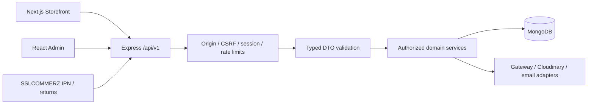
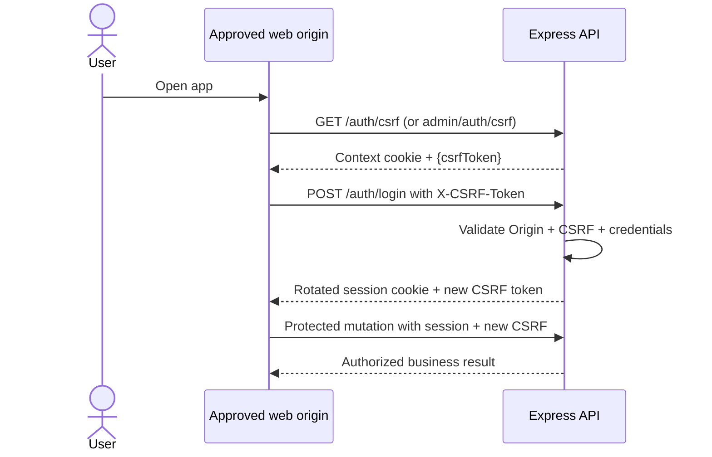
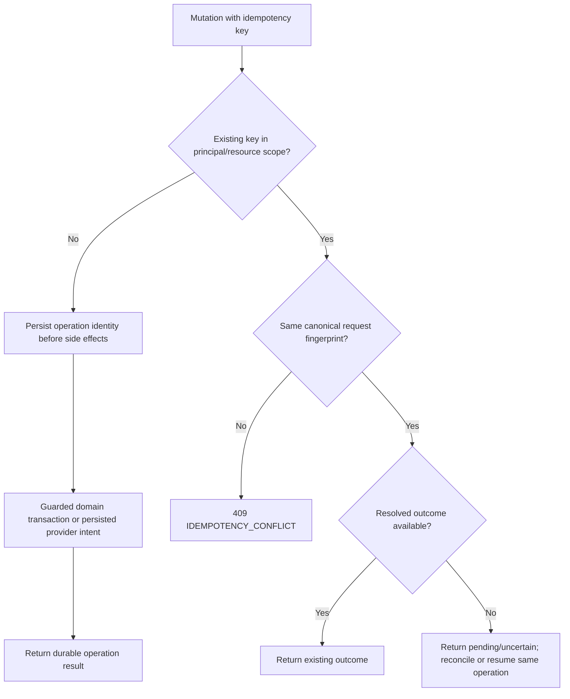

# SportZone — API design & specification

**Version:** 1.1  
**Source baseline:** PRD / Architecture / Design / Implementation Plan / Tasks v1.2; Database v1.2  
**Updated:** 16 October 2026  
**Documentation audit:** 16 October 2026 — corrections in this working revision do not grant specification, task or release approval.  
**Status:** Proposed implementation contract — approval, integration tests, and merchant verification pending  
**Product reference:** [PRD](./PRD.md)  
**Technical references:** [Architecture](./ARCHITECTURE.md) · [Database](./DATABASE.md)  
**Interface reference:** [Design](./DESIGN.md)  
**Execution references:** [Implementation Plan](./IMPLEMENTATION_PLAN.md) · [Tasks](./TASKS.md)  
**Scope:** Single-store sports e-commerce platform for Bangladesh  
**Stack:** Node.js, Express, TypeScript; MongoDB/Mongoose behind domain services  
**Consumers:** Next.js storefront, React/Vite administration portal, controlled SSLCOMMERZ callbacks  
**Audience:** Backend/frontend engineers, reviewers, and development agents

This document specifies the proposed HTTP contracts for SportZone's single authoritative Express API.
It defines routes, input/output DTOs, access controls, validation, errors, state-changing behavior, callbacks, and verification obligations.
**The PRD owns product rules; Architecture owns system boundaries; Database owns persistence and financial invariants.** Proposed route names, field limits, and response shapes require implementation approval; an unwritten provider capability or unverified legal policy is not a released feature.

---

## Contents

- [1. Purpose, scope & contract status](#1-purpose-scope--contract-status)
- [2. API architecture & ownership](#2-api-architecture--ownership)
- [3. HTTP conventions & versioning](#3-http-conventions--versioning)
- [4. Authentication, sessions & CSRF](#4-authentication-sessions--csrf)
- [5. Authorization & data exposure](#5-authorization--data-exposure)
- [6. Shared dtos & response contracts](#6-shared-dtos--response-contracts)
- [7. Validation & error catalog](#7-validation--error-catalog)
- [8. Pagination, search & caching](#8-pagination-search--caching)
- [9. Identity, customer & guest access apis](#9-identity-customer--guest-access-apis)
- [10. Catalog, cart, promotions & reviews apis](#10-catalog-cart-promotions--reviews-apis)
- [11. Checkout, orders & delivery apis](#11-checkout-orders--delivery-apis)
- [12. Payments, COD & gateway callbacks](#12-payments-cod--gateway-callbacks)
- [13. Returns, claims & refund apis](#13-returns-claims--refund-apis)
- [14. Administration, support & reporting apis](#14-administration-support--reporting-apis)
- [15. Idempotency, concurrency & recovery](#15-idempotency-concurrency--recovery)
- [16. External integrations & notifications](#16-external-integrations--notifications)
- [17. Security, performance & compatibility](#17-security-performance--compatibility)
- [18. Verification, traceability & change control](#18-verification-traceability--change-control)
- [Appendix A — Complete endpoint register](#appendix-a--complete-endpoint-register)
- [Appendix B — Decision & dependency register](#appendix-b--decision--dependency-register)
- [Appendix C — Endpoint definition checklist](#appendix-c--endpoint-definition-checklist)
- [Appendix D — Operation contract & DTO register](#appendix-d--operation-contract--dto-register)

---

## 1. Purpose, scope & contract status

### 1.1 Responsibility and precedence

| Source | Authoritative for | API obligation |
| --- | --- | --- |
| `PRD.md` | FR-01–FR-34, product/consumer rules and acceptance | Expose only approved capabilities; preserve payment/return policies |
| `ARCHITECTURE.md` | One Express business authority, auth boundaries, retry/state invariants | No business writes in Next.js or admin; verify server-side |
| `DATABASE.md` | Data models, enums, unique references, accounting and transaction guards | Map allowlisted DTOs to persistence; never return raw models |
| `DESIGN.md` | UI flows, loading/uncertain/error states, accessible feedback | Provide enough status and stable errors for each view |
| `IMPLEMENTATION_PLAN.md` / `TASKS.md` | Sequence, dependencies, verification evidence | Contract precedes each feature slice; not an implementation claim |
| **`API.md`** | HTTP methods/routes, DTOs, permissions, failures, retries, webhook responses | Respect each source within its subject authority; detailed proposed designs still require approval |

**Included:** guest/customer shopping, one admin role, Bangladesh delivery, BDT, COD and enabled SSLCOMMERZ hosted
bKash/Nagad/Rocket channels, after-sales, notifications, support, and essential operations. **Excluded:** multi-vendor,
courier API/tracking, international payments, loyalty, subscriptions, automatic exchanges, multi-level RBAC. Inactive
online channels remain hidden; **all three online channels and COD are mandatory launch acceptance** absent approved PRD
change (PRD §3.3).

### 1.2 Maturity rules

- **Required invariant:** an explicit PRD/Architecture requirement, not subject to route-level convenience. Database field, collection and index proposals remain subject to the design approval required by Database §1.2 and AGENTS §9.
- **Proposed HTTP contract:** an implementation-ready design target, pending owner approval and contract tests.
- **External/open:** merchant activation, provider-specific channel/refund capability, legal deadlines, policy content, approved retention and production configuration; never fabricate confirmation.
- `API.md` is a **design contract**, not proof that endpoints are running. Records marked `pending` / `uncertain` must not be presented as success.

## 2. API architecture & ownership

### 2.1 Runtime and request path



All DB access and financial decisions occur inside Express services; `storefront` and `admin` are presentations. Public
Next.js rendering may read public catalog DTOs. Callbacks are untrusted signals until independently validated with the
gateway. Scheduled jobs call shared services without bypassing invariants.

### 2.2 Module ownership

| Module | Primary route namespace(s) | Ownership |
| --- | --- | --- |
| `auth`, `customers`, `guest-access` | `/auth`, `/me`, `/guest-access`, `/admin/auth` | Identity, scoped access and sessions |
| `catalog`, `inventory` | `/products`, `/categories`, `/admin/products`, `/admin/inventory` | Visibility, SKUs, stock movement |
| `shopping`, `promotions`, `reviews` | `/cart`, `/wishlist`, `/coupons`, `/reviews`, `/admin/coupons` | Cart, quotas, verification, moderation |
| `checkout`, `orders`, `settings` | `/checkout`, `/orders`, `/delivery`, `/admin/orders`, `/admin/delivery` | Snapshots, submissions, fulfillment, charge rules |
| `payments`, `refunds`, `returns` | `/orders/{id}/payments`, `/payments`, `/claims`, `/refunds`, `/admin/...` | Verification, collections, claims, payouts |
| `notifications`, `support`, `admin-operations` | `/complaints`, `/admin/notifications`, `/admin/reports`, `/admin/settings` | Service correspondence, reporting, configuration |

Domain services coordinate cross-module mutations within MongoDB transactions. No external HTTP call occurs while a database transaction remains open.

## 3. HTTP conventions & versioning

### 3.1 Transport and representation

| Item | Contract |
| --- | --- |
| Root | `https://<configured-api-host>/api/v1` (deployment host configurable) |
| Format | UTF-8 JSON (`Content-Type: application/json`), except documented multipart uploads and gateway form POSTs |
| Resource names | Lowercase plural, hyphenated paths; JSON names `camelCase`; IDs serialized strings |
| Time | ISO 8601 UTC instants ending `Z`; Bangladesh display derived from `Asia/Dhaka` |
| Currency | Always `BDT`; **integer poisha** on every business API and internally; no floating-point money |
| Status values | Persisted `snake_case` enum values from Database v1.2; UI labels are presentation only |
| Creation | `201 Created` + `Location` where appropriate; replay may return `200 OK` with same logical result |
| Deletion | Use `204 No Content` only where deletion/deactivation is an approved operation; no body |
| Concurrency | `If-Match`/strong ETag for approved editable master records; backed by the `revision` CAS fields on category, product, variant, delivery-zone and charge-rule documents (Database v1.2); domain CAS for financial/stock operations |
| Request correlation | Server-issued `X-Request-Id` returned on every response; incoming value never trusted as evidence |
| API evolution | Additive compatible fields within `/api/v1`; incompatible changes require version review and consumer migration |

`GET` never mutates commerce state, and provider browser returns are not payment approvals. `POST` denotes
submissions/actions, `PATCH` limited updates, `PUT` idempotent item replacements where stated, `DELETE` removal of an
allowed customer-owned item—not financial evidence deletion. An endpoint not listed here is **not** automatically approved.

### 3.2 Headers

| Header | Direction | Rule |
| --- | --- | --- |
| `Cookie` | Browser → API | Host-only session/context cookie; use `credentials: 'include'` on browser fetch |
| `X-CSRF-Token` | Browser → API | Required for every browser mutation including guest/auth submissions; not for provider IPNs |
| `Idempotency-Key` | Client → API | Required where indicated for checkout, payment retry, payout actions and replay-sensitive operations |
| `If-Match` | Admin → API | Required for declared revision-based master-record updates; strong ETag form `"<revision>"` |
| `Cache-Control` | API → caller | `no-store` for identity, private, cart, order, payments, refunds and token/bootstrap responses |
| `Retry-After` | API → caller | Optional integer seconds on throttling/transient service unavailability |

Paths use `{id}` in examples, but Express implementations bind `:id`. Route prefixes carry no entitlement: authentication and ownership checks are enforced independently.

### 3.3 Success and error envelopes

```json
{
  "data": { "id": "resource-id", "status": "pending" },
  "meta": { "requestId": "server-generated-request-id" }
}
```

```json
{
  "error": {
    "code": "OUT_OF_STOCK",
    "message": "Selected quantity is unavailable.",
    "details": [{ "field": "items[0].quantity", "code": "UNAVAILABLE" }]
  },
  "meta": { "requestId": "server-generated-request-id" }
}
```

`meta` may be omitted from minimal successful responses only by explicit contract; errors always include a safe code/message and request ID. Never expose DB stack traces, password/token hashes, payment credentials, raw provider payloads or user existence clues.

## 4. Authentication, sessions & CSRF

### 4.1 Session and cookie contract

| Cookie (proposed host-only names) | Principal | Rules |
| --- | --- | --- |
| `sz_customer_sid` | Registered customer | Opaque, hashed at rest; `HttpOnly`, `Secure`, approved `SameSite`, path `/` |
| `sz_admin_sid` | Privately provisioned admin | Separate credential and revocation path; never accepted by customer routes as customer identity |
| `sz_guest_order_sid` | Verified single order | Contains no raw order/customer info; server binds exact `orderId` and expiry |
| `sz_browser_ctx` | Pre-auth browser context | Short-lived; **no account or order authorization**; bound to CSRF token |

Issue all cookies from the **API origin**, without a `Domain` attribute; environment-specific names/path prefixes may change only if security isolation is preserved.
Only `Secure` HTTPS production cookies; local testing may use a controlled development exception.
Expiry is checked server-side even before physical TTL cleanup.
Rotate after authentication or guest-proof exchange, revoke on logout and account suspension; invalidate sessions with `securityRevision`.
`GET /auth/csrf` supplies a token for the storefront/guest browser context or selected storefront session; `GET /admin/auth/csrf` separately scopes the admin origin/session.
If both storefront session kinds exist, the client chooses the applicable token by session kind and protected route.
No cache.

### 4.2 CSRF bootstrap, login and proof exchange



- Validate `Origin` against **exact** approved storefront/admin origins and verify the context/session-bound CSRF token for `POST`, `PUT`, `PATCH`, `DELETE`. Reject missing/mismatched Origins on browser mutations; do not permit wildcard credentialed CORS.
- `POST /auth/register`, `/auth/login`, recovery, guest checkout and guest-proof exchange require the same pre-auth protection. Password reset/recovery email flows always respond ambiguously about account existence.
- Refresh CSRF token after login, logout, privilege/security revision change or guest proof; client must not reuse stale tokens.
- The backend chooses the applicable cookie namespace from the **route and principal type**, not from a user-supplied role. Public registration always creates `customer`.
- IPN/provider returns are on explicitly segregated routes with no browser CSRF/Origin prerequisite; they **never** establish authenticated sessions or directly mark payments paid.

### 4.3 Authentication lifecycle expectations

| Scenario | Response / side effect |
| --- | --- |
| Authenticated `GET /auth/session` | Return `{account:Account}` from the current valid customer session (§9.1) |
| Unauthenticated session | `401 AUTH_REQUIRED`, no user details |
| Successful login | Rotate token; invalidate prior pre-auth context; issue session cookie plus new CSRF |
| Failed login or suspended identity | Same generic `401 INVALID_CREDENTIALS` response where enumeration would be possible |
| Logout | Idempotently revoke only the route's session type; clear cookie |
| Password reset/change | Single-use challenge consumption; advance security revision and invalidate affected sessions |
| Guest proof | Single-use challenge grants **one order** and explicitly expires; cannot be used as general customer identity |

## 5. Authorization & data exposure

| Principal | Allowed resources | Denied by default |
| --- | --- | --- |
| Anonymous | Public catalog/categories/reviews/policies, guest cart locally, checkout with approved CSRF context, request guest proof | Order details or financial records by number/email alone |
| Customer (`C`) | Own profile, addresses, server cart/wishlist, purchases, reviews, returns, refunds, support tickets | Other users' orders and admin-only actions |
| Verified guest (`G`) | **Only the verified order**: details, cancellation, claims and refunds/status allowed by the same eligibility rules | Account, wishlist, unrelated orders, other guest orders |
| Admin (`A`) | Admin operations and authorized financial decisions after all state checks | Arbitrary evidence alteration, unapproved payout, bypassing policy |
| Provider (`P`) | Only signed/independently verified workflow callback intake endpoints | Customer/admin session APIs |

**Ownership contract:** check resolved session identity against stored `userId` or exact guest-session `orderId` for
*every* nested resource including order item, cancellation, claim, payment and refund. Do not trust `userId`, arbitrary
`orderId`, email, or order number inside client request bodies as authorization. Admin audit entries include actor and
reason for sensitive changes. Return `404` (instead of identifying a foreign resource) for cross-user object lookup where
appropriate; a clearly authenticated but disallowed operation may use `403`.

**Privacy projection:** public product DTOs may expose approved SKU, pricing and derived stock availability but not
internal counters/history; customer DTOs expose only own PII and masked payment metadata; admin DTOs expose necessary
scoped operational fields; external provider evidence is redacted even to administrators.

## 6. Shared dtos & response contracts

### 6.1 Scalar types and standard objects

| Type | JSON contract | Notes |
| --- | --- | --- |
| `Id` | Nonempty string | Stringified server ObjectId; never proof of permission |
| `MoneyPoisha` | Nonnegative safe integer | Business amounts, allocations and refund capacities; never JSON decimal BDT |
| `SignedMoneyPoisha` | Signed safe integer | Derived net cash-flow reporting only; a period with more payouts than collections is negative |
| `Instant` | ISO UTC string, e.g. `2026-10-16T00:00:00Z` | Reject ambiguous timezone formats in writes |
| `Channel` | `cod` / `bkash` / `nagad` / `rocket` | Business choice; actual online provider display/availability subject to verified activation |
| `AddressInput` | `{recipient,phone,districtKey,areaKey,street,addressLine2?}` | Bangladesh-supported area keys, no arbitrary delivery-zone ID |
| `CartLineInput` | `{variantId,quantity}` | Bounded positive integer qty, unique variant |
| `PageMeta` | `{page,pageSize,totalItems,totalPages}` | Current snapshot estimate; deterministic sort on stable ID tie-break |
| `PolicyRef` | `{type,version,effectiveAt}` | Approved version used for terms/checkout snapshot |
| `Revision` | Nonnegative integer | Required to prevent overwriting concurrent administrative edits |

`?` in tables means optional and omitted, not an empty string or accidental `null`. Values of DB nullable fields (e.g. guest order `userId`) are never assumed present. The proposed default field/string/array bounds are in Database §2.2; they require API/UI alignment before acceptance.

### 6.2 DTO registry

| DTO | Public or private contract (allowlist) | Excluded by design |
| --- | --- | --- |
| `ProductCard` | `id,slug,name,thumbnail,regularPricePoisha,effectivePricePoisha,rating,availability` | Internal stock counters, media credentials |
| `ProductDetail` | Card + `description,categories,images,variants[{id,sku,attributes,regularPricePoisha,effectivePricePoisha,availableQty?}]` | Inventory movement and hidden draft data |
| `Account` | Canonical field allowlist in [Appendix D.2](#d2-typed-request-and-response-schema-registry) | `passwordHash`, challenge/session tokens, other accounts |
| `Cart` | `items[{variantId,quantity,product,estimatedUnitPoisha,availability}],estimatedSubtotalPoisha,revision` | Reservation claims; cart does **not** reserve stock |
| `CheckoutQuote` | Canonical field allowlist in [Appendix D.2](#d2-typed-request-and-response-schema-registry) | A guaranteed confirmation-relative absolute deadline before the confirmation event, payment guarantee, or reservation |
| `OrderSummary` | Canonical field allowlist in [Appendix D.2](#d2-typed-request-and-response-schema-registry) | Guest email/phone to unauthorized clients |
| `OrderDetail` | Canonical field allowlist in [Appendix D.2](#d2-typed-request-and-response-schema-registry) | Gateway raw payload, session secrets |
| `PaymentSummary` | Canonical field allowlist in [Appendix D.2](#d2-typed-request-and-response-schema-registry) | `fundingContext` is derived `normal` or `correction_only`; never interchangeable with the six payment statuses |
| `CollectionSummary` | `id,amountPoisha,collectedAt,sourceKind,merchandiseAllocatedPoisha,correctionAllocatedPoisha,unassignedAllocatedPoisha,merchandiseRefundHeldPoisha,merchandiseRefundCompletedPoisha,correctionRefundHeldPoisha,correctionRefundCompletedPoisha` | Full bank/card data and provider secrets |
| `Claim` | Canonical field allowlist in [Appendix D.2](#d2-typed-request-and-response-schema-registry) | Cross-user evidence; raw protected storage URL |
| `Refund` | Canonical field allowlist in [Appendix D.2](#d2-typed-request-and-response-schema-registry) | Transfer credentials / unmasked payout destination |
| `Complaint` | Canonical field allowlist in [Appendix D.2](#d2-typed-request-and-response-schema-registry) | Third-party contact details |
| `AdminAudit` | Canonical field allowlist in [Appendix D.2](#d2-typed-request-and-response-schema-registry) | Raw before/after sensitive PII or passwords |

**DTO naming:** `OrderDetail.items[]` retains historical line IDs; `PaymentSummary` displays correction/unassigned and
merchandise funding as **separate amounts**, not a single “paid” badge. `CollectionSummary` uses the exact monetary field
names from Database §8.6 for independently checkable allocations. Only the backend determines eligibility flags; frontend
cannot create state by setting them. `OrderSummary.finalTotalPoisha` is purchase-time immutable.

### 6.3 Representative server response

```json
{
  "data": {
    "id": "order-id",
    "orderNumber": "SZ-2026-EXAMPLE",
    "fulfillmentStatus": "pending",
    "paymentSummary": {
      "status": "pending",
      "fundingContext": "normal",
      "expectedPoisha": 125000,
      "verifiedCollectedPoisha": 40000,
      "merchandiseFundedPoisha": 40000,
      "correctionCollectedPoisha": 0,
      "unassignedCollectedPoisha": 0,
      "riskStatus": "clear",
      "merchandiseRefundHeldPoisha": 0,
      "merchandiseRefundCompletedPoisha": 0,
      "correctionRefundHeldPoisha": 0,
      "correctionRefundCompletedPoisha": 0
    }
  }
}
```

*Example identifiers and amounts are illustrative, not production data. No guest order may retrieve this payload without verified order-scoped authorization.*

## 7. Validation & error catalog

### 7.1 Shared validation rules

- Validate shape and allowlisted fields at the boundary; reject unknown protected fields, raw MongoDB operators and unbounded arrays/strings.
- Normalize emails, SKUs, slugs, coupon codes and supported area keys once. Never silently truncate customer/financial data.
- Validate valid Bangladesh phone formatting and email syntax server-side; sanitize rich product content and escape on rendering.
- Reject product/category/variant IDs that are missing, inactive, unauthorized or inconsistent; verify nested order-item IDs belong to the authoritative order.
- Monetary values offered by clients are **informational only**. Backend calculates price, coupon, delivery, collection and refundable balance in integer poisha; reject client attempts to write resulting totals.
- Use Database §2.2 proposed default bounds unless a domain rule is stricter; maintain the same limits in shared API validation. For provider fields obey the provider's documented limits.

### 7.2 Error code register

| HTTP | Stable code | When returned / recovery |
| --- | --- | --- |
| `400` | `INVALID_REQUEST` | Malformed JSON, invalid path/query/input shape |
| `400` | `VALIDATION_FAILED` | Safe field-level `details[]`; fix input |
| `400` | `UNSUPPORTED_DELIVERY_AREA` | Zone not served; choose available address |
| `401` | `AUTH_REQUIRED` | Missing/expired required session |
| `401` | `INVALID_CREDENTIALS` | Wrong credentials / enumeration-safe login failure |
| `401` | `GUEST_PROOF_REQUIRED` | No valid order-scoped proof session |
| `403` | `FORBIDDEN` | Role/ownership/state access denied |
| `403` | `CSRF_INVALID` | Missing/stale context/token or invalid Origin |
| `404` | `NOT_FOUND` | Hidden/inactive/out-of-scope resource or unknown route |
| `409` | `STATE_CONFLICT` | Invalid lifecycle transition or concurrent conflict |
| `409` | `IDEMPOTENCY_CONFLICT` | Same key, different canonical payload |
| `409` | `IDEMPOTENCY_KEY_RETIRED` | Key too old for replay, retained tombstone prevents new order |
| `409` | `REVISION_CONFLICT` | Client/admin update based on stale revision |
| `409` | `OUT_OF_STOCK` | Cannot obtain requested available stock |
| `409` | `COUPON_UNAVAILABLE` | Invalid eligibility, expired or exhausted capacity; safe reason if appropriate |
| `409` | `REFUND_BALANCE_EXCEEDED` | Source or order/class/unit refund cap reached |
| `409` | `PAYMENT_UNCERTAIN` | Prior attempt not safely resolved; reconcile before new charge |
| `409` | `FULFILLMENT_ON_HOLD` | Paid/collected, but risk or allocation/policy review blocks action |
| `412` | `PRECONDITION_FAILED` | Required `If-Match` mismatch; refresh edit |
| `428` | `PRECONDITION_REQUIRED` | Missing mandatory revision precondition; refetch record |
| `422` | `BUSINESS_RULE_VIOLATION` | Domain eligibility fails, with safe `details` |
| `422` | `PAYMENT_AMOUNT_UNSUPPORTED` | Attempt amount below/above verified provider/merchant range; choose COD or resolve balance without charging |
| `429` | `RATE_LIMITED` | Enforce per-route abuse limits; optional `Retry-After` |
| `502` | `PROVIDER_ERROR` | Verified upstream hard failure; **no inferred financial outcome** |
| `503` | `SERVICE_UNAVAILABLE` | DB/provider dependency unavailable; client may query operation status |
| `500` | `INTERNAL_ERROR` | Redacted unexpected fault with request ID |

Validation errors distinguish *bad input* from *current state*: an eligible but exhausted coupon is `409`, not “invalid
JSON”. On external timeout, do not report definitive `failed`; return pending/uncertain status when a durable operation
exists, or a safe transient error with correlation ID. Unknown user/email/guest-order lookup must not leak existence. A
successful refund request is **not** confirmed payout.

## 8. Pagination, search & caching

| Concern | Proposed rule |
| --- | --- |
| Pagination | `page` starts at `1`; `pageSize` defaults `20`, maximum `100`; no unbounded lists |
| Sorting | Explicit endpoint allowlist, e.g. `newest`, `price_asc`, `price_desc`; stable ID tie-break |
| Public search | `q` trimmed and length-bounded; only active products/categories eligible for public discovery |
| Catalog filtering | `category`, `minPricePoisha`, `maxPricePoisha`, `inStock`, with server type and range checks |
| Admin filtering | Allowlisted status/date/customer references; no arbitrary client query operators |
| Result | `{data:[...],meta:{page,pageSize,totalItems,totalPages,requestId}}` |
| Public cache | Optional controlled ETag/revalidation; stale display is possible; checkout requotes live stock/prices |
| Private cache | `Cache-Control: no-store`; prevent CDN/SSR shared caching for auth, account, cart, orders and money |

For large audit/financial histories, use an opaque cursor with stable ordering **if approved by query profiling**; do not
invent offset pagination where it risks missing/duplicating mutations. Query and index selection must agree with Database
§11. Reject invalid sort keys, inverted price ranges, unknown filters and attempts to request oversized pages.

## 9. Identity, customer & guest access apis

### 9.1 Authentication and account endpoint contracts

**All browser mutations** require approved Origin, `X-CSRF-Token` and cookie context/session. Notation: `Public+CSRF` means unauthenticated request with valid browser context; `C` customer-only, `A` admin-only.

| Method | Path (`/api/v1` prefix omitted) | Access | Request → response | Primary FR |
| --- | --- | --- | --- | --- |
| `GET` | `/auth/csrf` | Public | `— → {csrfToken,expiresAt}` + context/session cookie | 01, 21 |
| `POST` | `/auth/register` | Public+CSRF | `RegisterInput → {account,verificationRequired}` | 01 |
| `POST` | `/auth/login` | Public+CSRF | `Credentials → {account,csrfToken}` + rotated customer cookie | 01 |
| `GET` | `/auth/session` | C | `— → {account}` | 01 |
| `POST` | `/auth/logout` | Public+CSRF | `— → {revoked:true,csrfToken}` + cleared cookie | 01 |
| `POST` | `/auth/email-verifications` | Public+CSRF | `{email} → {accepted:true}` (ambiguous) | 01 |
| `POST` | `/auth/email-verifications/confirm` | Public+CSRF | `{token} → {verified:true}` | 01 |
| `POST` | `/auth/password-resets` | Public+CSRF | `{email} → {accepted:true}` (ambiguous) | 01 |
| `POST` | `/auth/password-resets/confirm` | Public+CSRF | `{token,newPassword} → {reset:true}` | 01 |
| `GET` | `/me` | C | `— → Account` | 02 |
| `PATCH` | `/me` | C | `{name?,phone?} → Account` | 02 |
| `POST` | `/me/email-changes` | C | `{newEmail} → {verificationSent:true}` | 02 |
| `POST` | `/me/email-changes/confirm` | C + proof | `{token} → Account` | 02 |
| `POST` | `/me/password-change` | C | `{currentPassword,newPassword} → {changed:true,csrfToken}` | 02 |
| `GET` | `/me/addresses` | C | `— → Address[]` | 02 |
| `POST` | `/me/addresses` | C | `AddressInput → Address` | 02 |
| `PATCH` | `/me/addresses/{addressId}` | C | `AddressPatch → Address` | 02 |
| `DELETE` | `/me/addresses/{addressId}` | C | `— → 204` | 02 |
| `POST` | `/me/addresses/{addressId}/default` | C | `— → Address` | 02 |
| `POST` | `/me/deletion-requests` | C | `{reason?} → {requestId,status}` | PRD §12.8 |
| `GET` | `/admin/auth/csrf` | Public | `— → {csrfToken,expiresAt}` scoped to admin context | 21 |
| `POST` | `/admin/auth/login` | Public+CSRF | `Credentials → {account,csrfToken}` + distinct admin cookie | 21 |
| `GET` | `/admin/auth/session` | A | `— → {account}` | 21 |
| `POST` | `/admin/auth/logout` | Public+CSRF (admin context) | `— → {revoked:true,csrfToken}` | 21 |
| `POST` | `/admin/auth/password-resets` | Public+CSRF (admin context) | `{email} → {accepted:true}` (ambiguous) | 21 |
| `POST` | `/admin/auth/password-resets/confirm` | Public+CSRF (admin context) | `{token,newPassword} → {reset:true}` | 21 |

**Identity input registry**

| DTO | Fields / important constraints |
| --- | --- |
| `RegisterInput` | `name,email,password`; public role omitted and forced `customer`; enforce approved password policy |
| `Credentials` | `email,password`; client may **not** supply role or cookie scope |
| `AddressPatch` | Optional editable `recipient,phone,districtKey,areaKey,street,addressLine2,isDefault` only; explicit fields, no arbitrary object merge |
| `Account` | Database §5.1 allowlist: `id,name,email,phone?,emailVerified,addresses,status`; no hashes/security revision details |
| `DeletionRequest` | Verified customer identity and approved retention/review process; **not** immediate hard deletion of financial records |

**Repeat logout:** logout is `Public+CSRF` within the correct host/context scope, even when its former session has already
expired or been revoked. A valid CSRF bootstrap/Origin is still required; revoke an active session if present, clear the
relevant cookie, and return the same `{revoked:true,csrfToken}` safe response on repeats (no account-existence disclosure).
An invalid/missing CSRF context is still `403 CSRF_INVALID`. No anonymous request may revoke any **other** session.

Email change confirms a unique normalized email through `authChallenges` and updates security/session revisions atomically; it cannot alter historic order snapshots.
Register, recovery and verification are rate-limited, short-lived, and single-use; do not promise email delivery by returning `201`.
Password reset consumes the challenge once and revokes affected sessions.
Administrator accounts are privately provisioned, never registered or privilege-upgraded through these routes.
Admin recovery uses the existing `password_reset` challenge purpose **bound to the admin `userId` and role checked on confirmation**; no challenge issued for a customer can reset an admin account.
No new unapproved `authChallenges.purpose` enum is implied.
Public responses stay enumeration-safe; account reactivation/recovery requires the approved operational security policy.

### 9.2 Verified guest access

| Method | Path | Access | Request → response |
| --- | --- | --- | --- |
| `POST` | `/guest-access/challenges` | Public+CSRF | `{orderNumber,email} → {accepted:true}` with indistinguishable valid/invalid responses |
| `POST` | `/guest-access/sessions` | Public+CSRF | `{challengeToken} → {orderId,expiresAt,csrfToken}` + rotated guest cookie |
| `GET` | `/guest-access/session` | G | `— → {orderId,expiresAt}` |
| `POST` | `/guest-access/logout` | Public+CSRF (guest context) | `— → {revoked:true,csrfToken}` |

Guest proof is email-delivered as one-time code or secure link, issued against **both** order number and checkout email, rate-limited and never exposed in an API response or logs.
Proof exchange atomically consumes `authChallenges` and grants only the verified `orders._id` through a `guest_order` session (Database §§5.2–5.3).
An attacker cannot enumerate orders by timing, HTTP status or message differences.
Subsequent guest order actions use the same `/orders/{orderId}` routes as a customer, but with *exact* bound order ID checks.
Do not include a public `GET /orders?email=...` endpoint.

## 10. Catalog, cart, promotions & reviews apis

### 10.1 Public catalog and discovery

| Method | Path | Access | Query / request → response | FR |
| --- | --- | --- | --- | --- |
| `GET` | `/storefront/home` | Public | `— → {featured[],newArrivals[],discounted[],categories[],banner?}` | 03 |
| `GET` | `/categories` | Public | `parent?,page?,pageSize? → Category[]` | 04 |
| `GET` | `/categories/{slug}` | Public | `— → CategoryDetail` | 04 |
| `GET` | `/products` | Public | `q?,category?,minPricePoisha?,maxPricePoisha?,inStock?,sort?,page?,pageSize? → ProductCard[]` | 04 |
| `GET` | `/products/{slug}` | Public | `— → ProductDetail` | 05, 06 |
| `GET` | `/products/{productId}/reviews` | Public | `page?,pageSize?,sort? → approved Review[] + rating summary` | 10 |
| `GET` | `/storefront/policies/{type}` | Public | Approved published policy `type → {version,content,effectiveAt}` | 20, 34 |
| `GET` | `/storefront/contact` | Public | `— → {contact,complaintContact}` (approved only) | 03, 20 |

Inactive products/categories (including inactive ancestors) are excluded; out-of-stock products may remain visible but cannot be purchased.
`variants` include one default SKU when a product has no selectable options.
Search/index details in Database §11; do not assume an external search service.
Product listings and homepage merchandising only include operator-approved media/content; no fabricated promotional claims.
The optional homepage `banner` requires an approved content source and its mapping to `storeSettings.branding` or a separately approved persistence change; do not assume a banner collection already exists (API-D17).

### 10.2 Cart and wishlist

| Method | Path | Access | Request → response | FR |
| --- | --- | --- | --- | --- |
| `GET` | `/cart` | C | `— → Cart` | 07 |
| `PUT` | `/cart/items/{variantId}` | C | `{quantity} → Cart` | 07 |
| `DELETE` | `/cart/items/{variantId}` | C | `— → Cart` | 07 |
| `POST` | `/cart/merge` | C | `{items:CartLineInput[]} → Cart` | 07 |
| `GET` | `/wishlist` | C | `— → {products:ProductCard[]}` | 08 |
| `PUT` | `/wishlist/products/{productId}` | C | `— → {saved:true}` | 08 |
| `DELETE` | `/wishlist/products/{productId}` | C | `— → {saved:false}` | 08 |

Guest cart is **browser-local** and is not created server-side by an anonymous `/cart` route. A merge deduplicates on
`variantId`, applies an approved bounded quantity rule (do not double-count on replay), and excludes invalid/inactive
variants with per-item error details. No cart/wishlist endpoint creates reservations or changes stock. Cart price and
availability remain estimates until `POST /checkout/quotes`.

### 10.3 Coupon and review contracts

| Method | Path | Access | Request → response | FR |
| --- | --- | --- | --- | --- |
| `POST` | `/coupons/preview` | C or Public+CSRF | `{code,items:CartLineInput[],deliveryArea?} → {eligible,discountPoisha,reasonCode?}` | 09 |
| `POST` | `/products/{productId}/reviews` | C | `{rating,comment,qualifyingOrderItemId} → Review` (`pending`) | 10 |
| `PATCH` | `/reviews/{reviewId}` | C owner | `{rating?,comment?} → Review` (moderation reset when needed) | 10 |
| `GET` | `/me/reviews` | C | `page?,pageSize? → Review[]` | 02, 10 |

Coupon preview **does not consume quota** or lock price/stock; final checkout evaluates current terms, overall and per-customer capacity, and one coupon per order.
`code` is normalized case-insensitively, percentage uses integer basis points and line allocation from Database §§2.3, 8.1–8.3.
A per-customer-limited coupon cannot be used by a guest even if a checkout email matches an account.
Reviews require a delivered qualifying purchase, exactly one active customer/product review, proper ownership and moderation; approved reviews alone affect public ratings.
Do not accept a client-controlled `isVerifiedPurchase`, `status`, or `reviewedBy` field.

### 10.4 Shopping DTO examples

```json
{
  "data": {
    "items": [
      {
        "variantId": "variant-id",
        "quantity": 2,
        "product": { "id": "product-id", "name": "Cricket Bat", "slug": "cricket-bat" },
        "estimatedUnitPoisha": 120000,
        "availability": "available"
      }
    ],
    "estimatedSubtotalPoisha": 240000,
    "revision": 3
  }
}
```

The cart example is not a final payable quote. Catalog and public reviews use `200` reads; new reviews return `201` with `pending`. A rejected eligibility check is `422 BUSINESS_RULE_VIOLATION`, stale inventory at checkout is `409 OUT_OF_STOCK`.

## 11. Checkout, orders & delivery apis

### 11.1 Checkout request/quote/submission

| Method | Path | Access | Request → response | FR |
| --- | --- | --- | --- | --- |
| `GET` | `/delivery/areas` | Public | `district? → {supportedAreas[],zoneKeys[]}` | 16 |
| `POST` | `/checkout/quotes` | C or Public+CSRF | `CheckoutQuoteInput → CheckoutQuote` (no reservation) | 11 |
| `POST` | `/checkout/orders` | C or Public+CSRF | `CheckoutSubmitInput + Idempotency-Key → {order,onlinePayment?}` | 11, 12, 13 |
| `GET` | `/orders` | C | `page?,pageSize?,status? → OrderSummary[]` for own user only | 14 |
| `GET` | `/orders/{orderId}` | C owner or G-scoped | `— → OrderDetail` | 14, 19 |
| `GET` | `/orders/{orderId}/status` | C owner or G-scoped | `— → {fulfillmentStatus,fulfillmentHold?,paymentSummary,deliveryEstimate?,deliveryDeadline}` | 14, 19 |
| `POST` | `/orders/{orderId}/cancellation-requests` | C owner or G-scoped | `{reason} → CancellationRequest` | 15, 19 |
| `GET` | `/orders/{orderId}/cancellation-requests` | C owner or G-scoped | `— → CancellationRequest[]` | 15, 19 |
| `GET` | `/orders/{orderId}/delivery-events` | C owner or G-scoped | `— → {status,estimate,deadline,exceptionSummary?,events[]}` | 16, 19 |

**`CheckoutQuoteInput`** is a full, typed draft transaction request: `items:CartLineInput[]`, `recipient:AddressInput` (or
`savedAddressId` for C only), `couponCode?`, `method:Channel`; `email` and `recipient.phone` are required for G checkout;
`contactPhone?` may override the buyer contact number, otherwise the server copies `recipient.phone` into the immutable
`customerSnapshot.phone`. Recipient/delivery phone remains separately snapshotted. Customer details may be explicitly
supplied/reconfirmed for C. `CheckoutSubmitInput` includes the same normalized fields **plus** `notes?`,
`acceptedTermsVersion`, `acceptedPolicyVersionIds[]`. Reject direct `unitPrice`, `discount`, `deliveryCharge`, `total`,
role, `userId` or target order ID fields.

**Checkout confirmation decision — API-D20:** PRD FR-11 requires final-amount confirmation, and Testing `CHK-03` requires a changed quote to be rejected or reconfirmed. The current request has no server-verifiable reference to the amount/terms the buyer confirmed: it rejects client totals and defines no quote identity. Recomputing at submission alone cannot demonstrate renewed consent to a changed total. **Do not implement automatic charging from this incomplete contract.** Product and API owners must approve a server-verifiable confirmation/precondition mechanism, its expiry and conflict/reconfirmation behavior before `P06-004`, `P06-018` and `P07-004` can be accepted. No new field or endpoint is approved by this note.

**Quote:** Recompute active SKU prices, stock visibility, product-discount-before-coupon, eligible coupon allocations,
delivery-zone rule and eligible payment methods at request time. Return a **deadline rule/status**, not a made-up date
anchored to a future confirmation. An approved placement-started legal cap may be absolute; a 14-day-from-confirmation
target remains provisional until `confirmedAt`. Return `quoteExpiresAt?` for **display freshness only**; quote is not a
stock/coupon reservation or promise of capacity. There is no client-trusted `quoteId` authority. The accepted terms must
match currently applicable operator-approved versions; if changed, return `409 STATE_CONFLICT` and current policy
references for renewed consent.

**Submit:** `Idempotency-Key` mandatory; canonical payload fingerprint fixed for the identity scope (customer or opaque
guest browser context). In one transaction create `checkoutIntents`, immutable order snapshot and `orderItemBalances`, then
either COD **committed** inventory/coupon or online **15-minute held** stock/coupon. Save one order per key before
returning. A same-key replay returns the same operation resource/result; different payload is `409 IDEMPOTENCY_CONFLICT`.
Timeout or disconnect must not create another order on retry. Do not hold a MongoDB transaction open while requesting
hosted payment session.

```json
{
  "items": [{ "variantId": "variant-id", "quantity": 1 }],
  "recipient": {
    "recipient": "Example Buyer",
    "phone": "+8801700000000",
    "districtKey": "approved-district",
    "areaKey": "approved-area",
    "street": "Example street"
  },
  "email": "buyer@example.com",
  "method": "bkash",
  "couponCode": "EXAMPLE10",
  "acceptedTermsVersion": "approved-terms-v1",
  "acceptedPolicyVersionIds": ["approved-shipping-v1"]
}
```

The example is a proposed `CheckoutSubmitInput` **body**; send a separate `Idempotency-Key` header. Admin-configured live payment activation and policy/zone data are prerequisites; the illustrated channel, area, coupon and version are **not claims of real configuration**.

### 11.2 Price, hold and order response rules

| Step | Backend effect | HTTP/API effect |
| --- | --- | --- |
| Validation fails | No order, no stock/coupon mutation | `400`, `409` or `422` as applicable |
| COD accepted | Commit inventory and coupon immediately; order fulfillment **`pending`** | `201` order, payment `pending`; admin confirmation later |
| Online accepted | New order pending + 15-minute reservation and coupon hold | `201` order; payment initialization may follow and be uncertain |
| Gateway session ready | Payment attempt persisted; hosted URL obtained | `201/200` `onlinePayment:{attemptId,redirectUrl,expiresAt?}` |
| Gateway session not obtained | **Order remains durable** with recoverable payment state | `202` `operationStatus:'payment_initialization_pending'`, poll/retry existing order |
| Replay identical request | No new order, coupon or stock effect | `200` same order ID + current safe operation status |
| Replay altered body | No new order | `409 IDEMPOTENCY_CONFLICT` |
| Retired key | No new order | `409 IDEMPOTENCY_KEY_RETIRED` or safe linked status |

**Response requirement:** for guest checkout, the immediate `201/202` response may return a minimal order
reference/next-step status **only to the originating verified browser context**; it must not grant durable cross-browser
access. Protected order details/actions require email challenge + `guest_order` session. A lost checkout response is
recovered through same-key context replay or verified guest proof, not order-number guessing.

### 11.3 Cancellation, fulfillment and shipment

Customer cancellations are **requests**, not direct order-state updates.
The admin accepts/rejects after checking `pending/confirmed`, or `processing` with explicit not-dispatched verification; stock and coupons release exactly once in transaction.
`shipped → cancelled` exists only for the **separate final non-delivery** exception after custody/disposition of all shipped quantities, never via ordinary customer cancellation.
`delivered` and `cancelled` remain terminal fulfillment states; paid cancellation creates refund eligibility, unpaid COD cancellation does not.

**Fulfillment status enum:** `pending`, `confirmed`, `processing`, `shipped`, `delivered`, `cancelled`. **Payment status enum:** `pending`, `paid`, `failed`, `cancelled`, `partially_refunded`, `refunded`. These dimensions cannot be collapsed into a single status; customer queries include both.

**Delivery rule and commitment (FR-16):**

- **Checkout:** persist immutable `deliverySnapshot` charge, rule version, start-event type and legal rule reference; quote `status:'awaiting_start'` for an unconfirmed confirmation-based target. Never persist an assumed `confirmedAt`.
- **Confirmation:** record actual `confirmedAt`; derive the target as **14 calendar days after confirmation** under the approved baseline. Evaluate any independently approved shorter legal deadline using its actual applicable start event (which may differ). Persist the earlier applicable `deliveryCommitment.effectiveDeadlineAt` and exact basis under order CAS.
- **Read/late updates:** return `{status,startEventAt?,targetDeadlineAt?,legalCapAt?,effectiveAt?}` and a distinct changeable `deliveryEstimate`. When no authorized event/rule exists, omit unavailable date fields and return `awaiting_start` or `under_review`, never a fictional firm date. Notify of changed estimates; log deadline-affecting policy corrections without overwriting snapshots.
- **Boundary:** changing future charges or policies does not alter an accepted order's charge/rule snapshot. Fulfillment updates are manual (no courier/GPS integration). Legal applicability/start events must be approved before launch (API-D07).

## 12. Payments, COD & gateway callbacks

### 12.1 Payment surfaces and statuses

| Method | Path | Access | Request → response | FR |
| --- | --- | --- | --- | --- |
| `GET` | `/checkout/payment-methods` | Public | `amountPoisha?,orderId? (owned if supplied) → {methods:[{channel,active,eligible,reasonCode?,minPoisha?,maxPoisha?}]}` | 12 |
| `GET` | `/orders/{orderId}/payments` | C owner or G-scoped | `— → {payment:PaymentSummary,attempts:PaymentAttemptPublic[]}` | 12, 19 |
| `POST` | `/orders/{orderId}/payment-attempts` | C owner or G-scoped | `{requestedChannel} + Idempotency-Key → {attemptId,expectedAmountPoisha,state,redirectUrl?,expiresAt?}` | 12 |
| `GET` | `/orders/{orderId}/payment-attempts/{attemptId}` | C owner or G-scoped | `— → {id,state,riskStatus?,lastCheckedAt?}` | 12 |
| `POST` | `/webhooks/sslcommerz/ipn` | P-untrusted intake | Provider form fields → HTTP acknowledgment; **never** client payment DTO | 12 |
| `GET` | `/payment-returns/sslcommerz/{result}` | Provider/browser untrusted | Redirect to safe storefront result page; no payment mutation | 12 |
| `POST` | `/payment-returns/sslcommerz/{result}` | Provider/browser untrusted | Accept configured provider form redirect and redirect safely; no payment mutation | 12 |
| `GET` | `/admin/payments` | A | Filters → PaymentSummary[] / reconciliation view | 29 |
| `GET` | `/admin/payments/{paymentId}` | A | `— → scoped attempts, linked collections, corrections, risk and audit` | 29 |
| `POST` | `/admin/payments/{paymentId}/reconcile` | A | `{reason} + Idempotency-Key → {state,verifiedAt?}` | 29 |
| `POST` | `/admin/payments/{paymentId}/risk-decisions` | A | `{decision:enum(approve,reject),reason} + Idempotency-Key → {riskStatus,fulfillmentHold}` | 29 |
| `POST` | `/admin/payments/{paymentId}/cod-collections` | A | `{amountPoisha,collectionReference,evidenceRef,reason} + Idempotency-Key → CollectionSummary` | 29 |
| `GET` | `/admin/provider-receipts` | A | `matchingStatus?,page? → redacted verified receipt intake[]` | 29 |
| `POST` | `/admin/provider-receipts/{intakeId}/link` | A | `{orderId,attemptId?,reason,matchingEvidenceRef} + Idempotency-Key → {linkedCollectionId,matchingStatus}` | 29 |
| `POST` | `/admin/payment-collections/{collectionId}/allocate` | A | `{merchandisePoisha,correctionPoisha,unassignedPoisha,reason,matchingEvidenceRef} + If-Match + Idempotency-Key → CollectionSummary` | 29 |

The public payment-method response reflects **verified merchant enablement** and, when a trustworthy quote/order amount is
available, amount eligibility. Client-supplied `amountPoisha` is advisory only: always recalculate on quote and attempt
initiation. Inactive channels are omitted, while active-but-amount-ineligible channels may be returned with
`eligible:false` and a safe reason. This response does not itself authorize a payment.

The merchant activation rule reflects **verified enablement**, not merely a boolean set by a local UI. bKash, Nagad and Rocket are each required for launch; other gateway channels are not newly approved product methods.
A caller may suggest a channel; the server validates live merchant permissions and controls the SSLCOMMERZ hosted flow.
`PaymentAttemptPublic` contains no provider validation secrets or card/bank data.
`GET /orders/{id}/payments` does not expose **unmatched** provider intake as belonging to that customer.

### 12.2 Hosted initiation, retries and uncertain state

1. Verify ownership, approved channel, lifecycle and all unresolved attempts. Derive `remainingMerchandiseFundingPoisha =
max(0, originalFinalTotalPoisha - currentVerifiedMerchandiseAllocatedPoisha)` from locked authoritative projections, not a
browser total. No new attempt is permitted for a fully funded order or when a prior attempt is uncertain. A new attempt for
a partially funded order targets this **remaining balance**, not the original total.
2. If any previous attempt is pending or uncertain, **reconcile it first**; an HTTP timeout cannot authorize a second charge. Use distinct merchant-generated `tran_id` (provider length limits) only for a genuinely new attempt.
3. Before initiating, validate the exact **attempt amount** against merchant-approved constraints.
   SSLCOMMERZ v4 publicly documents **BDT 10.00–500,000.00** (integer **1,000–50,000,000 poisha**) per initiation; these values are published-reference defaults, **not** proof of the merchant's own accepted limits.
   The effective range is the verified merchant/environment intersection.
   At quote, return channel `eligible:false,reasonCode:'PAYMENT_AMOUNT_UNSUPPORTED'` if known to be ineligible; at initiation return `422 PAYMENT_AMOUNT_UNSUPPORTED` without creating a provider charge.
   Do not silently split a large order or lower a small remainder to the minimum.
4. Persist new `paymentAttempts.expectedAmountPoisha` (the immutable attempt request), `initiatedOutstandingPoisha`, unique
`tranId` and idempotency record before the provider session call. The response provides an approved **absolute HTTPS**
hosted redirect URL only after provider session acceptance; never accept a client-provided redirect target.
5. If holds expired, atomically reacquire **both** inventory and applicable coupon capacity under current eligibility
before further payment initiation. Never silently prolong an expired reservation. If not available, return a durable
allocation shortfall state; do not create a new attempt that assumes fulfillment.
6. On provider call timeout, persist `uncertain`; let the read endpoint show current state and let reconciliation query provider. Do not reuse an old attempt's `tran_id` as a new financial attempt.
7. Collection funds might be partial, duplicate, excess or late. One order can have multiple independently verified receipts; do not assume one successful receipt per attempt without sandbox proof (Database §8.5–8.7).

**Payment initiation response (illustrative):**

```json
{
  "data": {
    "orderId": "order-id",
    "attemptId": "attempt-id",
    "state": "initiated",
    "redirectUrl": "https://sandbox.sslcommerz.com/example-hosted-session",
    "expiresAt": "2026-10-16T01:00:00Z"
  }
}
```

This is a **shape example**, not a working provider URL or promise of a particular expiry. The gateway adapter must honor the configured provider's own session response and documented amount boundaries; never silently alter the payable amount.

### 12.3 IPN, browser returns and independent verification

```mermaid
sequenceDiagram
    actor Buyer
    participant API as Express API
    participant GW as SSLCOMMERZ
    participant DB as MongoDB
    API->>DB: Persist payment attempt and intent
    API->>GW: Initiate hosted checkout outside transaction
    GW-->>Buyer: Hosted payment
    GW->>API: POST IPN (repeat/out of order possible)
    API->>GW: Validate transaction/status independently
    GW-->>API: Merchant, currency, amount, references, risk
    alt Verified and uniquely identified
        API->>DB: Deduplicate providerReceiptIntake / link collection
        API->>DB: Reclassify funds; commit eligibility once
    else Unknown ownership or identity
        API->>DB: Quarantine verified receipt for reconciliation
    else Not validated or provider unavailable
        API->>DB: Preserve uncertainty for retry/reconciliation
    end
    Buyer->>API: Read scoped order/payment status
    API-->>Buyer: Authoritative projection, no redirect-based success
```

**Provider acceptance contract:** Treat IPN as `application/x-www-form-urlencoded` (and only formats verified in merchant
sandbox), with strict body size and field allowlists. Validate via provider Transaction Validation / Order Status APIs:
merchant account, unique collection identity, expected `tran_id`/order mapping, `BDT`, exact conversion of **verified
provider amount into integer poisha**, verified status and risk flags. Compare the amount against the separately persisted
immutable attempt expectation; mismatches follow quarantine and reconciliation below. Raw IPN is not proof of funds. Store
sanitized fingerprints/references and stable deduplication keys; do not store full card or provider credentials. A provider
notification is **not** a paid-only message. Acknowledge according to the durable-result matrix below; do not force
nonpayment into receipt allocation. On transient validation or database failure return retryable `5xx` rather than falsely
acknowledging payment processing; reconcile known attempts periodically even if IPN delivery never succeeds. **Never**
repeat financial effects. A provider callback may legitimately be delivered more than once.

**IPN acknowledgment and replay matrix (proposed adapter contract):**

| Validated outcome | Durable action | Response / safe retry |
| --- | --- | --- |
| Verified paid receipt, known mapping | Unique provider intake, linked collection/allocation or audited quarantine | `200` only after commit; duplicate is `200` with no new effect |
| Verified paid but unmatched or amount discrepancy | Persist immutable receipt in `providerReceiptIntake` as unmatched/quarantined | `200` after durable quarantine; never mark order Paid by guess |
| Independently verified terminal nonpayment (`FAILED`, `CANCELLED`, `EXPIRED`, or confirmed equivalent) | Persist attempt state; **no** payment collection; never overwrite a later paid proof | `200` after commit; repeat `200` without side effects |
| Authenticated/form-valid notification but provider outcome still pending | Persist attempt as pending/uncertain plus durable reconciliation job | `200` only when reliable poll/reconciliation can recover; otherwise `503` |
| Malformed, oversized, unknown merchant / invalid reference | Reject, rate limit and record redacted security fingerprint | `400` / `403`; do not allocate funds |
| Validation service unavailable, database commit failed | Preserve retryability; avoid acknowledging unpersisted business effects | `503` / `500`; scheduled polling supplements provider retry |

Sandbox verification must confirm exact provider statuses, transport, retry behavior and acceptable acknowledgment body (API-D05); this table does not assert a provider delivery SLA.

**Amount-mismatch protocol:** persist the immutable `expectedAmountPoisha` on attempt and separately
`verifiedReceiptAmountPoisha` from trusted validation. Exact match is the default auto-allocation gate. A verified
smaller/larger amount is real evidence but **quarantined**, not dropped or treated as an exact paid attempt;
`amountDisposition` records the anomaly. Only supervised, sandbox-supported reconciliation may allocate an actually settled
partial amount and subsequently compute a safe new remaining-balance attempt. Excess goes to correction/unassigned and
never auto-funds merchandise twice.

**Browser returns:** map only approved `{result}` values (`success`, `fail`, `cancel`) and redirect using fixed configured
storefront URLs after stripping untrusted provider parameters; browser success is *display-only*. The actual provider
return HTTP method must be configured/tested with SSLCOMMERZ before deployment. The result screen polls `GET
/orders/{id}/payments` **with customer or verified guest proof**; it displays Pending when validation has not established
the outcome.

**Verified receipt intake:** independently verified merchant funds that cannot be mapped safely to an order remain
`providerReceiptIntake.matchingStatus=unmatched/quarantined`, not false customer `paymentCollections`. A supervised link
requires independent supporting evidence and creates a linked source receipt **once**; contradictory amounts/references go
to incident handling. Linked receipts have three separate allocations: merchandise (including original delivery),
correction and unassigned; money and refund counters remain within Database §8.7 equations.

### 12.4 Financial projection and correction contract

| Situation | API projection / permitted action |
| --- | --- |
| First partial collection | `payment.status='pending'`, `verifiedCollectedPoisha > 0`, merchandise funded below original total; no automatic fulfillment |
| Fully funded, all stock/coupon/risk conditions pass | `payment.status='paid'`; one guarded stock/coupon commitment, order confirmation remains separate authorized transition |
| Distinct excess/duplicate collection | `correctionCollectedPoisha > 0`; same order/fulfillment, correction refund eligibility; no duplicate dispatch |
| Cancelled order with only linked correction money | Financial projection can remain `paid` with `fundingContext:'correction_only'` derived when correction allocations exist without active merchandise funding; **never** reopen fulfilment (Database §13.2) |
| Fully verified late after order cancellation | Fulfillment stays `cancelled`; newly verified amount classed correction and queued for authorized resolution |
| Linked but disputed receipt | Reflect `unassignedCollectedPoisha` and `riskStatus='review'`; do not claim fulfilled payment |
| Unmatched verified provider funds | Admin reconciliation only; absent from every order's `PaymentSummary` |
| High-risk verified payment (including provider `risk_level=1`) | Keep financial collection, set fulfillment hold pending risk review; never delete receipt |
| COD accepted without collection | Fulfillment may be `pending`/later `confirmed`; payment stays `pending` until verified collection evidence |
| Correction-class payout completed | Increase `correctionRefundCompletedPoisha`, **not** merchandise refund progress |

Do **not** accept a client PATCH for `payments.paymentStatus`, `riskStatus`, collection splits, stock commitment or refund
counters. All changes use audited specialized service actions and Database §§8.4–8.7/12. Gateway validation success does
not automatically mean risk clearance or available stock; no front-end “Paid” boolean is authoritative.

### 12.5 COD collection

Only an authorized administrator may record a COD receipt, with a stable reference, verified original collection evidence and idempotency key.
Unconfirmed/uncollected COD never becomes Paid and is not refundable as collected cash.
A duplicate collection reference cannot be recorded twice; any genuinely distinct excess COD collection must enter correction accounting rather than funding merchandise twice.
A public customer cannot mark their COD order paid.
Manual evidence is access-controlled and redacted in APIs.

## 13. Returns, claims & refund apis

### 13.1 Customer/guest claims and refund visibility

| Method | Path | Access | Request → response | FR |
| --- | --- | --- | --- | --- |
| `GET` | `/me/claims` | C | `page?,pageSize?,status?,claimType? → paginated Claim[]` across owned orders | 02, 17 |
| `GET` | `/me/refunds` | C | `page?,pageSize?,status?,classification? → paginated Refund[]` across owned orders | 02, 18 |
| `GET` | `/orders/{orderId}/claim-eligibility` | C owner or G-scoped | `— → {items[],eligibleTypes,policyVersion,requestDeadlineAt?}` | 17, 19 |
| `POST` | `/orders/{orderId}/claims` | C owner or G-scoped | `ClaimInput + Idempotency-Key → Claim` | 17, 19 |
| `GET` | `/orders/{orderId}/claims` | C owner or G-scoped | `— → Claim[]` | 17, 19 |
| `GET` | `/claims/{claimId}` | C owner or G-scoped | `— → Claim` | 17, 19 |
| `GET` | `/orders/{orderId}/refunds` | C owner or G-scoped | `— → {refunds:Refund[],merchandiseSummary,correctionSummary}` | 18, 19 |
| `POST` | `/orders/{orderId}/refund-requests` | C owner or G-scoped | `{basis,basisRefId?,reason} + Idempotency-Key → {requestStatus,refundGroupKey?}` | 18, 19 |
| `GET` | `/refunds/{refundId}` | C owner or G-scoped | `— → Refund with source-masked status and payout timeline` | 18, 19 |

**History visibility:** `/me/claims` and `/me/refunds` are authenticated customer-only, sorted by created date + stable ID,
paginated with the standard envelope. Guests must continue to use **exact order-scoped** `/orders/{orderId}/...` routes
after email verification; no cross-order guest listing or N+1 enumeration. Admin histories require A authorization and
field masking.

**`ClaimInput`:**
`{claimType:'physical_return'|'shortage',items:[{orderItemId,quantity,reason,evidenceAssetIds?}],description?}`. Clients
never choose internal unit ordinals, inspection outcome, approved quantities or refundable amount. Server selects/locks
exact ordinal coverage from `orderItemBalances`, rejecting overlapping active or resolved/refunded units atomically. For
physical returns, normal request window is 7 calendar days after delivery **subject to applicable rights and policy
exceptions**; short delivery/missing-item claims use the non-physical `shortage` flow, with no invented return shipment or
restock.

**`refund-requests`** is an eligibility submission, **not a money transfer**. For an already-qualified basis (approved
cancellation, inspected return, approved shortage, resolved delivery exception, or documented payment correction) **and
verified source funds**, it creates or returns `requested` source-funded `refunds` obligations from Database §9.2. The
backend deduplicates by qualifying basis, source capacity and protected unit/delivery entitlements, even if a caller
changes idempotency keys. If eligibility or source funds do not yet exist, return `422 BUSINESS_RULE_VIOLATION` and direct
the caller to the claim/cancellation workflow; **do not** invent a standalone `refundRequests` collection or an unfunded
refund. Customers cannot select `sourceCollectionId`, refund amount, payout method or internal unit ordinals. A physical
return must still be inspected before refund approval.

### 13.2 Admin claim and return processing

| Method | Path | Access | Request → response | FR |
| --- | --- | --- | --- | --- |
| `GET` | `/admin/claims` | A | `claimType?,status?,page? → Claim[]` | 32 |
| `GET` | `/admin/claims/{claimId}` | A | `— → Claim + redacted evidence and eligibility` | 32 |
| `POST` | `/admin/claims/{claimId}/review` | A | `{decision:enum(approve,reject),approvedItems?,reason} + Idempotency-Key → Claim` | 32 |
| `POST` | `/admin/claims/{claimId}/receipt` | A | `{receivedItems,receiptReference,notes?} + Idempotency-Key → Claim` | 32 |
| `POST` | `/admin/claims/{claimId}/inspection` | A | `{items:[{orderItemId,acceptedQty,resellableQty,reason}],notes?} + Idempotency-Key → Claim` | 32 |
| `POST` | `/admin/claims/{claimId}/complete` | A | `{reason?} + Idempotency-Key → Claim` | 32 |

Only **physical returns** may receive `receipt` and `inspection`. Receipt/inspection requires prior approved state,
quantities within approved claim, and audit evidence; restocking only occurs after confirmed inspection and dedicated
inventory movement. **Shortage** follows `requested → under_review → approved → completed` (or rejected) and can authorize
a refund basis without return receipt. Completing a claim **never** asserts a paid-out refund.

### 13.3 Refund obligation and payment execution

| Method | Path | Access | Request → response | FR |
| --- | --- | --- | --- | --- |
| `GET` | `/admin/refunds` | A | `status?,classification?,sourceCollectionId?,page? → Refund[]` | 33 |
| `GET` | `/admin/refunds/{refundId}` | A | `— → Refund + source capacity, attempts, decisions` | 33 |
| `POST` | `/admin/refund-groups` | A | `RefundGroupInput + Idempotency-Key → {refundGroupKey,refunds[],status}` | 33 |
| `POST` | `/admin/refunds/{refundId}/review` | A | `{decision:enum(approve,reject),reason,method?,consentEvidenceRef?} + Idempotency-Key → Refund` | 33 |
| `POST` | `/admin/refunds/{refundId}/payout-attempts` | A | `{method,reason} + Idempotency-Key → {attemptId,state}` | 33 |
| `POST` | `/admin/refunds/{refundId}/reconcile` | A | `{reason} + Idempotency-Key → {status,attemptState}` | 33 |
| `POST` | `/admin/refunds/{refundId}/manual-confirmations` | A | `{transferReference,evidenceRef,reason} + Idempotency-Key → Refund` | 33 |

**RefundGroupInput (admin, proposed):**
`{orderId,basis,basisRefId?,classification,requestedItems?:[{orderItemId,quantity}],deliveryChargeRequestedPoisha?,correctionCollectionId?,reason}`.
The server computes line-ordinal amounts from the immutable order snapshot and source capacities. A multi-receipt payout
creates **multiple** `refunds`, each assigned **exactly one** verified source collection, with a common `refundGroupKey`
and unique `decisionKey` per slice. Group status is a **derived projection** over those records, not a new physical
`refundGroups` collection (Database §9.2). Client may **not** set per-source allocation/ordinal amounts, capacity flags, or
completed status. A pure payment correction does not consume merchandise quantities.

**Approval:** re-evaluate current legal/policy basis; for physical return require receipt and inspection; for shortage
require approved missing quantity; for cancellation require accepted cancellation; for COD require verified original
collection. Reserve source-class capacity **and** unit/delivery entitlement transactionally before external payout. Reject
attempts exceeding per-source or order total, per-ordinal entitlement, or delivery charge cap with `409
REFUND_BALANCE_EXCEEDED`. Consent is mandatory for a fallback method when required. A rejected obligation releases only
commitments known safe to release.

**Gateway attempt:** persist unique merchant-generated `refund_trans_id` (up to documented provider limit) and original
verified `bank_tran_id` **before** provider request. Store provider-issued `refund_ref_id` when returned. Gateway
initiation acknowledgment is not payout completion. Reconcile through supported refund-status API and the source
collection; `uncertain` retains held balance. A new refund transaction ID is issued only after verifying the old attempt
cannot pay. Partial gateway refund / uniqueness/account limits need merchant sandbox verification (Database DB-D07).

**Manual payout:** the admin registers masked destination and approved consent; another authorized confirmation step
records verified transfer reference/evidence (where the one-admin baseline cannot support dual control, an explicit review
trail and verification standard is required). The server sets `confirmedAt` from independently verified transfer evidence;
a client-supplied timestamp is not proof. `Completed` requires verified transfer, not uploaded screenshot alone. The
7-business-day refund target is a policy goal, not a fabricated gateway SLA.

### 13.4 Refund response and statuses

```json
{
  "data": {
    "refundGroupKey": "refund-group-key",
    "refunds": [
      {
        "id": "refund-id-1",
        "orderId": "order-id",
        "classification": "merchandise",
        "basis": "physical_return",
        "sourceCollectionId": "collection-id-1",
        "amountPoisha": 35000,
        "method": "gateway",
        "status": "processing",
        "capacityStatus": "reserved"
      }
    ],
    "status": "processing"
  }
}
```

Statuses: refund `requested`, `under_review`, `approved`, `processing`, `completed`, `failed`, `rejected`. A `failed`
payout needs an independently established terminal failed outcome; an unknown provider result remains
`processing`/`uncertain` and retains reserved capacity. Return `completed` **only** with confirmed payout proof.
Correction-class refunds never turn merchandise payment status into `partially_refunded` or `refunded` (Database §13.2).

### 13.5 Refund execution sequence

```mermaid
sequenceDiagram
    actor Admin
    participant API as Express Refund Service
    participant DB as MongoDB
    participant P as Gateway or verified manual transfer
    Admin->>API: Approve eligible source-funded refund
    API->>DB: Reserve source class and line/delivery entitlement atomically
    API-->>Admin: Refund approved, capacity reserved
    Admin->>API: Initiate payout with Idempotency-Key
    API->>DB: Persist payout attempt and merchant reference
    API->>P: Submit payout outside transaction
    alt Verified paid
        API->>DB: Confirm payout once and complete obligation
    else Unknown or timeout
        API->>DB: Keep attempt uncertain and capacity held
        API->>P: Reconcile existing payout reference
    else Verified terminal failure
        API->>DB: Record failed attempt; authorize reviewed retry
    end
    API-->>Admin: Current refund and payout state
```

## 14. Administration, support & reporting apis

### 14.1 Catalog, categories and variants (admin)

Every route below is **A only** and requires session, Origin, CSRF and audit for mutations.
`If-Match` is required where shown; the API must derive a strong ETag from a durable revision/CAS field and reject stale writes.
Database v1.2 defines CAS `revision` for every affected master; every successful edit increments it, while `deliveryZones.coverageRevision` separately guards concurrent coverage changes (API-D19).
No public endpoint can mutate base/sale prices, SKU identity or stock.

| Method | Path | Request → response | FR |
| --- | --- | --- | --- |
| `GET` | `/admin/products` | `q?,status?,page? → AdminProduct[]` | 23 |
| `POST` | `/admin/products` | `ProductCreateInput → AdminProduct` | 23 |
| `GET` | `/admin/products/{productId}` | `— → AdminProduct` | 23 |
| `PATCH` | `/admin/products/{productId}` | `ProductPatch + If-Match → AdminProduct` | 23 |
| `POST` | `/admin/products/{productId}/deactivate` | `{reason} + If-Match → AdminProduct` | 23 |
| `GET` | `/admin/categories` | `status?,page? → AdminCategory[]` | 24 |
| `POST` | `/admin/categories` | `CategoryCreateInput → AdminCategory` | 24 |
| `PATCH` | `/admin/categories/{categoryId}` | `CategoryPatch + If-Match → AdminCategory` | 24 |
| `POST` | `/admin/categories/{categoryId}/deactivate` | `{reason} + If-Match → AdminCategory` | 24 |
| `POST` | `/admin/products/{productId}/variants` | `VariantCreateInput → AdminVariant` | 23 |
| `PATCH` | `/admin/variants/{variantId}` | `VariantPatch + If-Match → AdminVariant` | 23 |
| `POST` | `/admin/variants/{variantId}/deactivate` | `{reason} + If-Match → AdminVariant` | 23 |
| `GET` | `/admin/inventory` | `q?,lowStock?,page? → {variants[],physical,reserved,committed,available}` | 25 |
| `GET` | `/admin/inventory/{variantId}/movements` | `page?,from?,to? → InventoryMovement[]` | 25 |
| `POST` | `/admin/inventory/{variantId}/adjustments` | `{deltaPhysical,reason} + Idempotency-Key → {stock,movementId}` | 25 |

**Admin projections:** [Appendix D.2](#d2-typed-request-and-response-schema-registry) owns the `AdminProduct`, `AdminVariant` and `AdminCategory` allowlists. Responses carry the strong `ETag` **header** derived from the durable revision; do not create a competing body-only `etag` authority. `AdminVariant.stock.available` is derived from physical, reserved and committed stock. Inventory movements expose `id,variantId,type,deltaPhysical,deltaReserved,deltaCommitted,occurredAt,reason,actor`, with no connection or secret metadata. Field updates use explicit allowlists and backend service ownership. The CAS source must be approved and verified (API-D19).

**Master record schemas:**

| Input | Validated field allowlist / guard |
| --- | --- |
| `ProductCreateInput` | `name,slug,description,categoryIds[],images[],keywords?,featured?,status?`; activate only with valid category and purchasable variant |
| `ProductPatch` | Same editable fields; cannot edit immutable order snapshots or internal rating counters |
| `VariantCreateInput` | `sku,attributes,regularPricePoisha,salePricePoisha?,status?`; default SKU required for no-options product |
| `VariantPatch` | `regularPricePoisha?,salePricePoisha?,status?,lowStockThreshold?`; **no stock fields** |
| `CategoryCreateInput` | `name,slug,parentId?,status?,image?,sortOrder?`; reject cycles and invalid parents |
| `CategoryPatch` | Editable metadata/status; reassignment required before prohibited destructive changes |

SKU and slug normalization and uniqueness are Database §§6.1–6.3. An `adjustments` call changes only verified physical
stock through an inventory service and appends `inventoryMovements` in one transaction; reject any adjustment leaving
`physical < reserved + committed`. `deltaPhysical` may be negative but must be a bounded safe integer. A duplicated
`Idempotency-Key` must not create another movement. Do not invent a generic `/admin/inventory/{id}` PATCH.

### 14.2 Orders, delivery, customers and review moderation (admin)

| Method | Path | Request → response | FR |
| --- | --- | --- | --- |
| `GET` | `/admin/orders` | `orderNumber?,customerId?,fulfillmentStatus?,paymentStatus?,page? → AdminOrderSummary[]` | 26 |
| `GET` | `/admin/orders/{orderId}` | `— → AdminOrderDetail` | 26 |
| `POST` | `/admin/orders/{orderId}/fulfillment-transitions` | `{to,reason,dispatchReference?,carrierLabel?} + Idempotency-Key → AdminOrderDetail` | 26 |
| `GET` | `/admin/cancellation-requests` | `status?,page? → CancellationRequest[]` | 26 |
| `POST` | `/admin/cancellation-requests/{requestId}/decision` | `{decision:enum(approve,reject),reason,dispatchNotStartedConfirmed?} + Idempotency-Key → CancellationRequest` | 26 |
| `GET` | `/admin/orders/{orderId}/delivery-exceptions` | `— → DeliveryException[]` | 26 |
| `POST` | `/admin/orders/{orderId}/delivery-exceptions` | `{type,reason,contact?} + Idempotency-Key → DeliveryException` | 26 |
| `POST` | `/admin/delivery-exceptions/{exceptionId}/resolve` | `{resolution,disposition?,contactOutcome?} + Idempotency-Key → DeliveryException` | 26 |
| `GET` | `/admin/customers` | `q?,status?,page? → CustomerAdminSummary[]` | 27 |
| `GET` | `/admin/customers/{customerId}` | `— → masked CustomerAdminDetail` (bounded profile/status, no unbounded histories) | 27 |
| `GET` | `/admin/customers/{customerId}/orders` | `page?,pageSize?,status? → paginated AdminOrderSummary[]` | 27 |
| `GET` | `/admin/customers/{customerId}/claims` | `page?,pageSize?,status? → paginated Claim[]` | 27 |
| `GET` | `/admin/customers/{customerId}/refunds` | `page?,pageSize?,status? → paginated Refund[]` (masked payout sources) | 27 |
| `POST` | `/admin/customers/{customerId}/status-decisions` | `{to:enum(active,suspended),reason} + Idempotency-Key → {status}` | 27 |
| `GET` | `/admin/reviews` | `status?,productId?,page? → AdminReview[]` | 31 |
| `POST` | `/admin/reviews/{reviewId}/moderation` | `{decision:enum(approve,reject,hide),reason} + Idempotency-Key → AdminReview` | 31 |

**Fulfillment transition rules:** `pending → confirmed → processing → shipped → delivered`, with eligible early `→
cancelled` after admin-approved cancellation. A COD acceptance stays `pending` until admin confirmation; unpaid COD can be
confirmed, but never marked **Paid** by order confirmation alone. `processing → cancelled` requires contemporaneous
not-dispatched proof. Shipped failures remain `shipped` during retry/investigation. An exceptionally final `shipped →
cancelled` requires a closed `final_non_delivery` exception with complete per-shipped-unit custody/disposition; recovered
inspected resellable items enter physical stock **only once**. No ordinary customer cancellation endpoint directly sets
these statuses.

**Customer status decisions:** suspension revokes active sessions and blocks protected features, but cannot erase order
history. Admin customer view exposes only justified operational PII. Review moderation cannot change a customer's authored
rating or unfairly suppress valid negative feedback. Always audit decisions/reasons.

### 14.3 Delivery, promotions, content and settings

| Method | Path | Request → response | FR |
| --- | --- | --- | --- |
| `GET` | `/admin/delivery/zones` | `— → DeliveryZone[]` | 28 |
| `POST` | `/admin/delivery/zones` | `DeliveryZoneInput → DeliveryZone` | 28 |
| `PATCH` | `/admin/delivery/zones/{zoneId}` | `DeliveryZonePatch + If-Match → DeliveryZone` | 28 |
| `GET` | `/admin/delivery/charges` | `zoneId?,status? → DeliveryChargeRule[]` | 28 |
| `POST` | `/admin/delivery/charges` | `DeliveryChargeInput → DeliveryChargeRule` | 28 |
| `POST` | `/admin/delivery/charges/{chargeId}/activate` | `{reason,effectiveAt?} + If-Match + Idempotency-Key → DeliveryChargeRule` | 28 |
| `POST` | `/admin/delivery/charges/{chargeId}/supersede` | `{replacement:DeliveryChargeInput,effectiveAt,reason} + If-Match + Idempotency-Key → {previous:DeliveryChargeRule,replacement:DeliveryChargeRule}` | 28 |
| `POST` | `/admin/delivery/charges/{chargeId}/deactivate` | `{effectiveAt,reason} + If-Match + Idempotency-Key → DeliveryChargeRule` | 28 |
| `GET` | `/admin/coupons` | `status?,page? → CouponAdmin[]` | 30 |
| `POST` | `/admin/coupons` | `CouponInput → CouponAdmin` | 30 |
| `PATCH` | `/admin/coupons/{couponId}` | `CouponPatch + If-Match → CouponAdmin` | 30 |
| `POST` | `/admin/coupons/{couponId}/deactivate` | `{reason} + If-Match → CouponAdmin` | 30 |
| `GET` | `/admin/coupons/{couponId}/redemptions` | `page? → CouponRedemptionSummary[]` | 30 |
| `GET` | `/admin/settings` | `— → StoreSettings (allowlisted)` | 34 |
| `PATCH` | `/admin/settings` | `SettingsPatch + If-Match → StoreSettings` | 34 |
| `GET` | `/admin/settings/policies` | `type?,status?,page?,pageSize? → paginated PolicyDocumentSummary[]` | 34 |
| `POST` | `/admin/settings/policies` | `PolicyDraftInput → {policyId,version,status:'draft',revision}` | 34 |
| `GET` | `/admin/settings/policies/{policyId}` | `— → PolicyDocument` (approved admin content, not public draft) | 34 |
| `PATCH` | `/admin/settings/policies/{policyId}` | `PolicyDraftPatch + If-Match → PolicyDocument` (draft only) | 34 |
| `POST` | `/admin/settings/policies/{policyId}/approve` | `{approvalEvidenceRef,reason} + If-Match + Idempotency-Key → PolicyDocument` | 34 |
| `POST` | `/admin/settings/policies/{policyId}/publish` | `{effectiveAt,reason} + If-Match + Idempotency-Key → {version,effectiveAt,status:enum(scheduled,published)}` | 34 |

**Delivery inputs and versioned administration:**

- `DeliveryZoneInput:{name,description?,status}`; `DeliveryZonePatch` permits only name/description/status. Require record `revision` ETag for master edits; `coverageRevision` additionally serializes charge changes.
- `DeliveryChargeInput:{zoneId,coverageKey,amountPoisha,effectiveFrom,effectiveTo?}`; coverage is an approved normalized district:area or district:* identifier. `amountPoisha >= 0`; old prices are **never overwritten**.
- To **edit a charge**, use `supersede` to create a new immutable-priced version and close the predecessor's effective window in **one** zone-guarded transaction. Deactivation ends the window without replacement; subsequent checkout for uncovered areas fails closed. Activate a scheduled version only if it is effective and nonoverlapping. Compare each rule's `revision` and return updated `ETag`; stale state is `412`, overlaps `409 STATE_CONFLICT`. Scheduled future changes do not retroactively alter order snapshots.
- No unsupported zone can be quoted. Legal deadline/coverage rules require operator approval before activation (Database §7.6).

**Coupons:**
`CouponInput:{code,type,value,minEligibleSubtotalPoisha,startsAt,expiresAt,status,overallLimit?,perCustomerLimit?,eligibleProductIds?,eligibleCategoryIds?}`;
`type=percentage` uses basis points `1..10000`, fixed uses poisha. No client edit to `heldCount`, `redeemedCount`,
individual redemptions, or past orders. Active holds keep their snapshotted terms; new/reacquired holds validate current
terms. Per-customer counts require user IDs; guests cannot use limited-per-customer coupons.

**Policy drafts and publication:** `PolicyDraftInput:{type,content,proposedEffectiveAt?}` (types: `shipping`, `cancellation`, `returns`, `refunds`, `privacy`, `terms`, `complaints`); server assigns unique immutable
`version`, ID, status `draft` and CAS revision in `policyDocuments` (Database §10.5).
`PolicyDraftPatch:{content?,proposedEffectiveAt?}` is permitted only for draft; `approve` verifies and stores durable
operator/legal approval evidence, then `publish` checks approved status, CAS and effective date. Publication with
`effectiveAt <= now` updates `storeSettings.activePolicyVersions[type]` transactionally. Future-effective publication is
**scheduled**, and the activation job swaps the public pointer at `effectiveAt` with CAS; prior published content stays
visible until then. Historic approved content remains immutable. Rollback uses a **new reviewed version**. Public
`/storefront/policies/{type}` serves the effective published pointer only. Do not fabricate approval by passing an
arbitrary string.

**Settings:** editable store branding/contact/address, approved public complaint channel, low-stock threshold, configured
payment eligibility and versioned policies. `paymentChannels.*Enabled=true` is **not** evidence of live merchant
activation; provider capability verification and PRD §3.3 acceptance remain independent. Secrets/credentials are never
settings/API fields. Policy publication requires an authorized documented approval; no invented policy content or statutory
deadline.

### 14.4 Dashboard, complaints and audit

| Method | Path | Access | Request → response | FR |
| --- | --- | --- | --- | --- |
| `GET` | `/admin/dashboard` | A | `from?,to?,asOf? → DashboardMetrics` | 22 |
| `GET` | `/admin/reports/sales` | A | `from,to,groupBy? → SalesReport` | 22 |
| `GET` | `/admin/reports/collections` | A | `from,to,classification? → CollectionReport` | 22, 29 |
| `GET` | `/admin/reports/refunds` | A | `from,to,classification? → RefundReport` | 22, 33 |
| `POST` | `/complaints` | Public+CSRF or C or G | `ComplaintInput → {reference,status:'open'}` | 20 / PRD §3 |
| `GET` | `/me/complaints` | C | `page? → Complaint[]` (own) | 20 |
| `GET` | `/orders/{orderId}/complaints` | C owner or G-scoped | `— → Complaint[]` (exact own order) | 19, 20 |
| `GET` | `/admin/complaints` | A | `status?,page? → Complaint[]` | 20, 26 |
| `POST` | `/admin/complaints/{complaintId}/resolve` | A | `{status,resolution,contactOutcome?} + Idempotency-Key → Complaint` | 20, 26 |
| `GET` | `/admin/audit-logs` | A | `targetType?,targetId?,from?,to?,page? → AdminAudit[]` | PRD §10 |
| `GET` | `/admin/notifications` | A | `status?,eventType?,page? → NotificationSummary[]` | 20 |
| `POST` | `/admin/notifications/{notificationId}/retry` | A | `{reason} + Idempotency-Key → {status}` (send intent only) | 20 |

**Complaint access:** anonymous contact submissions may omit `orderId` and must be rate-limited/spam-guarded; they receive
a safe reference, **not** a public arbitrary-reference lookup. To link an order, the caller must have C/G ownership of that
order. Never return other reporters' contact details. PRD complaint-response deadlines require legal/operator confirmation
before launch.

**Reporting field definitions (`DashboardMetrics` and export DTOs):**

| Metric | Calculation & time basis |
| --- | --- |
| `grossMerchandiseValuePoisha` | Purchase-time regular pre-discount item values for **accepted non-cancelled** orders by `placedAt` in range |
| `productDiscountPoisha`, `couponDiscountPoisha` | Original price allocations, reported separately by order placement |
| `paidCollectionsPoisha` | Sum of unique verified linked collection receipts **by collectedAt**; separate overpayments/corrections |
| `unattributedProviderCashPoisha` | Verified **unmatched** provider intake, admin reconciliation only, never a customer's payment |
| `completedMerchandiseRefundsPoisha` | Verified merchandise-class payout completions **by completedAt** |
| `completedCorrectionRefundsPoisha` | Verified correction-class payout completions **by completedAt** |
| `netLinkedCashFlowPoisha` | `SignedMoneyPoisha`: verified **linked** receipts by `collectedAt` minus completed merchandise/correction payouts by `completedAt` within `[from,to)`; signed cash movement, **not revenue** |
| `netAcceptedOrderSalesPoisha` | Accepted non-cancelled original orders by `placedAt`: sale subtotal − coupon discounts + delivery charge (before returns); **order sales indicator**, not recognized accounting revenue |
| `outstandingCodPoisha` | Verified still-uncollected COD balance **as of** snapshot cutoff |
| `pendingRefundLiabilityPoisha` | Active reserved (held) refund amounts, **not** already completed payouts |
| `unassignedLinkedCashPoisha` | Linked but unresolved allocations separately; not both cash flow and new sale |
| `lowStockVariants` | Available count below approved threshold at report cutoff |

Every report returns `{from,to,asOf,timezone:'Asia/Dhaka',dateBasis,filters,totals,...}` and explicitly distinguishes period sums vs as-of balances, pending vs completed refunds and correction vs merchandise.
Report `asOf` prevents pretending concurrent cash events constitute one fully consistent snapshot unless reporting snapshot guarantees are actually implemented.
COD without verified collection is not paid collections.
Do not label `netLinkedCashFlowPoisha` as revenue or profit; report unmatched intake and correction liabilities separately.

## 15. Idempotency, concurrency & recovery

### 15.1 Operation key ownership

| Operation | Idempotency scope / source | Required replay behavior |
| --- | --- | --- |
| Checkout submission | `(scopeType,scopeKeyHash,idempotencyKeyHash)` in `checkoutIntents` | Same fingerprint → same order; changed → conflict; retired → existing/retired, **never new order** |
| Payment retry initiation | Order, principal scope and idempotency key; persistent attempt lineage | Replay same attempt; uncertain earlier attempt reconciled before new charge |
| Verified IPN/collection | Provider + merchant account + independently verified unique receipt reference | Repeated callback causes zero extra money/stock/coupon effects |
| Inventory adjustments / stock movement | Variant, movement type, stable operation key | Movement and counter update once, in one transaction |
| Coupon hold/commit/release | Order, coupon, generation, guarded state | No duplicate quota updates; no second coupon on same order |
| Claim/cancel/fulfillment | Resource, actor decision, operation key | Exact transition at most once; stale transition `409` |
| Refund obligation/group | Order + source-specific `decisionKey` / group key | Reserve amounts once; separate disjoint source-funded obligations |
| Refund payout attempt | Existing obligation + unique persisted gateway merchant `refund_trans_id` | Unknown outcome reconciled; do not issue a fresh payout merely on timeout |
| Notification delivery intent | `notifications.eventKey` | Duplicate business event produces one durable notification intent |

`Idempotency-Key` is a client-generated opaque, bounded random key; hash before durable comparison where required. Do not
imply client requests with unique keys are automatically safe when **business identity** differs; enforce database
indexes/operation keys as second line of defense. Server returns the current authoritative record after replay, not an
invented instant completion.

### 15.2 Retry decision flow



This is the generic entry-point decision. Provider payouts additionally require **verification of the existing attempt** before any new payout transaction ID is allowed; old checkout keys remain tombstoned after replay expiry.

### 15.3 Transaction boundaries

| Transaction | Atomic responsibilities |
| --- | --- |
| `submitCheckout` | Intent/order identity, immutable snapshots, line balances, COD commitments or online holds, coupon capacity, notification intent when applicable |
| `commitVerifiedFunding` | Independently verified receipt link, allocation projection, valid risk/stock/coupon transitions and once-only effects |
| `expireHold` | Reservation state, stock counters, coupon hold and movement; do not release if active paid/uncertain attempt retains legitimate allocation |
| `cancelBeforeDispatch` | Recheck eligibility/dispatch, status, release committed allocation and qualifying coupon redemption, refund eligibility/outbox |
| `dispatch` | Guard fulfillment status, stock physical & committed delta, movement, audit; never twice |
| `claimSpecificOrdinals` | Validate remaining unit entitlement, protect ordinals and create one claim; conflicts reject rather than overclaim |
| `approveRefund` | Exact source class capacity, order/class cap, unit ordinals and delivery entitlement; create source-funded reserved obligation |
| `confirmRefundPayout` | Independent payout evidence, refund attempt status and source/order/unit balances; never infer from gateway initiation |
| `linkProviderReceipt` | Independently verified intake ownership + one linked collection + matching-status update/audit |

External gateway/refund/media/email calls run **outside** database transactions. Financial operations do not rely on TTL
deletions. Use transaction-capable MongoDB replica sets as required by Architecture/Database, guarded conditional writes,
unique references and explicit compensating recovery paths.

### 15.4 Operational failure matrix

| Trigger | API-visible result | Safe continuation |
| --- | --- | --- |
| Double checkout click | Identical order key and resource | Replay same order; reject different payload |
| Last SKU sold concurrently | One valid allocation; other returns `409 OUT_OF_STOCK` | Change quantity/variant; no negative stock |
| Two customers exhaust coupon | At most available quota allocated | `409 COUPON_UNAVAILABLE`, no double redemption |
| Payment callback missing | Attempt `pending/uncertain`; user sees no false success | Background status verification, authorized admin reconciliation |
| Old failure after verified paid | Verified collection persists; stale failure ignored | Audit inconsistent signals, no reversal of receipt |
| Paid after expired hold | Receipt recorded; fulfillment held until stock **and coupon** reacquisition plus risk clearance | Authorized allocation or refund resolution |
| Paid after cancelled order | Cancelled stays closed; collection class correction | Payment-correction refund, no new stock/coupon |
| Duplicate/excess money | Each independently verified collection logged, no second order | Source-specific correction allocation/refund |
| Provider refund timeout | Refund `processing`, attempt `uncertain`, balance reserved | Query refund status before safe retry |
| COD not collected | Payment `pending`, collectible outstanding | Admin verified collection only |
| Notification failure | Business transaction remains committed | Retry event delivery from durable queue |
| Customer session suspended mid-request | Reject authorization or recheck at commit boundary | Do not complete unauthorized mutation |

## 16. External integrations & notifications

### 16.1 Gateway boundary

- **SSLCOMMERZ hosted checkout:** API sends server-side credentials, unique `tran_id`, expected **decimal BDT representation derived exactly from integer poisha**, customer/shipment details within gateway field limits, and configured success/fail/cancel/IPN URLs. Never trust frontend-calculated money or allow direct merchant credential exposure.
- **Validation:** independent transaction validation/status; verify merchant identity, references, currency, amount, successful settlement status and `risk_level`. Provider status/result fields vary by API, therefore use an isolated version-aware adapter; no raw gateway shape exposed to browsers.
- **Refunds:** originate from a specific verified `paymentCollections` source; persist merchant-generated `refund_trans_id`, store provider-returned `refund_ref_id`, verify status; gateway capability and partial refund support require merchant sandbox/production approval.
- **Unmatched receipts:** verified merchant money enters separate `providerReceiptIntake` and remains admin-only until a defensible link decision; never fabricate an order/attempt.
- **Live launch gate:** bKash, Nagad, Rocket and COD each need tested/verified acceptance. Sandbox simulation is not production merchant activation.

Provider reference: [SSLCOMMERZ developer documentation v4](https://developer.sslcommerz.com/doc/v4/). The published v4 material describes server-side initiation, IPN and transaction validation; actual merchant activation and supported refund channel capabilities must be confirmed separately.

### 16.2 Media upload contract

| Method | Path | Access | Request → response |
| --- | --- | --- | --- |
| `POST` | `/admin/media/uploads` | A | Approved `multipart/form-data` product/store asset → `{assetId,publicId,url,alt?,mimeType,size}` |
| `POST` | `/orders/{orderId}/claims/evidence-uploads` | C owner or G-scoped to that exact order | `multipart/form-data {file,claimType,orderItemIds[]}` → `{assetId,orderId,status:'private',expiresAt?}` |
| `DELETE` | `/admin/media/{assetId}` | A | Safe deletion only if unreferenced/policy permits → `204` |

Validate file type, extension, true content type, maximum size, malware/security scanning policy and server-generated object identifiers; never accept arbitrary external URLs as approved Cloudinary files.
Claim uploads require the **path `orderId`** to match current C owner or G-scoped session, validated `claimType` and `orderItemIds[]` belonging to that order; the upload is a temporary, expiring reference that can only be attached to that same order’s eligible claim.
Return an **opaque** private evidence identifier; no public Cloudinary URL to confidential photos.
`assetId` is an opaque validated upload reference mapped to a Cloudinary `publicId`; it is **not** evidence of a dedicated `assets` collection in Database v1.2.
Choose an auditable temporary upload-authorization/cleanup strategy before implementation (API-D18).
Cleanup of unreferenced uploads is asynchronous and must not delete assets attached to immutable order/claim/audit evidence.
Upload limits and scan implementation require approved environment policy (Decision API-D10).

### 16.3 Transactional email and public notifications

Notification intents are persisted in `notifications` and delivered by Resend or an approved equivalent **after** business commit.
Events include registration, password reset, order confirmation/cancellation, payment success/failure, shipment/delivery, return update, refund approval/rejection/completion.
Deduplicate by durable `eventKey`, record retries/attempts and safe provider delivery status; repeat IPNs must not send duplicate payment-success emails.
Email failure **does not roll back** paid order or refund.

**Credential delivery decision — API-D21:** Database §§5 and 10.1 prohibit plaintext challenge secrets and secret-bearing notification payloads, while recovery/guest-proof delivery must be durable and retryable. Before implementing `P03-009`, `P03-010` and `P06-015`, security and data owners must approve how a worker obtains a deliverable one-time proof without storing plaintext or logging it, including crash/retry, expiry and replay handling. This document selects no encryption, derivation or reissuance design; notification retries must not bypass the secret-storage rule.
Customer-facing status is read from business resources, not from the presence/absence of an email.
No marketing consent workflows are implied by transactional messaging.

### 16.4 Health endpoints

| Method | Path | Access | Behavior |
| --- | --- | --- | --- |
| `GET` | `/health/live` | Internal/operational | `200` when server process responds; no sensitive dependency details |
| `GET` | `/health/ready` | Restricted monitor | `200` only when essential services ready, otherwise `503`; no credentials, topology or DB data in body |

Health endpoints may be served outside `/api/v1` by infrastructure **only if consistently configured and documented**; the baseline here uses `/api/v1/health/*`. Do not make a public readiness endpoint reveal internal deployment information.

## 17. Security, performance & compatibility

| Area | Enforced API contract |
| --- | --- |
| HTTPS and cookie isolation | TLS, host-only hashed opaque sessions, dedicated customer/admin/guest cookies and rotation |
| Cross-origin requests | Exact approved credentialed origins, `Vary: Origin` where appropriate, no wildcard CORS |
| CSRF | Non-cacheable pre-auth context token and session-bound custom header on all browser mutations; approved Origin |
| Role and ownership | Re-authorize inside every protected service, including nested order item/claim/refund paths |
| Throttling | Abuse protection on login, recovery, guest proof, complaint, checkout, payments, sensitive admin operations |
| Sensitive payloads | No raw provider transactions, complete financial instruments, secret tokens or unrestricted PII in client JSON/logs |
| File uploads | Size/type/access restrictions, private claim attachments, safe cleanup and access logs |
| Request bounds | Limit body size, field lengths, page size, search complexity and timeouts; protect provider callbacks separately |
| Provider security | Server-only credential validation, independent verification, constant operation identity and reconciliation |
| Observability | Request ID, event/attempt IDs and safe redacted logs; audit admin financial and stock decisions |
| Cache | Private endpoints and auth/bootstrap `no-store`; public catalog cache invalidated on approved changes |
| Performance | Indexed bounded queries, stable sorting, no N+1 sensitive fanout, measured budgets from PRD NFRs |
| API change | OpenAPI/typed contract parity, backwards-compatible additive evolution in `/api/v1`, planned deprecation only |

**Concrete targets:** PRD §12 performance/accessibility/reliability requirements govern acceptance. Do not invent new
response-time or uptime guarantees without approval. Error fallback for slow internet must preserve form intent and never
claim provider success before independent confirmation. Payment/return browser redirects are not credentials; never set
arbitrary redirect URL from request input.

## 18. Verification, traceability & change control

### 18.1 Contract acceptance matrix

| Verification layer | Required evidence |
| --- | --- |
| Static quality | All route names unique by method/path; ToC links, tables, Mermaid syntax and DTO references valid |
| Request/response contract | Runtime schema validation, representative valid/error payloads, integer poisha, status enum parity |
| Auth/CSRF/ownership | Pre-auth token, login rotation, session separation, guest scope, cross-order denial, Origin rejection |
| Catalog and cart | Visibility/indexed filters, SKU and variant mapping, cart merge, no phantom reservation |
| Checkout | Correct server totals, 15-min holds, COD commitment, same-key replay and changed-key conflict |
| Financial scenarios | Late/duplicate/partial/excess/unmatched provider collections, risks, COD evidence and reconciliation |
| Refund and claims | Physical vs shortage paths, ordinal cap, original snapshots, per-collection funds, uncertain payout |
| Admin actions | Revision CAS, state transition matrix, stock movement, policy version, audit event integrity |
| External integrations | SSLCOMMERZ merchant/sandbox evidence, Cloudinary media access and notification retry/duplicate tests |
| Security/operations | Rate limits, bounded search/body, private cache headers, redacted logs, recovery paths |
| Source alignment | PRD FR-01–FR-34, Architecture §§8–11, Database §§5–14 and phase/task IDs mapped |

### 18.2 Functional requirement traceability

| PRD requirement(s) | API section(s) | Required status |
| --- | --- | --- |
| FR-01, FR-02, FR-21 | §9 auth, customer, admin session | Proposed |
| FR-03–FR-06 | §10.1 public home/catalog/variants | Proposed |
| FR-07–FR-08 | §10.2 cart/wishlist | Proposed |
| FR-09, FR-10 | §10.3; §14.3 coupon and §14.2 moderation | Proposed |
| FR-11 | §11 checkout | Proposed |
| FR-12 | §12 hosted methods, retry, IPN, COD, risk | Proposed; merchant capability pending |
| FR-13 | §§11–12, 14.1, 15 stock guards | Proposed |
| FR-14–FR-16 | §11 orders, cancellation, delivery; §14.2 admin | Proposed; deadline approval pending |
| FR-17–FR-18 | §13 claims/refunds | Proposed; gateway/policy pending |
| FR-19 | §9.2 guest challenge/session; scoped §§11–13 | Proposed |
| FR-20 | §§14.4, 16 notifications, contact/complaints | Proposed |
| FR-22 | §14.4 dashboard, reports | Proposed |
| FR-23–FR-25 | §14.1 product/category/inventory administration | Proposed |
| FR-26–FR-27 | §14.2 orders/customers | Proposed |
| FR-28 | §14.3 delivery settings | Proposed |
| FR-29 | §12 admin payments/reconciliation | Proposed |
| FR-30–FR-31 | §§14.2–14.3 promotions/moderation | Proposed |
| FR-32–FR-33 | §13 admin claims/refunds | Proposed |
| FR-34 | §14.3 settings/policy versioning | Proposed |

Coverage is **planning/contract coverage**; no checkbox here certifies an implemented or passing endpoint. Authoritative
acceptance is PRD §14, rollout sequencing in Implementation Plan §6 and evidence attached in `TASKS.md`. Add contract tests
with each feature slice and reconcile this specification against the delivered OpenAPI/types prior to acceptance.

### 18.3 Change and sign-off procedure

1. Identify changed FR, Architecture invariant, Database field/index or Design interaction and note exact source section.
2. Propose the smallest compatible API contract change; list affected endpoints, DTOs, error codes and consumers.
3. For breaking HTTP changes, approve new version/migration route instead of silently changing `/api/v1` semantics.
4. Update Database/API/Testing/Operations documents as necessary **before** completing the implementation slice.
5. Attach real contract, authorization, transaction, provider and E2E evidence to corresponding task; record owner, date, approval and unresolved blockers.

---

## Appendix A — Complete endpoint register

The canonical route definitions, access roles and request/response contracts appear in **§§9–14 and §16**, rather than a second competing route list. This index gives reviewers one place to find every group; count validation is part of the static review.

| Area | Canonical definition | Resource families |
| --- | --- | --- |
| Identity and sessions | §9.1 | Customer auth, admin auth, recovery, self-service account and addresses |
| Guest verification | §9.2 | Email challenge, single-use exchange, scoped session |
| Public discovery | §10.1 | Homepage, categories, products, reviews, public policies/contact |
| Shopping | §§10.2–10.3 | Cart, wishlist, coupon preview, verified reviews |
| Checkout/orders | §11.1 | Delivery areas, quote/submit, own order read, cancellation requests, delivery status |
| Money collection | §12.1 | Enabled channels, payment attempts, IPN, browser returns, risk, COD, intake, reconciliation |
| Returns/refunds | §§13.1–13.3 | Claim eligibility, claim creation, review/inspection, refund groups, payout attempts |
| Admin catalog/stock | §14.1 | Products, categories, variants, inventory adjustment and movements |
| Admin commerce | §14.2 | Orders, fulfillment, cancellations, delivery exceptions, customers, review moderation |
| Admin configuration | §14.3 | Delivery rules, coupons, settings and versioned policies |
| Admin reporting/support | §14.4 | Dashboard, cash-flow reports, complaints, audit and notification state |
| Media and health | §§16.2–16.4 | Controlled uploads, private evidence, readiness/liveness |

A later OpenAPI file should be generated/maintained against **the same contracts**, not introduced as a contradictory
independent source. Every path listed in the main tables is a **proposed** v1 route; externally triggered callback methods
and operational endpoints require deployment-specific adapter tests.

## Appendix B — Decision & dependency register

| ID | Pending decision / requirement | Baseline handling | Status / owner to resolve |
| --- | --- | --- | --- |
| API-D01 | Exact resource route names, DTO validators and cookie names | Proposed tables in this document; use coordinated frontend/backend contract tests | Engineering approval pending |
| API-D02 | Session lifetimes, SameSite and production subdomain arrangement | Host-only opaque tokens; approved Origin and context/session CSRF; no assumed hours | Security/hosting approval pending |
| API-D03 | Idempotency replay/retention horizon | Persistent checkout tombstone; no duplicate order after replay expiry (Database DB-D06) | Operations/legal + engineering pending |
| API-D04 | SSLCOMMERZ merchant bKash/Nagad/Rocket activation and actual channel selection | Hide inactive methods, **block launch** until 3 online + COD verified or PRD revised | Merchant verification pending |
| API-D05 | Provider callback method, status/ack codes, unique verified identity and validation response version | Durable paid/nonpaid/unmatched callback decision table in §12.3; no inferred payment | Sandbox provider verification pending |
| API-D06 | Refund route capability, original `bank_tran_id`, merchant `refund_trans_id`, provider `refund_ref_id` uniqueness and partial payouts | Separate source-funded records and reconcile before retry (Database DB-D07) | Provider/merchant sandbox pending |
| API-D07 | Approved policies, legal delivery/complaint deadlines and returns/refund exception handling | `policyDocuments` v1.2 holds approved content; checkout snapshots rule basis, confirmation fixes target deadline; law start event remains a separately approved input | Store operator/legal approval pending |
| API-D08 | Delivery coverage, actual charge values/effective periods | Area-first eligible rule, serialized non-overlap (Database DB-D08) | Store operator pending |
| API-D09 | Catalog sorting/search index and performance thresholds | Bounded listing; choose final index/query after profiling (DB-D11) | Engineering testing pending |
| API-D10 | Upload max size, accepted MIME and private evidence scanning/purge | Restricted backend-controlled Cloudinary upload with opaque private IDs | Security/operations pending |
| API-D11 | Password strength/session recovery and rate limits | Enforce modern hashing, generic enumeration-safe errors, policy-configured limits | Security approval pending |
| API-D12 | Public complaint response handling and account deletion/retention | Verified ownership for linked complaints, durable financial history | Operator/legal approval pending |
| API-D13 | API numeric/array size bounds | Database §2.2 proposed defaults; agree UI and validators before sign-off | Frontend/backend pending |
| API-D14 | Refund rounding, per-ordinal entitlements and source splitting | Database §§2.3, 7.3, 9 and 12 governing; never compute refunds from live catalog | Contract/unit/integration tests pending |
| API-D15 | Ready/live hosting exposure and stable health route wiring | Restricted operational visibility, no leaked DB/provider state | Hosting/operations pending |
| API-D16 | OpenAPI compatibility policy and version evolution | `/api/v1` additive changes; breaking changes require reviewed migration | Engineering approval pending |
| API-D17 | Homepage promotional banner storage and public DTO | Use approved operator content in store settings if modeled; otherwise propose a Database change and withhold banner | Content/data-owner approval pending |
| API-D18 | Cloudinary upload reference authorization, temporary evidence storage and orphan cleanup | Opaque scoped upload IDs map to provider `publicId`; no dedicated collection assumed | Security/data-owner design approval pending |
| API-D19 | Strong ETag/revision for catalog/category edits and delivery charge activation | Database v1.2 specifies CAS `revision` for affected masters plus zone `coverageRevision`; verify in integration tests | Proposed design synchronized; runtime evidence pending |
| API-D20 | Buyer confirmation when server price/terms change between quote and submit | Resolve §11.1 against PRD FR-11 and Testing CHK-03; block automatic charging until server-verifiable confirmation/reconfirmation is approved; affected tasks P06-004, P06-018, P07-004 | Product/API owner decision required |
| API-D21 | Durable recovery/guest email proof delivery under no-plaintext/no-secret-outbox rules | Resolve §16.3 with Database §§5, 10.1 before P03-009, P03-010 and P06-015; verify crash/retry, expiry and replay safety | Security/data owner decision required |

**Resolution rule:** An open item does not invalidate already-approved PRD behavior; it blocks claims of a fully accepted implementation where the detail is material. Record decision owner, evidence, approved date and resulting source-document revision before closing it.

## Appendix C — Endpoint definition checklist

Use this compact template when the team adds or changes any route:

| Field | Required entry |
| --- | --- |
| Identity | Method, exact path, owning backend module, PRD FR and execution task |
| Access | Anonymous/context/customer/admin/guest-scoped/provider; server-side ownership checks |
| Input | Path/query/header/body types; allowed keys, normalization, limits; CSRF and idempotency requirements |
| Output | DTO name, example JSON, success HTTP code, cache headers and redaction rules |
| Failure | Explicit stable error codes, validation fields, unauthorized and invalid-state behavior |
| Data changes | Transaction boundary, guarded states, required indexes, audit/outbox side effects |
| Recovery | Retry behavior, duplicate callback action, timeout/uncertain state and safe polling |
| Verification | Unit/contract/integration/E2E/security/provider tests and execution evidence |

**Specification acceptance checklist**

- [ ] All applicable FR-01–FR-34 surfaces and admin workflows have route ownership and acceptance tests.
- [ ] All endpoint operation schemas in Appendix D are compiled to OpenAPI/TypeScript validators and checked against implemented handlers; no raw Mongoose models leak.
- [ ] Customer/admin/guest cookie boundaries, pre-auth CSRF, approved Origin and resource ownership are exercised with negative tests.
- [ ] Checkout replay/retirement, stock/coupon concurrency and payment late/partial/excess/unmatched receipt paths pass transaction tests.
- [ ] Refund group/source splitting, ordinal claim protection and uncertain gateway/manual payout are verified with evidence.
- [ ] Provider merchant activation/refund capability, legal/operator policies, charge coverage and media upload requirements are approved.
- [ ] All examples, Markdown links and Mermaid diagrams render correctly in the target viewer; tables have consistent columns.
- [ ] The API's real OpenAPI/TypeScript contracts, `DATABASE.md`, `TESTING.md`, `OPERATIONS.md` and `TASKS.md` evidence reconcile before final sign-off.

**Definition of complete:** This file is the **proposed** HTTP contract for implementation. It becomes an accepted
implementation contract only after required decisions, versioned validation schemas, runtime/provider tests and source
cross-checks have been completed. It is not a claim of deployed endpoints, activated merchant channels, verified legal
compliance or production readiness.

## Appendix D — Operation contract & DTO register

This appendix is a **single normative companion** to the compact route tables in §§9–14 and §16. Read it with the access
column in those tables and Database v1.2. The operation matrix below supplies a concrete default success status,
route-level failure families and response profile. It is a design-time validation target; **the OpenAPI document,
TypeScript/Zod validators and runtime contract tests do not exist yet**.

### D.1 schema notation and mandatory response rules

| Notation | Meaning |
| --- | --- |
| `string!`, `string?` | Required/optional UTF-8 bounded string; no implicit `null`; reject unlisted keys |
| `id!`, `id[]` | Opaque serialized MongoDB ID, server-authorized and validated for ownership |
| `money!` | Nonnegative **integer poisha**; signed stock adjustment uses `int` instead |
| `date!` | UTC ISO 8601 instant ending `Z`; date arithmetic only on approved server events |
| `enum(a,b)` | Exactly listed wire values; source Database enum wins if narrower |
| `T[]` | Bounded array of typed `T`, server-max enforced; pageable lists use `Page<T>` |
| `Page<T>` | `{data:T[],meta:{page,pageSize,totalItems,totalPages,requestId}}`; default 20, max 100, stable tie-break |
| `Mutation<T>` | `{data:T,meta?:{requestId}}`; `201` includes `Location` where a resource URI exists |
| `ETag<T>` | Body `T` plus strong `ETag:"<revision>"`; admin PATCH/action requires matching `If-Match` and atomic increment |

**Request defaults:** JSON except multipart and provider form routes. Required path/query IDs must be valid and authorized.
`GET` and `HEAD` never require CSRF; every **browser mutation**, including repeat logout, requires Origin and valid CSRF
context. A path-scoped guest proof never grants cross-order access. All money and allocation results are derived
server-side.

**Response defaults:** Every read and successful body-bearing mutation uses the §3.3 `{data,meta?}` envelope; list routes
marked `[]` are **`Page<T>` unless explicitly bounded** (e.g. a customer's saved addresses, the single-order bounded
status-history, or a small fixed options list). `204` never has a body. Private responses use `Cache-Control:no-store`. A
route that returns `202` includes `{operationStatus,resourceId?,pollUrl?}`; a client must not treat `202` as financial
completion. `Location` and ETag headers are emitted when the relevant resource/revision exists.

**Failure defaults:** All browser operations may return `400 INVALID_REQUEST`, `400 VALIDATION_FAILED`, `429 RATE_LIMITED`
or `500 INTERNAL_ERROR`. Protected routes may return `401 AUTH_REQUIRED` (or guest proof required), `403 FORBIDDEN`, `403
CSRF_INVALID`, and scope-safe `404 NOT_FOUND`. Operations with `If-Match` add `428 PRECONDITION_REQUIRED` and `412
PRECONDITION_FAILED`. Idempotent mutations add `409 IDEMPOTENCY_CONFLICT`; money/stock/order mutations also add `409
STATE_CONFLICT`/`409 PAYMENT_UNCERTAIN`/`409 OUT_OF_STOCK`/`409 REFUND_BALANCE_EXCEEDED` as applicable. Provider-facing
routes follow §12.3's own acknowledgment matrix **rather than** browser security errors. Do not return a generic success
body with a hidden failure.

### D.2 typed request and response schema registry

The following explicit field allowlists close the high-risk gaps identified in the review. `*Input` means client-writable fields only; `*` response fields are backend-produced. Fields inherited from an existing immutable snapshot are read-only even when their names appear in a response.

| Schema | Fields (required `!`; optional `?`) | Validity and behavior |
| --- | --- | --- |
| `AddressInput` | `recipient:string!,phone:string!,districtKey:string!,areaKey:string!,street:string!,addressLine2:string?` | Supported Bangladesh delivery keys; no client `zoneId` |
| `RegisterInput` | `name:string!,email:string!,password:string!` | Lowercase normalized unique email; role forced customer |
| `Credentials` | `email:string!,password:string!` | No role, privilege or session-type input |
| `Account` | `id,name,email:string!,phone:string?,emailVerified:bool!,addresses:Address[],status:enum(active,suspended)` | Never password/session/token details |
| `CategoryCreateInput` | `name:string!,slug:string!,parentId:id?,status:enum(active,inactive)?,image:MediaRef?,sortOrder:int?` | Parent acyclic; active ancestry required for public use |
| `CategoryPatch` | `name?,slug?,parentId?,status?,image?,sortOrder?` | Same typed fields as create; revision-checked |
| `AdminCategory` | `id!,name!,slug!,parentId?,status!,revision:int!,sortOrder:int!,image?` | `ETag` on read/edit; hidden categories admin-only |
| `ProductCreateInput` | `name:string!,slug:string!,description:string!,categoryIds:id[]!,images:MediaRef[]?,keywords:string[]?,featured:bool?,status:enum(draft,active,inactive)?` | No direct stock or variant price object |
| `ProductPatch` | `name?,slug?,description?,categoryIds?,images?,keywords?,featured?,status?` | Approved fields only; CAS and audit |
| `AdminProduct` | `id!,name!,slug!,description!,categoryIds:id[]!,status!,featured!,images:MediaRef[]!,createdAt:date!,updatedAt:date!,revision:int!` | Variants separate; no raw Mongoose shape |
| `VariantCreateInput` | `sku:string!,attributes:map<string,string>!,regularPricePoisha:money!,salePricePoisha:money?,status:enum(active,inactive)?` | Owning `productId` comes from the authorized path, never a conflicting body field; stock assigned by inventory service |
| `VariantPatch` | `regularPricePoisha:money?,salePricePoisha:money?,status:enum(active,inactive)?,lowStockThreshold:int?` | Same allowlist as §14.1; no stock, SKU or attribute writes; every change increments the record revision |
| `AdminVariant` | `id!,productId!,sku!,attributes!,regularPricePoisha!,salePricePoisha?,status!,stock:{physical,reserved,committed,available},revision:int!` | Available stock derived, never client-writable |
| `CartLineInput` | `variantId:id!,quantity:int!` | Positive quantity; duplicate variant rejected/merged once |
| `CheckoutQuoteInput` | `items:CartLineInput[]!,recipient:AddressInput! XOR savedAddressId:id!,email:string? (required guest),contactPhone:string?,couponCode:string?,method:enum(cod,bkash,nagad,rocket)!` | Contact phone defaults to `recipient.phone`; guest recipient phone required; no client money totals |
| `CheckoutSubmitInput` | All quote fields plus `acceptedTermsVersion:string!,acceptedPolicyVersionIds:string[]!,notes:string?` | Same normalization as quote; request `Idempotency-Key` mandatory |
| `DeliveryDeadline` | `status:enum(awaiting_start,calculated,under_review)!,startEvent:string!,startEventAt:date?,targetDeadlineAt:date?,legalCapAt:date?,effectiveAt:date?,ruleVersion:string!` | Actual 14-calendar-day target starts at recorded confirmation, not submission |
| `CheckoutQuote` | `items:QuoteItem[]!,regularSubtotalPoisha:money!,productDiscountPoisha:money!,saleSubtotalPoisha:money!,couponDiscountPoisha:money!,deliveryChargePoisha:money!,finalTotalPoisha:money!,currency:enum(BDT)!,deliveryEstimate:date?,quoteExpiresAt:date?,deliveryDeadline:DeliveryDeadline!,availableMethods:PaymentMethodEligibility[]!,policyVersions:PolicyRef[]!` | Quote never reserves stock/coupon; `quoteExpiresAt` optional display freshness |
| `OrderSummary` | `id!,orderNumber!,fulfillmentStatus!,paymentStatus!,finalTotalPoisha!,currency!,placedAt:date!,deliveryEstimate?,fulfillmentHold?` | Stable order source, no PII leakage |
| `OrderDetail` | `OrderSummary` plus `items:OrderLineSnapshot[]!,pricingSnapshot!,deliverySnapshot!,deliveryDeadline:DeliveryDeadline!,termsSnapshot!,policyVersions:PolicyRef[]!,statusHistory:StatusEvent[]!,paymentSummary:PaymentSummary!,cancellationEligibility!,claimEligibility!` | Immutable amounts/charge/rule; derived operational delivery commitment |
| `PaymentMethodEligibility` | `channel:enum(cod,bkash,nagad,rocket)!,active:bool!,eligible:bool!,reasonCode:string?,minPoisha:money?,maxPoisha:money?` | Merchant activation and attempt amount both required for `eligible` |
| `PaymentAttemptPublic` | `id!,state!,expectedAmountPoisha:money!,verifiedReceiptAmountPoisha:money?,amountDisposition!,riskStatus?,lastCheckedAt:date?,expiresAt:date?` | No provider credentials, PAN or validation payload |
| `PaymentSummary` | `status!,fundingContext:enum(normal,correction_only)!,expectedPoisha!,verifiedCollectedPoisha!,merchandiseFundedPoisha!,correctionCollectedPoisha!,unassignedCollectedPoisha!,riskStatus!,merchandiseRefundHeldPoisha!,merchandiseRefundCompletedPoisha!,correctionRefundHeldPoisha!,correctionRefundCompletedPoisha!` | All numeric fields `money`; distinct from fulfillment status |
| `DeliveryZoneInput` | `name:string!,description:string?,status:enum(active,inactive)!` | Coverage assignments are versioned charge-rule records |
| `DeliveryZonePatch` | `name?,description?,status?` | Master revision and zone-wide coverage revision distinct |
| `DeliveryZone` | `id!,name!,description?,status!,revision:int!,coverageRevision:int!` | `ETag` refers to `revision`, not `coverageRevision` |
| `DeliveryChargeInput` | `zoneId:id!,coverageKey:string!,amountPoisha:money!,effectiveFrom:date!,effectiveTo:date?` | Admin approved, no conflicting windows |
| `DeliveryChargeRule` | `id!,zoneId!,coverageKey!,amountPoisha!,ruleVersion:int!,status:enum(scheduled,active,inactive)!,effectiveFrom!,effectiveTo?,revision:int!,supersedesChargeId?` | Historic charge amount/coverage write-once; deactivation only closes window |
| `SettingsPatch` | `storeName?,branding?:MediaRef,contact?:ContactInfo,address?:ContactInfo,lowStockThreshold?:int,paymentChannels?:{bkashEnabled?,nagadEnabled?,rocketEnabled?,codEnabled?}` | No credentials; channel flag alone cannot assert live activation; CAS required |
| `StoreSettings` | `SettingsPatch` read form plus `key:'primary',activePolicyVersions:Record<PolicyType,string>,revision:int!,updatedBy:id?` | Admin only; published policies external `policyDocuments` |
| `PolicyDraftInput` | `type:enum(shipping,cancellation,returns,refunds,privacy,terms,complaints)!,content:string!,proposedEffectiveAt:date?` | Server generates version and ID; content length/sanitization enforced |
| `PolicyDraftPatch` | `content:string?,proposedEffectiveAt:date?` | Draft only, revision CAS; cannot edit approved/published content |
| `PolicyDocument` | `id!,type!,version!,status:enum(draft,approved,scheduled,published,superseded,withdrawn)!,content!,contentDigest!,revision:int!,effectiveAt?,approvalEvidenceRef?,approvedAt?,publishedAt?` | Admin only until published; immutable content after approval |
| `PolicyDocumentSummary` | `id!,type!,version!,status!,effectiveAt?,revision!` | Excludes unpublished content in public endpoints |
| `CustomerAdminDetail` | `id!,name!,emailMasked!,phoneMasked?,status!,emailVerified!,createdAt:date!` | Historic orders/claims/refunds via paginated scoped subroutes; not embedded |
| `AdminOrderDetail` | `OrderDetail` plus `customerContactMasked?,allocationSummary,fulfillmentActions[],auditRefs[]` | Fields operationally necessary only; protected admin view |
| `ClaimInput` | `claimType:enum(physical_return,shortage)!,items:[{orderItemId:id!,quantity:int!,reason:string!,evidenceAssetIds:id[]?}]!,description?` | Reject overlapping protected item ordinals; backend owns amounts/ordinal selection |
| `Claim` | `id!,orderId!,claimType!,items:[{orderItemId,requestedQty,approvedQty?,reason}]!,status!,requestedAt:date!,evidence[]` | Claim evidence private; only masked metadata/authorized links |
| `Refund` | `id!,orderId!,refundGroupKey:string?,classification:enum(merchandise,payment_correction)!,basis!,sourceCollectionId!,amountPoisha!,method!,status!,capacityStatus!,requestedAt?,completedAt?` | Source collected amount and unit entitlement guard obligations |
| `ComplaintInput` | `orderId:id?,issue:string!,contactEmail:string? (required anonymous),contactPhone:string?,description:string?` | Order ID only with verified owner/guest proof; anti-spam limits |
| `Complaint` | `id!,orderId?,status!,issue!,createdAt:date!,response?,resolvedAt?` | Customer sees only own/submitted authorized complaints |
| `Review` | `id!,productId!,rating:int!,comment:string!,status!,createdAt:date!,verifiedPurchase:bool!` | `verifiedPurchase` server-derived from delivered qualifying order |
| `DashboardMetrics` | `grossMerchandiseValuePoisha!,netAcceptedOrderSalesPoisha!,paidCollectionsPoisha!,netLinkedCashFlowPoisha:SignedMoneyPoisha!,unattributedProviderCashPoisha!,completedMerchandiseRefundsPoisha!,completedCorrectionRefundsPoisha!,pendingRefundLiabilityPoisha!,asOf:date!` | Sales by order placement, cash by collection/payout events; no revenue equivalence |
| `MediaRef` | `publicId:string!,url:string!,alt:string?` | Only verified server-approved Cloudinary asset references |
| `AdminAudit` | `action!,actor!,subject!,occurredAt:date!,reason?,requestId?` | Redact secret/raw PII before output |

**Canonical schema ownership:** §6.1 defines scalar types; Appendix D.2 defines named DTO allowlists; §§9–14 and §16 define operation-specific inputs and access. Earlier DTO summaries are navigation aids. Keep shared fields synchronized rather than allowing either copy to redefine a contract. `PolicyType` is the seven-value enum in `PolicyDraftInput`, including `privacy`.

**Nested type constraints:** `ContactInfo`, `QuoteItem`, `OrderLineSnapshot`, `StatusEvent`, `PolicyRef`, `AdminReview`,
`NotificationSummary` and `CollectionSummary` are bounded projections of their owning Database §5–§10 schema, with
public/private allowlists from §6.2. Their exact compiled validator files and machine-readable OpenAPI component
definitions remain a **verification gate**, not an unearned completion claim. Numeric/string/array bounds follow Database
§2.2 unless explicitly narrower above.

### D.3 endpoint response/status/error matrix

The main endpoint tables are authoritative for path, ownership and request shape. The matrix here records **each
method/path exactly once** and supplies its nominal success status and additional error families. `Base` means the
mandatory failure set in D.1; the abbreviations below add targeted failures.

| Error family | Added codes |
| --- | --- |
| `OWN` | `AUTH_REQUIRED`, `GUEST_PROOF_REQUIRED`, `FORBIDDEN`, `NOT_FOUND` (scope-safe) |
| `CAS` | `PRECONDITION_REQUIRED` (`428`), `PRECONDITION_FAILED` (`412`) |
| `STATE` | `STATE_CONFLICT`, `BUSINESS_RULE_VIOLATION` |
| `STOCK` | `OUT_OF_STOCK`, `COUPON_UNAVAILABLE` |
| `MONEY` | `PAYMENT_UNCERTAIN`, `PAYMENT_AMOUNT_UNSUPPORTED`, `PROVIDER_ERROR` |
| `REFUND` | `REFUND_BALANCE_EXCEEDED`, `PAYMENT_UNCERTAIN` |
| `REPLAY` | `IDEMPOTENCY_CONFLICT`, `IDEMPOTENCY_KEY_RETIRED` where checkout retention applies |

The `IPN` route is intentionally special: its `200`/`400`/`403`/`5xx` statuses are governed by §12.3, not the ordinary request envelope.
Provider browser returns use `303 See Other` to a fixed internal storefront result route, never payment approval.
`GET` list routes use `Page<T>` except deliberately bounded personal subresources.
Any difference between this matrix and the route's own explicitly stated `201`/`202`/`204` behavior is resolved in favor of the **specific operation's explicit rule** rather than a generic default.

| Method | Path | Nominal success | Additional error families |
| --- | --- | --- | --- |
| `GET` | `/auth/csrf` | `200` | Base |
| `POST` | `/auth/register` | `201` | Base |
| `POST` | `/auth/login` | `200` | Base |
| `GET` | `/auth/session` | `200` | Base |
| `POST` | `/auth/logout` | `200` | Base |
| `POST` | `/auth/email-verifications` | `200` | Base |
| `POST` | `/auth/email-verifications/confirm` | `200` | Base |
| `POST` | `/auth/password-resets` | `200` | Base |
| `POST` | `/auth/password-resets/confirm` | `200` | Base |
| `GET` | `/me` | `200` | Base |
| `PATCH` | `/me` | `200` | Base |
| `POST` | `/me/email-changes` | `200` | Base + OWN |
| `POST` | `/me/email-changes/confirm` | `200` | Base + OWN |
| `POST` | `/me/password-change` | `200` | Base + OWN |
| `GET` | `/me/addresses` | `200` | Base + OWN |
| `POST` | `/me/addresses` | `201` | Base + OWN |
| `PATCH` | `/me/addresses/{addressId}` | `200` | Base + OWN |
| `DELETE` | `/me/addresses/{addressId}` | `204` | Base + OWN |
| `POST` | `/me/addresses/{addressId}/default` | `200` | Base + OWN |
| `POST` | `/me/deletion-requests` | `200` | Base + OWN |
| `GET` | `/admin/auth/csrf` | `200` | Base + OWN |
| `POST` | `/admin/auth/login` | `200` | Base + OWN |
| `GET` | `/admin/auth/session` | `200` | Base + OWN |
| `POST` | `/admin/auth/logout` | `200` | Base + OWN |
| `POST` | `/admin/auth/password-resets` | `200` | Base + OWN |
| `POST` | `/admin/auth/password-resets/confirm` | `200` | Base + OWN |
| `POST` | `/guest-access/challenges` | `200` | Base |
| `POST` | `/guest-access/sessions` | `200` | Base + OWN |
| `GET` | `/guest-access/session` | `200` | Base + OWN |
| `POST` | `/guest-access/logout` | `200` | Base |
| `GET` | `/storefront/home` | `200` | Base |
| `GET` | `/categories` | `200` | Base |
| `GET` | `/categories/{slug}` | `200` | Base |
| `GET` | `/products` | `200` | Base |
| `GET` | `/products/{slug}` | `200` | Base |
| `GET` | `/products/{productId}/reviews` | `200` | Base |
| `GET` | `/storefront/policies/{type}` | `200` | Base |
| `GET` | `/storefront/contact` | `200` | Base |
| `GET` | `/cart` | `200` | Base + OWN |
| `PUT` | `/cart/items/{variantId}` | `200` | Base + OWN + STOCK |
| `DELETE` | `/cart/items/{variantId}` | `200` | Base + OWN + STOCK |
| `POST` | `/cart/merge` | `200` | Base + OWN + STOCK |
| `GET` | `/wishlist` | `200` | Base + OWN |
| `PUT` | `/wishlist/products/{productId}` | `200` | Base + OWN |
| `DELETE` | `/wishlist/products/{productId}` | `200` | Base + OWN |
| `POST` | `/coupons/preview` | `200` | Base + STATE + STOCK |
| `POST` | `/products/{productId}/reviews` | `201` | Base |
| `PATCH` | `/reviews/{reviewId}` | `200` | Base |
| `GET` | `/me/reviews` | `200` | Base + OWN |
| `GET` | `/delivery/areas` | `200` | Base |
| `POST` | `/checkout/quotes` | `200` | Base + STATE + STOCK |
| `POST` | `/checkout/orders` | `201 (replay 200)` | Base + STATE + STOCK + REPLAY |
| `GET` | `/orders` | `200` | Base |
| `GET` | `/orders/{orderId}` | `200` | Base + OWN |
| `GET` | `/orders/{orderId}/status` | `200` | Base + OWN |
| `POST` | `/orders/{orderId}/cancellation-requests` | `201` | Base + OWN + STATE + REPLAY |
| `GET` | `/orders/{orderId}/cancellation-requests` | `200` | Base + OWN |
| `GET` | `/orders/{orderId}/delivery-events` | `200` | Base + OWN |
| `GET` | `/checkout/payment-methods` | `200` | Base |
| `GET` | `/orders/{orderId}/payments` | `200` | Base + OWN + MONEY |
| `POST` | `/orders/{orderId}/payment-attempts` | `200 / 202` | Base + OWN + STATE + MONEY + REPLAY |
| `GET` | `/orders/{orderId}/payment-attempts/{attemptId}` | `200` | Base + OWN + MONEY |
| `POST` | `/webhooks/sslcommerz/ipn` | `200 / 4xx / 5xx` | §12.3 matrix |
| `GET` | `/payment-returns/sslcommerz/{result}` | `303` | Base |
| `POST` | `/payment-returns/sslcommerz/{result}` | `303` | Base |
| `GET` | `/admin/payments` | `200` | Base + OWN + MONEY |
| `GET` | `/admin/payments/{paymentId}` | `200` | Base + OWN + MONEY |
| `POST` | `/admin/payments/{paymentId}/reconcile` | `200 / 202` | Base + OWN + MONEY + REPLAY |
| `POST` | `/admin/payments/{paymentId}/risk-decisions` | `200` | Base + OWN + MONEY + REPLAY |
| `POST` | `/admin/payments/{paymentId}/cod-collections` | `200` | Base + OWN + MONEY + REPLAY |
| `GET` | `/admin/provider-receipts` | `200` | Base + OWN + MONEY |
| `POST` | `/admin/provider-receipts/{intakeId}/link` | `200` | Base + OWN + MONEY + REPLAY |
| `POST` | `/admin/payment-collections/{collectionId}/allocate` | `200` | Base + OWN + CAS + MONEY + REPLAY |
| `GET` | `/me/claims` | `200` | Base + OWN |
| `GET` | `/me/refunds` | `200` | Base + OWN + REFUND |
| `GET` | `/orders/{orderId}/claim-eligibility` | `200` | Base + OWN |
| `POST` | `/orders/{orderId}/claims` | `201` | Base + OWN + STATE + REPLAY |
| `GET` | `/orders/{orderId}/claims` | `200` | Base + OWN |
| `GET` | `/claims/{claimId}` | `200` | Base + OWN |
| `GET` | `/orders/{orderId}/refunds` | `200` | Base + OWN + REFUND |
| `POST` | `/orders/{orderId}/refund-requests` | `200` | Base + OWN + STATE + REFUND + REPLAY |
| `GET` | `/refunds/{refundId}` | `200` | Base + OWN + REFUND |
| `GET` | `/admin/claims` | `200` | Base + OWN |
| `GET` | `/admin/claims/{claimId}` | `200` | Base + OWN |
| `POST` | `/admin/claims/{claimId}/review` | `200` | Base + OWN + STATE + REPLAY |
| `POST` | `/admin/claims/{claimId}/receipt` | `200` | Base + OWN + STATE + REPLAY |
| `POST` | `/admin/claims/{claimId}/inspection` | `200` | Base + OWN + STATE + REPLAY |
| `POST` | `/admin/claims/{claimId}/complete` | `200` | Base + OWN + STATE + REPLAY |
| `GET` | `/admin/refunds` | `200` | Base + OWN + REFUND |
| `GET` | `/admin/refunds/{refundId}` | `200` | Base + OWN + REFUND |
| `POST` | `/admin/refund-groups` | `201` | Base + OWN + REFUND + REPLAY |
| `POST` | `/admin/refunds/{refundId}/review` | `200` | Base + OWN + STATE + REFUND + REPLAY |
| `POST` | `/admin/refunds/{refundId}/payout-attempts` | `200 / 202` | Base + OWN + STATE + REFUND + REPLAY |
| `POST` | `/admin/refunds/{refundId}/reconcile` | `200 / 202` | Base + OWN + STATE + REFUND + REPLAY |
| `POST` | `/admin/refunds/{refundId}/manual-confirmations` | `200` | Base + OWN + STATE + REFUND + REPLAY |
| `GET` | `/admin/products` | `200` | Base + OWN |
| `POST` | `/admin/products` | `201` | Base + OWN |
| `GET` | `/admin/products/{productId}` | `200` | Base + OWN |
| `PATCH` | `/admin/products/{productId}` | `200` | Base + OWN + CAS |
| `POST` | `/admin/products/{productId}/deactivate` | `200` | Base + OWN + CAS |
| `GET` | `/admin/categories` | `200` | Base + OWN |
| `POST` | `/admin/categories` | `201` | Base + OWN |
| `PATCH` | `/admin/categories/{categoryId}` | `200` | Base + OWN + CAS |
| `POST` | `/admin/categories/{categoryId}/deactivate` | `200` | Base + OWN + CAS |
| `POST` | `/admin/products/{productId}/variants` | `201` | Base + OWN |
| `PATCH` | `/admin/variants/{variantId}` | `200` | Base + OWN + CAS |
| `POST` | `/admin/variants/{variantId}/deactivate` | `200` | Base + OWN + CAS |
| `GET` | `/admin/inventory` | `200` | Base + OWN |
| `GET` | `/admin/inventory/{variantId}/movements` | `200` | Base + OWN |
| `POST` | `/admin/inventory/{variantId}/adjustments` | `200` | Base + OWN + STOCK + REPLAY |
| `GET` | `/admin/orders` | `200` | Base + OWN |
| `GET` | `/admin/orders/{orderId}` | `200` | Base + OWN |
| `POST` | `/admin/orders/{orderId}/fulfillment-transitions` | `200` | Base + OWN + STATE + REPLAY |
| `GET` | `/admin/cancellation-requests` | `200` | Base + OWN |
| `POST` | `/admin/cancellation-requests/{requestId}/decision` | `200` | Base + OWN + REPLAY |
| `GET` | `/admin/orders/{orderId}/delivery-exceptions` | `200` | Base + OWN |
| `POST` | `/admin/orders/{orderId}/delivery-exceptions` | `201` | Base + OWN + STATE + REPLAY |
| `POST` | `/admin/delivery-exceptions/{exceptionId}/resolve` | `200` | Base + OWN + REPLAY |
| `GET` | `/admin/customers` | `200` | Base + OWN |
| `GET` | `/admin/customers/{customerId}` | `200` | Base + OWN |
| `GET` | `/admin/customers/{customerId}/orders` | `200` | Base + OWN |
| `GET` | `/admin/customers/{customerId}/claims` | `200` | Base + OWN |
| `GET` | `/admin/customers/{customerId}/refunds` | `200` | Base + OWN + REFUND |
| `POST` | `/admin/customers/{customerId}/status-decisions` | `200` | Base + OWN + REPLAY |
| `GET` | `/admin/reviews` | `200` | Base + OWN |
| `POST` | `/admin/reviews/{reviewId}/moderation` | `200` | Base + OWN + REPLAY |
| `GET` | `/admin/delivery/zones` | `200` | Base + OWN |
| `POST` | `/admin/delivery/zones` | `201` | Base + OWN |
| `PATCH` | `/admin/delivery/zones/{zoneId}` | `200` | Base + OWN + CAS |
| `GET` | `/admin/delivery/charges` | `200` | Base + OWN |
| `POST` | `/admin/delivery/charges` | `201` | Base + OWN + STATE |
| `POST` | `/admin/delivery/charges/{chargeId}/activate` | `200` | Base + OWN + CAS + STATE + REPLAY |
| `POST` | `/admin/delivery/charges/{chargeId}/supersede` | `200` | Base + OWN + CAS + STATE + REPLAY |
| `POST` | `/admin/delivery/charges/{chargeId}/deactivate` | `200` | Base + OWN + CAS + STATE + REPLAY |
| `GET` | `/admin/coupons` | `200` | Base + OWN |
| `POST` | `/admin/coupons` | `201` | Base + OWN + STATE |
| `PATCH` | `/admin/coupons/{couponId}` | `200` | Base + OWN + CAS + STATE + STOCK |
| `POST` | `/admin/coupons/{couponId}/deactivate` | `200` | Base + OWN + CAS + STATE + STOCK |
| `GET` | `/admin/coupons/{couponId}/redemptions` | `200` | Base + OWN |
| `GET` | `/admin/settings` | `200` | Base + OWN |
| `PATCH` | `/admin/settings` | `200` | Base + OWN + CAS |
| `GET` | `/admin/settings/policies` | `200` | Base + OWN |
| `POST` | `/admin/settings/policies` | `201` | Base + OWN |
| `GET` | `/admin/settings/policies/{policyId}` | `200` | Base + OWN |
| `PATCH` | `/admin/settings/policies/{policyId}` | `200` | Base + OWN + CAS |
| `POST` | `/admin/settings/policies/{policyId}/approve` | `200` | Base + OWN + CAS + REPLAY |
| `POST` | `/admin/settings/policies/{policyId}/publish` | `200` | Base + OWN + CAS + REPLAY |
| `GET` | `/admin/dashboard` | `200` | Base + OWN |
| `GET` | `/admin/reports/sales` | `200` | Base + OWN |
| `GET` | `/admin/reports/collections` | `200` | Base + OWN |
| `GET` | `/admin/reports/refunds` | `200` | Base + OWN + REFUND |
| `POST` | `/complaints` | `201` | Base |
| `GET` | `/me/complaints` | `200` | Base + OWN |
| `GET` | `/orders/{orderId}/complaints` | `200` | Base + OWN |
| `GET` | `/admin/complaints` | `200` | Base + OWN |
| `POST` | `/admin/complaints/{complaintId}/resolve` | `200` | Base + OWN + REPLAY |
| `GET` | `/admin/audit-logs` | `200` | Base + OWN |
| `GET` | `/admin/notifications` | `200` | Base + OWN |
| `POST` | `/admin/notifications/{notificationId}/retry` | `200` | Base + OWN + REPLAY |
| `POST` | `/admin/media/uploads` | `200` | Base + OWN |
| `POST` | `/orders/{orderId}/claims/evidence-uploads` | `200` | Base + OWN + STATE |
| `DELETE` | `/admin/media/{assetId}` | `204` | Base + OWN |
| `GET` | `/health/live` | `200` | Base |
| `GET` | `/health/ready` | `200 / 503` | Restricted monitor; §16.4 |

**Operation-registry acceptance:** The matrix is structurally complete for all routes presently defined in this Markdown
file. Field-by-field OpenAPI coverage, generated sample validation, integration test evidence and external merchant
acceptance must still be completed before the document is *approved*, rather than merely *revised*. New routes require an
operation entry and DTO mapping in the same change.
