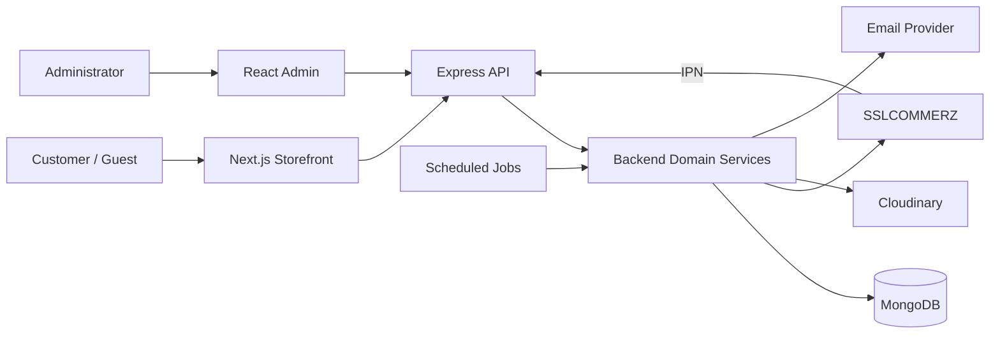
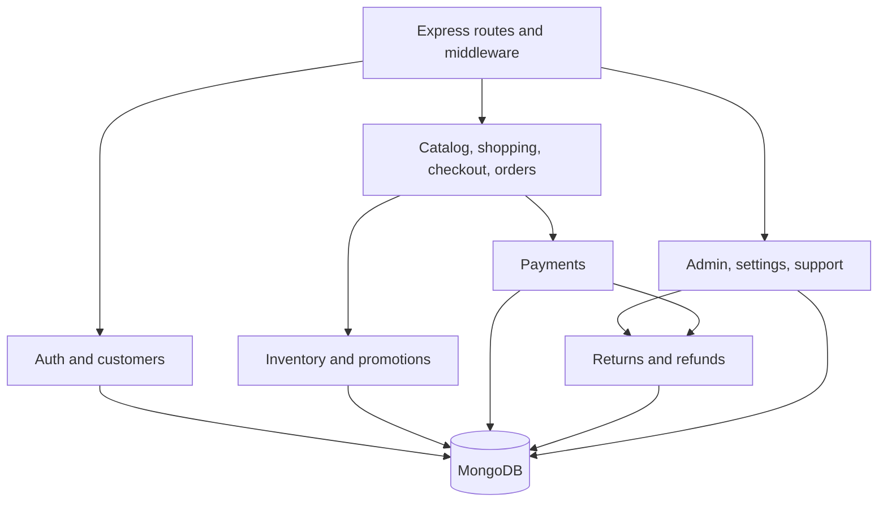
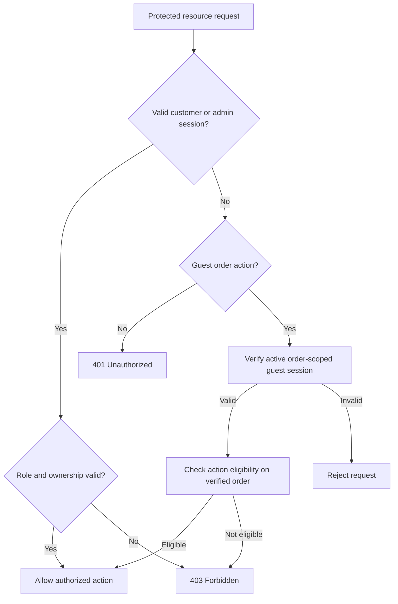
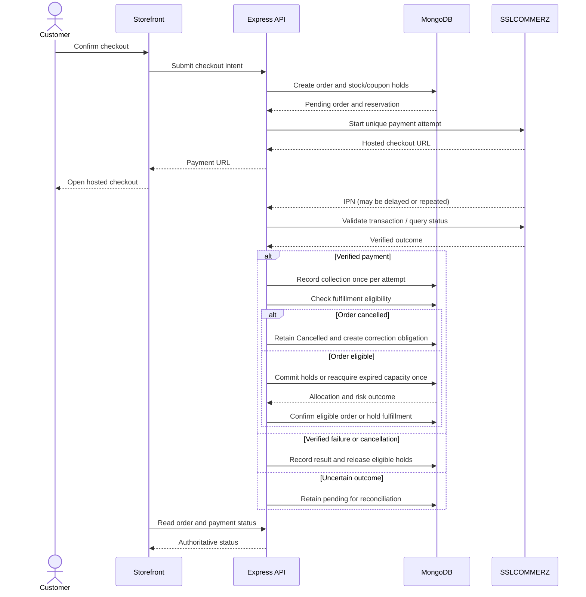
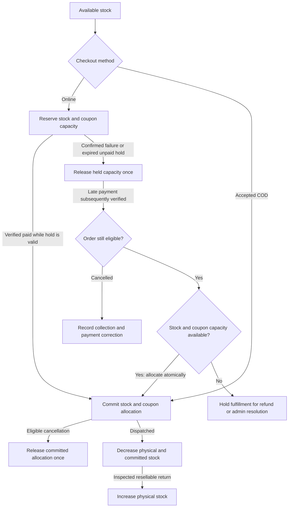
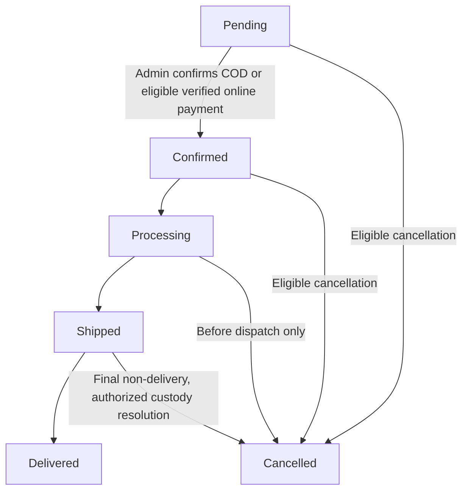
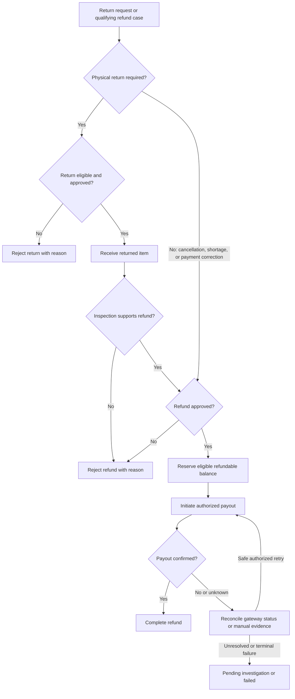
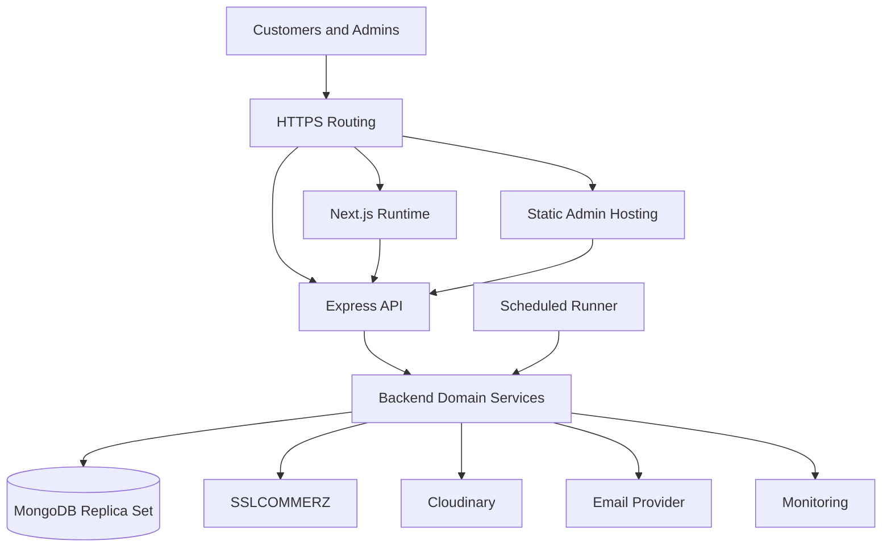

# SportZone — Software architecture

**Version:** 1.0\
**Status:** Final development baseline\
**Updated:** 17 October 2026

**Product reference:** [SportZone PRD v1.0](./PRD.md) (`docs/PRD.md` in the repository)\
**Scope:** Single-store sports e-commerce platform serving Bangladesh\
**Audience:** Software engineers and development agents

This document defines SportZone's application boundaries, technical structure, integrity invariants, integration boundaries, and workflow orchestration. The [PRD](./PRD.md) governs product scope, business rules, and acceptance criteria; this document defines their technical implementation.

---

**Contents**

- [1. Architecture overview](#1-architecture-overview)
- [2. Technology stack](#2-technology-stack)
- [3. System architecture](#3-system-architecture)
- [4. Project structure](#4-project-structure)
- [5. Frontend architecture](#5-frontend-architecture)
- [6. Backend architecture](#6-backend-architecture)
- [7. Data architecture](#7-data-architecture)
- [8. API architecture](#8-api-architecture)
- [9. Authentication & authorization](#9-authentication--authorization)
- [10. Critical business workflows](#10-critical-business-workflows)
- [11. Security architecture](#11-security-architecture)
- [12. Reliability & performance](#12-reliability--performance)
- [13. Deployment architecture](#13-deployment-architecture)
- [14. Architecture decisions](#14-architecture-decisions)

---

## 1. Architecture overview

### 1.1 Architectural style

SportZone is a **modular monolith** with two independently deployed web applications and one authoritative backend API:

- **Storefront:** Next.js (React), TypeScript, and Tailwind CSS for customer-facing pages.
- **Admin portal:** React, Vite, TypeScript, and Tailwind CSS for store operations.
- **Backend:** Node.js and Express with feature-based modules.
- **Persistence:** MongoDB accessed through Mongoose.

Both applications communicate with the same REST API. The backend owns authentication, permissions, pricing, checkout, inventory, coupon allocation, payment verification, order transitions, and refunds. Next.js rendering does not introduce a second business backend.

### 1.2 Architecture principles

1. **Single source of business truth:** Never trust browser-calculated totals, stock, roles, or payment results.
2. **Explicit boundaries:** Each application owns its UI; backend modules own business behavior and persistence.
3. **Transactional integrity:** Protect inventory and financial invariants with conditional writes, unique indexes, and transactions where required.
4. **Safe retries:** External callbacks, checkout submissions, and background work must be idempotent.
5. **Traceability:** Preserve payment attempts, inventory movements, refund attempts, and sensitive admin actions.
6. **Proportional complexity:** Use one backend and scheduled work; introduce additional infrastructure only when justified by measured needs.

### 1.3 System boundaries

Customers and administrators interact through separate web applications. Only the Express backend connects to the database and privileged third-party APIs. Public browser input, hosted payment redirects, and provider notifications cross a trust boundary and require independent validation.

---

## 2. Technology stack

| Component | Technology | Responsibility |
| --- | --- | --- |
| Storefront | Next.js App Router, React, TypeScript | Public pages, search indexing, customer journeys |
| Admin portal | React, Vite, TypeScript | Authenticated store-management SPA |
| Styling | Tailwind CSS | Responsive styling across both applications |
| Backend | Node.js, Express, TypeScript | REST API and authoritative business operations |
| Persistence | MongoDB, Mongoose | Durable records, indexes, conditional updates, transactions |
| Authentication | Opaque server-managed sessions, secure cookies | Customer and administrator access |
| Online payment | SSLCOMMERZ hosted checkout | Enabled bKash, Nagad, Rocket channels; payment/refund verification |
| Cash on Delivery | Internal backend workflow | Order acceptance and verified collection |
| Media | Cloudinary | Product images and approved supporting uploads |
| Transactional email | Resend or equivalent | Verification, recovery, order and status messages |
| Repository | Git, GitHub, npm workspaces | Version control and monorepo management |
| Verification | Type checking, linting, unit/integration/E2E tests | Build and behavioral quality |

Use supported compatible package versions and commit lockfiles. Gateway payment channels depend on the merchant account's actual activation; inactive channels are not offered at checkout. PRD §3.3 requires all three online channels for initial-release acceptance; an incomplete activation blocks launch unless an approved PRD scope change revises that requirement.

---

## 3. System architecture

### 3.1 Component interaction



The diagram shows logical responsibilities. Scheduled jobs run inside the backend process or in a separate process that imports the same domain services; they are not a second business API.

### 3.2 Communication and trust

- **Browser → API:** HTTPS and JSON; credentialed requests use server-issued session cookies and CSRF defenses.
- **Next.js server → API:** Public catalog and informational data may be fetched for rendering. Private business operations remain in Express.
- **API → MongoDB:** Only backend-controlled queries, models, and transactions.
- **API → SSLCOMMERZ:** Server-created payment sessions, verified transaction status, and supported refund requests.
- **SSLCOMMERZ → API:** Provider notification endpoints; every payment is independently validated before changing financial state.
- **API → Cloudinary/email:** Privileged calls with server-only credentials.

### 3.3 Rendering boundaries

Public category and product pages use Next.js server rendering or controlled revalidation to support discoverability. Account, cart, checkout, and order information is private and must not enter shared caches. The admin is a client-rendered application; it does not require search indexing or server-side rendering.

---

## 4. Project structure

Use the following workspace layout with independently buildable applications:

```text
sportzone/
├── storefront/                 # Next.js application
│   ├── src/
│   │   ├── app/                # App Router pages, layouts, metadata
│   │   ├── components/         # Reusable storefront UI
│   │   ├── features/           # Catalog, shopping, checkout, account
│   │   └── lib/                # API clients and utilities
│   └── public/
├── admin/                      # React + Vite application
│   ├── src/
│   │   ├── app/                # Routes, providers, application setup
│   │   ├── features/           # Administrative screens
│   │   ├── components/         # Shared admin UI
│   │   └── lib/                # API clients and utilities
│   └── public/
├── backend/                    # Express API
│   └── src/
│       ├── modules/            # Feature-owned routes, services, models
│       ├── middleware/         # Auth, validation, errors, CSRF
│       ├── jobs/               # Expiry, reconciliation, notifications
│       ├── config/             # Environment and external clients
│       ├── shared/             # Cross-module primitives
│       ├── routes.ts           # Root API registration
│       └── app.ts
├── docs/
│   ├── PRD.md
│   ├── ARCHITECTURE.md
│   ├── DESIGN.md
│   ├── IMPLEMENTATION_PLAN.md
│   ├── TASKS.md
│   ├── DATABASE.md             # Persistence specification
│   ├── API.md                  # HTTP contracts
│   ├── TESTING.md              # Verification procedures
│   └── OPERATIONS.md           # Operating runbooks
├── AGENTS.md
├── CHANGELOG.md
├── README.md
├── .env.example
├── .gitignore
└── package.json               # npm workspace scripts
```

**Dependency rules:** Frontend applications do not import backend runtime code or database models. Backend modules communicate through their public service functions rather than another module's private model. A small shared package for pure types or validation contracts may be introduced when actual duplication warrants it; do not require one upfront. Keep UI specifications in `DESIGN.md` and development sequencing in `IMPLEMENTATION_PLAN.md`.

---

## 5. Frontend architecture

### 5.1 Storefront — Next.js

Use the App Router for customer pages, nested layouts, loading/error boundaries, and metadata. Prefer Server Components for public content and Client Components where interaction or browser state is required.

| Concern | Approach |
| --- | --- |
| Public pages | Server-rendered or revalidated home, category, catalog, product, and informational pages |
| SEO | Page-specific titles, descriptions, canonical URLs, and accurate product structured data |
| Private pages | Authenticated client data access for profile, cart, checkout, orders, and returns |
| API access | Typed API client; Express remains the only business authority |
| State | Local UI state for interactions; server data fetched/refreshed from the API |
| Forms | Client-side usability checks followed by mandatory backend validation |
| Errors | Accessible loading, empty, retry, and failure states without exposing private internals |

**Caching policy:** Public catalog content may be cached and revalidated after product/category updates. Public prices and availability may be briefly stale; checkout must always revalidate current values. Customer sessions, order details, payment status, cart, and checkout totals must not use shared caches. Use framework-version-compatible caching primitives when implementing this policy.

Do not duplicate pricing, stock allocation, payment verification, or refund processing in Next.js Server Actions or route handlers. If a framework-specific server endpoint is needed, it remains a thin presentation adapter to Express.

### 5.2 Admin portal — React + Vite

Use client-side routing with an authenticated application shell. Feature screens cover products, categories, inventory, orders, payments, customers, coupons, reviews, delivery configuration, returns, refunds, complaints, and store settings.

- Use reusable forms, tables, filters, and pagination components.
- Keep API-backed data separate from transient UI state; refresh affected records after mutations.
- Protect routes for usability, but enforce every permission again in Express.
- Handle expired sessions and failed mutations explicitly.
- Never expose credentials through Vite's client environment variables.

### 5.3 Shared frontend conventions

Both applications use consistent BDT formatting, Bangladesh address/phone input handling, accessible form feedback, and typed API error handling. UI components need not be shared across applications unless a real maintenance benefit emerges.

---

## 6. Backend architecture

### 6.1 Modules and ownership



This is a **logical module diagram**, not a set of microservices. Arrows indicate primary coordination paths, not an exhaustive call graph. Notification delivery and other supporting module details remain in the ownership table and §§6.3/10.6.

| Module | Ownership | PRD references |
| --- | --- | --- |
| `auth` | Registration, login, sessions, recovery, admin access | FR-01, FR-21 |
| `customers` | Profile, addresses, customer administration | FR-02, FR-27 |
| `catalog` | Products, variants, categories, discovery | FR-03–FR-06, FR-23–FR-24 |
| `shopping` | Cart and wishlist | FR-07–FR-08 |
| `promotions` | Coupon rules, discounts, usage holds/redemptions; product base/sale prices remain in `catalog` | FR-09, FR-30 |
| `reviews` | Verified purchase reviews and moderation | FR-10, FR-31 |
| `checkout` | Checkout validation and order submission | FR-11 |
| `payments` | Online attempts, verification, COD collection | FR-12, FR-29 |
| `inventory` | Stock, reservations, commitments, movements | FR-13, FR-25 |
| `orders` | Lifecycle, cancellation, delivery and fulfillment | FR-14–FR-16, FR-26 |
| `returns` | Return claims, receipt, inspection | FR-17, FR-32 |
| `refunds` | Refund eligibility, amounts, attempts, payouts | FR-18, FR-33 |
| `guest-access` | Verified guest order access | FR-19 |
| `notifications` | Transactional notifications and retries | FR-20 |
| `support` | Basic complaints and resolution | PRD §§3, 10 |
| `settings` | Store settings, delivery zones/charges and policies | FR-28, FR-34 |
| `admin-operations` | Dashboard aggregates and administrative reporting from existing modules | FR-22 |

### 6.2 Request processing

`Route → Authentication / Authorization / Validation → Controller → Service → Persistence / Provider → Response`

- **Routes and middleware:** Endpoint registration, session checks, authorization, CSRF, rate limits, and validation.
- **Controllers:** Parse validated requests and shape HTTP responses.
- **Services:** Enforce business rules, coordinate modules, and control transactions.
- **Models:** Define persistence structures and indexes.
- **Provider adapters:** Isolate gateway, media, and email protocol details.

Cross-module financial operations use a coordinating service with explicit transaction boundaries. Never keep a database transaction open while waiting for an external network request.

### 6.3 Background processing

Run reservation expiry, uncertain-payment reconciliation, notification retries, and related maintenance as scheduled backend jobs. Store job progress or work claims durably, use atomic leases when parallel runners are possible, and make each transition idempotent. Jobs reuse domain services; they do not bypass stock or payment rules.

---

## 7. Data architecture

Detailed collection schemas, embedding/reference decisions, field validation, exact indexes, retention schedules, and migrations belong in [`DATABASE.md`](./DATABASE.md). This section owns modeling strategy and system-wide integrity constraints; it is not a replacement for that specification.

### 7.1 Modeling approach

MongoDB stores business records with Mongoose schemas, indexes, and validation. Embed small immutable order-line snapshots when appropriate; reference independently managed entities such as users, products, variants, payments, and refunds. The PRD's **27 logical entities** do not require 27 separate collections.

The conceptual entity inventory is in PRD §10. [Database §3](./DATABASE.md#3-logical-and-physical-data-model) maps those concepts to physical collections and embedded documents without duplicating ownership here.

### 7.2 Core relationships

Users own sessions and saved addresses; guest orders may have no user reference. Products belong to one or more categories and expose purchasable variants/SKUs. Order lines retain immutable product, variant, price, and delivery snapshots. A Payment aggregate summarizes the order while individual attempts/collections retain independently verified receipts. Returns, shortage claims, refunds, and payout attempts reference the original order and relevant quantities or collections.

Products without selectable options still use a default SKU. The complete relationship diagram, cardinalities, embedding decisions, and exact fields belong in `DATABASE.md`.

### 7.3 Historical records and money

- Snapshot ordered product name, SKU, selected variant, quantity, unit price, allocated discount, delivery address, delivery charge, applicable deadline, and final totals.
- Preserve order history when products, prices, addresses, and delivery settings later change.
- Represent money as **integer poisha** internally (`100 poisha = BDT 1`). Convert at display and gateway boundaries using precise decimal handling.
- Apply product sale prices before coupon discounts. Exclude delivery charges from coupon eligibility. Allocate coupon discounts across eligible order items with deterministic rounding.
- Calculate refunds from original order snapshots and remaining eligible quantities, not current catalog prices.

### 7.4 Stock and financial invariants

Define **Physical** as units on hand not yet shipped, **Reserved** as temporary online holds, and **Committed** as accepted but unshipped allocations.

`Available = Physical − Reserved − Committed`\
`Available >= 0; Reserved >= 0; Committed >= 0`

Use conditional atomic writes to prevent negative availability. For changes spanning reservations, order state, coupon capacity, and stock counters, use MongoDB transactions on a replica-set-capable deployment. Accepted COD orders commit stock immediately; verified online payments convert active holds to commitments. Shipment decreases physical and committed quantities together. Pre-shipment cancellations and eligible expiries release their allocation exactly once; inspected resellable returns increase physical stock.

For refunds, **pending plus completed refund commitments must not exceed collected funds**. Reserve eligible refund balance before starting a provider payout and release or reconcile that commitment only through an authorized state transition.

### 7.5 Indexes, retention, and privacy

Use unique indexes for normalized account email, product slug, variant SKU, order number, and provider-scoped payment references. Index common catalog filters, order ownership/lookups, active holds, and reconciliation queries. Apply unique or conditional indexes to prevent duplicate active review/redemption/claim records where required.

TTL cleanup may remove expired session or verification artifacts but must **not** be relied upon to release stock or coupon holds. Retain transaction and audit history according to approved legal/operational rules; protect personal information and backups, and support deletion requests without destroying required financial records.

---

## 8. API architecture

[`API.md`](./API.md) owns endpoint inventory, request/response schemas, error/status mappings, CSRF bootstrap, idempotency behavior, and callback contracts. Architecture owns the security and integration constraints those contracts must preserve.

### 8.1 REST conventions

The Express API uses `/api/v1` with resource-oriented routes. Standard requests and responses use JSON; approved uploads may use multipart requests. Enforce input normalization and schema validation before business processing.

| Concern | Convention |
| --- | --- |
| Authentication | Cookie-backed sessions for browser requests |
| Authorization | Backend role and resource-ownership checks |
| Lists | Bounded pagination, validated sorting/filtering |
| Success | Consistent JSON data envelope |
| Errors | Stable code, safe message, appropriate HTTP status |
| Versioning | `/api/v1`; maintain compatible contracts within the version |
| Financial mutations | Persisted idempotency keys and unique provider references |

Exact wire enums, success/error envelopes and examples belong in [API §3](./API.md#3-http-conventions--versioning). Architecture summaries do not define alternative payloads.

### 8.2 Application integration

- The storefront may fetch public catalog data from Express during Next.js rendering.
- Authenticated browser calls use credentialed requests to the configured API origin.
- The admin uses the same API with admin-only endpoints and server-side authorization.
- Client validation improves usability but never replaces backend validation.
- Private customer/order responses must not be cached publicly.

### 8.3 Idempotency and consistency

Use a persistent checkout intent or idempotency key to prevent duplicate order submissions. A retry must return the existing operation outcome or safely resume it, not create a second financial action. Provider callbacks, refund requests, and job retries require unique references and guarded state transitions. Reject invalid transitions with stable error codes. Exact endpoint contracts belong in `API.md` and must remain aligned with implementation and contract tests; an exhaustive route list does not belong here.

---

## 9. Authentication & authorization

### 9.1 Identity and sessions

Use opaque, revocable server-managed sessions. Store a hash of the session token, principal identity, expiry, and revocation state; deliver the token through an `HttpOnly`, `Secure`, appropriately `SameSite` cookie. Rotate session identifiers after login or privilege changes and revoke them on logout or account suspension.

Prefer same-site storefront, admin, and API subdomains under one approved registrable domain. The API issues **host-only cookies**; credentialed CORS allows only exact approved frontend origins. For state-changing browser requests, require a session-bound CSRF token in a custom request header and validate the `Origin` against approved frontend origins. Provide a non-cacheable CSRF bootstrap for browser requests before authentication as well as session-bound tokens after login. Before login, bind the CSRF token to a short-lived opaque browser-context cookie; this context grants no account or order access.

Login, registration, recovery, guest checkout, and guest-proof exchange require this token and approved Origin validation. After login or proof exchange, rotate context and issue the token for the resulting customer/admin/order-scoped session. Refresh tokens after rotation or expiry; [API §4](./API.md#4-authentication-sessions--csrf) specifies the endpoint and cookie contracts. Payment IPNs and provider browser-return endpoints are exempt from browser token/Origin requirements because they originate outside the approved application origins. They grant no customer/admin access and cannot trust redirect fields.

Any resulting financial transition requires independent provider verification and idempotency; ordinary browser payment-initiation/retry APIs remain protected.

Keep customer and administrator sessions distinct through separate session types and cookie names. Admin endpoints accept only an active administrator session; a customer session never grants administrator access. Revoke and rotate each session independently.

### 9.2 Access flow

This diagram covers protected resource access only. Public catalog and authentication/bootstrap endpoints follow their own validation, abuse, and CSRF requirements; they are not routed through this session-or-guest-order decision. The scoped guest session is issued only after successful single-use email-proof exchange and remains subject to ownership and action eligibility.



### 9.3 Role and resource rules

- **Guest:** Browse and submit checkout without an account. Access to protected order records and actions requires email-proof exchange into a time-limited order-scoped guest session; an order number or checkout email alone never grants access.
- **Customer:** Manage their own account, wishlist, orders, reviews, returns, and refund requests.
- **Administrator:** Manage store operations using protected admin endpoints; accounts are privately provisioned.

Order number plus email address alone is not sufficient authorization for guest order access. Use single-use, time-limited verification artifacts and rate limits. Passwords require a modern adaptive hash. Apply ownership checks to nested order items, returns, reviews, complaints, and refunds; do not trust client-supplied user IDs.

---

## 10. Critical business workflows

### 10.1 Checkout and online payment



**Checkout rules**

1. Recalculate product prices, sale discounts, coupon eligibility, delivery zone/charge, stock, and final BDT total on the backend. Validate customer details and accepted terms.
2. Persist one order per checkout intent, scoped to the customer or opaque guest browser context; the same key with a different payload is a conflict, not a second operation. Persist canonical request identity and outcome. [API §15](./API.md#15-idempotency-concurrency--recovery) defines replay and conflict handling; the exact replay/retention horizon remains open in API §15.1.
   Online checkout creates **15-minute** stock and coupon holds and a unique payment attempt transaction ID.
3. Initiate SSLCOMMERZ hosted checkout on the server. Show bKash, Nagad, and Rocket only when activated for the merchant.
4. Treat browser success/failure redirects as presentation signals. Verify payment independently using provider IPN and validation/status APIs.
5. Match the expected order and `tran_id`; validate provider references (`val_id` or applicable status result), merchant identity, amount, BDT currency, accepted status, and `risk_level`. Persist a verified successful payment as `Paid` **even if fulfillment cannot proceed**.
6. Deduplicate callbacks and retries using persisted provider-scoped references and guarded transitions. A payment retry uses the same order with a new `tran_id`. Before retrying, check the existing payment outcome and reservation expiry; reacquire stock and coupon capacity atomically if the prior holds have expired. Never extend an expired hold without reallocation.
7. After recording a verified payment, check whether fulfillment was cancelled or otherwise resolved. A Cancelled order never reacquires stock/coupon or reopens; record a payment-correction obligation and retain the collection for authorized refund. For an eligible non-cancelled order, convert valid stock/coupon holds into committed allocations. If holds have expired, revalidate **both inventory and coupon capacity** atomically. If either is unavailable, retain `Paid`, hold fulfillment, and arrange an authorized resolution or refund.
8. Independently evaluate payment risk and allocation eligibility. Verified high-risk payments, including `risk_level=1`, remain on fulfillment hold even when allocation succeeds. Review approval allows fulfillment only with valid allocation; rejection follows the eligible refund process.
9. A failed attempt must not release an allocation needed by another active attempt or a paid order. Reconcile uncertain outcomes using provider status APIs; a timeout alone is not proof of failure.
10. If multiple attempts for one order are independently verified as paid, record **each collection** against its own attempt, but commit stock, coupon, and fulfillment **only once**. Treat additional collected funds as an overpayment requiring an authorized refund or financial resolution; never discard the second collection or fulfill twice.

Payment and fulfillment states are independent. Provider field handling and refund capabilities must match the [SSLCOMMERZ developer documentation](https://developer.sslcommerz.com/doc/v4/) and the enabled merchant account.

### 10.2 Cash on delivery

`Validate checkout → Accept Pending COD and commit allocation → Admin confirms → Process → Deliver → Verify collection`

COD acceptance commits available stock immediately and confirms eligible coupon usage. The order stays `Pending` until an administrator confirms fulfillment; backend checkout acceptance and administrator confirmation are distinct. No successful online gateway payment is created. The order remains unpaid until authorized collection confirmation. Failed delivery requires recorded contact and a retry, cancellation, or applicable resolution; an uncollected COD order does not generate a monetary refund.

### 10.3 Inventory lifecycle



This diagram summarizes **allocation outcomes**, not every inventory-counter operation. Released allocations return to available capacity; shipped items leave physical stock, and only inspected resellable returns add physical stock back. Each transition updates stock counters and inventory movement history atomically. Release/commit/shipment actions are idempotent. Cart additions and wishlists never reserve stock. A returned item increases physical stock only after inspection approves resale.

**Coupon capacity:** One coupon per order. Coupons with per-customer limits require a registered customer ID; guest checkout can use only coupons without such limits. Checkout email is not an authorization or quota identity. Online redemption capacity is held with inventory and confirmed after verified payment; failed/expired holds release once. Accepted COD orders confirm redemption. Eligible pre-shipment cancellations release the applicable coupon redemption once, including accepted COD cancellations. Completed orders later refunded do not automatically restore coupon usage. Enforce overall and per-customer limits under concurrency.

### 10.4 Order management and delivery



- **Pre-shipment cancellation:** Pending, Confirmed, and Processing require administrator approval of the customer request and an atomic current-eligibility check; Processing also requires confirmation that dispatch has not occurred. A pending cancellation request does not itself release allocation or change fulfillment. Release committed stock and applicable coupon redemption once. Paid cancellation creates an eligible refund obligation; uncollected COD does not.
- **Delivery exceptions:** Shipped orders use delivery-exception procedures. A retry stays Shipped. Final non-delivery can exceptionally close as Cancelled only after every shipped quantity has recorded custody/disposition. This is not ordinary customer cancellation.
- **Recovered stock:** Shipment already reduced physical and committed stock. Do not repeat pre-shipment release or automatically restore coupon usage. Only physically recovered, inspected resellable units create an idempotent inventory-receipt movement; lost or damaged units do not.
- **Historical records:** Keep payment separate from fulfillment. Preserve checkout-time address, charge, and applicable deadline. Changes to delivery configuration affect future orders only.
- **Fulfillment:** Initial release uses manual shipment updates. Record delays and failed deliveries, customer contact, and resolution. The delivery planning target never overrides a shorter applicable deadline.

Validate every transition server-side and preserve the actor, reason, timestamps, and financial/inventory consequences.

### 10.5 Returns and refunds



Return and refund lifecycles are **separate**. Physical returns follow FR-17. Missing-item/shortage claims use the same access-controlled claim entry point but an explicit non-physical claim type: Requested → Under Review → Approved → Completed, or Rejected. Approval records eligible missing quantities and can create a refund obligation without receipt, inspection, or restock. Physical-return statuses remain: `Requested → Under Review → Approved → Awaiting Return → Received → Inspected → Completed`, with rejection when appropriate. Refunds follow `Requested → Under Review → Approved → Processing → Completed`, with rejection or failure/retry paths. Completing a return does not itself mark its refund as completed.

- Limit physical-return and shortage claims together to eligible unclaimed quantities of each original order item; resolved/refunded merchandise quantities cannot be claimed again.
- Require receipt and inspection for physical returns; cancellation, approved shortage claims, and payment corrections do not require inspection.
- Calculate item-level partial/full refunds using purchase-time prices, allocated coupon discounts, eligible quantities, and applicable delivery-charge rules.
- Prevent pending plus completed refund commitments from exceeding funds actually collected, both for each source collection and for the order. Persist each verified collection separately even when one Payment aggregate summarizes the order.
- Separate merchandise refunds from payment corrections. A refund of an extra paid attempt consumes that collection's financial capacity without consuming returned-item quantities or changing a fully paid merchandise balance to Refunded. Expose correction and merchandise summaries separately; `DATABASE.md` and `API.md` define their exact projections.
- For gateway refunds, retain the original provider `bank_tran_id`, generate and durably persist a unique **merchant-supplied** `refund_trans_id` before sending each refund request, and retain any **provider-returned** `refund_ref_id`. Verify payout through the supported refund-status mechanism. Gateway request acceptance is not payout completion; exact gateway fields and behavior require merchant/sandbox confirmation (see [API](./API.md) §13 and [Database](./DATABASE.md) §9).
- For COD/manual refunds, confirm original collection and record verified transfer evidence before `Completed`.
- Record every attempt, failure, approval, and authorized retry. Restock only inspected resellable items.

### 10.6 Supporting workflows

- **Reviews:** Authenticated verified purchasers; one active review per customer/product; moderation before public display.
- **Notifications:** Persist critical notification intent in the same durable business transaction as the originating state change when required; deliver and retry separately without repeating the business transaction. Record delivery outcomes.
- **Complaints:** Record contact, optional order reference, issue, status, resolution, and timestamps; restrict access to authorized parties.
- **Audit:** Record sensitive admin changes, financial decisions, stock adjustments, and security-relevant actions.

---

## 11. Security architecture

| Control | Architecture requirement |
| --- | --- |
| Transport | HTTPS/TLS for browser, API, and provider traffic |
| Sessions | Hashed opaque tokens, `HttpOnly`/`Secure` cookies, expiry, rotation, revocation |
| CSRF and CORS | CSRF protection for browser mutations; exact trusted credentialed origins |
| Authorization | Server-side role and resource-ownership checks on every protected operation |
| Input safety | Central schema validation, normalization, bounded payloads, safe error messages |
| Abuse protection | Rate limits for login, recovery, guest verification, checkout, and sensitive endpoints |
| Payments | Server-only merchant credentials, independent verification, replay-safe callbacks |
| Media | Restricted uploads, file type/size validation, controlled Cloudinary permissions |
| Secrets | Environment-managed credentials; never expose in `NEXT_PUBLIC_*` or `VITE_*` bundles |
| Audit and privacy | Sensitive action logs without passwords, session tokens, or unnecessary personal data |

Provider IPNs are authenticated through transaction verification rather than browser CSRF tokens. Never treat a frontend route guard, hidden UI control, or user-supplied ID as authorization. Public error responses must not disclose stack traces, database details, or provider secrets.

---

## 12. Reliability & performance

### 12.1 Consistency and recovery

- Use conditional stock updates, unique constraints, and MongoDB transactions for multi-record invariants.
- Never keep database transactions open while waiting for gateway, email, or media responses.
- Persist payment/refund intent and attempt status before or around provider calls; reconcile uncertain external outcomes instead of guessing success or failure.
- Make order submission, payment callbacks, reservation release, coupon confirmation, refund attempts, and scheduled jobs idempotent.
- Use durable job claims/leases if concurrent schedulers are possible. Apply bounded retries and surface unresolved cases for admin review.
- Do not depend on TTL deletion for stock or coupon release.

### 12.2 Performance and observability

Cache only suitable public storefront content and invalidate it when catalog data changes. Paginate large API results, index common queries, and avoid unbounded document growth. Keep private responses uncached in shared layers. Use structured logs with request/operation identifiers, error monitoring, availability checks, and protected database backups. Periodically test restoration.

### 12.3 Verification priorities

[`TESTING.md`](./TESTING.md) owns scenario catalogs, planned fixtures/commands, browser matrices, and test evidence format. Architecture identifies the risks to verify, not a second test procedure.

Test the behavior most likely to cause financial or inventory errors: concurrent final-unit purchases; coupon-limit races; duplicate checkout; delayed/repeated/out-of-order IPNs; missing payment callbacks; expired holds followed by verified payment; COD without collection; partial refunds and duplicate refund attempts; guest verification; session separation; CSRF; unauthorized admin operations; and critical mobile checkout paths. Cover these with unit, integration, and end-to-end tests as appropriate.

---

## 13. Deployment architecture

### 13.1 Deployment topology



- **Storefront:** Host on a Next.js-capable runtime supporting selected server-rendering features; do not assume a fully static export.
- **Admin:** Deploy Vite's static build with SPA routing fallback.
- **Backend:** Deploy Express as a protected Node.js service with HTTPS and health checks.
- **Database:** Use a managed MongoDB replica set/cluster that supports transactions and backups.
- **Jobs:** Execute the same backend domain services from a scheduler or worker process with durable state and duplicate-execution protection; do not depend on public API calls for internal jobs.

### 13.2 Environments and configuration

Maintain local, staging, and production environments with separate credentials and data. Staging uses SSLCOMMERZ sandbox/test settings; production uses approved live credentials and activated channels. Validate required environment variables on startup. Keep database credentials, merchant keys, email secrets, and signing secrets out of source control and frontend bundles.

Prefer same-site subdomains for storefront, admin, and API to support secure cookie-based sessions. Final hosting, domain, and email-provider choices must satisfy these requirements; they do not change the component boundaries.

### 13.3 CI/CD and release safety

[`OPERATIONS.md`](./OPERATIONS.md) owns deployment procedures, configuration inventory, approval-dependent alert thresholds and backup/restore schedules, rollout/rollback procedures, incident response, and operator workflows. Hosting/provider selections are operational decisions constrained by this topology; names and secrets must not be invented.

Run lint, type checks, tests, and application builds before deployment. Apply and verify required database indexes. Exercise staging checkout, IPN reconciliation, refunds, guest access, CORS/cookies, and admin authorization using deployed origins. Confirm backups, restoration, monitoring, rollback steps, store configuration, merchant activation, and published operational policies before production release.

---

## 14. Architecture decisions

| Concern | Architecture decision |
| --- | --- |
| Application model | Separate Next.js storefront and React + Vite admin |
| Backend model | One modular Express API; server-authoritative business rules |
| Repository | npm workspaces monorepo; independent application builds |
| Database | MongoDB + Mongoose with atomic writes and transactions where necessary |
| API | Versioned REST API under `/api/v1` |
| Authentication | Revocable server-managed sessions with customer/admin separation |
| Payment | SSLCOMMERZ hosted checkout, independent verification, safe retries; internal COD workflow |
| Inventory | Physical/reserved/committed accounting and 15-minute online holds |
| Financial precision | Integer poisha and immutable purchase-time snapshots |
| Background work | Durable, idempotent scheduled jobs |
| Media and messaging | Cloudinary and transactional email through backend adapters |
| Delivery | Admin-managed zones/charges and manual fulfillment updates |
| Deployment | Next.js runtime, static admin hosting, Express service, transactional MongoDB deployment |

**Document ownership:** PRD owns product rules; Design owns UI behavior; Architecture owns component, security, and consistency decisions. `DATABASE.md` and `API.md` own detailed data and HTTP contracts. `TESTING.md` owns verification procedures; `OPERATIONS.md` owns deployment and operating procedures. Implement these contracts with each feature slice and verify them against code and test evidence. Root README and AGENTS own setup/navigation and agent execution instructions.

The PRD remains authoritative for feature scope and store policies. Architecture changes must preserve its financial, inventory, access-control, and customer-rights requirements.
