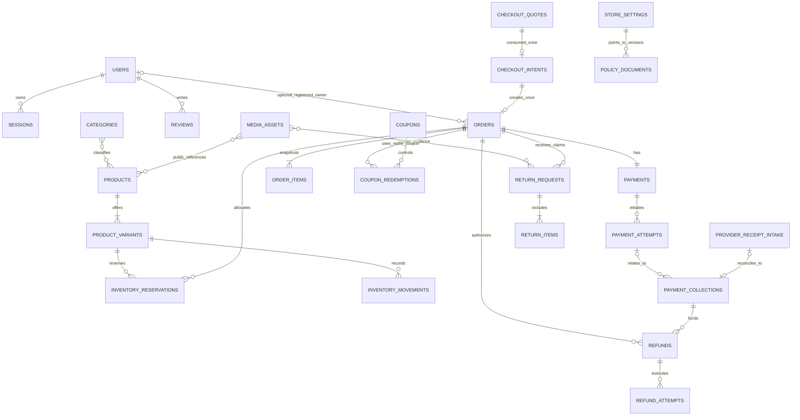
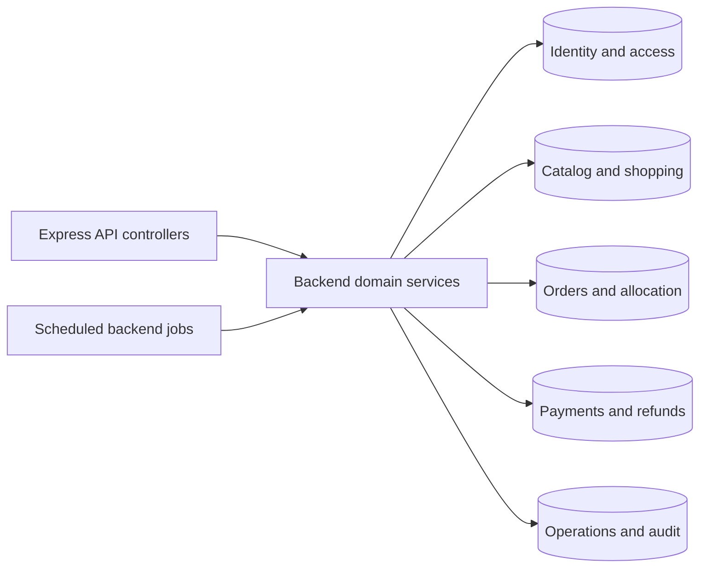
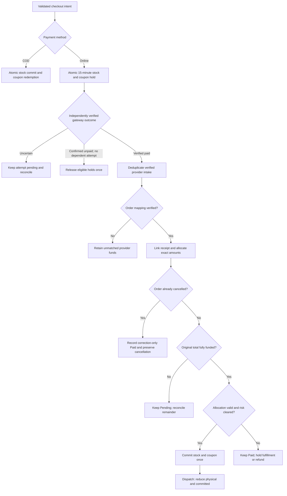
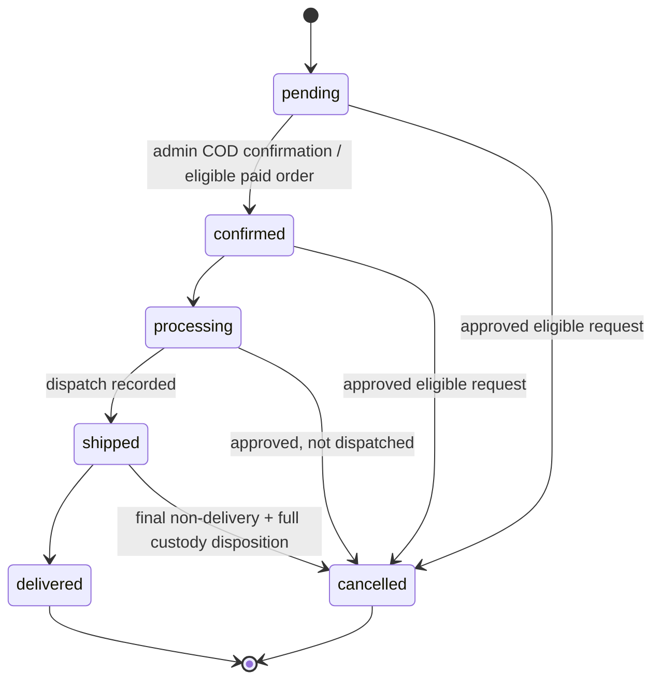

# SportZone — Database design specification

**Version:** 1.0\
**Status:** Final development baseline\
**Updated:** 23 October 2026

**Product reference:** [PRD](./PRD.md)\
**Technical reference:** [Architecture](./ARCHITECTURE.md)\
**Design reference:** [Design](./DESIGN.md)\
**Execution references:** [Implementation Plan](./IMPLEMENTATION_PLAN.md) · [Tasks](./TASKS.md)\
**Scope:** Single-store sports e-commerce platform for Bangladesh\
**Stack:** MongoDB, Mongoose, Express/TypeScript\
**Audience:** Backend engineers, reviewers, and development agents

This document defines SportZone's durable data model: physical collections, embedded records, field contracts,
indexes, state persistence, transactions, data protection, and schema evolution. It translates the PRD's **27 logical
entities** into an implementable design without requiring 27 one-to-one collections. The PRD remains authoritative for
product and policy rules; `ARCHITECTURE.md` governs system boundaries and integrity invariants. It defines delivery timing, versioned policy content, guarded mutations and verified financial accounting. All policy types, including privacy, use versioned approval/publication controls.

---

## Contents

- [1. Purpose and contract boundaries](#1-purpose-and-contract-boundaries)
- [2. Database architecture and conventions](#2-database-architecture-and-conventions)
- [3. Logical and physical data model](#3-logical-and-physical-data-model)
- [4. Relationship diagrams](#4-relationship-diagrams)
- [5. Identity and access collections](#5-identity-and-access-collections)
- [6. Catalog and shopping collections](#6-catalog-and-shopping-collections)
- [7. Orders, delivery, and inventory collections](#7-orders-delivery-and-inventory-collections)
- [8. Promotions and payment collections](#8-promotions-and-payment-collections)
- [9. Returns and refund collections](#9-returns-and-refund-collections)
- [10. Operations and supporting collections](#10-operations-and-supporting-collections)
- [11. Indexes and query contracts](#11-indexes-and-query-contracts)
- [12. Data integrity and transaction contracts](#12-data-integrity-and-transaction-contracts)
- [13. State transitions and data lifecycles](#13-state-transitions-and-data-lifecycles)
- [14. Security, privacy, and retention](#14-security-privacy-and-retention)
- [15. Migrations, environments, and recovery](#15-migrations-environments-and-recovery)
- [16. Verification and traceability](#16-verification-and-traceability)
- [Appendix A — Persistence standards](#appendix-a--persistence-standards)
- [Appendix B — Schema implementation checklist](#appendix-b--schema-implementation-checklist)

---

## 1. Purpose and contract boundaries

### 1.1 Ownership

| Source | Owns | Database implication |
| --- | --- | --- |
| `PRD.md` | Functional requirements, business policies, acceptance | Never replace policy with a schema assumption |
| `ARCHITECTURE.md` | MongoDB/Mongoose choice, trust boundaries, stock/payment invariants | No alternate business database or client-side writes |
| **`DATABASE.md`** | Collections, exact field shapes, indexes, persistence state, transactions, migrations | Persistence contract for backend implementation |
| [`API.md`](./API.md) | HTTP payloads, errors, authorization, retry contracts | Map API DTOs to persisted fields; do not expose private models |
| [`TESTING.md`](./TESTING.md) | Test procedures, fixtures, executable evidence | Validate contracts here with executable tests there |
| [`OPERATIONS.md`](./OPERATIONS.md) | Backup/restore procedure, production jobs, monitoring | This document states DB prerequisites and invariants |

### 1.2 Scope and authority

- **In scope:** customer/admin identity, guest proof, products and variants, shopping, checkout, COD/online payments, stock, coupons, shipment, claims, refunds, notifications, support, settings, and audit history.
- **Out of scope:** multi-vendor tenancy, loyalty, subscriptions, live courier GPS, automated courier integration, multi-currency, multi-role RBAC, and speculative analytics infrastructure (PRD §3.2).
- **Authority:** Only Express domain services write business data. Next.js and the admin SPA never connect directly to MongoDB.
- **Contract:** implement the fields, indexes and state transitions below, then verify them with the corresponding API and database tests.

### 1.3 Cross-cutting acceptance conditions

1. No overselling; `available = physical − reserved − committed` remains nonnegative.
2. Checkout retry cannot duplicate an order; callbacks and provider retries cannot apply a collection twice.
3. Every independently verified collection is recorded, even if fulfillment is already cancelled or paid.
4. Refund commitments cannot exceed verified collections, globally **or** per source collection.
5. Historical order/pricing/delivery snapshots do not change when live records change.
6. Guest proof grants only time-limited, order-scoped access; customer and administrator sessions stay distinct.
7. An event replay, job restart, or concurrent request cannot repeat stock/coupon/refund effects.
8. Initial release requires verified bKash, Nagad, Rocket and COD acceptance; inactive channels are hidden, but missing required gateway activation blocks launch unless the PRD is explicitly revised (PRD §3.3).

## 2. Database architecture and conventions

### 2.1 Deployment and ownership

| Area | Contract |
| --- | --- |
| Database | MongoDB; one logically isolated SportZone database per environment; provider provisioning belongs in Operations |
| ODM | Mongoose, explicit schemas and controlled model/index deployment |
| Transaction capability | Replica-set-capable MongoDB in local integration, staging, and production; stand-alone MongoDB is insufficient for required multi-document tests |
| Connections | Pooled, bounded server connections; credentials available only to backend/job processes |
| Jobs | Backend workers use the same domain services; durable lease/claim records prevent competing execution |
| External calls | Never hold an open DB transaction across payment, Cloudinary, or email HTTP calls |
| Boundaries | Public APIs return allowlisted DTOs, never raw Mongoose documents |

Database access requires bounded replica-set connections, explicit collection validators/indexes and a
session-aware transaction boundary. Each domain owns its fields, protected update allowlists and DTO mappings;
schema validation does not authorize arbitrary update operators. Operations §§5, 7 own runtime and bootstrap commands.

Backend Mongoose connections consume the private MongoDB URI from `MONGODB_URI` and the explicit
`MONGODB_DB_NAME`. Frontends receive no database URI or credentials. The configured provider must
support replica-set sessions, explicit validator/index rollout and required transactions; Operations owns its setup.

### 2.2 Field standards

| Convention | Definition |
| --- | --- |
| Primary key | `_id: ObjectId`, server-generated; serialize as a string only at API boundaries |
| References | `<entity>Id: ObjectId`; never use an email or order number as proof of ownership |
| Timestamps | UTC `Date` instants; `createdAt`/`updatedAt` for mutable records and `occurredAt` for event facts |
| Business timezone | `Asia/Dhaka` for display, report buckets and approved deadline rules; never persist naive local dates |
| Money | Integer **poisha** only; negative stored amounts permitted only for signed movement deltas; derived net cash-flow reports may also be negative; `100 poisha = 1 BDT` |
| Currency | `BDT` for all monetary records and historic snapshots |
| Enums | Lowercase `snake_case`; API/UI labels may differ, never reinterpret a persisted enum silently |
| Normalized IDs | Trimmed lowercase emails, coupon codes and slugs; uppercase SKU normalization follows §6.3; retain original display text where required |
| Counters | Nonnegative safe integers with conditional, concurrency-safe updates; `revision` for mutable financial aggregates |
| `schemaVersion` | Positive integer on orders and long-lived financial records; schema upgrades preserve evidence |
| Sensitive fields | Hash password/session/challenge secrets; no gateway secrets or full financial instruments in MongoDB |
| Deletion | Soft-deactivate master data; financial evidence follows approved retention and erasure rules |

**Schema notation:** `!` required; `?` optional and **absent when unset** unless a field explicitly permits `null`; `[]`
bounded array; `embedded` nested document; `enum(...)` closed allowed values. For example, **guest `orders.userId` is
explicitly `null`**, while an unissued `refundAttempts.refundRefId` is absent. Mongoose must use `strict: 'throw'` or
equivalent explicit DTO allowlists; direct unrestricted update operators are prohibited for protected fields. An embedded
`id` is a stable ObjectId, not an array offset.

**Validation limits** (apply unless the owning field defines a stricter bound):

| Field family | Default maximum / constraint |
| --- | --- |
| Human names / short titles | 120 Unicode characters; nonempty after normalization |
| Email | 254 characters, validated and normalized; never truncate |
| Slug | 160 normalized characters; SKU/code up to 64 characters |
| Operation/idempotency keys | 128 characters before hashing; provider field limits override this |
| Address line | 300 characters; freeform notes/reasons/complaints 2,000 characters |
| Review comment | 2,000 characters; tags/keywords up to 30 per record |
| Saved addresses | 10 per account; product images 12 per product |
| Cart items / wishlist entries | 100 / 200 distinct items |
| Order lines / units per line | 40 distinct lines / 50 purchased units per line |
| Return claim lines / private evidence refs | 40 lines / 12 files per claim |
| Embedded short status/contact history | 40 records; overflow goes to `auditLogs` or another approved durable event record |

Enforce these abuse and document-size limits consistently. Reject invalid input rather than silently truncating purchased quantities or personal information. Dates and optional ObjectIds use explicit JSON/BSON schema
validators, and optional reference fields must not be stored as `''`. Provider limits are authoritative for their
corresponding API fields (`tran_id` 30, `bank_tran_id` 80, `refund_trans_id` 30, `refund_ref_id` 50 characters, per the
currently published SSLCOMMERZ v4 reference).

### 2.3 Monetary rounding and immutable pricing

- Convert gateway decimal BDT strings to integer poisha with a decimal-safe parser. Never use floating-point results for authoritative amounts or percentages.
- `effectiveUnitPoisha = salePricePoisha ?? regularPricePoisha`; for an active sale, `0 <= salePricePoisha <= regularPricePoisha`.
- `regularSubtotal = Σ(regularUnit × quantity)`; `productDiscount = Σ((regularUnit − effectiveUnit) × quantity)`; `saleSubtotal = regularSubtotal − productDiscount`.
- Coupon scope is the eligible **post-sale merchandise** subtotal `E`; delivery is excluded. A fixed coupon gives `min(fixedValuePoisha, E)`. A percentage coupon uses integer basis points `b` (1–10,000): `couponDiscount = min(E, floor((E × b + 5_000) / 10_000))` (**round half up** to one poisha). Multiplication must use safe integer/BigInt arithmetic.
- Allocate the integer `couponDiscount = D` over eligible line subtotals `eᵢ`: set `baseᵢ = floor(D × eᵢ / E)`; distribute the remaining `D − Σbaseᵢ` poisha to lines with largest exact rational remainders, ties by ascending **stable embedded order-item ObjectId**. Noneligible lines get zero. For `E=0`, no discount or coupon hold is permitted.
- `finalTotalPoisha = regularSubtotalPoisha − productDiscountPoisha − couponDiscountPoisha + deliveryChargePoisha`. Validate `ΣlineCoupon = couponDiscount`, `ΣlineNet + deliveryCharge = finalTotal`, and all totals nonnegative.
- A merchandise line's purchased net value `N` over `q` units has per-unit refund entitlement `floor(N/q) + 1` for ordinals `1..(N mod q)`, and `floor(N/q)` for the remaining ordinals. Keep those stable 1-based ordinals across claims and partial payouts; they must reconcile to `N` exactly. Delivery refunds are independently approved and capped by snapshotted delivery charge.

| Calculation example | Exact result (poisha) |
| --- | ---: |
| 101-poisha eligible subtotal, 50% coupon | `floor((101 × 5,000 + 5,000)/10,000) = 51` |
| Eligible lines 201 + 100, fixed coupon 100 | Floor shares 66 + 33; extra 1 to first line → **67 + 33** |
| Three units sharing line net 101 | Stable ordinal entitlements **34, 34, 33** |

Persist the computed **67 + 33** allocation and the original price/coupon/charge/policy snapshots; changes to live master records must not rewrite history. Any adjustment to this arithmetic is a versioned financial-contract change (PRD §§6.1, 10; Architecture §7.3).

### 2.4 Embedding and reference rules

**Embed** bounded, purchase-time snapshots (order items, address/charge, variant selection), saved addresses when account
limits are enforced, return-request item entries, and small status histories when bounded. **Reference** independently
updated or high-growth records (variants, reservations, movements, attempts, collections, refunds, notifications, audit
events). Never embed an unbounded payment history, product review list, or movement ledger in an order/product.

## 3. Logical and physical data model

### 3.1 Collection inventory

The data model contains **38 physical collections**. `authRateLimits`, `authChallenges`, `browserContexts`,
`checkoutQuotes`, `checkoutIntents`, `mediaAssets`, `providerReceiptIntake`, `paymentCollections`, `couponCustomerCounters`, `orderItemBalances`,
`cancellationRequests`, `deliveryExceptions`, and `jobLeases` are supporting collections required by the defined
persistence design.

| Domain | Collections | Key embeddings |
| --- | --- | --- |
| Identity | `users`, `sessions`, `authChallenges`, `browserContexts`, `authRateLimits` | User `addresses[]` |
| Catalog and shopping | `categories`, `products`, `productVariants`, `carts`, `wishlists`, `reviews`, `mediaAssets` | Product `images[]`; cart `items[]` |
| Orders and delivery | `checkoutQuotes`, `checkoutIntents`, `orders`, `orderItemBalances`, `cancellationRequests`, `deliveryExceptions`, `deliveryZones`, `deliveryCharges` | Order `items[]`, customer/delivery/terms snapshots, transition history |
| Inventory | `inventoryReservations`, `inventoryMovements` | Variant stock counters in `productVariants` |
| Promotions | `coupons`, `couponRedemptions`, `couponCustomerCounters` | Coupon terms snapshot on order/redemption |
| Payments | `payments`, `paymentAttempts`, `providerReceiptIntake`, `paymentCollections` | Independent verified-provider intake and linked collection references |
| After-sales | `returnRequests`, `refunds`, `refundAttempts` | Return `items[]`; refund funding/scope |
| Operations | `notifications`, `complaints`, `auditLogs`, `storeSettings`, `policyDocuments`, `jobLeases` | Delivery outcomes and durable policy drafts/publications |

### 3.2 PRD's 27-entity mapping

| PRD logical entity | Physical representation |
| --- | --- |
| User / Session / Address | `users` / `sessions` / `users.addresses[]` |
| Category / Product / Product Variant | `categories` / `products` / `productVariants` |
| Cart / Wishlist | `carts` (registered; guest browser-local) / `wishlists` |
| Order / Order Item | `orders` / `orders.items[]` |
| Payment / Payment Attempt | `payments` / `paymentAttempts`; online verification intake in `providerReceiptIntake`, linked receipts in `paymentCollections` |
| Coupon / Coupon Redemption | `coupons` / `couponRedemptions`; per-user quota in `couponCustomerCounters` |
| Inventory Reservation / Inventory Movement | `inventoryReservations` / `inventoryMovements` |
| Review | `reviews` |
| Return Request / Return Item | `returnRequests` / `returnRequests.items[]` |
| Refund / Refund Attempt | `refunds` / `refundAttempts` |
| Delivery Zone / Delivery Charge | `deliveryZones` / `deliveryCharges` |
| Notification / Complaint / Audit Log / Store Settings | `notifications` / `complaints` / `auditLogs` / `storeSettings`; independently versioned policy records in `policyDocuments` |

### 3.3 Boundary and cardinality rules

- A guest order has `orders.userId = null`; its checkout email **never** becomes an ownership proof by itself.
- Every product has one default SKU if there are no selectable options. Each variant belongs to exactly one product; each product has one or more variants; each active product belongs to at least one active category.
- A checkout intent maps to at most **one** order. An order has one payment aggregate, multiple attempts and zero or more linked receipts. Verified online funds with unknown order ownership remain in `providerReceiptIntake` until reconciled.
- One order can have multiple stock reservations **over time**, but no more than one active allocation per order/variant at once. Stock is tracked by variant.
- One order binds to at most one immutable `orders.couponSnapshot.couponId` for its lifetime. A new hold generation may be created only for that same coupon after a safe release and re-eligibility check.
- A return request has one or more immutable order-item references; refund(s) reference the original order, source collection, and eligible basis.

## 4. Relationship diagrams

### 4.1 Commerce entity relationship diagram



`ORDER_ITEMS` and `RETURN_ITEMS` are logical **embedded** nodes, not collections. `USERS o|--o{ ORDERS` reflects nullable
`orders.userId` for guests. Multiple distinct independently verified receipts may relate to one gateway attempt when
provider evidence proves separate collections; there is **no unique attempt-to-receipt constraint**.
`CHECKOUT_QUOTES` and `MEDIA_ASSETS` below are supporting records, independent of the PRD entity count.
`PROVIDER_RECEIPT_INTAKE` is the authoritative unique online-provider evidence intake; a verified but unmatched intake
entry has no order reference.

### 4.2 Data ownership and persistence boundaries



Both controllers and scheduled jobs invoke shared backend **domain services**, never each other's HTTP endpoint. Cross-module transaction coordination remains inside backend-controlled services (Architecture §§3, 6).

**Target ownership:** [Architecture §6.1](./ARCHITECTURE.md#61-modules-and-ownership) groups products/variants/categories under catalog, carts/wishlists under cart,
coupon operations under promotions, guest access under auth, and existing reports/audit under
reporting/audit. The table below describes canonical capabilities; legacy labels do not require old
source folders. Source moves must preserve schema/collection/index identities, validators, transaction and
narrow shared-collection capabilities. No migration or second model registration is implied.

| Records | Canonical registration / permitted operations |
| --- | --- |
| `users` | Auth owns the single schema/index/validator registration and credential/security writes; customers uses narrow public profile/address operations. Guest-order access remains independently scoped |
| `sessions`, `authChallenges`, `browserContexts`, `authRateLimits` | Auth; guest-access uses the approved scoped guest boundary |
| `products`, `productVariants` | Catalog registers schemas; inventory receives a stock-only persistence capability for variant counters. Product updates cannot overwrite counters |
| `categories` | Catalog/categories |
| `carts`, `wishlists` | Cart module, distinct cart/wishlist capabilities |
| `coupons`, `couponRedemptions`, `couponCustomerCounters` | Promotions |
| `deliveryZones`, `deliveryCharges` | Delivery owns the existing coverage reader; future charge management remains its feature task |
| `mediaAssets` | Media owns registration, scoped attachment/reference-ledger/cleanup operations; products/categories/returns/settings coordinate attachments through that boundary |
| `storeSettings`, `policyDocuments` | Settings |
| Other records | Retain the domain ownership and invariants specified in their collection sections |

Auth revalidates the credential/principal inside the coordinating transaction, with conditional monotonic `updatedAt` writes for protected mutations to serialize with revocation. No expiry extension, new field/collection/index or migration is introduced. Profile/address reads revalidate without timestamp writes. This capability stays inside auth; callers do not gain raw models for other domains.

The auth-owned customer-account capability exposes to customers
only detached profile/address/deletion-intake data and transaction-scoped save/view operations. Auth revalidates
and fences the customer credential/principal, and persists only name, phone, addresses and new verified deletion
intake. Supplied email/role/status/credential/security fields are never written. Existing deletion review metadata
is preserved; read-only or expired scopes cannot save. Customers owns validation/coverage and profile operations,
with no foreign user model or duplicated schema. The coordinating transaction is retained across the capability.

Composition wires narrow public operations, never a second mutable schema for the same collection or unrestricted foreign-model access. Public capabilities accept the coordinating transaction session; participants must not start nested transactions or parallel operations in the same session. Preserve ObjectIds, snapshots, integer-poisha arithmetic, unique identities, BSON validation and all existing indexes. Raw model, validator and bootstrap path moves require updated tooling and parity tests; a filename change is not permission to change durable data or mark a migration executed.

### 4.3 Atomic allocation and verified-payment flow



**Persistence rule:** provider verification runs *outside* the MongoDB transaction. Its verified result is committed in a short transaction with idempotency guards; a crash can be replayed safely.

## 5. Identity and access collections

**Common rule:** No password, session, guest-proof, CSRF context, or recovery token may be stored in plaintext. Use a short-lived encrypted challenge-delivery envelope with a reference-only notification outbox. Verify key custody and never store raw proof links in the outbox. Use separate session types/cookie names for admin, customer, and scoped guest access; require server-side role and resource ownership checks (Architecture §9).

### 5.1 `users` — `auth` / `customers`

| Field | Type | Constraints / notes |
| --- | --- | --- |
| `emailNormalized`! | string | Lowercase/trimmed; unique; changed only after verified email-change flow |
| `name`! | string | Nonempty, length-limited |
| `passwordHash`! | string | Adaptive password hash; excluded from default queries |
| `phone`? | string | Bangladesh validation at service boundary; normalized for search |
| `role`! | enum(`customer`,`admin`) | Default `customer`; admin privately provisioned only |
| `status`! | enum(`active`,`suspended`,`deletion_pending`,`deactivated`) | Suspended/deactivated identities cannot authenticate |
| `emailVerifiedAt`? | Date | Set only after challenge verification |
| `addresses[]` | embedded[] | `{id,recipient,phone,districtKey,areaKey,street,addressLine2?,isDefault}`; bounded per customer |
| `securityRevision`! | int | Increment when passwords, privileges, suspension, or security posture changes |
| `challengeRevisions`! | embedded | Per-purpose nonnegative counters for email verification/change/reset; issuance/reissue and consumption serialize on the same principal/purpose counter |
| `deletionRequest`? | embedded | `{id,requestedAt,verifiedAt,status,reason?,decisionAt?,decisionReason?}`; approval/retention-controlled (§5.5) |

**Indexes:** unique `{emailNormalized:1}`; `{role:1,status:1,createdAt:-1}` for admin customer views.

**Rules:** at most one default address; deleting a saved address never edits an order snapshot. Admin accounts have no public registration. User account deletion/anonymization requires verified review against retention obligations.

The customer credential service uses the password policy and versioned adaptive scrypt encoding in API §4.6.
Registration user + registration notification intent + browser-context consumption commit together. Login serializes
credential/status/revision checks with context consumption and session issuance; password KDF work stays outside the
transaction. Customer/admin identities remain separated.

Profile/address mutations are scoped to the active session's userId, role and security revision and serialize
through a transaction on that user document. Partial edits re-read and validate the merged state on retry; maximum ten
addresses and at most one default remain BSON-enforced. Phone storage is canonical validated Bangladesh E.164 (API §4.7).
No new user field, index or schema migration is required. The optional deletionRequest is written only after active
session plus persisted email-verification checks. It preserves the first id/reason/requestedAt/verifiedAt and returns
existing review status on retries, including terminal decisions. Intake does not set deletion_pending/deactivated or
remove/anonymize accounts. Operational review/retention decisions are not exposed as customer mutations.

### 5.2 `sessions` — `auth`

| Field | Type | Constraints / notes |
| --- | --- | --- |
| `tokenHash`! | string | Unique hash of opaque cookie secret; never return |
| `kind`! | enum(`customer`,`admin`,`guest_order`) | Separate credential/cookie namespaces |
| `userId`? | ObjectId | Required for customer/admin; absent for guest-order |
| `orderId`? | ObjectId | Required only for guest-order scope |
| `securityRevisionAtIssue`? | int | Required for customer/admin; absent for guest-order; principal security revision to detect invalidation |
| `csrfSecretHash`! | string | Session-bound CSRF verifier; private projection; rotate with the session (API §4) |
| `expiresAt`! | Date | Enforced during each request, independent of TTL |
| `revokedAt`? | Date | Revocation takes effect immediately |
| `lastUsedAt`? | Date | Minimal retained metadata; avoid storing full IP by default |

**Indexes:** unique `{tokenHash:1}`; `{userId:1,kind:1,revokedAt:1}`; TTL `{expiresAt:1}`.

**Rules:** rotate after login, proof exchange or privilege changes; revoke on logout/suspension; do not treat physical TTL deletion as authentication expiry. A guest session cannot access other orders or admin/customer routes.

The customer/admin session lifecycle stores HMAC-SHA-256 digests with route-kind/domain separation
under SESSION_SECRET; API §4.4 defines the exact session/CSRF encoding. Fresh issuance/rotation creates independent
32-byte opaque session/CSRF values; only digests persist. Rotation revokes the predecessor and writes the replacement
transactionally. Active lookup checks current role/status/security revision independently of TTL; principal revocation
increments securityRevision and marks matching sessions in one transaction. Raw tokens are returned only inside the
backend issuance result for cookie/private CSRF response composition, never in a session DTO or log. Browser-context,
challenge and guest digest issuance use their owning scoped services; schema-valid strings alone do not
constitute cryptographic verification. No session is minted by HTTP startup or by simply knowing an ObjectId.

### 5.3 `authChallenges` — verification and recovery

| Field | Type | Constraints / notes |
| --- | --- | --- |
| `purpose`! | enum(`email_verify`,`email_change`,`password_reset`,`guest_order_access`) | Single-use proof type |
| `secretHash`! | string | Hash of one-time link/code; no plaintext secret |
| `userId`? / `orderId`? | ObjectId | Scope according to purpose; guest proof requires `orderId` |
| `emailNormalized`! | string | Verified destination or ownership challenge target |
| `targetEmailNormalized`? | string | For email-change workflow |
| `expiresAt`! / `consumedAt`? | Date | Atomic consume; an expired/consumed proof fails |
| `attemptCount`! | int | Enforce bounded guessing attempts and rate limits |
| `scopeRevisionAtIssue`! | int | Current user purpose counter or order guestAccessChallengeRevision; verify on delivery/consume, not only secretHash |
| `issuedContextHash`? | string | Optional binding to initiating browser context when required |
| `deliveryEnvelope`? | embedded | `{algorithm:'AES-256-GCM',keyVersion,nonce,ciphertext,authTag}`; only the short-lived proof is encrypted, never passwords or session tokens; worker-only projection |
| `deliveryNotificationId`? / `invalidatedAt`? | ObjectId / Date | One delivery intent for this challenge; explicit supersession/revocation independent of TTL |

**Indexes:** unique `{secretHash:1}`; `{purpose:1,orderId:1,expiresAt:1}`; TTL `{expiresAt:1}`.

**Rules:** guest proof is issued only after safe order/email lookup and grants order scope only after atomic single-use exchange; ambiguous lookup responses do not leak existence. Password reset token consumption and password/session revision must be coordinated safely.

**Proof delivery (API §16.3):** generate a cryptographically random, high-entropy single-use proof in memory.
Persist its `secretHash`, scope/expiry and authenticated encrypted `deliveryEnvelope` in the same transaction as the
notification intent. Use a maintained AEAD implementation, a fresh nonce for each encryption under a key, and authenticated
additional data binding challenge ID, purpose, principal/order, destination and expiry. The versioned encryption key is
held outside MongoDB/backups in the approved secret store; notification `payload` contains `challengeId` only, never proof,
URL, ciphertext or key. A delivery worker reads the restricted envelope, checks current expiry/consumption/invalidation,
decrypts only in memory and renders a link to a fixed configured HTTPS origin. Authentication verifies the hash and atomically
consumes the challenge; it never decrypts to validate a supplied proof. Remove the envelope on consumption, invalidation or
expiry, independently of TTL lag. Keep old key versions only while still-valid envelopes need them; missing keys or AEAD
failure fail closed. Resend/reissue must increment `users.challengeRevisions[purpose]` or `orders.guestAccessChallengeRevision`, invalidate the old challenge under that same principal/purpose serialization guard and
create a fresh proof/intent; do not extend an existing proof's expiry. Delivery retry reuses that challenge and event key;
see API §16.3 for uncertain-send handling. No new session is granted by delivery. The chosen proof transport is a high-entropy secure link; supporting short numeric codes later requires a separately reviewed guessing/attempt-limit design. Security tests cover key access, nonce management, concurrency, redaction and restore invalidation.

#### Password-reset implementation

Existing identity fields/indexes remain authoritative. Issuance conditionally increments `users.challengeRevisions.password_reset` in a transaction, invalidates previous reset challenges and removes their envelopes, then inserts a fresh challenge and reference-only `password_reset` notification (`password-reset-v1`). Notification `payload` contains only `challengeId:ObjectId`. `deliveryNotificationId` binds the outbox row to the challenge. AES-256-GCM uses fresh 12-byte nonces and 16-byte tags; AAD binds challenge ID, purpose, customer ID, destination, expiry, scope revision and key version. The externally held key ring is never persisted. Reset consumption and authenticated password change update the user security revision and revoke sessions atomically; password change also invalidates pending reset proofs. Cleanup removes expired/inactive envelopes even if TTL deletion is delayed. A reviewed additive notification validator migration accepts registration-v1 and password-reset-v1 records; old notification validators are known predecessors, and older exact-validator binaries require a compatible rollback build.

#### Email-change implementation

Customer email change uses authChallenges with purpose `email_change`: userId is the current customer, emailNormalized is the current identity and targetEmailNormalized is the new destination. A transaction advances the user's email_change scope counter, invalidates/removes predecessor envelopes and creates one challenge plus an `email_change`/`email-change-v1` notification containing only challengeId. Delivery recipient is the target, not the former identity. The email-change verifier and AES-GCM AAD are purpose-separated from password reset; AAD additionally binds the target. Existing reset digests/envelopes remain compatible. Session checks are repeated and conditionally touched in the transaction to serialize with logout/revocation.

Confirmation consumes the proof under its user/purpose revision, updates unique users.emailNormalized and emailVerifiedAt, increments securityRevision plus email_verify/password_reset scope counters, removes pending identity envelopes and revokes customer sessions atomically. Duplicate email indexes remain the final authority; duplicate races abort all effects. Password reset/change also advance email-change/verification counters and remove pending identity envelopes. No identity schema/index or historical order update is introduced. The additive notification validator accepts the exact P03-010 predecessor and the new supported email-change event/template/reference-only payload; old exact-validator binaries require compatible rollout/rollback builds.

#### Private administrator provisioning and recovery

Initial administrator provisioning inserts a new active administrator only; it never upgrades a customer, replaces an existing credential or exposes HTTP signup. Reserved initial-user ID `535a00000000000000000001` serializes concurrent bootstrap attempts through the existing unique _id index, even when proposed emails differ. Provisioning refuses an existing administrator/reserved ID/occupied email and uses the approved password hash. No identity schema/index change is required. The local/test CLI reads bounded private stdin and refuses deployed environments; production provisioning remains an authorized operator action.

Admin reset retains purpose password_reset and current user scope counters. Its secretHash uses a distinct admin-password-reset domain and its AES-GCM AAD includes admin audience, preserving customer reset encoding. The notification uses event password_reset with template admin-password-reset-v1 and challengeId-only payload. Role, expiry, purpose, scope and admin verifier namespace are checked on consume; admin sessions alone are revoked. The additive notification migration accepts the exact P03-011 predecessor and supported admin template pair without changing previous records.

### 5.4 `browserContexts` — pre-auth CSRF bootstrap

| Field | Type | Constraints / notes |
| --- | --- | --- |
| `contextTokenHash`! | string | Unique hash of short-lived opaque browser-context cookie |
| `audience`! | enum(`storefront`,`admin`) | Bind bootstrap to its approved frontend/route namespace; never selected by an untrusted role field |
| `csrfSecretHash`! | string | Server-verifiable session/context-bound CSRF token material |
| `expiresAt`! | Date | Short-lived and independently checked |
| `rotatedAt`? | Date | Rotate after authentication/proof exchange |

**Indexes:** unique `{contextTokenHash:1}`; TTL `{expiresAt:1}`.

**Rules:** no user/order permission is granted by this record; Origin verification is still required on protected browser mutations. Implementations may replace this persistence with an equally secure signed short-lived context only after documented Architecture/API alignment.

Browser-context protection uses 32-byte opaque cookie/CSRF values and audience-separated HMAC-SHA-256
verifiers (API §4.5); plaintext is never persisted. Bootstrap replacement and single-use successful exchange write
`rotatedAt` conditionally in a transaction. Consumption and its owned durable effect commit together; failure rolls back
both. Expired or rotated records remain unusable before TTL cleanup. Session CSRF refresh uses the existing private
`csrfSecretHash` field and a conditional old-verifier update; it does not extend session lifetime. No index/schema change
is introduced by these services.

### 5.5 Identity field and projection rules

The four identity collections use explicit physical names and the mutable timestamp/strict-schema conventions in §2.
`_id`, `createdAt` and `updatedAt` are required server-owned fields. Embedded records disable Mongoose's implicit `_id`;
saved addresses and deletion requests instead use the explicit stable `id` ObjectId. Optional values are absent, not
`null`; nested records reject unknown keys. Counters use nonnegative safe integers without string/boolean coercion.

| Record / field family | Persistence validation and write ownership |
| --- | --- |
| `users.emailNormalized` | Valid email, at most 254 characters, equal to its trimmed lowercase form; unique across customer/admin and all account statuses; never release an identity by suspension |
| `users.name`, `addresses.recipient` | Trimmed, nonempty, at most 120 Unicode characters; do not silently truncate |
| `users.passwordHash` | Nonempty encoded adaptive password hash, never a password or generic unsalted digest; credential service follows API §4.6 for algorithm/parameters; default queries exclude it |
| `users.phone`, `addresses.phone` | Normalize and validate Bangladesh phone at the service boundary; optional user phone absent when unset; address phone required; never use phone as ownership proof |
| `users.role`, `users.status` | Required closed enums from §5.1; public registration supplies neither and writes `customer`/`active`; private provisioning owns admin creation |
| `users.securityRevision` | Required, initial `0`; security changes increment atomically; clients cannot choose/reset it |
| `users.challengeRevisions` | Required exact object `{email_verify,email_change,password_reset}`, each initial `0`; the keys deliberately match challenge purposes, not notification event names |
| `users.addresses` | Required array, initial `[]`, maximum 10; distinct ObjectId `id`; required recipient/phone/districtKey/areaKey/street/isDefault; street and optional addressLine2 at most 300 characters; keys validated against supported coverage; zero or one default |
| `users.deletionRequest` | Optional exact object; required `id:ObjectId`, UTC requestedAt/verifiedAt, status enum(`requested`,`under_review`,`approved`,`rejected`,`completed`); optional nonempty reason/decisionReason at most 2,000 characters and UTC decisionAt; terminal decisions require decisionAt; review approval alone does not erase data |
| Token/CSRF/context digests | Required nonempty one-way verifier strings, backend-only and excluded from default projections; token generation/digest encoding follows API §§4.4–4.5 and must be consistent between issuer and verifier; schema acceptance alone cannot prove a string is a hash |
| `sessions.kind` and references | Customer/admin: userId and securityRevisionAtIssue required, orderId absent; guest_order: orderId required, userId and securityRevisionAtIssue absent; no dual-principal record |
| `authChallenges` scope | email_verify/email_change/password_reset: userId required, orderId absent; guest_order_access: orderId required, userId absent; targetEmailNormalized required only for email_change and absent otherwise |
| Challenge destination/counters | emailNormalized and targetEmailNormalized use the same email rules as users; attemptCount initially `0`; scopeRevisionAtIssue is required; issuedContextHash/deliveryNotificationId absent until applicable |
| Optional instants | emailVerifiedAt/revokedAt/lastUsedAt/consumedAt/invalidatedAt/rotatedAt and decision dates are BSON Date instants when present; no string, invalid Date or null persistence |
| Expiry | expiresAt required BSON Date, later than createdAt on issuance; persisted expired artifacts remain structurally valid but cannot authorize; lifetimes are validated positive configuration owned by security/operations, not invented schema constants |
| Delivery envelope | Exact all-or-none object from §5.3; algorithm exactly AES-256-GCM, nonempty external keyVersion, binary nonce/ciphertext/authTag; bytes are server-created, never a public input or outbox payload; the proof-delivery service owns nonce/tag validation and encryption under §5.3 |

A customer/admin session's user must exist, match its kind and be eligible under the owning authentication service;
ObjectId shape validation is not a foreign-key or authorization check. `deactivated` and `deletion_pending` are internal
persistence states, not additional values silently added to API's Account status enum; the identity API task must deny
ineligible self-session access and explicitly reconcile any administrative projection. The deletion-intake capability and operator retention procedure own request transitions/review; no deletion endpoint is enabled by this contract.

Only credential services select password/token/CSRF verifiers. Delivery workers explicitly select the encrypted envelope;
normal account and notification queries cannot. Lean/raw-driver queries still require explicit allowlists—Mongoose
`select:false` alone is not an API security boundary. Account/address output follows API §9.1/Appendix D.2; never serialize
security revisions, challenges, context audience internals, digests or delivery envelopes to account DTOs.

### 5.6 Identity indexes and eligibility predicates

Use explicit stable index names below; directions and options are part of the contract. All indexes are additive,
non-sparse and non-partial unless specified; `_id` has MongoDB's ordinary unique index. TTL uses `expireAfterSeconds:0`
on the absolute BSON Date, not a guessed duration. No TTL index belongs on users or financial records.

| Collection | Index name | Ordered key | Options |
| --- | --- | --- | --- |
| users | `users_email_unique` | `{emailNormalized:1}` | unique |
| users | `users_role_status_created` | `{role:1,status:1,createdAt:-1}` | ordinary |
| sessions | `sessions_token_unique` | `{tokenHash:1}` | unique |
| sessions | `sessions_user_kind_revoked` | `{userId:1,kind:1,revokedAt:1}` | ordinary |
| sessions | `sessions_expiry` | `{expiresAt:1}` | TTL, expireAfterSeconds:0 |
| authChallenges | `auth_challenges_secret_unique` | `{secretHash:1}` | unique |
| authChallenges | `auth_challenges_purpose_order_expiry` | `{purpose:1,orderId:1,expiresAt:1}` | ordinary |
| authChallenges | `auth_challenges_expiry` | `{expiresAt:1}` | TTL, expireAfterSeconds:0 |
| browserContexts | `browser_contexts_token_unique` | `{contextTokenHash:1}` | unique |
| browserContexts | `browser_contexts_expiry` | `{expiresAt:1}` | TTL, expireAfterSeconds:0 |

- **Session:** matching digest and route-selected kind, `expiresAt > now`, revokedAt absent; customer/admin additionally
  require current eligible role/status and matching securityRevision. Scoped guests additionally match the exact order.
- **Browser context:** matching digest and route-selected audience, `expiresAt > now`, rotatedAt absent; compare bound
  CSRF verifier and exact approved Origin independently. A valid context grants no account/order permission.
- **Challenge:** matching purpose/digest/principal, `expiresAt > now`, consumedAt and invalidatedAt absent, attempts within
  the approved bound and current scope revision equal to scopeRevisionAtIssue. Email-change also checks the bound target.
- **Consumption/reissue:** use a transaction and conditional writes on the same principal/purpose revision; one winner
  advances the revision. Consumption sets consumedAt and removes deliveryEnvelope with the associated password/email/
  session effect in that transaction. Reissue invalidates/removes the predecessor envelope and creates a fresh challenge
  plus notification intent; retries must not extend expiry. Never verify via a read followed by an unconditional write.
- **Addresses:** create/delete/default changes use guarded user-document writes; concurrent requests preserve the ten-address
  bound, distinct IDs and at-most-one-default rule. A saved-address edit cannot rewrite orders.

The query paths above supplement §11's global index register; a future measured additional index is an additive reviewed
change, not permission to drop these indexes or create business collections during server startup.

### 5.7 Identity implementation and rollout gates

Identity persistence has one canonical model registration per collection, strict collection-level validators and
the ten named indexes in §5.6. Default queries exclude private verifiers and encrypted delivery envelopes.

`initializeIdentityPersistence(connection, models)` explicitly bootstraps empty collections and verifies existing
validator/validation-level/action compatibility before additive index creation. It does not silently use collMod, replace
validators, drop indexes or repair duplicate identities. Existing mismatches require the reviewed migration below; a
failed bootstrap may leave already-created empty collections and must be resumed/reconciled explicitly. HTTP startup
never runs this initializer or enables an identity writer automatically.

Identity persistence supplies active user-session/browser-context lookups and transactional challenge consumption. Consumption matches purpose, verified-digest lookup, user/role, active status, expiry/attempt bounds and
principal purpose revision; it advances that revision, marks consumed and removes the envelope with the caller's DB-only
effect in one transaction. A fresh server clock is checked on every retry and before consumption; failure rolls everything
back. Consumed/invalidated challenges cannot retain an envelope under the collection validator. A proof helper grants
no permission from a client-supplied digest or ObjectId. Schema-valid guest-order references do not authorize access;
resolve current order ownership and eligibility through the scoped guest service before exchange.

Before enabling an identity writer, apply §15.1 with a migration ID and independent environment approval:

1. Inventory existing documents/indexes and serving code. On an empty owned test database, bootstrap explicitly; do not
   assume staging/production are empty. Verify backup/restore and operator authority before deployed changes.
2. Report invalid/duplicate normalized email, digest, scope, timestamp and counter records without printing PII/secrets.
   Stop on collisions; do not merge identities, drop indexes or normalize duplicates silently.
3. Expand compatible fields/readers, then checkpoint any bounded resumable backfill. Records without provable credential
   provenance are revoked/invalidated through an approved security procedure, never upgraded into valid access by defaults.
4. Explicitly create and verify named unique/query/TTL indexes and collection validators before new writes. BSON validators
   enforce types/enums/required conditional scope and strict fields; service guards enforce ownership and atomic transitions.
   Mongoose update validation alone does not make arbitrary update operators safe.
5. Verify duplicate races, TTL-lag expiry, single-use/reissue races, scope separation, revision invalidation and recovery on
   a real isolated replica set; link model and API evidence. Synthetic fixtures contain no live identity or secret.
6. Cut over only when old/new readers and writers agree. Preserve migration run evidence and protected conflict reports;
   rollback must keep revocations, consumed proofs and advanced revisions. Never restore an old credential's validity.

Retention remains §14.2/Operations OP-PRIV-01. Expired envelopes are stripped independently of TTL; legally held records
and immutable order/collection/refund history survive account review. Every refund obligation still references verified
source collections and preserves classification/unit caps (§§8.6, 9, 12.5); identity deletion cannot weaken those rules.

### 5.8 `authRateLimits` — shared ephemeral auth controls

Auth owns `authRateLimits`, an ephemeral shared security-control collection. `_id` is a 64-character HMAC hex digest including audience, group, subject and fixed-window start; `count` is an integer 1–61, saturated at the policy ceiling plus one; `expiresAt` is the fixed window end. No raw email, network address, cookie, token, password or account-existence result is stored. Required indexes are the unique built-in `_id` and `auth_rate_limits_expiry` on `{expiresAt:1}` with TTL 0. Strict BSON validation rejects unknown fields. TTL is cleanup only: the window-bound key determines eligibility before deletion. Atomic single-document increments use majority write concern; sequential independent network/group/target checks may consume earlier quota when a later check denies, never grant extra quota through rollback/refund.

Explicit identity bootstrap adds this collection/index without modifying existing identity collections or records. Existing mismatched validators require review; HTTP startup and admission verify schema/index readiness without bootstrapping; missing or mismatched protection state fails closed. No legal/account audit history is TTL-deleted by this change. No down migration removes records or alters session revocation.

---

## 6. Catalog and shopping collections

### 6.1 `categories` — `catalog`

| Field | Type | Constraints / notes |
| --- | --- | --- |
| `name`! / `slug`! | string | Nonempty; unique normalized slug |
| `parentId`? | ObjectId | Self-reference; absent for root |
| `status`! | enum(`active`,`inactive`) | Inactive excluded from public navigation |
| `image`? | embedded | `{publicId,url,alt}`; Cloudinary reference, not binary image |
| `sortOrder`! | int | Nonnegative display sequence |
| `revision`! | int | Nonnegative CAS revision; increment on every editable metadata, parent, status or sort change |

**Indexes:** unique `{slug:1}`; `{parentId:1,status:1,sortOrder:1}`; public listing `{status:1,sortOrder:1,_id:1}`.

**Rules:** reject cycles; verify category has active ancestry for public visibility; restrict deletion while products/subcategories depend on it unless reassigned in an approved operation.

**Hierarchy mutation protocol:** category hierarchy writes run in snapshot/majority transactions.
The categories-owned `guardAncestry` capability checks the full parent chain and increments each
visited category's revision to serialize against reparenting, deactivation and deletion. Product
association writers must invoke it with active-ancestry validation in the same transaction as their
product write. Consequently, dependency changes can conservatively invalidate category ETags.
Deletion checks children and a required products-owned reference reader in the same transaction;
there is no permissive default reader. Image-bearing deletion remains rejected until the media-owned
reference detachment operation is integrated. Reassignment uses guarded parent updates; no cascade
or destructive HTTP endpoint is introduced. Index creation is explicit and additive through the
existing database index helper, never automatic startup synchronization. HTTP administration reuses this
hierarchy protocol inside its auth/audit transaction. Category image replacement/removal uses the media-owned
reference capability in that same transaction; persist only the resolved public identity/URL and bounded alt.
Omission preserves the image; explicit null detaches only its image-slot reference before unsetting it.
Deactivation is non-destructive and does not rewrite referenced products or historical orders.

### 6.2 `products` — `catalog`

| Field | Type | Constraints / notes |
| --- | --- | --- |
| `name`! / `slug`! | string | Unique slug; name/description length-limited |
| `description`! | string | Sanitized display content (safe output rendering remains required) |
| `categoryIds`! | ObjectId[] | Nonempty distinct active category references for active products |
| `images[]` | embedded[] | `{publicId,url,alt,position}`; bounded; only approved media |
| `keywords[]` | string[] | Normalized bounded search terms |
| `status`! | enum(`draft`,`active`,`inactive`) | Only active visible/purchasable when eligible |
| `featured`! | bool | Storefront merchandising flag |
| `ratingSummary` | embedded | `{approvedCount,average}` derived projection; not authority for review eligibility |
| `revision`! | int | Nonnegative CAS revision; increment on every editable product/status/category/media change |

**Indexes:** unique `{slug:1}`; `{status:1,categoryIds:1,createdAt:-1}`; `{status:1,featured:1,createdAt:-1}`; public newest `{status:1,createdAt:-1,_id:-1}`; compound native text `{status:1,name:"text",keywords:"text"}` with language `none`, weights name 5 / keywords 2. The status prefix is always constrained to active on public search.

**Rules:** every purchasable product has at least one active `productVariants` document; deactivation does not erase historical order lines.

### 6.3 `productVariants` — `catalog` / `inventory`

| Field | Type | Constraints / notes |
| --- | --- | --- |
| `productId`! | ObjectId | Valid owning product |
| `skuNormalized`! | string | Globally unique normalized SKU, including default SKU |
| `attributes`! | map(string,string) | Bounded normalized selectable options; empty for default SKU |
| `attributeSignature`! | string | Stable canonical representation of sorted option keys/values; `default` for the no-options SKU |
| `regularPricePoisha`! | int | `>= 0`; backend-set |
| `salePricePoisha`? | int | `0 <= salePrice <= regularPrice` |
| `status`! | enum(`active`,`inactive`) | Inactive cannot be newly purchased |
| `stock`! | embedded | `{physical:int,reserved:int,committed:int}`; all nonnegative; `physical >= reserved + committed` |
| `revision`! | int | CAS revision incremented by **every** stock, price, attribute, SKU or status change (never only stock writes) |
| `lowStockThreshold`? | int | Optional override; otherwise approved store setting |

**Indexes:** unique `{skuNormalized:1}`; `{productId:1,status:1}`; unique `{productId:1,attributeSignature:1}` to reject duplicate purchasable combinations.

**Rules:** `available` is **derived**, not independently writable. A no-options product uses exactly one default variant; never create a parallel product-level stock authority. All stock writes go through `inventory` services, not generic product edits.

**Product aggregate persistence:** Catalog/products owns both canonical Mongoose registrations and
strict BSON collection validators. Slugs are trimmed lowercase ASCII kebab-case (160 characters);
SKUs are trimmed uppercase ASCII letters/digits with single `.`, `_` or `-` separators (64 characters).
Names use the §2.2 120-character limit; descriptions are plain text, at most 2,000 Unicode characters,
with HTML tags/control characters rejected. Future views must render them as text. Keywords are
trimmed lowercase distinct terms, up to 30 terms of 120 characters. Native MongoDB text search uses the
declared compound text index; verify its query profile under Testing §13.1. No external search service is required.
Index creation remains explicit and additive, with existing validators and extra indexes preserved.

Internal aggregate creation accepts 1–100 variants and 1–30 distinct category references. Option maps
contain up to 30 keys (64 characters) with values up to 120 characters, NFKC/lowercase/whitespace
normalized. Ambiguous normalized keys and MongoDB/prototype-reserved map keys are rejected.
`attributeSignature` is JSON of sorted key/value tuples (bounded 40,000 characters), or `default`.
Each option variant in one aggregate uses the same keys; a default SKU cannot coexist with option
variants or another default. HTTP create/detail use the approved API contracts with a bounded 100-SKU
aggregate; subsequent variant creation validates the entire aggregate under the same product fence.

Creation commits product and variants in one transaction using categories' ancestry guard; active
products require active ancestry and at least one active SKU. Draft/inactive products still require
existing categories and at least one configured SKU. Duplicate slug/SKU/combination aborts the entire
aggregate. The products-owned category-reference reader protects all statuses from category deletion.
Media reference changes use the media-owned ledger capability in the same target/auth/audit transaction;
images are at most 12 ordered public references, with position/slot derived from array order. No provider
call occurs inside it. Default-disabled media composition does not fabricate account or policy approval.
Parent product revisions fence concurrent variant master changes and canonical stock writes; these
conservative bumps invalidate stale product detail/edit tokens. Active products cannot lose their final
active SKU, including across concurrent variant edits. SKU/attribute identity is immutable after creation.
Initial counters are zero; an active SKU is configured for sale but cannot be purchased without available
inventory. Product inputs cannot set counters, revisions, rating projections or low-stock overrides;
only the declared VariantPatch owns its optional low-stock threshold override.

`initializeProductPersistence` explicitly creates new collections with strict/error validators and
additive declared indexes; it is not called by HTTP startup. Existing validator drift requires a
reviewed migration and is never silently replaced. BSON checks also reject fractional/unsafe money,
optional null money/threshold, sale above regular and negative derived availability. Cross-document
category/SKU eligibility is enforced by owning services, not by foreign model access.

### 6.4 `carts` — `cart`

| Field | Type | Constraints / notes |
| --- | --- | --- |
| `userId`! | ObjectId | One server-side cart per registered customer |
| `items[]` | embedded[] | `{variantId,quantity,addedAt}`; unique variant ID within cart; integer qty 1–50; at most 100 lines |
| `revision`! | int | Compare-and-set cart merge/update when needed |

**Indexes:** unique `{userId:1}`.

**Rules:** guest cart remains browser-local (not a durable `carts` record); merge eligible variants once on login; cart items do not reserve stock, and displayed totals are provisional. Prices always revalidate on checkout.

### 6.5 `wishlists` — `cart`

| Field | Type | Constraints / notes |
| --- | --- | --- |
| `userId`! | ObjectId | One wishlist per registered customer |
| `productIds[]` | ObjectId[] | Unique entries; at most 200; preserve saved order |

**Indexes:** unique `{userId:1}`.

**Rules:** no guest wishlist, no stock allocation, and deactivated items remain identifiable without permitting checkout.

### 6.6 `reviews` — `reviews`

| Field | Type | Constraints / notes |
| --- | --- | --- |
| `userId`! / `productId`! | ObjectId | Authenticated purchaser and reviewed product |
| `qualifyingOrderItemId`! / `orderId`! | ObjectId | Delivered eligible purchase evidence; order item is embedded identifier |
| `rating`! | int | 1–5 inclusive |
| `comment`! | string | Length-limited, moderated and escaped on display |
| `status`! | enum(`pending`,`approved`,`rejected`,`hidden`) | Only approved contributes to public rating |
| `isActive`! | bool | One active review per user/product |
| `moderatedAt`? / `moderationReason`? | Date / string | Required for approved/rejected/hidden state; decisions retained in append-only audit history |

**Indexes:** partial unique `{userId:1,productId:1}` where `isActive:true`; `{productId:1,status:1,createdAt:-1}`.

**Rules:** validate delivered qualifying purchase and exclusions (PRD FR-10); default to denied without authoritative eligibility evidence. Actual authored changes return the review to pending; unchanged content does not reset approval. Audit customer/moderator changes and preserve prior decisions when current moderation metadata is cleared. Administrators cannot rewrite authored ratings. Only active approved rows contribute to the canonical product rating summary; serialize review changes through the catalog-owned product fence and update the summary in the same transaction. Rating aggregates remain recalculable projections.

### 6.7 `mediaAssets` — `media`

| Field | Type | Constraints / notes |
| --- | --- | --- |
| `publicId`! / `assetKind`! | string / enum(`public_media`,`claim_evidence`) | Server-generated unique provider object identity; not a client URL |
| `owner`! | embedded | `{kind:admin or customer or guest_order,principalId}`; userId for accounts, orderId for guest_order; resolved server-side, never a client-selected ownership field |
| `orderId`? / `claimType`? / `orderItemIds[]` | ObjectId / enum / ObjectId[] | Required for evidence; immutable scope validated before upload |
| `mimeType`! / `size`! / `access`! | string / int / enum(`public`,`private`) | Header-validated expected metadata in intent; checked against provider on completion; evidence always private |
| `format`! / `digest`! | enum(`png`,`jpg`,`webp`) / string | Inspected image format and SHA-256 of exact uploaded bytes; immutable intent metadata checked during reconciliation |
| `scanStatus`! | enum(`pending`,`clean`,`rejected`) | Durable scanner verdict; unknown/unavailable scanning never implies clean |
| `legalHold`! / `retainUntil`? | bool / Date | Default false hold plus optional minimum retention; protection writes share asset CAS; no generic hold-release API |
| `status`! | enum(`uploading`,`temporary`,`attached`,`deleting`,`deleted`,`quarantined`) | Quarantine until validation/scanning passes |
| `references[]` | embedded[] | Bounded unique `{targetType,targetId,slot}` links; attaching/detaching and target mutation share one transaction |
| `expiresAt`? / `deletedAt`? / `revision`! | Date / Date / int | Temporary cleanup deadline, actual deletion evidence and CAS guard |

**Rules — public attachments:** each MediaRef.publicId must resolve to the approved public asset ledger; provider URL comparison alone is insufficient. Product/category/store updates and ledger references commit together. Reusing public media adds a distinct target reference; evidence can attach only to its immutable order/item claim scope.

**Indexes:** unique `{publicId:1}`; `{orderId:1,assetKind:1,status:1}`; `{status:1,expiresAt:1}`. No TTL deletion: it
would remove the authorization/cleanup ledger before the provider object is safely reconciled. Create `uploading` intent
with deterministic provider identity before upload; external upload runs outside a transaction. Failed/uncertain uploads
retain the intent for reconciliation. Claim attachment requires correct owner/order/item scope, unexpired `temporary`
state and successful validation; it atomically adds a reference and changes state to `attached`. Cleanup first CAS-claims
an expired unreferenced record as `deleting`; attachment cannot race past that claim. Recheck retention/legal hold and
all references before provider deletion. Timeout remains `deleting` for status reconciliation; never delete a referenced
asset or declare provider deletion from a local timeout. Private retrieval rechecks current order/claim ownership and
issues only a short-lived authorized URL (never a permanent public evidence URL). Exact size/MIME/scan/retention values
are configured under API §16.2 and Operations §16.3.

**Media persistence and lifecycle:** media owns a single strict/error BSON schema and explicit additive
bootstrap/index verification. `publicId=sportzone/<server ObjectId>` is generated before upload;
there is no TTL index or client-selected provider identity. Public uploads require transaction-fenced
admin access. Private upload/read/attach capabilities require the current order/item authorization
provider and exact stored owner; guest principal identity equals the order ID. Evidence stays
Cloudinary `authenticated`, including derived assets. Public media cannot attach to a claim and
private evidence cannot attach to catalog/settings or be reused for another claim.

Scanner acceptance is persisted before the provider call; incomplete/rejected scanning quarantines
without uploading. Byte signature, extension, MIME, configured byte/pixel bounds and image dimensions
are checked first; provider-decoded format/size/dimensions and digest context must match before
`temporary`. Unknown upload outcomes remain `uploading`; reconciliation queries the same identity,
never reuploads or deletes an unresolved in-flight intent. Missing upload lookups remain pending.

Target services use `attach`/`detach` with a caller-owned active transaction and their own guarded
mutation callback. That callback must validate the target/claim's immutable order/items and perform
its CAS update in the provided session; no target collection/model is passed into media. Public
references may be reused (at most 40 unique target/slot links); private references are single-claim
and cannot be detached through the generic capability. Duplicate/expired/deleting/quarantined assets
cannot be attached. Last public detach renews its temporary cleanup deadline.

`protect` can only add a legal hold or extend minimum retention, under current admin authorization
and asset revision. Holds cannot race past a deletion claim; adding protection to `deleting/deleted`
is rejected for investigation. Cleanup requires no references, eligible state/deadline, no hold,
expired minimum retention and a required owning retention-policy capability, rechecked after claim.
The sole fresh CAS claimant may call provider deletion. Timeout stays `deleting`; later passes only
query provider status. Provider absence confirms deletion; an object still present requires supervised
reconciliation rather than another blind delete. The bounded maintenance batch reports known,
pending and blocked outcomes separately and does not erase ledger rows. Operational policy must
coordinate additional retention/legal-hold decisions through this same asset fence.

## 7. Orders, delivery, and inventory collections

### 7.1 `checkoutIntents` — `checkout`

#### 7.1.1 `checkoutQuotes` — buyer confirmation

| Field | Type | Constraints / notes |
| --- | --- | --- |
| `scopeType`! / `scopeKeyHash`! | enum(`customer`,`guest_context`) / string | Same principal scope as checkout intent; quote ID alone grants no access |
| `requestFingerprint`! | string | Canonical draft fields after saved-address/contact resolution, including selected method/coupon |
| `commercialSnapshot`! / `commercialDigest`! | embedded / string | Immutable line IDs, quantities, prices, discount allocations, charge rule, deadline basis, method and required policy versions shown to buyer |
| `quotedAt`! / `expiresAt`! | Date / Date | Server-generated; approved configured quote lifetime, no hardcoded operating duration |
| `status`! | enum(`open`,`consumed`) | Consumption commits with exactly one checkout intent/order |
| `checkoutIntentId`? / `orderId`? / `consumedAt`? / `revision`! | ObjectId / ObjectId / Date / int | Write-once outcome pointers and conditional consume guard |

**Indexes:** `{scopeType:1,scopeKeyHash:1,expiresAt:1}`; partial unique `{checkoutIntentId:1}` and `{orderId:1}` when
ObjectId. No TTL until approved retention permits deleting unused quotes; consumed consent evidence is retained with the
order or an equivalent immutable snapshot/digest. Quote creation reserves neither stock nor coupon capacity. Final submit
checks same scope, unexpired open quote and identical normalized draft; recalculates commercial terms using stable quoted
line IDs; rejects changed prices, allocation, charge/rule, deadline basis, method eligibility or policy versions. In one
transaction, conditionally consume the quote with intent/order/allocation creation; concurrent different keys for the same
quote cannot create two orders. Repeat same-key requests resolve the durable intent **before** checking quote expiry or
consumption. Different payload under that key remains a conflict. A changed/expired quote needs a fresh quote and explicit
buyer confirmation, never automatic resubmission. Stock/coupon capacity is checked again atomically at submit. Verify scope, expiry, commercial comparison, replay and concurrent consumption through checkout transaction tests.

#### 7.1.2 Checkout intent fields

| Field | Type | Constraints / notes |
| --- | --- | --- |
| `scopeType`! | enum(`customer`,`guest_context`) | Request identity scope |
| `scopeKeyHash`! / `idempotencyKeyHash`! | string | Hash opaque guest/browser ID and client retry key; never trust raw email as scope |
| `requestFingerprint`! | string | Hash of canonical validated checkout payload; retries with changed payload conflict |
| `quoteId`! | ObjectId | Consumed server-issued quote; unique, bound to identical scope and commercial consent |
| `orderId`? | ObjectId | Exactly one order once committed |
| `status`! | enum(`preparing`,`order_created`,`resolved`) | Recover interrupted submission safely |
| `resultSnapshot`? | embedded | Minimal durable result pointer/status, not sensitive response secrets |
| `replayUntil`? | Date | Optional client replay-response availability deadline; **not** a deletion deadline |

**Indexes:** unique `{quoteId:1}`; unique `{scopeType:1,scopeKeyHash:1,idempotencyKeyHash:1}`; `{orderId:1}` (partial unique when present); **No TTL** on the unique key registry; retain a minimal key/fingerprint/order tombstone while its order can be replayed, reconciled, or referenced.

**Rules:** concurrent identical submissions resolve to one order; changed payload with same key fails; persist outcome
before reporting success. After `replayUntil`, an old key must return existing-order status or a `key_retired` conflict,
**never** create a new order. Any future purge requires a durable equivalent uniqueness/tombstone mechanism first; the
actual legal retention horizon remains an approved operations decision.

### 7.2 `orders` — `checkout` / `orders`

| Field | Type | Constraints / notes |
| --- | --- | --- |
| `orderNumber`! | string | Unique public reference; never an access credential |
| `userId`! | ObjectId or null | Explicitly null for guest; ownership verified through scoped guest session |
| `checkoutIntentId`! | ObjectId | Unique; one order per intent |
| `items[]`! | embedded[] | Nonempty immutable item snapshots (below) |
| `customerSnapshot`! | embedded | `{name,emailNormalized,phone}` captured at checkout |
| `deliverySnapshot`! | embedded | **Immutable checkout facts:** `{recipient,phone,districtKey,areaKey,street,addressLine2?,zoneId,chargeRuleId,chargePoisha,estimateAtCheckout?,deadlineRuleVersion,deadlineBasis}`. `deadlineBasis` captures the approved target duration (normally 14 calendar days), start-event type, and applicable legal-cap rule reference/start event; it does **not** contain a fabricated confirmation-relative absolute deadline. |
| `deliveryCommitment`! | embedded | **Operational projection:** `{status:'awaiting_start'\|'calculated'\|'under_review',startEventAt?,targetDeadlineAt?,legalDeadlineAt?,effectiveDeadlineAt?,calculatedAt?,revision}`; omit absolute dates where the governing start event has not occurred. Changes require controlled transition/audit and never overwrite `deliverySnapshot`. |
| `pricingSnapshot`! | embedded | `{regularSubtotalPoisha,productDiscountPoisha,saleSubtotalPoisha,couponDiscountPoisha,deliveryChargePoisha,finalTotalPoisha,currency:'BDT'}` |
| `couponSnapshot`? | embedded | `{couponId,code,type,value,eligibleSubtotalPoisha,discountPoisha,termsVersion}` |
| `paymentMethod`! | enum(`online`,`cod`) | Specific online channel identified by verified provider method where available |
| `fulfillmentStatus`! | enum(`pending`,`confirmed`,`processing`,`shipped`,`delivered`,`cancelled`) | Not derived from payment status |
| `fulfillmentHold`? | enum(`none`,`payment_pending`,`risk_review`,`allocation_shortfall`,`admin_review`) | Reason fulfillment cannot proceed; separate from payment status |
| `guestAccessChallengeRevision`! | int | Internal nonnegative guest-proof issuance/revocation guard; never a public ownership credential |
| `termsSnapshot`! | embedded | `{acceptedAt,policyVersionIds[],termsVersion,quoteId,commercialDigest}`; preserves consent basis |
| `notes`? | string | Bounded customer note; sanitize display |
| `placedAt`! / `confirmedAt`? / `shippedAt`? / `deliveredAt`? / `cancelledAt`? | Date | Actual transition timestamps |
| `shipment`? | embedded | `{dispatchReference?,carrierLabel?,trackingText?,statusUpdatedBy?}`; manual only |
| `statusHistory[]` | embedded[] | Small bounded recent history with `{from,to,actorType,actorId?,reason,at,operationKey}`; complete audit external |
| `schemaVersion`! / `revision`! | int / int | Explicit snapshot schema and write revision |

**Embedded `orders.items[]` — immutable line contract**

| Field | Type | Constraint |
| --- | --- | --- |
| `id`! | ObjectId | Stable embedded line identifier, referenced by claims/refunds |
| `productId`! / `variantId`! | ObjectId | Historical reference, not live pricing authority |
| `productName`! / `sku`! | string | Purchase-time name and SKU |
| `variantAttributes`! | map(string,string) | Purchased size/color/other choices |
| `quantity`! | int | Positive; one canonical line per variant |
| `regularUnitPoisha`! / `effectiveUnitPoisha`! | int | Unit list and post-sale prices |
| `regularLinePoisha`! / `productDiscountPoisha`! | int | Purchase-time extended values |
| `couponAllocatedPoisha`! / `netMerchandisePoisha`! | int | Immutable final line discount and net value |
| `couponEligible`! | bool | Coupon basis snapshot |
| `unitRefundBasePoisha`! / `unitRefundRemainderQty`! | int | Deterministic unit-ordinal partial-refund allocation |

`regularLine = regularUnit × quantity`; `productDiscount = (regularUnit − effectiveUnit) × quantity`; `netMerchandise =
effectiveUnit × quantity − couponAllocated`. Sum line values into `pricingSnapshot`; do not recalculate refunds from
current product prices. Line identifiers and unit ordinals are stable across claims.

**Indexes:** unique `{orderNumber:1}`, unique `{checkoutIntentId:1}`; `{userId:1,placedAt:-1}`, `{fulfillmentStatus:1,placedAt:-1}`, `{customerSnapshot.emailNormalized:1,orderNumber:1}` (internal lookup only).

**Deadline basis representation:** the immutable `deliverySnapshot.deadlineBasis` is
`{rule,review,capturedAt}`. `rule` contains `{version,timezone:'Asia/Dhaka',effectiveFrom,effectiveTo?,
target:{startEvent:'confirmedAt',calendarDays},estimate?:{startEvent,calendarDays},legalCaps[]}`;
each cap is `{ruleRef,startEvent:'placedAt'|'confirmedAt',calendarDays}`. Require an explicit reviewed
cap list (maximum 10 distinct references); an empty list means an independently reviewed no-additional-cap
determination, never a default inferred from missing legal review. Durations are bounded integers
1–3,660 calendar days (a technical bound, not a legal rule); references at most 2,000 characters and
versions at most 100. `review:{evidenceRef,approvedAt,approvedBy,ruleDigest}` binds SHA-256 of canonical
normalized rule JSON in validator field order. Require a nonfuture review and a rule effective at the
server's capturedAt. Digest matching provides integrity, not proof of legal applicability or approval.
The operator retains underlying qualified review evidence separately. Keep review metadata private.
Calendar arithmetic preserves Asia/Dhaka wall-clock time using runtime timezone data; ambiguous or
nonexistent local times fail closed rather than guessing. If review requires a non-calendar-day basis,
change and verify the owning contract before enabling it; do not approximate it in this format.

**Rules — delivery timing:** capture the approved delivery **rule basis** and charge at checkout, not a guessed 14-day
absolute deadline. Upon the actual `confirmedAt` transition, set `targetDeadlineAt = confirmedAt + 14 calendar days`
(unless the approved rule differs). A verified legal cap may start at a distinct documented event (including placement):
calculate `legalDeadlineAt` using its approved reference and event, then set `effectiveDeadlineAt` to the earlier
**applicable** deadline. If a required start event or legally approved rule is missing, expose
`awaiting_start`/`under_review`, do not claim a definitive deadline and block any affected deadline-dependent
confirmation/acceptance until resolved. Later operational ETA notices do not rewrite either the checkout rule snapshot or
confirmed legal commitments. Changes to `deliveryCommitment` require order CAS, a reason, audit, and customer notification
when the estimate changes. Test a delayed COD confirmation, checkout-relative statutory cap, unconfirmed order and
exception handling (PRD FR-16).

### 7.3 `orderItemBalances` — cross-claim quantity guard

| Field | Type | Constraints / notes |
| --- | --- | --- |
| `orderId`! / `orderItemId`! | ObjectId | One balance per immutable `orders.items[].id` |
| `purchasedQty`! | int | Immutable purchase quantity (1–50 under the validation limits) |
| `unitCoverage[]`! | embedded[] | Exactly `purchasedQty` rows `{ordinal,netEntitlementPoisha,claimState,claimId?,refundHeldPoisha,refundCompletedPoisha,restockOperationKey?}` |
| `activeClaimQty`! / `resolvedClaimQty`! | int | Recomputable counts for protected and resolved ordinal rows |
| `refundedMerchandiseQty`! | int | Recomputable count of units **fully** paid out; partial amounts remain visible per ordinal |
| `revision`! | int | Transactional conflict/write guard |

**Ordinal state:** `claimState = available | protected | resolved`. Ordinals are unique integers from `1..purchasedQty`;
`netEntitlementPoisha` equals the order-line's stable unit entitlement (§2.3). `available → protected` requires exactly one
valid claim owner; approved/fulfilled claims become `resolved`; rejected/invalid claims release only their still-protected
ordinals to `available`. A resolved or partially/fully refunded ordinal cannot be reclaimed. `refundHeldPoisha +
refundCompletedPoisha <= netEntitlementPoisha` per ordinal. Refund obligations funded by multiple collections may each
reserve a **disjoint amount** of the same ordinal entitlement, never duplicate the total.

**Indexes:** unique `{orderId:1,orderItemId:1}`. **Enforcement:** claim selection and `unitCoverage` modifications occur
under a `revision`-checked order-item balance write in the same transaction as claim/refund changes. Check ordinal
ownership, status, per-unit remaining refundable amount, and claim eligibility; do not rely on aggregate counts alone.
Every restock requires one inspected physical receipt and a globally stable movement operation key; shortage claims never
restock. Claim completion and payout confirmation are independent facts.

### 7.4 `cancellationRequests` — `orders`

| Field | Type | Constraints / notes |
| --- | --- | --- |
| `orderId`! | ObjectId | Eligible pre-dispatch order |
| `requestedBy`! | embedded | `{kind: customer or guest_order, userId?, guestSessionId?}` |
| `reason`! | string | Customer explanation |
| `status`! | enum(`requested`,`approved`,`rejected`) | Submission alone never cancels order |
| `reviewedBy`? / `reviewedAt`? / `decisionReason`? | ObjectId / Date / string | Administrator review |
| `operationKey`! | string | Idempotent decision reference |

**Indexes:** unique `{orderId:1,operationKey:1}`; partial unique `{orderId:1}` for status `requested`.

**Rules:** acceptance requires current order-status/dispatch recheck in the same transaction as allocation release and cancellation; paid cancellations produce an eligible refund obligation.

### 7.5 `deliveryExceptions` — `orders`

| Field | Type | Constraints / notes |
| --- | --- | --- |
| `orderId`! | ObjectId | Shipment/late delivery concern |
| `type`! | enum(`delay`,`failed_attempt`,`final_non_delivery`) | Clear subtype |
| `status`! | enum(`open`,`resolved`) | Retry/investigation remains open while Shipped |
| `contactHistory[]` | embedded[] | Bounded `{at,channel,outcome}`; detailed high-volume events in audit if needed |
| `disposition[]` | embedded[] | `{orderItemId, quantity, custody: recovered / lost / damaged / other, inspectedResellableQty}` |
| `resolution`? / `resolvedAt`? | string / Date | Admin decision; full shipped-quantity accounting before terminal closure |

**Indexes:** `{orderId:1,status:1,createdAt:-1}`.

**Rules:** final non-delivery `Shipped → Cancelled` requires custody/disposition coverage of *every* shipped unit; recovered goods return to physical stock only after inspected resale approval and unique receipt movement.

### 7.6 `deliveryZones` and `deliveryCharges` — `delivery`

| Collection / field | Type | Constraints / notes |
| --- | --- | --- |
| `deliveryZones.name`! / `status`! | string / enum(`active`,`inactive`) | Administrative group and availability |
| `deliveryZones.description`? / `coverageRevision`! | string / int | Notes; per-zone change sequence; not the global non-overlap guard |
| `deliveryZones.revision`! | int | Distinct CAS revision for any editable zone metadata/status/coverage assignment |
| `deliveryCharges.zoneId`! | ObjectId | Refers to delivery zone |
| `deliveryCharges.coverageKey`! | string | Normalized `district:area` or `district:*` for approved district default |
| `deliveryCharges.amountPoisha`! | int | `>= 0` |
| `deliveryCharges.status`! | enum(`scheduled`,`active`,`inactive`) | `active` means one currently effective selectable rule; `scheduled` is approved for future activation |
| `deliveryCharges.effectiveFrom`! / `effectiveTo`? | Date | Historical rule version; old rules stay referentially available |
| `deliveryCharges.ruleVersion`! | int | Explicit immutable commercial version used by order snapshot |
| `deliveryCharges.revision`! / `supersedesChargeId`? | int / ObjectId | CAS for activation/end/supersession; predecessor lineage remains queryable |
| `deliveryCharges.endedAt`? / `endedReason`? | Date / string | Audited effective-window closure; never change historical charge amount/coverage |
| `deliveryCharges.operations[]` | embedded[] | At most three server-only replay records (activate/deactivate/supersede), each with action, key/request digests and original allowlisted rule response; supersession also retains previous-rule response. Never expose replay metadata |

**Indexes:** partial unique `deliveryCharges {coverageKey:1}` for `status:'active'`; unique
`{coverageKey:1,ruleVersion:1}`; `{zoneId:1,status:1,effectiveFrom:1}`; `{status:1,effectiveFrom:1}`, `{status:1,effectiveTo:1}` for bounded due work; `{createdAt:-1,_id:-1}` on zones/charges for admin lists. Use `storeSettings.deliveryCoverageRevision:int` (initialized to 0 on the unique `primary` singleton) as the **store-wide write-serialization guard**; retain `deliveryZones.coverageRevision` only as a per-zone change sequence.

**Rules:** `effectiveFrom <= checkoutAt < effectiveTo` (or no upper bound) for selected active rule. Resolve exact area
coverage before its district wildcard; never combine two rules. In every charge insert/schedule/activate/end/supersede or zone-status transaction, first conditionally increment the **same singleton** `storeSettings.deliveryCoverageRevision`, then update affected zones in stable ID order and reject any **overlapping** effective windows globally for that
`coverageKey` among scheduled/active rules. To replace an indefinite live charge, create a **new** version, then in one
globally guarded transaction close the predecessor's `effectiveTo` **once**, set its status `inactive` at the agreed effective
boundary, and activate the successor when due; no overlapping selectable windows are allowed. The current `active`
partial-unique index is satisfied by atomically ending the predecessor before activating the replacement. Planned future
versions may remain `scheduled`; their windows must not overlap any approved scheduled/active rule unless the predecessor
is closed in the **same** serialized decision. Deactivation without replacement closes the current window and leaves the
coverage unavailable (checkout fails closed). Every master edit checks its `revision`; zone revisions never replace the store-wide guard. Allocate each next `ruleVersion` under this same guard across the full history of the coverage key, including inactive rules. Transactions for different zones and the same key must conflict/retry before interval checks; missing singleton fails closed. The activation job performs the same guarded transition. Existing order snapshots keep the
original rule ID and amount. If no precisely eligible active rule exists, **fail checkout closed** rather than guess a
charge. Snapshot selected version/charge/deadline **rule basis**, not a confirmation-relative absolute date. Effective
windows and legal deadlines are operator-approved, not invented.

The delivery-owned read-only coverage boundary checks saved-address eligibility against these existing
collections. It neither seeds delivery data nor creates/changes delivery indexes or master records. Its transaction reads
exact eligible coverage before an eligible district wildcard; multiple active exact candidates or an inactive selected
zone fail closed. The same delivery module owns validated delivery masters, additive index rollout, global revision serialization and admin
changes. A saved address is not a quote or permission to reuse a historic charge at checkout.

### 7.7 `inventoryReservations` — `inventory`

| Field | Type | Constraints / notes |
| --- | --- | --- |
| `orderId`! / `variantId`! | ObjectId | Allocation owner and SKU |
| `quantity`! | int | `> 0`; equal to canonical order-item quantity |
| `generation`! | int | Increment on valid reallocation after hold expiration |
| `heldAt`? | Date | Server event for creation of this held generation; required for online holds, absent for direct COD commitment |
| `status`! | enum(`held`,`committed`,`released`,`shipped`) | One-way guarded state machine |
| `activeKey`? | string | Set to `active` while held/committed; cleared on release/shipment |
| `expiresAt`? | Date | Online: `heldAt + 15 minutes` for **this generation**; initial `heldAt` is placement, retry `heldAt` is successful atomic reacquisition; absent after commitment |
| `committedAt`? / `releasedAt`? / `shippedAt`? | Date | Transition timestamps |
| `releaseReason`? / `lastOperationKey`? | string | Replay/reconciliation context |

**Indexes:** unique `{orderId:1,variantId:1,generation:1}`; partial unique `{orderId:1,variantId:1,activeKey:1}` **only where `activeKey` is a string**; `{status:1,expiresAt:1}`. **Do not TTL these records:** they are financial/stock history.

**Rules:** expiry job performs a status-guarded release transaction; TTL time passing does nothing by itself. A payment retry after expired holds acquires a new generation; never overwrite/extend the expired one. The same transaction captures one `heldAt` and expiry for all stock lines and the coupon generation. Idempotent replay returns that generation without resetting its clock. Reacquisition directly after verified full funding may commit immediately without creating a fresh unpaid hold; it cannot reopen a cancelled order.

### 7.8 `inventoryMovements` — `inventory` (append-only)

| Field | Type | Constraints / notes |
| --- | --- | --- |
| `variantId`! / `orderId`? / `reservationId`? | ObjectId | Linked source of movement |
| `type`! | enum(`opening`,`adjustment`,`reserve`,`release_hold`,`commit_hold`,`commit_cod`,`release_commit`,`dispatch`,`return_receipt`) | Movement category |
| `deltaPhysical`! / `deltaReserved`! / `deltaCommitted`! | int | Signed counter deltas; sum reconciles to variant stock |
| `operationKey`! | string | Stable idempotency key scoped by variant/type |
| `actor`! | embedded | `{type: system or admin, id?}` |
| `reason`! / `occurredAt`! | string / Date | Audit and causal trace |

**Indexes:** unique `{variantId:1,type:1,operationKey:1}`; `{variantId:1,occurredAt:-1}`; `{orderId:1,occurredAt:1}`.

**Rules:** create movement and conditional counter mutation in the *same* transaction; duplicate movement key means replay, not an additional change. Manual stock adjustments may not make available negative.

## 8. Promotions and payment collections

### 8.1 `coupons` — `promotions`

| Field | Type | Constraints / notes |
| --- | --- | --- |
| `codeNormalized`! | string | Unique case-normalized coupon code |
| `type`! | enum(`percentage`,`fixed`) | Percentage as integer basis points; fixed value in poisha |
| `value`! | int | Percentage: `1..10000` basis points; fixed: `> 0` poisha |
| `minEligibleSubtotalPoisha`! | int | Threshold checked on post-sale eligible merchandise |
| `startsAt`! / `expiresAt`! | Date | Starts before expiry |
| `status`! | enum(`active`,`inactive`) | New hold eligibility; historical orders unaffected |
| `overallLimit`? / `perCustomerLimit`? | int | Positive limits, if configured |
| `heldCount`! / `redeemedCount`! | int | `>= 0`, `held + redeemed <= overallLimit` when set |
| `eligibleProductIds[]` / `eligibleCategoryIds[]` | ObjectId[] | At most 200 distinct IDs per list; empty means approved global merchandise scope |
| `termsVersion`! / `revision`! | int | Each meaningful edit increments terms version |

**Indexes:** unique `{codeNormalized:1}`; `{status:1,startsAt:1,expiresAt:1}`; `{createdAt:-1,_id:-1}`; `{status:1,createdAt:-1,_id:-1}`.

**Rules:** configuration edits use the canonical revision CAS and serialize with allocation writes; reject limit reductions below global or any affected customer held-plus-redeemed counts. Append an admin audit digest in the same transaction; never reset counters or rewrite redemptions. Normalized no-op edits preserve terms version and revision. Existing live holds keep their snapshotted terms until expiry; a new/reacquired hold checks *current* coupon state. Guest checkout cannot use any coupon with a per-customer limit (PRD FR-09). Coupon quotas are authoritative in conditional writes, not `countDocuments` alone.

### 8.2 `couponRedemptions` — `promotions`

| Field | Type | Constraints / notes |
| --- | --- | --- |
| `couponId`! / `orderId`! | ObjectId | One coupon family per order |
| `userId`? | ObjectId | Required when coupon has per-customer limit |
| `generation`! | int | Distinct safe hold attempts over time |
| `status`! | enum(`held`,`redeemed`,`released`) | Confirmation/release once |
| `activeKey`? | string | `active` for held/redeemed; cleared when released |
| `termsSnapshot`! | embedded | `{code,type,value,version,discountPoisha,eligibleLineIds[]}` |
| `heldAt`? / `expiresAt`? | Date | Same generation start/expiry as stock: `expiresAt = heldAt + 15 minutes`; absent expiry after redemption |
| `redeemedAt`? / `releasedAt`? / `lastOperationKey`? | Date / Date / string | Traceable transition |

**Indexes:** unique `{couponId:1,orderId:1,generation:1}`; partial unique `{orderId:1,activeKey:1}` where `activeKey` is a string; `{status:1,expiresAt:1}`; `{couponId:1,createdAt:-1,_id:-1}` for bounded coupon history.

**Rules:** on every redemption creation/reacquisition, transactionally compare `couponId` with immutable
`orders.couponSnapshot.couponId` (the sole coupon identity bound at order creation); reject any different coupon even after
a previous hold is released. The unique active-key index only prevents simultaneous active generations and does **not**
enforce lifetime identity. Pending holds consume quota until deliberately released; pre-shipment eligible cancellation
releases redeemed usage once; post-dispatch refund/non-delivery never automatically restores coupon usage. Coupon edits do
not rewrite accepted orders. Reacquisition must honor the accepted price/allocation snapshot; incompatible current terms block new initiation pending cancellation/new explicit checkout, never silently reprice. Late collected money is preserved and fulfillment held for reviewed resolution/refund.

### 8.3 `couponCustomerCounters` — `promotions`

| Field | Type | Constraints / notes |
| --- | --- | --- |
| `couponId`! / `userId`! | ObjectId | Unique registered-customer quota key |
| `heldCount`! / `redeemedCount`! | int | Nonnegative, combined total within per-customer limit |
| `revision`! | int | Conditional update guard |

**Indexes:** unique `{couponId:1,userId:1}`.

**Rules:** creation and increment occur atomically with coupon global counter and redemption record; release/confirm adjusts both in one transaction. A missing counter is initialized with an upsert safely under the unique key. Checkout email is not a quota identity.

### 8.4 `payments` — `payments` (one aggregate per order)

| Field | Type | Constraints / notes |
| --- | --- | --- |
| `orderId`! | ObjectId | Unique; payment aggregate belongs to one order |
| `method`! | enum(`online`,`cod`) | Payment method selected on the order |
| `expectedPoisha`! / `currency`! | int / enum(`BDT`) | Immutable order final total, nonnegative |
| `paymentStatus`! | enum(`pending`,`paid`,`failed`,`cancelled`,`partially_refunded`,`refunded`) | Derived summary (§13.2), **never** proof of fulfillment |
| `verifiedCollectedPoisha`! | int | Sum of all **linked, unique verified** source receipts |
| `merchandiseFundedPoisha`! | int | Sum of receipt amounts allocated to original order merchandise **and delivery**, capped at `expectedPoisha` |
| `correctionCollectedPoisha`! | int | Allocated duplicate/excess/late-cancelled funds |
| `unassignedCollectedPoisha`! | int | Linked funds whose disposition is still under review; unmatched intake funds are **excluded** |
| `merchandiseRefundHeldPoisha`! / `merchandiseRefundCompletedPoisha`! | int | Order-class refund reservations and confirmed payouts, including eligible delivery component |
| `correctionRefundHeldPoisha`! / `correctionRefundCompletedPoisha`! | int | Correction-class reservations and confirmed payouts |
| `deliveryRefundHeldPoisha`! / `deliveryRefundCompletedPoisha`! | int | Subsets of merchandise-class refunds; capped by immutable delivery charge |
| `riskStatus`! | enum(`clear`,`review`,`rejected`) | Verified collection and fulfillment clearance are separate |
| `lastReconciledAt`? / `revision`! | Date / int | Projection reconciliation and conditional-write revision |

**Indexes:** unique `{orderId:1}`; `{paymentStatus:1,updatedAt:-1}`.

**Rules:** every projection is reproducible from linked receipts and refund obligations. A distinct late/duplicate payment
creates a second receipt but **does not** create a second order, coupon redemption, stock commitment or fulfillment. Risk
review may hold delivery while collected funds remain verified. Never fold correction refunds into the merchandise refund
progress indicator.

### 8.5 `paymentAttempts` — `payments`

| Field | Type | Constraints / notes |
| --- | --- | --- |
| `paymentId`! / `orderId`! | ObjectId | Parent aggregate and order |
| `provider`! | enum(`sslcommerz`) | Online payment provider |
| `tranId`! | string | Unique merchant-generated transaction ID, maximum 30 characters; new for each distinct initiated attempt |
| `expectedAmountPoisha`! / `currency`! | int / enum(`BDT`) | **Exact initiated request** for remaining merchandise funding on this attempt, not the original order total on every retry; valid channel/merchant range checked immediately before initiation |
| `initiatedOutstandingPoisha`! | int | Authoritative original merchandise entitlement remaining when attempt was initiated; immutable audit snapshot |
| `verifiedReceiptAmountPoisha`? | int | Independently verified provider amount; do not force equality by rewriting expected amount |
| `amountDisposition`! | enum(`not_checked`,`matched`,`under_collected`,`over_collected`,`quarantined`) | Records validation result and review treatment separately from attempt state |
| `requestedChannel`? | enum(`bkash`,`nagad`,`rocket`,`provider_other`) | UI only exposes approved active channels |
| `state`! | enum(`created`,`initiated`,`pending`,`uncertain`,`verified_failed`,`verified_cancelled`,`verified_paid`) | Attempt outcome separate from order |
| `providerSessionId`? / `providerValidationId`? / `bankTranId`? | string | Gateway correlation fields; optional until verified |
| `riskLevel`? / `riskTitle`? | int / string | Exact sanitized provider risk classification |
| `initiatedAt`? / `expiresAt`? / `lastCheckedAt`? | Date | Reconciliation scheduling |
| `verification`? | embedded | `{verifiedAt,verifiedStatus,merchantIdMatch,amountMatch,currencyMatch,referenceMatch,rawRecordDigest}` |
| `retryOfAttemptId`? | ObjectId | Attempt lineage; old attempt is never overwritten |

**Indexes:** unique `{provider:1,tranId:1}`; `{state:1,lastCheckedAt:1}`. `providerValidationId`/`bankTranId` lookup indexes are **nonunique** unless the merchant provider contract confirms uniqueness across distinct independently verifiable charges.

**Rules:** select `expectedAmountPoisha` from authoritative **unfunded merchandise entitlement** after independently
verified prior allocations (never from client total). Uncertain earlier attempts block new initiation until reconciled.
Compare provider verified amount to the immutable requested amount and persist both. Mismatched amounts remain in
`providerReceiptIntake` as verified-but-quarantined financial evidence; they do **not** automatically mark the attempt
fully funded or release holds. If the merchant/provider later verifies genuinely settled partial amounts, an audited
reconciliation may allocate the verified smaller receipt, leaving an exact remaining balance for another safely initiated
attempt; overpayments are correction/unassigned, not duplicate merchandise funding. No collection is discarded merely for
an amount mismatch. Never discard a validated paid receipt due to an older failed/cancelled message. Provider-specific
behavior needs sandbox sign-off.

### 8.6 `providerReceiptIntake` and `paymentCollections` — verified receipts

`providerReceiptIntake` is the **single deduplication boundary for online provider money**. It records verified funds even
if the provider's `tran_id` cannot yet be safely mapped to an existing order. `paymentCollections` contains linked receipts
with one authoritative order and class-specific allocation/capacity. No fabricated `orderId`, `paymentId`, or `attemptId`
is permitted to make unmatched money fit an order schema.

**`providerReceiptIntake` — provider-confirmed funds, matched or unmatched**

| Field | Type | Constraints / notes |
| --- | --- | --- |
| `provider`! | enum(`sslcommerz`) | Independent validation source |
| `merchantAccountKey`! | string | Stable non-secret fingerprint identifying the validated merchant account |
| `providerCollectionRef`! | string | Independently verified unique collection identity; required before calling money verified |
| `bankTranId`? / `validationId`? / `reportedTranId`? | string | Sanitized provider references and untrusted matching hints |
| `amountPoisha`! / `currency`! | int / enum(`BDT`) | Confirmed positive amount and BDT |
| `collectedAt`! / `verifiedAt`! | Date | Distinct provider receipt and validation times |
| `validationDigest`! | string | Digest of sanitized provider verification response; no credentials/card data |
| `matchingStatus`! | enum(`unmatched`,`linked`,`quarantined`) | Unknown ownership is never automatically a customer payment |
| `linkedCollectionId`? | ObjectId | Present only after transactional matching to one `paymentCollections` receipt |
| `resolutionKey`? / `resolvedBy`? / `resolvedAt`? | string / ObjectId / Date | Auditable controlled reconciliation |

**Index:** unique `{provider:1,merchantAccountKey:1,providerCollectionRef:1}`; partial unique `{linkedCollectionId:1}` when
ObjectId; `{matchingStatus:1,verifiedAt:1}`. A provider message **not independently confirmed as merchant funds** is an
unverified notification to reconcile, not a `providerReceiptIntake` entry. Reject conflicting verification digests/amounts
for the same provider identity into a supervised security/reconciliation incident; never overwrite historical evidence.

**`paymentCollections` — linked source receipts with immutable core and guarded accounting**

| Field | Type | Constraints / notes |
| --- | --- | --- |
| `paymentId`! / `orderId`! | ObjectId | Must match verified linked order |
| `intakeId`? / `attemptId`? | ObjectId | `intakeId` required for online; `attemptId` when trusted local attempt is identified |
| `provider`! | enum(`sslcommerz`,`cod_manual`) | Verified receipt origin |
| `merchantAccountKey`! / `providerCollectionRef`! | string | Provider-scoped source identity; COD uses stable `internal` account key and server-issued unique receipt reference |
| `bankTranId`? / `validationId`? | string | Sanitized proof correlation references |
| `amountPoisha`! / `currency`! | int / enum(`BDT`) | **Immutable positive** receipt face amount |
| `collectedAt`! / `verifiedAt`! | Date | Immutable receipt event times |
| `evidenceDigest`! / `verifiedBy`! | string / embedded | `{type:provider or admin,actorId?}`; COD requires authorized verified evidence |
| `merchandiseAllocatedPoisha`! | int | Amount funded toward original order and delivery; never above original order outstanding principal |
| `correctionAllocatedPoisha`! | int | Amount attributed to duplicate/overpayment/cancelled-order correction |
| `unassignedAllocatedPoisha`! | int | Known linked funds held without a safe class decision |
| `merchandiseRefundHeldPoisha`! / `merchandiseRefundCompletedPoisha`! | int | Refund capacity consumed from merchandise allocation |
| `correctionRefundHeldPoisha`! / `correctionRefundCompletedPoisha`! | int | Refund capacity consumed from correction allocation |
| `revision`! | int | CAS guard on allocation/capacity mutations |

**Indexes:** unique `{provider:1,merchantAccountKey:1,providerCollectionRef:1}` (COD uses a stable
`merchantAccountKey='internal'`); partial unique `{intakeId:1}` when ObjectId; `{attemptId:1,collectedAt:1}` **nonunique**;
`{orderId:1,collectedAt:-1}`. Every online linked receipt must reference one intake entry; link creation and intake status
change occur atomically. If SSLCOMMERZ evidence cannot establish distinct collection identity, **quarantine and reconcile**
rather than assert a second charge or block a genuinely distinct charge with attempt-level uniqueness.

**Immutability boundary:** IDs, provider identity, face amount, currency, receipt timestamps, proof digest, verified actor
and reference are **write-once**. Only `*AllocatedPoisha`, `*RefundHeldPoisha`, `*RefundCompletedPoisha`, `revision` and
auditable reconciliation metadata may change through allowlisted, revision-guarded domain operations. Allocate or
reclassify funds in a transaction with the `payments` projection; append a redacted `auditLogs` decision with old/new
monetary splits. Generic update endpoints must not mutate financial evidence.

### 8.7 Payment accounting and receipt allocation

For each linked collection `c`, all values are nonnegative integers:

```text
c.amount = c.merchandiseAllocated + c.correctionAllocated + c.unassignedAllocated
c.merchandiseRefundHeld + c.merchandiseRefundCompleted <= c.merchandiseAllocated
c.correctionRefundHeld + c.correctionRefundCompleted <= c.correctionAllocated
payments.verifiedCollected = sum(c.amount)
payments.merchandiseFunded = sum(c.merchandiseAllocated) <= orders.pricingSnapshot.finalTotal
payments.correctionCollected = sum(c.correctionAllocated)
payments.unassignedCollected = sum(c.unassignedAllocated)
payments.verifiedCollected = merchandiseFunded + correctionCollected + unassignedCollected
```

Unmatched entries in `providerReceiptIntake` **do not** enter any order's sums until linked through verified ownership.
Source-level refund reservations and completed payouts are subsets of the corresponding class allocations and are **not
subtracted** when reporting gross verified receipts. Aggregate refund held/completed fields equal class-specific sums of
linked source counters and the corresponding refund obligations, not a second financial debt. A class reassignment may not
take funds below committed/completed refunds. **After stock/coupon commitment or dispatch, do not reduce merchandise
funding below the accepted order entitlement**; any correction requires an explicit compensating business transition,
reviewed financial evidence and a revision-guarded transaction. Reclassification never reverses a confirmed payout.

**Amount gate:** The partial/excess examples below describe **financially verified collections**, not permission to
auto-accept a mismatch against a larger immutable attempt request. A receipt differing from its attempt expectation is
first quarantined, then allocated only after supervised provider-supported reconciliation; a separately initiated smaller
attempt that was exactly verified may allocate normally.

**Deterministic allocation policy:** match a verified merchant receipt to an order using independent provider
`tran_id`/transaction evidence and the local immutable order mapping. If mapping/amount/currency is disputed, link only
when ownership is established and assign disputed amounts to `unassignedAllocatedPoisha` until reviewed. For a
non-cancelled eligible order, assign up to `max(0, expectedPoisha − merchandiseFundedPoisha)` toward merchandise; the
remainder is correction. For an already cancelled order, assign the entire newly verified late amount to correction. A risk
flag can block fulfillment but cannot erase the validated receipt. Multiple receipts can **collectively** fund an order;
fulfillment stock and coupon conversion remain once-only guarded events, and partial funding alone never confirms
fulfillment.

| Scenario (expected 100,000 poisha) | Receipt allocation | Order merchandise funded | Resolution |
| --- | --- | ---: | --- |
| Exact receipt 100,000 | 100,000 merchandise | 100,000 | Eligible to commit allocation after stock, coupon and risk checks |
| First partial receipt 40,000 | 40,000 merchandise | 40,000 | Pending remaining 60,000; do not dispatch |
| Second partial receipt 60,000 | 60,000 merchandise | 100,000 | May commit once after all gates pass |
| First single excess receipt 120,000 | 100,000 merchandise + 20,000 correction | 100,000 | Correct/refund 20,000 against its own collection |
| Subsequent duplicate paid attempt 100,000 | 100,000 correction | 100,000 | Preserve distinct receipt, do not allocate/fulfill again |
| Late paid after cancellation 100,000 | 100,000 correction | 0 | Keep cancelled fulfillment; authorized correction payout |
| Independently verified provider funds with unknown order | 100,000 in unmatched intake; **no linked collection** | Not attributed | Investigate identity before linking/refunding |

When linked receipts span multiple sources, each refund obligation references **one** source receipt and cannot exceed its
class-specific remaining capacity. Cross-source refunds are separate obligations coordinated against original line/delivery
entitlement (§§7.3, 9.2, 12.5). Verified provider status is independent of provider risk clearance or customer fulfillment;
no retry of an uncertain external transaction is presumed safe.

## 9. Returns and refund collections

### 9.1 `returnRequests` — `returns`

| Field | Type | Constraints / notes |
| --- | --- | --- |
| `orderId`! / `requestedBy`! | ObjectId / embedded | Authenticated user or verified scoped guest session |
| `claimType`! | enum(`physical_return`,`shortage`) | Explicitly separate physical/non-physical processes |
| `items[]`! | embedded[] | `{id,orderItemId,requestedQty,approvedQty?,protectedUnitOrdinals[],approvedUnitOrdinals[],reason,inspectionResult?,resellableQty?,evidenceRefs[]}`; approved ordinals subset of protected |
| `status`! | enum(`requested`,`under_review`,`approved`,`awaiting_return`,`received`,`inspected`,`completed`,`rejected`) | Only valid paths allowed per claim type |
| `requestedAt`! / `approvedAt`? / `receivedAt`? / `inspectedAt`? / `completedAt`? | Date | Stage proof, not derived from UI |
| `eligibilitySnapshot`! | embedded | `{deliveredAt?,requestDeadlineAt?,policyVersion,exceptionBasis?}` |
| `evidenceRefs[]` | embedded[] | `{publicId,access:'private',mimeType,size}`; approved private upload metadata |
| `reviewedBy`? / `decisionReason`? | ObjectId / string | Admin decision and traceability |
| `revision`! | int | Controlled state writes |

**Indexes:** `{orderId:1,status:1,createdAt:-1}`; `{claimType:1,status:1,createdAt:1}`.

**Rules:** normal physical return within PRD's 7-calendar-day baseline unless a qualifying right/policy exception applies.
Physical return must pass receipt and inspection; shortage claim must **not** fabricate receipt, inspection, or restock. In
either route, acquire **specific** `orderItemBalances.unitCoverage[].ordinal` claims under a revision CAS; rejected or
nonapproved ordinals are released only when refund capacity is zero. Both physical and shortage claims share this exact
ordinal namespace. A completed claim does not mean the payout has completed.

### 9.2 `refunds` — `refunds`

| Field | Type | Constraints / notes |
| --- | --- | --- |
| `orderId`! / `paymentId`! / `sourceCollectionId`! | ObjectId | One refund funds exactly one verified, linked source collection |
| `basis`! | enum(`cancellation`,`physical_return`,`shortage`,`delivery_exception`,`payment_correction`) | Auditable reason for eligibility |
| `basisRefId`? / `refundGroupKey`? | ObjectId / string | Original claim/cancellation reference and optional common business-refund group for source-funded slices |
| `classification`! | enum(`merchandise`,`payment_correction`) | Separate business vs excess-cash balance |
| `items[]` | embedded[] | For merchandise: `{orderItemId,unitAmounts:[{ordinal,amountPoisha}],amountPoisha}`; sum unit amounts equals line refund and each ordinal respects its unreimbursed net cap; empty for pure correction |
| `merchandiseAmountPoisha`! / `deliveryAmountPoisha`! | int | Both nonnegative; correction uses explicit `correctionAmountPoisha` |
| `correctionAmountPoisha`! / `amountPoisha`! | int | `amount = merchandise + delivery + correction`; positive total |
| `method`! | enum(`gateway`,`manual_bkash`,`manual_nagad`,`manual_rocket`,`manual_bank`) | Original channel preferred if supported; fallback needs consent |
| `status`! | enum(`requested`,`under_review`,`approved`,`processing`,`completed`,`failed`,`rejected`) | Gateway initiation is not completion |
| `capacityStatus`! | enum(`not_reserved`,`reserved`,`completed`,`released`) | Source-collection balance commitment stage |
| `consentEvidenceRef`? | string | Required when switching from supported original channel to approved manual method |
| `approvedBy`? / `approvedAt`? / `completedAt`? | ObjectId / Date / Date | Recorded approvals and verified payout |
| `timingSnapshot`? | embedded | Set at approval: `{policyVersion,timezone:'Asia/Dhaka',targetBusinessDays:7,calendarVersion?,legalRuleRef?,targetAt?,status:calculated or under_review}`; approved shorter rule wins; no date without approved business calendar/start basis |
| `decisionKey`! | string | Idempotency token for one approved refund obligation |
| `policyVersion`! / `revision`! | string / int | Snapshot applicable approved rules; guarded updates |

`requestedAt` in the API maps to immutable refund `createdAt`. The public timeline is a bounded projection of durable status/audit events; retain approval/completion facts separately so history truncation cannot remove timing authority. Timing basis corrections require audited domain updates, preserve approvedAt, and must not delay an otherwise authorized payout.

**Indexes:** unique `{orderId:1,decisionKey:1}`; `{sourceCollectionId:1,status:1}`; `{orderId:1,classification:1,createdAt:-1}`.

**Rules:** a multi-collection refund uses separate source-funded obligations with exact `unitAmounts[]`, one shared
`refundGroupKey`/business `basisRefId` when applicable, and a **distinct unique `decisionKey` per source-funded slice**.
Reserve class-specific source balance **and** per-ordinal/per-delivery entitlement in the same MongoDB transaction
**before** creating an external payout attempt. On timeout leave the obligation reserved pending reconciliation. Merchant
refunds cannot consume payment-correction-only collections unless explicitly classed as corrections. Refund unit amounts
and ordinals are bounded by original immutable order lines and `orderItemBalances.unitCoverage`; a partially refunded
ordinal can receive another source-funded payment only for its exact remaining net amount.

### 9.3 `refundAttempts` — `refunds`

| Field | Type | Constraints / notes |
| --- | --- | --- |
| `refundId`! | ObjectId | One source-funded refund obligation |
| `attemptNumber`! / `idempotencyKey`! | int / string | Monotonic distinct payout attempts; stable local replay key |
| `provider`! | enum(`sslcommerz`,`manual`) | Authorized payout channel |
| `originalBankTranId`? | string | **Required for gateway initiation**; original verified collection's bank transaction ID |
| `refundTransId`? | string | **Required for gateway initiation**: unique **merchant-generated** `refund_trans_id` (maximum 30 characters), persisted **before** sending the request |
| `refundRefId`? | string | Optional **provider-issued** `refund_ref_id` (maximum 50 characters); populated on successful initiation acknowledgment |
| `status`! | enum(`created`,`submitted`,`uncertain`,`confirmed`,`failed`) | Acknowledgment/submission is not completed payout |
| `amountPoisha`! / `initiatedAt`! | int / Date | Must equal a source-reserved refund obligation |
| `lastCheckedAt`? / `confirmedAt`? | Date | Verification timestamps |
| `manualEvidence`? | embedded | `{destinationMasked,transferReference,evidenceDigest,confirmedBy?,confirmedAt?}`; access restricted |
| `failureCode`? / `lastOperationKey`? | string | Safe failure metadata and unique causal reference |

**Indexes:** unique `{refundId:1,attemptNumber:1}`; unique `{provider:1,idempotencyKey:1}`; partial unique
`{provider:1,refundTransId:1}` and `{provider:1,refundRefId:1}` **where the field is a string**, after account-level
semantics are verified; `{status:1,lastCheckedAt:1}`. Use one merchant `refundTransId` for replay/reconciliation of the
**same uncertain gateway request**. A new ID represents a new payout attempt only after independent confirmation that the
previous attempt cannot pay. Never regenerate an ID merely because an HTTP request timed out.

SSLCOMMERZ v4 currently documents `refund_trans_id` as merchant-generated and mandatory (introduced **24 February 2025**),
while `refund_ref_id` is returned after initiation; the status-query call requires `refund_ref_id`. The backend must
preserve both identifiers and check refund-status outcome before `confirmed`. Actual merchant capability, partial gateway
refunds and reference uniqueness must be sandbox-tested before production acceptance. Reference: [SSLCOMMERZ Refund
API](https://developer.sslcommerz.com/doc/v4/index.html#refund-api). Manual payouts require verified transfer evidence,
authorization and applicable consent; a 7-business-day target is a policy target, not payout confirmation.

## 10. Operations and supporting collections

### 10.1 `notifications` — `notifications`

| Field | Type | Constraints / notes |
| --- | --- | --- |
| `eventKey`! | string | Unique event + recipient + template purpose; prevents duplicate intent |
| `orderId`? / `userId`? | ObjectId | Optional source reference |
| `recipient`! | embedded | `{emailNormalized,displayName?}`; restricted |
| `eventType`! | enum | `registration`, `email_verification`, `email_change`, `password_reset`, `guest_order_access`, `order_received`, `order_confirmation`, `payment_success`, `payment_failure`, `order_cancellation`, `shipment_update`, `delivery_completion`, `return_update`, `refund_approval`, `refund_rejection`, `refund_completion` (PRD FR-20) |
| `templateVersion`! / `payload`! | string / embedded | Minimal redacted template data; no secrets |
| `status`! | enum(`queued`,`sending`,`delivery_uncertain`,`sent`,`retry_wait`,`failed`) | Delivery state independent of business success |
| `attemptCount`! / `nextAttemptAt`? | int / Date | Bounded backoff |
| `providerMessageId`? / `lastErrorCode`? / `sentAt`? | string / string / Date | Outcome trace |

**Indexes:** unique `{eventKey:1}`; `{status:1,nextAttemptAt:1}`.

**Rules:** critical intent is created in the originating business transaction where necessary (outbox-style), then sent
asynchronously; retry cannot repeat commerce work. `order_received` is placement/Pending, `order_confirmation` only the
Confirmed transition; proof events reference a challenge ID, with no rendered secret-bearing content in `payload`.
`delivery_uncertain` means a send may have succeeded; reconcile provider identity or explicitly reissue an invalidating
proof, never blindly send an unrelated new token. Event uniqueness prevents duplicate intents, not a claim of exactly-once
transport; use verified provider idempotency where available. Do not store credentials or full payment details in payloads.

The notifications-owned registration intent uses a strict BSON validator permitting `registration`/`registration-v1` with an empty payload, required user reference/recipient/base
fields, closed delivery statuses and safe nonnegative attempt counter. The physical indexes are
`notifications_event_key_unique` (`{eventKey:1}`, unique) and `notifications_retry_queue` (`{status:1,nextAttemptAt:1}`).
Delivery retry updates do not repeat account creation or reset existing delivery status. Registration stores no challenge,
proof URL, session credential or password in this collection; initial email-verification challenge/delivery remains with its owning feature. Password-reset and email-change delivery reference their bound challenges.
Later notification event types require an explicit backward-compatible validator/model expansion before activation.
Existing validators are checked, never silently replaced by startup or local bootstrap.

Dispatch claims use optional `claimId:string`, `claimExpiresAt:Date` and `lastAttemptAt:Date` fields on notification intents,
plus `notifications_claim_expiry` on `{status:1,claimExpiresAt:1}`. A majority-acknowledged conditional queued/retry claim
increments attemptCount before the provider call. Completion is fenced by claimId. Expired/missing-lease sending rows
become delivery_uncertain, never automatically requeued; a late verified acceptance for the same retained claim can
resolve uncertainty. Explicit provider rejection may enter bounded retry_wait or failed. sent records API provider
acceptance with providerMessageId, not recipient inbox delivery. Account/business transaction state is never rolled back
by the worker.

The validator expansion is additive for existing registration records. Startup still verifies the exact expected
validator/indexes. A separate reviewed migration upgrades only the known P03-007/009/010/011 validators; it does not drop data/indexes,
reset delivery state or silently accept another schema. Local/test bootstrap can invoke this explicit migration; production
rollout remains operator-controlled. Old binaries with exact prior-validator readiness checks require a compatible rollback
build; never remove new lease/receipt data to make a prior validator pass. Other event payloads and secret-bearing proof
renderers remain disabled until their owning tasks expand the contracts safely.

### 10.2 `complaints` — `support`

| Field | Type | Constraints / notes |
| --- | --- | --- |
| `orderId`? / `userId`? | ObjectId | Optional order/customer reference |
| `contact`! | embedded | `{name,emailNormalized,phone?}`; anonymous name/email from validated input, authenticated omissions resolved from own profile or verified order snapshot; never invent a name |
| `issue`! | string | Length-limited, access-controlled customer report |
| `status`! | enum(`open`,`in_review`,`resolved`,`closed`) | Admin-managed lifecycle |
| `resolution`? / `respondedAt`? / `resolvedAt`? | string / Date / Date | Document action and response |
| `assignedTo`? | ObjectId | Authorized administrator |

**Indexes:** `{status:1,createdAt:-1}`; `{orderId:1,createdAt:-1}`.

**Rules:** enforce guest/customer ownership and complaint-response policy; legal response period is a tracked operator approval, not hardcoded here.

### 10.3 `auditLogs` — security and operations (append-only)

| Field | Type | Constraints / notes |
| --- | --- | --- |
| `actorType`! / `actorId`? | enum(`customer`,`admin`,`guest_order`,`system`) / ObjectId | Author of privileged action |
| `action`! / `targetType`! / `targetId`? | string / string / ObjectId | Event and affected record |
| `operationKey`! / `occurredAt`! | string / Date | Stable cause/reference; exact record order |
| `beforeDigest`? / `afterDigest`? | string | Minimal change fingerprints, not secret snapshots |
| `reason`? / `requestCorrelationId`? | string | Review and troubleshooting |

**Indexes:** `{targetType:1,targetId:1,occurredAt:-1}`; `{actorId:1,occurredAt:-1}`; optionally unique `{operationKey:1,action:1,targetType:1,targetId:1}` for idempotently emitted audit facts.

**Rules:** record admin stock changes, privilege/suspension, cancellation decisions, payment/correction/risk decisions, refund approvals and payout evidence access. Audit records are write-restricted; do not put plaintext tokens, card information or raw gateway secrets in them.

### 10.4 `storeSettings` — `settings` (singleton)

| Field | Type | Constraints / notes |
| --- | --- | --- |
| `key`! | enum(`primary`) | Unique singleton identity |
| `storeName`? / `branding`? | string / embedded | Operator-approved store name and logo media reference |
| `homepageBanner`? | embedded | `{assetId,title,alt,href?,image}`; validated public `mediaAssets` reference plus server-resolved canonical MediaRef attachment snapshot for replacement/removal, bounded operator-approved copy and internal relative destination only; future public banner projection must recheck media eligibility |
| `deliveryCoverageRevision`! | int | Server-only store-wide guard for every delivery-rule/zone-status transaction; independent of settings edit ETag |
| `contact`? / `complaintContact`? / `address`? | embedded | Public operator-supplied allowlisted contact/complaint channels and store address; exact fields in API §14.3 |
| `lowStockThreshold`! | int | Nonnegative default stock alert threshold |
| `paymentChannels`! | embedded | `{bkashEnabled,nagadEnabled,rocketEnabled,codEnabled}`; operational eligibility subject to verified merchant activation |
| `activePolicyVersions`! | embedded | Map with optional `shipping,cancellation,returns,refunds,privacy,terms,complaints` version IDs; absent keys mean unpublished, never empty-string/null references |
| `policyHistory[]` | embedded[] | **Bounded read-only pointers** to published `policyDocuments` IDs, digest and effective dates (not canonical draft or full policy text) |
| `updatedBy`? / `revision`! | ObjectId / int | Audit and concurrency guard |

**Indexes:** unique `{key:1}`.

**Bootstrap:** initialize the unique primary singleton before delivery writes, with revision/deliveryCoverageRevision 0, all payment flags false, an empty policy-pointer map and a low-stock threshold from approved environment/test configuration. Do not fabricate published policies or active merchant channels. Missing required effective policies block dependent checkout; operator/test fixtures provide reviewed versions through normal services. This is a foundation prerequisite, not a dependency on the later settings UI.

**Rules:** `activePolicyVersions` references immutable published `policyDocuments`; publishing an immediately effective
replacement atomically updates the pointer and records the previous version as superseded; future-effective approved
versions are `scheduled` until a CAS-protected activation at `effectiveAt`. Never store gateway secrets here. Store
settings cannot silently change PRD launch gates. Orders snapshot accepted terms and delivery **rule basis**, not an
unknown confirmation-relative absolute deadline; later policy updates do not rewrite accepted transactions.

### 10.5 `policyDocuments` — `settings` (durable revisions)

| Field | Type | Constraints / notes |
| --- | --- | --- |
| `type`! / `version`! | enum(`shipping`,`cancellation`,`returns`,`refunds`,`privacy`,`terms`,`complaints`) / string | Immutable identity unique per policy type and version; no client-selected duplicate version |
| `status`! | enum(`draft`,`approved`,`scheduled`,`published`,`superseded`,`withdrawn`) | Approval distinct from publication; withdrawn published history remains auditable |
| `content`! / `contentDigest`! | sanitized bounded text / string | Full canonical versioned content; immutable from approval onward (new revision for correction) |
| `proposedEffectiveAt`? / `effectiveAt`? / `publishedAt`? | Date | Draft proposal is separate from the approved effective time; never publish without reviewed approved effective time |
| `approvalEvidenceRef`? / `approvedAt`? / `approvedBy`? | string / Date / ObjectId | Durable operator/legal approval proof; publication requires verified reference |
| `supersedesId`? / `supersededAt`? | ObjectId / Date | Publication lineage; never physically replace older accepted versions |
| `revision`! / `createdBy`! | int / ObjectId | CAS for draft edits; audit all publish/withdraw actions |
| `approvalOperation`? / `publicationOperation`? | embedded | One durable replay identity per transition: `{keyDigest,requestDigest,revision,status}`; request digest binds actor, action, policy ID, payload and original If-Match; never public |

**Indexes:** unique `{type:1,version:1}`; `{type:1,status:1,effectiveAt:-1}`; `{type:1,publishedAt:-1}`. A single
`storeSettings.activePolicyVersions[type]` is the authoritative public lookup; immediate publication changes it atomically,
while future-effective versions remain `scheduled` until the guarded activation job swaps the pointer at their approved
effective time. Public reads never guess a future version.

**Rules:** draft creation → editable draft → approved with evidence → scheduled (if future-effective) → published when
effective → superseded by another approved version. Published content/digest and historical accepted order pointers are
immutable. Draft edits require a strong revision; no client may self-assert legal approval. Rollback **publishes a new
version** carrying reviewed content rather than rewriting history. Retention of legally relevant published versions follows
approved retention policy.

### 10.6 `jobLeases` — backend maintenance

| Field | Type | Constraints / notes |
| --- | --- | --- |
| `jobKey`! | string | Stable job name/partition key |
| `leaseOwner`? / `leaseUntil`? | string / Date | Acquired by conditional update; expired leases may be reacquired |
| `cursor`? | string | Durable bounded work checkpoint; no secret payload |
| `lastStartedAt`? / `lastSucceededAt`? | Date | Observability and replay tracking |
| `failureCount`! / `lastErrorCode`? | int / string | Operational health |

**Indexes:** unique `{jobKey:1}`; `{leaseUntil:1}`.

**Rules:** process reservation expiry, payment uncertainty, refund verification and notification retries through idempotent domain services. A lease alone does not make a job's financial side effects idempotent.

## 11. Indexes and query contracts

### 11.1 Unique and partial-unique index register

Collection-level tables define the exact intended fields. This list contains minimum **enforceable** database keys; a partial unique index must use `partialFilterExpression`, not only an application check. Build and verify indexes before enabling write traffic.

| Collection | Required key | Uniqueness / condition |
| --- | --- | --- |
| `users` | `{emailNormalized:1}` | Unique globally |
| `sessions` / `authChallenges` / `browserContexts` | `{tokenHash:1}` / `{secretHash:1}` / `{contextTokenHash:1}` | Each unique in its own collection |
| `categories` / `products` | `{slug:1}` | Unique in each collection |
| `productVariants` | `{skuNormalized:1}`; `{productId:1,attributeSignature:1}` | Both unique |
| `carts` / `wishlists` | `{userId:1}` | Unique separately |
| `reviews` | `{userId:1,productId:1}` | Unique where `{isActive:true}` |
| `checkoutQuotes` | `{checkoutIntentId:1}`; `{orderId:1}` | Each partial unique when ObjectId; conditional open→consumed plus intent uniqueness |
| `checkoutIntents` | `{scopeType:1,scopeKeyHash:1,idempotencyKeyHash:1}`; `{quoteId:1}` | Unique persistent identity and quote consumption; **never TTL** |
| `mediaAssets` | `{publicId:1}` | Unique upload/deletion intent identity |
| `orders` | `{orderNumber:1}`; `{checkoutIntentId:1}` | Both unique |
| `orderItemBalances` | `{orderId:1,orderItemId:1}` | Unique balance; unit ordinals protected by document CAS |
| `inventoryReservations` | `{orderId:1,variantId:1,generation:1}` | Unique generation |
| `inventoryReservations` | `{orderId:1,variantId:1,activeKey:1}` | Unique where `{activeKey:{$type:'string'}}` |
| `inventoryMovements` | `{variantId:1,type:1,operationKey:1}` | Unique stock side-effect |
| `deliveryCharges` | `{coverageKey:1}`; `{coverageKey:1,ruleVersion:1}` | First unique when `{status:'active'}`; second globally unique |
| `coupons` | `{codeNormalized:1}` | Unique |
| `couponRedemptions` | `{couponId:1,orderId:1,generation:1}` | Unique generation |
| `couponRedemptions` | `{orderId:1,activeKey:1}` | Unique where `{activeKey:{$type:'string'}}`; lifetime coupon ID guarded via order snapshot |
| `couponCustomerCounters` | `{couponId:1,userId:1}` | Unique |
| `payments` | `{orderId:1}` | Unique |
| `paymentAttempts` | `{provider:1,tranId:1}` | Unique attempt reference; **not** unique per receipt |
| `providerReceiptIntake` | `{provider:1,merchantAccountKey:1,providerCollectionRef:1}` | Unique independently verified online money identity |
| `providerReceiptIntake` | `{linkedCollectionId:1}` | Unique only where linked ID is ObjectId |
| `paymentCollections` | `{provider:1,merchantAccountKey:1,providerCollectionRef:1}` | Unique linked provider/COD receipt |
| `paymentCollections` | `{intakeId:1}` | Unique where intake ID is ObjectId; online must have intake ID |
| `refunds` | `{orderId:1,decisionKey:1}` | Unique refund obligation |
| `refundAttempts` | `{refundId:1,attemptNumber:1}`; `{provider:1,idempotencyKey:1}` | Both unique |
| `refundAttempts` | `{provider:1,refundTransId:1}`; `{provider:1,refundRefId:1}` | Partial unique where reference is string; validate merchant-account semantics first |
| `notifications` / `storeSettings` / `jobLeases` | `{eventKey:1}` / `{key:1}` / `{jobKey:1}` | Unique in respective collection |

**Do not create a unique `{attemptId:1}` index on `paymentCollections`.** Multiple independently verified provider
collections per attempt are preserved if the provider can establish separate collection identities. Provider `bankTranId`
and `validationId` are indexed for investigation but are **not declared unique** without verified provider guarantees.
MongoDB unique partial indexes constrain only matching documents; missing optional references must not collide. See
[MongoDB partial-index documentation](https://www.mongodb.com/docs/manual/core/index-partial/).

### 11.2 Query and access-path register

| Query | Access path | Required behavior |
| --- | --- | --- |
| Public products by category/status | `products(status,categoryIds,createdAt)` + variant eligibility | Bounded pagination; filter invisible products |
| Public featured/newest | `products(status,featured,createdAt)` / `products(status,createdAt,_id)` | Stable sort with `_id` tie-break |
| Public name/keyword search | Native compound text index with equality on status | Literal bounded Unicode terms; active category ancestry and valid active variants checked before projection |
| Public category listing | `categories(status,sortOrder,_id)` + ancestor `_id` lookups | Stable pages; cycles/orphans and ancestry beyond 64 ancestors fail closed |
| Product details | Unique product slug + variants by product ID | No query by unsafe client price |
| Customer orders | `orders(userId,placedAt)` | Authenticated ownership, bounded pages |
| Guest verification | `orders(orderNumber)` then challenge against stored checkout email | No unauthenticated order data disclosure |
| Admin order queue | `orders(fulfillmentStatus,placedAt)` | Paginated queue, deterministic sort |
| Hold expiry | `inventoryReservations(status,expiresAt)` | Claim only `held` and expired records |
| Uncertain payments | `paymentAttempts(state,lastCheckedAt)` | Recovery job selects due candidates |
| Pending refund status | `refundAttempts(status,lastCheckedAt)` | Do not issue blind duplicate payouts |
| Review listing | `reviews(productId,status,createdAt)` | Public includes approved only |
| Notifications | `notifications(status,nextAttemptAt)` | Retry queue with bounded claim batch |
| Admin cash-flow reports | `paymentCollections(collectedAt)` and `refunds(completedAt,status)` | Separate collection/refund dates, Asia/Dhaka grouping |
| Unmatched online receipts | `providerReceiptIntake(matchingStatus,verifiedAt)` | Queue validated merchant money with no asserted order ownership |
| Refund verification | `refundAttempts(status,lastCheckedAt)` and reference lookups | Uncertain payouts remain reserved until outcome is established |

### 11.3 TTL and search-index policy

- TTL indexes may garbage-collect expired *authentication artifacts* (`sessions`, `authChallenges`, `browserContexts`). Authorization and single-use verification **must check expiration in queries** before TTL physically deletes documents.
- Do **not** TTL-delete checkout intents/tombstones, orders, reservations, redemption records, `providerReceiptIntake`, collection receipts, payment/refund attempts, inventory movements, returns, or audit history. A hold becomes expired through an atomic business transition, **not** by TTL.
- Verify the native text index in §6.3 with query plans and representative catalog data. A different search strategy requires an architecture/index review. Enforce public visibility filters in the search path and revalidate checkout against primary business records.
- Avoid unbounded skip/limit pagination for large histories; prefer indexed cursor seek on `(timestamp,_id)` where suitable. Record actual query plans and thresholds in `TESTING.md`.

## 12. Data integrity and transaction contracts

### 12.1 Hard invariants

| ID | Constraint | Enforcement |
| --- | --- | --- |
| DB-I01 | `physical >= reserved + committed >= 0` per SKU | Conditional variant update + transaction + test |
| DB-I02 | One order for one checkout intent/scope/key | Unique intent and order indexes + request fingerprint |
| DB-I03 | No duplicate active allocation for order/SKU | Active-key partial unique index and transaction |
| DB-I04 | Same immutable coupon ID per order for its lifetime; global/per-user quotas never exceeded | Order coupon snapshot identity + conditional counters + redemption transaction |
| DB-I05 | One unique independently verified online intake fact per provider account and receipt identity; link to at most one collection | Unique intake and linked-receipt indexes + provider verification |
| DB-I06 | A paid retry cannot commit fulfillment twice | Guarded order/allocation transitions and unique movement keys |
| DB-I07 | Refund held + completed never exceed **each allocated source class**, each ordinal, order merchandise entitlement or delivery charge | Guarded source, order and `unitCoverage` writes in one transaction |
| DB-I08 | Claims own disjoint original-unit ordinals; cumulative refunded amount per ordinal stays within its purchase-time net value | `unitCoverage` CAS and source-funded obligation transaction |
| DB-I09 | Historic item, price, discount, delivery and policy snapshots remain unchanged | Strict update allowlists; separate mutable operational fields |
| DB-I10 | Guest/customer/admin data access stays scoped | Express authorization; indexed lookups do not grant access |
| DB-I11 | Shipped final non-delivery cannot bypass custody resolution | Transactional item disposition coverage + admin evidence |
| DB-I12 | A replay cannot duplicate a financial, stock, coupon or notification effect | Stable operation keys, unique indexes and state CAS |
| DB-I13 | Linked collection amount equals its exact allocation split; unmatched online funds never impersonate order money | Source amount equation, intake reference, validation and reconciliation guard |
| DB-I14 | A retired checkout key never creates another order and a scheduled delivery rule never overlaps a peer | Persistent key tombstone; global singleton coverage guard across all zones, uniqueness and time-window check |

**Important:** Mongoose validation alone cannot enforce cross-document quantities, uniqueness, or concurrent account/payment constraints. Use database indexes, predicates and transactions. Approval and provider confirmation are independent of having a valid schema.

### 12.2 Transaction boundaries

| Operation | Atomic database mutation | External work outside transaction |
| --- | --- | --- |
| Customer checkout (online) | Scope-bound quote compare/consume + canonical intent + one order/payment + item balances + stock hold + coupon hold + movements + notification intent | Create hosted gateway session; reconcile if outcome uncertain |
| Accepted COD checkout | Quote compare/consume + intent/order/payment + committed stock + redemption + movements | Dispatch email independently; collection happens later |
| Verified online provider funds | Upsert unique `providerReceiptIntake`; if reliably matched, link exactly one `paymentCollections` receipt, allocate monetary splits, update payment projection and conditionally commit **only if fully funded** and eligible | Independent provider verification **before** transaction; unmatched receipt stays in intake |
| Hold expiration | Conditional held→released; decrement reserved; release eligible coupon quota; append movements | Worker scheduling only |
| Pre-dispatch cancellation approval | Approve request; pending/confirmed/processing→cancelled; release allocation/coupon once; eligible refund obligation | Actual payout outside transaction |
| Dispatch | Guard current fulfillment state; committed→shipped; decrement physical and committed; append movement | Courier action/manual confirmation prior to recorded dispatch |
| Return/shortage claim | CAS-protect exact eligible unit ordinals; create claim with immutable entitlement evidence and requested ordinals | Media upload outside transaction; finalize only validated refs |
| Inspected restock | Mark approved inspected units; increase physical + unique `return_receipt` movement | Physical inspection precedes transaction |
| Refund approval | Guard original unit-ordinal/delivery entitlement, reserve **class-specific** linked source balance, create obligation and provider-ready attempt identity | Payout request only after DB reservation commits |
| Refund payout confirmation | Deduplicate provider/manual proof; mark Completed; source class held→completed; update unit balances, projections and notification intent | Verify provider refund status/manual transfer proof first |
| COD collection | Persist authenticated verified collection and payment aggregate once | Receive/verify physical or transfer evidence first |

**Write protocol:** (1) validate role/policy/input, (2) load current state, (3) start bounded transaction, (4) conditional
writes plus unique keys, (5) record immutable movement/receipt/decision and notification intent, (6) commit, (7) make
external call or return confirmed state. For operations initiated by an external call, persist a recoverable intent
**before** calling it, then reconcile. Retry MongoDB transient transaction conflicts with bounded backoff; never retry an
external financial payout unless its outcome is verified safe.

### 12.3 Stock counter transition examples

| Event | `Δphysical` | `Δreserved` | `Δcommitted` | Preconditions |
| --- | ---: | ---: | ---: | --- |
| New online reservation of `q` | 0 | `+q` | 0 | Available `>= q` |
| Expired/failed eligible hold | 0 | `−q` | 0 | Active held allocation, no paid/other live dependent attempt |
| Verified eligible hold → commit | 0 | `−q` | `+q` | Held, valid, eligible order; coupon consistent |
| Accepted COD direct commit | 0 | 0 | `+q` | Available `>= q`; coupon capacity confirmed |
| Pre-dispatch committed cancellation | 0 | 0 | `−q` | Approved and not dispatched |
| Dispatch committed quantity | `−q` | 0 | `−q` | Current committed `>= q`; guarded order transition |
| Inspected resellable return | `+q` | 0 | 0 | Physically received, inspected, not already restocked |
| Admin stock increase/decrease | `±q` | 0 | 0 | After change `physical >= reserved + committed` |

Example: `physical=10, reserved=3, committed=4 ⇒ available=3`. A fresh online order for four units must fail even though physical stock is ten.

### 12.4 Coupon counter transition examples

| Event | Coupon global counts | Per-user counts | Redemption |
| --- | --- | --- | --- |
| Online accepted hold | `held +1` | `held +1` if per-user restricted | `held` (15 min) |
| Verified eligible payment / COD acceptance | Online: `held −1, redeemed +1`; COD: `redeemed +1` | Same applicable movement | `redeemed` |
| Eligible unpaid expiry/failure | `held −1` | `held −1` if applicable | `released` |
| Approved pre-shipment cancellation | `redeemed −1` if eligible | Same applicable release | `released` |
| Delivered/refunded or final post-dispatch non-delivery | No automatic restoration | No automatic restoration | Remains `redeemed` |

The coupon document uses counts of *redemption units*, not discounted amount; one redemption per order. Global and per-user
counters and redemption status must commit together. If a payment arrives after expired allocation, reacquire both coupon
and stock atomically before fulfillment; retain a verified receipt even when reacquisition fails.

### 12.5 Refund-capacity transaction

1. Resolve an approved business basis, snapshotted merchandise unit entitlements and/or separately eligible delivery charge, **and** a linked, independently verified source collection; unmatched provider intake alone cannot fund a refund.
2. For merchandise-class refunds, acquire the relevant `orderItemBalances` documents under `revision` guards. Each
`{orderItemId,ordinal,amountPoisha}` must be a permitted amount within that ordinal's **remaining** entitlement; delivery
refunds also check `payments.deliveryRefundHeld + deliveryRefundCompleted + newDelivery <= order.deliveryChargePoisha`.
3. Guard `paymentCollections` **per classification**: `merchandiseAllocated − merchandiseRefundHeld −
merchandiseRefundCompleted >= newMerchandiseRefund`, or corresponding `correctionAllocated − correctionRefundHeld −
correctionRefundCompleted >= newCorrectionRefund`. Never use unassigned funds. Ensure the order-wide merchandise refund sum
cannot exceed original funded purchase/delivery entitlement.
4. In **one MongoDB transaction**, reserve source funds, reserve unit/delivery balances, create or advance the unique
source-funded `refunds` obligation, update aggregate projections, and persist the deterministic payout intent. Across
multiple collections, create separately funded obligations; their item amounts may split a unit only within its original
net entitlement.
5. Outside the transaction, submit the payout using the persisted attempt identity and correct provider references. Timeout/unknown outcomes retain `capacityStatus=reserved`; do **not** submit a new external payout ID blindly.
6. On independently verified completion, atomically move source class `Held → Completed`, move matching ordinal/delivery
held to completed, mark obligation Completed and emit audit/notification evidence. On **verified terminal failure**, keep
original obligation and capacity reserved if an authorized retry is needed; release capacity only after documented
cancellation/abandonment and proof that no pending attempt can settle.
7. Rejected **uninitiated** obligations can release their reservations and revert eligible unit refund-held amounts. Completed payouts never reopen source capacity; retried attempts reuse the same approved obligation rather than creating a second refund decision.

**Correction-only refunds:** charge only `correctionAllocatedPoisha` and never consume order-item ordinals or original
merchandise refund progression. For a cancelled order with newly verified funds, preserve the verified receipt, allocate it
to correction and keep fulfillment cancelled. Provider-linked receipts with uncertain class remain
`unassignedAllocatedPoisha` until an audited decision; provider money lacking a verified order link remains **only** in
`providerReceiptIntake`.

**Gateway/uncertainty transition matrix**

| Evidence or decision | Attempt status | Refund / capacity | Monetary effect |
| --- | --- | --- | --- |
| Approved, before external call | `created` | `approved` / `reserved` | Hold class source + unit/delivery amounts once |
| Submitted or request accepted | `submitted` | `processing` / `reserved` | No completed payout yet |
| Timeout, unclear payout | `uncertain` | `processing` / `reserved` | Keep all holds; reconcile same identifier |
| Verified provider completion / manual transfer proof | `confirmed` | `completed` / `completed` | Move held to completed exactly once |
| Verified definitive failure, retry authorized | `failed` | `failed` / `reserved` | Retain same obligation and source capacity for safe new attempt |
| Definitive failure, refund obligation formally withdrawn | `failed` | `failed` / `released` | Release all held funds and unit/delivery reservations in one transaction; new request needs new approved decision |
| Rejected before any payout attempt | No submitted attempt | `rejected` / `released` | Reverse only unspent, still-held balances |

An external acknowledgment or an error string is **not** proof of successful or failed payout. Cancellation/retirement of an obligation with a possibly payable external attempt is prohibited until reconciliation resolves the uncertainty.

## 13. State transitions and data lifecycles

### 13.1 Fulfillment and allocation



- Checkout accepting COD creates `pending` fulfillment with **committed** stock and confirmed coupon redemption. It does not mark payment Paid or fulfillment Confirmed.
- Verified online collection updates the receipt ledger first. **Fully funded** merchandise is `Paid` regardless of allocation availability or risk review; actual fulfillment confirmation separately requires a non-cancelled order, valid inventory/coupon allocation and risk clearance. Partial funding remains `Pending`; late verified funds for an already-cancelled order remain visible as Paid correction activity without reopening fulfillment. `fulfillmentHold` records why Paid can coexist with pending fulfillment.
- Shipped failed delivery remains Shipped during retries/investigation. `Shipped → Cancelled` is a restricted final non-delivery exception, **not** a pre-dispatch stock-release operation.
- Terminal orders retain payment, refund, return, and audit records; late verified payment against Cancelled creates a correction obligation, not fulfillment reopening.

**Allocation statuses:** `held → committed → shipped` or `held → released`; `committed → released` only before dispatch and with approved cancellation. No transition out of released/shipped; safe retry uses a new generation. Inventory and coupon events share the originating operation key.

### 13.2 Payment, return, and refund state projection

**Payment aggregate decision order** (computed from persisted receipt allocation, original entitlement, refunds and attempt/fulfillment evidence; persist as a rebuildable projection):

| Priority | Condition | `paymentStatus` | Additional presentation / liability |
| --- | --- | --- | --- |
| 1 | Merchandise was fully funded (`merchandiseFunded = expected > 0`) and **completed merchandise-class refund** equals the fully refunded original funded entitlement | `refunded` | Refunds can include separately authorized delivery; only completed payout counts |
| 2 | Merchandise was fully funded and `0 < merchandiseRefundCompleted < merchandiseFunded` | `partially_refunded` | Show reserved/in-progress separately; do not display as refunded before payout |
| 3 | Merchandise funding equals expected (and previous higher-priority conditions false) | `paid` | Can coexist with `fulfillmentHold`, risks or cancelled fulfillment |
| 4 | Fulfillment already cancelled **and verified linked receipt exists** but funds are entirely correction/unassigned | `paid` | Explicit `correction_only` annotation; not a fulfilled purchase |
| 5 | No linked money and order/attempt has a final verified cancelled outcome | `cancelled` | Fulfillment cancellation stays separate |
| 6 | No linked money and all relevant attempts are verified failed with no uncertain/new attempt | `failed` | A future verified collection supersedes this summary |
| 7 | Everything else, including COD awaiting collection, partial/unassigned funds or an uncertain attempt | `pending` | Expose `collected/expected`, `unassigned`, and risk separately |

`expected=0` requires a separately approved zero-value-order flow; do **not** infer `paid` by `0=0`. The PRD payment-status enum remains unchanged. `merchandiseRefundCompleted` here includes eligible original delivery charge. For
cancelled orders with merchandise funds already allocated, do not reclassify historic funded receipts merely to make the
status nicer: keep `paid`/refund progression and record cancellation separately. **Correction-only refunds never move a
payment to `partially_refunded` or `refunded`.** Underfunded orders with refunded partial collections remain pending plus
explicit collection/correction detail until approved reconciliation; no automatic dispatch.

**Outstanding liability (as of the report instant):** `merchandiseRefundHeld + correctionRefundHeld` is approved/in-flight
reserved liability; `merchandiseRefundCompleted + correctionRefundCompleted` is disbursed cash, not outstanding liability.
Unassigned and correction funds with no refund obligation are **unresolved cash**, shown separately from approved payout
liability. `unmatched provider intake` is **unattributed merchant cash** in reconciliation reports only, never an order
total. Do not combine these categories into one undifferentiated paid/refunded number.

| Record | Primary permitted path | Important exception |
| --- | --- | --- |
| Payment attempt | `created → initiated → pending/uncertain → verified_paid/verified_failed/verified_cancelled` | A subsequently validated paid receipt remains recorded after stale failure |
| Provider intake | `unmatched → linked` or `unmatched → quarantined → linked` | Linking requires matching proof, one-to-one receipt ID and audit |
| Physical return | `requested → under_review → approved → awaiting_return → received → inspected → completed` | Reject at authorized stages; only inspected resellable stock restocks |
| Shortage claim | `requested → under_review → approved → completed` | Reject with reason; never fabricate received or inspected state |
| Refund | `requested → under_review → approved → processing → completed` | `processing → failed` only after verified terminal outcome; retry retains original obligation/capacity |
| Refund attempt | `created → submitted/uncertain → confirmed/failed` | Unknown payout reconciled before safe retry or release |
| Coupon redemption | `held → redeemed` or `held → released` | `redeemed → released` only for qualifying pre-shipment cancellation |

Payment, fulfillment, risk review, correction, refund capacity, and external provider evidence are different dimensions. A late provider response must not silently reverse a confirmed, verified receipt.

### 13.3 Scheduled expiry and reconciliation

| Record | Trigger | Required action |
| --- | --- | --- |
| Session/challenge/context | `expiresAt <= now` | Reject immediately; TTL may later delete |
| Online hold | `status=held` and hold `expiresAt <= now` | Safely check dependent active/uncertain attempts; transition to released once when eligible |
| Payment attempt | Pending/uncertain beyond provider check window | Independently query provider; preserve ambiguous state until resolved |
| Unmatched provider funds | Validated intake still `unmatched` / `quarantined` | Revalidate matching references, queue authorized reconciliation; never fabricate order ID |
| Refund attempt | Submitted/uncertain payout | Verify provider/manual transfer before marking completed, failed or retry-safe |
| Notification | Retry due and under bounded retry budget | Claim and send; update message state only |
| Job lease | Expired lease | Another worker may claim; business operation remains individually idempotent |

**Expiry is not financial failure.** The 15-minute checkout hold deadline controls stock/coupon allocation, not whether an actual gateway receipt can arrive later. Reconciliation may identify a late paid transaction after expiry, where allocation must be reacquired or the payment corrected.

### 13.4 Creation, updates, and deletion policy

- **Write-once evidence:** `orders.items[]`, checkout customer/delivery **rule**/pricing/terms snapshots, original attempt initiation/verification facts, **receipt core** of `providerReceiptIntake` and `paymentCollections`, stock movement facts, and confirmed payout evidence. Source allocation/class/capacity **projections** are separately allowlisted mutable fields with audit and revision guards (§8.6).
- **Mutable workflow records:** order fulfillment state, live master data, stock counters, active holds, claim/refund statuses and current store settings, always with audit or causal history where material.
- **Deactivation:** user, product, category, variant and coupon eligibility may be deactivated without damaging referenced historical orders.
- **Safe cleanup:** expired token artifacts and abandoned unreferenced media according to approved retention rules; never detach images needed to support open return evidence or orders without a reviewed policy.

## 14. Security, privacy, and retention

### 14.1 Data classification and access

| Class | Data examples | Storage and access rule |
| --- | --- | --- |
| Authentication secrets | Password hashes, hashed session/proof/context tokens | Backend-only; exclude from default projections and logs; strong hash for passwords and appropriately keyed/one-way token digests |
| Customer PII | Name, email, phone, address, support complaint | Limit to authorized owner/admin; protect at rest/in transit and in backups; minimize exports |
| Financial evidence | Gateway identifiers, verified collection references, refund/transfer receipts | Restricted service/admin roles; preserve source provenance; no raw card credentials |
| Business master | Products, variants, public policies, active delivery coverage | Public read only for approved subset; admin writes authenticated and validated |
| Operational/audit | IP-related security metadata, job errors, admin decisions | Least privilege, redaction and authorized retention |

- MongoDB credentials and gateway/Cloudinary/email secrets are environment-managed, not stored in collections or browser bundles.
- Enforce row/document ownership in Express, including nested order items, refunds, claims, guest sessions and support records. A valid ObjectId is **not** proof of access.
- Public APIs must omit hashed secrets, administrative notes, raw verification evidence and private guest/customer data.
- Production database users should have narrowly scoped read/write privileges; separate migration/operator credentials from runtime service credentials where feasible.
- Validate schema and query inputs to prevent operator injection; do not pass arbitrary user-defined MongoDB predicates into queries.
- Maintain protected/encrypted backups and sanitized nonproduction fixtures. Do not replicate live personal/customer/payment records to developer machines by default.

### 14.2 Retention and erasure boundaries

| Record category | Default handling | Exact retention period |
| --- | --- | --- |
| Expired sessions/challenges/context | Reject by timestamp; TTL cleanup permitted | Set with security/operations approval |
| Cart/wishlist/profile | Maintain while account exists; deletion requests require verified processing | Operator policy and applicable legal requirements |
| Orders/items/delivery snapshots | Preserve source-of-truth history for disputes, accounting and legal duties | Environment retention policy; legal hold takes precedence |
| Attempts, verified collections, refunds, financial corrections | Preserve immutable financial evidence and reconciliation trail | Environment retention policy; legal hold takes precedence |
| Inventory movements/redemptions/return claims | Preserve consistency and audit trace | Environment retention policy; legal hold takes precedence |
| Complaints/notifications | Minimize and retain for approved response/support obligation | Environment retention policy; legal hold takes precedence |
| Administrative/security audit | Append-only, access-controlled, integrity-protected retention | Environment retention policy; legal hold takes precedence |
| Product media and return evidence | Clean unused/orphaned assets only when no active evidence/retention dependency | Environment retention policy; legal hold takes precedence |

**Account deletion:** verify requester ownership; revoke active sessions; assess ongoing orders, legally required
financial/complaint evidence and deletion rights; pseudonymize/minimize personal account data where law/policy allows
without destroying required immutable financial facts. Record the decision and actions. The PRD does not authorize guessing
a numeric legal retention period or introducing an unapproved self-service deletion workflow.

### 14.3 Reporting data integrity

- Dashboard cutoff counts and bounded recent/low-stock lists follow API §14.4 and Appendix D.2. Historic cutoffs require reconstructible history or an approved snapshot; otherwise reject the request, never substitute current state.
- Gross merchandise value uses **accepted non-cancelled orders** by **order placement period**, computed from original pre-discount merchandise snapshots; show sale and coupon discounts separately.
- Linked paid collections use verified `paymentCollections.collectedAt`, **including separately disclosed overpayments**; COD counts only after verified collection. Independently verified **unmatched** merchant funds from `providerReceiptIntake` appear in a separate suspense/reconciliation line, never as an order sale or linked receipt.
- Completed refunds use `refunds.completedAt`, separately classified as merchandise vs payment correction.
- Net **linked** cash flow = linked verified collections minus **completed** refunds within the selected cash-flow period; show unmatched intake funds separately. Neither total is profit; pending refunds are outstanding liabilities, not already-paid refunds.
- All reports state date basis, `Asia/Dhaka` business timezone, cutoff, and handling of cancellations/corrections. Any materialized summary must be rebuildable from primary records and reconciled before use.

## 15. Migrations, environments, and recovery

### 15.1 Versioned migration procedure

1. **Design:** Register the field/index change, requirement source, impact on existing snapshots, backfill/rollback decision, and approval status.
2. **Preflight:** Inspect duplicate identities, provider references and existing invalid documents **before** creating unique indexes; fail safely rather than force-dropping data.
3. **Expand:** Introduce backward-compatible optional fields and new indexes; do not invalidate running application versions mid-deployment.
4. **Backfill:** Run an idempotent, bounded, resumable migration using checkpointed progress and deterministic transformations. Keep a repair ledger for conflicts.
5. **Verify:** Compare counts, reconciliation equations, unique indexes, and sample documents; execute multi-record transaction tests.
6. **Cut over:** Deploy readers/writers for the new schema version, then tighten validators only after migration and rollback gate approval.
7. **Rollback/repair:** Preserve original accounting evidence; never blindly reverse paid receipts, shipped stock movements, or completed payouts. Use explicit compensating records and authorized incident procedure.
8. **Record:** Commit migration name/version, deployment environment, run result and test evidence. No migration is considered executed by its appearance in this document.

**Migration location:** `backend/scripts/migrations/` when versioned migrations are introduced; use monotonic
migration IDs, an append-only migration run record and environment-controlled execution. The final repository folder layout
must remain aligned with `ARCHITECTURE.md` §4 rather than silently inventing another application.

### 15.2 Environment matrix

| Environment | Database baseline | Data policy | Required gate |
| --- | --- | --- | --- |
| Local development | Replica-set-capable MongoDB for transaction scenarios | Synthetic seed records | Schemas and tests load cleanly |
| CI/integration | Isolated replica set, reproducible schema/index bootstrap | Deterministic synthetic fixtures | Duplicate/race/failure tests pass |
| Staging | Deployment-equivalent feature/index support | Approved sanitized content and provider sandbox | Integration, reconciliations, restore rehearsal |
| Production | Managed transaction-capable MongoDB with restricted access and backup | Real records; retention controls and encryption | Verified indexes, backups, restore plan, monitoring and release authorization |

### 15.3 Seed/fixture conventions

- Seed operator-independent defaults only; never manufacture customer identities, merchant activation, completed payouts, approved laws, or production stock levels.
- Use deterministic SKUs, identifiers and money amounts in tests; cover one-unit stock, competing holds, guest purchases, high-risk verification, duplicate paid attempts, partial refund unit rounding and return eligibility.
- Fixture cleanup never uses TTL to fake stock release. Explicitly exercise expiry jobs and corresponding movement/redemption records.
- Production bootstrap of the initial admin requires approved private provisioning and credential handling; it is **not** a public signup or shared default credential.

### 15.4 Backup, reconciliation, and restoration prerequisites

- [Operations §11](./OPERATIONS.md#11-backup-restore--disaster-recovery) owns backup and recovery procedures. Record cadence, retention, restore commands and recovery objectives in the environment inventory.
- A restored database must retain unique index definitions, checkout-key tombstones, unmatched provider intake, linked receipts, active allocations, live refund commitments, provider references and durable job state; rebuild derived payment/product counters only through a verified reconciliation process.
- Restoration acceptance must check snapshot/index compatibility, aggregate money equations, inventory movement reconciliation, coupon usage totals, and any provider payments/refunds occurring after the backup point. **Restoring old data does not reverse externally completed money movements.**
- Schedule reconciliation of uncertain gateway receipts, unsettled refund attempts, held allocation age, cash-flow projections, and stock movement deltas. Surface discrepancies for authorized resolution instead of silent destructive repairs.

## 16. Verification and traceability

### 16.1 Database verification matrix

| Area | Required test/assertion | Expected result |
| --- | --- | --- |
| Identity | Concurrent duplicate normalized-email registration | Exactly one valid account; unique conflict for other |
| Sessions/guest | Expired or replayed proof; guest scope escalation; admin/customer cookie confusion | Denied; token not reusable; no cross-role access |
| Catalog | Duplicate SKU/slug, inactive variant/category, missing default SKU | Write/checkout rejected as applicable |
| Checkout | Same key, concurrent submissions; same key with changed payload | One order or deterministic conflict |
| Inventory | Two orders for last unit; expired hold; duplicate release/dispatch | No negative available stock or duplicated movement |
| Coupon | Global/per-user final usage race; guest restricted coupon; retry after expiry | Quotas respected with no phantom redemption |
| Pricing | Sale→coupon→delivery; mixed eligible lines and odd-poisha proportional allocation | Exact integer reconciliation and deterministic split |
| Payment | Duplicate/out-of-order IPN; redirect-only success; no callback; late verified payment | One provider intake per real verified collection, exactly-once linking; no browser-only Paid |
| Unmatched receipt | Independently verified funds with no identifiable local order; later successful matching | No fabricated ownership; one unique unmatched intake record; link once after reconciliation |
| Partial/excess collection | 40k + 60k, 120k against 100k, multi-receipt attempt | Funding/excess allocations reconcile to receipts; no duplicate fulfillment |
| Overpayment | Two separately paid attempts for same order | Two verified receipts; one fulfillment allocation; correction case |
| COD | Accepted without collection; duplicate admin collection proof | Stock committed, payment pending until one verified receipt |
| Cancellation | Request pending while shipment starts | Atomic eligibility check; no post-dispatch ordinary release |
| Claims | Overlapping partial physical/shortage quantities; invalid inspection skip | No overclaim; shortage never restocks |
| Refunds | Concurrent partial refunds across receipts and ordinals; double payout retry; gateway timeout | Source **class**, unit and delivery caps respected; uncertainty stays reserved |
| Refund provider IDs | Initiation with missing/duplicate merchant refund ID; later provider refund-ref result | No initiated gateway request without persisted unique `refundTransId`; payout only on verified status |
| Payment projections | Partially funded, correction-only, refund held vs completed, cancellation after payment | Every status and liability obeys §13.2 priority and can be rebuilt from facts |
| Delivery rules | Concurrent supersession, deactivate/no replacement, scheduled activation and 14-day confirmation anchor | Serialized nonoverlap; immutable charge snapshot; target calculated from real `confirmedAt` and legal cap |
| Policy publication | Draft edit CAS, approval proof, future schedule and rollback | Approved content immutable; public active pointer changes once at effective time; historic order references resolve |
| Master ETags | Concurrent category/product/variant/zone/charge edits | Revision increments on every editable change and stale `If-Match` rejects lost writes |
| Attempt amounts | Provider under/over mismatch vs immutable expected; retry after supervised partial settlement | Quarantine until verified, then allocate only real receipts and compute remaining charge safely |
| Delivery exception | Shipped failed delivery and final closure | Custody coverage and inspected receipt required |
| Security | Model mass assignment, unauthorized nested reads/writes, secrets in projections | All blocked/redacted |
| Lifecycle | TTL race vs session proof; 15-minute hold vs TTL deletion | Authorization/hold transitions unaffected by TTL lag |
| Reporting | Duplicate collection, correction payout and period boundary | Correct distinct collections/refunds and timezone cutoff |
| Recovery | Backup restore plus subsequently verified provider payment | External ledger reconciled; no double order/stock/payout |

**Evidence location:** Executable commands, fixture definitions, concurrency harness, performance budgets and observed results belong in the [`TESTING.md`](./TESTING.md) verification plan and the corresponding `TASKS.md` evidence entry. These are acceptance **requirements**, not claims of passing tests.

### 16.2 Requirements coverage matrix

| PRD source | Database-owned coverage | Primary sections |
| --- | --- | --- |
| FR-01, FR-02, FR-19, FR-21, FR-27 | Users, address snapshots, sessions, verification, scoped guest, deletion review | §§5, 14 |
| FR-03–FR-06, FR-23–FR-24 | Categories, products, variants, search indexes, media references | §§6, 11 |
| FR-07–FR-08 | Registered cart/wishlist; local guest-cart boundary | §6 |
| FR-09, FR-30 | Coupons, eligible totals, held/confirmed usage, global/per-customer counters | §§2.3, 8.1–8.3, 12.4 |
| FR-10, FR-31 | Verified reviews, one-active rule and moderated rating projections | §§6.6, 11 |
| FR-11, FR-14–FR-16, FR-26, FR-28 | Checkout identity, immutable order/charge/terms snapshot, delivery exception, admin review | §§7.1–7.6, 13 |
| FR-12, FR-29 | Provider attempts, independently verified receipts, COD/overpayment and reconciliation | §§8.4–8.7, 12 |
| FR-13, FR-25 | Variant counters, active reservation generations, movements, atomic inventory invariants | §§7.7–7.8, 12.3 |
| FR-17, FR-18, FR-32–FR-33 | Claim quantity, physical/shortage separation, collection-funded refunds and payout evidence | §§7.3, 9, 12.5 |
| FR-20 | Transactional notification intent and retry state | §10.1 |
| FR-22 | Cash-flow periods, collections, merchandise/correction separation, as-of liabilities | §14.3 |
| FR-34 | Store configuration, durable policy drafts/publications and policy-version snapshots | §§7.6, 10.4–10.5 |
| PRD §§10–12, 14, 18–19 | Data integrity, retention/security, exception cases, release checks | §§11–16 |
| Architecture §§7, 9–10, 12 | Technical integrity, access scope, business transitions and retry safety | Throughout |
| Implementation Plan §§3–4, 6, 11 and Tasks P03-017 | Incremental data contracts, tests, migration and evidence gates | §§1, 15–16 |

### 16.3 Schema implementation requirements

- Implement the 38 physical collections incrementally in their owning feature tasks, with field validation and indexes; the contract inventory is not evidence that these models exist.
- Verify each money, stock, coupon, claim and refund transition with atomicity and recovery tests.
- Match API DTOs to allowlisted persistence fields and immutable snapshots.
- Validate diagrams, migration compatibility, index predicates and historical records.
- Enforce retention, privacy and provider identity requirements through the operating configuration.

---

## Appendix A — Persistence standards

| Area | Implementation standard |
| --- | --- |
| Ownership | Backend domain services own writes; immutable snapshots and append-only evidence preserve history |
| Concurrency | Unique indexes, conditional writes, aggregate revisions and transactions enforce cross-record invariants |
| Inventory | Variant counters are authoritative; generation-specific holds and movement keys prevent duplicate effects |
| Payments | Provider intake deduplicates verified funds; linked collections retain exact class allocations |
| Refunds | Every obligation uses one verified source; unit ordinals, delivery entitlement and source-class caps reserve capacity |
| Checkout | Scope-bound quotes are consumed once with a durable intent and order; retired keys retain uniqueness |
| Identity | Hash verification secrets; use a short-lived authenticated envelope only for proof delivery, with keys outside MongoDB |
| Media | Persist upload ownership, attachment references and deletion claims before external effects |
| Configuration | Operations owns environment-specific lifetimes, retention, business calendars and service access |
| Verification | Test actual schemas, indexes, transactions, retries and recovery against the requirements in §16 |

## Appendix B — Schema implementation checklist

| Stage | Expected code/review artifact | Source gate |
| --- | --- | --- |
| Identity contract | Reviewed fields, conditional scopes, exact indexes, retention and rollout gates (§§5.5–5.7) | Task P03-017; executable models and security behavior remain below |
| Identity implementation | `users`, sessions, contexts/challenges, index bootstrap, single-use proofs and API reconciliation | Tasks P03-004–014, P03-018; scoped guest behavior P06-015 |
| Catalog | Category/product/variant models, SKU/index tests and stock counters | Implementation Plan Phase 04 |
| Shopping and promotion | Cart/wishlist/review, coupon global+per-user capacity and holds | Phases 04–05 |
| Checkout/COD | Orders and snapshots, item balances, intent uniqueness, COD allocation/delivery rules | Phase 06 |
| Online payments | Attempts, unmatched provider intake, linked receipts, partial/excess allocation, uncertain reconciliation | Phase 07 |
| Returns/refunds | Unit-ordinal quantity guard, evidence/inspection, class-specific source commitments, merchant/provider payout references | Phase 08 |
| Administration and reporting | Audit/support/settings, reporting cash-flow formulas | Phase 09 |
| Release evidence | Security, race tests, real index verification, backup/restore and reconciliation | Phases 10–11 |
| Handover | Reconcile this schema with delivered Mongoose models, migrations, and tests | Phase 12 |
