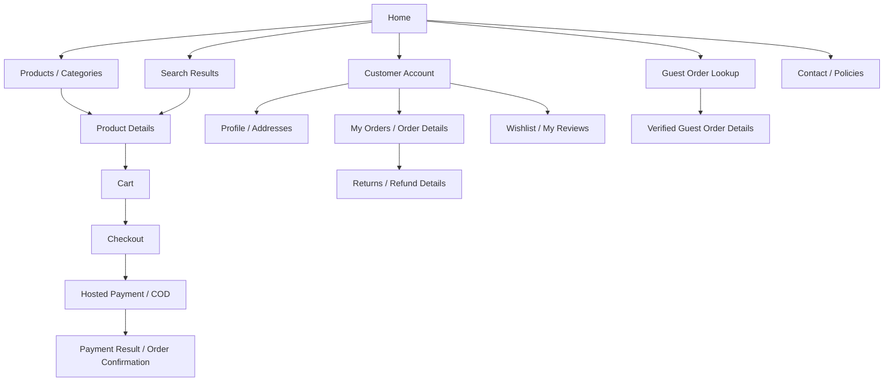
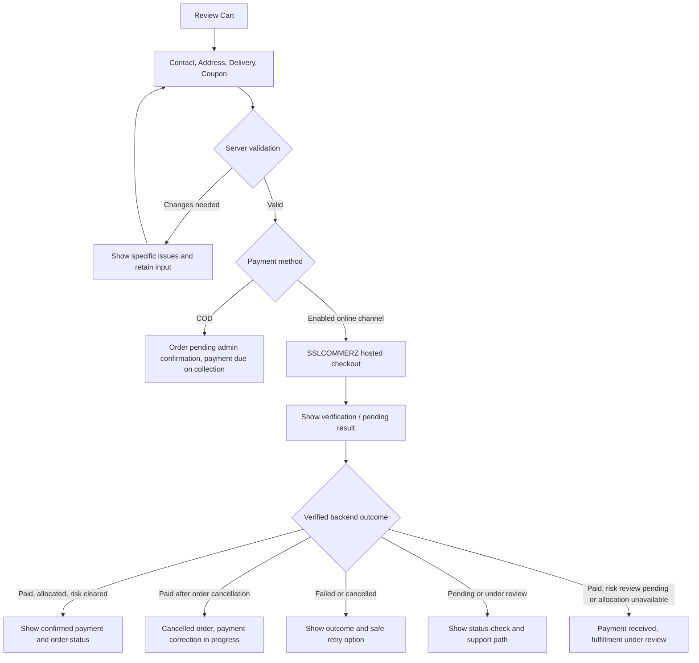
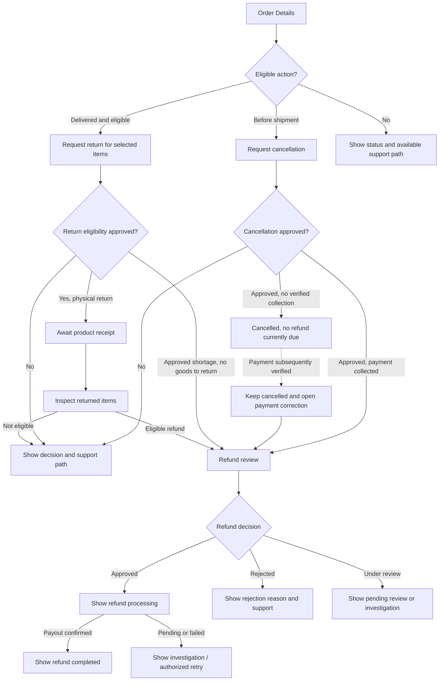
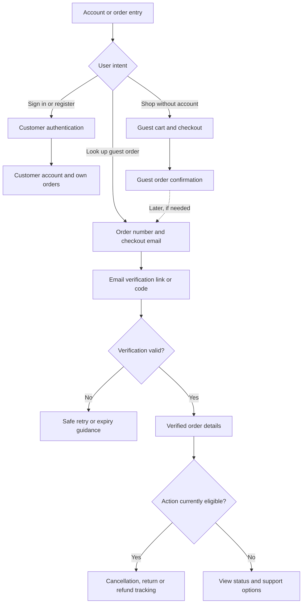
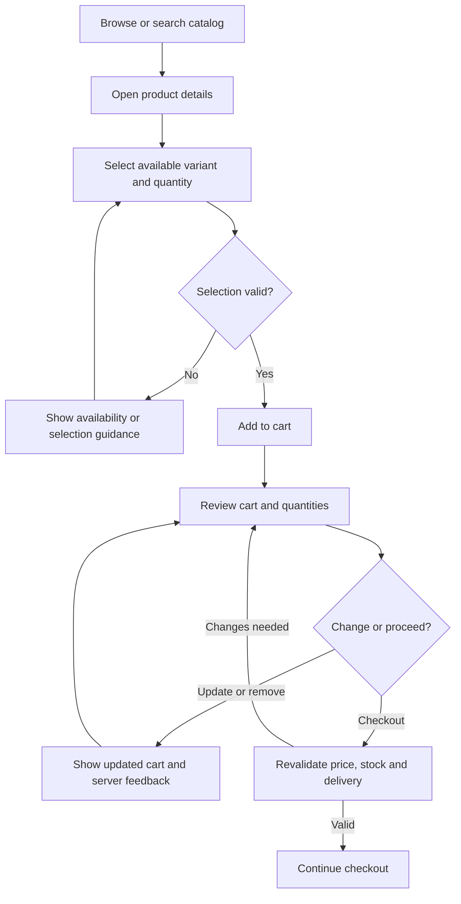

# SportZone — UI/UX design specification

**Version:** 1.0\
**Status:** Final development baseline\
**Updated:** 20 October 2026

**Product reference:** [PRD](./PRD.md)\
**Technical reference:** [Architecture](./ARCHITECTURE.md)\
**Applications:** Customer storefront (Next.js) and administration portal (React + Vite)\
**Market / currency:** Bangladesh / BDT

This document owns the visual system, page composition, navigation, interactions, responsive behavior, and accessible UI states for SportZone. Detailed HTTP/data contracts and test/operating procedures are documented separately in [API](./API.md), [Database](./DATABASE.md), [Testing](./TESTING.md), and [Operations](./OPERATIONS.md). The [PRD](./PRD.md) defines product scope and business rules; [Architecture](./ARCHITECTURE.md) defines technical boundaries. The interface uses a black-and-white light/dark foundation with restrained blue interactive accents and semantic tokens. Brand assets and policy content remain operator-supplied; no unapproved business claims are assumed.

---

**Contents**

- [1. Design overview](#1-design-overview)
- [2. Design system](#2-design-system)
- [3. Responsive design](#3-responsive-design)
- [4. Application layouts](#4-application-layouts)
- [5. Navigation & information architecture](#5-navigation--information-architecture)
- [6. UI components](#6-ui-components)
- [7. Storefront page specifications](#7-storefront-page-specifications)
- [8. Admin portal page specifications](#8-admin-portal-page-specifications)
- [9. Forms & validation](#9-forms--validation)
- [10. Interaction & state design](#10-interaction--state-design)
- [11. Critical user flows](#11-critical-user-flows)
- [12. Accessibility](#12-accessibility)
- [13. Content & visual assets](#13-content--visual-assets)
- [14. Design quality & consistency](#14-design-quality--consistency)

---

## 1. Design overview

### 1.1 Experience goals

- Make product discovery, variant selection, and checkout straightforward on mobile devices.
- Show prices, availability, delivery charges, deadlines, payment status, and refund status without ambiguity.
- Keep guest checkout usable without requiring account creation.
- Make administrative decisions explicit, auditable, and difficult to trigger accidentally.
- Provide consistent feedback for slow networks, expired sessions, payment uncertainty, and invalid operations.
- Target **WCAG 2.2 AA** and current stable Chrome, Firefox, Edge, Brave, and Safari, as required by PRD §12.7.

### 1.2 Design principles

1. **Clarity over decoration.** Emphasize product information and next actions.
2. **One primary action per context.** Secondary actions remain available but visually subordinate.
3. **Never imply success before confirmation.** The backend determines order, payment, stock, and refund outcomes.
4. **Preserve user input.** Validation errors and network failures should not discard completed form fields.
5. **Consistent patterns.** Use shared components for repeated interactions within each application.
6. **Mobile-first, accessible by default.** Touch, keyboard, screen-reader, and reduced-motion use are supported.
7. **Theme parity.** Light and dark modes preserve the same information, actions, status meanings, and accessibility.

### 1.3 Experience boundaries

The storefront serves guests and registered customers; the admin portal serves the single authorized administrator role. The design does not include multi-vendor features, live courier tracking, loyalty programs, advanced campaign builders, or other features excluded by the PRD. Backend validation and state transitions remain authoritative. Hide inactive channels, but follow PRD §3.3 for the three-channel launch gate; hiding a required method does not mean the release is accepted.

---

## 2. Design system

### 2.1 Visual direction

SportZone uses a **black-and-white foundation with a restrained blue brand accent**. Light mode is predominantly white; dark mode is predominantly black. All neutral backgrounds, borders, and text use true grayscale without blue, green, or purple undertones. Blue identifies primary actions, interactive links, selection, and focus; it does not tint page backgrounds, cards, or large interface regions. Product photography provides the visual energy. The brand blue is identical in both themes. The same system applies to the storefront and admin portal, with layouts tailored to each application.

**Component system:** HeroUI v3 is the standard component library for both frontends, using `@heroui/react` and `@heroui/styles`. Application-owned Button defaults live in each app's `src/components/ui/button.tsx`: primary for the main action, outline for secondary actions, ghost for low-emphasis actions and danger for destructive actions. Use app-owned HeroUI Link adapters to preserve Next.js/React Router navigation. Appearance uses HeroUI Select; mobile navigation and the Appearance panel use Disclosure. Page/loading panels use Card, loading feedback uses Spinner and connectivity/error feedback uses Alert. Keep native headings, text and landmarks for document semantics. Add further primitives as their feature tasks require them, with accessible pending, disabled, error and keyboard states.

**Design delivery:** The project owner delegates visual design within this specification; no separate Figma file is required. Use clear product-focused layouts, generous consistent spacing, restrained blue actions and grayscale surfaces. Storefront layouts prioritize discovery and purchase; admin layouts prioritize readable data and explicit actions. Review actual responsive screens and both themes, then incorporate owner feedback. Earlier scaffold acceptance does not approve every future screen's appearance.

**Implementation ownership:** Keep layout/composition in routes, repeated UI defaults in app-owned `components/ui/`, feature-specific components with their feature, pure shared behavior in `shared/` and cross-app design values in `styles/`. Avoid speculative abstractions, a shared UI package and additional component libraries. Remove superseded code/styles as components migrate.

**Component placement:** Architecture §§4–5 specify thin route composition, shells/navigation in `components/layout/`, feature-owned views/forms and reusable commerce/management compositions. Route groups organize layouts without changing URL or access rules. Current-shell/component links below remain implementation references until P02-012/P02-013 migrate them. Preserve HeroUI v3, semantic tokens, Appearance behavior and responsive/accessibility requirements; moves require affected browser verification.

### 2.2 Light and dark color system

Use the same **brand blue `#2563EB` in light and dark modes**, including primary buttons and selection indicators. Theme switching changes only monochrome surfaces, text, and borders; it does not change the brand hue. Neutrals are strictly grayscale. Success, warning, and danger colors are reserved for functional status feedback, never decorative backgrounds.

| Semantic token | Light | Dark | Purpose |
| --- | --- | --- | --- |
| `brand` | `#2563EB` | `#2563EB` | Primary buttons, selection indicators, accent strokes |
| `onBrand` | `#FFFFFF` | `#FFFFFF` | Text and icons on blue-filled controls |
| `linkText` | `#2563EB` | `#FAFAFA` | Readable link labels; dark links use blue underline/indicator |
| `linkAccent` | `#2563EB` | `#2563EB` | Link underline and interactive accent in both modes |
| `selectedSurface` | `#F5F5F5` | `#171717` | Neutral selected item surface with a blue border/indicator |
| `text` | `#0A0A0A` | `#FAFAFA` | Primary content |
| `textMuted` | `#525252` | `#A3A3A3` | Supporting content |
| `canvas` | `#FFFFFF` | `#000000` | Main page background |
| `surface` | `#FFFFFF` | `#0A0A0A` | Cards, dialogs, and panels |
| `surfaceMuted` | `#F5F5F5` | `#171717` | Inputs and secondary surfaces |
| `border` | `#D4D4D4` | `#404040` | Decorative dividers and nonessential separators |
| `controlBorder` | `#737373` | `#737373` | Visually identifiable input/control boundaries |
| `focus` | `#2563EB` | `#2563EB` | Keyboard focus accent; provide sufficient outline separation |
| `success` | `#166534` | `#86EFAC` | Confirmed successful status |
| `warning` | `#92400E` | `#FCD34D` | Pending or attention status |
| `danger` | `#B91C1C` | `#FCA5A5` | Errors and destructive status |
| `infoText` | `#2563EB` | `#FAFAFA` | Informational copy; dark mode pairs text with blue icon/indicator |

**Contrast and interaction rules:**

- Blue-filled primary buttons use **`#2563EB` with white text in both themes** (approximately **5.17:1** contrast). The button fill must not switch to light blue in dark mode.
- `#2563EB` against pure black is approximately **4.06:1**: sufficient for many non-text indicators, but below the **4.5:1** WCAG AA requirement for normal text. Therefore, dark-mode links and informational labels use readable light text with a persistent blue underline, icon, or accent; do **not** use blue alone for small dark-mode text.
- Primary-button hover and press feedback use neutral outlines or elevation **without replacing the blue base token**. Do not introduce a separate light-blue or dark-blue primary-button variant.
- Selected navigation uses a neutral selected surface and blue indicator; no blue-filled sidebar items. Focus outlines use blue with a contrasting offset/outer separation ring where needed, and must be clearly visible on both themes.
- Use `controlBorder` for essential form boundaries; subtle `border` is only for nonessential dividers. Functional status colors are not general-purpose button fills or broad tinted surfaces.
- Test actual combinations for badges, icons, links, overlays, disabled controls, and charts; do not rely on color alone to convey status.

**Theme behavior:**

- Provide a labeled **Light / Dark / System** preference in both applications; use the OS preference until the user chooses an override.
- Persist the choice per browser and apply it before the first visible paint to avoid theme flashing. Theme preference is visual only and does not require a backend account setting.
- Switching themes must not reset forms, carts, filters, or navigation state. The SSLCOMMERZ hosted interface is outside SportZone's theme control.
- Set `color-scheme` appropriately and style native controls, skeletons, overlays, icons, and charts for each mode. Do not invert product photographs; use theme-appropriate logo assets if necessary.
- Respect `prefers-reduced-motion`. Verify WCAG 2.2 AA text contrast, non-text contrast, and visible focus in **both** modes.

Both apps expose a labelled HeroUI Appearance select. Browser-local `sportzone.theme` stores Light/Dark/System per
origin; same-origin tabs synchronize changes. A blocking same-origin `/theme-bootstrap.js` in the document head applies
explicit choices before body content. System remains CSS media-driven, including OS changes. Storage failures preserve
a usable page-local selection. Theme state is independent of route/form state; reduced-motion rules apply in both apps.

**Implementation mapping:** [Shared color tokens](../styles/tokens.css) define semantic CSS custom properties (`--brand`, `--on-brand`, `--canvas`, `--text`, `--link-text`) on `:root`, overridden by `:root[data-theme="dark"]`. Without an explicit light/dark choice, the system preference supplies the dark fallback. Keep `--brand: #2563EB` and `--on-brand: #FFFFFF` unchanged in both modes. Tailwind color mappings use the same kebab-case names in both applications (`bg-brand`, `text-on-brand`, `text-text-muted`, `border-control-border`); avoid raw hex values in components. HeroUI aliases in [the adapter](../styles/heroui.css) reference these tokens in both apps; no separate shared UI package is needed. Tailwind library color mappings remain available for HeroUI internals, while project components use semantic tokens. Keep the existing CSS-driven System fallback and blocking bootstrap; do not add a second theme manager. HeroUI v3 needs no global provider.

### 2.3 Typography

- **Body, navigation, forms, tables, and product information:** **Inter**, weights 400, 500, and 600. Its readable shapes and tabular numerals suit both commerce screens and dense administration tables.
- **Page headings, product titles, and promotional display text:** **Plus Jakarta Sans**, weights 600 and 700. Use it for a distinct, modern retail identity without introducing decorative display fonts.
- **Bangla content, when present:** **Noto Sans Bengali** with a tested Bengali-capable system fallback. Do not assume the Latin fonts cover Bengali characters.
- **Fallbacks:** `Inter, system-ui, sans-serif` for UI text; `Plus Jakarta Sans, Inter, system-ui, sans-serif` for headings.
- **Loading:** Prefer self-hosted, subsetted WOFF2 files with `font-display: swap`; avoid unnecessary weights. Preserve readable layout while fonts load.
- **Sizing:** Body 16px at 1.5–1.6 line height; most supporting UI text at least 14px; 12px reserved for nonessential metadata. Scale: 12, 14, 16, 18, 20, 24, 30, 36px. Responsive page titles typically 24–32px.
- **Numeric content:** Use tabular figures for BDT amounts, quantities, order identifiers, and dashboard metrics. Preserve semantic heading order and avoid excessive all-caps labels.

[Typography foundation](../styles/foundation.css) provides the shared font faces and Tailwind font/size mappings.
[Font assets and licenses](../styles/fonts/README.md) are self-hosted; use `numeric` for tabular figures.

### 2.4 Spacing, dimensions, and surfaces

| Element | Baseline |
| --- | --- |
| Spacing scale | 4, 8, 12, 16, 24, 32, 40, 48, 64px |
| Content width | Storefront max 1280px; centered with responsive gutters |
| Form/control height | Minimum 44px for primary interactive controls |
| Card radius | 20px |
| Input/button radius | 12px |
| Dialog radius | 24px |
| Borders | 1px subtle neutral; stronger for selected/error states |
| Shadows | Minimal; use primarily for elevated dialogs, menus, and sticky surfaces |
| Icon sizes | 16, 20, or 24px according to context |

Use responsive spacing rather than fixed heights for content. Product imagery should have stable aspect ratios to avoid layout shifts. Keep animation subtle and respect `prefers-reduced-motion`.

**20 October 2026 owner direction:** After rejecting the first showcase, the owner explicitly selected HeroUI v3’s original component design and requested simplicity/professionalism. Retain native HeroUI shapes, typography, spacing, variants and elevation rather than a custom component skin. Semantic blue/neutral colors, project fonts, minimum 44px interactive targets, contrast, focus and reduced-motion requirements remain. Radius tokens above remain available for app-owned non-library compositions; do not force them over HeroUI controls/cards/dialogs. All current app-owned UI and commerce/management components must be accessible in the local gallery, including state examples and isolated layout previews. Visual acceptance remains pending owner review. The owner subsequently clarified that the reference preview must show direct HeroUI components used by the project with their supported variants, entirely without project CSS or wrappers. Serve that reference in its own document; keep the app composition gallery separate. Native reference colors are not approval to replace production palette/contrast requirements.

### 2.5 Core visual rules

- Primary buttons use the same `brand` fill and white `onBrand` text in both themes; secondary buttons use semantic neutral surfaces and borders. Destructive controls use tested danger-specific combinations.
- Links remain recognizable independently of color: use `linkText` plus a persistent underline or other clear affordance; in dark mode, the underline/indicator uses `linkAccent`.
- Disabled controls explain the reason when useful, particularly for unavailable variants, ineligible actions, and unactivated payment channels.
- Prices use **৳** or **BDT** consistently, with the display precision determined by the amount; never use floating-point UI arithmetic as the source of checkout totals.
- Product images use `object-fit: contain` for catalog thumbnails when cropping would hide merchandise; editorial banners may use intentional cover cropping.

The shared foundation maps the 4px spacing unit, `min-h-control` (44px), `max-w-storefront` (1280px), and
`rounded-control/card/dialog` (8/12/16px). The [BDT display utility](../shared/format-bdt.ts) accepts nonnegative safe integer
poisha and uses the taka symbol with en-BD grouping. Whole taka omit decimals; other amounts show exactly two digits
(for example, 100 → ৳1, 105 → ৳1.05, 123450 → ৳1,234.50). Invalid input is rejected without coercion.

---

## 3. Responsive design

### 3.1 Breakpoints and layout behavior

Use mobile-first styles; these widths are layout guidance, not device detection.

| Viewport | Layout behavior |
| --- | --- |
| Under 640px | Single-column content, compact navigation, stacked forms, full-width primary actions |
| 640–767px | Wider cards and selective two-column content where readable |
| 768–1023px | Tablet grids, expanded filters where space permits, compact admin navigation |
| 1024–1279px | Desktop navigation, multi-column catalog and admin layouts |
| 1280px and above | Centered max-width storefront; full admin workspace with readable line lengths |

### 3.2 Storefront responsive patterns

- **Header:** Desktop logo, category navigation, search, account, wishlist, and cart. Mobile uses logo, accessible menu, search access, and cart; other links appear in the menu. Keep the search control easy to reach.
- **Catalog:** Two product columns on typical mobile widths when cards remain legible; otherwise one. Increase to three or four columns on wider viewports. Filters open in a dismissible mobile drawer; desktop filters can occupy a sidebar.
- **Product details:** Gallery above purchase details on mobile; side-by-side on desktop. Variant choices and quantity controls remain visible and touch-friendly.
- **Cart and checkout:** Single-column on mobile, with the order summary positioned after the relevant form content or in a collapsible summary. On desktop, show the summary in a separate column; never hide final charges behind a collapsed state at order submission.
- **Tables:** Customer-facing order lists use cards on narrow screens; avoid horizontal scrolling for primary information.

### 3.3 Admin responsive patterns

- Desktop uses a persistent sidebar and content workspace. Smaller screens use a keyboard-accessible, dismissible navigation drawer.
- Dense tables can scroll horizontally inside their own region with column labels retained; show essential status and actions first. On mobile, use row summaries/cards for workflows that require frequent phone use.
- Forms stack to one column on narrow screens; use two columns only when fields remain understandable.
- Dialogs fit within the viewport; complex workflows may use full-screen mobile dialogs with clear back/cancel actions.

### 3.4 Responsive quality rules

No page-level horizontal overflow at common viewport sizes. Maintain visible focus, usable touch targets, readable errors, and stable layout during image loading and asynchronous updates.

---

## 4. Application layouts

### 4.1 Storefront shell

```text
Utility/contact information (when configured)
Header: logo | navigation/search | account | wishlist | cart
Main content: page heading/breadcrumbs → page-specific sections
Footer: contact | customer support | shipping | returns/refunds | privacy | terms
```

Use one consistent header/footer across public pages, with a simplified distraction-free checkout header if necessary; policy/help access must remain available. Render a promotional banner only from approved storeSettings.homepageBanner content, independently of the logo. Missing content is an honest empty state; banner capability remains required by FR-03 and is not waived by withholding unapproved content. It is not a persistent blocking overlay. The header must not cover page headings or keyboard focus targets. Provide the Light / Dark / System control in the accessible account or appearance menu (also available to guests).

### 4.2 Customer account shell

Authenticated account pages share a title, account navigation, and main content region. Desktop may use a left-side navigation; mobile uses a compact navigation list or tabs that do not hide available destinations. Highlight the current section. A signed-out or expired session redirects to login with a safe return destination and preserves non-sensitive in-progress work where possible.

### 4.3 Admin shell

```text
Sidebar: dashboard | catalog | inventory | orders | customers
         payments | coupons | reviews | returns | refunds
         delivery settings | reports | store settings
Top bar: page context | administrator account/logout
Main: page title/actions → filters/summary → content → pagination
```

Provide the Light / Dark / System control in the administrator account/appearance menu. Group related destinations without creating extra permission levels. Show current section and contextual actions. Keep the administrator's session and access separate from customer sessions. Complaint handling is available from the order/customer context where relevant; a standalone complaint screen is not required by the PRD.

**Current shell implementation:** [Admin shell](../admin/src/components/layout/admin-shell.tsx) uses a persistent sidebar from 1024px and a HeroUI left Drawer below that breakpoint. The five groups and 14 destinations share one navigation source. Selected items use a grayscale surface and blue border. Drawer navigation, Escape/Close and desktop transitions dismiss the overlay; the body scrolls vertically. Page title/actions and Appearance are reusable compositions. Until Phase 03 session integration, only public navigation metadata and an unavailable-access state render on `/app/*`; no management data, logged-in identity or working logout is implied. Lazy administration loading exposes a live status; route render/chunk failures show a safe alert and Reload page action without exception details.

### 4.4 Shared layout states

All shells must handle navigation loading, expired sessions, missing permissions, offline/network errors, and not-found routes without displaying stale sensitive data.

---

## 5. Navigation & information architecture

### 5.1 Storefront sitemap



This is a navigation map, not an assertion that every page is accessible without authentication or verification.

### 5.2 Admin sitemap

The authenticated admin shell exposes these navigation groups. Group labels organize the interface; they do not create additional roles or permissions.

| Navigation group | Destinations |
| --- | --- |
| Overview | Dashboard, Reports |
| Catalog and shopping | Products/Add/Edit, Categories, Inventory, Coupons, Reviews |
| Orders and payments | Orders/Details, Payments |
| Customers and after-sales | Customers, Returns, Refunds; complaints in order/customer context |
| Configuration | Delivery Settings, Store Settings; account logout, appearance and recovery entry points |

### 5.3 Navigation conventions

- Use predictable page titles and breadcrumbs on nested catalog, order, and admin detail pages.
- Keep search query, filters, sort, and page number in the URL when appropriate so results can be revisited or shared.
- Use descriptive URLs for products and categories. An invalid or inactive product link shows a safe unavailable/not-found state, not a broken purchase action.
- Use back navigation without losing search/filter context when returning from product details.
- Route guards improve navigation but never replace backend authorization.

---

## 6. UI components

### 6.1 Shared component inventory

| Component | Variants / essential behavior |
| --- | --- |
| Button | Primary, secondary, text, destructive; loading, disabled, focus states |
| Link | External/internal, visible focus and descriptive destination |
| Text input / textarea | Label, hint, required, invalid, disabled; preserve input on error |
| Select / combobox | Keyboard-operable; supports long district/area lists |
| Checkbox / radio | Clear selection, label click targets, grouped payment options |
| Quantity selector | Minus/plus and direct value; respects min/max and stock feedback |
| Product card | Image, title, BDT price, optional sale price/rating, availability, action |
| Price display | Regular/sale hierarchy, discount indication when applicable |
| Variant selector | Selected, unavailable, invalid, and loading states |
| Badge | Order/payment/return/refund status with explicit text |
| Alert / inline message | Success, warning, error, information; actionable next step |
| Toast | Brief noncritical feedback; must not be the only confirmation of an important action |
| Modal / confirmation | Focus trap, descriptive title, cancel/confirm, focus restoration |
| Drawer | Mobile navigation and catalog filters; dismissible with Escape |
| Tabs / accordion | Semantic state, keyboard support, visible labels |
| Breadcrumbs | Nested navigation, last item current page |
| Pagination | Current page, previous/next, bounded accessible controls |
| Skeleton / spinner | Announce loading where appropriate; avoid layout shifts |
| Empty state | Explanation and relevant recovery action |
| File upload | File constraints, preview, removal, upload/error progress |
| Data table | Header associations, sort/filter states, row actions, pagination |
| Status timeline | Ordered milestones with current state and timestamps when available |

### 6.2 Product and commerce components

- **Product cards:** Show image, name, current price, prior price only when a genuine sale exists, approved rating summary if available, and an availability cue. Do not promise stock from cached data.
- **Variant controls:** Show attributes as labeled choices; disable invalid combinations; announce availability updates. Require a valid selection before adding to cart.
- **Cart line:** Thumbnail, name, variant/SKU description, unit price, quantity, line total, remove action, and price/stock change warnings.
- **Order summary:** Subtotal, product discounts, coupon discount, delivery charge, total payable, and payment method. Display confirmed server-calculated values before final submission.
- **Payment method choice:** Show COD and only gateway channels currently enabled. Use the provider's recognizable channel labels without implying unavailable activation.

**Implementation:** Storefront [commerce components](../storefront/src/components/commerce/product-card.tsx) follow the [usage/state contracts](./UI_COMPONENTS.md#commerce-compositions). Price/line/summary amounts are supplied by the consuming feature/API; quantity controls and variant options express requests/eligibility without reserving stock. Status text remains explicit; payment, funding and fulfillment are never inferred from a monetary total. These components do not populate unavailable catalog/cart pages with synthetic products.

### 6.3 Administrative components

- **Management tables:** Search/filter toolbar, visible row status, bulk selection only where an actual bulk operation exists, and contextual row actions.
- **Detail panels:** Show immutable historical values separately from editable current configuration.
- **Status change controls:** Present only backend-eligible next actions, with confirmation and reason fields when needed; still handle backend rejection.
- **Financial actions:** Show source transaction, eligible amount, pending commitments, intended payout method, and confirmation before submission. Never mark payout complete from an optimistic UI update.
- **Audit context:** Display available actor, timestamp, and action details for sensitive changes without exposing secrets.

Implementation foundation: admin table/filter/pagination, file upload and guarded confirmation compositions are defined in the [component usage guide](./UI_COMPONENTS.md#admin-management-compositions). Feature integrations supply authoritative rows, upload policy and eligible actions; these primitives do not grant administrator access or execute business operations.

### 6.4 Component state contract

Every interactive component must define: default, hover (where applicable), focus-visible, active/selected, disabled, pending/loading, validation error, and successful completion states **in both themes**. Disabled actions that matter to users should include an explanation nearby.

**Implementation:** Both apps provide HeroUI field/form/feedback/overlay compositions in `src/components/ui/`; usage and state ownership are documented in [UI components](./UI_COMPONENTS.md). Appearance selects, connectivity notices and storefront loading feedback consume these primitives. Parent editors retain controlled drafts across overlay dismissal; pending panels block Escape/backdrop/Cancel until the caller settles. Field errors and linked summaries use explicit accessible associations; summary focus is requested only after a failed submission.

---

## 7. Storefront page specifications

### 7.1 Discovery and shopping

| Page | Layout and required content | Key interactions / states |
| --- | --- | --- |
| **Home** | Hero/banner, category links, featured, new, and discounted products; search; contact/support access | Responsive sections; configured promotions only; loading/empty sections |
| **Products** | Heading, search context, result count, filters, sort, paginated product grid | Search by name/keywords; price/availability filters; newest/price sorts; reset; empty results |
| **Category** | Category title, optional image, subcategory navigation, same catalog controls | Inactive category excluded; preserve category context |
| **Product Details** | Breadcrumbs; image gallery; name, rating, description, regular/sale price, variant/stock, quantity, cart/wishlist actions, return eligibility, related products, reviews | Change variant updates stock/price; invalid selection, out-of-stock, add-to-cart feedback; gallery keyboard controls |
| **Cart** | Cart lines, quantity/remove, estimated subtotal, checkout action | Guest persistence; account merge after login; stock/price change warnings; empty state; no stock reservation |
| **Wishlist** | Saved product grid/list, availability, remove and add-to-cart | Requires login; unavailable product remains clearly marked; empty state |
| **Reviews (on product)** | Average/count, approved review list, verified-purchase labels; eligible review form | 1–5 stars, written review, moderation status; edit own review when permitted; sign-in/eligibility messages |

**Catalog layout:** On desktop, place filters beside the grid; on mobile, use a filter drawer with Apply and Clear controls. Search, sort, and filters must be operable without a mouse. Pagination retains query state. Product card links must not contain nested interactive buttons.

**Product detail layout:** On mobile, gallery precedes product information and purchase controls. On desktop, gallery and purchase details form two columns; descriptions and reviews follow. Price and stock changes after variant selection must be announced without excessive screen-reader chatter.

### 7.2 Authentication and account

| Page | Layout and required content | Key interactions / states |
| --- | --- | --- |
| **Login** | Email, password, submit, forgot-password link, registration link | Invalid credentials, rate-limit feedback, session creation |
| **Register** | Name, email, password, confirmation where needed, submit, login link | Duplicate email, field errors, successful account creation |
| **Forgot Password** | Email entry, submission confirmation | Neutral response that does not reveal account existence |
| **Reset Password** | New password, confirmation, token validity feedback | Expired/used token and recovery link |
| **My Account** | Overview and links to profile, addresses, orders, wishlist, reviews, returns/refunds | Authentication required; loading/empty states |
| **Profile** | Name, phone, email, password-change actions | Email change verification; inline success/error feedback |
| **Addresses** | Address cards/list, default address, add/edit/delete form | District/area validation; deletion confirmation; historical orders unaffected |
| **My Orders** | Paginated order cards/list with number, date, total, fulfillment and payment statuses | Open details, empty history, filter if supported by API |
| **Order Details** | Immutable purchased items, price breakdown, delivery snapshot, payment status, fulfillment timeline, delivery estimate/deadline | Eligible cancellation/return links; delay/failed-delivery notice, revised estimate when confirmed, contact/support action, and refund links |
| **My Reviews** | Submitted reviews, product context, moderation state, edit action | Ineligible edit or missing review state |

Account pages must not expose another customer's records. If a session expires, show a clear reauthentication path without leaking private data.

### 7.3 Checkout, payment, and guest access

| Page | Layout and required content | Key interactions / states |
| --- | --- | --- |
| **Checkout** | Contact details, delivery address/district/area, optional notes, delivery charge and deadline, coupon field, payment method, order summary, terms acceptance, final action | Guest or signed-in; saved address selection; revalidate stock, prices, coupon, and delivery; duplicate-submit prevention |
| **Payment Result** | Verification-in-progress, confirmed paid, failed, cancelled, or pending/unresolved result | Never trust browser redirect alone; show refresh/check-status path; do not encourage duplicate payment while status is uncertain |
| **Order Confirmation** | Order number, summary, payment/fulfillment status, next steps, receipt of submitted order | COD shown as unpaid until collection; pending online payment not mislabeled as paid |
| **Order Lookup** | Order number + checkout email; request verification link/code; verified order view | Rate-limited, time-limited proof; scoped cancellation, return, and refund tracking only when eligible |

**Checkout composition:** Keep contact/address first, then delivery area and charge, coupon, payment choice, and final summary. On desktop, a persistent summary column may be used; on mobile, show a compact summary during entry and the full total before the final action. A rejected checkout retains entered details and identifies the exact item or field requiring attention. Final confirmation submits the server-issued quote reference internally, as specified in API §11.1. Changed or expired quotes display current terms for explicit confirmation using plain-language feedback. Never automatically approve or resubmit a refreshed quote. Keep the same idempotency key during uncertain replay of an already submitted operation.

**Payment messaging:** Distinguish *order submitted*, *payment pending verification*, *payment confirmed*, *payment failed*, and *payment cancelled*. For a late verified payment with unavailable stock/coupon capacity, show **Payment received — fulfillment under review**, not a false order confirmation. Do not display provider transaction secrets.

### 7.4 After-sales and informational pages

| Page | Layout and required content | Key interactions / states |
| --- | --- | --- |
| **Return Request** | Eligible order items/quantities, reason, optional evidence upload, policy summary, submit | Show applicable request deadline (standard baseline: 7 calendar days after delivery), eligibility exceptions, and inspection for physical returns only; shortage claims skip shipment/receipt/inspection; block duplicate active claims and invalid quantities |
| **My Returns** | Return list, item context, current status, dates and decisions | Distinguish approved return from approved refund; show deadline and next required action where applicable |
| **Refund Details** | Refund amount, method, status, associated items/transaction, timestamps | Show approval date and target (normally 7 business days after approval), provider delay/overdue message when applicable; completion only after confirmed payout |
| **Contact** | Store-provided contact details and basic complaint submission/channel; anonymous contact name/email required | Submission feedback and reference when available; no invented live chat |
| **Shipping Policy** | Store-approved delivery coverage, charges approach, deadlines, exceptions | Accessible readable content; operator-supplied policy |
| **Return & Refund Policy** | Eligibility, return window, refund methods/timing, consumer-rights statement | Store-approved content; link from checkout and after-sales screens |
| **Privacy Policy** | Approved privacy and data-use content | Accessible headings and links |
| **Terms & Conditions** | Approved terms, checkout-related policies | Explicit acceptance at checkout |
| **Not Found / Error** | Clear explanation, home/catalog navigation, retry where useful | Do not expose stack traces or private data |

**Deadline presentation:** Show a return-request deadline only when delivery date and applicable policy make it reliable; explain legally protected exceptions without implying that the standard window eliminates statutory rights. Refund targets begin at **refund approval**, not request submission. Read approvedAt and the authoritative timing projection from the API; under_review/awaiting_approval has no invented date. Display the approved business-calendar/policy basis and safe item/status timeline; do not calculate targets from a browser holiday guess. If the target is missed, display the latest verified status and support path; never imply payout has completed.

**Legal/operational content:** Delivery commitments and policy wording must reflect the store's approved configuration and applicable law. The UI must not hard-code an unconditional 14-day delivery promise or represent store policy drafts as verified legal rules.

---

## 8. Admin portal page specifications

### 8.1 Dashboard and catalog

**Administrator recovery screens:** The admin login links to a dedicated recovery request and reset screen using the admin session context. Show neutral request confirmation, new-password fields, expired/used-link guidance, rate-limit feedback, and return to admin login. Customer recovery must never create administrator access.

| Page | Layout and required content | Primary actions / safeguards |
| --- | --- | --- |
| **Admin Login** | Email, password, recovery, login feedback | No public admin registration; rate-limit and session-expiry messaging |
| **Dashboard** | KPI cards, recent orders, low-stock and pending-return summaries | Distinguish paid collections, outstanding COD, refunds, and net collected revenue; no misleading revenue aggregation |
| **Products** | Searchable/filterable table with name, SKU/variants, price, category, visibility, stock | Add, edit, deactivate; show active/inactive state |
| **Add/Edit Product** | General details, categories, images, pricing, variants/SKUs, featured and visibility settings | Field validation, duplicate slug/SKU feedback, image preview, unsaved-change warning |
| **Categories** | Category/subcategory hierarchy, status, image, edit controls | Prevent deletion with dependent products without reassignment |
| **Inventory** | Variant/SKU table with physical, reserved, committed, available, threshold and movements | Record reasoned adjustments; protect against negative available stock; inspect returned items before restocking |

**Metric labels:** Use PRD FR-22 definitions. Display the selected period, date basis, Asia/Dhaka timezone, balance cutoff, and separate overpayment/payment-correction amounts. Do not label net collections as profit.

The dashboard must not treat uncollected COD as paid revenue. Charts are optional only when they accurately represent the PRD's basic reporting data; metric cards and tables are sufficient.

### 8.2 Orders, customers, and payments

| Page | Layout and required content | Primary actions / safeguards |
| --- | --- | --- |
| **Orders** | Search by order number, status filters, date, customer, totals, payment/fulfillment badges | Open order; paginate; no unsupported state jumps |
| **Order Details** | Order snapshot, items, totals, delivery deadline, payment attempts/status, fulfillment history, cancellation and complaint context | Confirm COD, update allowed fulfillment states, record shipment/collection; for delayed or failed delivery show reason, customer-contact record, revised estimate and retry/resolution action when eligible |
| **Customers** | Searchable customer list, status, account/order overview | View history, suspend/reactivate with confirmation; minimize sensitive details |
| **Payments** | Transaction references, method, amount, status, attempts, reconciliation flags, linked order/refunds | Review uncertain/risky transactions; record verified COD collection; do not manually mark unverified gateway payment as paid |
| **Reports** | Basic date-filtered order/collection/refund summaries and activity history | Separate GMV, discounts, collections, refunds, and net collections; show date range and metric definitions |

### 8.3 Promotions, moderation, and after-sales

| Page | Layout and required content | Primary actions / safeguards |
| --- | --- | --- |
| **Coupons** | Code, type/value, validity, minimum eligible amount, limits, status, redemption history | Create/edit/deactivate; validate overlapping/invalid settings and usage limits |
| **Reviews** | Review text/rating, product, verified-purchase flag, moderation status | Approve/reject/hide with reason; never rewrite customer rating as their own |
| **Returns** | Request list and detail with items, quantities, reason, evidence, history | Review physical-return or shortage claim; physical returns use receipt/inspection/restocking, while shortage claims skip those steps; distinguish decisions from payout |
| **Refunds** | Refund list and detail with original collection, eligible balance, amounts, attempts, payout method/status | Approve/reject, initiate supported payout, verify manual transfer, investigate failure; require confirmation |
| **Delivery Settings** | Zones, district/area coverage, active status, charges | Add/edit/deactivate; warn that changes affect future orders only |
| **Store Settings** | Branding/contact, store address, low-stock threshold, policies, support/complaint contact | Validate changes; show saved/unsaved state; published policy content must be approved |

**Operational complaints:** Show basic complaint records, status, and resolution in the relevant order/customer support context. Do not introduce a complex ticketing product.

### 8.4 Admin detail and action rules

- Place primary actions in a consistent page-header area; keep destructive/irreversible actions visually separate.
- Show relevant history, actor, and timestamp before a high-impact financial or fulfillment action.
- Require an explicit confirmation step for refunds, stock adjustments, account suspension, order cancellation, and irreversible status changes.
- A successful button click is not a successful transaction: update status only after authoritative API confirmation.
- Surface validation conflicts and concurrent changes without silently overwriting records.

---

## 9. Forms & validation

### 9.1 Form anatomy

Each field has a visible label, optional helper text, clear required indication, and an error message associated programmatically with the field. Placeholder text is supplementary, not a replacement for a label. Group related fields under meaningful headings.

### 9.2 Validation and submission

- Validate obvious format constraints on blur or submission; avoid disruptive errors while the user is still typing.
- Always display backend validation errors beside the relevant field, plus a concise summary for multi-field failures.
- Focus the first invalid field or error summary after a failed submission; preserve all valid inputs.
- Disable repeat submission while a request is pending, but provide a visible progress label and a safe retry path.
- Validate Bangladesh phone numbers, email, required delivery fields, SKU uniqueness, quantities, and currency fields using backend-compatible rules.
- For password recovery, use neutral messaging that does not reveal whether an account exists.
- For upload forms, show supported type/size constraints from the implementation and allow removal/retry.

### 9.3 Sensitive and financial forms

Checkout always shows the final backend-calculated payable amount before confirmation. Coupon failures explain invalid, expired, ineligible, or exhausted conditions without revealing internal configuration. Refund forms show eligible balance and remaining quantity; manual refund forms require evidence/confirmation as specified by the PRD. Never collect payment card credentials in SportZone forms; online payment uses SSLCOMMERZ hosted checkout.

---

## 10. Interaction & state design

### 10.1 Global UI states

| State | Required UI behavior |
| --- | --- |
| Initial loading | Skeleton or progress indicator without misleading empty results |
| Empty | State-specific explanation and next valid action |
| Validation error | Field-level message and retained input |
| API/network error | Safe explanation, retry when idempotent, no false success |
| Unauthorized | Reauthentication path; remove private data from view |
| Forbidden | Explain lack of access without exposing protected information |
| Conflict / stale data | Refresh authoritative values; preserve user intent when safe |
| Success | Confirm saved outcome with persistent page state for important operations |
| Pending external operation | Clearly distinguish waiting from completed; provide status-check path |
| Disabled/ineligible | Explain why action cannot proceed and when it may become available |

### 10.2 Commerce-specific states

- **Price or stock changed:** Identify affected cart lines, show current values, and require confirmation before checkout.
- **Coupon rejected or expired:** Keep entered code visible with reason and allow correction/removal.
- **Delivery area unavailable:** Block checkout with a clear supported-area message; retain address input.
- **Payment pending/unknown:** Show a non-final status and link to the order; do not create an automatic second attempt.
- **Paid after cancellation:** Preserve the Cancelled order label and show payment received with correction/refund under review; never imply that the order reopened.
- **COD placed:** Show Order Pending Confirmation and Payment Due on Collection until the separate administrator and collection actions occur.
- **Final failed delivery:** Show the recorded non-delivery closure and eligible refund status; administrative views require custody/disposition and inspected recovery details.
- **Duplicate payment confirmed:** Show collection under review and direct customer to order/payment status; do not claim duplicate fulfillment.
- **Reservation expired:** Explain that availability must be rechecked; do not promise stock.
- **Cancellation requested:** Show request pending administrator review; retain the current fulfillment state until approval. Pending/Confirmed requests require review, and Processing also requires dispatch verification.
- **Order status changed concurrently:** Reload status and show eligible actions only.
- **Physical return approved but not inspected:** Show the next return/receipt step; do not display its refund as approved.
- **Shortage claim approved:** Show the approved missing quantity and separate refund-review status; never request shipment, receipt, or inspection of missing goods.
- **Refund processing or failed:** Show investigation/retry status; do not show completed until payout verification.
- **Delayed or failed delivery:** Show a persistent status notice, last confirmed estimate and customer support path. Admin sees reason, contact history and allowed retry/resolution actions.
- **Return/refund deadlines:** Display only policy- and event-backed dates; label calendar days versus business days and provide overdue support messaging.

### 10.3 Feedback timing

Use inline validation for fields, toasts for reversible low-risk changes, and persistent banners/timelines for orders, payments, refunds, and failures. Avoid automatic dismissal of messages needed to make a decision. Long-running operations should show progress without promising an exact completion time.

---

## 11. Critical user flows

### 11.1 Checkout and payment experience



The UI cannot treat the provider redirect as proof of payment. A late verified payment with insufficient allocation is shown as an exception requiring resolution, not an ordinary fulfilled order.

### 11.2 Order cancellation and after-sales



For unpaid online cancellation, stop further payment initiation and keep uncertain provider attempts under reconciliation. If a collection is verified later, preserve Cancelled fulfillment and show correction/refund under review; do not reopen the order.

For missing items or short-delivered quantities, offer a claim reason and quantity selection without requiring a return shipment. Show Requested, Under Review, Approved/Rejected, and Completed claim states with the refund tracked separately. Do not ask the customer to confirm receipt or inspection of missing goods.

Cancellation, return, and refund are distinct processes. An approved return does not mean a refund has been paid. Some cancellation/payment-correction refunds do not involve physical returns.

### 11.3 Authentication and verified guest access



`Order lookup → Enter order number and checkout email → Receive time-limited proof → Verify → View scoped order → Perform only currently eligible actions.`

The guest must not see account-only navigation as if authenticated. Verification failure, expired proof, and rate limiting require clear recovery instructions without exposing order existence to unauthorized users.

### 11.4 Product selection and cart



Cart quantities and product availability remain subject to backend validation at checkout. Adding an item to the cart does not reserve stock.

### 11.5 Administrator processing

`Find record → Review current status and evidence → Select permitted action → Confirm details/reason → Submit → Display verified result and updated history.`

For payment/refund exceptions, show a pending-investigation state when the authoritative result is uncertain. Never offer an optimistic **Completed** state.

---

## 12. Accessibility

### 12.1 Target and semantics

Target **WCAG 2.2 AA**. Use semantic headings, landmarks, navigation, form labels, tables, and buttons. All essential operations must be available with keyboard only. Provide a visible skip-to-content link and logical tab order.

### 12.2 Interaction requirements

- Maintain visible keyboard focus and restore it after closing menus/dialogs.
- Ensure touch targets meet the applicable WCAG 2.2 target-size requirement, with 44px controls as the default design baseline.
- Use sufficient text and non-text contrast; verify real component combinations, not only isolated tokens.
- Associate validation errors and hints with inputs; announce important state changes through appropriate live regions.
- Provide meaningful image alternatives; decorative images have empty alt text.
- Avoid conveying status through color, position, animation, or icon alone.
- Support zoom, text resizing, reflow, and reduced motion without losing actions or content.
- Use proper accessible names for icon-only controls, pagination, image galleries, and rating controls.
- Ensure overlays have focus management, Escape handling, and an obvious close action where appropriate.

### 12.3 Accessibility verification

Review storefront discovery, variant selection, checkout, guest verification, order tracking, admin tables, modal confirmations, and refund forms with keyboard and screen-reader checks. Automated accessibility checks complement but do not replace manual verification. Repeat contrast, focus, error, overlay and form-control checks in **both light and dark themes**.

---

## 13. Content & visual assets

### 13.1 Language and formatting

The initial interface uses clear English copy suitable for Bangladesh customers; the UI should accommodate future localization without changing layout architecture. Display monetary amounts in BDT with consistent separators. Use an unambiguous date format and label business-day versus calendar-day deadlines where relevant. Show local delivery locations using store-configured district/area values.

### 13.2 Microcopy conventions

Use consistent labels for separate lifecycles: **Order** (Pending, Confirmed, Processing, Shipped, Delivered, Cancelled where eligible), **Payment** (Pending Verification, Paid, Failed, Cancelled, Partially Refunded, Refunded), **Return** (Requested, Under Review, Approved, Awaiting Return, Received, Inspected, Completed or Rejected), and **Refund** (Requested, Under Review, Approved, Rejected, Processing, Completed, Failed). Show risk review, allocation hold, and overpayment/payment-correction flags separately from these lifecycle labels. Non-physical shortage claims use the abbreviated PRD FR-17 claim path. These are user-facing labels mapped to authoritative backend states; do not invent a single combined order/payment/refund status.

- Buttons describe actions: **Add to Cart**, **Proceed to Checkout**, **Place COD Order**, **Continue to Secure Payment**, **Request Cancellation**, **Submit Return Request**, **Approve Refund**.
- State labels are explicit: **Payment Pending Verification**, **Payment Confirmed**, **Refund Processing**, **Refund Completed**.
- Error messages explain what happened and what the user can do next; avoid generic “Something went wrong” when a safe specific explanation is available.
- Avoid countdown promises for payment verification, delivery, or refunds unless the system has a reliable deadline to show.
- Distinguish *estimated delivery date* from *applicable delivery deadline*.

### 13.3 Imagery and icons

Use store-approved product photographs and brand assets. Maintain consistent thumbnail ratios, provide alternate product views where available, and optimize images for responsive loading. Use a consistent icon family and avoid icons without text for critical actions. Store policies, contact details, shipping charges, active payment channels, and logo are operator-supplied/configured values, not fixed design assumptions.

### 13.4 Transactional email presentation

Use one responsive, accessible email layout: store identity, concise subject, clear event heading, order/reference number, verified status, relevant amount/date, support contact, and a safe link to the appropriate verified page. Use plain-text fallbacks and avoid relying on color, images, or email-client dark-mode rendering for meaning.

| Event | Email content focus |
| --- | --- |
| Registration or account recovery | Account confirmation or recovery action; no password disclosure |
| Order placed | Order reference, items/amount, COD due or online payment pending as applicable |
| Payment update | Verified paid, failed, or pending status; safe order link |
| Shipment or delivery exception | Latest fulfillment status, confirmed estimate or support instructions |
| Return update | Request status, receipt/inspection step or decision |
| Refund update | Approved, rejected, processing, failed, or confirmed completed status |

Email links must not expose sensitive data or imply that clicking a link verifies payment. Use backend-confirmed status and the store's approved sender identity.

### 13.5 Content ownership

| Content | Source |
| --- | --- |
| Product names, descriptions, images, prices | Catalog administration |
| Categories, featured products, banners | Catalog/store configuration |
| Delivery zones, charges, estimates | Backend and store configuration |
| Payment channels and financial status | Backend/provider-verified state |
| Shipping, returns, privacy, terms | Store-approved published policy content |
| Contact and complaint details | Store settings |

---

## 14. Design quality & consistency

### 14.1 Page completion checklist

A page specification is ready for implementation when it defines the following. Passing implementation checks still requires real test evidence:

1. A clear title, primary task, and navigation context.
2. Responsive layouts for mobile, tablet, and desktop.
3. Correct shared components and semantic tokens in light and dark modes.
4. Loading, empty, error, success, and relevant pending states.
5. Accessible forms, keyboard interaction, and visible focus.
6. Appropriate authorization/eligibility messaging.
7. Correct BDT, pricing, delivery, and status language.
8. No contradictory behavior against the PRD or `ARCHITECTURE.md`.

### 14.2 Consistency and acceptance checks

| Check | Expected outcome |
| --- | --- |
| Mobile navigation | All PRD-required destinations remain reachable |
| Catalog and variants | Filter, sort, selection, unavailable states, and back navigation work |
| Checkout | Final server totals and delivery details are visible before submission |
| Payment | Redirect alone never appears as verified success |
| Guest access | Verification required; only authorized order actions visible |
| Order management | Fulfillment, payment, return, and refund statuses remain distinct |
| Admin actions | Invalid transitions blocked; financial actions confirmed and auditable |
| Responsive layout | No clipped controls or page-level horizontal scrolling |
| Accessibility | Keyboard, focus, labels, contrast, errors, and reflow checked in both themes |
| Theme switching | System default, explicit preference, persisted choice, identical brand-blue buttons, and no lost form state |
| Content | No placeholder legal claims, unsupported delivery promises, or inactive payment channels |

### 14.3 Relationship to implementation

Use these specifications as the UI/UX baseline for both applications. `ARCHITECTURE.md` remains authoritative for technical boundaries and financial state transitions; the PRD remains authoritative for product scope and business rules. Implementation tasks, route-by-route coding details, and project schedules belong in `IMPLEMENTATION_PLAN.md` and `TASKS.md`, not here.
