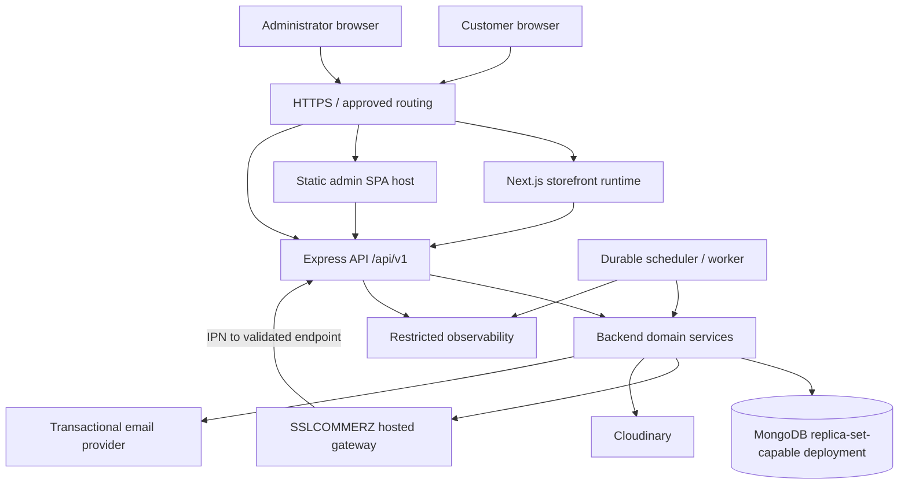
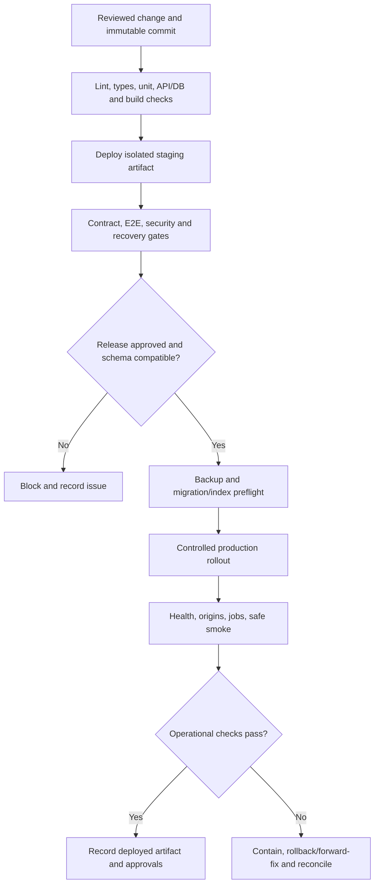
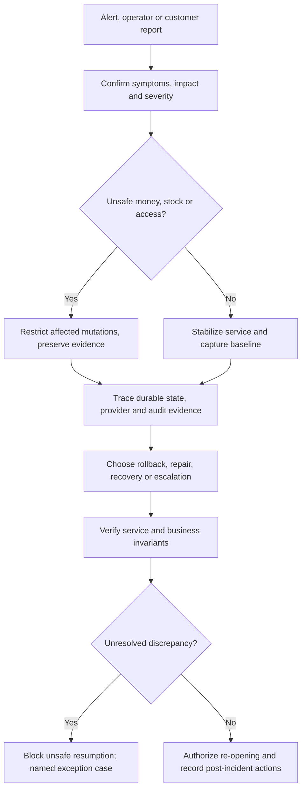
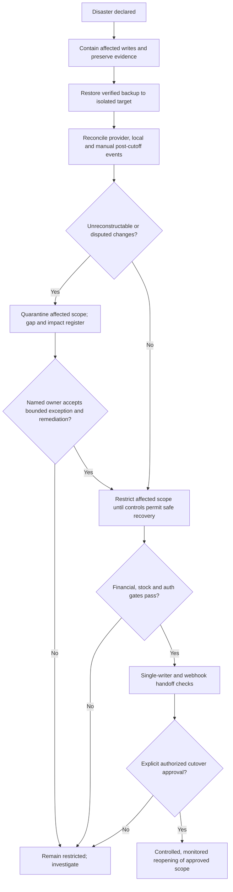
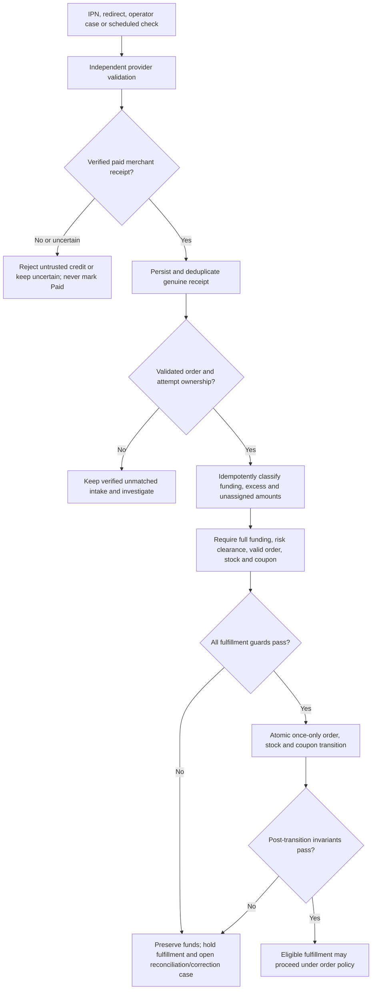

# SportZone — Operations & maintenance specification

**Version:** 1.0\
**Status:** Final development baseline\
**Updated:** 17 October 2026

**Product reference:** [PRD](./PRD.md)\
**Technical reference:** [Architecture](./ARCHITECTURE.md)\
**Design reference:** [Design](./DESIGN.md)\
**Data reference:** [Database](./DATABASE.md)\
**HTTP reference:** [API](./API.md)\
**Quality reference:** [Testing](./TESTING.md)\
**Delivery reference:** [Implementation Plan](./IMPLEMENTATION_PLAN.md)\
**Execution reference:** [Tasks](./TASKS.md)\
**Scope:** Single-store sports e-commerce platform for Bangladesh\
**Audience:** Developers, infrastructure operators, incident responders, store owner and release approvers

This document defines how to provision, deploy, operate, observe, secure and recover SportZone. Runbooks specify
service responsibilities and safety checks; the protected operating inventory records environment-specific commands,
provider settings, owners and verification evidence.

The **PRD** owns product policy and launch acceptance; **Architecture** owns component boundaries and integrity
invariants; **Database/API** own persisted and HTTP contracts; **Testing** owns executable verification;
**Implementation Plan/Tasks** own milestones and recorded evidence. This file owns operating procedures, on-call
responsibilities, configuration inventories, alerting, backup/restore decisions and incident handling, but cannot
change those authoritative contracts.

---

## Contents

- [1. Operations overview & objectives](#1-operations-overview--objectives)
- [2. Production infrastructure & topology](#2-production-infrastructure--topology)
- [3. Environments & configuration management](#3-environments--configuration-management)
- [4. Infrastructure provisioning & setup](#4-infrastructure-provisioning--setup)
- [5. CI/CD & deployment procedures](#5-cicd--deployment-procedures)
- [6. Release management & rollback](#6-release-management--rollback)
- [7. Database operations](#7-database-operations)
- [8. Background jobs & scheduled tasks](#8-background-jobs--scheduled-tasks)
- [9. Monitoring, logging & observability](#9-monitoring-logging--observability)
- [10. Alerting & incident management](#10-alerting--incident-management)
- [11. Backup, restore & disaster recovery](#11-backup-restore--disaster-recovery)
- [12. Payment & financial operations](#12-payment--financial-operations)
- [13. Security & access operations](#13-security--access-operations)
- [14. Performance, capacity & reliability](#14-performance-capacity--reliability)
- [15. Maintenance & operational runbooks](#15-maintenance--operational-runbooks)
- [16. Store administration & third-party services](#16-store-administration--third-party-services)
- [17. Operational verification & acceptance](#17-operational-verification--acceptance)
- [18. Ownership, handover & change management](#18-ownership-handover--change-management)
- [Appendix A — Runbook index & execution template](#appendix-a--runbook-index--execution-template)
- [Appendix B — Configuration inventory](#appendix-b--configuration-inventory)
- [Appendix C — Environment commissioning checklist](#appendix-c--environment-commissioning-checklist)
- [Appendix D — Requirements & task traceability](#appendix-d--requirements--task-traceability)
- [Appendix E — Operational evidence templates](#appendix-e--operational-evidence-templates)

---

## 1. Operations overview & objectives

### 1.1 Operational scope

Operate **one Bangladesh store**, denominated in **BDT**, with a Next.js storefront, a static React/Vite
administration portal, one modular Express API, MongoDB/Mongoose and durable scheduled jobs. SSLCOMMERZ-hosted
bKash, Nagad and Rocket, plus internal COD, are required for launch under PRD §3.3; inactive channels must not be
displayed, and omitting a required channel does **not** waive the launch gate. Manual shipment status and
operator-managed delivery zones/charges are in scope. Automated courier integration, GPS tracking,
multi-vendor/multi-currency and additional administrator permission tiers are not.

| Operational objective | Definition of acceptable evidence |
| --- | --- |
| Repeatable deployment | Identified artifact, environment, approver, automated checks, deployment and smoke-test record |
| Business correctness | Order, price, stock, coupon, collection and refund transitions preserve Database/Architecture invariants |
| Security/privacy | Scoped access, TLS, session/cookie/CSRF isolation, redacted logs, controlled secret/access ownership |
| Reliable background work | Durable work state, bounded retries, lease-fencing or equivalent protection, backlog visibility |
| Recovery | Practiced restore and reconciliation with known recovery point, unresolved gap register and approval before reopening writes |
| Store ownership | Authorized persons control live service, merchant, domain, backup and provider accounts; access is documented without credential disclosure |

### 1.2 Operational non-negotiables

1. **Express remains the sole business authority.** The storefront and admin only consume its API; internal jobs reuse backend domain services.
2. **External money is not undone by an application deploy, rollback or database restore.** Preserve and
   independently reconcile externally settled payments/refunds.
3. **Never infer provider success.** Browser redirects, received IPNs, gateway request acceptance and timeouts are
   not independently verified payment/payout completion.
4. **No destructive reconciliation.** Retain immutable order snapshots, receipts, correction records, stock
   movements, refund obligations, and audit evidence; repair through approved domain transitions.
5. **No unapproved operational numbers.** Backup frequency/retention, RPO/RTO, alert thresholds, SLAs, performance
   budgets and legal response periods require evidence and owner approval.
6. **No synthetic production activity without approval.** Do not run live financial tests, destructive migrations,
   load tests or bulk data corrections as ordinary smoke checks.
7. **No completion by documentation alone.** Every task, drill or launch gate stays `Not Run`, `Blocked` or
   `Pending` until linked actual evidence exists.

### 1.3 Source precedence and delivery timing

Establish the baseline during **Phase 01**, add operational contracts with each feature slice, provision integrated
staging before Phase 10, execute production readiness in **Phase 11 / M7**, and reconcile the document to deployed
reality during **Phase 12 / M8**. Production topology must match Architecture §13. Out-of-date runbooks are a
release blocker when they are necessary to recover a critical flow.

## 2. Production infrastructure & topology

### 2.1 Logical topology



This is **logical**, not a diagram of a selected cloud provider. HTTPS routing, runtime placement, backup storage
and monitoring vendor remain deployment decisions. Worker and HTTP deployments may share code but must not
independently bypass the authoritative domain rules.

### 2.2 Component requirements

| Component | Deployment characteristic | Health/recovery expectation | Sensitive boundary |
| --- | --- | --- | --- |
| Storefront | Next.js-capable runtime; required SSR/revalidation supported | Pages render; public catalog cache invalidation tested | No merchant/DB secrets or private shared caches |
| Admin portal | Versioned Vite static assets; SPA fallback | Deep-link navigation and admin login function | Frontend environment variables are public |
| Express API | Independent deployable Node.js service; approved host/origin | `/api/v1/health/live` and restricted `/api/v1/health/ready` | All authenticated commerce actions enforced server-side |
| MongoDB | Transaction-capable replica set/cluster with index management | Connections, transaction capability, backups and restoration verified | Private network, least-privilege service account |
| Scheduled worker | Durable leased/claimed job execution using backend services | Lag, failures, expired leases and restart safety visible | No public unauthenticated job execution endpoints |
| SSLCOMMERZ | Approved sandbox vs live credentials and callback URLs | Server-side transaction/refund verification available | Secrets stay in backend; live channel activation evidenced |
| Cloudinary/email | Restricted backend-controlled adapters | Retry/error observation and credential ownership | Private return evidence; no raw secret leakage |
| Telemetry/backup | Controlled access, redaction, retention | Alerts, restore drills, integrity and owner checks | Private evidence, encrypted storage, access audit |

### 2.3 Network, DNS and trust boundaries

Prefer approved **same-site subdomains** for storefront, admin and API as specified in Architecture §13. Before
launch, record actual domains, DNS owners, allowed browser origins, certificate ownership/renewal, API ingress
restrictions, outbound provider dependencies and webhook delivery path. Require HTTPS for browser, admin and
provider traffic; HSTS/cert behavior is configured for verified live domains, not guessed here. Database and
internal worker control surfaces are not public. CDN/proxy caching applies only to explicitly public content;
authenticated pages, customer data, payment status and admin responses must not be shared-cached.

### 2.4 Infrastructure inventory record

For each provisioned resource, maintain: **environment; provider/account; service/resource ID (internal inventory,
not public document); region; data residency assessment; owner; backup/export capability; encryption; access group;
dependencies; cost center; expiry/renewal; evidence link; last verified date**. Actual provider, region and plan
must be recorded on provisioning, not invented.

## 3. Environments & configuration management

### 3.1 Environment isolation matrix

| Environment | Data and credentials | Allowed activity | Explicitly prohibited |
| --- | --- | --- | --- |
| Local | Synthetic users/orders; local transaction-capable replica set; mocked/test third parties | Development, unit/integration/race tests | Live merchant keys; unrestricted real customer exports |
| CI | Ephemeral isolated DB namespace; nonproduction short-lived secrets | Static checks, build, contract and automated tests | Shared production credentials, destructive production access |
| Staging | Isolated DB, approved synthetic/sanitized data, SSLCOMMERZ sandbox | E2E, migration, callback, restore, security and fault-injection rehearsal | Live charges or unredacted production customer data |
| Production | Real restricted customer/merchant data and activated channels | Approved deploy, operational read-only checks, verified low-risk smoke | Synthetic live payments/refunds without explicit approval, load/destructive testing |

Do not promote staging **data or secrets** to production. Deploy a release artifact built from an identified
commit; promote compatible configurations independently. Verify test-provider identifiers cannot be mistaken for
live settlement identities.

### 3.2 Configuration ownership and startup validation

Maintain the per-key environment registry defined in Appendix B. Reconcile keys with `.env.example`, server-side
validation and deployment configuration. Record environment, required conditions, exposure, owner, protected source
reference, validation, rotation and verification evidence for each deployed key.

- Fail API/worker startup on missing or invalid **required** secrets, DB configuration, deployed origins and
  provider modes; disable unactivated payment methods explicitly.
- Never place credentials in `NEXT_PUBLIC_*`, `VITE_*`, source, CI logs, uploaded artifacts or browser-exposed diagnostic responses.
- Verify customer/admin/guest cookies are host-only, `Secure` and `HttpOnly`, correctly separated, and constrained
  by appropriate `SameSite` behavior. CSRF/Origin and credentialed CORS must match deployed origins.
- Record timestamps in UTC where stored; report Bangladesh business periods in `Asia/Dhaka` as defined by Database §14.3.
- Configuration changes affecting delivery, policy, payments or access are versioned/approved and audited, not
  performed as undocumented runtime edits.

### 3.3 Change classes

| Change | Approval/review requirement | Release implication |
| --- | --- | --- |
| Public content or branding | Authorized store operator, preview and provenance | May use admin workflow; no arbitrary DB update |
| Delivery zones/charges or published policies | Store-owner approval; versioned/effective change and audit | Preserve original checkout snapshots |
| Payment channel, callback, merchant limits or refunds | Merchant/operator approval with provider evidence | Block payment method if unverified; test before enabling |
| Backend binary, schema or index | Engineer review and deployment/migration gate | Compatible staging evidence before promotion |
| Secrets, domains, auth or access policy | Security/owner authorization and rotation impact review | Targeted origin/session checks after change |

## 4. Infrastructure provisioning & setup

### 4.1 Provisioning checklist (OP-PROV-01)

**Trigger:** First setup or replacing infrastructure. **Owner:** Assigned infrastructure engineer;
security/store-owner approval for live resources.

1. Record hosting, region, domains, budget owner, third-party accounts and topology in the
   protected operating inventory before production provisioning.
2. Create distinct staging/production projects, identities, resources, ingress policies and secret stores. Ensure
   no shared root tokens or DB credentials.
3. Provision Next.js runtime, SPA static hosting with deep-route fallback, Express API and a scheduler/worker with
   safe restart and durable claim support.
4. Provision transaction-capable MongoDB; configure network access, runtime DB role, separate migration/operator
   privilege, encryption and verified backup capability.
5. Provision independent media/email resources and SSLCOMMERZ sandbox/live merchant boundaries; register approved HTTPS callback/return URLs.
6. Configure DNS/TLS, credentialed browser-origin allowlists, host-only cookies, server clock synchronization and outbound service access.
7. Attach monitoring, restricted logs, alert routes, billing notifications and backup retention/export controls. Do
   **not** publish private readiness details.
8. Verify runtime readiness, DB transaction support, independent admin/storefront builds, worker lease behavior,
   provider sandbox reachability and restore feasibility on staging.
9. Record resource inventory, proof of ownership, smoke evidence, blockers and approvals. Block M7 if required
   infrastructure controls are unverified.

**Failure path:** Stop provisioning before serving customer writes; revoke unused credentials and record the
incomplete resource state. Deletion of any live resource requires independent data-retention/backup and
financial-impact approval.

### 4.2 Provisioning verification matrix

| Check | Observable acceptance |
| --- | --- |
| DB transaction support | Replica-set-backed session/transaction scenario succeeds in staging |
| Service isolation | DB and worker control endpoints unreachable from unauthenticated public Internet |
| TLS and domains | Storefront/admin/API/callback origins present valid certificates and correct host routing |
| Session boundaries | Customer/admin/guest identities cannot cross roles or hosts; credentials not shared-cacheable |
| Provider separation | Test and live credentials, callbacks, logs and merchant identities are distinct |
| Recovery infrastructure | Backup exists, restore destination is separate, restore can be tested without overwriting live DB |

### 4.3 Operational prerequisites

Maintain authoritative versions of: Node/npm and compatible framework releases, `package-lock.json` or approved
lockfile, migrations, index definitions, required configuration, secret-store locations, DNS records, worker
schedule definitions, email sender verification, gateway limits and callback configuration. A staging success never
proves live merchant capabilities.

Before executing an environment-specific runbook, record its actual resource/backup/secret-store references, named
authorized operator, exact commands, preflight/abort conditions and tested recovery steps in the protected operating
inventory. Unverified platform commands remain prerequisites; a published procedure does not prove an executable deployment.
Use [P01-005 readiness records](./evidence/P01-005-readiness.md) to track unresolved ownership and external inputs.

## 5. CI/CD & deployment procedures

### 5.1 Release pipeline



### 5.2 Reproducible build interface

The monorepo uses `storefront/`, `admin/` and `backend/` workspaces (Architecture §4). Implement the standard
package-script interface in [Testing §5.3](./TESTING.md#53-standard-execution-interface) during foundation setup.
The required application build/validation interface is below. Run each command only after its implementation and
environment prerequisites are verified against the committed manifest and lockfile:

```bash
# Required application interface; establish with the owning foundation/slices before deployment.
npm ci
npm run lint
npm run typecheck
npm run test:unit
npm run test:integration
npm run test:contract
npm run build --workspace=storefront
npm run build --workspace=admin
npm run build --workspace=backend
```

The current repository foundation supports `npm ci`, `npm run workspaces:check`, `npm run lint`, `npm run test:unit`
and `npm run ci`. All three workspaces have independent lint/type/unit/build and HTTP smoke commands in [ci-workspaces.json](../ci-workspaces.json). Admin Vite preview verifies local SPA fallback,
not production static hosting; configure fallback and noindex/private document headers at the deployment host. No deployment, migration or restore
command exists yet; local storefront build/start is not a production deployment procedure. See
[Testing §5.3](./TESTING.md#53-standard-execution-interface) for current coverage and the complete required interface.
The database foundation exports `openDatabase(uri, dbName)` and P03-003 startup now calls it after configuration validation, before binding HTTP. Use an isolated explicit database name; `admin`, `local` and `config` are rejected. Pools are bounded to ten connections, with five-second selection/connect/queue waits and a fifteen-second socket timeout. Startup failures return static database codes without URI/driver text; failed connections are destroyed. Connections require replica-set topology and logical sessions. Automatic collection/index creation and command buffering are disabled.

`npm run db:local --workspace=backend` starts a single-member, loopback-only, ephemeral MongoDB 8.0.16 replica set and prints its credential-free local URI. Its data disappears on shutdown; never use it for real/customer data or durability/backup acceptance. Integration tests generate their own random database on their own replica and never read external `MONGODB_URI`. `MONGOMS_DISTRO=ubuntu-24.04` selects the compatible official binary on this Ubuntu 26 host; supported Ubuntu 24 CI resolves it normally. First use downloads the pinned binary and requires network access; there is no mock/standalone fallback. Close the local tool with SIGINT/SIGTERM to clean its owned processes/data.

Index changes are explicit/additive through `createDeclaredIndexes` and checked by `verifyDeclaredIndexes`; extra indexes are reported and preserved. No `syncIndexes`, global drop or automatic destructive migration is added. Domain models/index plans remain owned by their feature tasks. Transactions use primary/snapshot/majority with a ten-second driver retry deadline and five-second commit limit. Work may rerun: only sequential database effects belong in the callback, every write must carry its session, and external effects must stay outside. Nested independent transactions are rejected. Retain deployment-grade failover/restore/replication evidence for staging/operations gates.

The compiled backend starts with `npm run start --workspace=backend` after build, using injected process variables. Local files are loaded only by an explicit Node flag, e.g. root command `node --env-file=.env backend/dist/server.js`. The environment validator requires NODE_ENV, APP_ENV, RELEASE_ID, MongoDB URI/name, API/storefront/admin origins and exact allowed-origin pair, plus separate SESSION_SECRET and HEALTH_MONITOR_TOKEN. Secrets use 64 lowercase hex characters representing 32 cryptographically random bytes; provision them privately with a cryptographic generator, never committed examples. The session secret is now used by the P03-005 customer/admin session service for domain-separated HMAC digests; public login/CSRF composition is not activated by health-only startup. Unknown environment keys are ignored so inactive provider adapters do not become fake startup dependencies.

APP_ENV is local/test/staging/production, paired with NODE_ENV development/test/production respectively (staging uses production). Staging/production origins require HTTPS and reject localhost/loopback conventions. RELEASE_ID is bounded nonsecret deployment metadata. PORT defaults to 4000 and must be 1–65535. API_BIND_HOST defaults to 127.0.0.1 and permits only documented loopback/wildcard bind addresses. Production/wildcard listeners require the approved TLS proxy/firewall/operational ingress; a bind option is not deployment acceptance. Missing/invalid values fail before DB/network access and emit only safe configuration key names, never values.

Session composition additionally calls `loadSessionOptions`: require CUSTOMER_SESSION_TTL_SECONDS and
ADMIN_SESSION_TTL_SECONDS as positive bounded seconds and SESSION_COOKIE_SAME_SITE as explicit lax/strict. Values require
security/operator approval; none are supplied by the repository. Session options are validated at service composition,
required for explicit customer activation and never silently defaulted. Configured HTTPS produces Secure cookies in every environment;
only local/test loopback HTTP may omit Secure. Cookies remain host-only, HttpOnly and path /. Confirm actual deployed
same-site origin/TLS behavior before activation; proxy headers cannot override configured cookie security.

SESSION_SECRET rotation invalidates old customer/admin token/CSRF digests on new-key processes. Drain/restart all old-key
processes before declaring revocation; no compatibility key ring or plaintext token migration exists. Credential/security
incidents may also use per-principal revision/revocation through the authorized identity service. Preserve audit/incident
evidence without raw tokens; do not log Set-Cookie/Cookie/CSRF headers. TTL cleanup is not expiry or revocation authority.

Startup verifies MongoDB replica/session capability before opening HTTP. Runtime disconnect/error events emit static codes; readiness checks connection state and a primary DB ping bounded to one second. SIGTERM/SIGINT mark draining before closing HTTP, allow at most ten seconds before force-closing HTTP connections, then destroy the DB connection. Repeated close calls share one shutdown operation. In-flight business effects in later features still require durable intent/reconciliation; shutdown is not rollback of financial effects. Logs are JSON with UTC/environment/service/release/level/event metadata, generated request or lifecycle operation IDs, status, error code and request duration. Request route labels use registered templates only; unmatched paths are labelled `unmatched`, with no original URL/query/params/headers/body or raw exception text. Known configured secrets are also scrubbed from emitted metadata. Liveness is independent of a runtime DB outage; restricted readiness is not financial correctness.

Every application response retains a fresh server UUID, no-store and nosniff; private errors remain generic. Ordinary JSON parsing is strict, uncompressed and limited to 102400 bytes by default. Unsupported media/parser/limit input maps to API 400 INVALID_REQUEST. Provider/media parsers must be added under their owning contracts. Customer/admin sessions, browser CORS/CSRF, external-provider capability gates and deployed telemetry/alerts remain their owning tasks.

Successful foundation CI is evidence for its configured checks only, not application deployment or operational readiness. Browser audit setup now requires `npx playwright install --with-deps chromium firefox webkit` after locked installation. The audit is mandatory through admin `test:a11y` in the CI inventory and starts only loopback test servers on 3100/5273/5180 after both builds. `test-results/ui-report.json` and `test-results/ui/` are CI artifacts; the fixture is not a deployment asset. Missing engines/libraries fail the audit rather than silently skip it. Local engine-wrapper overrides are test-machine configuration only; see [P02-011 environment evidence](./evidence/P02-011-accessibility.md).

CI must reject missing required scripts rather than silently skip checks. Pin compatible runtime/tool versions and
preserve tested build outputs with commit SHA, dependency lock digest and signed/traceable artifact identity where
supported. Do not embed secrets or prefilled `.env` in release archives.

### 5.3 Deployment runbook (OP-REL-01)

**Trigger:** Promoting an approved candidate. **Executor:** Assigned release engineer. **Approver:** Authorized
release/store owner for production. **Preconditions:** M6 staging release candidate accepted; provider and policy
gates prepared; compatible DB/index plan; operational on-call available.

1. Open a change record identifying commit, artifact checksums, affected services, schema versions, backup point,
   feature flags, maintenance/customer-impact window, rollback/forward-fix plan and responsible persons.
2. Verify passed CI and staging evidence for auth/CSRF, browsing, checkout, COD, gateway callbacks,
   returns/refunds, jobs, error states and rollback rehearsal (Testing §18).
3. Preflight live backups/indexes, active orders/holds, gateway callbacks, refund liabilities and pending job
   backlog; record baseline values and any ongoing financial incident.
4. Apply only reviewed **backward-compatible** expand/index migrations using a restricted migration identity;
   independently confirm index build and data compatibility before enabling new writers.
5. Deploy backend/worker and frontend **in a compatibility-tested order** specified in the release record. Do not
   assume a single universal sequence for every migration; use feature gates/read-write compatibility.
6. Run readiness and safe deployed-origin tests; confirm `/api/v1` contract, auth isolation, cache control,
   callback reachability, worker progress, log correlation and monitoring.
7. Verify configured/activated payment channels and approved production smoke **without unapproved live financial
   transfers**. Evaluate discrepancies; if release gate fails, follow §6.
8. Record exact deployed versions, timestamps, verification artifacts, incidents, operator/store-owner decision and
   next support contact in `TASKS.md`/change record.

**Stop condition:** Unknown DB migration compatibility, missed backup, unavailable financial reconciliation, unsafe
credential exposure or material failure of checkout/security/payment verification. **Recovery:** Hold unsafe writes
or affected feature; use OP-REL-02 and OP-FIN-* instead of ad hoc manual ledger edits.

### 5.4 Promotion safeguards

- All critical checks are blocking, even if a provider mock passed. No “green build” substitutes for merchant
  activation, legal approval or restore drill.
- Config and database schema compatibility must permit the previous safe application release to read **and write
  its supported state** during planned rollback, or the change cannot use binary rollback.
- Staged rollout or maintenance-mode choices require the actual platform's capabilities and operator approval.
  Avoid having two incompatible worker versions process the same job queue.

## 6. Release management & rollback

### 6.1 Release record

| Field | Required value |
| --- | --- |
| Release ID | Unique trace to commit/artifact and PR/approval |
| Environment and time | Staging/production, UTC timestamp; local communication in Dhaka timezone |
| Source changes | API/database migration/config/policy/merchant impact |
| Evidence | CI, staging regression, origin/CSRF, job, restore, financial verification |
| Rollout/abort criteria | Measured health conditions, rollback compatibility and decision owner |
| Post-deploy result | Passed/Failed/Blocked; actual links and limitations |
| Sign-off | Named authorized approver and date; do not prefill |

### 6.2 Application rollback (OP-REL-02)

**Trigger:** Critical regression, unsafe financial action, auth leak, error/availability threshold breach.
**Owner:** Incident commander + release engineer. **Prerequisite:** Verified earlier artifact and migration
compatibility.

1. Declare incident, record live artifact/version, first impact time, active financial jobs and customer-visible
   symptoms. Identify whether new writes must be paused; limit scope to affected capability where safe.
2. Capture protected logs/event identifiers and DB/provider time boundaries; preserve evidence without copying secrets to incident chat.
3. Classify rollback: **binary/config only** if old release is compatible with current schema and state; otherwise
   choose authorized forward-fix/isolation. Never perform an automatic destructive down-migration.
4. If compatible, redeploy the earlier artifact using the approved platform-specific command and verified config;
   do not restore an old DB merely to match the binary.
5. Confirm `/api/v1/health/ready`, cookie/CSRF protection, checkout/coupon/inventory invariant checks, scheduled
   work health and gateway validation. Independently reconcile payments and refund attempts in flight.
6. Reopen writes only when the incident commander confirms no duplicate operations or unobserved liabilities.
   Record user impact, incomplete work, live versions and follow-up actions.

**Escalation:** If state cannot be safely served by either build, keep affected mutations disabled and invoke
OP-DR-01/OP-FIN-* with an authorized specialist. **Forbidden:** Deleting paid orders, resetting `refunds` status to
allow retries, rolling back confirmed receipts or replacing stock counters manually.

### 6.3 Release types and controls

| Type | Minimum control | Additional control |
| --- | --- | --- |
| Ordinary application | CI, staging E2E, release record, smoke | Rollback-compatible artifact |
| Index/schema | Versioned migration, index preflight and duplicate scan | Backfill checkpoint, schema compatibility and recovery plan |
| Financial logic | Source-funded accounting tests, provider sandbox, concurrency | On-call reconciliation and rollback/forward-fix proof |
| Auth/secrets | Security review, cookie/CSRF regression | Rotation, active-session impact and escalation |
| Store policy/payment availability | Authorized operator approval | Effective version and published customer communication |

## 7. Database operations

### 7.1 Database authority and safety

MongoDB/Mongoose is the only persistence backend. **Only backend services and authorized migrations** mutate
business records. Transaction-capable deployment and unique indexes are required before financial/inventory write
traffic. Database §11–§15 controls exact index keys, schema changes, state transitions and recovery invariants;
this section governs safe execution.

Identity collection bootstrap is explicit in `backend/src/modules/auth/collection-validators.ts`, not HTTP startup.
`initializeIdentityPersistence` creates missing empty collections with strict/error validators and additive named indexes;
it rejects existing validator mismatches without collMod/drop. Before a deployed invocation, follow Database §15.1:
record migration/environment authority, duplicate/invalid-data preflight, backup/recovery compatibility and index results.
A partial empty bootstrap must be inventoried and resumed safely; do not infer that an existing environment is empty or
relax a validator to make startup pass. Real customer/credential migrations and production provisioning were not executed
by P03-004. The test-only TTL-monitor override is confined to the owned ephemeral replica.


### 7.2 Index and migration runbook (OP-DB-01)

**Trigger:** Schema/index deployment or flagged drift. **Owner:** Backend/database engineer, reviewed by release
engineer. **Preconditions:** Tested migration, isolated staging rehearsal, current protected backup, known write
impact.

1. Compare target migration and index manifests to deployed state; record versions, expected field/index changes and affected endpoints/jobs.
2. Run **read-only** preflight for duplicate emails, slugs, SKUs, provider transaction references, checkout
   idempotency keys, partial-index predicates, incompatible legacy documents and storage headroom.
3. Halt on conflicts: quarantine/report for authorized correction. Do not force-drop identity/financial records merely to satisfy a unique index.
4. Expand schema first; apply safe new indexes and bounded resumable backfills. Restrict migration credentials;
   prevent concurrent unapproved migration runners.
5. Verify actual index definitions/options, data counts, sampling, domain invariants and idempotent restart; compare staging before/after tests.
6. Activate updated readers/writers only after compatibility acceptance; defer contract-breaking validator tightening until rollback gate passes.
7. Record migration run ID, progress cursor, approvals, duration, impact, unresolved conflicts and recovery decision.

**On failure:** Stop dependent deployments/writes. Re-running must be checkpoint-safe; do not drop live data or use
blind `dropDatabase`, `deleteMany` or automatic destructive rollback. Follow §6 or §11 with approved
restore/reconciliation if state was damaged.

### 7.3 Health and reconciliation invariants

| Query/observation | Required safe behavior |
| --- | --- |
| Replica-set/transaction check | Primary/replication healthy enough for stated transaction guarantees |
| Schema/index drift | Missing or altered unique/partial indexes block affected writes |
| Inventory counters | `available = physical − reserved − committed >= 0`; movement log and reservations reconcile |
| Coupon holds/counters | Held + redeemed quotas bounded; expiry handled by domain job, **not TTL** |
| Checkout identities | Unique durable idempotency keys remain protected, including tombstones |
| Verified money | Provider intake uniqueness, receipt allocation and unmatched suspense totals reconcile |
| Refund source balances | Pending + completed never exceed original verified allocated funds, per source/class |
| Historical records | Order snapshots, confirmed deadlines, policy versions, audits survive upgrades |

### 7.4 Database access and data operations

Separate runtime CRUD account from privileged migration/backup/read-only incident accounts where platform allows.
Use scoped roles and time-bounded access. Production direct data edits are exceptional, reviewed and evidenced;
prefer versioned domain-service repair jobs preserving audit and uniqueness. No developer laptop receives a raw
live production dump by default. Index creation, repair and restore must have an approved capacity/impact window.

## 8. Background jobs & scheduled tasks

### 8.1 Durable job inventory

Jobs use backend domain services, stable job/operation identities and persisted state (`jobLeases`, attempts,
outbox/notification documents as applicable). A scheduler tick is not proof a job succeeded. Configure cadence from business expiration requirements, provider
limits and measured backlog; record the schedule and responsible role in the operating inventory.

| Work item | Durable source | Primary safety property | Alert condition |
| --- | --- | --- | --- |
| Online hold expiry | Active `inventoryReservations`, associated order/payment status | Release only eligible unpaid hold after this generation heldAt + 15 minutes; synchronize coupon expiry; do not race newly verified payment or extend expiry on replay | Expired eligible holds unprocessed; repeated errors |
| Coupon hold expiry | Active `couponRedemptions`, tied to checkout and inventory | Release eligible hold exactly once, atomically with dependent state | Old held coupon allocations |
| Uncertain payment reconciliation | `paymentAttempts`, `providerReceiptIntake`, `paymentCollections` | Verify provider independently; allocate each real receipt once | Aging unknown attempt / unmatched intake |
| Refund status reconciliation | `refundAttempts`, `refunds`, source collection balances | Unknown payout stays reserved until verified; no duplicate disbursement | Aging unknown refund, caps mismatch |
| Notification retry | `notifications` / unique `eventKey` | Retry message without repeating commerce event | Delivery backlog / repeated failures |
| Scheduled delivery-charge activation | `deliveryCharges`, storeSettings.deliveryCoverageRevision and affected zone revisions | Acquire the shared global guard before interval/version checks across all zones; atomically end predecessor and activate due successor without overlapping scheduled/selectable windows (Database §7.6) | Due rule not activated, overlap or coverage gap |
| Scheduled policy publication | `policyDocuments`, `storeSettings.activePolicyVersions` | Publish only approved due revision; CAS-swap active pointer and preserve historic content (Database §10.5) | Due approved policy not activated or wrong public revision |
| Operational consistency sweep | Immutable movements, claims, payment/refund projections | Detect drift; propose case for authorized resolution | Inventory, financial or policy mismatch |

### 8.2 Worker control and restart (OP-JOB-01)

**Trigger:** Failed runs, stalled backlog, deployment restart or suspected duplicate job. **Owner:** Assigned
backend on-call. **Preconditions:** Job identity, expected state transitions, affected financial records and
lease/fencing mechanism known.

1. Inspect worker health and `jobLeases` (`jobKey`, `leaseOwner`, `leaseUntil`, `cursor`, last success and error
   code). Collect record IDs, no raw customer secrets.
2. Determine whether the worker crashed before/after a database commit or before/after an external provider
   request. Mark externally uncertain results for verification, not a new uncorrelated request.
3. Pause only the affected unsafe job if business continuity permits; do not delete its cursor or release an unexpired active lease blindly.
4. Restart through approved deployment orchestration. Ensure atomic lease acquisition and check that an expired
   lease can be safely reacquired; use fencing/version validation where duplicate processes can overlap.
5. Reprocess bounded batches using idempotent domain operations and stable event identities. Verify state changes
   and uniqueness records for each completed case.
6. Compare pre/post backlog, age, last success, lease owner and invariant violations. Escalate reconciliation
   exceptions to OP-FIN-01/02 or OP-DB-01 rather than editing records.
7. Record timeline, job version, incident ID, results and evidence. Resume scheduling only after owner approval.

**Hard rule:** A lease prevents some duplicate workers; it **does not** make payment/refund/stock side effects
idempotent. TTL removal never releases stock/coupon holds.

**Additional maintenance controls:** reconcile `mediaAssets` uploading/deleting outcomes and CAS-claim expired unreferenced
uploads before provider cleanup. Never TTL-delete their authorization ledger or delete attached/legal-held evidence.
Remove expired/consumed/invalidated challenge delivery envelopes without waiting for authChallenges TTL; retain only safe
verification/audit facts for the approved period. Quote cleanup must preserve consumed consent evidence and intent/order
uniqueness. Record schedules, key custodians, temporary upload/quote lifetimes and retention in the environment configuration inventory.

### 8.3 Schedule and ownership record

| Job key | Scheduling basis (UTC) | Retry/backoff | Responsible role | Environment scope |
| --- | --- | --- | --- | --- |
| Reservation/coupon expiry | Process eligible holds at their recorded expiry | Bounded and idempotent | Backend owner | Local/CI, staging and production |
| Payment intake/verification | Callback-driven intake plus provider-compatible reconciliation interval | Bounded; status-aware | Backend / merchant owner | Isolated sandbox; activated live merchant |
| Refund status verification | Provider-supported polling and uncertainty reconciliation | Bounded; no duplicate payout | Backend / finance owner | Sandbox and authorized live service |
| Notification dispatch | Durable outbox availability and configured retry policy | Bounded; dedupe by `eventKey` | Backend owner | Separate provider resources per environment |
| Delivery-charge/policy activation | Recorded UTC effective instants | CAS-protected, idempotent activation | Backend / store operator | Staging and production; synthetic local/CI triggers |
| Consistency reconciliation | Configured bounded batch interval | Resumable and observable | Backend / data owner | Staging and production |

Record each deployed job's exact cadence, batch size, lease duration, retry limits and named duty contact in the operating inventory.

## 9. Monitoring, logging & observability

### 9.1 Health model

- `GET /api/v1/health/live` — process liveness; do not make DB/provider reachability a condition for an otherwise-live process.
- `GET /api/v1/health/ready` — **restricted** readiness; `200` when required dependencies and serving state are
  ready, otherwise `503`. Return no topology, secrets or customer records.
- Publish service process readiness separately from *financial correctness*. Healthy HTTP does **not** mean there
  are no unmatched receipts, stalled refund attempts or missing worker executions.
- For a provider outage, distinguish traffic-serving safety from payment-capability availability. Fail closed on
  unsafe new payment initiation when verification cannot be completed, without presenting paid success.

The readiness monitor must send the configured `Authorization: Bearer` credential over protected HTTPS (or loopback in isolated local tests); cookies/query tokens are not accepted. Missing/incorrect credentials return 401 before any dependency check. An authorized healthy probe returns only status `ready`; failure returns generic 503. Rotate the monitor credential independently from session secrets and restart the service to revoke the old value. Restrict operational ingress, including liveness, in the deployment proxy/network. The service's minimal liveness payload is not an authorization or launch-readiness signal. JSON logs go to stdout; invalid-configuration diagnostics go to stderr. The deployed collector, retention/access controls, dashboards and alert exercises still require operational acceptance.

### 9.2 Required signal catalog

| Signal | Source/labels | Operational interpretation |
| --- | --- | --- |
| API request volume, status, latency | Route template, deployment, correlation ID (no raw URL tokens) | Availability, regressions, abusive traffic |
| Authentication/CSRF failures | Endpoint family, role, coarse failure type | Session breakage, origin mistakes, attack indicators |
| MongoDB connections, replication, transactions | Cluster/role, error category | Data-path outage, failed commit / uncertainty |
| Checkout outcomes, idempotency conflicts | Intent status, non-PII operation ID | Duplicate suppression and checkout failure rate |
| Stock reservations and movements | Expired hold age, invariant violations | Oversell risk or job lag |
| Coupon held/redeemed limits | Capacity/race conflict counters | Allocation drift and rejected concurrency |
| Payment verification backlog | Pending/unknown attempt age, unmatched intake, excess allocation | Merchant collections requiring action |
| Refund liability and payout backlog | Pending amount by source/class, unknown payout age | At-risk obligations; no unsafe double payout |
| Worker lease/backlog, retries | Job key, elapsed age, last success | Stalled, duplicated or failing schedules |
| Email/outbox delivery | Pending, retry, failed by event type | Messages not delivered; no commerce rollback |
| Backup and recovery | Last successful snapshot, restore drill age, errors | Disaster recovery confidence |
| Media and third parties | Server-side error/timeout category | Dependency degraded, asset access problem |

### 9.3 Structured log and correlation contract

Required minimum event fields: `timestampUtc`, `environment`, `service`, `releaseId`, `level`, `eventType`,
`requestId`/`operationId`, safe `status`, `errorCode`, duration when relevant, and **opaque** business correlation
IDs. Gateways may provide reference identifiers; only store/emit the minimum safe identifiers in access-limited
logs, with controlled redaction and retention. Prefer propagating a correlation ID through API → domain service →
job → provider-verification record without trusting arbitrary client IDs as proof.

**Never log:** passwords/hashes, session cookies, CSRF tokens, secret keys, complete gateway payloads, sensitive
return evidence, raw authentication challenges, full addresses, provider signatures, or full personal identifiers.
Sensitive security incidents may require protected forensic retention with explicit authorization and limited
distribution.

### 9.4 Dashboard and alert design

Present separate dashboards for **service health**, **customer journey**, **inventory/coupon state**,
**payment/refund exceptions**, **job backlog**, **backup/restore**, **security** and **provider availability**.
Keep business timestamps and current-state definitions traceable to Database §14.3. Actual monitoring platform,
collection queries, sampling, cardinality limits, dashboard IDs and alert destinations must be recorded after
provisioning.

## 10. Alerting & incident management

### 10.1 Severity and escalation

| Severity | Definition | Default response posture |
| --- | --- | --- |
| SEV-1 | Confirmed loss/exposure of sensitive data, double payout, unbounded stock corruption, or unsafe payment writes | Contain immediately, suspend affected mutations, mobilize authorized responders |
| SEV-2 | Checkout/payment/receipt validation impaired, refund unknown aging, DB unavailable or significant service outage | Prioritize incident, reduce unsafe functionality, assess obligations |
| SEV-3 | Degraded email, selected catalog/admin path or delayed job with invariant checks still valid | Triage, monitor trend and restore service |
| SEV-4 | Nonurgent maintainability, minor display or documentation defect | Standard change/backlog process |

Apply these severity rules to incident triage. The operations owner records alert thresholds, acknowledgement
targets, notification destinations, escalation timers and duty coverage in the operating inventory. The responsible
privacy/store owner determines disclosure and customer-notification obligations under current applicable rules.

### 10.2 Incident process



### 10.3 Incident response runbook (OP-INC-01)

**Trigger:** SEV-1/SEV-2, security alarm, customer loss-of-service or integrity warning. **Incident commander:**
The designated duty lead in the operating inventory.

1. Open incident with severity, detected time, impacted environment/versions, customer/payment scope and evidence
   links. Assign commander, technical responder, store-owner contact and communications owner.
2. Confirm alert with independent signals; establish last-known-good boundary, new orders/stock changes and
   payment/refund attempts during affected window.
3. **Contain narrowly:** revoke compromised sessions/credentials, disable vulnerable route or payment initiation,
   hold affected fulfillment/worker actions when required. Preserve ability to observe/reconcile.
4. Capture protected immutable records, provider settlement/reference status, worker cursors and deployment
   history; do not use chat screenshots as sole evidence.
5. Choose recovery path: OP-REL-02 (code), OP-DB-01 (migration), OP-JOB-01 (worker), OP-FIN-01/02 (funds), OP-DR-01
   (restore), OP-SEC-01 (compromise).
6. Re-verify auth boundaries, money/inventory invariants, notification/outbox impact and customer-visible states.
   Escalate unresolved cases with named owner and blocked writes.
7. Authorize reopening only after containment and minimum integrity checks. Record resolution time, remaining risks and communication approvals.
8. Within an owner-approved review window, write a short post-incident record: impact, timeline, root-cause
   hypothesis/evidence, effective safeguards, corrective tasks, detection gaps and follow-up owners.

### 10.4 Alert routing inventory

| Alert category | Primary role | Backup/escalation | Routing requirement |
| --- | --- | --- | --- |
| Availability / API | Backend on-call | Platform owner | Reachable duty channel; availability and error-rate thresholds |
| DB / transaction integrity | Data owner | Backend / platform owner | Immediate escalation for integrity violations |
| Payment / refunds | Merchant / finance owner | Backend on-call and provider contact | Receipt, payout and uncertainty-age alerts |
| Security / privacy | Security designate | Store owner | Restricted incident channel and disclosure escalation |
| Backup / worker drift | Platform / backend owner | Data owner | Backup freshness, failed jobs and oldest-work thresholds |

Record named contacts, destinations, coverage windows and exercised thresholds per environment.

A monitored metric without an owned and exercised alert route is not an operationally accepted control.

## 11. Backup, restore & disaster recovery

### 11.1 Recovery objectives and coverage

Backups must be protected, restorable and appropriate to a transaction-capable MongoDB deployment. The data owner
maintains the following environment-specific recovery policy and verifies it through isolated restore exercises.

| Parameter | Required definition and evidence | Accountable role |
| --- | --- | --- |
| RPO | Maximum tolerable loss of committed data; backup/PITR capability and measured recovery point | Store / data owner |
| RTO | Restoration target including services, workers, verification and provider reconciliation; measured drill duration | Platform / data owner |
| Backup frequency / PITR window | Configured schedule, recovery window, provider capability and restore results | Data owner |
| Retention and encryption/key custody | Retention/legal-hold policy, protected storage, independent key custody and deletion controls | Privacy / security / data owner |
| Restore drill cadence | Scheduled isolated exercises, responsible operator and retained results | Data owner |
| Cross-region/offsite protection | Recovery location, residency constraints, threat coverage and provider capability | Platform / privacy owner |

**RPO/RTO are targets, not inferred guarantees.** A successful database snapshot can still omit activity after its
capture and cannot reverse settled external payments/refunds or reconstruct every missing local action.

### 11.2 Recovery boundary classification



**Scope rule:** Approval to tolerate a documented, bounded gap does **not** authorize writes to an affected order,
payment, stock, refund or identity scope before its specific invariants and risk controls pass. Unreconstructable
gaps need named business/security acceptance, customer-remediation disposition and continued quarantine where
appropriate.

| Event after backup cutoff | Evidence source | Recovery disposition |
| --- | --- | --- |
| Online provider collection or payout | Independent merchant/provider status, settlement and transaction references | Verify, deduplicate and reconcile through controlled domain services; never infer from browser/IPN alone |
| Durable independent outbox/export/audit | Protected, independently retained record with provenance | Validate and replay only approved idempotent transitions |
| COD cash collected after snapshot | Receipt, delivery proof, responsible operator, customer/order reference and independent till/settlement evidence where available | Reconcile to original order and exactly-once COD collection; uncertain amount remains blocked |
| Manual cash/refund payout after snapshot | Approved disbursement evidence, beneficiary/order/reference and actual payout proof | Verify source capacity and completed amount; do not re-disburse when status is unknown |
| Manual inventory change or account/policy decision | Independently retained audit and authorized operator evidence, if any | Reconstruct only when verifiable; otherwise preserve the gap and restrict affected action |
| Externally delivered message with missing local event | Provider message ID/log, if accessible | Reconcile delivered status; avoid duplicate customer notification |
| Provider attempt that may still be in flight | Approved provider status mechanism | Keep outcome uncertain; never automatically retry external money operations |

**Manual cash register:** Every post-cutoff COD or manual payout investigation records case ID, order ID,
proof/reference, actor and approver, event time in UTC, amount in poisha, source evidence, matching outcome and
exception disposition. An operator assertion without independently corroborating evidence is not proof that money
moved. Retain original evidence; do not insert fabricated collection/payout records.

### 11.3 Restoration runbook (OP-DR-01)

**Trigger:** Disaster, material corruption or an approved restore drill. **Owner:** Database/incident engineer;
production cutover requires separate store-owner/security authorization. **Default:** Restore to an isolated
target; never overwrite a running production database.

**Phase A — Contain and reconstruct**

1. Record affected services, response owner, source backup/PITR point, event cutoff (UTC), signed recovery
   objectives and available independent audit/provider evidence. Preserve incident logs and restrict unsafe
   financial, stock and account writes.
2. Block old API and scheduler/worker writers from performing mutations, including privileged repair processes.
   Preserve their identifiers, in-flight requests, lease state, callback intake cutoff and observed provider
   requests. **A DNS switch alone is not a writer fence.**
3. Restore a verified backup into a separately permissioned recovery cluster using the selected provider's tested
   process. Validate database version, collections, schema/index manifests, checkout-key tombstones, payment/refund
   sources, jobs and policy snapshots. Record exact backup and restoration evidence.
4. Reconcile all events after the backup cutoff. Compare independently verified gateway receipts/refunds, surviving
   audit/outbox and **manual COD/payout proof** against restored primary records. Maintain one case per missing or
   disputed event; use only reviewed idempotent repairs.
5. Recompute and verify stock reservations/movements, coupon holds, order entitlement, financial allocations,
   unmatched intake and pending/completed refund capacities. Rebuild projections only from verified primary facts.
   Quarantine affected IDs and never synthesize missing external settlement.
6. **Fail closed for restored authentication:** Restored sessions and one-time login/recovery/email-change/guest
   proofs may have been revoked or consumed since the backup. Use independently verifiable post-cutoff revocation
   history only where available; otherwise invalidate all potentially affected pre-cutover sessions and challenges,
   rotate/fence issuance context as supported, and require new authentication/proof. Validate that restored private
   endpoints reject old cookies and replayed tokens. If no durable fail-closed mechanism exists, keep those
   endpoints disabled until one is implemented and tested; do not delete necessary audit history.
7. Create an explicit loss/exception register: affected records, unknown money, missing manual cash actions,
   user/data exposure, owner, mitigation and evidence. Unreconstructable changes cannot be claimed recovered.
   Obtain named risk/security/business acceptance of any bounded gap **and maintain restrictions on impacted
   operations** until invariant checks permit safe use.

**Phase B — Single-writer, callback and traffic handoff**

| Gate | Required evidence before new business writes |
| --- | --- |
| Writer fencing | Old API, worker, scheduler, migration and repair identities are stopped or credibly fenced from DB/provider effects; no stale generation can commit a protected write |
| New generation | Deployment/worker generation or equivalent fencing mechanism is recorded, enforced at claim/write boundaries and shown effective in staging; unresolved design tracked by Operations §11.3 |
| Jobs | At most one authorized job-claim owner per key; expired old leases cannot let old code resume side effects; cursor/backlog reconciled before scheduling resumes |
| Provider callback ingress | Approved reachable endpoint for selected environment, old endpoint closure/draining plan, accepted-request cutoff and durable intake/reconciliation evidence; provider retries are not assumed reliable without confirmation |
| Auth protection | Pre-restore potentially revoked or consumed credentials refused, fresh login/proof flow verified; no cache/old session bypass |
| Business safety | All applicable receipts/refunds, stock, coupon and unknown-operation exceptions resolved or isolated; specific scopes remain blocked if unsafe |
| Authorization | Named incident commander, security/data owner and authorized store/financial owner approve exact services/scopes and restoration timestamp |

8. Route callbacks to the approved ingress only after its availability and deduplication are proven; reconcile
   notifications/settlements accepted between the old endpoint cutoff and new endpoint activation. If callback
   delivery cannot be guaranteed, hold affected payment paths and use independent provider-status checks until the
   gap is closed.
9. Validate read-only APIs, authentication/CSRF, audit continuity, idempotent job replay and safe sandbox/synthetic
   state transitions in the recovery environment. Do not run artificial real charges or payouts.
10. Execute controlled cutover with **one active writer generation**. Bring up health/read-only functions first,
    then allow only verified safe business scopes, then approved job families; inspect repeated callbacks, stale
    lease rejection and reconciliation queues throughout.
11. Record exact reopening time, owner approvals, protected gap cases and continued holds. Keep old environment
    isolated for forensics/retention; do not re-enable it as a competing writer. Use OP-INC-01 for failed gates and
    repeat the documented recovery decision rather than silently switching back.

**Stop conditions:** Ambiguous refund payout, lost financial history, unreconciled COD proof, unsafe restored
credentials, overlapping writers, missing callback controls, broken uniqueness/indexes, negative stock or
unauthorized risk acceptance. `TESTING.md` recovery and idempotency cases must exercise these protections before
production sign-off.

### 11.4 Backup verification and storage controls

- Run documented scheduled creation plus independent job monitoring. Verify successful completion,
  repository/container consistency and recoverability on an isolated target; sample restores alone do not
  substitute for full rehearsals.
- Encrypt in transit/at rest, restrict backup restore/download principals, rotate encryption material under an
  approved recovery path, and log access and exports.
- Ensure deletion/retention rules preserve legally required transaction evidence without collecting unnecessary
  personal data indefinitely. Do not put live backup URIs or encryption recovery keys in this repository.
- Test account/cloud-region failure, credential loss, failed backup jobs and interrupted restore where relevant to the approved threat model.

## 12. Payment & financial operations

### 12.1 Financial sources of truth

**Backend verified provider facts and durable persisted records**, not redirect pages or operator assumptions,
determine collected money. Online collections are independently verified via the gateway and captured through
`providerReceiptIntake` then linked when a valid order/attempt match exists. `paymentCollections` holds verified
linked receipts; `payments` provides projections. The system separately tracks **funding**, **excess/correction**,
**unassigned/suspense** and COD confirmed collections. `refundAttempts` records provider/manual payout attempts; a
pending request is **not** completed payout.

| Financial state | Operational consequence |
| --- | --- |
| Redirect claims success but no independent verification | Keep uncertain; verify provider, never mark Paid |
| Independently verified receipt but no safe order match | Retain unique unmatched `providerReceiptIntake`; quarantine and investigate |
| Verified partial funds | Allocate only real verified amount; preserve remainder; no assumption of fully paid |
| Verified excess or duplicate paid attempts | Preserve all receipts; only valid funding reaches order; excess is correction liability |
| COD order accepted, money not collected | Order may have committed stock; COD collection remains unconfirmed |
| Refund initiation/timeout/unknown | Keep source balance reserved, verify payout outcome; no new blindly generated payout ID |
| Confirmed refund payout | Mark completed only with trusted evidence; separately report merchandise vs correction |

### 12.2 Gateway receipt reconciliation (OP-FIN-01)



**Trigger:** Missing, delayed or duplicated IPN; payment mismatch, partial/excess collection, unmatched receipt or
verification alert. **Owner:** Payment operations with authorized merchant/finance reviewer. **Precondition:**
Verified merchant access and read-only local/provider evidence.

1. Open a restricted case with order/attempt references, merchant identity, UTC event window, immutable initiated
   amount and expected outstanding merchandise in integer poisha.
2. Independently validate merchant, transaction, currency, status, amount and any provider risk information using
   approved server-side provider queries. A browser return or IPN alone is not proof of funds or risk clearance.
3. Deduplicate on provider-scoped unique receipt identity. Preserve independently verified money even if order
   matching or allocation fails. Do not attribute unmatched intake to an order.
4. Classify as unverified/forged, uncertain, verified unmatched, verified partial, verified exact, verified excess,
   replay of the **same** receipt or a **distinct paid attempt**. Mismatches against immutable initiation amounts
   require the approved supervised provider verification and quarantine rules in Database §8.7/API §12.
5. Allocate only verified, correctly linked amounts once. Recompute original merchandise entitlement (including
   delivery), current funded balance, excess/correction, unassigned suspense and outstanding amount; partial
   funding is not fulfillment approval.
6. Before a fulfillment-capable transition, assert **all** conditions together: full merchandise funding, risk
   approved/cleared, valid non-cancelled/non-terminal order state, permitted inventory reservation or newly
   acquired safe allocation, and valid coupon commitment. Enforce this through revision/transaction guards, not an
   operator dashboard color.
7. On any failed gate, retain receipt and exact accounting, block fulfillment, create a review/correction case and
   restrict unsafe retries. Late money after expired holds or cancellation never silently dispatches an order.
8. Verify exactly one receipt intake, correct source allocation, at-most-once order/stock/coupon fulfillment
   effects, and any customer communication. Attach provider evidence and unresolved case/owner to the incident
   record.

**Escalation:** Unknown merchant receipt, disputed identity, provider verification outage, high-risk status or
unbalanced allocation requires authorized finance/security handling. Disable new online payment initiation if
verification is not safe. Do not infer merchant channel or refund capability from sandbox-only tests.

### 12.3 Refund payout investigation (OP-FIN-02)

**Trigger:** Unknown gateway refund response, stale pending refund, duplicated initiation, source-balance violation
or requested manual payout. **Owner:** Authorized refunds operator with finance oversight.

1. Locate approved `refunds` obligation, classification (**merchandise** or **payment correction**), original
   order/line entitlement, allocated verified source collection and held amounts.
2. Verify source-capacity equation: pending + completed payouts **per source and class** must not exceed linked
   verified funds allocated to that class; merchandise unit ordinals/delivery refund caps must also hold.
3. Inspect provider attempt state and its persisted unique merchant refund transaction ID (`refundTransId` mapping
   to SSLCOMMERZ `refund_trans_id`) and returned provider reference (`refund_ref_id` where supported). Verify exact
   parameter/response names against deployed gateway version and merchant contract.
4. If provider outcome is pending/unknown, **do not create another payout identity** or release reserved capacity.
   Query supported provider refund-status channel and preserve the obligation until independently verified outcome
   or authorized decision.
5. On verified completion, finalize exactly once and emit auditable notification. On verified failure, follow the
   existing authorized retry/cancel protocol; do not assume a timeout means failed.
6. For manual COD correction, require approved collection and evidence of actual disbursement before marking paid;
   record actor and method without exposing account secrets.
7. Reconcile `refunds`, `refundAttempts`, source-class held/completed balances, item entitlements and financial
   reports; sign off exception closure.

**Forbidden:** New payout attempt with an uncorrelated ID after timeout; refunding unmatched funds without a
verified linked source; using an overpayment correction to consume return-item entitlements; releasing reserved
money merely because the operator sees a failure screen.

### 12.4 Financial close and COD (OP-FIN-03)

**Trigger:** Approved daily/periodic close, COD audit or financial discrepancy. **Owner:** Merchant/finance
operator prepares the close; a separately authorized store/finance approver signs off. **Period:** Store-selected
start/end instants expressed in `Asia/Dhaka`, converted to explicit UTC boundaries. No timing, tolerance or owner
is assumed approved.

| Step | Procedure | Expected control/evidence |
| --- | --- | --- |
| 1. Freeze reporting scope | Record `[start,end)` period, timezone, cutoff UTC, report/query version, orders/receipts/refunds source snapshots and source-extract timestamps | Reproducible report ID; never rewrite primary records to close books |
| 2. Independent sources | Obtain provider-confirmed receipts, refunds/settlement exports where supported, verified COD receipts/delivery proof and local intake/collection/refund lists | Provider, COD and local evidence identified and accessible to reviewers |
| 3. Orders and merchandise | Compute accepted non-cancelled order GMV by **order placement** period from immutable pre-discount merchandise snapshots; show price/coupon discounts, delivery and cancellations separately | GMV/sales view is **not** equated with collected cash or profit |
| 4. Receipt intake and linking | For each independently verified provider receipt, confirm unique intake and classification as linked or unmatched; for linked receipts check merchandise + correction + unassigned allocations equal original receipt | Every verified receipt accounted for once; suspense disclosed separately |
| 5. COD evidence | Include COD as paid only with authenticated actual collection proof. Compare delivery/receipt IDs to collection references and reject double counting | COD order acceptance or shipment alone never becomes cash |
| 6. Refund controls | Compare per-source merchandise/correction `held` and `completed` to allocated capacity; separately total payout **confirmed within the selected completion period** | Pending/uncertain held liabilities reported, never subtracted as completed cash payout |
| 7. Independent reconciliation | Compare source amount/count by provider/channel, merchant account, transaction ID and period against local intake, linked allocations, COD, refund status and settlement timing | Unmatched/partial/excess/late cases have case IDs; settled deposit timing distinguished from original collectedAt |
| 8. Exception decisions | Classify missing provider/local receipt, pending merchant validation, excess, incorrect mapping, duplicate COD, payout unknown, time-boundary difference or genuine unreconstructable cash proof | No arbitrary balancing entry; named owner and review deadline on every unresolved exception |
| 9. Close or hold | Reviewer confirms permitted variance thresholds **only if explicitly approved**, signs control totals, unresolved liabilities and restricted remediation. Material unaccepted difference blocks close | Signed, immutable report version, UTC time, source extracts and independent approval |

**Required control totals (integer poisha; run separately for each relevant receipt/provider and period):**

```text
verifiedLinkedCollections = sum(unique linked collection amounts, by collectedAt)
linkedAllocationTotal = sum(merchandise + correction + unassigned allocations)
assert verifiedLinkedCollections == linkedAllocationTotal (same receipt population)
verifiedUnmatchedIntake = sum(verified intake not yet linked; report separately)
netLinkedCashFlow = verifiedLinkedCollections - completedRefundPayouts
outstandingRefundLiability = sum(held/uncertain refund commitments; not yet paid)
```

The cash-flow equation uses linked cash receipts and completed refunds measured by their **own event times** within
the chosen period; do not equate unlike order-placement, collection, settlement and payout cohorts. Opening/closing
balances and provider settlement timing differences must be shown as reconciliation bridges, not forced into a
single-period zero-difference assertion. Reproduce classifications **as of the recorded close cutoff** using
the protected extract and audit trail; later allocation corrections must be disclosed as dated adjustments, not
silently rewritten into a signed prior-period close. COD proof must correspond to a unique authorized collection
event; manual payout proof must correspond to a unique confirmed refund. **No close is accepted without source links, reviewer
signature and disposition of material exceptions.**

### 12.5 Provider incident playbook

A gateway outage or invalid callback configuration must be treated as a capability incident. Do not expose
inactive/unverified bKash, Nagad or Rocket channels. Production launch acceptance still requires all three, plus
COD, unless the PRD and dependent documents are **explicitly revised and approved before launch**. Distinguish: (a)
previously verified funds, (b) pending unknown outcomes, (c) genuinely failed/unverified attempts and (d)
refundable excess. Log merchant escalation and avoid promising timelines without verified provider support.

## 13. Security & access operations

### 13.1 Access governance

| Principal / role | Minimum scope | Control and evidence |
| --- | --- | --- |
| Store primary administrator | Approved storefront operations via backend, not blanket DB access | Privately provisioned; ownership verified; sessions revocable; sensitive actions audited |
| API runtime identity | Required collections/service providers only | Narrow-scoped secret; noninteractive; rotation/runbook |
| Migration/operator identity | Temporary schema/index privilege | Separate approval, time limit, recorded migration |
| Backup/restore operator | Encrypted backup target and isolated restore permissions | Restore approval and export audit; least privilege |
| Worker identity | Approved backend domain operations and durable job state | No public control endpoint; stable idempotency keys |
| Payment merchant operator | Provider console/status/refund procedures | Named merchant ownership; dual review of high-risk actions where feasible |
| CI/CD identity | Build/artifact deployment to intended environment | No live customer data, scoped token, change trace |
| Support personnel | Only assigned complaint/order support scope | Role/resource checks and redacted access; do not invent new admin tier in product |

Actual team members and access groups must be assigned in a protected operator inventory. The PRD initially has
**one primary admin role**; an infrastructure/incident responsibility matrix does **not** create additional in-app
permission tiers.

### 13.2 Credential rotation and suspected compromise (OP-SEC-01)

**Trigger:** Expiry, personnel change, suspected leak, provider key compromise or scheduled security review.
**Owner:** Authorized security/infrastructure lead and affected service owner.

1. Identify credential type, scope, affected environment, storage location and dependent services; open protected change/incident record.
2. For suspected compromise, contain access: revoke or limit the exposed principal, investigate access/audit
   history and disable affected operations if payment integrity cannot be guaranteed.
3. Provision new scoped credential using approved secret manager; update server/worker configuration in a staged,
   compatibility-tested manner. Verify roll-forward and rollback requirements if dual-valid windows are supported.
4. Verify access with health checks and safe provider authentication; retest admin/customer/guest session
   boundaries, CSRF/Origin and callbacks when affected.
5. Revoke the old credential **after** dependent workloads are migrated (unless active compromise requires
   immediate revocation). Check secret occurrence in logs/artifacts/bundles; purge according to approved
   incident/retention policy.
6. Record rotation event, affected provider accounts, approvals, security findings and follow-up monitoring. Never
   paste the secret itself into the evidence record.

**Do not assume** SSLCOMMERZ, email or Cloudinary supports zero-downtime rotation; confirm actual capabilities and provider instructions first.

### 13.3 Ongoing security controls

- Enforce server authorization for user-owned/nested order, complaint, guest token, claim, refund and admin
  actions. Every support override requires an approved audit trail.
- Keep `Secure`, `HttpOnly`, host-only sessions and controlled `SameSite`/CSRF practices; rotate/revoke after
  sensitive auth changes and suspension as specified in API/Architecture.
- Maintain route-specific rate limits for login, recovery, guest access, checkout and other sensitive operations;
  thresholds depend on measured behavior and abuse policy.
- Keep dependency/SAST/secret/dependency-license scans in CI, with severity and permitted exception review; stage
  security patches with functional regression.
- Protect media upload MIME/extension/size and private claim evidence. Scan policy and media cleanup timing require
  approval; do not make return evidence public.
- Protect authorized production data requests and erasure handling; financial/audit/legal holds can require
  selective retention and pseudonymization rather than wiping immutable records.
- Review TLS/cert renewals, DNS changes, CORS origins, backup sharing, external merchant administrators and stale
  accounts on an approved cadence.

### 13.4 Security incident evidence

Record exposure window, affected principals/keys/data classes, confirmed access log scope, provider actions,
revocation timestamps, recovery tests and legally approved notification decisions. Separate demonstrable facts from
hypotheses. Any applicable notification deadline requires verified legal advice/current rules—not an invented
numeric timer.

### 13.5 Personal-data requests and retention (OP-PRIV-01)

**Trigger:** Verified request to access, correct or erase personal data; approved retention expiry; legal hold or
privacy incident. **Owner:** Authorized privacy/store owner with security/data operator; applicable legal
requirements require independent review under §16.2.

1. Record request ID, intake source, requested action, affected identities and statutory/policy determination
   **without guessing a deadline**. Verify requester identity and authority through the approved account/guest
   proof channel; do not disclose protected data on email assertion alone.
2. Locate data across user profiles, saved addresses, orders, customer communications, Cloudinary/private evidence,
   logs, notifications, exports, backups and third parties. Restrict the search and evidence to authorized
   personnel.
3. Classify each field/record: correctable, removable, pseudonymizable, or legally/financially required for
   historical transaction, audit or active dispute. Document legal hold/retention decision and approver; keep
   immutable payment, inventory and tax/consumer evidence intact when required.
4. Execute scoped and audited changes through approved services; verify no stale public/private cache or active
   session exposes erased data. Notify connected processors only where supported and authorized; never silently
   destroy pending refund rights or open claims.
5. For backups, apply approved retention/expiration and restricted restoration controls rather than claiming
   instant selective erasure of immutable snapshots. Any future restoration must reapply the approved
   erasure/suppression decisions before data becomes publicly or privately accessible.
6. Verify resulting user-facing records, historic order integrity, provider/media references and audit trail;
   record actual completion, required notices, exceptions and evidence location. Escalate blocked/legal-hold cases
   with an approved explanation, not an invented deadline.

**Acceptance:** Identity proof, retention basis, scope, operator and reviewer decisions, actual deletion/correction
evidence, downstream/backup handling and closure decision are recorded. This runbook changes no PRD privacy right
or jurisdictional requirement by itself.

## 14. Performance, capacity & reliability

### 14.1 Capacity management principles

Plan around observed Bangladesh storefront traffic and anticipated peak commerce events, but do not fabricate
numeric targets. `TESTING.md` §13 owns representative workload configuration and acceptance measurements. Observe
server-side rendering cost, Next.js cache behavior, image payloads, product-search latency, MongoDB query/index
latency, API tail latency, transaction retries, connection pools, worker lag and provider verification timeouts.

| Workload | Operational lever | Safety boundary |
| --- | --- | --- |
| Public browsing/search | Public-content caching, paginated indexed queries, controlled invalidation | Prices/availability can be briefly stale; checkout must reprice and recheck stock |
| Cart/account/checkout | API scaling within DB/provider capacity, no-store private caching | Shared edge caches must not contain sessions, PII or order status |
| Transaction-heavy checkout | Idempotent retries, DB contention metrics, bounded transactional work | Never keep DB transaction open during gateway call |
| Inventory/job bursts | Batch limits, durable leases and scaled worker capacity | Prevent double stock release, coupon redemption or payout |
| Product media | Optimized Cloudinary delivery/allowed transformations | Sensitive claim uploads remain private |
| Payments/refunds | Provider-aware retry and verification, operator exception backlog | Do not turn provider timeout into success/failure or duplicate transfers |

### 14.2 Capacity review procedure

1. Agree test volume, concurrency, device/network profiles and acceptance thresholds with responsible owner,
   derived from PRD/Testing rather than arbitrary benchmarks.
2. Gather baseline load, error and saturation metrics on staging with synthetic data; test abnormal provider
   latency and idempotent retry patterns.
3. Verify API queries use appropriate indexes, avoid unbounded pagination, and preserve uniqueness constraints under simulated concurrency.
4. Evaluate headroom and third-party quotas; record scaling triggers, expected cost, failover behavior and rollback plan.
5. Re-test on significant runtime, schema, provider or traffic-shape changes and update limits only with approval.

### 14.3 Reliability and maintenance indicators

Track service availability, failed deploys, mean detection/recovery time, unprocessed reservation age, mismatched
financial cases, unresolved payout age, backup success and *measured* restore time. No uptime/SLA, alert threshold
or time-to-resolution is asserted in this specification. Customer-facing delivery and refund obligations remain
governed by PRD and verified law/published policies, not infrastructure metrics.

## 15. Maintenance & operational runbooks

### 15.1 Operational routine matrix

| Timing | Routine | Evidence/stop condition |
| --- | --- | --- |
| On each deployment | Health/origin, migrations/indexes, worker backlog, financial anomaly sample, safe smoke | Release checklist; block on integrity failure |
| On each approved reconciliation cycle | Payment intake, pending refunds, COD proof, inventory/coupon counters | Exceptions signed or escalated, never hidden |
| On approved backup schedule | Backup status, encryption/access, restore point and lag | Failed protection triggers incident/owner notification |
| On approved review cadence | Access/credential inventory, provider settings, TLS expiry, privacy retention | Unauthorized principal or expiring critical control escalated |
| On approved maintenance cadence | Dependency/OS patches, index/query analysis, cost review, provider contract updates | Change record and regression evidence |
| During handover | Walk through deploy, incident, restore and financial runbooks | Named recipient demonstrates capability; no credentials in docs |

An entry in this table establishes **expected work**, not its execution cadence. Agree owners, frequencies and
alert policy in Appendix C before M7.

### 15.2 Customer-impacting maintenance (OP-MNT-01)

**Trigger:** Approved deployment, schema/index maintenance, DNS/provider change or scheduled service interruption.
**Owner:** Release/operations engineer, with store-owner approval for customer impact and payment-channel
restrictions.

1. Declare affected services and write operations, approved window, provider callback path, outstanding financial
   attempts and rollback/forward-fix. Record current callback URL, gateway verification method, worker ownership
   and reconciliation cutoff.
2. Verify an approved callback continuity strategy **before** maintenance: a tested durable intake endpoint where
   deployed, or an explicit provider-supported retry/status-reconciliation plan. Do not assume an offline API can
   buffer IPNs or that provider retries are guaranteed.
3. Confirm callback routing and authenticity checks using provider sandbox/approved non-financial probes. Test
   duplicate delivery and provider-only settled money when the local callback was missed; retain receipt identity
   and no-duplicate expectations.
4. Communicate expected customer-facing restrictions through the approved operator route, without promising unsupported deadlines.
5. Quiesce only affected writes/jobs using the approved fencing procedure; keep unaffected safe status access and
   protected callback intake operating where possible. Preserve in-flight attempt identifiers and cutoff
   timestamps.
6. Apply compatible changes. Verify database/index, provider, cookie/Origin/CSRF and worker/backlog behavior
   without unapproved live payment or refund mutations.
7. Restore safe services in controlled order. Compare provider transactions since cutoff to durable intake;
   reconcile any missed callbacks and unknown refund/payment outcomes before marking them resolved. Prove duplicate
   callbacks do not repeat collection/order/notification effects.
8. Check checkout availability, ongoing attempts, backlog aging and error alerts; if callback continuity or
   financial reconciliation fails, keep affected channels/fulfillment operations disabled and invoke
   OP-FIN-01/OP-INC-01.
9. Record sandbox/probe results, provider retry limitations, gaps, owner approval and change closure. Link
   regression scenarios in `TESTING.md` to the evidence record.

**Maintenance acceptance:** No paid-state claim from a redirect, no silently dropped callback, one verified intake
per unique receipt, protected unknown outcomes and a defined path to reconcile merchant settlements even where
provider retry is absent.

### 15.3 Routine failure quick-reference

| Symptom | Initial diagnostic | Safe first action | Escalation |
| --- | --- | --- | --- |
| Storefront blank or outdated | Next.js/static host, CDN, artifact/cache invalidation | Validate deployed assets/readiness; revert compatible build | OP-REL-02 |
| Admin login fails after domain change | Cookie domain, Origin/CORS, CSRF bootstrap | Confirm expected allowlist; never disable auth globally | OP-SEC-01 |
| Checkout accepts duplicate attempt | Checkout intent/unique index, retry headers, worker overlap | Restrict state-changing endpoint, preserve IDs | OP-INC-01 / DB review |
| Out-of-stock mismatch | Inventory counters/movements/reservations | Suspend affected SKU purchases; reconcile facts | OP-DB-01 / FIN if paid |
| Online success only in browser | Callback and server-side provider verification | Keep pending, reconcile provider | OP-FIN-01 |
| Refund stuck after timeout | Payout attempt, unique merchant ID, source hold | Do not issue new payout; verify provider | OP-FIN-02 |
| Notification backlog | `notifications` status/eventKey, provider errors | Retry bounded worker after cause checked | OP-JOB-01 |
| Old backup appears only recovery option | Backup metadata, real event cutoff and provider settlement | Isolated restore and gap analysis | OP-DR-01 |
| Complaint deadline uncertain | Approved current legal/published response policy | Escalate owner/legal rather than guessing | §16.2 |

### 15.4 Decommissioning and disposal

Before deleting accounts, resources, backups or old environments: confirm retention/legal holds, active financial
obligations, pending emails, provider callbacks, restoration requirements, owner approval and records transfer.
Revoke external access only after safe migration. The same controls apply to replacing staging when its fixtures
include reconciliation evidence.

## 16. Store administration & third-party services

### 16.1 Store operator responsibilities

| Area | Operator action | Record/verification |
| --- | --- | --- |
| Catalog and stock | Maintain actual SKUs, media, pricing, availability and audited adjustments | Product/variant revisions and inventory movements |
| Delivery | Maintain zones/charges, effective versions, manual shipment status and exceptions | Snapshot unchanged on existing orders; deadline anchored to actual confirmation |
| COD | Record real verified collection or noncollection | Audit/receipt; never infer collected from order acceptance |
| Customer complaints | Record issue, status, required response and resolution | Access-scoped `complaints`, evidence of response within *approved* applicable period |
| Returns and shortages | Apply correct eligibility, inspection where physically required and quantity controls | Claim units and inspection/decision evidence; shortage requires no physical receipt |
| Refunds | Approve source-funded amounts and observe payout states | Immutable provider/manual evidence and balance checks |
| Reviews | Verified-purchaser moderation and safe publication | Moderation history; no fabricated purchases |
| Store settings/policies | Version, approve, publish and archive content | Effective immutable policy version and sign-off |
| Reports | Review date basis, cash-flow vs sales, liabilities/exceptions | Reconciliation without calling linked cash flow “profit” |

### 16.2 Policy and legal publishing gate

Product-policy development defaults in PRD §19.2 (including a seven-calendar-day standard return window, refund
target and delivery commitments) are **development baselines**, not independently verified legal advice. Before
publishing real policy content, the responsible store owner must verify current Bangladesh
consumer/digital-commerce rules, the delivery promise including applicable prepaid legal cap, complaint-response
requirements and channel/refund terms. Preserve actual approval record, text version, effective time,
customer-facing links and historical order policy snapshot. Never allow a new policy version to retroactively
rewrite an accepted order.

### 16.3 External-service readiness matrix

| Dependency | External proof required | Failure or owner response |
| --- | --- | --- |
| SSLCOMMERZ | Live merchant ownership, bKash/Nagad/Rocket activation, transaction validation, limits, refund capability, callback registration | Hide inactive channels; block unrevised baseline launch; reconcile uncertainty |
| Email sender | Verified domain/sender, service account ownership, rate/delivery failure handling | Retry intent; escalate undelivered transactional messages |
| Cloudinary | Backend key ownership, product/public asset settings, private evidence policy, quota and deletion | Private asset policy first; never expose sensitive return attachments |
| Hosting/DNS/TLS | Ownership, routing, renewal, incident escalation, billing and export rights | Avoid unmanaged expiring keys/domains; ensure rollback feasibility |
| MongoDB/backup | Replica set/transaction support, index privileges, protected backups, tested restore | Stop unsafe financial/inventory writes on broken invariants |
| Delivery/fulfillment | Approved operating arrangements and ability to update manual status | No unsupported courier API/GPS claims |
| Policies/support | Actual business identity, contact, terms and applicable legal sign-off | No placeholder store or response-time claims on live site |

### 16.4 Operator walkthrough procedure (OP-STORE-01)

**Trigger:** Staging handover rehearsal or approved operator training. **Owner:** Assigned store operator, observed
by engineer/QA; final handover accepted by the authorized store owner. **Fixture:** Sanitized/synthetic catalog,
users, orders, payment/return cases and test gateway mode. No live customer data or unapproved payouts.

| Step / actor | Fixture and operator action | Pass criteria and evidence |
| --- | --- | --- |
| 1. Administrator | Create/edit product, variant and category; make valid stock adjustment | Public visibility and stock movement/revision match API/DB; unauthorized modification rejected |
| 2. Administrator | Supersede/deactivate delivery charge; confirm existing order snapshot | New eligible checkout sees correct effective rule; historic order keeps immutable charge/deadline basis |
| 3. Store operator | Process an approved COD example, then try duplicate marking | Status changes only on verified collection proof; duplicate is rejected or idempotent |
| 4. Merchant/finance operator | Investigate partial/excess, unmatched or risk-held sandbox receipt | Receipt retained, class totals right, no premature fulfillment; operator can identify escalation |
| 5. Returns operator | Inspect physical return; resolve shortage without physical inspection; attempt repeat claim | Correct eligible quantities and claim rules; no duplicate unit refund/return |
| 6. Refund operator | Observe pending/unknown sandbox payout, resolve verified completion | Source capacity stays reserved during uncertainty; no second payout identity |
| 7. Store administrator | Moderate verified-purchase review; manage complaint to resolution | Audit/history and scoped access correct; customer sees approved result |
| 8. Authorized policy owner | Create, approve and publish policy version; reopen historic order | Public active version changes at effective time; old order snapshot unchanged |
| 9. Operator + reviewer | Read dashboard and finance exception report | Cash flow, sales, unmatched funds and held refunds not confused with profit |
| 10. Observer | Attempt out-of-role action, review incident/audit evidence and recovery drill checklist | Access denied, evidence recorded; operator identifies escalation and stop conditions |

**Completion:** Capture fixture ID, actor role, expected/actual status, sanitized screenshot/API/DB evidence, open
blockers and owner acknowledgement for each row. Any missing/failed safety control blocks walkthrough acceptance
until retested. Sandbox/mocks prove training flow only; live channel activation and provider refund acceptance
remain separate M7 decisions.

## 17. Operational verification & acceptance

### 17.1 Acceptance gate matrix

| Gate | Operational acceptance | Evidence owner/status |
| --- | --- | --- |
| M1 — Foundation | Baseline documents, source precedence, external readiness register | Planned; task evidence needed |
| M3 — COD Commerce | Transactional inventory/checkout, COD record and retries, delivery rules | Planned; see Testing and Tasks |
| M4 — Payment Ready | Provider sandbox checks, IPN/risk/late/partial/excess reconciliation | Planned; no provider success assumed |
| M5 — After-Sales Ready | Source-funded partial/full refund and unknown payout recovery | Planned; refund sandbox verification required |
| M6 — Release Candidate | Full staging integration, security/NFR/regression, restoration rehearsal | Planned; not accepted |
| **M7 — Production Ready** | Live domain/merchant/policy, monitoring, backup, recovery, safe production smoke and launch approval | **Not accepted** |
| **M8 — Handover Accepted** | Reproducible runbooks, real provider/credential ownership, accepted limitations/support | **Not accepted** |

M2 and the other phase milestones still follow Implementation Plan §11; this table emphasizes operating evidence
and does not redefine or waive any gate.

### 17.2 M7 production readiness checklist

- [ ] Approved hosting/topology, inventory, domain/DNS/TLS, billing owner and isolated environments recorded.
- [ ] CI/staging M6 evidence linked; production artifacts and compatible schema/index migration rehearsed.
- [ ] MongoDB transaction support, indexes, backups, approved recovery targets and successful isolated restore demonstrated.
- [ ] Restricted liveness/readiness, logs, metrics, alerts and named incident contacts are working.
- [ ] Worker leases, restart/idempotency, expiry jobs and payment/refund reconciliation backlog observed and verified.
- [ ] Customer/admin/guest cookie separation, allowed origins/CSRF and real deployed callback reachability verified.
- [ ] Merchant activation and **verified bKash, Nagad, Rocket and COD acceptance** recorded or approved PRD revision already in force.
- [ ] Approved provider refund pathways/limits and unknown payout incident procedures verified.
- [ ] Operator-provided branding/products/stock/delivery settings/support contacts and versioned legally reviewed policies published.
- [ ] Safe production browsing/auth/guest/COD/payment/admin smoke evidence recorded, with no unapproved live charge or payout.
- [ ] DR single-writer/callback cutover, revoked-session invalidation, post-backup COD/manual payout reconciliation
      and exception quarantine exercised on staging.
- [ ] Callback continuity during maintenance and independently reviewed financial-close controls demonstrated.
- [ ] Rollback compatibility, controlled financial recovery and release approval explicitly signed.

**Release-blocking:** Missing required gateway channel, unresolved financial or inventory integrity failure,
unverified restore/alert route, absent legal-policy approval, unknown ownership or exposed secrets. An engineering
checklist alone cannot approve production.

### 17.3 M8 handover checklist

- [ ] Source repository, deployment identity, immutable release artifacts and tested build/deploy procedures transferred.
- [ ] DNS, hosting, MongoDB, backups, merchant, Cloudinary and email account ownership assigned and acknowledged.
- [ ] Administrators privately provisioned/recovered; least-privilege accounts and rotation procedures transferred
      without secret values in documentation.
- [ ] Runbooks OP-PROV/REL/DB/JOB/INC/DR/FIN/SEC/PRIV/MNT/STORE walked through by recipient.
- [ ] Actual schedules, RPO/RTO, backups, monitoring queries, alert routes, escalation and support boundaries attached to operating inventory.
- [ ] Known limitations, provider restrictions, subscriptions/costs, blocked decisions and ongoing maintenance agreements recorded.
- [ ] `TASKS.md` evidence/status reconciled; final owner acceptance dated and signed.

### 17.4 Production verification vs staging test

Test cases and objective pass/fail evidence are governed by `TESTING.md`; production **smoke** is limited to
operator-approved low-risk activity. Merchant settlement/refund tests require explicit approval and real provider
evidence; mocks and sandbox logs do not prove live activation. Record each checklist result against the observed environment and release artifact.

## 18. Ownership, handover & change management

### 18.1 Responsibility matrix

| Decision/activity | Accountable role | Execution/support |
| --- | --- | --- |
| Launch and published commerce policies | Store owner / authorized release approver | Product, legal/compliance, support |
| Deploy and rollback | Release owner | Infrastructure, backend, QA |
| Database, backup and restore | Infrastructure/data owner | Backend and security |
| Payment operations and refund approval | Merchant/finance owner | Backend support, provider |
| Access and security incidents | Security/owner designate | Infrastructure and backend |
| Content, catalog, delivery, complaints | Store administrator | Support and fulfillment |
| Testing sign-off | QA/test approver | Backend, frontend, provider representative |
| Handover and ongoing support | Store owner and receiving operator | Engineering / maintenance party |

### 18.2 Change-control procedure

1. Create change record with ID, reason, affected source requirements, services/collections/endpoints,
   financial/user impact and versioned change specification.
2. Classify risk (ordinary, financial, schema, security, external provider, legal/policy); appoint technical
   reviewer and authorized business approver.
3. Update **the owning source first**: PRD for product/legal scope, Architecture for system boundaries, Database
   for persisted data, API for HTTP contract, Testing for evidence, this file for operations. Update Implementation
   Plan/Tasks when milestones/dependencies change.
4. Test on staging with actual dependency capabilities where possible, preserving failures/unknowns. Review rollback and restore feasibility.
5. Deploy only after applicable gate approvals; record resulting artifact/provider config, incident impact,
   operator communication and verification evidence.
6. Update runbooks, inventories, alert routes and decisions; never silently change customer rights or payment
   contract by editing this file alone.

### 18.3 Operating inventory maintenance

Keep service owners, runtime versions, origins, secret references, migration commands, job schedules, recovery objectives
and alert routes in the environment inventory. Link deployment/drill evidence to the exact release and runbook execution.
Review the inventory after infrastructure, merchant, security or policy changes and transfer it with the M8 handover.

---

## Appendix A — Runbook index & execution template

### A.1 Runbook catalog

| ID | Runbook | Section | Trigger | Required evidence |
| --- | --- | --- | --- | --- |
| OP-PROV-01 | Infrastructure provisioning | §4.1 | New/replaced environment | Resource inventory, capability checks, owner approval |
| OP-REL-01 | Production deployment | §5.3 | Accepted candidate release | Artifact, CI/staging, migration, live smoke, approval |
| OP-REL-02 | Binary/config rollback | §6.2 | Unsafe deployed regression | Compatibility decision, before/after checks, reconciliation |
| OP-DB-01 | Index/migration | §7.2 | Schema/index change or drift | Preflight duplicates, applied manifests, verification |
| OP-JOB-01 | Worker restart | §8.2 | Job stall/overlap/restart | Lease/cursor and no-duplicate evidence |
| OP-INC-01 | Incident response | §10.3 | Outage, integrity or security impact | Incident timeline, containment, sign-off |
| OP-DR-01 | Backup restore | §11.3 | Disaster/drill | Backup ID, isolated restore, reconciliation gaps |
| OP-FIN-01 | Payment reconciliation | §12.2 | Gateway/callback discrepancy | Independent verification, unique receipt and case closure |
| OP-FIN-02 | Refund uncertainty | §12.3 | Pending/unknown payout | Source balance and provider-status evidence |
| OP-FIN-03 | Financial close/COD | §12.4 | Approved close/collection audit | Provider vs linked/unmatched/COD/refund totals |
| OP-SEC-01 | Credential rotation/compromise | §13.2 | Leak, expiry, staff change | Rotation/revocation, dependent-service checks |
| OP-PRIV-01 | Personal-data request and retention | §13.5 | Identity-verified access/correction/erasure or legal hold | Scope/retention basis, selective action, backup effect and review |
| OP-MNT-01 | Customer-impacting maintenance | §15.2 | Planned work | Approval, communication, state/replay checks |
| OP-STORE-01 | Operator walkthrough | §16.4 | Prelaunch/handover | Store workflows, policy/provider exceptions, sign-off |

### A.2 Standard execution record

Each runbook execution must record:

| Field | Requirement |
| --- | --- |
| Execution ID, environment, incident/change ID | Stable trace and date/time |
| Operator and approver | Named, verified authorization (no invented individuals) |
| Exact artifact/provider/version | Deployed release or queried live/sandbox endpoint |
| Trigger and preconditions | Why operation started and relevant state |
| Steps and observations | Actual timestamps, safe command or console action, sanitized output |
| Business invariants | Auth, stock, coupon, receipt/refund and audit checks applicable |
| Failure/rollback path | What happened when checks failed, containment and escalation |
| Final disposition | Passed / Failed / Blocked / Partially Recovered + outstanding cases |
| Evidence/retention reference | Restricted link or ticket; no plaintext credentials/PII |

---

## Appendix B — Configuration inventory

Use this configuration vocabulary consistently in runtime validation, `.env.example` and deployment records.
Keep secret values outside Git and frontend bundles. Record environment-specific values through protected
secret/configuration references in the operating inventory.

The current [.env.example](../.env.example) is a minimal local template with twelve keys. Its localhost origins and
sandbox mode are development conventions; blank secrets, proof-key version and quote/upload lifetimes are not valid
deployed configuration. No runtime validator consumes this template yet. Add exact adapter/runtime keys with their owning
implementation and per-key validation; complete all applicable categories below before deploying the corresponding service.

| Configuration category | Identifiers / contents | Exposure / validation |
| --- | --- | --- |
| Runtime | `NODE_ENV`, `APP_ENV`, `PORT`, `API_BIND_HOST`, `RELEASE_ID` | Server runtime, allowlisted env and valid port |
| Backend URL/origins | `API_PUBLIC_ORIGIN`, `STOREFRONT_ORIGIN`, `ADMIN_ORIGIN`, `CORS_ALLOWED_ORIGINS` | Server, exact HTTPS origins in prod; avoid wildcard credentials |
| MongoDB | `MONGODB_URI`, `MONGODB_DB_NAME`, optional TLS/CA path | **Secret** URI; replica set and transaction capability checks |
| Operational monitor | `HEALTH_MONITOR_TOKEN` | **Secret**; separate 32-byte hex Bearer credential for restricted readiness only; rotate by protected config update/restart; never send in URLs/logs/browser bundles |
| Sessions | `SESSION_SECRET`, CUSTOMER_SESSION_TTL_SECONDS, ADMIN_SESSION_TTL_SECONDS, SESSION_COOKIE_SAME_SITE | SESSION_SECRET is **secret**; separate kind/domain HMAC digests; lifetimes/SameSite explicitly approved and validated at session composition; no fallback |
| CSRF and guest access | CSRF signing secret/context and one-time guest-token secret if implemented | **Secret**; expiry, rotation, no log/public bundle |
| Proof delivery (API §16.3) | PROOF_DELIVERY_KEY_VERSION and protected versioned key-store references | Encryption keys outside MongoDB/backups; worker-only decrypt, AEAD nonce/tamper checks, no plaintext/outbox envelope; fail closed if unavailable |
| Quote/upload lifetimes | CHECKOUT_QUOTE_TTL_SECONDS, MEDIA_TEMP_TTL_SECONDS | Positive bounded server configuration approved by owners; enforce expiry, no runtime fallback guessed here |
| Refund business calendar | Approved versioned calendar/holiday and policy-rule references | Compute target from actual approvedAt; shorter applicable basis wins; under_review without guessed date |
| Gateway | `SSLCOMMERZ_MODE`, merchant/store identity, store password, validation URLs/callback URLs | Mode-specific **secrets**, enabled channels approved by merchant |
| Refund settings | Provider-supported refund mechanism, merchant identity, limits and feature enablement | Server-only; do not hardcode unsupported refund API paths |
| Email | Email provider API key, verified sender/domain, message retry policy | **Secret**; nonproduction/live sender separation |
| Media | Cloudinary cloud/account, API key/secret, permitted folder/privacy config | **Secret** for upload; server-only signature material |
| Worker | Job enabling, scheduled cadence, batch/retry/lease settings | Backend/worker; bounded, monitored; approve timing |
| Monitoring | Telemetry endpoint/token, service tags, log retention and alerts | Collector token secret, redact sensitive records |
| Backup | Managed backup policy IDs, encrypted key references, restore principal | **Secret**/restricted; never store raw backup URI/keys in docs |
| UI public | Public site origin/asset configuration only | Allowed `NEXT_PUBLIC_*` / `VITE_*` values **never contain credentials** |

**Per-key environment registry:** Maintain one record per deployed key with the following fields.

| Field | Required content |
| --- | --- |
| Exact key and environment | Runtime key, consuming service and local/CI/staging/production scope |
| Required conditions | Startup requirement and dependent capability |
| Exposure | Secret, restricted server configuration or public configuration |
| Owner | Accountable role and named operating contact |
| Source reference | Secret-store or configuration-record reference; never the secret value |
| Validation | Type, format, allowed target/origin, dependency and environment checks |
| Rotation/revocation | Procedure, interval or change trigger and responsible role |
| Verification | Deployment identity, verification time, observed result and evidence link |

Reconcile this registry with runtime code and infrastructure before M7; every required key must have an owner,
validated configuration and verification evidence.

**Startup behavior:** Validate required presence/shape, host/origin matching, environment-specific modes and
provider enablement; refuse unsafe startup or disable unsupported gateway methods. Do not implement a silent
production fallback to sandbox credentials or localhost.

---

## Appendix C — Environment commissioning checklist

| Area | Required commissioning record | Accountable role |
| --- | --- | --- |
| Hosting and domains | Runtime/region inventory, exact origins, DNS/TLS ownership and rollback procedure | Platform owner |
| Configuration | Per-key environment registry, secret-store references, validation and rotation | Platform / security owner |
| Database and recovery | Transaction/index verification, backup/PITR policy, RPO/RTO, isolated restore and reconciliation | Data owner |
| Workers | Job schedules, bounded retries, leases/fencing, backlog alerts and restart procedure | Backend owner |
| Payments | Merchant/channel activation, supported limits, callbacks and receipt reconciliation | Merchant owner |
| Refunds | Gateway status capability, manual verification/consent and source-capacity controls | Finance owner |
| Store content | Catalog/stock, support contacts, coverage/charges and effective published policies | Store operator |
| Monitoring | Dashboard/alert routes, severity thresholds, on-call roles and escalation exercise | Operations owner |
| Privacy and media | Retention/legal holds, private asset access, scanning and deletion procedure | Privacy / security owner |
| Disaster cutover | Old-writer fencing, callback handoff, restored-session rejection and controlled reopening | Incident commander |
| Handover | Account ownership, support coverage, service costs and signed operating inventory | Store owner |

Maintain environment-specific records in the protected operating inventory. Verify them at M6/M7 and transfer them at M8.

## Appendix D — Requirements & task traceability

### D.1 Normative sources

| Source | Operations-owned consequence |
| --- | --- |
| [PRD](./PRD.md) §§3, 5–6, 11–12, 14, 18–19 | Merchant channel launch gate, delivery/consumer rights, acceptance and ownership |
| [Architecture](./ARCHITECTURE.md) §§6–13 | One backend, trust, idempotent jobs, money/stock invariants and deployment boundaries |
| [Database](./DATABASE.md) §§7–15 | Schema/index/migration, confirmations and snapshots, transactions, receipt intake, refund source holds, retention |
| [API](./API.md) §§3–17, Appendix D | Deployed route/auth/callback contracts, health, idempotency, provider handling |
| [Testing](./TESTING.md) §§4, 9, 11–13, 15–18 | Staging, recovery and financial tests, test evidence and release acceptance |
| [Implementation Plan](./IMPLEMENTATION_PLAN.md) §§4, 6, 10–12 | Incremental ops baseline, Phase 11/M7 release and Phase 12/M8 handover |
| [Tasks](./TASKS.md) Phase 11–12 and dependencies | Real work items, owners, blockers, test/approval evidence |
| [Design](./DESIGN.md) §§7–12 | Public/admin UI availability, accessible customer-facing error/status experience |

### D.2 Functional ownership coverage

| PRD requirement | Relevant operating control | Where documented |
| --- | --- | --- |
| FR-01, FR-02, FR-19, FR-21, FR-27 | Sessions, role/guest privacy, admin ownership, recovery, support access | §§3, 10, 13 |
| FR-03–FR-06, FR-23–FR-24 | Public catalog/media, cache, deploy; actual store catalog data | §§2, 9, 14, 16 |
| FR-07–FR-10, FR-30–FR-31 | Cart/wishlist, coupon expiration/concurrency, review evidence and moderation | §§7–9, 16 |
| FR-11–FR-16, FR-25–FR-26, FR-28 | Checkout retries, inventory holds, delivery configuration, fulfillment and deadlines | §§7–8, 12, 16 |
| FR-12, FR-29 | Merchant activation, verification, missing/late callback, partial/excess payment, COD | §§3, 9, 12, 17 |
| FR-17–FR-18, FR-32–FR-33 | Return/shortage handling, source-funded refund, payout confirmation | §§11–12, 16 |
| FR-20 | Durable notification intent and retries | §§8–9, 16 |
| FR-22 | Dashboard, period definitions, reconciliation and finance exceptions | §§9, 12, 16 |
| FR-34 | Policy drafts, publication, contact/store settings and audit | §§3, 13, 16 |

### D.3 Production/handover execution crosswalk

| Task IDs | Required operational evidence | Runbook/section |
| --- | --- | --- |
| P11-001–P11-003 | Topology/config, DB/backup, real origin/session security | OP-PROV-01; §§2–4, 7, 13 |
| P11-004–P11-005 | Worker/reconciliation visibility and live merchant activation | OP-JOB-01, OP-FIN-01; §§8, 12 |
| P11-006–P11-007 | Approved store data and current published legal policies | §16 |
| P11-008–P11-009 | Authorized live-safe smoke, channel validation, payout protections | §§12, 17 |
| P11-010–P11-011 | Monitoring, restore/rollback and explicit M7 decision | OP-REL-02, OP-DR-01, OP-INC-01; §17 |
| P12-001–P12-003 | Reconciled setup/API/data/tests, accurate deploy/recovery runbooks | §§5–8, 11, 18 |
| P12-004–P12-009 | Store operator guide, ownership, limitations, support, M8 sign-off | §§16–18 |

### D.4 External technical references (informative)

- [SSLCOMMERZ Developer Documentation v4](https://developer.sslcommerz.com/doc/v4/) — hosted initiation,
  verification, IPN and supported refund operations; live merchant availability remains an external approval.
- [MongoDB — Transactions](https://www.mongodb.com/docs/manual/core/transactions/) — replica-set-capable
  transactional behavior and deployment constraints.
- [MongoDB — Backup Methods](https://www.mongodb.com/docs/manual/core/backups/) — recovery-method context; the
  chosen managed provider controls actual supported restore procedures.
- [OWASP Web Security Testing Guide](https://owasp.org/www-project-web-security-testing-guide/) — security
  verification methodology referenced by `TESTING.md`.
- [Bangladesh Digital Commerce Operation Guidelines 2021 (gazette referenced by
  PRD)](https://www.dpp.gov.bd/bgpress/index.php/document/get_extraordinary/40432) — background regulatory source;
  verify current applicable rules with an authorized reviewer before publishing.

These are contextual references, **not** proofs of live merchant activation, legal compliance, operational testing or service readiness.

---

## Appendix E — Operational evidence templates

### E.1 Release/incident record

```yaml
# Template only: all values must be supplied by the executing operator.
recordId: <ticket-or-runbook-execution-id>
type: <deploy|rollback|incident|restore|financial-reconciliation>
environment: <staging|production>
startedAtUtc: <ISO8601>
operatorRole: <assigned-role>
authorizingOwner: <actual-approver>
releaseOrBackupId: <immutable-identifier>
affectedDomains: <services-and-business-functions>
preconditions: <verified-inputs>
observations: <sanitized-evidence-links>
businessIntegrityChecks: <actual-results>
externalProviderChecks: <applicable-verified-outcomes-or-not-applicable>
remainingExceptions: <case-ids-and-risk-owner>
result: <Passed|Failed|Blocked|PartiallyRecovered>
closedAtUtc: <ISO8601-if-closed>
```

### E.2 Recovery reconciliation checklist

| Check | Evidence expected |
| --- | --- |
| Backup point and restored target | Snapshot ID/UTC point; isolated restore environment |
| Collections, indexes and migrations | Manifest/query comparison and valid constraints |
| Inventory and coupon allocation | Physical/reserved/committed and hold/redemption reconciliation |
| Orders/checkout proofs and policy/deadline snapshots | Durable idempotency/history samples |
| Provider receipts and unmatched intake | Official verified references reconciled since restore point |
| Linked collections and source-class refund balances | Allocation, held and completed money invariants |
| Worker and notification backlog | Lease/retry/outbox restart safety |
| Nonreconstructable local changes | Explicit gap/impact/authorized remediation record, affected scope still restricted |
| Post-cutoff COD/manual payouts | Verified actor, order, receipt/disbursement proof and source-control reconciliation |
| Old writers, leases and callbacks | Writer fencing, single generation, cutoff/intake reconciliation and safe restart evidence |
| Restored auth proofs | Old session/recovery/guest challenges rejected and fresh proof verified |
| Safety to resume writes | Signed incident/store-owner decision |

### E.3 Operational sign-off rule

A completed evidence form needs **real observations**, a traceable environment/version, actual operator/approver
and an explicitly recorded decision. Placeholder text, checkbox presence, published runbook or synthetic gateway
response is **not** completion evidence. Attach evidence to the corresponding stable task ID in `TASKS.md`;
propagate accepted versions and remaining decisions to the handover record.

### Browser security composition

P03-006 provides the identity bootstrap router and route-selected Origin/CORS/CSRF controls; the executable defaults to health-only and can activate customer routes through P03-007 as described below. At identity composition, call `loadBrowserSecurityOptions` with the protected environment
and existing cookie policy. Set `BROWSER_CONTEXT_TTL_SECONDS` explicitly in 1–1800 seconds; its sanitized template is
blank. `STOREFRONT_ORIGIN`, `ADMIN_ORIGIN` and `CORS_ALLOWED_ORIGINS` must agree exactly; frontend origins must be distinct.
HTTPS is required with secure cookies; controlled loopback HTTP follows the existing local/test session policy.

The separate `sz_browser_ctx` and `sz_admin_browser_ctx` cookies are API-host-only and grant no account permission.
SESSION_SECRET rotation also invalidates all browser contexts; drain old-key processes as for sessions. CSRF errors
remain generic `403 CSRF_INVALID`; do not log cookies, CSRF headers, context hashes or raw Origin values. Before deploying
identity routes, verify real approved-origin browser cookies/preflights and logout/recovery composition. Provider routes
stay segregated and require their own verified outcome handling. No live browser-origin deployment is asserted by the
local MongoDB/HTTP suite.

### Customer identity activation and rollback

`CUSTOMER_AUTH_ENABLED` defaults to false and accepts only true/false. Enable only with explicit
CUSTOMER_SESSION_TTL_SECONDS, ADMIN_SESSION_TTL_SECONDS, SESSION_COOKIE_SAME_SITE and BROWSER_CONTEXT_TTL_SECONDS,
the approved origins, private SESSION_SECRET and a transaction-capable database. Enabled startup checks all four identity
validators/indexes plus registration notification validator/indexes before binding; it never creates or rewrites them.
Configuration and readiness failures remain secret-safe and close the database connection.

For an owned local/test database, build the backend and run
`node --env-file=.env backend/tools/bootstrap-identity.mjs` explicitly. The additive bootstrap rejects non-local/test
environments and incompatible existing validators. Production rollout requires the ordinary reviewed schema/index
procedure; there is no automatic production migration. Registration notification validation currently accepts only the
registration subset and must be expanded through reviewed migrations for later notification event types.

Registration enqueues one retryable intent transactionally, without calling an email provider. Email verification and
worker delivery remain P03-009/010 and notification tasks; queued is not delivered. Keep the intent across retries and
application rollback. Password hashes use versioned scrypt with a per-process two-KDF concurrency cap; budget at least
256 MiB plus application/headroom for concurrent derivations and benchmark deployed capacity. Per-process socket-IP
limits are 10 attempts/minute across register/login/logout; trust proxy remains false and forwarded headers are ignored.
Multi-replica/shared abuse controls, credential auditing and deployed-origin checks remain release gates in P03-014/016.

Disable the activation flag to roll back HTTP exposure; do not remove accounts, intents, contexts or sessions. Preserve
hash format compatibility; password/secret changes follow the identity rotation policy. Logout reports success only after
revocation/context persistence; after an uncertain failure re-bootstrap and retry safely. Logs never include passwords,
cookies, recipient records, raw network identity or credential hashes.

### Profile/address and deletion intake operations

Customer activation also composes `/me`, saved-address and deletion-intake routes; existing session/origin/CSRF policy
still applies. Phone validation uses pinned `libphonenumber-js/max` metadata locally and makes no external lookup or
verification call. Review package/metadata updates through the normal dependency/lockfile checks.

Saved-address eligibility requires approved currently effective active delivery rules and active zones. Missing masters
return UNSUPPORTED_DELIVERY_AREA; do not fix this by seeding guessed districts or charges. P06-001 owns master setup,
indexes and global coverage revisions. Address acceptance does not reserve a rate; checkout must price current rules.
Existing unserved addresses can be viewed/deleted. No new user schema, secret or environment setting is introduced.

Deletion intake is a verified customer's review request only, and repeat POST returns its current status. Inspect the
protected user record through approved operational tooling; do not expose a generic customer review/status mutation.
Keep original request/review evidence and legally retained order/payment/refund/audit records. Intake does not disable
accounts, erase data or authorize retention changes; operator/legal processing remains governed by the retention runbook.
Rollback removes route exposure while preserving user profile, addresses, review records and historical snapshots.

### Registration notification worker and recovery

Registration commits its intent without invoking email. Build the backend; use the common protected environment plus
`EMAIL_DELIVERY_ENABLED=true`, `EMAIL_PROVIDER=resend`, EMAIL_MODE, RESEND_API_KEY, EMAIL_FROM, EMAIL_TIMEOUT_MS,
EMAIL_MAX_ATTEMPTS, EMAIL_RETRY_BASE_MS, EMAIL_RETRY_MAX_MS, EMAIL_CLAIM_TTL_MS and EMAIL_BATCH_SIZE for the separate command
`node --env-file=.env backend/tools/notification-worker.mjs`. Each invocation processes at most the configured batch;
processed counts claims, not confirmed inbox deliveries. No background loop is implicitly started by HTTP startup.
Keep the worker disabled until sender/domain and provider credentials are verified. No live send was performed here.

Production requires EMAIL_MODE=live. Local/test/staging require EMAIL_MODE=test and an explicitly approved
EMAIL_TEST_RECIPIENT; every outgoing recipient is redirected to that inbox. Sender/API keys remain separate per environment
in protected config. Templates and original recipient addresses are not logged; CLI output contains counts or a generic
failure. The outbox contains no plaintext proof/session/password or arbitrary email HTML; proof delivery's authenticated
envelope/challenge checks remain required for later recovery/verification templates.

Policy bounds: 1–10 attempts; 1–100 claims per batch; base delay 100–3600000 ms; maximum delay at least the base and at most
86400000 ms; lease 1000–3600000 ms; HTTP timeout 1–60000 ms. Require lease strictly greater than timeout plus 1000 ms.
All values are explicit; the sanitized template leaves them blank. Run cadence and concurrency must respect provider
limits and deployment capacity. Only known HTTP 429 rejection automatically retries; permanent rejection fails and
ambiguous/network/timeout/5xx outcomes stop in delivery_uncertain. Resend acceptance is not recipient delivery proof.

For an existing owned local/test P03-007/008 database, explicitly run
`node --env-file=.env backend/tools/migrate-notifications.mjs` before updated identity startup/worker readiness. It upgrades
only the known strict predecessor validator and adds the claim-expiry index, preserving all records and statuses; repeat
migration is safe. Fresh local/test bootstrap creates the current schema. Neither HTTP startup nor the worker migrates.
Production migration needs normal operator change control; the convenience migration command refuses deployed environments.

Expired/missing-lease sending becomes uncertain, never automatically requeued, even after provider idempotency retention.
Inspect protected event/claim metadata and provider records; do not reset attempt counters or generate a new key merely
because delivery timed out. A verified acceptance for the same retained claim can record providerMessageId/sentAt. Any
manual retry or no-send conclusion needs authorized reconciliation outside this foundation's public API. The worker
cannot undo customer creation or commerce state. Recovery never repeats the business transaction.

Rollback: stop/disable the worker first, preserve notifications, accepted provider IDs, claims and business data. The
schema expansion accepts prior registration data, but old binaries with exact old-validator readiness checks will refuse
restart. Use a compatible rollback build; do not erase new lease/receipt fields or downgrade validation destructively.
Production provider/recipient checks, reconciliation exercises and operator approval remain unrun release gates.
