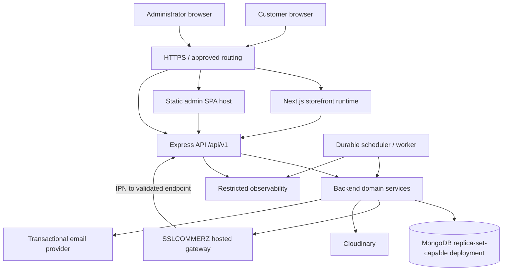
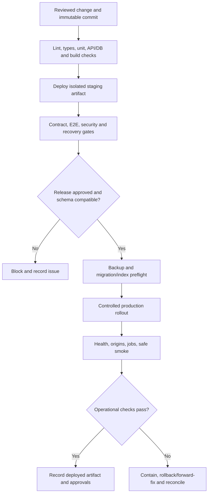
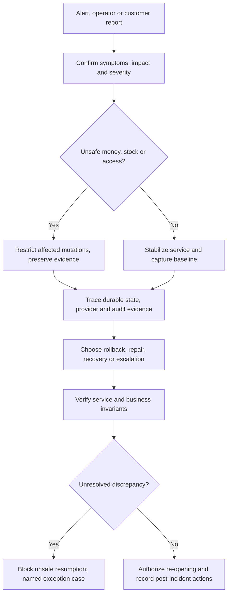
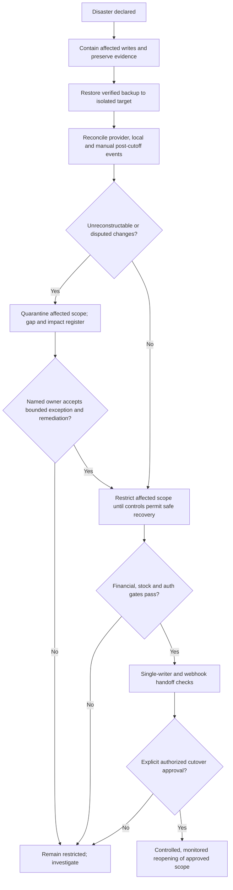
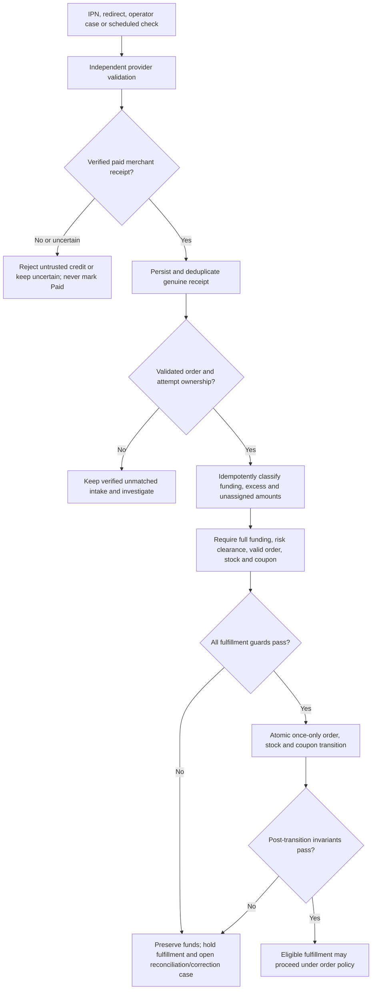

# SportZone — Operations & maintenance specification

**Version:** 1.0\
**Status:** Final development baseline\
**Updated:** 23 October 2026

**Product reference:** [PRD](./PRD.md)\
**Technical reference:** [Architecture](./ARCHITECTURE.md)\
**Design reference:** [Design](./DESIGN.md)\
**Data reference:** [Database](./DATABASE.md)\
**HTTP reference:** [API](./API.md)\
**Quality reference:** [Testing](./TESTING.md)\
**Delivery reference:** [Implementation Plan](./IMPLEMENTATION_PLAN.md)\
**Execution reference:** [Tasks](./TASKS.md)\
**Scope:** Single-store sports e-commerce platform for Bangladesh\
**Audience:** Developers, infrastructure operators, incident responders, store owner and release approvers

This document defines how to provision, deploy, operate, observe, secure and recover SportZone. Runbooks specify
service responsibilities and safety checks; the protected operating inventory records environment-specific commands,
provider settings, owners and verification evidence.

The **PRD** owns product policy and launch acceptance; **Architecture** owns component boundaries and integrity
invariants; **Database/API** own persisted and HTTP contracts; **Testing** owns executable verification;
**Implementation Plan/Tasks** own milestones and recorded evidence. This file owns operating procedures, on-call
responsibilities, configuration inventories, alerting, backup/restore decisions and incident handling, but cannot
change those authoritative contracts.

---

## Contents

- [1. Operations overview & objectives](#1-operations-overview--objectives)
- [2. Production infrastructure & topology](#2-production-infrastructure--topology)
- [3. Environments & configuration management](#3-environments--configuration-management)
- [4. Infrastructure provisioning & setup](#4-infrastructure-provisioning--setup)
- [5. CI/CD & deployment procedures](#5-cicd--deployment-procedures)
- [6. Release management & rollback](#6-release-management--rollback)
- [7. Database operations](#7-database-operations)
- [8. Background jobs & scheduled tasks](#8-background-jobs--scheduled-tasks)
- [9. Monitoring, logging & observability](#9-monitoring-logging--observability)
- [10. Alerting & incident management](#10-alerting--incident-management)
- [11. Backup, restore & disaster recovery](#11-backup-restore--disaster-recovery)
- [12. Payment & financial operations](#12-payment--financial-operations)
- [13. Security & access operations](#13-security--access-operations)
- [14. Performance, capacity & reliability](#14-performance-capacity--reliability)
- [15. Maintenance & operational runbooks](#15-maintenance--operational-runbooks)
- [16. Store administration & third-party services](#16-store-administration--third-party-services)
- [17. Operational verification & acceptance](#17-operational-verification--acceptance)
- [18. Ownership, handover & change management](#18-ownership-handover--change-management)
- [Appendix A — Runbook index & execution template](#appendix-a--runbook-index--execution-template)
- [Appendix B — Configuration inventory](#appendix-b--configuration-inventory)
- [Appendix C — Environment commissioning checklist](#appendix-c--environment-commissioning-checklist)
- [Appendix D — Requirements & task traceability](#appendix-d--requirements--task-traceability)
- [Appendix E — Operational evidence templates](#appendix-e--operational-evidence-templates)

---

## 1. Operations overview & objectives

### 1.1 Operational scope

Operate **one Bangladesh store**, denominated in **BDT**, with a Next.js storefront, a static React/Vite
administration portal, one modular Express API, MongoDB/Mongoose and durable scheduled jobs. SSLCOMMERZ-hosted
bKash, Nagad and Rocket, plus internal COD, are required for launch under PRD §3.3; inactive channels must not be
displayed, and omitting a required channel does **not** waive the launch gate. Manual shipment status and
operator-managed delivery zones/charges are in scope. Automated courier integration, GPS tracking,
multi-vendor/multi-currency and additional administrator permission tiers are not.

| Operational objective    | Definition of acceptable evidence                                                                                                           |
| ------------------------ | ------------------------------------------------------------------------------------------------------------------------------------------- |
| Repeatable deployment    | Identified artifact, environment, approver, automated checks, deployment and smoke-test record                                              |
| Business correctness     | Order, price, stock, coupon, collection and refund transitions preserve Database/Architecture invariants                                    |
| Security/privacy         | Scoped access, TLS, session/cookie/CSRF isolation, redacted logs, controlled secret/access ownership                                        |
| Reliable background work | Durable work state, bounded retries, lease-fencing or equivalent protection, backlog visibility                                             |
| Recovery                 | Practiced restore and reconciliation with known recovery point, unresolved gap register and approval before reopening writes                |
| Store ownership          | Authorized persons control live service, merchant, domain, backup and provider accounts; access is documented without credential disclosure |

### 1.2 Operational non-negotiables

1. **Express remains the sole business authority.** The storefront and admin only consume its API; internal jobs reuse backend domain services.
2. **External money is not undone by an application deploy, rollback or database restore.** Preserve and
   independently reconcile externally settled payments/refunds.
3. **Never infer provider success.** Browser redirects, received IPNs, gateway request acceptance and timeouts are
   not independently verified payment/payout completion.
4. **No destructive reconciliation.** Retain immutable order snapshots, receipts, correction records, stock
   movements, refund obligations, and audit evidence; repair through approved domain transitions.
5. **No unapproved operational numbers.** Backup frequency/retention, RPO/RTO, alert thresholds, SLAs, performance
   budgets and legal response periods require evidence and owner approval.
6. **No synthetic production activity without approval.** Do not run live financial tests, destructive migrations,
   load tests or bulk data corrections as ordinary smoke checks.
7. **No completion by documentation alone.** Every task, drill or launch gate stays `Not Run`, `Blocked` or
   `Pending` until linked actual evidence exists.

### 1.3 Source precedence and delivery timing

Establish the operational baseline in the foundation stage and maintain affected procedures as backend,
admin and storefront capabilities are implemented under Implementation Plan §3.1. Provision integrated
staging before Phase 10, execute production readiness in **Phase 11 / M7**, and reconcile the document to deployed
reality during **Phase 12 / M8**. Production topology must match Architecture §13. Out-of-date runbooks are a
release blocker when they are necessary to recover a critical flow.

## 2. Production infrastructure & topology

### 2.1 Logical topology



This is **logical**, not a diagram of a selected cloud provider. HTTPS routing, runtime placement, backup storage
and monitoring vendor remain deployment decisions. Worker and HTTP deployments may share code but must not
independently bypass the authoritative domain rules.

### 2.2 Component requirements

| Component        | Deployment characteristic                                                 | Health/recovery expectation                                                | Sensitive boundary                                           |
| ---------------- | ------------------------------------------------------------------------- | -------------------------------------------------------------------------- | ------------------------------------------------------------ |
| Storefront       | Next.js-capable runtime; request-time catalog SSR under Architecture §5.1 | Pages render; next-request freshness and unavailable/404 behavior verified | No merchant/DB secrets or private shared caches              |
| Admin portal     | Versioned Vite static assets; SPA fallback                                | Deep-link navigation and admin login function                              | Frontend environment variables are public                    |
| Express API      | Independent deployable Node.js service; approved host/origin              | `/api/v1/health/live` and restricted `/api/v1/health/ready`                | All authenticated commerce actions enforced server-side      |
| MongoDB          | Transaction-capable deployment with index management                      | Connections, transaction capability, backups and restoration verified      | Restricted network access, least-privilege database identity |
| Scheduled worker | Durable leased/claimed job execution using backend services               | Lag, failures, expired leases and restart safety visible                   | No public unauthenticated job execution endpoints            |
| SSLCOMMERZ       | Approved sandbox vs live credentials and callback URLs                    | Server-side transaction/refund verification available                      | Secrets stay in backend; live channel activation evidenced   |
| Cloudinary/email | Restricted backend-controlled adapters                                    | Retry/error observation and credential ownership                           | Private return evidence; no raw secret leakage               |
| Telemetry/backup | Controlled access, redaction, retention                                   | Alerts, restore drills, integrity and owner checks                         | Private evidence, encrypted storage, access audit            |

### 2.3 Network, DNS and trust boundaries

Prefer approved **same-site subdomains** for storefront, admin and API as specified in Architecture §13. Before
launch, record actual domains, DNS owners, allowed browser origins, certificate ownership/renewal, API ingress
restrictions, outbound provider dependencies and webhook delivery path. Require HTTPS for browser, admin and
provider traffic; HSTS/cert behavior is configured for verified live domains, not guessed here. Database and
internal worker control surfaces are not public. CDN/proxy caching applies only to explicitly public content;
authenticated pages, customer data, payment status and admin responses must not be shared-cached.

### 2.4 Infrastructure inventory record

For each provisioned resource, maintain: **environment; provider/account; service/resource ID (internal inventory,
not public document); region; data residency assessment; owner; backup/export capability; encryption; access group;
dependencies; cost center; expiry/renewal; evidence link; last verified date**. Actual provider, region and plan
must be recorded on provisioning, not invented.

## 3. Environments & configuration management

### 3.1 Environment isolation matrix

| Environment | Data and credentials                                                                     | Allowed activity                                                          | Explicitly prohibited                                                               |
| ----------- | ---------------------------------------------------------------------------------------- | ------------------------------------------------------------------------- | ----------------------------------------------------------------------------------- |
| Local       | Synthetic users/orders; local transaction-capable replica set; mocked/test third parties | Development, unit/integration/race tests                                  | Live merchant keys; unrestricted real customer exports                              |
| CI          | Ephemeral isolated DB namespace; nonproduction short-lived secrets                       | Static checks, build, contract and automated tests                        | Shared production credentials, destructive production access                        |
| Staging     | Isolated DB, approved synthetic/sanitized data, SSLCOMMERZ sandbox                       | E2E, migration, callback, restore, security and fault-injection rehearsal | Live charges or unredacted production customer data                                 |
| Production  | Real restricted customer/merchant data and activated channels                            | Approved deploy, operational read-only checks, verified low-risk smoke    | Synthetic live payments/refunds without explicit approval, load/destructive testing |

Do not promote staging **data or secrets** to production. Deploy a release artifact built from an identified
commit; promote compatible configurations independently. Verify test-provider identifiers cannot be mistaken for
live settlement identities.

### 3.2 Configuration ownership and startup validation

Maintain the per-key environment registry defined in Appendix B. Reconcile keys with `.env.example`, server-side
validation and deployment configuration. Record environment, required conditions, exposure, owner, protected source
reference, validation, rotation and verification evidence for each deployed key.

- Fail API/worker startup on missing or invalid **required** secrets, DB configuration, deployed origins and
  provider modes; disable unactivated payment methods explicitly.
- Never place credentials in `NEXT_PUBLIC_*`, `VITE_*`, source, CI logs, uploaded artifacts or browser-exposed diagnostic responses.
- Verify customer/admin/guest cookies are host-only, `Secure` and `HttpOnly`, correctly separated, and constrained
  by appropriate `SameSite` behavior. CSRF/Origin and credentialed CORS must match deployed origins.
- Record timestamps in UTC where stored; report Bangladesh business periods in `Asia/Dhaka` as defined by Database §14.3.
- Configuration changes affecting delivery, policy, payments or access are versioned/approved and audited, not
  performed as undocumented runtime edits.

### 3.3 Change classes

| Change                                                | Approval/review requirement                                | Release implication                                      |
| ----------------------------------------------------- | ---------------------------------------------------------- | -------------------------------------------------------- |
| Public content or branding                            | Authorized store operator, preview and provenance          | May use admin workflow; no arbitrary DB update           |
| Delivery zones/charges or published policies          | Store-owner approval; versioned/effective change and audit | Preserve original checkout snapshots                     |
| Payment channel, callback, merchant limits or refunds | Merchant/operator approval with provider evidence          | Block payment method if unverified; test before enabling |
| Backend binary, schema or index                       | Engineer review and deployment/migration gate              | Compatible staging evidence before promotion             |
| Secrets, domains, auth or access policy               | Security/owner authorization and rotation impact review    | Targeted origin/session checks after change              |

## 4. Infrastructure provisioning & setup

### 4.1 Provisioning checklist (OP-PROV-01)

**Trigger:** First setup or replacing infrastructure. **Owner:** Assigned infrastructure engineer;
security/store-owner approval for live resources.

1. Record hosting, region, domains, budget owner, third-party accounts and topology in the
   protected operating inventory before production provisioning.
2. Create distinct staging/production projects, identities, resources, ingress policies and secret stores. Ensure
   no shared root tokens or DB credentials.
3. Provision Next.js runtime, SPA static hosting with deep-route fallback, Express API and a scheduler/worker with
   safe restart and durable claim support.
4. Provision transaction-capable MongoDB; configure network access, runtime DB role, separate migration/operator
   privilege, encryption and verified backup capability.
5. Provision independent media/email resources and SSLCOMMERZ sandbox/live merchant boundaries; register approved HTTPS callback/return URLs.
6. Configure DNS/TLS, credentialed browser-origin allowlists, host-only cookies, server clock synchronization and outbound service access.
7. Attach monitoring, restricted logs, alert routes, billing notifications and backup retention/export controls. Do
   **not** publish private readiness details.
8. Verify runtime readiness, DB transaction support, independent admin/storefront builds, worker lease behavior,
   provider sandbox reachability and restore feasibility on staging.
9. Record resource inventory, proof of ownership, smoke evidence, blockers and approvals. Block M7 if required
   infrastructure controls are unverified.

**Failure path:** Stop provisioning before serving customer writes; revoke unused credentials and record the
incomplete resource state. Deletion of any live resource requires independent data-retention/backup and
financial-impact approval.

### 4.2 Provisioning verification matrix

| Check                   | Observable acceptance                                                                             |
| ----------------------- | ------------------------------------------------------------------------------------------------- |
| DB transaction support  | Replica-set-backed session/transaction scenario succeeds in staging                               |
| Service isolation       | DB and worker control endpoints unreachable from unauthenticated public Internet                  |
| TLS and domains         | Storefront/admin/API/callback origins present valid certificates and correct host routing         |
| Session boundaries      | Customer/admin/guest identities cannot cross roles or hosts; credentials not shared-cacheable     |
| Provider separation     | Test and live credentials, callbacks, logs and merchant identities are distinct                   |
| Recovery infrastructure | Backup exists, restore destination is separate, restore can be tested without overwriting live DB |

### 4.3 Operational prerequisites

Maintain authoritative versions of: Node/npm and compatible framework releases, `package-lock.json` or approved
lockfile, migrations, index definitions, required configuration, secret-store locations, DNS records, worker
schedule definitions, email sender verification, gateway limits and callback configuration. A staging success never
proves live merchant capabilities.

Before executing an environment-specific runbook, record its actual resource/backup/secret-store references, named
authorized operator, exact commands, preflight/abort conditions and tested recovery steps in the protected operating
inventory. Unverified platform commands remain prerequisites; a published procedure does not prove an executable deployment.
Use [P01-005 readiness records](./evidence/P01-005-readiness.md) to track unresolved ownership and external inputs.

## 5. CI/CD & deployment procedures

### 5.1 Release pipeline



### 5.2 Reproducible build interface

#### Database setup

Use a transaction-capable MongoDB deployment. Supply its private
connection URI as `MONGODB_URI` and an isolated application database as `MONGODB_DB_NAME`; Mongoose
uses these through the existing backend configuration boundary. Provision a database identity and
network access for the actual backend environment, keep credentials out of browser/public variables,
and verify replica/session/transaction capability before enabling dependent writes. Apply the explicit
bootstrap/index procedures in §7. Development, staging and production must use separated data/access;
integration tests retain their own disposable replica sets and never target application data.
The repository's local database tool below provides a disposable development replica set.
MongoDB Atlas is an optional managed hosting choice; record its network, identity, backup and billing
configuration in the protected environment inventory when selected. Cloud hosting is not a local
development prerequisite.

#### Build and verification commands

API artifacts are maintained through API §18.3. Run `npm run api:generate --workspace=backend` after
an owning contract change and commit the deterministic `backend/api/` outputs with it. Candidate checks
use `npm run test:contract --workspace=backend`; stale/missing artifacts or route parity failures block
acceptance. Import only the blank Postman environment template, configure private values locally and
keep filled/exported environments out of Git and CI artifacts. `baseUrl` includes `/api/v1`.
Generated capability/activation metadata does not establish deployed route or provider readiness.

The monorepo uses `storefront/`, `admin/` and `backend/` workspaces (Architecture §4).
[Testing §5.3](./TESTING.md#53-standard-execution-interface) owns the executable check inventory.
For a backend candidate, use the existing owning-workspace interface with isolated test prerequisites:

```bash
npm ci --ignore-scripts --no-audit --no-fund
npm run lint
npm run ci -- --scope=backend
```

This consolidated scope is for candidate verification; routine implementation uses focused checks under
Testing §15.5. Integrated candidates use `npm run ci` to verify all consumers. All three workspaces have
independent lint/type/unit/build and HTTP smoke commands in [ci-workspaces.json](../ci-workspaces.json). Admin Vite preview verifies local SPA fallback,
not production static hosting; configure fallback and noindex/private document headers at the deployment host. No automated production deployment, migration or restore
command is supplied; local storefront build/start is not a production deployment procedure. See
[Testing §5.3](./TESTING.md#53-standard-execution-interface) for current coverage and the complete required interface.

#### Local development lifecycle

`npm run dev` coordinates local development on Linux/macOS/WSL: one TypeScript watch compiler and both UI dev servers.
The compiler uses the existing backend tsconfig; its first successful emit starts the API and later
successful builds gracefully restart it. This avoids a duplicate initial compilation. API startup validates
configuration before database/HTTP access; only the API explicitly loads optional root `.env` and injected
variables take precedence. Provision isolated local configuration and run the existing ephemeral replica-set
tool in another terminal. No database provisioning, identity bootstrap, migration, provider activation or
notification worker runs automatically. SIGINT/SIGTERM and unexpected child/API exits stop owned process
groups with a 12-second grace period before SIGKILL. Compiler errors retain the last successfully running
API until a valid rebuild; verify actual HTTP readiness separately. Stop the separate DB tool independently.
Native Windows uses WSL or individual workspace commands. For backend-only work, use root `npm run dev:backend`; it supervises the compiler/API process group with the same failure and termination cleanup, without UI processes. The workspace backend `dev` command only watches already compiled output and does not provide this initial compile/environment setup.

Root `lint:boundaries` validates literal source imports, package declarations, workspace isolation,
shared-code purity and transitive browser/server imports. Root `format:check` covers repository scripts/tests/shared utilities and all three applications’ adopted source,
tests, scripts and configuration; generated next-env.d.ts remains tool-owned and excluded. Workspace Biome configuration inherits the root formatting policy.
Both checks are in
the CI inventory and fail on violations. Their pinned Biome/TypeScript tools are declared at the root,
using the same versions already locked for the workspaces.

#### Backend configuration and startup

API startup calls `openDatabase(uri, dbName)` after configuration validation, before binding HTTP. Use an isolated explicit database name; `admin`, `local` and `config` are rejected. Pools are bounded to ten connections, with five-second selection/connect/queue waits and a fifteen-second socket timeout. Startup failures return static database codes without URI/driver text; failed connections are destroyed. Connections require replica-set topology and logical sessions. Automatic collection/index creation and command buffering are disabled.

Database startup failures include a safe `reasonCode` in the `startup_failed` lifecycle record:
`CONNECTION_FAILED` indicates connection/selection failure; `REPLICA_SET_REQUIRED` indicates unsupported
topology/session support. Raw exceptions and connection strings are never logged. For local connection
failures, keep the separate replica-set tool running and copy its current URI into the private root
`.env` before restarting development; a restarted ephemeral tool may use a different port.

`npm run db:local --workspace=backend` starts a single-member, loopback-only, ephemeral MongoDB 8.0.16 replica set and prints its credential-free local URI. Its data disappears on shutdown; never use it for real/customer data or durability/backup acceptance. Integration tests generate their own random database on their own replica and never read external `MONGODB_URI`. `MONGOMS_DISTRO=ubuntu-24.04` selects the compatible official binary on this Ubuntu 26 host; supported Ubuntu 24 CI resolves it normally. First use downloads the pinned binary and requires network access; there is no mock/standalone fallback. Close the local tool with SIGINT/SIGTERM to clean its owned processes/data.

Authenticated cart and wishlist persistence use an explicit local/test bootstrap after the backend build:
`node --env-file=.env backend/scripts/bootstrap-cart.mjs` from the repository root. This creates only
missing `carts`/`wishlists` collections with their strict validators and unique user indexes; matching reruns are
additive. Existing incompatible validators require a reviewed migration and are never overwritten.
For an isolated Linux container runtime qualification, first build the backend image, then run
`node backend/scripts/verify-container-runtime.mjs <local-image-tag>` from the repository root.
The verifier requires local Docker access and installed backend development tools. It generates its
own loopback MongoDB 8.0.16 replica set, database, credentials and temporary env file; it never loads
`.env` or `.env.staging`. Linux host networking lets only this local test reach that loopback fixture.
It verifies transactions, protected readiness, initialized catalog reads, non-root identity, SIGTERM
shutdown, restart persistence and two empty reservation-expiry worker processes. Cleanup removes
only its named test container and temporary fixture. Retain `test-results/container-runtime.json`.
This qualifies the local artifact, not Atlas collections, a deployed scheduler, nonempty financial
job recovery or hosted scanner availability.

HTTP startup does not create collections; cart/wishlist requests fail closed with 503 when required persistence
is absent or incompatible. Staging/production rollout must use the reviewed owning initializer with
approved configuration and migration review; the local/test entry script refuses those environments.
Cart/wishlist records contain selections only, so account/financial retention rules remain authoritative.

Coupon persistence has a separate explicit local/test bootstrap after build:
`node --env-file=.env backend/scripts/bootstrap-promotions.mjs` from the repository root. It creates
only missing `coupons`, `couponRedemptions`, `couponCustomerCounters` and canonical `auditLogs` collections with strict
validators and declared unique/query indexes; compatible reruns preserve records and extra indexes.
Incompatible existing validators require a reviewed migration and are never overwritten. The script
refuses staging/production; those environments require reviewed rollout of the same owning initializer.
HTTP startup and quota primitives do not auto-create or repair financial collections. Quota mutations
fail closed if persistence is absent. Preserve accepted redemptions/counters during rollback or restore;
never drop financial records or use a TTL deletion to release coupon capacity. The internal allocation
service requires the owning order capability and an outer transaction; it is not wired as a public API.
Coupon administration routes activate with ADMIN_AUTH_ENABLED; reads require compatible promotion
persistence and writes additionally require compatible audit persistence. Missing prerequisites fail closed. Reviewed rollout adds coupon list/history indexes and audit indexes
without dropping data; incompatible existing audit collections require a reviewed migration. Audit writes
are append-only through the owning capability and commit with configuration changes. Preserve both coupon
and audit history during application rollback; roll back router/registry/artifacts together, retaining indexes.

Category administration activates with ADMIN_AUTH_ENABLED. After build, the explicit local/test command
`node --env-file=.env backend/scripts/bootstrap-categories.mjs` creates only missing category indexes and
canonical audit persistence, preserving records/extra indexes; it never activates media or creates seed data.
The script refuses staging/production; reviewed rollout there uses the same owning initializers and existing
migration controls. Requests fail closed when required indexes/audit persistence are unavailable. Category
metadata works without a media provider; image writes additionally require explicit verified media composition.
Preserve category/media references and audit on rollback; deploy matching router/registry/generated artifacts
together. Do not delete referenced data or use image replacement as an external provider delete operation.

Public GET /api/v1/storefront/home reads current catalog sections, configured contact/branding/banner
and approved effective policy pointers with no-store. Provision the existing catalog/category/SKU,
settings and policy indexes/singleton through their owning procedures; runtime never seeds content or
repairs missing persistence. No additional collection, migration, feature flag or provider activation
is introduced. Missing configured copy/media is omitted; missing required persistence returns 503.

Logo and banner use independent settings ledger slots. Public rendering rechecks attached/public/clean
media and banner asset identity, generating URLs through the owning provider rather than trusting a
stored URL. An unavailable provider omits image content; private/quarantined/deleting/deleted or
unreferenced assets cannot publish. Configure/clear homepageBanner through the protected settings CAS
API; changes appear on a subsequent public read. Policy links require the current approved, published,
effective pointer, never a scheduled/draft/latest-version fallback. Retain existing media references
and policy history during rollback; disabling or reverting presentation does not delete those records.

`GET /api/v1/checkout/payment-methods` reads current store payment flags in a transaction.
No checkout activation or identity is needed for a general read; order-specific reads require the
current customer owner or an enabled scoped guest session. Only active methods are returned;
an unknown online amount remains ineligible (AMOUNT_REQUIRED). Amount query values are advisory;
owned order reads use remaining canonical merchandise funding and the original payment method.
The API and checkout quotes share the same verified capability projection. COD follows store flags.
No provider request, new attempt or financial mutation is performed by this availability read.

Online publication requires `PAYMENT_CHANNEL_APPROVALS_FILE`, an operator-controlled JSON array
(maximum three entries), plus explicit valid adapter configuration below. Each entry includes
channel (bkash/nagad/rocket), appEnv, mode, merchantAccountKey, gatewayKey, minPoisha/maxPoisha,
verifiedAt, validUntil, approvedBy, evidenceRef, evidenceFile and evidenceDigest. Bind the merchant
key to SHA-256 of `mode + NUL + storeId`; it must match the configured account/environment.
EvidenceFile is a plain sibling filename, not a path/URL; evidenceDigest is SHA-256 of its nonempty
bytes. Both manifest and each artifact are capped at 1 MB. Store these files outside public/web
content under deployment/operator write controls; do not include credentials or personal payment data.

The merchant owner must supply actual channel enablement/limits and authoritative sign-off evidence;
writing a boolean, copying a synthetic fixture or computing a digest is not approval. Each verified
lifetime and gateway key must be explicitly approved. Amount bounds are the merchant-approved
intersection with published gateway constraints; no automatic channel-key mapping or default range
is supplied. Missing manifest means no online capability. Malformed, duplicate, expired, future,
wrong-account/environment, missing or digest-mismatched evidence fails startup configuration safely.
Qualifying metadata and underlying evidence are loaded at startup; lifetimes are rechecked on every
read/quote. Revoke immediately through the owning store flag, then replace/review evidence and restart
to load changed qualifications. Expired evidence hides the affected channel automatically. Keep the
approval revision/evidence in the protected operational inventory for audit/recovery.

Without merchant evidence, online channels remain unavailable; bKash, Nagad, Rocket and COD still each
require separate live launch acceptance. Availability does not enable the separately gated hosted initiation path or activate callbacks/receipt verification. Rollback can clear the evidence-file setting/restart or disable store
flags while preserving attempt/receipt and approval history. No collection migration is introduced.

Callback transport is independently gated by `PAYMENT_CALLBACKS_ENABLED=true` in local/test only;
configuration and root composition refuse staging/production pending independent verification and
provider qualification. Supply SSLCOMMERZ_MODE=sandbox, explicit SSLCOMMERZ_STORE_ID,
PAYMENT_CALLBACK_RATE_LIMIT (1–60 requests per real peer per fixed minute), and
PAYMENT_RETURN_SUCCESS_URL / PAYMENT_RETURN_FAIL_URL / PAYMENT_RETURN_CANCEL_URL. Return targets
must be canonical absolute HTTPS URLs on STOREFRONT_ORIGIN, without credentials/query/fragment.
Configure actual approved result routes; no route is guessed. All three may target one result page
that reads authoritative scoped status. Default/false leaves callback routes unmounted.

After build, `node --env-file=.env backend/scripts/bootstrap-payment-callbacks.mjs` additively
provisions audit and the existing protected quota collection in an owned local/test database. It
preserves audit facts, refuses unknown drift/deployed environments and never creates financial records
or verifies merchant activation. HTTP startup never provisions this state. Missing audit/quota
protection fails admission closed; quota hashing uses a distinct purpose with the backend secret.
Register exact POST IPN and GET/POST return URLs only after provider transport qualification.

Only the callback router accepts URL-encoded forms before the normal JSON parser (8 KiB, 64 fields,
no compression/duplicate fields). It does not grant a wider parser/CSRF exception. Normal initiation,
admin/customer and guest mutations retain their own JSON, Origin, CSRF, role and ownership checks.
Callback responses grant no credentialed CORS access or sessions. Do not log request bodies, full
callback URLs/queries, card fields, signatures, credentials or raw peer addresses in infrastructure.
Browser success/fail/cancel is an untrusted display hint; empty-body 303 forwards none of those values.

Runtime IPN returns retryable 503 until a separately composed independent processor verifies and
commits its durable receipt/nonpayment/quarantine/reconciliation outcome. A security fingerprint alone
never permits 200. A configured processor's 200 response is plain-text OK only after its durable result;
confirm provider retry behavior/ACK transport and all merchant/channel gates independently. Do not
interpret retry/no-IPN/browser navigation as noncollection or blindly create another charge.
P07-006/007/012 own independent financial verification, replay protection and reliable reconciliation.

For local/test durable intake, explicitly set PAYMENT_PROCESSING_ENABLED=true alongside callbacks
and valid SSLCOMMERZ_ADAPTER_ENABLED sandbox configuration. Default false preserves retryable IPN.
Staging/production is refused; this flag does not qualify merchant channels, legal rules or reconciliation.
Provision existing payment/attempt/intake/collection/initiation and audit state with the reviewed
`bootstrap-payment-initiation.mjs`, plus callback quota with `bootstrap-payment-callbacks.mjs`, after
build in an owned local/test database. No new schema/index migration is introduced by processing.
Existing inventory/coupon/order provisioning and immutable order snapshots remain required.

Operator-approved safe behavior pending timezone evidence: accept only valid, explicit-offset collection
timestamps and fail closed on timezone-free provider tran_date. Do not replace it with current time.
A 503 means uncertain processing, not noncollection. Test doubles with explicit offsets are not provider
qualification. Pending/unavailable validation and failed transactions remain retryable; polling is
separately activated through the explicit worker procedure in §8.2 and never by API startup. Quarantined/mismatched intake, cancelled correction obligations and unassigned additional collections
require the owning supervised reconciliation/correction workflow; do not manually convert them into merchandise funding.

Initial linked funding and eligible live allocations commit together. Risk/expired holds retain funds
without forced fulfillment; late recovery follows the separately fenced rules below. Committed orders remain pending/admin_review for the
separate confirmation/deadline/notification workflow. A terminal nonpayment updates its attempt only,
never releases another attempt's allocations. Inspect immutable intake, collection, guarded attempt and
audit events for duplicate identity conflicts or risk escalation; preserve the original core proof.
Disable PAYMENT_PROCESSING_ENABLED first to roll back local processing while retaining callbacks;
IPN then returns 503. Preserve all receipt/payment/audit and allocation history. Disabling the flag
cannot roll back verified money, and any deployed recovery still requires qualified reconciliation.

Late allocation recovery follows the durable receipt transaction in a separate payment/order-fenced
transaction. It honors current stock and coupon capacity together, reuses valid committed generation,
and rolls back any partial reacquisition on shortfall. Verified Paid survives unavailable capacity.
Cancelled late money remains cancelled, links entirely as correction, and creates an immutable
under_review/not_reserved source obligation with no guessed method/policy or automatic payout.

After build, rerun the local/test `bootstrap-payment-initiation.mjs`: it applies only the exact known
payments-validator additive change and provisions the canonical refunds correction-intent slice and
indexes. Repeats preserve data; unknown validator/index protection fails closed. HTTP never migrates.
Existing full/unknown refunds schemas require separate reviewed migration rather than replacement.
An old backend cannot safely restore its former validator over correction-only Paid data. Preserve
all receipt/source/obligation/audit facts; rollback means disable writes, not delete verified money.

Risk-decision API is mounted only with ADMIN_AUTH_ENABLED in local/test. Every mutation requires
current admin session, Origin/CSRF and explicit Idempotency-Key/reason. Approval does not itself
fulfill: retained/reacquired stock/coupon must pass the separate funded recovery transaction. Rejection
holds funds and fulfillment without automatic refund. Replaying a historical approval cannot clear a
new review. The same already reviewed provider flag is not reopened by ordinary duplicate IPN.
Disable processing plus admin mutations for a local financial freeze; processing flag alone does
not unmount risk decisions. Staging/production activation and provider/legal qualifications stay blocked.

Rollback disables callback composition while preserving audit/quota and all financial histories.
Keep canonical receipt, correction-obligation and audit history; no separate raw callback collection
or API-started automatic worker is implied. A deployed rollback must reconcile provider retry
queues and uncertain payment outcomes through its reviewed procedure; local tests are not provider acceptance.

Hosted initiation requires `PAYMENT_INITIATION_ENABLED=true`, CUSTOMER_AUTH_ENABLED, valid explicit
adapter options and current merchant evidence. It is local/test only: both configuration and root
composition refuse staging/production until callback/independent verification tasks are qualified.
Absent/false leaves initiation and attempt-status routes unmounted. This does not enable online order
submission or accept the existing checkout review gates. Merchant channel qualification remains distinct.

After backend build, run `node --env-file=.env backend/scripts/bootstrap-payment-initiation.mjs` in
an owned local/test database. It additively provisions paymentInitiations plus payment record/audit
persistence, and upgrades only exact known predecessor users/orders validators for optional postalCode.
Existing records, indexes and historical snapshots are retained; unknown drift or deployed environments
are refused. A partial provisioning failure can leave already-created collections/schema expansion;
inspect and resume explicitly. Existing identity/catalog/order/stock/coupon/notification prerequisites
remain their owning bootstraps. Startup verifies admission but never migrates/provisions silently.

Saved address/quote/order postalCode is optional for compatibility; online initiation requires the
actual immutable snapshot value. Missing postcode, overlong gateway contact/shipment fields or other
unrepresentable historical metadata fail before any provider call. Do not invent, truncate or backfill
contacts/postcodes. Shipping addressLine2 is preserved when gateway-compatible. A legacy order requiring
additional facts needs reviewed resolution; deployment cannot rewrite its commercial snapshot.

Initiation persists its unique request/attempt and uncertain dispatch before external I/O. Identical
requests never resend or restart holds; a timeout, crash or failed result transaction remains unresolved
for independent reconciliation using the original tranId/session references. Do not reset an operation,
generate another financial attempt or infer noncollection from an absent browser result. Stock and
coupon reacquisition share one new 15-minute generation in a single transaction, guarded by current
order/payment/attempt state. Allocation shortfall has no attempt or provider call; its original key
retains that outcome. A fresh explicit request after capacity recovers may proceed only without an
unresolved attempt. Current risk/funding/channel/lifecycle changes suppress historical hosted URLs.

Rollback disables initiation first while preserving operations, attempts, receipts and audit. New
postalCode data/expanded validators require a compatible rollback build: do not erase fields or
blindly downgrade validators. Staging schema changes use the reviewed operational migration process;
the convenience bootstrap never authorizes deployed collection effects. Session acceptance is not
payment verification, fulfillment confirmation or permission to bypass required launch channels.

SSLCOMMERZ adapter configuration is loaded by explicit backend composition through
`loadSslcommerzOptions`. HTTP startup composes initiation only under the separate gated option below. `SSLCOMMERZ_ADAPTER_ENABLED=false`
(or absent) disables loading. Enabling requires explicit `SSLCOMMERZ_MODE`, `SSLCOMMERZ_STORE_ID`,
`SSLCOMMERZ_STORE_PASSWORD`, `SSLCOMMERZ_CALLBACK_ORIGIN` and `SSLCOMMERZ_TIMEOUT_MS` (1–60,000).
Local/test/staging permit sandbox only; production permits live only. Credentials must belong to the
selected merchant/environment; this validation does not prove merchant enablement. Callback origin
must be an absolute HTTPS origin without credentials, trailing slash, path, query or fragment.
Canonical API return/IPN paths are derived; do not configure arbitrary client redirect destinations.

Transport uses the published v4 endpoints on fixed sandbox/securepay origins. It never follows
redirects or automatically retries. Hosted URLs are restricted to the mode's `/gwprocess/v4/gw.php`
with the returned SESSIONKEY and optional Q=PAY; an unexpected gateway URL requires reviewed provider
qualification. Query API credentials are sent in the documented GET query: redact full outbound URLs,
query strings and response bodies in HTTP instrumentation, proxies and incident artifacts. Returned
records are redacted provider reports/digests, not a funding decision; authenticate and match merchant,
order, amount/currency and references in the owning verification service before financial mutation.
Persist intent before initiation; reconcile uncertain outcomes using the original references.
No provider endpoint/channel is activated by the adapter flag. Before production integration, verify
merchant-owned credentials, callback transport, channel keys/limits and public egress/IP registration
with the merchant owner. Rollback disables composition while preserving all attempts and receipts;
never retry an uncertain external request solely because a deployment was reverted.

After backend build, `node --env-file=.env backend/scripts/bootstrap-payment-records.mjs`
additively provisions payment attempts, receipt intake, linked collections and audit persistence in
local/test only. Existing validator drift is refused; records and extra indexes are preserved, and
financial TTL indexes fail readiness. Staging/production requires the reviewed migration procedure.
This script enables no provider, callback or receipt writer. Preserve financial histories on rollback;
do not drop collections or restore incompatible validators. Private attempt preparation requires its
transactional authorization/allocation adapter; the gated local/test composition supplies that boundary; test fixtures do not
establish verified merchant capability or independently verified receipts.

COD submission additionally requires `CHECKOUT_COD_ENABLED=true`; the default is false. It requires
quote activation and customer authentication, current approved consent/deadline rules and reviewed
order/intent/inventory/coupon/payment/notification persistence. Unsupported or malformed activation
fails configuration validation. Startup never provisions collections or activates merchant channels.

After build, `node --env-file=.env backend/scripts/bootstrap-checkout-submit.mjs` additively provisions
the approved checkout collections/indexes in local/test only. Catalog, current coverage/settings and
published policy prerequisites remain their owning procedures; no business settings are seeded. This
explicit bootstrap also migrates only exact known predecessor notification validators, preserving all
account/proof delivery evidence and adding order_received for guest/registered buyers. Unknown schema
drift and staging/production are refused. The expanded validator must remain while new events exist;
application rollback must not delete events or blindly restore an older incompatible validator.

COD commits stock/coupon, Pending order/payment and one order_received intent in the same transaction.
An uncertain browser response is retried with its original key; inspect current durable outcome before
any recovery. Missing notification/payment/index readiness rolls back commerce effects. Monitor 409,
429/503 and allocation/readiness failures using safe route/correlation codes, never buyer data or keys.
Payment aggregate creation records zero verified funds and no paymentCollections/paymentAttempts.
Queued order_received events are not claimed by registration/proof workers; commerce delivery belongs
to P06-016. Online creation is private only, with shared 15-minute generation clocks and no provider
call/public activation. Automatic expiry remains P06-010; do not enable online submission before its
payment/expiry/reconciliation integrations and qualified compliance gates are accepted.

Checkout quote runtime is opt-in: `CHECKOUT_QUOTES_ENABLED=true` requires `CUSTOMER_AUTH_ENABLED=true`,
explicit `CHECKOUT_QUOTE_TTL_SECONDS` (1–86,400; technical bound, no operating default) and comma-separated
`CHECKOUT_REQUIRED_POLICY_TYPES` (distinct PolicyType values including terms). The operator approves
lifetime/applicable policies; no values are seeded. A protected eligible DELIVERY_DEADLINE_POLICY_FILE
is loaded once through the existing deadline boundary. Invalid enabled configuration fails startup
with value-free diagnostics. Missing independently reviewed deadline or current published policy pointers
blocks quote publication. Existing P06-003 legal/compliance acceptance is not cleared by this switch.

After backend build, `node --env-file=.env backend/scripts/bootstrap-checkout-quotes.mjs` additively
creates quote indexes in local/test only. Provision identity/throttle, catalog, delivery, canonical
settings/published policies and promotions through their owning reviewed procedures. Runtime never
repairs indexes. Staging/production bootstrap is refused; review their additive provisioning separately.
Quote records retain consent evidence without TTL; lifetime expiry does not authorize deletion. Never
wipe open/consumed quotes as a rollback or substitute a new quote/intent automatically after an error.

After backend build, `node --env-file=.env backend/scripts/bootstrap-orders.mjs` provisions the
canonical orders/orderItemBalances collections, strict validators and declared indexes in local/test
only. It refuses existing validator drift and staging/production; it never repairs incompatible
collections or deletes historical data. Runtime creation checks persistence readiness. Rollback must
retain orders, unit balances and audit evidence. This foundation requires explicit submission activation:
the checkout coordinator atomically authorizes current consent, consumes the quote, persists
the intent and coordinates allocations/pending payment before committing an order.

After backend build, `node --env-file=.env backend/scripts/bootstrap-checkout-intents.mjs` provisions
the canonical durable checkout identity registry in local/test only. It installs strict validators and
unique scope/key, quote and optional order indexes; existing validator drift or any TTL index fails
readiness and requires reviewed provisioning. Staging/production bootstrap is refused. Never delete
intents or tombstones to resolve a retry, expire them with TTL, or rotate a key automatically after an
uncertain response. `replayUntil` affects no uniqueness/retention guarantee; replay reads current owned
order state without revalidating an expired/consumed quote. Missing linked orders or stranded preparing
records require investigation and safe reconciliation, not blind resubmission. Preserve registry,
quotes, orders and audit across rollback/restore. The COD route requires its explicit activation and
combined completion boundary; online submission and provider/reconciliation integrations remain gated.

Quote generation commits only its scope-bound quote and ordinary authorization fences; it does not
reserve stock/coupons, create orders or invoke providers. GET /delivery/areas is public bounded advisory
discovery even with quote activation disabled. Persistent quote admission shares the customer 60/minute
network budget and a separate checkout 10/minute network/email-target group. Respect Retry-After; no
process-memory fallback is allowed. Request logs identify checkout.quote.create and correlation/error
codes, never draft contact/address, cookies, quote scope hashes or fingerprints. Monitor 429/503/stock/
quote-change rates before changing reviewed limits. Browser context expiry/rotation still invalidates
guest access; quote lifetime does not extend its credential.

Default online eligibility is closed until the owning payment integration supplies verified durable
merchant/provider capability and amount bounds. Setting online flags cannot authorize collection or
waive required initial-release channels. Roll back matching quote routes/contracts/capabilities together,
retain private consent snapshots/digests, and leave existing orders/financial evidence intact. COD
intent/consumption and allocation use the reviewed combined coordinator. Actual provider sessions and
integrated release acceptance remain owning later tasks.

Delivery management uses `node --env-file=.env backend/scripts/bootstrap-delivery.mjs` after a backend
build, in local/test only. It adds delivery indexes and audit persistence without seeding zones, charge
amounts or coverage. Provision the canonical primary settings singleton first through its own bootstrap.
Missing settings or index drift prevents delivery writes; HTTP/worker startup never repairs persistence.
Staging/production index rollout requires separate operator review; existing conflicting coverage must
be reconciled before adding the active-key partial unique index. Do not erase old charge versions.

Schedule `node --env-file=.env backend/scripts/activate-delivery.mjs` with the approved worker scheduler.
Each batch handles at most 100 due items, expires closed windows and activates due schedules behind the
same store-wide guard as HTTP mutations. Disabled scheduled zones do not consume every batch slot;
re-enable a zone only after reviewing its retained windows. Concurrent runs are safe, and failed
transactions roll back their window/fence/audit effects. Monitor `delivery_activation_batch` counts,
nonzero exits and due active-zone backlog. A failed batch remains retryable after investigation;
public coverage fails closed until a valid active rule is present. Effective boundary gaps during
worker delay do not justify using an expired or merely scheduled charge. API key/actor/payload-bound
retries return original snapshots; avoid generating a new key to blindly repeat a command.

Rollback matching delivery routes/services/contracts together, preserving charge versions, configured
end boundaries, lineage, replay records, global/zone fences and audit. Never rewrite accepted order
snapshots or roll commercial prices backward by editing history. Real operator coverage/amounts,
scheduler deployment and legal deadlines remain separately approved operational inputs.

Delivery deadline technical preflight is `node --env-file=.env backend/scripts/check-delivery-deadline.mjs`
after a backend build. Optional `DELIVERY_DEADLINE_POLICY_FILE` names a protected read-only JSON
`{rule,review}` manifest with the exact format in Database §7.2. Missing/inactive configuration produces
under_review and nonzero exit; malformed, oversized (>100 KB), future-review or digest-mismatched input
produces a sanitized error. No database, network, new collection or seed is required. The digest is
computed by the owning `deliveryDeadlineDigest` service over normalized rule JSON; it is not a signature
or an independent legal approval. A successful preflight proves technical eligibility of supplied
configuration only. Do not treat synthetic fixtures or reviewer strings as real approval evidence.

Before installing a real manifest, the store owner/authorized policy approver must retain qualified
current review of applicable legal deadlines, start events and operator policy (EXT-07/EXT-08), approve
the exact rule and identify its evidence reference/reviewer/date. Keep the manifest writable only by
the authorized operator; retain old evidence and immutable order bases. Replace/reload future rules
through reviewed configuration, never by rewriting accepted snapshots. No real manifest is supplied by
the repository. This preflight/domain capability does not yet configure a running checkout/order API;
those owning features must integrate snapshot capture and actual-event confirmation guards. Missing
review blocks affected final publication/acceptance. ETA or exception handling must preserve existing
commitments and use the owning order CAS/audit/customer-notification path when implemented.

Store settings/policy persistence uses `node --env-file=.env backend/scripts/bootstrap-settings.mjs`
after a backend build, in local/test only. Supply explicit approved `STORE_INITIAL_LOW_STOCK_THRESHOLD`
(nonnegative safe integer); there is no default. Additive indexes and the unique primary singleton
are provisioned without overwriting an existing singleton or enabling payment channels/policies.
For staging/production, the operator reviews the same additive rollout separately; startup never
repairs indexes or bootstraps content. Retain the collection, policy history, replay identities and
audit on binary rollback; do not delete published policy documents or pointer history.

`POLICY_APPROVALS_FILE` optionally names a protected, durable JSON approval register mounted read-only
for the API process. Its array entries contain `evidenceRef,type,version,contentDigest,effectiveAt,
approvedAt,approvedBy` (API §14.3); unknown fields, duplicate references, invalid/future approval dates,
more than 1,000 entries or a file larger than 1 MB fail startup. Absence leaves approval unavailable.
The authorized operator/legal reviewer must independently approve the exact policy text/version and
effective date before adding an entry; neither the browser nor an arbitrary evidence string can
create approval. Keep underlying evidence and historical registers durably retained with restricted
write access; reload by reviewed API restart after an atomic register replacement. Do not commit real
contact data, approval records or operational paths. Invalid files produce sanitized configuration
errors. Existing persisted approvals remain durable when the live register rotates.

Schedule `node --env-file=.env backend/scripts/activate-policies.mjs` repeatedly using the approved
worker scheduler. Each run handles at most 100 due schedules in effective-date/ID order, uses real
transactions and atomically records pointer/history/audit transitions. Concurrent runs are replay-safe;
failed transactions leave work scheduled for retry. Monitor `policy_activation_batch` counts and
nonzero exits; investigate due schedules left behind and rerun the batch after recovery. Public reads
continue showing the prior effective pointer until activation commits. Worker scheduling/deployment
and real legal approvals require operator evidence and are not established by local test fixtures.

Product/variant administration uses `node --env-file=.env backend/scripts/bootstrap-catalog.mjs` after
build for explicit local/test category indexes, strict product/variant persistence and canonical audit setup.
It is additive, retains records/extra indexes, seeds no products/stock/media and refuses staging/production;
those environments use reviewed owning initializers/migration controls. Category-only bootstrap remains
supported. Missing validators/indexes/audit cause requests to fail closed; startup never repairs them.
Full variant PATCH now owns threshold edits at the existing URL; inventory list/adjustment/history stay in
inventory, with one registered PATCH handler. Deploy routers/contracts together and preserve SKU/stock,
media references, audit and historical commerce data during rollback. Real provider activation remains
separate, and metadata-only APIs do not require frontend builds or media credentials.

Inventory administration activates with ADMIN_AUTH_ENABLED and requires reviewed product/inventory persistence;
mutations additionally require canonical audit persistence. Reuse the product/inventory owning initializers and
promotion/audit bootstrap under their existing environment restrictions; HTTP startup never creates or repairs
collections. Inventory lists additionally require an operator-approved primary storeSettings.lowStockThreshold
and an unconditional unique key index. The read-only stock-settings capability does not seed that singleton;
settings provisioning remains its owning task. Missing defaults return 503, with no environment fallback or
fabricated approval. Adjustment/history remain usable independently. Preserve movements, audit records and
canonical stock during rollback; roll back router/registry/artifacts together without deleting movement history.

Review persistence uses `node --env-file=.env backend/scripts/bootstrap-reviews.mjs` after backend
build, from the repository root. The local/test-only command creates only the missing `reviews`
collection and declared indexes with its strict validator; compatible reruns preserve records and
incompatible options require reviewed migration. It refuses staging/production. Provisioning a
collection does not activate verified review creation: the service defaults purchase eligibility to
deny. Production integration must supply transaction-scoped delivered-purchase eligibility, real
administrator authorization and append-only audit write/receipt capabilities through their owners.
Moderation receipts must bind actor, review, operation key, decision and reason; replay must never
approve later customer edits. No review HTTP route is registered by this bootstrap. Preserve authored
reviews and audit history on rollback; do not clear them when purchase/refund status changes.

Index changes are explicit/additive through `createDeclaredIndexes` and checked by `verifyDeclaredIndexes`; extra indexes are reported and preserved. No `syncIndexes`, global drop or automatic destructive migration is added. Domain models/index plans remain owned by their feature tasks. Transactions use primary/snapshot/majority with a ten-second driver retry deadline and five-second commit limit. Work may rerun: only sequential database effects belong in the callback, every write must carry its session, and external effects must stay outside. Nested independent transactions are rejected. Retain deployment-grade failover/restore/replication evidence for staging/operations gates.

The compiled backend starts with `npm run start --workspace=backend` after build, using injected process variables. Local files are loaded only by an explicit Node flag, e.g. root command `node --env-file=.env backend/dist/server.js`. The environment validator requires NODE_ENV, APP_ENV, RELEASE_ID, MongoDB URI/name, API/storefront/admin origins and exact allowed-origin pair, plus separate SESSION_SECRET and HEALTH_MONITOR_TOKEN. Secrets use 64 lowercase hex characters representing 32 cryptographically random bytes; provision them privately with a cryptographic generator, never committed examples. The customer/admin session service uses the session secret for domain-separated HMAC digests; identity HTTP routes require their explicit activation flags. Unknown environment keys are ignored so inactive provider adapters do not become fake startup dependencies.

APP_ENV is local/test/staging/production, paired with NODE_ENV development/test/production respectively (staging uses production). Staging/production origins require HTTPS and reject localhost/loopback conventions. RELEASE_ID is bounded nonsecret deployment metadata. PORT defaults to 4000 and must be 1–65535. API_BIND_HOST defaults to 127.0.0.1 and permits only documented loopback/wildcard bind addresses. Production/wildcard listeners require the approved TLS proxy/firewall/operational ingress; a bind option is not deployment acceptance. Missing/invalid values fail before DB/network access and emit only safe configuration key names, never values.

When either auth flag is enabled, `loadEnvironment` constructs frozen typed session/browser/proof options once: require CUSTOMER_SESSION_TTL_SECONDS and
ADMIN_SESSION_TTL_SECONDS as positive bounded seconds and SESSION_COOKIE_SAME_SITE as explicit lax/strict. Values require
security/operator approval; none are supplied by the repository. Session options are validated at the configuration boundary and guarded by the service factory,
required for explicit customer activation and never silently defaulted. Configured HTTPS produces Secure cookies in every environment;
only local/test loopback HTTP may omit Secure. Cookies remain host-only, HttpOnly and path /. Confirm actual deployed
same-site origin/TLS behavior before activation; proxy headers cannot override configured cookie security.

SESSION_SECRET rotation invalidates old customer/admin token/CSRF digests on new-key processes. Drain/restart all old-key
processes before declaring revocation; no compatibility key ring or plaintext token migration exists. Credential/security
incidents may also use per-principal revision/revocation through the authorized identity service. Preserve audit/incident
evidence without raw tokens; do not log Set-Cookie/Cookie/CSRF headers. TTL cleanup is not expiry or revocation authority.

Startup verifies MongoDB replica/session capability before opening HTTP. Runtime disconnect/error events emit static codes; readiness checks connection state and a primary DB ping bounded to one second. SIGTERM/SIGINT mark draining before closing HTTP, allow at most ten seconds before force-closing HTTP connections, then destroy the DB connection. Repeated close calls share one shutdown operation. In-flight business effects require durable intent/reconciliation; shutdown is not rollback of financial effects. Logs are JSON with UTC/environment/service/release/level/event metadata, generated request or lifecycle operation IDs, status, error code and request duration. Request route labels use registered templates only; unmatched paths are labelled `unmatched`, with no original URL/query/params/headers/body or raw exception text. Known configured secrets are also scrubbed from emitted metadata. Liveness is independent of a runtime DB outage; restricted readiness is not financial correctness.

Every application response retains a fresh server UUID, no-store and nosniff; private errors remain generic. Ordinary JSON parsing is strict, uncompressed and limited to 102400 bytes by default. Unsupported media/parser/limit input maps to API 400 INVALID_REQUEST. Provider/media parsers must be added under their owning contracts. Customer/admin sessions, browser CORS/CSRF, external-provider capability gates and deployed telemetry/alerts remain their owning tasks.

Successful foundation CI is evidence for its configured checks only, not application deployment or operational readiness. Browser-scope verification requires `npx playwright install --with-deps chromium firefox webkit` after locked installation; backend-private checks do not require browser setup. Testing §15.1 distinguishes target hosted scope selection from the current full-run workflow. The tests/e2e audit is mandatory through the root browser scope in the CI inventory and starts only loopback test servers on 3100/5273/5180 after both builds. `test-results/ui-report.json` and `test-results/ui/` are CI artifacts; the fixture is not a deployment asset. Missing engines/libraries fail the audit rather than silently skip it. Local engine-wrapper overrides are test-machine configuration only; see [P02-011 environment evidence](./evidence/P02-011-accessibility.md).

`npm run build --workspace=backend` clears only generated `backend/dist/` before compilation, so old
module paths cannot survive a source move. The local watch coordinator also clears it before initial compilation.
Build the backend before invoking operator scripts; do not mix generated modules from different revisions.

CI must reject missing required scripts rather than silently skip checks. Active application inventories require
production smoke checks, and the backend inventory also requires real database integration checks; removing those
entries fails planning even if core lint/types/unit/build checks remain. Pin compatible runtime/tool versions and
preserve tested build outputs with commit SHA, dependency lock digest and signed/traceable artifact identity where
supported. Do not embed secrets or prefilled `.env` in release archives.

Storefront type checking removes only generated .next/types and .next/dev/types caches before Next type generation
and TypeScript verification, preventing moved routes from retaining obsolete validators. It does not clear application
or customer state. UI preview/browser fixtures remain excluded from production builds.

#### Runtime configuration and composition

`backend/src/config/env.ts` is the process-environment boundary. Enabled identity capabilities are frozen
under `RuntimeConfig.identity`: numeric session/context policy and customer reset, email-change and admin reset
options. Origins remain canonical, same-site/cookie rules and explicit lifetimes are unchanged. Invalid enabled
policies fail before database/listener work; inactive providers do not become startup dependencies. Do not convert
parsed booleans/numbers/allowlists back into environment strings or reload proof keys in HTTP/worker composition.
Raw option adapters remain available for isolated callers and tests, but executable runtime wiring uses typed policy.

HTTP and notification-worker composition use the same validated identity policy. The worker loads its separate
email/retry policy once. HTTP startup verifies persistence without creating collections or repairing validators;
explicit bootstrap and migration follow §7.2. Listener/readiness/draining, signals and database cleanup remain
process-lifecycle responsibilities.

#### Storefront catalog runtime

Set API_PUBLIC_ORIGIN and STOREFRONT_ORIGIN in the storefront server process or its own environment
file. They are exact origins: HTTPS for deployed hosts, or explicit loopback HTTP for local tests.
The server uses API_PUBLIC_ORIGIN for public catalog reads; browser identity still uses the separate
NEXT_PUBLIC_API_ORIGIN build value. Do not copy backend session, mail, provider or database secrets
into frontend configuration. Root .env alone does not configure the storefront.

Architecture §5.1 owns the request-time freshness policy. Missing/invalid API origin renders a generic
unavailable/noindex state; missing site origin omits canonical/structured URLs and disables indexing.
Verify canonical URLs against the approved storefront origin, next-request product/category changes,
confirmed 404/noindex, stock disclaimers and credential-free upstream requests after deployment.
No cache purge secret or invalidation endpoint is required by this mode. Existing browser tabs are
snapshots; Refresh catalog or navigation requests current content. Do not enable shared catalog caching
without verified write-linked invalidation. Rollback uses a complete prior storefront artifact and
its matching configuration; it never changes backend records or identity state.

#### Browser identity rollout

Build storefront with `NEXT_PUBLIC_API_ORIGIN` and admin with `VITE_API_ORIGIN`, each an exact canonical API origin
without a trailing slash/path. These are public build-time values. Never copy session/proof/mail keys into either
frontend environment. Align existing API_PUBLIC_ORIGIN, STOREFRONT_ORIGIN, ADMIN_ORIGIN and CORS_ALLOWED_ORIGINS
with the real HTTPS deployments and verify Secure/HttpOnly, separate customer/admin cookies and CSRF from browsers.
Root `.env` alone does not feed frontend builds; changed public values require rebuilding assets. Unset/invalid
values disable requests with a service-unavailable message rather than guessing a backend. Local loopback HTTP is
accepted as explicit configuration but does not prove the production Secure-cookie flow; isolated browser tests
use TLS proxies and a real API/MongoDB replica set.

Auth/account pages remain no-store/private and noindex; proof fragments are captured once into component memory
and removed before explicit confirmation. Do not capture auth traffic/proofs/cookies in analytics, replay tools,
network traces or support logs. Recovery messages preserve generic acknowledgement. Browser caches are not
persisted; identity changes cancel/clear private reads and broadcast only an invalidation signal to other tabs.
A failed sign-out clears the private view and offers explicit revocation retry without claiming the server session
was revoked. No mutation is automatically retried, including CSRF/network failure.

Validate actual deployed login/recovery inbox delivery, link origins, browser cookie/CORS behavior, suspension and
cross-tab expiry before environment acceptance. Registration verification delivery is not implemented; the UI does
not fabricate it. Delivery-coverage discovery remains the delivery feature; address save checks existing server
coverage. Rollback restores previous compatible frontend assets/configuration and preserves all backend identity,
challenge, notification and audit data. Frontend asset rollback does not roll back backend schema or identity state.

### 5.3 Deployment runbook (OP-REL-01)

**Trigger:** Promoting an approved candidate. **Executor:** Assigned release engineer. **Approver:** Authorized
release/store owner for production. **Preconditions:** M6 staging release candidate accepted; provider and policy
gates prepared; compatible DB/index plan; operational on-call available.

1. Open a change record identifying commit, artifact checksums, affected services, schema versions, backup point,
   feature flags, maintenance/customer-impact window, rollback/forward-fix plan and responsible persons.
2. Verify passed CI and staging evidence for auth/CSRF, browsing, checkout, COD, gateway callbacks,
   returns/refunds, jobs, error states and rollback rehearsal (Testing §18).
3. Preflight live backups/indexes, active orders/holds, gateway callbacks, refund liabilities and pending job
   backlog; record baseline values and any ongoing financial incident.
4. Apply only reviewed **backward-compatible** expand/index migrations using a restricted migration identity;
   independently confirm index build and data compatibility before enabling new writers.
5. Deploy backend/worker and frontend **in a compatibility-tested order** specified in the release record. Do not
   assume a single universal sequence for every migration; use feature gates/read-write compatibility.
6. Run readiness and safe deployed-origin tests; confirm `/api/v1` contract, auth isolation, cache control,
   callback reachability, worker progress, log correlation and monitoring.
7. Verify configured/activated payment channels and approved production smoke **without unapproved live financial
   transfers**. Evaluate discrepancies; if release gate fails, follow §6.
8. Record exact deployed versions, timestamps, verification artifacts, incidents, operator/store-owner decision and
   next support contact in `TASKS.md`/change record.

**Stop condition:** Unknown DB migration compatibility, missed backup, unavailable financial reconciliation, unsafe
credential exposure or material failure of checkout/security/payment verification. **Recovery:** Hold unsafe writes
or affected feature; use OP-REL-02 and OP-FIN-* instead of ad hoc manual ledger edits.

### 5.4 Promotion safeguards

- All critical checks are blocking, even if a provider mock passed. No “green build” substitutes for merchant
  activation, legal approval or restore drill.
- Config and database schema compatibility must permit the previous safe application release to read **and write
  its supported state** during planned rollback, or the change cannot use binary rollback.
- Staged rollout or maintenance-mode choices require the actual platform's capabilities and operator approval.
  Avoid having two incompatible worker versions process the same job queue.

### 5.5 CI execution and supply-chain controls

GitHub Actions runs one job named `CI required result`. A single locked install serves all checks.
`ci-workspaces.json` lists the commands; the local runner executes repository, storefront, admin, backend,
browser and supply-chain groups in order. Each application builds once; browser checks reuse the two UI builds
in the same job. No workflow generation, cross-job build transfer or report aggregation is required.

The workflow selects affected scopes under Testing §15.1, retaining the stable required result. Browser engines install only for browser scopes. Manual dispatch and conservative fallbacks run the full inventory; integrated/release verification remains mandatory. Tasks records actual hosted evidence and acceptance. During development follow Testing §15.5 rather
than repeatedly running the entire pipeline. A failed command stops the runner and fails the job; an interrupted
or cancelled job cannot satisfy the required successful check. Do not use `--if-present`, `continue-on-error`
or passing placeholders. Preserve application/browser/replica-set coverage when simplifying tooling.

The runner records command outcomes, exit status and duration in `test-results/ci.json`; native suite reports
retain detailed cases. On GitHub Actions, a failed command also emits an error annotation containing its
validated npm command name, so the failed check is visible without downloading logs. It does not publish
configuration values or raw report payloads. Upload available sanitized reports even on failure. GitHub run metadata identifies the
source revision and attempt; do not combine artifacts from different runs as acceptance evidence. Keep the
required check name stable. Verify a successful hosted run and the protected-main rule before acceptance;
local YAML does not configure remote settings. Record the operator and actual settings evidence.

Use the recorded Node/npm versions and root `npm ci --ignore-scripts --no-audit --no-fund` installation policy. Review any required dependency lifecycle step explicitly; never enable all install scripts to fix an unexplained failure. Cache package downloads, keyed by runner/runtime/lockfile, rather than treating cached node_modules as installation. Install pinned Playwright engines/system dependencies only when the selected job includes browser checks; browser binary caching and remote task-result caches are not initial requirements. Tests using time, databases or providers must not be accepted solely from cached results.

Pin external actions to full commit SHAs, use read-only permissions by default and keep checkout credentials unpersisted. PR code receives no deployment/merchant secrets; do not run untrusted PR source under privileged pull_request_target/workflow_run contexts. Scope release credentials to protected deployment environments. Prefer short-lived provider identity when supported. CI cancels superseded validation runs; deployment serialization is separate and must not interrupt an in-flight migration or financial operation blindly.

Retain native suite reports with their workflow revision and runtime context. Upload sanitized failure diagnostics on failure as well as success; enforce restricted access/retention for traces containing private data. Use npm audit for locked dependency advisories and Gitleaks CLI for repository secret detection, with an explicitly pinned/checksummed release and bounded reviewable exclusions. Scan the working tree and relevant Git history; redact matches from public logs/artifacts. `npm run test:security` runs the scanners, downloading a pinned/checksummed Gitleaks archive into ignored cache and extracting a verified copy per invocation; Linux x64 and network access are required. Scanner/network unavailability is not a clean result. High/critical advisories require remediation or an explicit reviewed non-applicability exception; actual secrets or exploitable high-impact findings block acceptance. Exceptions record affected versions, rationale, reviewer, expiry and remediation without waiving product/security invariants. Use Dependabot for npm/GitHub Actions update PRs, grouping compatible maintenance updates and separating majors; no unreviewed auto-merge or automatic audit fix/force upgrade.

#### Local security scan boundaries

The working-tree secret scan copies Git-tracked files (including tracked files that now match ignore rules)
and non-ignored untracked files into a private temporary snapshot. Ignored local environment/configuration,
generated output and symlink targets are not copied. Git inventory failure or a file escaping the repository
fails closed. The separate `git --all` history scan retains the existing pinned scanner, redaction and reviewed
Gitleaks rules; tracked secrets must never be hidden by adding an ignore rule. Temporary snapshots are removed
on completion. Keep the versioned `ci-security-exceptions.json` register present; `[]` means no dependency
exceptions, and missing/invalid/expired records fail the check. The scan does not modify local secrets.

### 5.6 Source control and artifact promotion

Use protected `main`, short task branches and reviewed squash merges; a persistent develop branch is not required. PRs identify task IDs, behavioral scope, test evidence and compatibility/recovery impact. Require the successful CI job and independent review; changes to security/financial paths include their owning negative/concurrency tests. Repository protection/environment settings must be inspected and verified during implementation; local YAML is not proof they are enabled or available on the selected account plan. Retain the equivalent release approval record if a platform protection feature is unavailable.

Applications are private workspaces with a coordinated release record; no public package publication or Changesets workflow is required. Release IDs trace immutable commit and artifact digests. Build backend images once per candidate using locked dependencies, excluding source secrets and running without privileged identity; API and worker use the same compatible image with distinct entry commands.

The backend recipe is `backend/Dockerfile`, built from repository root with its Dockerfile-specific
allowlist (`backend/Dockerfile.dockerignore`). It pins the official Node image digest, installs the pinned
npm toolchain, compiles only backend source and places only production backend dependencies, compiled output
and HTTP/notification/reservation-expiry commands in the runtime stage. No frontend install/build is part of this recipe.
Secrets are runtime inputs, never Docker build arguments or copied environment files. Actual builder,
image inspection and staging execution evidence remain required before deployment acceptance.

On an authorized Docker builder, use `docker build --pull -f backend/Dockerfile -t sportzone-backend:<revision> .`.
Record the resulting immutable image digest and verify effective non-root user, dependency/file inventory,
secret absence, health, SIGTERM draining and restart behavior before publishing/promoting. The default command
is `node dist/server.js`; the same image runs a scheduled notification batch with
`docker run --rm --no-healthcheck --env-file /protected/staging.env sportzone-backend:<revision> scripts/notification-worker.mjs`.
The same image also runs expiry with `scripts/expire-reservations.mjs` and the same `--no-healthcheck`
container pattern. Both workers are one-shot batches, not second HTTP servers; monitor exit status, durable backlog and lease recovery.
Do not apply an always-restart loop to a normally completed batch.

Supply protected staging environment values privately, including APP_ENV=staging, the approved origins,
isolated DB credentials and test-mode provider/sender restrictions. Container HTTP binds to 0.0.0.0:4000 by
default; publish behind the approved TLS edge, not as an unreviewed public plaintext port. Run with read-only
root filesystem, no added capabilities/no-new-privileges and an appropriate bounded temporary mount after
verifying provider/runtime compatibility. The image's credential-free health probe checks only loopback
`/api/v1/health/live`; authenticated readiness remains a separate protected monitoring responsibility.
Neither Docker's liveness result nor a host-side build substitutes for deployed database transactions,
secure origins/sessions, worker restart or real sandbox/email evidence.

Admin is a static artifact; storefront is a supported Next.js runtime artifact. Frontend public env values may be compiled into bundles: record environment/build-config identity and rebuild/reverify for a different environment when necessary. Never promote a staging-baked API origin as a production artifact by assumption.

Eligible candidates may deploy to isolated staging after CI. Production promotion requires the existing milestone/provider/policy gates and a recorded release approval. Run additive schema/index operations as explicit controlled jobs, not from every API replica startup. Preserve API/worker compatibility during rollout and follow §6 for rollback. Managed runtime/static hosting and transaction-capable managed MongoDB are the deployment class; exact vendor, region, resources and billable plan are selected against the environment inventory before provisioning.

### 5.7 Refactor deployment compatibility

Ongoing refactors follow foundation → backend → admin → storefront under Architecture §§4–6 and Implementation Plan §3.1. P03-021/P02-015/P02-016 retain their historical migration and acceptance records. Inventory runtime/build imports, tool/worker launch commands, CI paths and runbook references with each move. Preserve env names, activation, process draining, protected readiness, logs and fenced job claims. No folder move authorizes a schema change, deployed-origin/cookie change or destructive data operation. Drain incompatible runners before replacing entry points; do not create a second uncontrolled scheduler.

Restore a compatible prior build for code-only recovery while retaining durable intents/audit and reconciling uncertain external effects. Update runbook commands when actually implemented; planned script names are not executable instructions. Any persistence/config change needs its additive migration and restore assessment before deployment.

Build/deploy the complete backend artifact from current source; obsolete generated modules must not survive
source moves. Current operator entry points are `backend/scripts/bootstrap-identity.mjs`,
`provision-admin.mjs`, `notification-worker.mjs` and `migrate-notifications.mjs`. Update scheduler/operator
command paths when deploying this layout; use the matching complete artifact for rollback. Preserve bootstrap/provisioning restrictions, bounded secret input,
safe diagnostics, readiness verification and connection/worker cleanup. Module ownership and target paths
belong to Architecture §§4–6, not a second operational source tree.

### 5.8 Render and Vercel staging deployment

**Owner-selected topology:** Render Docker API, two Vercel frontend projects and isolated MongoDB
Atlas. The tracked [Render Blueprint](../render.yaml) uses JSON syntax (valid YAML) so repository tests
can validate it without another parser. [Admin configuration](../admin/vercel.json) and
[storefront configuration](../storefront/vercel.json) contain no secrets or provider activation.
These are deployment inputs, not proof of a successful hosted build or complete application readiness.
The owner requested combined deployment preparation; verify backend → admin → storefront in sequence,
then retain independent application/task acceptance. Provisioning costs and platform terms still apply.

#### 5.8.1 GitHub setup and branch roles

1. Keep one private GitHub repository for all three workspaces. Never upload `.env`, database dumps,
   customer data or provider credentials. Configure two-factor authentication and least-privilege access.
2. Keep **`main`** as the reviewed integration branch. No permanent `develop`, `frontend`, `backend` or
   separate production branch is required. Actual environment/project/configuration identifies staging
   versus production; a branch name does not authorize launch.
3. Create short branches such as `feat/P08-002-return-eligibility`, `fix/payment-replay` and
   `chore/render-vercel-deployment`. Open a PR to `main`, record tests and obtain independent review;
   squash-merge after required checks pass, then delete the merged branch. Do not self-approve milestones.
4. GitHub Settings → Rules → Rulesets / Branch protection: target `main`, require PRs, an independent
   approval where the plan supports enforcement, resolved conversations and the actual **CI required result**
   check from `.github/workflows/ci.yml`; block force pushes/deletion. Select the observed check after CI
   has run. If private-repository plan features are unavailable, record the limitation and use the explicit
   review/release approval record; do not claim enforcement exists. No passing placeholder is allowed.
5. Actions → CI: inspect the actual run and artifacts. The current workflow installs Node/npm from
   `.nvmrc` and the recorded package-manager version and selects affected checks. No application secrets
   belong in PR test jobs. Repository/hosting permissions and protection settings require actual inspection.
The manual **Container verification** workflow (`.github/workflows/container.yml`) provides a
GitHub-hosted Docker builder: after the workflow is present on the default branch, Actions → Container
verification → Run workflow on the reviewed ref. It builds without secrets, checks non-root execution
and a limited runtime file inventory, and preserves an image-ID record. It neither pushes an image nor
deploys resources; full layer/OS scanning, HTTP/DB/draining/worker checks remain required. Render builds
from source directly, so this topology does not require a separate image registry account.

6. Initially deploy **manually** from an identified reviewed commit on `main` to isolated staging.
   Keep Render auto-deploy and Blueprint auto-sync off until the release procedure is accepted. Vercel's
   label “Production” means its stable project deployment, not SportZone production acceptance: the
   initial projects below are staging resources even when their stable branch is `main`.
7. Never attach sensitive staging secrets to arbitrary PR/fork previews. Preview domains are not approved
   cookie/CORS origins. Leave commerce/auth disabled for previews, or provision a separately reviewed
   isolated preview environment. Production later uses distinct projects, secrets, data and approvals.

Example after reviewing this branch locally (publishing is an explicit owner action):

```bash
git push -u origin chore/render-vercel-deployment
```

Create the PR on GitHub, wait for CI and review, then squash-merge. For the next task, update `main`
with a fast-forward pull and create a new short branch. Do not force-push shared branches. A real
release tag is created only after release acceptance, not for this configuration preparation.

#### 5.8.2 Free-tier boundary and accounts

- Render Free supports a sleeping Docker web service. It sleeps after 15 idle minutes, has a shared
  workspace allowance of 750 instance hours/month and lacks free cron/background worker, shell and
  one-off job support. Track bandwidth/build usage and spending controls. This is a demo/staging
  compromise, not accepted production infrastructure. No keep-alive pings or hidden polling scheduler.
- Vercel Hobby is restricted to personal non-commercial use. SportZone commercial deployment requires
  an appropriate commercial plan or another approved host. Do not promise a fully free commercial
  Render/Vercel shop. Confirm account eligibility before importing the frontend projects.
- Atlas Free has capacity/operational limits; use only isolated synthetic staging data. Select a supported
  region and verify actual transactions and backup/recovery limitations rather than assuming acceptance.
- Cloudinary, Resend and merchant sandbox access are separate accounts with their own limits. Credentials
  do not establish scanner availability, sender verification or bKash/Nagad/Rocket merchant activation.

Official provider references: [Render Free](https://render.com/docs/free),
[Vercel Hobby](https://vercel.com/docs/plans/hobby),
[Atlas Free](https://www.mongodb.com/docs/atlas/reference/free-shared-limitations/).

#### 5.8.3 Account and domain preparation — owner checklist

1. Connect the GitHub repository to Render and Vercel using provider GitHub Apps, with access only to
   this repository. Select region/resources deliberately; provisioning is not performed by these files.
2. Atlas: create an isolated project/Free cluster and a least-privilege staging database user. Reserve
   `sportzone_staging`. Connect → Drivers gives the private URI; percent-encode credentials as required.
   Allow the operator's IP for approved maintenance and Render's displayed outbound IP ranges. Avoid
   unrestricted internet access. Never point local/CI at this staging URI implicitly.
3. Reserve the stable API/shop/admin addresses. Prefer `api.<owned-domain>`, `shop.<owned-domain>` and
   `admin.<owned-domain>`, with TLS on all three. Follow each provider's current DNS verification UI;
   do not guess CNAME/A targets. Provider-assigned URLs may serve public previews initially.
4. Separate `vercel.app` and `onrender.com` sites do not satisfy the current Lax/Strict session-cookie
   arrangement for cross-site fetches. Full login/CSRF acceptance requires approved same-site custom
   subdomains or an implemented and independently verified same-origin proxy. This package adds no
   proxy or SameSite=None exception. CORS alone does not repair cookie scope. Do not enable auth to
   present a broken cross-site deployment as ready.
5. Record nonsecret project IDs/links, owners, intended commit, origins, secret-store references and
   deployment/rollback approver in the protected inventory. Provider passwords/secrets stay out of chat,
   issues, screenshots and Git. Keep local `.env` separate from staging configuration.

#### 5.8.4 Render API — exact setup

1. New → Blueprint → connect this repository and select `main` after merge. Review `render.yaml` before
   provisioning: one Free Docker API only, no paid workers/databases, auto-deploy off. Disable Blueprint
   auto-sync in its settings. The Blueprint may trigger the first deploy on creation; fill all required
   values before confirming. Missing inputs or platform access can still block that deploy.
2. Equivalent manual Web Service fields: root directory **empty**, runtime Docker, Dockerfile
   `backend/Dockerfile`, build context `.`, plan Free, health path `/api/v1/health/live`. Leave Docker
   Command empty to preserve `ENTRYPOINT node` / `CMD dist/server.js`. No npm start/build override.
3. Supply each `sync: false` value from the UI. Use the actual approved origins with no trailing slash;
   `CORS_ALLOWED_ORIGINS` is exactly `STOREFRONT_ORIGIN,ADMIN_ORIGIN`. Set `RELEASE_ID` to the deployed
   commit's short SHA (bounded release metadata), not a fabricated release tag. `APP_ENV=staging` pairs
   with `NODE_ENV=production`; bind `0.0.0.0:4000` behind Render TLS.
4. Provision independent staging `SESSION_SECRET` and `HEALTH_MONITOR_TOKEN`. Generate each privately
   with `node -e "console.log(require('node:crypto').randomBytes(32).toString('hex'))"`. Do not rotate an
   existing environment's keys casually. Proof key rings are provisioned separately before proof activation.
   Never configure these as Docker build arguments or add ARG/RUN references to them; the image recipe
   consumes no runtime secrets. Inspect the actual hosted image/build logs for accidental secret exposure.
5. Keep all Blueprint activation flags false. No merchant keys are needed for the initial disabled
   deployment. Later provider secrets use the exact names in `.env.example`; `EMAIL_FROM` is a plain
   verified email address. The Blueprint does not invent approval-file contents or operational policy.
6. Deploy the reviewed commit. Check logs for `ready` and public `/api/v1/health/live`. Monitor authenticated
   `/api/v1/health/ready` privately with the approved monitor-token transport from API §16.4; never expose
   readiness credentials in a public health-check URL. Liveness is not financial/provider readiness.
7. `sync: false` values are initial prompts, not ongoing secret updates: change existing service secrets
   in the provider UI/approved secret mechanism. Do not expect Blueprint re-sync to rotate them.

The Render recipe is deliberately a disabled-feature staging scaffold. Reviewed schema/index rollout,
actual image inspection, non-root runtime, draining, transactions and worker execution remain P09-011
acceptance prerequisites. Existing `bootstrap-*.mjs` tools refuse staging/production: do not set
`APP_ENV=local` against a hosted database or run them as a deploy command. Prepare the owning additive
operator rollout and reviewed administrator provisioning before enabling auth/commerce.

#### 5.8.5 Vercel admin — after backend verification

Import the same GitHub repository as a separate project named `sportzone-admin-staging`:

| Setting | Value |
| --- | --- |
| Root Directory | `admin` |
| Framework | Vite |
| Node.js | 24.x, at least the repository engine minimum |
| Include source files outside Root Directory | Enabled for workspace/shared inputs |
| Install / Build commands | Use tracked `admin/vercel.json`; do not override in dashboard |
| Output | `dist` |
| Stable deployment branch | `main` in this isolated staging project |
| Environment | `VITE_API_ORIGIN=https://<approved-staging-api-origin>` |

The install command runs from repository root using npm 11.19.0, the shared lockfile and explicit dev
build dependencies. Build executes in `admin`. The SPA rewrite preserves direct React Router navigation.
No backend/provider keys belong in Vercel's admin environment. Rebuild when the compiled API origin changes.
Importing the project starts a deployment; choose eligible plan and correct environment before confirming.

#### 5.8.6 Vercel storefront — after admin verification

Import the same repository again as `sportzone-shop-staging`:

| Setting | Value |
| --- | --- |
| Root Directory | `storefront` |
| Framework | Next.js |
| Node.js | 24.x, at least the repository engine minimum |
| Include source files outside Root Directory | Enabled for workspace/shared inputs |
| Install / Build commands | Use tracked `storefront/vercel.json` |
| Output / Start command | Next.js platform defaults; no Render start command |
| Stable deployment branch | `main` in this isolated staging project |

Set `NEXT_PUBLIC_API_ORIGIN` and server-side `API_PUBLIC_ORIGIN` to the approved API origin, and
`STOREFRONT_ORIGIN` to this project's stable approved shop origin. These are origins, not `/api/v1` URLs.
The install uses the root lockfile and pinned npm. No storefront provider/MongoDB/session secrets.
Retain existing private cache headers, server/client ownership and dynamic catalog error behavior.

Both frontend manifests declare `engines.node=24.x` because Vercel selects the runtime for each
configured project root. The root workspace still enforces its minimum Node 24.20.0/npm 11.19.0.
If a build reports `EBADENGINE` with actual Node 26, set Settings → Build and Deployment → Node.js
Version to **24.x** in both Vercel projects and redeploy the commit containing these app manifests.
The npm `cache-dir` warning is not that failure. Do not disable `engine-strict` or broaden to Node 26.

Vercel's supported Node 24 minor may change independently of local `.nvmrc`; inspect the actual version
and honor package engines. Do not bypass engine failures. Official references:
[Vercel monorepos](https://vercel.com/docs/monorepos),
[Vite deployment](https://vercel.com/docs/frameworks/frontend/vite),
[Render Blueprints](https://render.com/docs/blueprint-spec).

#### 5.8.7 Post-deploy checks, activation and recovery

1. Record all three actual stable URLs and commit/build IDs. Match Render origins/CORS and Vercel API
   origins; rebuild frontends after public env changes. Restrict preview access where the selected plan
   allows it; if access controls are unavailable, keep private capabilities disabled.
2. Check API liveness and protected readiness, TLS and redirects; public catalog success, unavailable API
   and missing-product behavior; admin deep-link refresh; frontend network calls and error states. Record
   cold-start failures honestly. Do not treat an HTTP 200 home page as end-to-end acceptance.
3. Complete the reviewed staging schema/index rollout and transaction test. Verify the same-site/proxy
   arrangement before customer/admin/guest login, session-cookie, CSRF, logout and ownership tests. Enable
   only features with accepted prerequisites; keep qualified delivery/policy/provider gates intact.
4. Configure media plus reachable private scanner and approved retention policy, test-only Resend sender/
   recipient, and merchant sandbox qualifications in their owning work packages. Current runtime still
   refuses several staging payment/commerce activations: no environment workaround is authorized.
5. Free Render has no cron/background worker or shell. This package provisions no scheduler and no
   scanner. Prepare an authorized external runner/local operator machine and approved job schedule only
   after runtime/persistence qualification. A sleeping API is not a reliable scheduler. Never expose an
   unauthenticated “run jobs” endpoint; never run financial retries blindly. Notification and expiry image
   commands are in §5.6; other source workers need their owning packaging/qualification before scheduling.
6. On deploy failure inspect safe configuration-field errors and provider logs. Check Atlas access list,
   database name, Node/npm versions, lockfile, origins and feature flags. Do not print credentials or
   weaken validation. If free memory/build quota is insufficient, report Blocked rather than claiming a
   successful free deployment; select a reviewed resource plan or continue local testing.
7. Roll back code with Render/Vercel's previous identified compatible deployment, verify config compatibility
   and repeat affected smoke/security checks. Preserve MongoDB orders, receipts, outbox and audit records;
   never delete/restore a database just to fix a frontend build. Reconcile external effects under §6.
8. Attach actual URLs, build/image identity, observed checks, limitations and independent acceptance to
   [P09-011 evidence](./evidence/P09-011-staging-runtime.md). P09-012 integrated staging, P03-022 backend
   closeout and production milestones stay separate. Configuration preparation does not mark them Done.

## 6. Release management & rollback

### 6.1 Release record

| Field                  | Required value                                                            |
| ---------------------- | ------------------------------------------------------------------------- |
| Release ID             | Unique trace to commit/artifact and PR/approval                           |
| Environment and time   | Staging/production, UTC timestamp; local communication in Dhaka timezone  |
| Source changes         | API/database migration/config/policy/merchant impact                      |
| Evidence               | CI, staging regression, origin/CSRF, job, restore, financial verification |
| Rollout/abort criteria | Measured health conditions, rollback compatibility and decision owner     |
| Post-deploy result     | Passed/Failed/Blocked; actual links and limitations                       |
| Sign-off               | Named authorized approver and date; do not prefill                        |

### 6.2 Application rollback (OP-REL-02)

**Trigger:** Critical regression, unsafe financial action, auth leak, error/availability threshold breach.
**Owner:** Incident commander + release engineer. **Prerequisite:** Verified earlier artifact and migration
compatibility.

1. Declare incident, record live artifact/version, first impact time, active financial jobs and customer-visible
   symptoms. Identify whether new writes must be paused; limit scope to affected capability where safe.
2. Capture protected logs/event identifiers and DB/provider time boundaries; preserve evidence without copying secrets to incident chat.
3. Classify rollback: **binary/config only** if old release is compatible with current schema and state; otherwise
   choose authorized forward-fix/isolation. Never perform an automatic destructive down-migration.
4. If compatible, redeploy the earlier artifact using the approved platform-specific command and verified config;
   do not restore an old DB merely to match the binary.
5. Confirm `/api/v1/health/ready`, cookie/CSRF protection, checkout/coupon/inventory invariant checks, scheduled
   work health and gateway validation. Independently reconcile payments and refund attempts in flight.
6. Reopen writes only when the incident commander confirms no duplicate operations or unobserved liabilities.
   Record user impact, incomplete work, live versions and follow-up actions.

**Escalation:** If state cannot be safely served by either build, keep affected mutations disabled and invoke
OP-DR-01/OP-FIN-* with an authorized specialist. **Forbidden:** Deleting paid orders, resetting `refunds` status to
allow retries, rolling back confirmed receipts or replacing stock counters manually.

### 6.3 Release types and controls

| Type                              | Minimum control                                               | Additional control                                          |
| --------------------------------- | ------------------------------------------------------------- | ----------------------------------------------------------- |
| Ordinary application              | CI, staging E2E, release record, smoke                        | Rollback-compatible artifact                                |
| Index/schema                      | Versioned migration, index preflight and duplicate scan       | Backfill checkpoint, schema compatibility and recovery plan |
| Financial logic                   | Source-funded accounting tests, provider sandbox, concurrency | On-call reconciliation and rollback/forward-fix proof       |
| Auth/secrets                      | Security review, cookie/CSRF regression                       | Rotation, active-session impact and escalation              |
| Store policy/payment availability | Authorized operator approval                                  | Effective version and published customer communication      |

## 7. Database operations

### 7.1 Database authority and safety

MongoDB/Mongoose is the only persistence backend. **Only backend services and authorized migrations** mutate
business records. Transaction-capable deployment and unique indexes are required before financial/inventory write
traffic. Database §11–§15 controls exact index keys, schema changes, state transitions and recovery invariants;
this section governs safe execution.

Identity collection bootstrap is explicit in `backend/src/modules/auth/identity.persistence.ts`, not HTTP startup.
`initializeIdentityPersistence` creates missing empty collections with strict/error validators and additive named indexes;
it rejects existing validator mismatches without collMod/drop. Before a deployed invocation, follow Database §15.1:
record migration/environment authority, duplicate/invalid-data preflight, backup/recovery compatibility and index results.
A partial empty bootstrap must be inventoried and resumed safely; do not infer that an existing environment is empty or
relax a validator to make startup pass. Customer/credential migrations and production provisioning require separate deployment authorization and verification. The test-only TTL-monitor override is confined to the owned ephemeral replica.

### 7.2 Index and migration runbook (OP-DB-01)

**Trigger:** Schema/index deployment or flagged drift. **Owner:** Backend/database engineer, reviewed by release
engineer. **Preconditions:** Tested migration, isolated staging rehearsal, current protected backup, known write
impact.

1. Compare target migration and index manifests to deployed state; record versions, expected field/index changes and affected endpoints/jobs.
2. Run **read-only** preflight for duplicate emails, slugs, SKUs, provider transaction references, checkout
   idempotency keys, partial-index predicates, incompatible legacy documents and storage headroom.
3. Halt on conflicts: quarantine/report for authorized correction. Do not force-drop identity/financial records merely to satisfy a unique index.
4. Expand schema first; apply safe new indexes and bounded resumable backfills. Restrict migration credentials;
   prevent concurrent unapproved migration runners.
5. Verify actual index definitions/options, data counts, sampling, domain invariants and idempotent restart; compare staging before/after tests.
6. Activate updated readers/writers only after compatibility acceptance; defer contract-breaking validator tightening until rollback gate passes.
7. Record migration run ID, progress cursor, approvals, duration, impact, unresolved conflicts and recovery decision.

**On failure:** Stop dependent deployments/writes. Re-running must be checkpoint-safe; do not drop live data or use
blind `dropDatabase`, `deleteMany` or automatic destructive rollback. Follow §6 or §11 with approved
restore/reconciliation if state was damaged.

#### Product persistence rollout constraint

The product/variant foundation exposes `initializeProductPersistence` in
`backend/src/modules/catalog/products/product.persistence.ts` for explicit new-environment bootstrap.
It is not registered in HTTP startup. It creates strict/error BSON
validators and additive indexes, preserves extra indexes and refuses incompatible existing
collection validators. Existing-data rollout requires a reviewed migration with duplicate
slug/SKU/signature and numeric/stock preflight; never drop indexes or silently normalize collisions.
Catalog integration/deployment must wire and verify bootstrap/readiness before exposing catalog mutations.
Public catalog reads verify declared indexes and return a sanitized 503 if they are missing; they never
bootstrap from HTTP. Before deploying those reads, use the explicit product initializer to add
`product_public_search` and `product_public_newest`, and the existing declared-index helper on the
canonical category model to add `category_public_sort`. Review existing text indexes before rollout:
MongoDB permits one text index per collection, so an incompatible index needs a separate reviewed
migration rather than an automatic drop. New indexes are additive; do not erase catalog records.
Public reads retain no-store and fixed query deadlines, and do not set session cookies. Approved
thumbnail delivery requires an explicitly composed media provider and clean attached public ledger
references. Without that capability images are omitted; stored URLs are never used as a fallback.
EXT-04 approval and deployed media verification remain separate.
Product persistence bootstrap performs no external media or inventory effects. Undoing code must preserve
existing product/variant records and indexes; no data-erasing rollback is supplied.

#### Inventory persistence rollout constraint

After product persistence is established, `initializeInventoryPersistence` in
`backend/src/modules/inventory/inventory.persistence.ts` provides explicit additive bootstrap
of `inventoryMovements` through an authorized runner. No CLI or HTTP startup migration is supplied.
It verifies strict/error validation and declared indexes, preserves extra indexes and refuses an
incompatible existing validator. Review existing-data rollout separately; never drop history to
satisfy validation. Internal adjustments verify persistence before changing counters and fail closed
when required protection is absent. `initializeAllocationPersistence` in the same file additionally
bootstraps `inventoryReservations`, its generation/active-allocation unique indexes and status/expiry
index. It verifies both reservation and movement protection; incompatible validators require a reviewed
migration. Reservations have no TTL: elapsed time alone never releases stock. Allocation primitives
require the caller transaction; expiry/order/payment orchestration remains separately integrated.
HTTP adjustments and operator views require their own integration.

Rollback must preserve variant counters, reservation generations and movement history. Restore them together from a
consistent backup and reconcile subsequent effects before resuming writes; never reset counters or
delete movements as a code rollback.

#### Guarded initial staging catalog rollout

After building the backend, `backend/scripts/staging-catalog.mjs <report-path>` performs only a
read-only inventory of the canonical categories/products/productVariants collections, record counts,
validators and indexes. It requires APP_ENV=staging and an explicit database name ending `_staging`.
Use a new private report path; existing files are never overwritten. Example from repository root:

```sh
mkdir -p test-results
node --env-file=.env.staging backend/scripts/staging-catalog.mjs test-results/catalog-preflight.json
```

This operator source tool is not part of HTTP startup or the runtime image. Run it from an authorized
machine/runner with Atlas network access and the matching complete source/build. Do not turn on a
local/test bootstrap against the staging database. A connection failure writes a sanitized failed
report and exits nonzero; it does not authorize an empty-state assumption or an apply operation.

The plan contains a deterministic `digest`. Validator conflicts, conflicting declared/text indexes and
nonempty collections requiring new indexes block this initial-rollout tool. Existing-data migrations
still require §7.2's separate duplicate/invalid-data and recovery procedure. Extra compatible indexes
are retained. No seeding, record edits, collMod, index drops or database deletion is supplied.

For an independently reviewed safe plan, the authorized reviewer supplies a private JSON approval
file with `environment` (`staging`), exact `databaseName`, `planDigest`, `approvedBy`, offset-qualified
`approvedAt`/`validUntil`, `backupReference` and `maintenanceReference`. References must identify real
review/recovery and writer-pause evidence; the tool cannot establish those facts from arbitrary text.
It never generates an approval. Verify all writers are paused, then execute:

```sh
node --env-file=.env.staging backend/scripts/staging-catalog.mjs --apply /protected/catalog-approval.json test-results/catalog-applied.json
```

Apply requires all local capability flags disabled, validates target/review window, reserves a new
report before connecting, rechecks the exact digest and adds only canonical initial persistence.
DDL is not transactional: if a concurrent operator or infrastructure failure leaves a partial state,
preserve it, take a fresh inventory and review a new digest. Do not rerun an obsolete approval or
attempt a destructive rollback. Inspect deployed API/collection/index results before acceptance.

### 7.3 Health and reconciliation invariants

| Query/observation             | Required safe behavior                                                                      |
| ----------------------------- | ------------------------------------------------------------------------------------------- |
| Replica-set/transaction check | Primary/replication healthy enough for stated transaction guarantees                        |
| Schema/index drift            | Missing or altered unique/partial indexes block affected writes                             |
| Inventory counters            | `available = physical − reserved − committed >= 0`; movement log and reservations reconcile |
| Coupon holds/counters         | Held + redeemed quotas bounded; expiry handled by domain job, **not TTL**                   |
| Checkout identities           | Unique durable idempotency keys remain protected, including tombstones                      |
| Verified money                | Provider intake uniqueness, receipt allocation and unmatched suspense totals reconcile      |
| Refund source balances        | Pending + completed never exceed original verified allocated funds, per source/class        |
| Historical records            | Order snapshots, confirmed deadlines, policy versions, audits survive upgrades              |

### 7.4 Database access and data operations

Separate runtime CRUD account from privileged migration/backup/read-only incident accounts where platform allows.
Use scoped roles and time-bounded access. Production direct data edits are exceptional, reviewed and evidenced;
prefer versioned domain-service repair jobs preserving audit and uniqueness. No developer laptop receives a raw
live production dump by default. Index creation, repair and restore must have an approved capacity/impact window.

## 8. Background jobs & scheduled tasks

### 8.1 Durable job inventory

Jobs use backend domain services, stable job/operation identities and persisted state (`jobLeases`, attempts,
outbox/notification documents as applicable). A scheduler tick is not proof a job succeeded. Configure cadence from business expiration requirements, provider
limits and measured backlog; record the schedule and responsible role in the operating inventory.

| Work item                            | Durable source                                                                        | Primary safety property                                                                                                                                                                                 | Alert condition                                            |
| ------------------------------------ | ------------------------------------------------------------------------------------- | ------------------------------------------------------------------------------------------------------------------------------------------------------------------------------------------------------- | ---------------------------------------------------------- |
| Online hold expiry                   | Active `inventoryReservations`, associated order/payment status                       | Release only eligible unpaid hold after this generation heldAt + 15 minutes; synchronize coupon expiry; do not race newly verified payment or extend expiry on replay                                   | Expired eligible holds unprocessed; repeated errors        |
| Coupon hold expiry                   | Active `couponRedemptions`, tied to checkout and inventory                            | Release eligible hold exactly once, atomically with dependent state                                                                                                                                     | Old held coupon allocations                                |
| Uncertain payment reconciliation     | `paymentAttempts`, `providerReceiptIntake`, `paymentCollections`                      | Verify provider independently; allocate each real receipt once                                                                                                                                          | Aging unknown attempt / unmatched intake                   |
| Refund status reconciliation         | `refundAttempts`, `refunds`, source collection balances                               | Unknown payout stays reserved until verified; no duplicate disbursement                                                                                                                                 | Aging unknown refund, caps mismatch                        |
| Notification retry                   | `notifications` / unique `eventKey`                                                   | Retry message without repeating commerce event                                                                                                                                                          | Delivery backlog / repeated failures                       |
| Scheduled delivery-charge activation | `deliveryCharges`, storeSettings.deliveryCoverageRevision and affected zone revisions | Acquire the shared global guard before interval/version checks across all zones; atomically end predecessor and activate due successor without overlapping scheduled/selectable windows (Database §7.6) | Due rule not activated, overlap or coverage gap            |
| Scheduled policy publication         | `policyDocuments`, `storeSettings.activePolicyVersions`                               | Publish only approved due revision; CAS-swap active pointer and preserve historic content (Database §10.5)                                                                                              | Due approved policy not activated or wrong public revision |
| Operational consistency sweep        | Immutable movements, claims, payment/refund projections                               | Detect drift; propose case for authorized resolution                                                                                                                                                    | Inventory, financial or policy mismatch                    |

### 8.2 Worker control and restart (OP-JOB-01)

**Trigger:** Failed runs, stalled backlog, deployment restart or suspected duplicate job. **Owner:** Assigned
backend on-call. **Preconditions:** Job identity, expected state transitions, affected financial records and
lease/fencing mechanism known.

1. Inspect worker health and `jobLeases` (`jobKey`, `leaseOwner`, `leaseUntil`, `cursor`, last success and error
   code). Collect record IDs, no raw customer secrets.
2. Determine whether the worker crashed before/after a database commit or before/after an external provider
   request. Mark externally uncertain results for verification, not a new uncorrelated request.
3. Pause only the affected unsafe job if business continuity permits; do not delete its cursor or release an unexpired active lease blindly.
4. Restart through approved deployment orchestration. Ensure atomic lease acquisition and check that an expired
   lease can be safely reacquired; use fencing/version validation where duplicate processes can overlap.
5. Reprocess bounded batches using idempotent domain operations and stable event identities. Verify state changes
   and uniqueness records for each completed case.
6. Compare pre/post backlog, age, last success, lease owner and invariant violations. Escalate reconciliation
   exceptions to OP-FIN-01/02 or OP-DB-01 rather than editing records.
7. Record timeline, job version, incident ID, results and evidence. Resume scheduling only after owner approval.

**Hard rule:** A lease prevents some duplicate workers; it **does not** make payment/refund/stock side effects
idempotent. TTL removal never releases stock/coupon holds.

**Additional maintenance controls:** reconcile `mediaAssets` uploading/deleting outcomes and CAS-claim expired unreferenced
uploads before provider cleanup. Never TTL-delete their authorization ledger or delete attached/legal-held evidence.
Remove expired/consumed/invalidated challenge delivery envelopes without waiting for authChallenges TTL; retain only safe
verification/audit facts for the approved period. Quote cleanup must preserve consumed consent evidence and intent/order
uniqueness. Record schedules, key custodians, temporary upload/quote lifetimes and retention in the environment configuration inventory.

#### Reservation expiry worker

After backend build and reviewed checkout bootstrap, schedule
`node --env-file=.env backend/scripts/expire-reservations.mjs` with explicit
RESERVATION_EXPIRY_BATCH_SIZE (1–100) and RESERVATION_EXPIRY_LEASE_MS (1000–3600000).
No operating defaults or HTTP background loop are supplied. `bootstrap-checkout-submit.mjs` adds the
canonical strict jobLeases collection/indexes in local/test only; staging/production provisioning needs
normal operator review. Runtime only verifies readiness and refuses TTL or unknown validator drift.

Each invocation scans one bounded batch under a durable lease and cursor. It releases only consistent,
due unpaid online stock/coupon generations in a transaction with order/payment fences and audit. COD,
verified-funded/risk-held, cancelled, missing or inconsistent state is retained for its owning resolution.
Expiry does not cancel orders/attempts, mark payment failure or discard possible late verified funds.
Cursor wrap and status-guarded movements make restart/checkpoint replay safe. A stale owner cannot
commit or checkpoint. Do not delete held records, movements, coupons or lease history as recovery.

Monitor scheduler exit status, scanned/released/skipped counts, durable failure metadata and overdue
held backlog. Repeated skips need protected order/payment/generation investigation; a successful scan
is not proof every hold was eligible. The CLI logs counts/static failure only. Schedule cadence/lease
capacity requires operator approval; no provider call or financial retry belongs in this worker.

#### Guest proof activation and recovery

`GUEST_ACCESS_ENABLED=true` requires CUSTOMER_AUTH_ENABLED, explicit GUEST_ORDER_ACCESS_TTL_SECONDS
(60–1800), GUEST_ORDER_ACCESS_COOLDOWN_SECONDS (60–3600),
GUEST_ORDER_ACCESS_RESPONSE_FLOOR_MS (100–5000), GUEST_ORDER_SESSION_TTL_SECONDS (60–604800),
protected AUTH_PROOF_ACTIVE_KEY_VERSION/AUTH_PROOF_KEYS_JSON and the exact HTTPS storefront origin.
Bounds are technical limits, not approved operating defaults. Keys must be distinct from session/monitor
secrets and held outside database/backups. The sanitized template leaves durations blank and activation off.

Before identity startup, explicitly migrate exact known notification predecessors with the existing
local/test `migrate-notifications.mjs` procedure or combined checkout bootstrap. Migration preserves
account/proof/order receipt events and expands only the guest proof branch; unknown drift is refused.
Review equivalent staging rollout separately. Root composition verifies order/identity/notification/
throttle persistence before serving activated guest routes. Normal startup never repairs it.

The existing separately scheduled notification worker dispatches guest proofs only when this feature
and its protected proof renderer are enabled. Nonproduction email still requires approved test-recipient
redirection. No raw proof, URL, envelope or key belongs in logs/outbox payloads. Delivery uncertainty
stays uncertain; reconcile or explicitly reissue an invalidating proof after cooldown, never reset a send
counter and blindly resend. Remove expired/invalidated/consumed envelopes independently of TTL lag.
Missing keys/tamper deny delivery; hash verification of an already delivered valid proof needs no key.

Guest exchange returns an order-scoped cookie and CSRF, never durable access from order/email text.
Refresh guest CSRF with explicit sessionKind=guest; logout revokes only the guest credential and returns
a fresh browser context. Preserve challenges, notification evidence, session revocations and order scope
revisions across compatible rollouts. Retain the expanded validator while new rows exist; do not erase
proof or financial evidence to force an older binary's exact-validator check to pass.

#### Registration notification worker and recovery

Registration commits its intent without invoking email. Build the backend; use the common protected environment plus
`EMAIL_DELIVERY_ENABLED=true`, `EMAIL_PROVIDER=resend`, EMAIL_MODE, RESEND_API_KEY, EMAIL_FROM, EMAIL_TIMEOUT_MS,
EMAIL_MAX_ATTEMPTS, EMAIL_RETRY_BASE_MS, EMAIL_RETRY_MAX_MS, EMAIL_CLAIM_TTL_MS and EMAIL_BATCH_SIZE for the separate command
`node --env-file=.env backend/scripts/notification-worker.mjs`. Each invocation processes at most the configured batch;
processed counts claims, not confirmed inbox deliveries. No background loop is implicitly started by HTTP startup.
Keep the worker disabled until sender/domain and provider credentials are verified.

Production requires EMAIL_MODE=live. Local/test/staging require EMAIL_MODE=test and an explicitly approved
EMAIL_TEST_RECIPIENT; every outgoing recipient is redirected to that inbox. Sender/API keys remain separate per environment
in protected config. Templates and original recipient addresses are not logged; CLI output contains counts or a generic
failure. The outbox contains no plaintext proof/session/password or arbitrary email HTML. Enabled identity proof renderers supply authenticated
envelope/challenge checks for explicitly activated customer-reset/email-change/admin-reset/guest-access templates; other proof templates remain disabled.

Payment templates additionally require `PAYMENT_NOTIFICATIONS_ENABLED=true`, restricted to
local/test. Default workers skip these events and never substitute a registration template.
After backend build, the explicit local/test `bootstrap-payment-initiation.mjs` also migrates the
known notification predecessor; `migrate-notifications.mjs` remains available. Preserve queued,
sent and uncertain evidence on rollback; use a compatible binary rather than reverting validators.
Queue persistence is distinct from delivery and verified collection. Keep deployed payment delivery
blocked pending provider/template qualification; the existing test-recipient override is mandatory.
Retry admission queries all prior attempts independently; unknown outcomes require reconciliation,
not a fresh charge. Histories over 100 attempts require operational investigation.

Commerce templates separately require `ORDER_NOTIFICATIONS_ENABLED=true` in local/test, default false.
The existing approved test-recipient override and sender/provider protections remain mandatory.
Default workers skip order events; they never send a welcome-email fallback. Before upgraded HTTP/
worker readiness, build and explicitly run `migrate-notifications.mjs` or the local/test
`bootstrap-delivery-support.mjs`; only exact known predecessor validators migrate, preserving rows,
leases, accepted sends and uncertainty. Old binaries need a schema-compatible rollback build rather
than deletion or a validator downgrade. Provider acceptance remains distinct from inbox delivery.

Policy bounds: 1–10 attempts; 1–100 claims per batch; base delay 100–3600000 ms; maximum delay at least the base and at most
86400000 ms; lease 1000–3600000 ms; HTTP timeout 1–60000 ms. Require lease strictly greater than timeout plus 1000 ms.
All values are explicit; the sanitized template leaves them blank. Run cadence and concurrency must respect provider
limits and deployment capacity. Only known HTTP 429 rejection automatically retries; permanent rejection fails and
ambiguous/network/timeout/5xx outcomes stop in delivery_uncertain. Resend acceptance is not recipient delivery proof.

For an existing owned local/test P03-007/008 database, explicitly run
`node --env-file=.env backend/scripts/migrate-notifications.mjs` before identity startup/worker readiness. It upgrades
only exact known identity-proof/order-received predecessor validators and ensures the claim-expiry index, preserving all records and statuses; repeat
migration is safe. Fresh local/test bootstrap creates the current schema. Neither HTTP startup nor the worker migrates.
Production migration needs normal operator change control; the convenience migration command refuses deployed environments.

Expired/missing-lease sending becomes uncertain, never automatically requeued, even after provider idempotency retention.
Inspect protected event/claim metadata and provider records; do not reset attempt counters or generate a new key merely
because delivery timed out. A verified acceptance for the same retained claim can record providerMessageId/sentAt. Any
manual retry or no-send conclusion needs authorized reconciliation through the authorized operational change process. The worker
cannot undo customer creation or commerce state. Recovery never repeats the business transaction.

Rollback: stop/disable the worker first, preserve notifications, accepted provider IDs, claims and business data. The
schema expansion accepts prior registration data, but old binaries with exact old-validator readiness checks will refuse
restart. Use a compatible rollback build; do not erase new lease/receipt fields or downgrade validation destructively.
Verify provider/recipient behavior, reconciliation exercises and operator approval separately in the target environment.

**Payment reconciliation — local/test command:** build, then run the reviewed additive
`node --env-file=.env backend/scripts/bootstrap-payment-initiation.mjs` against the owned local/test
database. It now also provisions existing jobLeases protection, preserving all progress and financial
history. The worker never provisions/migrates state. Run one bounded scan with
`node --env-file=.env backend/scripts/reconcile-payments.mjs` only after explicit configuration.

Required: PAYMENT_RECONCILIATION_ENABLED=true plus valid SSLCOMMERZ_ADAPTER_ENABLED sandbox settings;
PAYMENT_RECONCILIATION_BATCH_SIZE (1–100), PAYMENT_RECONCILIATION_LEASE_MS (1,000–3,600,000),
PAYMENT_RECONCILIATION_POLL_MS (1,000–86,400,000),
PAYMENT_RECONCILIATION_TERMINAL_POLL_MS (at least poll interval, up to 604,800,000), and
PAYMENT_RECONCILIATION_ESCALATE_AFTER_MS (at least poll interval, up to 2,592,000,000).
These are technical bounds, not defaults, provider limits or legal deadlines. Agree cadence/budget with
the merchant/backend owner and record the actual external scheduler, duty contact and environment.
Allow the lease budget for configured provider timeouts and batch validation work; insufficient lease
budget fails closed rather than extending ownership or acknowledging stale effects. Staging/production
execution is refused until separate provider/scheduler qualification. No deployed schedule is claimed.

The command is independent of callback availability and API processing activation: it only reads
original merchant-scoped transaction identities and applies independently verified results through the
same domain processor. Terminal attempts are revisited less frequently as explicitly configured to
catch late/distinct collections. No timeout or missing result creates Failed or a new charge. A stale
worker cannot commit receipt/stock/coupon effects, observation state or a checkpoint. On crash, replay
may repeat safe provider queries but receipt/payment/allocation identities suppress financial duplication.

Monitor payment_reconciliation counts (scanned/resolved/unresolved/escalated/skipped), jobLeases last
success/failureCount and lease age, paymentAttempts.lastCheckedAt, quarantined intake and protected
payment.reconcile.escalated/payment.reconcile.resolved audit facts. Escalated counts are newly recorded
once-only investigations; unresolved can remain nonzero after a prior escalation. A Paid attempt with
new quarantined money or unavailable current verification is not reported resolved. Inspect current
protected payment/attempt/intake evidence through authorized operational access; do not log references,
raw provider responses or secrets in public output. Escalation is a durable operator investigation fact,
not a new customer email or permission to refund/retry. P07-013 owns safe user payment retry admission.

To freeze local financial writes, stop/disable scheduled reconciliation too, alongside API processing
and admin financial mutations. Preserve cursor, attempts, immutable receipts and correction obligations;
do not clear leases/counters blindly or reset financial identities. Existing unassigned collections
require supervised reclassification; new exactly matched excess goes to source-specific correction
accounting and unreserved refund review, never duplicate fulfillment or merchandise refund totals.

### 8.3 Schedule and ownership record

| Job key                           | Scheduling basis (UTC)                                                  | Retry/backoff                        | Responsible role         | Environment scope                                   |
| --------------------------------- | ----------------------------------------------------------------------- | ------------------------------------ | ------------------------ | --------------------------------------------------- |
| Reservation/coupon expiry         | Process eligible holds at their recorded expiry                         | Bounded and idempotent               | Backend owner            | Local/CI, staging and production                    |
| Payment intake/verification       | Callback plus explicitly scheduled status-aware reconciliation | Bounded fixed intervals; lease-fenced | Backend / merchant owner | Executable local/test; deployed qualification separate |
| Refund status verification        | Provider-supported polling and uncertainty reconciliation               | Bounded; no duplicate payout         | Backend / finance owner  | Sandbox and authorized live service                 |
| Notification dispatch             | Durable outbox availability and configured retry policy                 | Bounded; dedupe by `eventKey`        | Backend owner            | Separate provider resources per environment         |
| Delivery-charge/policy activation | Recorded UTC effective instants                                         | CAS-protected, idempotent activation | Backend / store operator | Staging and production; synthetic local/CI triggers |
| Consistency reconciliation        | Configured bounded batch interval                                       | Resumable and observable             | Backend / data owner     | Staging and production                              |

Record each deployed job's exact cadence, batch size, lease duration, retry limits and named duty contact in the operating inventory.

## 9. Monitoring, logging & observability

### 9.1 Health model

- `GET /api/v1/health/live` — process liveness; do not make DB/provider reachability a condition for an otherwise-live process.
- `GET /api/v1/health/ready` — **restricted** readiness; `200` when required dependencies and serving state are
  ready, otherwise `503`. Return no topology, secrets or customer records.
- Publish service process readiness separately from *financial correctness*. Healthy HTTP does **not** mean there
  are no unmatched receipts, stalled refund attempts or missing worker executions.
- For a provider outage, distinguish traffic-serving safety from payment-capability availability. Fail closed on
  unsafe new payment initiation when verification cannot be completed, without presenting paid success.

The readiness monitor must send the configured `Authorization: Bearer` credential over protected HTTPS (or loopback in isolated local tests); cookies/query tokens are not accepted. Missing/incorrect credentials return 401 before any dependency check. An authorized healthy probe returns only status `ready`; failure returns generic 503. Rotate the monitor credential independently from session secrets and restart the service to revoke the old value. Restrict operational ingress, including liveness, in the deployment proxy/network. The service's minimal liveness payload is not an authorization or launch-readiness signal. JSON logs go to stdout; invalid-configuration diagnostics go to stderr. The deployed collector, retention/access controls, dashboards and alert exercises still require operational acceptance.

### 9.2 Required signal catalog

| Signal                                         | Source/labels                                                    | Operational interpretation                           |
| ---------------------------------------------- | ---------------------------------------------------------------- | ---------------------------------------------------- |
| API request volume, status, latency            | Route template, deployment, correlation ID (no raw URL tokens)   | Availability, regressions, abusive traffic           |
| Authentication/CSRF failures                   | Endpoint family, role, coarse failure type                       | Session breakage, origin mistakes, attack indicators |
| MongoDB connections, replication, transactions | Cluster/role, error category                                     | Data-path outage, failed commit / uncertainty        |
| Checkout outcomes, idempotency conflicts       | Intent status, non-PII operation ID                              | Duplicate suppression and checkout failure rate      |
| Stock reservations and movements               | Expired hold age, invariant violations                           | Oversell risk or job lag                             |
| Coupon held/redeemed limits                    | Capacity/race conflict counters                                  | Allocation drift and rejected concurrency            |
| Payment verification backlog                   | Pending/unknown attempt age, unmatched intake, excess allocation | Merchant collections requiring action                |
| Refund liability and payout backlog            | Pending amount by source/class, unknown payout age               | At-risk obligations; no unsafe double payout         |
| Worker lease/backlog, retries                  | Job key, elapsed age, last success                               | Stalled, duplicated or failing schedules             |
| Email/outbox delivery                          | Pending, retry, failed by event type                             | Messages not delivered; no commerce rollback         |
| Backup and recovery                            | Last successful snapshot, restore drill age, errors              | Disaster recovery confidence                         |
| Media and third parties                        | Server-side error/timeout category                               | Dependency degraded, asset access problem            |

### 9.3 Structured log and correlation contract

Required minimum event fields: `timestampUtc`, `environment`, `service`, `releaseId`, `level`, `eventType`,
`requestId`/`operationId`, safe `status`, `errorCode`, duration when relevant, and **opaque** business correlation
IDs. Gateways may provide reference identifiers; only store/emit the minimum safe identifiers in access-limited
logs, with controlled redaction and retention. Prefer propagating a correlation ID through API → domain service →
job → provider-verification record without trusting arbitrary client IDs as proof.

**Never log:** passwords/hashes, session cookies, CSRF tokens, secret keys, complete gateway payloads, sensitive
return evidence, raw authentication challenges, full addresses, provider signatures, or full personal identifiers.
Sensitive security incidents may require protected forensic retention with explicit authorization and limited
distribution.

Identity action logging includes optional `securityAction` and `outcome` to the existing `request_completed` event for allowlisted identity action patterns. `outcome` is `succeeded` for 2xx/3xx, `denied` for 4xx and `failed` otherwise. Classification comes from server-owned method/registered-route pairs; unmatched routes and denials before route matching retain the normal safe request record without a fabricated action. No submitted ID, actor claim, email, body, query or proof is added. Correlate by the server-issued request ID. These stdout operational records require the normal protected collector/retention setup; they do not implement the append-only business `auditLogs` contract or the domain audit infrastructure. Throttling adds fixed `securityReason` values (`rate_limited`, `throttle_unavailable`) and CSRF issuance action classifications without identifiers or counter keys.

### 9.4 Dashboard and alert design

Present separate dashboards for **service health**, **customer journey**, **inventory/coupon state**,
**payment/refund exceptions**, **job backlog**, **backup/restore**, **security** and **provider availability**.
Keep business timestamps and current-state definitions traceable to Database §14.3. Actual monitoring platform,
collection queries, sampling, cardinality limits, dashboard IDs and alert destinations must be recorded after
provisioning.

## 10. Alerting & incident management

### 10.1 Severity and escalation

| Severity | Definition                                                                                                       | Default response posture                                                        |
| -------- | ---------------------------------------------------------------------------------------------------------------- | ------------------------------------------------------------------------------- |
| SEV-1    | Confirmed loss/exposure of sensitive data, double payout, unbounded stock corruption, or unsafe payment writes   | Contain immediately, suspend affected mutations, mobilize authorized responders |
| SEV-2    | Checkout/payment/receipt validation impaired, refund unknown aging, DB unavailable or significant service outage | Prioritize incident, reduce unsafe functionality, assess obligations            |
| SEV-3    | Degraded email, selected catalog/admin path or delayed job with invariant checks still valid                     | Triage, monitor trend and restore service                                       |
| SEV-4    | Nonurgent maintainability, minor display or documentation defect                                                 | Standard change/backlog process                                                 |

Apply these severity rules to incident triage. The operations owner records alert thresholds, acknowledgement
targets, notification destinations, escalation timers and duty coverage in the operating inventory. The responsible
privacy/store owner determines disclosure and customer-notification obligations under current applicable rules.

### 10.2 Incident process



### 10.3 Incident response runbook (OP-INC-01)

**Trigger:** SEV-1/SEV-2, security alarm, customer loss-of-service or integrity warning. **Incident commander:**
The designated duty lead in the operating inventory.

1. Open incident with severity, detected time, impacted environment/versions, customer/payment scope and evidence
   links. Assign commander, technical responder, store-owner contact and communications owner.
2. Confirm alert with independent signals; establish last-known-good boundary, new orders/stock changes and
   payment/refund attempts during affected window.
3. **Contain narrowly:** revoke compromised sessions/credentials, disable vulnerable route or payment initiation,
   hold affected fulfillment/worker actions when required. Preserve ability to observe/reconcile.
4. Capture protected immutable records, provider settlement/reference status, worker cursors and deployment
   history; do not use chat screenshots as sole evidence.
5. Choose recovery path: OP-REL-02 (code), OP-DB-01 (migration), OP-JOB-01 (worker), OP-FIN-01/02 (funds), OP-DR-01
   (restore), OP-SEC-01 (compromise).
6. Re-verify auth boundaries, money/inventory invariants, notification/outbox impact and customer-visible states.
   Escalate unresolved cases with named owner and blocked writes.
7. Authorize reopening only after containment and minimum integrity checks. Record resolution time, remaining risks and communication approvals.
8. Within an owner-approved review window, write a short post-incident record: impact, timeline, root-cause
   hypothesis/evidence, effective safeguards, corrective tasks, detection gaps and follow-up owners.

### 10.4 Alert routing inventory

| Alert category             | Primary role             | Backup/escalation                    | Routing requirement                                            |
| -------------------------- | ------------------------ | ------------------------------------ | -------------------------------------------------------------- |
| Availability / API         | Backend on-call          | Platform owner                       | Reachable duty channel; availability and error-rate thresholds |
| DB / transaction integrity | Data owner               | Backend / platform owner             | Immediate escalation for integrity violations                  |
| Payment / refunds          | Merchant / finance owner | Backend on-call and provider contact | Receipt, payout and uncertainty-age alerts                     |
| Security / privacy         | Security designate       | Store owner                          | Restricted incident channel and disclosure escalation          |
| Backup / worker drift      | Platform / backend owner | Data owner                           | Backup freshness, failed jobs and oldest-work thresholds       |

Record named contacts, destinations, coverage windows and exercised thresholds per environment.

A monitored metric without an owned and exercised alert route is not an operationally accepted control.

## 11. Backup, restore & disaster recovery

### 11.1 Recovery objectives and coverage

Backups must be protected, restorable and appropriate to a transaction-capable MongoDB deployment. The data owner
maintains the following environment-specific recovery policy and verifies it through isolated restore exercises.

| Parameter                            | Required definition and evidence                                                                                  | Accountable role                |
| ------------------------------------ | ----------------------------------------------------------------------------------------------------------------- | ------------------------------- |
| RPO                                  | Maximum tolerable loss of committed data; backup/PITR capability and measured recovery point                      | Store / data owner              |
| RTO                                  | Restoration target including services, workers, verification and provider reconciliation; measured drill duration | Platform / data owner           |
| Backup frequency / PITR window       | Configured schedule, recovery window, provider capability and restore results                                     | Data owner                      |
| Retention and encryption/key custody | Retention/legal-hold policy, protected storage, independent key custody and deletion controls                     | Privacy / security / data owner |
| Restore drill cadence                | Scheduled isolated exercises, responsible operator and retained results                                           | Data owner                      |
| Cross-region/offsite protection      | Recovery location, residency constraints, threat coverage and provider capability                                 | Platform / privacy owner        |

Production database selection must support encrypted managed backups and the approved recovery window; select PITR capability when required to meet that target. Verify actual service-tier capability, access separation and isolated restore before acceptance. Runtime replication is not a backup policy. Monitoring retains structured stdout/stderr with redaction and separate owned alerts for API availability, transaction integrity, financial/notification backlog and backup freshness; vendor selection belongs to environment provisioning.

**RPO/RTO are targets, not inferred guarantees.** A successful database snapshot can still omit activity after its
capture and cannot reverse settled external payments/refunds or reconstruct every missing local action.

### 11.2 Recovery boundary classification



**Scope rule:** Approval to tolerate a documented, bounded gap does **not** authorize writes to an affected order,
payment, stock, refund or identity scope before its specific invariants and risk controls pass. Unreconstructable
gaps need named business/security acceptance, customer-remediation disposition and continued quarantine where
appropriate.

| Event after backup cutoff                             | Evidence source                                                                                                                  | Recovery disposition                                                                                     |
| ----------------------------------------------------- | -------------------------------------------------------------------------------------------------------------------------------- | -------------------------------------------------------------------------------------------------------- |
| Online provider collection or payout                  | Independent merchant/provider status, settlement and transaction references                                                      | Verify, deduplicate and reconcile through controlled domain services; never infer from browser/IPN alone |
| Durable independent outbox/export/audit               | Protected, independently retained record with provenance                                                                         | Validate and replay only approved idempotent transitions                                                 |
| COD cash collected after snapshot                     | Receipt, delivery proof, responsible operator, customer/order reference and independent till/settlement evidence where available | Reconcile to original order and exactly-once COD collection; uncertain amount remains blocked            |
| Manual cash/refund payout after snapshot              | Approved disbursement evidence, beneficiary/order/reference and actual payout proof                                              | Verify source capacity and completed amount; do not re-disburse when status is unknown                   |
| Manual inventory change or account/policy decision    | Independently retained audit and authorized operator evidence, if any                                                            | Reconstruct only when verifiable; otherwise preserve the gap and restrict affected action                |
| Externally delivered message with missing local event | Provider message ID/log, if accessible                                                                                           | Reconcile delivered status; avoid duplicate customer notification                                        |
| Provider attempt that may still be in flight          | Approved provider status mechanism                                                                                               | Keep outcome uncertain; never automatically retry external money operations                              |

**Manual cash register:** Every post-cutoff COD or manual payout investigation records case ID, order ID,
proof/reference, actor and approver, event time in UTC, amount in poisha, source evidence, matching outcome and
exception disposition. An operator assertion without independently corroborating evidence is not proof that money
moved. Retain original evidence; do not insert fabricated collection/payout records.

### 11.3 Restoration runbook (OP-DR-01)

**Trigger:** Disaster, material corruption or an approved restore drill. **Owner:** Database/incident engineer;
production cutover requires separate store-owner/security authorization. **Default:** Restore to an isolated
target; never overwrite a running production database.

**Phase A — Contain and reconstruct**

1. Record affected services, response owner, source backup/PITR point, event cutoff (UTC), signed recovery
   objectives and available independent audit/provider evidence. Preserve incident logs and restrict unsafe
   financial, stock and account writes.
2. Block old API and scheduler/worker writers from performing mutations, including privileged repair processes.
   Preserve their identifiers, in-flight requests, lease state, callback intake cutoff and observed provider
   requests. **A DNS switch alone is not a writer fence.**
3. Restore a verified backup into a separately permissioned recovery cluster using the selected provider's tested
   process. Validate database version, collections, schema/index manifests, checkout-key tombstones, payment/refund
   sources, jobs and policy snapshots. Record exact backup and restoration evidence.
4. Reconcile all events after the backup cutoff. Compare independently verified gateway receipts/refunds, surviving
   audit/outbox and **manual COD/payout proof** against restored primary records. Maintain one case per missing or
   disputed event; use only reviewed idempotent repairs.
5. Recompute and verify stock reservations/movements, coupon holds, order entitlement, financial allocations,
   unmatched intake and pending/completed refund capacities. Rebuild projections only from verified primary facts.
   Quarantine affected IDs and never synthesize missing external settlement.
6. **Fail closed for restored authentication:** Restored sessions and one-time login/recovery/email-change/guest
   proofs may have been revoked or consumed since the backup. Use independently verifiable post-cutoff revocation
   history only where available; otherwise invalidate all potentially affected pre-cutover sessions and challenges,
   rotate/fence issuance context as supported, and require new authentication/proof. Validate that restored private
   endpoints reject old cookies and replayed tokens. If no durable fail-closed mechanism exists, keep those
   endpoints disabled until one is implemented and tested; do not delete necessary audit history.
7. Create an explicit loss/exception register: affected records, unknown money, missing manual cash actions,
   user/data exposure, owner, mitigation and evidence. Unreconstructable changes cannot be claimed recovered.
   Obtain named risk/security/business acceptance of any bounded gap **and maintain restrictions on impacted
   operations** until invariant checks permit safe use.

**Phase B — Single-writer, callback and traffic handoff**

| Gate                      | Required evidence before new business writes                                                                                                                                                                                 |
| ------------------------- | ---------------------------------------------------------------------------------------------------------------------------------------------------------------------------------------------------------------------------- |
| Writer fencing            | Old API, worker, scheduler, migration and repair identities are stopped or credibly fenced from DB/provider effects; no stale generation can commit a protected write                                                        |
| New generation            | Deployment/worker generation or equivalent fencing mechanism is recorded, enforced at claim/write boundaries and shown effective in staging; unresolved design tracked by Operations §11.3                                   |
| Jobs                      | At most one authorized job-claim owner per key; expired old leases cannot let old code resume side effects; cursor/backlog reconciled before scheduling resumes                                                              |
| Provider callback ingress | Approved reachable endpoint for selected environment, old endpoint closure/draining plan, accepted-request cutoff and durable intake/reconciliation evidence; provider retries are not assumed reliable without confirmation |
| Auth protection           | Pre-restore potentially revoked or consumed credentials refused, fresh login/proof flow verified; no cache/old session bypass                                                                                                |
| Business safety           | All applicable receipts/refunds, stock, coupon and unknown-operation exceptions resolved or isolated; specific scopes remain blocked if unsafe                                                                               |
| Authorization             | Named incident commander, security/data owner and authorized store/financial owner approve exact services/scopes and restoration timestamp                                                                                   |

8. Route callbacks to the approved ingress only after its availability and deduplication are proven; reconcile
   notifications/settlements accepted between the old endpoint cutoff and new endpoint activation. If callback
   delivery cannot be guaranteed, hold affected payment paths and use independent provider-status checks until the
   gap is closed.
9. Validate read-only APIs, authentication/CSRF, audit continuity, idempotent job replay and safe sandbox/synthetic
   state transitions in the recovery environment. Do not run artificial real charges or payouts.
10. Execute controlled cutover with **one active writer generation**. Bring up health/read-only functions first,
    then allow only verified safe business scopes, then approved job families; inspect repeated callbacks, stale
    lease rejection and reconciliation queues throughout.
11. Record exact reopening time, owner approvals, protected gap cases and continued holds. Keep old environment
    isolated for forensics/retention; do not re-enable it as a competing writer. Use OP-INC-01 for failed gates and
    repeat the documented recovery decision rather than silently switching back.

**Stop conditions:** Ambiguous refund payout, lost financial history, unreconciled COD proof, unsafe restored
credentials, overlapping writers, missing callback controls, broken uniqueness/indexes, negative stock or
unauthorized risk acceptance. `TESTING.md` recovery and idempotency cases must exercise these protections before
production sign-off.

### 11.4 Backup verification and storage controls

- Run documented scheduled creation plus independent job monitoring. Verify successful completion,
  repository/container consistency and recoverability on an isolated target; sample restores alone do not
  substitute for full rehearsals.
- Encrypt in transit/at rest, restrict backup restore/download principals, rotate encryption material under an
  approved recovery path, and log access and exports.
- Ensure deletion/retention rules preserve legally required transaction evidence without collecting unnecessary
  personal data indefinitely. Do not put live backup URIs or encryption recovery keys in this repository.
- Test account/cloud-region failure, credential loss, failed backup jobs and interrupted restore where relevant to the approved threat model.

## 12. Payment & financial operations

### 12.1 Financial sources of truth

**Backend verified provider facts and durable persisted records**, not redirect pages or operator assumptions,
determine collected money. Online collections are independently verified via the gateway and captured through
`providerReceiptIntake` then linked when a valid order/attempt match exists. `paymentCollections` holds verified
linked receipts; `payments` provides projections. The system separately tracks **funding**, **excess/correction**,
**unassigned/suspense** and COD confirmed collections. `refundAttempts` records provider/manual payout attempts; a
pending request is **not** completed payout.

| Financial state                                         | Operational consequence                                                                 |
| ------------------------------------------------------- | --------------------------------------------------------------------------------------- |
| Redirect claims success but no independent verification | Keep uncertain; verify provider, never mark Paid                                        |
| Independently verified receipt but no safe order match  | Retain unique unmatched `providerReceiptIntake`; quarantine and investigate             |
| Verified partial funds                                  | Allocate only real verified amount; preserve remainder; no assumption of fully paid     |
| Verified excess or duplicate paid attempts              | Preserve all receipts; only valid funding reaches order; excess is correction liability |
| COD order accepted, money not collected                 | Order may have committed stock; COD collection remains unconfirmed                      |
| Refund initiation/timeout/unknown                       | Keep source balance reserved, verify payout outcome; no new blindly generated payout ID |
| Confirmed refund payout                                 | Mark completed only with trusted evidence; separately report merchandise vs correction  |

#### Claim foundation bootstrap

After backend build, run `node --env-file=.env backend/scripts/bootstrap-returns.mjs` only against an
owned local/test database. It creates the strict requested-claim validator and declared indexes,
refuses unknown drift and deployed environments, and enables no HTTP route. Preserve return requests,
order-item ordinal coverage and audit together during restore. Do not delete a claim to release
capacity; release/approval/refund/restock require their later owning workflows. No real policy,
media evidence or customer submission is seeded.

Administrator payment reconcile requests are durable audit intents, not synchronous provider calls.
Run the existing merchant-partitioned reconciliation worker to process them. Inspect canonical payment
state after processing; a 202 response does not establish Paid. Existing lease/retry/escalation and
provider qualification requirements remain mandatory. Replays do not refresh timestamps or resend
charges; unmatched/quarantined monitoring is read-only pending authorized investigation.

#### Local lifecycle and COD capabilities

P06-011/P06-012 local domain services have no ordinary HTTP/root/worker activation. No environment
flag or bootstrap enables them. Confirmation requires a qualified protected approval capability for
the exact captured basis; the capability must use preverified/local transactional evidence and must
not call providers inside the business transaction. Missing capability denies confirmation. COD
recording separately requires a real protected evidence verifier; a user-supplied reference is not proof.
Use synthetic adapters only in isolated tests. Qualified delivery sign-off, real evidence integration,
HTTP authorization/CSRF contracts and deployment verification must precede task acceptance/activation.
Preserve orders/commitments, stock movements, source collections, corrections and audit together on
restore. Never retry uncertain cash recording with a fresh identity or erase a dispatch movement.

#### Local cancellation and owned order reads

After build, `node --env-file=.env backend/scripts/bootstrap-cancellations.mjs` explicitly provisions
only the strict local/test cancellation collection and indexes. It refuses deployed environments and
unknown drift, preserves existing requests, and enables no cancellation HTTP route or decision.
Requests, immutable submission identity, admin audit and stock/coupon history must be restored together.
Do not clear a key or pending request to retry a possibly committed decision.

`CUSTOMER_ORDER_READ_ENABLED=false` is the default. Explicit true requires customer authentication in
local/test and provisioned order/payment/consumed-quote history; guest detail additionally requires
GUEST_ACCESS_ENABLED and exact proof. The existing HTTP process serves GET /orders, /orders/{id}
and /orders/{id}/status only when enabled. All are no-store; no browser mutation is enabled by this
flag. Missing/contradictory historical PolicyRefs in consumed quotes fail detail closed, never fall
back to current policy; assess retained history before cleanup/restore or enabling reads.

Cancellation mutation services remain private until accepted P06-011 and their browser/admin Origin,
CSRF, rate/access and DTO integration. Missing real source-backed merchandise refund capability blocks
paid approvals; the correction-only refund model is not a substitute. Unpaid online cancellation does
not remove attempts or disable merchant reconciliation; later verified funds remain correction-only.

#### Delivery exception and complaint foundation

After build, explicit local/test `node --env-file=.env backend/scripts/bootstrap-delivery-support.mjs`
creates strict exception/complaint persistence and applies the known notification migration. It does
not open HTTP support/closure APIs, start workers or seed approvals/contacts/financial effects.
Unknown drift and deployed configuration are refused. Keep order/exception/complaint/audit evidence,
source collections, recovery movements and notification records together across restores.

Final non-delivery requires a protected custody/inspection authority and per-shipped-item full
accounting. No real verifier is installed by default. Missing source-backed refund obligations block
paid closure; recovered resale stock changes only after verified inspection, with a globally stable
receipt per original order item. Never rerun pre-shipment release or reset a recovery identity.
Uncertain collection and payout outcomes remain subject to their independent reconciliation.
Complaints/contact outcomes are restricted operational data; anonymous transport, public rate/spam
controls, support HTTP security and legally qualified response windows require their owning acceptance.
No hardcoded legal deadline or change to an existing order's deadline/estimate is implied by case resolution.

### 12.2 Gateway receipt reconciliation (OP-FIN-01)



**Trigger:** Missing, delayed or duplicated IPN; payment mismatch, partial/excess collection, unmatched receipt or
verification alert. **Owner:** Payment operations with authorized merchant/finance reviewer. **Precondition:**
Verified merchant access and read-only local/provider evidence.

1. Open a restricted case with order/attempt references, merchant identity, UTC event window, immutable initiated
   amount and expected outstanding merchandise in integer poisha.
2. Independently validate merchant, transaction, currency, status, amount and any provider risk information using
   approved server-side provider queries. A browser return or IPN alone is not proof of funds or risk clearance.
3. Deduplicate on provider-scoped unique receipt identity. Preserve independently verified money even if order
   matching or allocation fails. Do not attribute unmatched intake to an order.
4. Classify as unverified/forged, uncertain, verified unmatched, verified partial, verified exact, verified excess,
   replay of the **same** receipt or a **distinct paid attempt**. Mismatches against immutable initiation amounts
   require the approved supervised provider verification and quarantine rules in Database §8.7/API §12.
5. Allocate only verified, correctly linked amounts once. Recompute original merchandise entitlement (including
   delivery), current funded balance, excess/correction, unassigned suspense and outstanding amount; partial
   funding is not fulfillment approval.
6. Before a fulfillment-capable transition, assert **all** conditions together: full merchandise funding, risk
   approved/cleared, valid non-cancelled/non-terminal order state, permitted inventory reservation or newly
   acquired safe allocation, and valid coupon commitment. Enforce this through revision/transaction guards, not an
   operator dashboard color.
7. On any failed gate, retain receipt and exact accounting, block fulfillment, create a review/correction case and
   restrict unsafe retries. Late money after expired holds or cancellation never silently dispatches an order.
8. Verify exactly one receipt intake, correct source allocation, at-most-once order/stock/coupon fulfillment
   effects, and any customer communication. Attach provider evidence and unresolved case/owner to the incident
   record.

**Escalation:** Unknown merchant receipt, disputed identity, provider verification outage, high-risk status or
unbalanced allocation requires authorized finance/security handling. Disable new online payment initiation if
verification is not safe. Do not infer merchant channel or refund capability from sandbox-only tests.

### 12.3 Refund payout investigation (OP-FIN-02)

**Trigger:** Unknown gateway refund response, stale pending refund, duplicated initiation, source-balance violation
or requested manual payout. **Owner:** Authorized refunds operator with finance oversight.

1. Locate approved `refunds` obligation, classification (**merchandise** or **payment correction**), original
   order/line entitlement, allocated verified source collection and held amounts.
2. Verify source-capacity equation: pending + completed payouts **per source and class** must not exceed linked
   verified funds allocated to that class; merchandise unit ordinals/delivery refund caps must also hold.
3. Inspect provider attempt state and its persisted unique merchant refund transaction ID (`refundTransId` mapping
   to SSLCOMMERZ `refund_trans_id`) and returned provider reference (`refund_ref_id` where supported). Verify exact
   parameter/response names against deployed gateway version and merchant contract.
4. If provider outcome is pending/unknown, **do not create another payout identity** or release reserved capacity.
   Query supported provider refund-status channel and preserve the obligation until independently verified outcome
   or authorized decision.
5. On verified completion, finalize exactly once and emit auditable notification. On verified failure, follow the
   existing authorized retry/cancel protocol; do not assume a timeout means failed.
6. For manual COD correction, require approved collection and evidence of actual disbursement before marking paid;
   record actor and method without exposing account secrets.
7. Reconcile `refunds`, `refundAttempts`, source-class held/completed balances, item entitlements and financial
   reports; sign off exception closure.

**Forbidden:** New payout attempt with an uncorrelated ID after timeout; refunding unmatched funds without a
verified linked source; using an overpayment correction to consume return-item entitlements; releasing reserved
money merely because the operator sees a failure screen.

### 12.4 Financial close and COD (OP-FIN-03)

**Trigger:** Approved daily/periodic close, COD audit or financial discrepancy. **Owner:** Merchant/finance
operator prepares the close; a separately authorized store/finance approver signs off. **Period:** Store-selected
start/end instants expressed in `Asia/Dhaka`, converted to explicit UTC boundaries. No timing, tolerance or owner
is assumed approved.

| Step                          | Procedure                                                                                                                                                                                                             | Expected control/evidence                                                                                         |
| ----------------------------- | --------------------------------------------------------------------------------------------------------------------------------------------------------------------------------------------------------------------- | ----------------------------------------------------------------------------------------------------------------- |
| 1. Freeze reporting scope     | Record `[start,end)` period, timezone, cutoff UTC, report/query version, orders/receipts/refunds source snapshots and source-extract timestamps                                                                       | Reproducible report ID; never rewrite primary records to close books                                              |
| 2. Independent sources        | Obtain provider-confirmed receipts, refunds/settlement exports where supported, verified COD receipts/delivery proof and local intake/collection/refund lists                                                         | Provider, COD and local evidence identified and accessible to reviewers                                           |
| 3. Orders and merchandise     | Compute accepted non-cancelled order GMV by **order placement** period from immutable pre-discount merchandise snapshots; show price/coupon discounts, delivery and cancellations separately                          | GMV/sales view is **not** equated with collected cash or profit                                                   |
| 4. Receipt intake and linking | For each independently verified provider receipt, confirm unique intake and classification as linked or unmatched; for linked receipts check merchandise + correction + unassigned allocations equal original receipt | Every verified receipt accounted for once; suspense disclosed separately                                          |
| 5. COD evidence               | Include COD as paid only with authenticated actual collection proof. Compare delivery/receipt IDs to collection references and reject double counting                                                                 | COD order acceptance or shipment alone never becomes cash                                                         |
| 6. Refund controls            | Compare per-source merchandise/correction `held` and `completed` to allocated capacity; separately total payout **confirmed within the selected completion period**                                                   | Pending/uncertain held liabilities reported, never subtracted as completed cash payout                            |
| 7. Independent reconciliation | Compare source amount/count by provider/channel, merchant account, transaction ID and period against local intake, linked allocations, COD, refund status and settlement timing                                       | Unmatched/partial/excess/late cases have case IDs; settled deposit timing distinguished from original collectedAt |
| 8. Exception decisions        | Classify missing provider/local receipt, pending merchant validation, excess, incorrect mapping, duplicate COD, payout unknown, time-boundary difference or genuine unreconstructable cash proof                      | No arbitrary balancing entry; named owner and review deadline on every unresolved exception                       |
| 9. Close or hold              | Reviewer confirms permitted variance thresholds **only if explicitly approved**, signs control totals, unresolved liabilities and restricted remediation. Material unaccepted difference blocks close                 | Signed, immutable report version, UTC time, source extracts and independent approval                              |

**Required control totals (integer poisha; run separately for each relevant receipt/provider and period):**

```text
verifiedLinkedCollections = sum(unique linked collection amounts, by collectedAt)
linkedAllocationTotal = sum(merchandise + correction + unassigned allocations)
assert verifiedLinkedCollections == linkedAllocationTotal (same receipt population)
verifiedUnmatchedIntake = sum(verified intake not yet linked; report separately)
netLinkedCashFlow = verifiedLinkedCollections - completedRefundPayouts
outstandingRefundLiability = sum(held/uncertain refund commitments; not yet paid)
```

The cash-flow equation uses linked cash receipts and completed refunds measured by their **own event times** within
the chosen period; do not equate unlike order-placement, collection, settlement and payout cohorts. Opening/closing
balances and provider settlement timing differences must be shown as reconciliation bridges, not forced into a
single-period zero-difference assertion. Reproduce classifications **as of the recorded close cutoff** using
the protected extract and audit trail; later allocation corrections must be disclosed as dated adjustments, not
silently rewritten into a signed prior-period close. COD proof must correspond to a unique authorized collection
event; manual payout proof must correspond to a unique confirmed refund. **No close is accepted without source links, reviewer
signature and disposition of material exceptions.**

### 12.5 Provider incident playbook

A gateway outage or invalid callback configuration must be treated as a capability incident. Do not expose
inactive/unverified bKash, Nagad or Rocket channels. Production launch acceptance still requires all three, plus
COD, unless the PRD and dependent documents are **explicitly revised and approved before launch**. Distinguish: (a)
previously verified funds, (b) pending unknown outcomes, (c) genuinely failed/unverified attempts and (d)
refundable excess. Log merchant escalation and avoid promising timelines without verified provider support.

## 13. Security & access operations

### 13.1 Access governance

| Principal / role            | Minimum scope                                                     | Control and evidence                                                                     |
| --------------------------- | ----------------------------------------------------------------- | ---------------------------------------------------------------------------------------- |
| Store primary administrator | Approved storefront operations via backend, not blanket DB access | Privately provisioned; ownership verified; sessions revocable; sensitive actions audited |
| API runtime identity        | Required collections/service providers only                       | Narrow-scoped secret; noninteractive; rotation/runbook                                   |
| Migration/operator identity | Temporary schema/index privilege                                  | Separate approval, time limit, recorded migration                                        |
| Backup/restore operator     | Encrypted backup target and isolated restore permissions          | Restore approval and export audit; least privilege                                       |
| Worker identity             | Approved backend domain operations and durable job state          | No public control endpoint; stable idempotency keys                                      |
| Payment merchant operator   | Provider console/status/refund procedures                         | Named merchant ownership; dual review of high-risk actions where feasible                |
| CI/CD identity              | Build/artifact deployment to intended environment                 | No live customer data, scoped token, change trace                                        |
| Support personnel           | Only assigned complaint/order support scope                       | Role/resource checks and redacted access; do not invent new admin tier in product        |

Actual team members and access groups must be assigned in a protected operator inventory. The PRD initially has
**one primary admin role**; an infrastructure/incident responsibility matrix does **not** create additional in-app
permission tiers.

### 13.2 Credential rotation and suspected compromise (OP-SEC-01)

**Trigger:** Expiry, personnel change, suspected leak, provider key compromise or scheduled security review.
**Owner:** Authorized security/infrastructure lead and affected service owner.

1. Identify credential type, scope, affected environment, storage location and dependent services; open protected change/incident record.
2. For suspected compromise, contain access: revoke or limit the exposed principal, investigate access/audit
   history and disable affected operations if payment integrity cannot be guaranteed.
3. Provision new scoped credential using approved secret manager; update server/worker configuration in a staged,
   compatibility-tested manner. Verify roll-forward and rollback requirements if dual-valid windows are supported.
4. Verify access with health checks and safe provider authentication; retest admin/customer/guest session
   boundaries, CSRF/Origin and callbacks when affected.
5. Revoke the old credential **after** dependent workloads are migrated (unless active compromise requires
   immediate revocation). Check secret occurrence in logs/artifacts/bundles; purge according to approved
   incident/retention policy.
6. Record rotation event, affected provider accounts, approvals, security findings and follow-up monitoring. Never
   paste the secret itself into the evidence record.

**Do not assume** SSLCOMMERZ, email or Cloudinary supports zero-downtime rotation; confirm actual capabilities and provider instructions first.

### 13.3 Ongoing security controls

- Enforce server authorization for user-owned/nested order, complaint, guest token, claim, refund and admin
  actions. Every support override requires an approved audit trail.
- Keep `Secure`, `HttpOnly`, host-only sessions and controlled `SameSite`/CSRF practices; rotate/revoke after
  sensitive auth changes and suspension as specified in API/Architecture.
- Maintain route-specific rate limits for login, recovery, guest access, checkout and other sensitive operations;
  thresholds depend on measured behavior and abuse policy.
- Keep dependency/SAST/secret/dependency-license scans in CI, with severity and permitted exception review; stage
  security patches with functional regression.
- Protect media upload MIME/extension/size and private claim evidence. Scan policy and media cleanup timing require
  approval; do not make return evidence public.
- Protect authorized production data requests and erasure handling; financial/audit/legal holds can require
  selective retention and pseudonymization rather than wiping immutable records.
- Review TLS/cert renewals, DNS changes, CORS origins, backup sharing, external merchant administrators and stale
  accounts on an approved cadence.

#### Browser security composition

Identity bootstrap and mutations use route-selected Origin/CORS/CSRF controls. Customer and administrator routes activate independently; both flags default to false. The configuration boundary validates the protected environment and configured cookie policy once; identity composition receives its typed browser options. Set `BROWSER_CONTEXT_TTL_SECONDS` explicitly in 1–1800 seconds; its sanitized template is
blank. `STOREFRONT_ORIGIN`, `ADMIN_ORIGIN` and `CORS_ALLOWED_ORIGINS` must agree exactly; frontend origins must be distinct.
HTTPS is required with secure cookies; controlled loopback HTTP follows the existing local/test session policy.

The separate `sz_browser_ctx` and `sz_admin_browser_ctx` cookies are API-host-only and grant no account permission.
SESSION_SECRET rotation also invalidates all browser contexts; drain old-key processes as for sessions. CSRF errors
remain generic `403 CSRF_INVALID`; do not log cookies, CSRF headers, context hashes or raw Origin values. Before deploying
identity routes, verify real approved-origin browser cookies/preflights and logout/recovery composition. Provider routes
stay segregated and require their own verified outcome handling. Verify deployed-origin behavior separately from local MongoDB/HTTP tests.

#### Customer identity activation and rollback

`CUSTOMER_AUTH_ENABLED` defaults to false and accepts only true/false. Enable only with explicit
CUSTOMER_SESSION_TTL_SECONDS, ADMIN_SESSION_TTL_SECONDS, SESSION_COOKIE_SAME_SITE and BROWSER_CONTEXT_TTL_SECONDS,
the approved origins, private SESSION_SECRET and a transaction-capable database. Enabled startup checks the four base identity
collections, shared authentication throttles and notification validators/indexes before binding; it never creates or rewrites them.
Configuration and readiness failures remain secret-safe and close the database connection.

For an owned local/test database, build the backend and run
`node --env-file=.env backend/scripts/bootstrap-identity.mjs` explicitly. The additive bootstrap rejects non-local/test
environments and incompatible existing validators. Production rollout requires the ordinary reviewed schema/index
procedure; there is no automatic production migration. Verify the notification schema for every enabled registration/recovery/email-change renderer; new event types require a reviewed compatible expansion.

Registration enqueues one retryable intent transactionally, without calling an email provider. The separate worker dispatches enabled templates under §8.2; queued is not delivered. Registration-email verification requires its own challenge/confirmation capability. Keep the intent across retries and
application rollback. Password hashes use versioned scrypt with a per-process two-KDF concurrency cap; budget at least
256 MiB plus application/headroom for concurrent derivations and benchmark deployed capacity. Shared MongoDB quotas apply across instances; trust proxy remains false and forwarded headers are ignored. Deployed proxy/origin/collector verification remains a release gate.

Disable the activation flag to roll back HTTP exposure; do not remove accounts, intents, contexts or sessions. Preserve
hash format compatibility; password/secret changes follow the identity rotation policy. Logout reports success only after
revocation/context persistence; after an uncertain failure re-bootstrap and retry safely. Logs never include passwords,
cookies, recipient records, raw network identity or credential hashes.

#### Profile/address and deletion intake operations

Customer activation also composes `/me`, saved-address and deletion-intake routes; existing session/origin/CSRF policy
still applies. Phone validation uses pinned `libphonenumber-js/max` metadata locally and makes no external lookup or
verification call. Review package/metadata updates through the normal dependency/lockfile checks.

Saved-address eligibility requires approved currently effective active delivery rules and active zones. Missing masters
return UNSUPPORTED_DELIVERY_AREA; do not fix this by seeding guessed districts or charges. P06-001 owns master setup,
indexes and global coverage revisions. Address acceptance does not reserve a rate; checkout must price current rules.
Existing unserved addresses can be viewed/deleted.

Deletion intake is a verified customer's review request only, and repeat POST returns its current status. Inspect the
protected user record through approved operational tooling; do not expose a generic customer review/status mutation.
Keep original request/review evidence and legally retained order/payment/refund/audit records. Intake does not disable
accounts, erase data or authorize retention changes; operator/legal processing remains governed by the retention runbook.
Rollback removes route exposure while preserving user profile, addresses, review records and historical snapshots.

#### Recovery activation and key custody

`PASSWORD_RECOVERY_ENABLED=false` is the sanitized default. Activation requires customer authentication, current identity/notification persistence, an approved HTTPS STOREFRONT_ORIGIN and explicit PASSWORD_RESET_TTL_SECONDS (60–1800), PASSWORD_RESET_COOLDOWN_SECONDS (60–3600) and PASSWORD_RESET_RESPONSE_FLOOR_MS (100–5000). Size the response floor above measured issuance latency; it reduces routine account timing differences, without promising constant-time network responses. Per-process IP limits do not substitute for deployed shared ingress abuse controls. Only the backend and separate email worker receive AUTH_PROOF_ACTIVE_KEY_VERSION and AUTH_PROOF_KEYS_JSON, a private JSON map of version to independent random 32-byte lowercase hex keys (1–8 versions). No key may duplicate the session, monitor or another proof key. Never commit/log this JSON or place it in frontend variables or MongoDB/backups.

Deploy the additive notification validator migration before new HTTP/worker processes. Existing local/test databases use `node --env-file=.env backend/scripts/migrate-notifications.mjs`; fresh owned databases use the documented identity bootstrap. No identity schema/index change is required. Production migration remains an operator-controlled action; the convenience command refuses deployed environments. Unknown validators are refused. The expanded validator preserves registration records and accepts password-reset-v1 reference-only intents. Older exact-validator binaries need a compatible rollback build.

The configured worker additionally delivers eligible password-reset challenges and removes expired/consumed/invalidated envelopes in bounded batches independently of TTL deletion. Schedule it often enough for the configured reset TTL. Provider rejection retries keep the same proof/link/event key; uncertain sends do not automatically retry. Explicit reissue after cooldown invalidates the predecessor. A mail already in flight may arrive after invalidation but cannot reset an account; proof consumption still checks the current scope. Missing/tampered envelopes fail without a provider call and record PROOF_UNAVAILABLE; restore key custody before requesting a fresh challenge, rather than blindly requeueing a failed row.

Key rotation: distribute the new active key plus still-needed old versions to all API/worker processes before switching issuance. Retain old versions only until outstanding envelopes expire or are invalidated and cleaned; never reuse key bytes or reset versions. Key loss blocks delivery, not hash-based confirmation of already received proofs. After a restore, disable recovery/worker first, revoke restored sessions/challenges through the reviewed incident process, reconcile uncertain email records, remove inactive envelopes and provision a new active key before reopening. Do not replay restored intents or downgrade validators destructively. Disabling recovery leaves authenticated password-change routes unavailable while recovery is disabled; retain sessions and business records and use a compatible rollback build. Live sender, deployed timing/ingress, secret-store custody and storefront reset-screen acceptance are separate gates.

#### Verified email-change activation and recovery

EMAIL_CHANGE_ENABLED defaults false and requires CUSTOMER_AUTH_ENABLED plus the existing protected proof key ring and approved HTTPS storefront origin. Explicit EMAIL_CHANGE_TTL_SECONDS (60–1800), EMAIL_CHANGE_COOLDOWN_SECONDS (60–3600) and EMAIL_CHANGE_RESPONSE_FLOOR_MS (100–5000) are independent of password-reset policy. Size the floor above measured issuance latency and enforce shared ingress limits; local process limits are foundation protection. Password recovery may remain disabled while email change is enabled, and vice versa. The separate notification worker must use matching activation/key/origin settings; only enabled event types are claimed.

Upgrade the exact known notification validator before new HTTP/worker startup; owned local/test databases use `node --env-file=.env backend/scripts/migrate-notifications.mjs`. It preserves registration/reset data and supports reference-only email-change-v1 intents. Production migration remains operator-controlled. Startup never migrates and unknown validators fail closed. Disable the worker before compatible rollback; retain expanded rows, provider receipts and claims, without destructive validator downgrade.

Successful confirmation clears the customer cookie and revokes all customer sessions, so the customer must log in using the newly verified email. Pending identity challenges are invalidated atomically, including old-email resets. Successful password reset/change likewise invalidates pending email changes; merely requesting a reset email cannot cancel an authenticated email-change request. Suppressed occupied-target/cooldown requests do not replace the existing challenge. Do not manually switch identity to an unverified address or override unique-email failures. Historic order-time email/address snapshots remain immutable.

For uncertain delivery, reconcile retained provider/event/claim identifiers; do not blindly resend or change the key. Authenticated reissue after cooldown supersedes the prior challenge. Key loss/tamper fails delivery closed; expiry/consumption/invalidation removes envelopes without relying on TTL. A previously dispatched but invalidated link cannot authorize a change. Use the recovery key rotation/restore procedures above for both proof purposes. Deployment sender/inbox tests, shared-ingress controls, protected secret-store custody and the authenticated frontend email-change screen remain separate gates.

#### Private administrator provisioning and recovery

ADMIN_AUTH_ENABLED defaults false and is independent of CUSTOMER_AUTH_ENABLED. Activation requires explicit CUSTOMER_SESSION_TTL_SECONDS/ADMIN_SESSION_TTL_SECONDS, BROWSER_CONTEXT_TTL_SECONDS, SESSION_COOKIE_SAME_SITE, existing protected proof keys and approved HTTPS ADMIN_ORIGIN, plus ADMIN_PASSWORD_RESET_TTL_SECONDS (60–1800), ADMIN_PASSWORD_RESET_COOLDOWN_SECONDS (60–3600), ADMIN_PASSWORD_RESET_RESPONSE_FLOOR_MS (100–5000). No public administrator signup exists. Shared MongoDB quotas and protected structured security event logs cover admin credentials/recovery. Deployed ingress configuration and comprehensive domain audit infrastructure retain their owning security/operations gates.

Build the backend and bootstrap owned local/test identity persistence through the existing explicit command; migrate notifications through `node --env-file=.env backend/scripts/migrate-notifications.mjs`. The additive migration accepts the exact P03-011 predecessor and admin-password-reset-v1 reference-only intents. HTTP startup never migrates. Operator-controlled production rollout and a compatible rollback build must preserve expanded records, claims and provider receipts.

For owned local/test initial provisioning, pipe a protected secret-source JSON object `{name,email,password}` into `node --env-file=.env backend/scripts/provision-admin.mjs`. Input is noninteractive and limited to 8192 bytes; the command prints only generic success/failure and never credentials. Do not type passwords in process arguments, commit an input file, use a shared default credential or expose this function as an HTTP route. The command verifies existing strict persistence without creating collections/indexes, inserts the reserved initial administrator and refuses replay, existing admins, occupied identities and customer upgrades. Concurrent attempts serialize through the reserved _id. Staging/production are refused by this convenience command. Production initial provisioning requires an authorized operator to review the same service against verified persistence, privately inject credentials, record a secret-free change record and verify namespace/role/session behavior.

Admin recovery uses the same one-batch email worker with admin activation/key/origin policy supplied. Only the admin-specific template is claimed by the enabled admin renderer. Admin links use the configured admin HTTPS origin; customer proof/cookie/context cannot substitute, including after a role change. Known provider rejection retains stable challenge/event identity; uncertainty stops automatic resend. Bounded cleanup, key rotation, restore invalidation and reconciliation follow the existing proof procedures. Successful reset revokes admin sessions, consumes the proof and creates no session. Repeat logout requires fresh admin context when the session is unavailable. Suspended/ineligible accounts remain inaccessible; recovery cannot reactivate or privilege-upgrade them. Live inbox, deployed ingress/browser/TLS, secret-store, audit rollout and milestone approvals remain separate gates.

#### Shared authentication throttle rollout

Before enabling the new identity build, run the existing explicit local/test identity bootstrap (`node --env-file=.env backend/scripts/bootstrap-identity.mjs` after building). It adds only `authRateLimits` with a strict digest/count/expiry validator and the TTL index; existing identity records/validators are retained. Review the equivalent additive collection/index rollout separately for staging/production; the convenience tool refuses those environments. HTTP startup and admission only verify, never repair/implicitly create protection state. Missing/mismatched schema/index or unavailable MongoDB fails closed (generic 503), never falling back to process memory.

Use one protected SESSION_SECRET and synchronized clocks across the API instances sharing the database. Drain previous unguarded builds before asserting fleet-wide protection; a mixed old/new rollout is not verified enforcement. Do not delete current buckets to bypass lockout. Minute-window keys determine reset, and TTL only reclaims expired opaque counters. Counters saturate at policy ceiling plus one. Secret rotation invalidates sessions and changes quota namespaces; coordinate it across the fleet.

Network limits use the socket address; an unreviewed proxy must not be trusted through client Forwarded/X-Forwarded-For values. Behind a proxy, verify the documented topology and capacity before enabling traffic; do not silently weaken quota or trust proxy. Monitor fixed securityAction/securityReason/errorCode counts for rate limiting (429) and unavailable storage (503), and verify the protected collector and alert delivery in the deployed environment. No raw email, address, proof, cookie or HMAC key enters logs; retain security logs under the existing approved access/retention policy. Target limits apply equally to supplied existing/missing accounts, temporarily bound requests and do not change account status. Recovery cooldowns, generic responses and single-use proofs remain independent defenses.

Rollback uses the prior compatible build and preserves identity/proof/notification/audit state; the new ephemeral collection can stay in place. A rollback to a build without shared enforcement requires traffic restriction or verified equivalent edge protection before reopening auth traffic. Local tests do not replace deployed migration, sender, collector/proxy or milestone verification.

### 13.4 Security incident evidence

Record exposure window, affected principals/keys/data classes, confirmed access log scope, provider actions,
revocation timestamps, recovery tests and legally approved notification decisions. Separate demonstrable facts from
hypotheses. Any applicable notification deadline requires verified legal advice/current rules—not an invented
numeric timer.

### 13.5 Personal-data requests and retention (OP-PRIV-01)

**Trigger:** Verified request to access, correct or erase personal data; approved retention expiry; legal hold or
privacy incident. **Owner:** Authorized privacy/store owner with security/data operator; applicable legal
requirements require independent review under §16.2.

1. Record request ID, intake source, requested action, affected identities and statutory/policy determination
   **without guessing a deadline**. Verify requester identity and authority through the approved account/guest
   proof channel; do not disclose protected data on email assertion alone.
2. Locate data across user profiles, saved addresses, orders, customer communications, Cloudinary/private evidence,
   logs, notifications, exports, backups and third parties. Restrict the search and evidence to authorized
   personnel.
3. Classify each field/record: correctable, removable, pseudonymizable, or legally/financially required for
   historical transaction, audit or active dispute. Document legal hold/retention decision and approver; keep
   immutable payment, inventory and tax/consumer evidence intact when required.
4. Execute scoped and audited changes through approved services; verify no stale public/private cache or active
   session exposes erased data. Notify connected processors only where supported and authorized; never silently
   destroy pending refund rights or open claims.
5. For backups, apply approved retention/expiration and restricted restoration controls rather than claiming
   instant selective erasure of immutable snapshots. Any future restoration must reapply the approved
   erasure/suppression decisions before data becomes publicly or privately accessible.
6. Verify resulting user-facing records, historic order integrity, provider/media references and audit trail;
   record actual completion, required notices, exceptions and evidence location. Escalate blocked/legal-hold cases
   with an approved explanation, not an invented deadline.

**Acceptance:** Identity proof, retention basis, scope, operator and reviewer decisions, actual deletion/correction
evidence, downstream/backup handling and closure decision are recorded. This runbook changes no PRD privacy right
or jurisdictional requirement by itself.

## 14. Performance, capacity & reliability

### 14.1 Capacity management principles

Plan around observed Bangladesh storefront traffic and anticipated peak commerce events, but do not fabricate
numeric targets. `TESTING.md` §13 owns representative workload configuration and acceptance measurements. Observe
server-side rendering cost, Next.js cache behavior, image payloads, product-search latency, MongoDB query/index
latency, API tail latency, transaction retries, connection pools, worker lag and provider verification timeouts.

| Workload                   | Operational lever                                                     | Safety boundary                                                                   |
| -------------------------- | --------------------------------------------------------------------- | --------------------------------------------------------------------------------- |
| Public browsing/search     | Paginated indexed queries, bounded request-time SSR, optimized media  | Follow Architecture §5.1 no-store policy; checkout must reprice and recheck stock |
| Cart/account/checkout      | API scaling within DB/provider capacity, no-store private caching     | Shared edge caches must not contain sessions, PII or order status                 |
| Transaction-heavy checkout | Idempotent retries, DB contention metrics, bounded transactional work | Never keep DB transaction open during gateway call                                |
| Inventory/job bursts       | Batch limits, durable leases and scaled worker capacity               | Prevent double stock release, coupon redemption or payout                         |
| Product media              | Optimized Cloudinary delivery/allowed transformations                 | Sensitive claim uploads remain private                                            |
| Payments/refunds           | Provider-aware retry and verification, operator exception backlog     | Do not turn provider timeout into success/failure or duplicate transfers          |

### 14.2 Capacity review procedure

1. Agree test volume, concurrency, device/network profiles and acceptance thresholds with responsible owner,
   derived from PRD/Testing rather than arbitrary benchmarks.
2. Gather baseline load, error and saturation metrics on staging with synthetic data; test abnormal provider
   latency and idempotent retry patterns.
3. Verify API queries use appropriate indexes, avoid unbounded pagination, and preserve uniqueness constraints under simulated concurrency.
4. Evaluate headroom and third-party quotas; record scaling triggers, expected cost, failover behavior and rollback plan.
5. Re-test on significant runtime, schema, provider or traffic-shape changes and update limits only with approval.

### 14.3 Reliability and maintenance indicators

Track service availability, failed deploys, mean detection/recovery time, unprocessed reservation age, mismatched
financial cases, unresolved payout age, backup success and *measured* restore time. No uptime/SLA, alert threshold
or time-to-resolution is asserted in this specification. Customer-facing delivery and refund obligations remain
governed by PRD and verified law/published policies, not infrastructure metrics.

## 15. Maintenance & operational runbooks

### 15.1 Operational routine matrix

| Timing                                | Routine                                                                                 | Evidence/stop condition                                         |
| ------------------------------------- | --------------------------------------------------------------------------------------- | --------------------------------------------------------------- |
| On each deployment                    | Health/origin, migrations/indexes, worker backlog, financial anomaly sample, safe smoke | Release checklist; block on integrity failure                   |
| On each approved reconciliation cycle | Payment intake, pending refunds, COD proof, inventory/coupon counters                   | Exceptions signed or escalated, never hidden                    |
| On approved backup schedule           | Backup status, encryption/access, restore point and lag                                 | Failed protection triggers incident/owner notification          |
| On approved review cadence            | Access/credential inventory, provider settings, TLS expiry, privacy retention           | Unauthorized principal or expiring critical control escalated   |
| On approved maintenance cadence       | Dependency/OS patches, index/query analysis, cost review, provider contract updates     | Change record and regression evidence                           |
| During handover                       | Walk through deploy, incident, restore and financial runbooks                           | Named recipient demonstrates capability; no credentials in docs |

An entry in this table establishes **expected work**, not its execution cadence. Agree owners, frequencies and
alert policy in Appendix C before M7.

### 15.2 Customer-impacting maintenance (OP-MNT-01)

**Trigger:** Approved deployment, schema/index maintenance, DNS/provider change or scheduled service interruption.
**Owner:** Release/operations engineer, with store-owner approval for customer impact and payment-channel
restrictions.

1. Declare affected services and write operations, approved window, provider callback path, outstanding financial
   attempts and rollback/forward-fix. Record current callback URL, gateway verification method, worker ownership
   and reconciliation cutoff.
2. Verify an approved callback continuity strategy **before** maintenance: a tested durable intake endpoint where
   deployed, or an explicit provider-supported retry/status-reconciliation plan. Do not assume an offline API can
   buffer IPNs or that provider retries are guaranteed.
3. Confirm callback routing and authenticity checks using provider sandbox/approved non-financial probes. Test
   duplicate delivery and provider-only settled money when the local callback was missed; retain receipt identity
   and no-duplicate expectations.
4. Communicate expected customer-facing restrictions through the approved operator route, without promising unsupported deadlines.
5. Quiesce only affected writes/jobs using the approved fencing procedure; keep unaffected safe status access and
   protected callback intake operating where possible. Preserve in-flight attempt identifiers and cutoff
   timestamps.
6. Apply compatible changes. Verify database/index, provider, cookie/Origin/CSRF and worker/backlog behavior
   without unapproved live payment or refund mutations.
7. Restore safe services in controlled order. Compare provider transactions since cutoff to durable intake;
   reconcile any missed callbacks and unknown refund/payment outcomes before marking them resolved. Prove duplicate
   callbacks do not repeat collection/order/notification effects.
8. Check checkout availability, ongoing attempts, backlog aging and error alerts; if callback continuity or
   financial reconciliation fails, keep affected channels/fulfillment operations disabled and invoke
   OP-FIN-01/OP-INC-01.
9. Record sandbox/probe results, provider retry limitations, gaps, owner approval and change closure. Link
   regression scenarios in `TESTING.md` to the evidence record.

**Maintenance acceptance:** No paid-state claim from a redirect, no silently dropped callback, one verified intake
per unique receipt, protected unknown outcomes and a defined path to reconcile merchant settlements even where
provider retry is absent.

### 15.3 Routine failure quick-reference

| Symptom                                 | Initial diagnostic                                          | Safe first action                                           | Escalation             |
| --------------------------------------- | ----------------------------------------------------------- | ----------------------------------------------------------- | ---------------------- |
| Storefront blank or outdated            | Next.js/static host, CDN, artifact/cache invalidation       | Validate deployed assets/readiness; revert compatible build | OP-REL-02              |
| Admin login fails after domain change   | Cookie domain, Origin/CORS, CSRF bootstrap                  | Confirm expected allowlist; never disable auth globally     | OP-SEC-01              |
| Checkout accepts duplicate attempt      | Checkout intent/unique index, retry headers, worker overlap | Restrict state-changing endpoint, preserve IDs              | OP-INC-01 / DB review  |
| Out-of-stock mismatch                   | Inventory counters/movements/reservations                   | Suspend affected SKU purchases; reconcile facts             | OP-DB-01 / FIN if paid |
| Online success only in browser          | Callback and server-side provider verification              | Keep pending, reconcile provider                            | OP-FIN-01              |
| Refund stuck after timeout              | Payout attempt, unique merchant ID, source hold             | Do not issue new payout; verify provider                    | OP-FIN-02              |
| Notification backlog                    | `notifications` status/eventKey, provider errors            | Retry bounded worker after cause checked                    | OP-JOB-01              |
| Old backup appears only recovery option | Backup metadata, real event cutoff and provider settlement  | Isolated restore and gap analysis                           | OP-DR-01               |
| Complaint deadline uncertain            | Approved current legal/published response policy            | Escalate owner/legal rather than guessing                   | §16.2                  |

### 15.4 Decommissioning and disposal

Before deleting accounts, resources, backups or old environments: confirm retention/legal holds, active financial
obligations, pending emails, provider callbacks, restoration requirements, owner approval and records transfer.
Revoke external access only after safe migration. The same controls apply to replacing staging when its fixtures
include reconciliation evidence.

## 16. Store administration & third-party services

### 16.1 Store operator responsibilities

| Area                    | Operator action                                                                       | Record/verification                                                                  |
| ----------------------- | ------------------------------------------------------------------------------------- | ------------------------------------------------------------------------------------ |
| Catalog and stock       | Maintain actual SKUs, media, pricing, availability and audited adjustments            | Product/variant revisions and inventory movements                                    |
| Delivery                | Maintain zones/charges, effective versions, manual shipment status and exceptions     | Snapshot unchanged on existing orders; deadline anchored to actual confirmation      |
| COD                     | Record real verified collection or noncollection                                      | Audit/receipt; never infer collected from order acceptance                           |
| Customer complaints     | Record issue, status, required response and resolution                                | Access-scoped `complaints`, evidence of response within *approved* applicable period |
| Returns and shortages   | Apply correct eligibility, inspection where physically required and quantity controls | Claim units and inspection/decision evidence; shortage requires no physical receipt  |
| Refunds                 | Approve source-funded amounts and observe payout states                               | Immutable provider/manual evidence and balance checks                                |
| Reviews                 | Verified-purchaser moderation and safe publication                                    | Moderation history; no fabricated purchases                                          |
| Store settings/policies | Version, approve, publish and archive content                                         | Effective immutable policy version and sign-off                                      |
| Reports                 | Review date basis, cash-flow vs sales, liabilities/exceptions                         | Reconciliation without calling linked cash flow “profit”                             |

### 16.2 Policy and legal publishing gate

Product-policy development defaults in PRD §19.2 (including a seven-calendar-day standard return window, refund
target and delivery commitments) are **development baselines**, not independently verified legal advice. Before
publishing real policy content, the responsible store owner must verify current Bangladesh
consumer/digital-commerce rules, the delivery promise including applicable prepaid legal cap, complaint-response
requirements and channel/refund terms. Preserve actual approval record, text version, effective time,
customer-facing links and historical order policy snapshot. Never allow a new policy version to retroactively
rewrite an accepted order.

### 16.3 External-service readiness matrix

| Dependency           | External proof required                                                                                                          | Failure or owner response                                                      |
| -------------------- | -------------------------------------------------------------------------------------------------------------------------------- | ------------------------------------------------------------------------------ |
| SSLCOMMERZ           | Live merchant ownership, bKash/Nagad/Rocket activation, transaction validation, limits, refund capability, callback registration | Hide inactive channels; block unrevised baseline launch; reconcile uncertainty |
| Email sender         | Verified domain/sender, service account ownership, rate/delivery failure handling                                                | Retry intent; escalate undelivered transactional messages                      |
| Cloudinary           | Backend key ownership, product/public asset settings, private evidence policy, quota and deletion                                | Private asset policy first; never expose sensitive return attachments          |
| Hosting/DNS/TLS      | Ownership, routing, renewal, incident escalation, billing and export rights                                                      | Avoid unmanaged expiring keys/domains; ensure rollback feasibility             |
| MongoDB/backup       | Replica set/transaction support, index privileges, protected backups, tested restore                                             | Stop unsafe financial/inventory writes on broken invariants                    |
| Delivery/fulfillment | Approved operating arrangements and ability to update manual status                                                              | No unsupported courier API/GPS claims                                          |
| Policies/support     | Actual business identity, contact, terms and applicable legal sign-off                                                           | No placeholder store or response-time claims on live site                      |

#### Controlled media operation and external gate

The store administrator, backend/security owner and QA must verify EXT-04 before activation: account control,
asset rights, approved type/size/pixel/scanner policy, temporary/private-delivery settings, retention and legal holds.
Keep media disabled until real upload, original/derived privacy, private-link expiry and deletion/reconciliation
checks have accepted staging evidence. Track missing inputs and their current status in Tasks §6 and the readiness
register; synthetic fixtures and a configuration string cannot establish provider approval.

`loadMediaConfiguration` reads server-only `CLOUDINARY_CLOUD_NAME`, `CLOUDINARY_API_KEY`,
`CLOUDINARY_API_SECRET`, `MEDIA_PROVIDER_TIMEOUT_MS`, `MEDIA_SCANNER=clamav`, `MEDIA_SCANNER_HOST`,
`MEDIA_SCANNER_PORT`, `MEDIA_SCANNER_TIMEOUT_MS`, `MEDIA_POLICY_JSON` and existing
`MEDIA_TEMP_TTL_SECONDS`, requiring `MEDIA_ENABLED=true` for explicit loading. JSON holds maxBytes,
maxPixels, allowedFormats and privateUrlTtlSeconds; temporary lifetime has only the existing key.
No defaults imply policy approval. Hard caps: 20 MiB file, 100 million pixels, allowed subset of
PNG/JPEG/WebP, 60 seconds–7 days temporary lifetime, 1–300 seconds private delivery, at most 60 seconds
per provider/scanner call. These are defensive implementation ceilings, not approved operational
values. Scanner host must be a protected operator-controlled private endpoint with current virus
signatures; the TCP scanner protocol itself supplies no authentication/TLS. Do not expose it publicly.
A fake scanner response does not prove actual antivirus coverage or signature freshness.

Before explicit composition, bootstrap `initializeMediaPersistence` against a new authorized database
and verify strict validators/indexes. Existing drift requires a reviewed additive migration; no
startup repair or TTL cleanup occurs. Pass validated policy, Cloudinary/ClamAV adapters, current admin
access and an approved `canDelete` retention capability into the typed media composition. Account/
environment isolation and protected references require operator evidence, not just config strings.
Standard `startServer` has no media activation hook. Wire a reviewed operator composition/deployment only after EXT-04 approval/evidence. P08-012
must supply current customer/guest order/claim access before private evidence HTTP is registered.

Invoke `maintenanceBatch(1..100)` only from the restricted durable scheduled-job/operator boundary.
It performs sequential, bounded reconciliation/cleanup and returns examined/deleted/reconciled/
pending/blocked counts. It does not claim pending status lookups as completed uploads. Polling never
reuploads an uncertain intent or blindly repeats an uncertain delete. If an uploading object is
missing, retain the intent and investigate the original process/outcome. If deleting is still present,
retain the deletion claim and supervise reconciliation; do not reset it to temporary to force a retry.
New holds and target references must participate in the asset revision boundary. `protect` only adds
holds/extends retention; removing a hold requires a separately approved operational procedure.

Run the staging gate using licensed/synthetic media only: real admin upload; invalid/scanner-down
rejection; authenticated original and transformation URL denial without authorized delivery; timed
private URL expiry; owner/order/item denial; attach/cleanup race; referenced/held retention; delete
confirmation and unknown-outcome reconciliation. Record operator, account/environment references,
scanner freshness/version, commands and sanitized receipts. Do not log secrets, signed private URLs,
filenames or evidence contents. `admin.media.upload/delete` are registered safe log actions.

Rollback stops admissions and maintenance, preserving mediaAssets, references, intents and external
objects. Never drop the ledger or infer provider deletion from code rollback. Reconcile outstanding
uploading/deleting states against the same deterministic identity after recovery. Attaching real
product/category/settings targets is owned by their integration tasks and must use the same session;
private claim attachment is owned by P08-012. No new endpoint or cleanup schedule is silently enabled.

#### Nonproduction media preflight runner

`node --env-file=.env.staging backend/scripts/check-media-provider.mjs` makes a bounded authenticated
Cloudinary `/ping` GET, validates configured policy shape and, when a scanner is configured, performs
clean/EICAR scans. No uploads, deletions, database writes or feature activation occur. Output reports
credential reachability, policy configuration and scanner probe status only. `configured_not_approved`
means schema validity is not policy acceptance; a passing scanner probe is not signature-freshness
qualification. Missing policy/scanner or failed probes exit nonzero even when Cloudinary ping passes.

For a staging-only technical profile selected under owner delegation, prepare 5 MiB maximum file,
24 million pixels, PNG/JPEG/WebP, 24-hour temporary lifetime and 60-second signed private URLs. This is
not a legal retention rule or approval to remove references/holds. Record the policy review before
real upload qualification. Inactive technical configuration does not activate HTTP media composition.

The explicit media-preflight mode in `.github/workflows/container.yml` runs on an isolated GitHub-hosted Linux runner
with a digest-pinned official ClamAV service bound to runner loopback. The container's signature updater
and `clamdcheck.sh` health gate must complete; scanner freshness/version still needs retained evidence.
This consumes the account's included Actions allowance and may stop when quota is exhausted; inspect
billing/spending controls before use. It provisions no paid or persistent Render service.

Create the protected GitHub `staging` environment and configure only
`STAGING_CLOUDINARY_CLOUD_NAME`, `STAGING_CLOUDINARY_API_KEY` and `STAGING_CLOUDINARY_API_SECRET` as
its secrets, after reviewing the workflow/ref and access controls. Do not copy MongoDB/payment/email
secrets into this job. Dispatch only the reviewed trusted ref; no pull_request/schedule trigger exists.
Dispatch the registered Container verification workflow on the reviewed feature ref with
`media_preflight=true`; its direct staging job skips the unrelated image build. This job reads the
three environment secrets without broad secret inheritance or a reusable-workflow boundary. Default
mode still builds the backend image. This does not merge or deploy the branch. Example:

```sh
gh workflow run container.yml --repo mdnuruzzamannirob/sportzone --ref chore/staging-catalog-media-preflight -f media_preflight=true
```

The workflow installs/builds backend only and preserves sanitized preflight output. It does not upload,
delete or grant customer access, and it is not a replacement for the complete staging gate above.

Ephemeral CI scanner availability does not supply a persistent scanner to the Render API. Keep
MEDIA_ENABLED=false until a reviewed private scanner/runtime composition is reachable by the actual
backend. Free Render's web-service limit is not a reason to expose unauthenticated ClamAV TCP or replace
scanning with a test double. Choose a qualified runner/private service within the resource budget and
complete actual upload/private original/derived denial, expiry, retention and deletion checks.
Primary references: [ClamAV Docker requirements](https://docs.clamav.net/manual/Installing/Docker.html),
[GitHub service containers](https://docs.github.com/en/actions/tutorials/use-containerized-services/use-docker-service-containers),
[GitHub Actions allowance](https://docs.github.com/en/billing/concepts/product-billing/github-actions).

#### Free demo profile and Render inventory

For the owner-selected free demo, keep scanner-dependent media, checkout/payment admission and
notification delivery disabled until their separate runtime prerequisites pass. Hosted scanner and
scheduled worker acceptance may be Deferred for this demo; no initial-release or milestone gate is
waived and no incomplete task becomes Done.

Where free hosting has no operator shell, `scripts/staging-inventory.mjs` can be selected explicitly
as a Node preload (`NODE_OPTIONS=--import=./scripts/staging-inventory.mjs`) on the existing reviewed
staging image. It requires APP_ENV staging, an isolated `_staging` database, every feature flag off,
and REPORT_PUBLIC_KEY as a base64 DER RSA public key of at least 2048 bits. Before HTTP startup it
performs only canonical read-only catalog inspection and emits an encrypted envelope in protected
logs. It never creates records, indexes or collections. Keep the private key only in the operator's
protected local store. Remove the preload/public-key settings and redeploy after collecting the
report. Any catalog apply still requires the target-specific review and recovery procedure in §7.2.
A failed preload blocks that candidate startup; the operator retains the previous healthy deployment.

#### Synthetic provider qualification and private catalog inventory

The same registered workflow accepts explicit `media_qualification=true`. This mode first runs the
read-only preflight, prepares exactly two fresh one-pixel PNG identities (public/authenticated), and
uploads the intent artifact **before** any Cloudinary object creation. The execution step is bound to
the account hash, source revision, fresh intent and explicit nonproduction authority. It verifies UTC
ClamAV VERSION metadata with signatures no older than 48 hours, clean-image/EICAR outcomes, actual
upload/lookup/public delivery, private original/derived denial, valid signed delivery, backdated-expired
signed delivery and signature tamper denial. Only identities in the fresh intent that this run attempted
may be cleaned up, with matching source digest/type and a confirmed missing provider lookup afterward.
Unknown upload/delete outcomes remain in the retained result for reconciliation; no blind reupload or
delete retry is supplied. No existing customer/store asset is selected or mutated by this fixture.

The result artifact records no credentials or signed URLs. Initial intent and final cleanup result must
be retained together. A green provider fixture does not approve customer-data retention, claim access,
persistent scanner/runtime composition or task/production acceptance. The 48-hour freshness ceiling is
part of the selected staging test profile; a stale/missing/unparseable signature version blocks the run.
Qualification explicitly updates definitions and requests clamd reload, then makes bounded version
probes while that asynchronous reload completes; on-disk freshness alone is insufficient.

`catalog_preflight=true` is a separate read-only staging inventory mode. It requires only the approved
`STAGING_MONGODB_URI` environment secret, plus a base64 DER RSA public key in `report_public_key`.
Do not copy session/monitor/payment/email credentials into this mode. The staging-catalog operator tool
uses narrow database configuration validation; it does not start identity/HTTP services. Raw reports
are never uploaded from the public repository: `encrypt-operator-report.mjs` uses a random AES-256-GCM
key wrapped with RSA-OAEP-SHA256. Only the operator holding the private key can read the uploaded report.
Missing/invalid encryption inputs fail closed. No apply operation or schema/data mutation exists in
this workflow mode. A target-specific reviewed plan and protected approval remain required for §7.2.

### 16.4 Operator walkthrough procedure (OP-STORE-01)

**Trigger:** Staging handover rehearsal or approved operator training. **Owner:** Assigned store operator, observed
by engineer/QA; final handover accepted by the authorized store owner. **Fixture:** Sanitized/synthetic catalog,
users, orders, payment/return cases and test gateway mode. No live customer data or unapproved payouts.

| Step / actor                 | Fixture and operator action                                                                 | Pass criteria and evidence                                                                              |
| ---------------------------- | ------------------------------------------------------------------------------------------- | ------------------------------------------------------------------------------------------------------- |
| 1. Administrator             | Create/edit product, variant and category; make valid stock adjustment                      | Public visibility and stock movement/revision match API/DB; unauthorized modification rejected          |
| 2. Administrator             | Supersede/deactivate delivery charge; confirm existing order snapshot                       | New eligible checkout sees correct effective rule; historic order keeps immutable charge/deadline basis |
| 3. Store operator            | Process an approved COD example, then try duplicate marking                                 | Status changes only on verified collection proof; duplicate is rejected or idempotent                   |
| 4. Merchant/finance operator | Investigate partial/excess, unmatched or risk-held sandbox receipt                          | Receipt retained, class totals right, no premature fulfillment; operator can identify escalation        |
| 5. Returns operator          | Inspect physical return; resolve shortage without physical inspection; attempt repeat claim | Correct eligible quantities and claim rules; no duplicate unit refund/return                            |
| 6. Refund operator           | Observe pending/unknown sandbox payout, resolve verified completion                         | Source capacity stays reserved during uncertainty; no second payout identity                            |
| 7. Store administrator       | Moderate verified-purchase review; manage complaint to resolution                           | Audit/history and scoped access correct; customer sees approved result                                  |
| 8. Authorized policy owner   | Create, approve and publish policy version; reopen historic order                           | Public active version changes at effective time; old order snapshot unchanged                           |
| 9. Operator + reviewer       | Read dashboard and finance exception report                                                 | Cash flow, sales, unmatched funds and held refunds not confused with profit                             |
| 10. Observer                 | Attempt out-of-role action, review incident/audit evidence and recovery drill checklist     | Access denied, evidence recorded; operator identifies escalation and stop conditions                    |

**Completion:** Capture fixture ID, actor role, expected/actual status, sanitized screenshot/API/DB evidence, open
blockers and owner acknowledgement for each row. Any missing/failed safety control blocks walkthrough acceptance
until retested. Sandbox/mocks prove training flow only; live channel activation and provider refund acceptance
remain separate M7 decisions.

## 17. Operational verification & acceptance

### 17.1 Acceptance gate matrix

| Gate                       | Operational acceptance                                                                               | Required evidence                                          |
| -------------------------- | ---------------------------------------------------------------------------------------------------- | ---------------------------------------------------------- |
| M1 — Foundation            | Baseline documents, source precedence, external readiness register                                   | Reviewed baseline and dependency records                   |
| M3 — COD Commerce          | Transactional inventory/checkout, COD record and retries, delivery rules                             | Transaction, replay and COD collection assertions          |
| M4 — Payment Ready         | Provider sandbox checks, IPN/risk/late/partial/excess reconciliation                                 | Independent provider verification and reconciliation cases |
| M5 — After-Sales Ready     | Source-funded partial/full refund and unknown payout recovery                                        | Refund sandbox and uncertainty-recovery results            |
| M6 — Release Candidate     | Full staging integration, security/NFR/regression, restoration rehearsal                             | Integrated candidate and restore-drill records             |
| **M7 — Production Ready**  | Live domain/merchant/policy, monitoring, backup, recovery, safe production smoke and launch approval | Named production approval with §17.2 evidence              |
| **M8 — Handover Accepted** | Reproducible runbooks, real provider/credential ownership, accepted limitations/support              | Receiving operator and owner sign-off under §17.3          |

M2 and the other phase milestones follow Implementation Plan §11; this table emphasizes operating evidence
and does not redefine or waive any gate. Tasks records actual acceptance status and evidence links.

### 17.2 M7 production readiness checklist

- [ ] Approved hosting/topology, inventory, domain/DNS/TLS, billing owner and isolated environments recorded.
- [ ] CI/staging M6 evidence linked; production artifacts and compatible schema/index migration rehearsed.
- [ ] MongoDB transaction support, indexes, backups, approved recovery targets and successful isolated restore demonstrated.
- [ ] Restricted liveness/readiness, logs, metrics, alerts and named incident contacts are working.
- [ ] Worker leases, restart/idempotency, expiry jobs and payment/refund reconciliation backlog observed and verified.
- [ ] Customer/admin/guest cookie separation, allowed origins/CSRF and real deployed callback reachability verified.
- [ ] Merchant activation and **verified bKash, Nagad, Rocket and COD acceptance** recorded or approved PRD revision already in force.
- [ ] Approved provider refund pathways/limits and unknown payout incident procedures verified.
- [ ] Operator-provided branding/products/stock/delivery settings/support contacts and versioned legally reviewed policies published.
- [ ] Safe production browsing/auth/guest/COD/payment/admin smoke evidence recorded, with no unapproved live charge or payout.
- [ ] DR single-writer/callback cutover, revoked-session invalidation, post-backup COD/manual payout reconciliation
      and exception quarantine exercised on staging.
- [ ] Callback continuity during maintenance and independently reviewed financial-close controls demonstrated.
- [ ] Rollback compatibility, controlled financial recovery and release approval explicitly signed.

**Release-blocking:** Missing required gateway channel, unresolved financial or inventory integrity failure,
unverified restore/alert route, absent legal-policy approval, unknown ownership or exposed secrets. An engineering
checklist alone cannot approve production.

### 17.3 M8 handover checklist

- [ ] Source repository, deployment identity, immutable release artifacts and tested build/deploy procedures transferred.
- [ ] DNS, hosting, MongoDB, backups, merchant, Cloudinary and email account ownership assigned and acknowledged.
- [ ] Administrators privately provisioned/recovered; least-privilege accounts and rotation procedures transferred
      without secret values in documentation.
- [ ] Runbooks OP-PROV/REL/DB/JOB/INC/DR/FIN/SEC/PRIV/MNT/STORE walked through by recipient.
- [ ] Actual schedules, RPO/RTO, backups, monitoring queries, alert routes, escalation and support boundaries attached to operating inventory.
- [ ] Known limitations, provider restrictions, subscriptions/costs, blocked decisions and ongoing maintenance agreements recorded.
- [ ] `TASKS.md` evidence/status reconciled; final owner acceptance dated and signed.

### 17.4 Production verification vs staging test

Test cases and objective pass/fail evidence are governed by `TESTING.md`; production **smoke** is limited to
operator-approved low-risk activity. Merchant settlement/refund tests require explicit approval and real provider
evidence; mocks and sandbox logs do not prove live activation. Record each checklist result against the observed environment and release artifact.

## 18. Ownership, handover & change management

### 18.1 Responsibility matrix

| Decision/activity                      | Accountable role                          | Execution/support                          |
| -------------------------------------- | ----------------------------------------- | ------------------------------------------ |
| Launch and published commerce policies | Store owner / authorized release approver | Product, legal/compliance, support         |
| Deploy and rollback                    | Release owner                             | Infrastructure, backend, QA                |
| Database, backup and restore           | Infrastructure/data owner                 | Backend and security                       |
| Payment operations and refund approval | Merchant/finance owner                    | Backend support, provider                  |
| Access and security incidents          | Security/owner designate                  | Infrastructure and backend                 |
| Content, catalog, delivery, complaints | Store administrator                       | Support and fulfillment                    |
| Testing sign-off                       | QA/test approver                          | Backend, frontend, provider representative |
| Handover and ongoing support           | Store owner and receiving operator        | Engineering / maintenance party            |

### 18.2 Change-control procedure

1. Create change record with ID, reason, affected source requirements, services/collections/endpoints,
   financial/user impact and versioned change specification.
2. Classify risk (ordinary, financial, schema, security, external provider, legal/policy); appoint technical
   reviewer and authorized business approver.
3. Update **the owning source first**: PRD for product/legal scope, Architecture for system boundaries, Database
   for persisted data, API for HTTP contract, Testing for evidence, this file for operations. Update Implementation
   Plan/Tasks when milestones/dependencies change.
4. Test on staging with actual dependency capabilities where possible, preserving failures/unknowns. Review rollback and restore feasibility.
5. Deploy only after applicable gate approvals; record resulting artifact/provider config, incident impact,
   operator communication and verification evidence.
6. Update runbooks, inventories, alert routes and decisions; never silently change customer rights or payment
   contract by editing this file alone.

### 18.3 Operating inventory maintenance

Keep service owners, runtime versions, origins, secret references, migration commands, job schedules, recovery objectives
and alert routes in the environment inventory. Link deployment/drill evidence to the exact release and runbook execution.
Review the inventory after infrastructure, merchant, security or policy changes and transfer it with the M8 handover.

---

## Appendix A — Runbook index & execution template

### A.1 Runbook catalog

| ID          | Runbook                             | Section | Trigger                                                   | Required evidence                                                 |
| ----------- | ----------------------------------- | ------- | --------------------------------------------------------- | ----------------------------------------------------------------- |
| OP-PROV-01  | Infrastructure provisioning         | §4.1    | New/replaced environment                                  | Resource inventory, capability checks, owner approval             |
| OP-REL-01   | Production deployment               | §5.3    | Accepted candidate release                                | Artifact, CI/staging, migration, live smoke, approval             |
| OP-REL-02   | Binary/config rollback              | §6.2    | Unsafe deployed regression                                | Compatibility decision, before/after checks, reconciliation       |
| OP-DB-01    | Index/migration                     | §7.2    | Schema/index change or drift                              | Preflight duplicates, applied manifests, verification             |
| OP-JOB-01   | Worker restart                      | §8.2    | Job stall/overlap/restart                                 | Lease/cursor and no-duplicate evidence                            |
| OP-INC-01   | Incident response                   | §10.3   | Outage, integrity or security impact                      | Incident timeline, containment, sign-off                          |
| OP-DR-01    | Backup restore                      | §11.3   | Disaster/drill                                            | Backup ID, isolated restore, reconciliation gaps                  |
| OP-FIN-01   | Payment reconciliation              | §12.2   | Gateway/callback discrepancy                              | Independent verification, unique receipt and case closure         |
| OP-FIN-02   | Refund uncertainty                  | §12.3   | Pending/unknown payout                                    | Source balance and provider-status evidence                       |
| OP-FIN-03   | Financial close/COD                 | §12.4   | Approved close/collection audit                           | Provider vs linked/unmatched/COD/refund totals                    |
| OP-SEC-01   | Credential rotation/compromise      | §13.2   | Leak, expiry, staff change                                | Rotation/revocation, dependent-service checks                     |
| OP-PRIV-01  | Personal-data request and retention | §13.5   | Identity-verified access/correction/erasure or legal hold | Scope/retention basis, selective action, backup effect and review |
| OP-MNT-01   | Customer-impacting maintenance      | §15.2   | Planned work                                              | Approval, communication, state/replay checks                      |
| OP-STORE-01 | Operator walkthrough                | §16.4   | Prelaunch/handover                                        | Store workflows, policy/provider exceptions, sign-off             |

### A.2 Standard execution record

Each runbook execution must record:

| Field                                         | Requirement                                                         |
| --------------------------------------------- | ------------------------------------------------------------------- |
| Execution ID, environment, incident/change ID | Stable trace and date/time                                          |
| Operator and approver                         | Named, verified authorization (no invented individuals)             |
| Exact artifact/provider/version               | Deployed release or queried live/sandbox endpoint                   |
| Trigger and preconditions                     | Why operation started and relevant state                            |
| Steps and observations                        | Actual timestamps, safe command or console action, sanitized output |
| Business invariants                           | Auth, stock, coupon, receipt/refund and audit checks applicable     |
| Failure/rollback path                         | What happened when checks failed, containment and escalation        |
| Final disposition                             | Passed / Failed / Blocked / Partially Recovered + outstanding cases |
| Evidence/retention reference                  | Restricted link or ticket; no plaintext credentials/PII             |

---

## Appendix B — Configuration inventory

Use this configuration vocabulary consistently in runtime validation, `.env.example` and deployment records.
Keep secret values outside Git and frontend bundles. Record environment-specific values through protected
secret/configuration references in the operating inventory.

The [.env.example](../.env.example) template documents supported configuration without providing credentials.
Backend runtime validation checks required configuration and conditional feature settings; blank secrets
must be supplied privately before activation. Localhost origins are development conventions. Add exact
adapter/runtime keys with their owning implementation and validation, and complete the applicable
categories below before deploying the corresponding service. This inventory includes planned capabilities;
the template and runtime validator determine which exact keys are currently supported.

| Configuration category     | Identifiers / contents                                                                              | Exposure / validation                                                                                                                                                |
| -------------------------- | --------------------------------------------------------------------------------------------------- | -------------------------------------------------------------------------------------------------------------------------------------------------------------------- |
| Runtime                    | `NODE_ENV`, `APP_ENV`, `PORT`, `API_BIND_HOST`, `RELEASE_ID`                                        | Server runtime, allowlisted env and valid port                                                                                                                       |
| Backend URL/origins        | `API_PUBLIC_ORIGIN`, `STOREFRONT_ORIGIN`, `ADMIN_ORIGIN`, `CORS_ALLOWED_ORIGINS`                    | Server, exact HTTPS origins in prod; avoid wildcard credentials                                                                                                      |
| MongoDB                    | `MONGODB_URI`, `MONGODB_DB_NAME`, optional TLS/CA path                                              | **Secret** URI; replica set and transaction capability checks                                                                                                        |
| Operational monitor        | `HEALTH_MONITOR_TOKEN`                                                                              | **Secret**; separate 32-byte hex Bearer credential for restricted readiness only; rotate by protected config update/restart; never send in URLs/logs/browser bundles |
| Sessions                   | `SESSION_SECRET`, CUSTOMER_SESSION_TTL_SECONDS, ADMIN_SESSION_TTL_SECONDS, SESSION_COOKIE_SAME_SITE | SESSION_SECRET is **secret**; separate kind/domain HMAC digests; lifetimes/SameSite explicitly approved and validated at session composition; no fallback            |
| CSRF and guest access      | SESSION_SECRET for session/CSRF verifiers; AUTH_PROOF_* external AEAD key ring for proof delivery                          | **Secret**; expiry, rotation, no log/public bundle                                                                                                                   |
| Proof delivery (API §16.3) | AUTH_PROOF_ACTIVE_KEY_VERSION / AUTH_PROOF_KEYS_JSON injected from the protected key store          | Encryption keys outside MongoDB/backups; worker-only decrypt, AEAD nonce/tamper checks, no plaintext/outbox envelope; fail closed if unavailable                     |
| Quote/upload lifetimes     | CHECKOUT_QUOTE_TTL_SECONDS, MEDIA_TEMP_TTL_SECONDS                                                  | Positive bounded server configuration approved by owners; enforce expiry, no runtime fallback guessed here                                                           |
| Refund business calendar   | Approved versioned calendar/holiday and policy-rule references                                      | Compute target from actual approvedAt; shorter applicable basis wins; under_review without guessed date                                                              |
| Gateway                    | `SSLCOMMERZ_MODE`, merchant/store identity, store password, validation URLs/callback URLs           | Mode-specific **secrets**, enabled channels approved by merchant                                                                                                     |
| Refund settings            | Provider-supported refund mechanism, merchant identity, limits and feature enablement               | Server-only; do not hardcode unsupported refund API paths                                                                                                            |
| Email                      | Email provider API key, verified sender/domain, message retry policy                                | **Secret**; nonproduction/live sender separation                                                                                                                     |
| Media                      | Cloudinary cloud/account, API key/secret, permitted folder/privacy config                           | **Secret** for upload; server-only signature material                                                                                                                |
| Worker                     | Job enabling, scheduled cadence, batch/retry/lease settings                                         | Backend/worker; bounded, monitored; approve timing                                                                                                                   |
| Monitoring                 | Telemetry endpoint/token, service tags, log retention and alerts                                    | Collector token secret, redact sensitive records                                                                                                                     |
| Backup                     | Managed backup policy IDs, encrypted key references, restore principal                              | **Secret**/restricted; never store raw backup URI/keys in docs                                                                                                       |
| UI public                  | Public site origin/asset configuration only                                                         | Allowed `NEXT_PUBLIC_*` / `VITE_*` values **never contain credentials**                                                                                              |

**Per-key environment registry:** Maintain one record per deployed key with the following fields.

| Field                     | Required content                                                          |
| ------------------------- | ------------------------------------------------------------------------- |
| Exact key and environment | Runtime key, consuming service and local/CI/staging/production scope      |
| Required conditions       | Startup requirement and dependent capability                              |
| Exposure                  | Secret, restricted server configuration or public configuration           |
| Owner                     | Accountable role and named operating contact                              |
| Source reference          | Secret-store or configuration-record reference; never the secret value    |
| Validation                | Type, format, allowed target/origin, dependency and environment checks    |
| Rotation/revocation       | Procedure, interval or change trigger and responsible role                |
| Verification              | Deployment identity, verification time, observed result and evidence link |

Reconcile this registry with runtime code and infrastructure before M7; every required key must have an owner,
validated configuration and verification evidence.

**Startup behavior:** Validate required presence/shape, host/origin matching, environment-specific modes and
provider enablement; refuse unsafe startup or disable unsupported gateway methods. Do not implement a silent
production fallback to sandbox credentials or localhost.

---

## Appendix C — Environment commissioning checklist

| Area                  | Required commissioning record                                                                    | Accountable role          |
| --------------------- | ------------------------------------------------------------------------------------------------ | ------------------------- |
| Hosting and domains   | Runtime/region inventory, exact origins, DNS/TLS ownership and rollback procedure                | Platform owner            |
| Configuration         | Per-key environment registry, secret-store references, validation and rotation                   | Platform / security owner |
| Database and recovery | Transaction/index verification, backup/PITR policy, RPO/RTO, isolated restore and reconciliation | Data owner                |
| Workers               | Job schedules, bounded retries, leases/fencing, backlog alerts and restart procedure             | Backend owner             |
| Payments              | Merchant/channel activation, supported limits, callbacks and receipt reconciliation              | Merchant owner            |
| Refunds               | Gateway status capability, manual verification/consent and source-capacity controls              | Finance owner             |
| Store content         | Catalog/stock, support contacts, coverage/charges and effective published policies               | Store operator            |
| Monitoring            | Dashboard/alert routes, severity thresholds, on-call roles and escalation exercise               | Operations owner          |
| Privacy and media     | Retention/legal holds, private asset access, scanning and deletion procedure                     | Privacy / security owner  |
| Disaster cutover      | Old-writer fencing, callback handoff, restored-session rejection and controlled reopening        | Incident commander        |
| Handover              | Account ownership, support coverage, service costs and signed operating inventory                | Store owner               |

These are environment acceptance inputs, not alternatives to the engineering architecture. Keep each record linked to its EXT-01–09 dependency, accountable named individual, verified capability, evidence, acceptance deadline and next action. Hosting/vendor/region and budget selection must establish Next.js runtime compatibility, static SPA routing, durable worker support, network/session behavior, data residency, backup/recovery capability and account ownership before provisioning. Select monitoring access/retention and recovery objectives against measured operator needs; do not populate arbitrary numbers or legal claims to close a register.

Maintain environment-specific records in the protected operating inventory. Verify them at M6/M7 and transfer them at M8.

## Appendix D — Requirements & task traceability

### D.1 Normative sources

| Source                                                        | Operations-owned consequence                                                                                      |
| ------------------------------------------------------------- | ----------------------------------------------------------------------------------------------------------------- |
| [PRD](./PRD.md) §§3, 5–6, 11–12, 14, 18–19                    | Merchant channel launch gate, delivery/consumer rights, acceptance and ownership                                  |
| [Architecture](./ARCHITECTURE.md) §§6–13                      | One backend, trust, idempotent jobs, money/stock invariants and deployment boundaries                             |
| [Database](./DATABASE.md) §§7–15                              | Schema/index/migration, confirmations and snapshots, transactions, receipt intake, refund source holds, retention |
| [API](./API.md) §§3–17, Appendix D                            | Deployed route/auth/callback contracts, health, idempotency, provider handling                                    |
| [Testing](./TESTING.md) §§4, 9, 11–13, 15–18                  | Staging, recovery and financial tests, test evidence and release acceptance                                       |
| [Implementation Plan](./IMPLEMENTATION_PLAN.md) §§4, 6, 10–12 | Incremental ops baseline, Phase 11/M7 release and Phase 12/M8 handover                                            |
| [Tasks](./TASKS.md) Phase 11–12 and dependencies              | Real work items, owners, blockers, test/approval evidence                                                         |
| [Design](./DESIGN.md) §§7–12                                  | Public/admin UI availability, accessible customer-facing error/status experience                                  |

### D.2 Functional ownership coverage

| PRD requirement                   | Relevant operating control                                                            | Where documented |
| --------------------------------- | ------------------------------------------------------------------------------------- | ---------------- |
| FR-01, FR-02, FR-19, FR-21, FR-27 | Sessions, role/guest privacy, admin ownership, recovery, support access               | §§3, 10, 13      |
| FR-03–FR-06, FR-23–FR-24          | Public catalog/media, cache, deploy; actual store catalog data                        | §§2, 9, 14, 16   |
| FR-07–FR-10, FR-30–FR-31          | Cart/wishlist, coupon expiration/concurrency, review evidence and moderation          | §§7–9, 16        |
| FR-11–FR-16, FR-25–FR-26, FR-28   | Checkout retries, inventory holds, delivery configuration, fulfillment and deadlines  | §§7–8, 12, 16    |
| FR-12, FR-29                      | Merchant activation, verification, missing/late callback, partial/excess payment, COD | §§3, 9, 12, 17   |
| FR-17–FR-18, FR-32–FR-33          | Return/shortage handling, source-funded refund, payout confirmation                   | §§11–12, 16      |
| FR-20                             | Durable notification intent and retries                                               | §§8–9, 16        |
| FR-22                             | Dashboard, period definitions, reconciliation and finance exceptions                  | §§9, 12, 16      |
| FR-34                             | Policy drafts, publication, contact/store settings and audit                          | §§3, 13, 16      |

### D.3 Production/handover execution crosswalk

| Task IDs        | Required operational evidence                                      | Runbook/section                     |
| --------------- | ------------------------------------------------------------------ | ----------------------------------- |
| P11-001–P11-003 | Topology/config, DB/backup, real origin/session security           | OP-PROV-01; §§2–4, 7, 13            |
| P11-004–P11-005 | Worker/reconciliation visibility and live merchant activation      | OP-JOB-01, OP-FIN-01; §§8, 12       |
| P11-006–P11-007 | Approved store data and current published legal policies           | §16                                 |
| P11-008–P11-009 | Authorized live-safe smoke, channel validation, payout protections | §§12, 17                            |
| P11-010–P11-011 | Monitoring, restore/rollback and explicit M7 decision              | OP-REL-02, OP-DR-01, OP-INC-01; §17 |
| P12-001–P12-003 | Reconciled setup/API/data/tests, accurate deploy/recovery runbooks | §§5–8, 11, 18                       |
| P12-004–P12-009 | Store operator guide, ownership, limitations, support, M8 sign-off | §§16–18                             |

### D.4 External technical references (informative)

- [SSLCOMMERZ Developer Documentation v4](https://developer.sslcommerz.com/doc/v4/) — hosted initiation,
  verification, IPN and supported refund operations; live merchant availability remains an external approval.
- [MongoDB — Transactions](https://www.mongodb.com/docs/manual/core/transactions/) — replica-set-capable
  transactional behavior and deployment constraints.
- [MongoDB — Backup Methods](https://www.mongodb.com/docs/manual/core/backups/) — recovery-method context; the
  chosen managed provider controls actual supported restore procedures.
- [OWASP Web Security Testing Guide](https://owasp.org/www-project-web-security-testing-guide/) — security
  verification methodology referenced by `TESTING.md`.
- [Bangladesh Digital Commerce Operation Guidelines 2021 (gazette referenced by
  PRD)](https://www.dpp.gov.bd/bgpress/index.php/document/get_extraordinary/40432) — background regulatory source;
  verify current applicable rules with an authorized reviewer before publishing.

These are contextual references, **not** proofs of live merchant activation, legal compliance, operational testing or service readiness.

---

## Appendix E — Operational evidence templates

### E.1 Release/incident record

```yaml
# Template only: all values must be supplied by the executing operator.
recordId: <ticket-or-runbook-execution-id>
type: <deploy|rollback|incident|restore|financial-reconciliation>
environment: <staging|production>
startedAtUtc: <ISO8601>
operatorRole: <assigned-role>
authorizingOwner: <actual-approver>
releaseOrBackupId: <immutable-identifier>
affectedDomains: <services-and-business-functions>
preconditions: <verified-inputs>
observations: <sanitized-evidence-links>
businessIntegrityChecks: <actual-results>
externalProviderChecks: <applicable-verified-outcomes-or-not-applicable>
remainingExceptions: <case-ids-and-risk-owner>
result: <Passed|Failed|Blocked|PartiallyRecovered>
closedAtUtc: <ISO8601-if-closed>
```

### E.2 Recovery reconciliation checklist

| Check                                                | Evidence expected                                                                         |
| ---------------------------------------------------- | ----------------------------------------------------------------------------------------- |
| Backup point and restored target                     | Snapshot ID/UTC point; isolated restore environment                                       |
| Collections, indexes and migrations                  | Manifest/query comparison and valid constraints                                           |
| Inventory and coupon allocation                      | Physical/reserved/committed and hold/redemption reconciliation                            |
| Orders/checkout proofs and policy/deadline snapshots | Durable idempotency/history samples                                                       |
| Provider receipts and unmatched intake               | Official verified references reconciled since restore point                               |
| Linked collections and source-class refund balances  | Allocation, held and completed money invariants                                           |
| Worker and notification backlog                      | Lease/retry/outbox restart safety                                                         |
| Nonreconstructable local changes                     | Explicit gap/impact/authorized remediation record, affected scope still restricted        |
| Post-cutoff COD/manual payouts                       | Verified actor, order, receipt/disbursement proof and source-control reconciliation       |
| Old writers, leases and callbacks                    | Writer fencing, single generation, cutoff/intake reconciliation and safe restart evidence |
| Restored auth proofs                                 | Old session/recovery/guest challenges rejected and fresh proof verified                   |
| Safety to resume writes                              | Signed incident/store-owner decision                                                      |

### E.3 Operational sign-off rule

A completed evidence form needs **real observations**, a traceable environment/version, actual operator/approver
and an explicitly recorded decision. Placeholder text, checkbox presence, published runbook or synthetic gateway
response is **not** completion evidence. Attach evidence to the corresponding stable task ID in `TASKS.md`;
propagate accepted versions and remaining decisions to the handover record.
