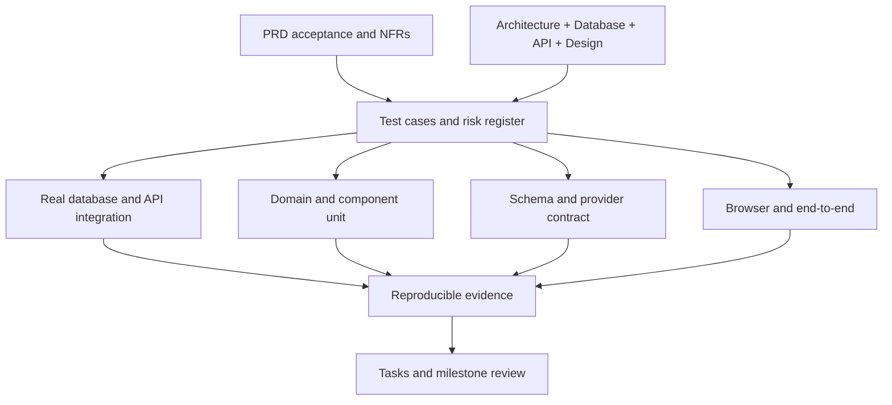
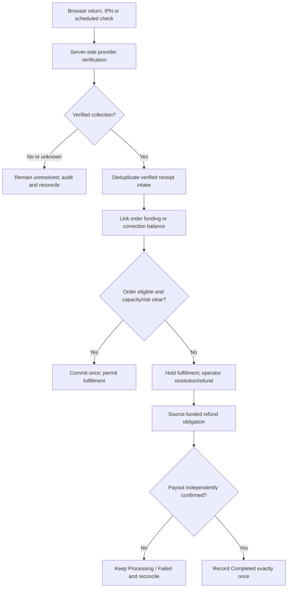
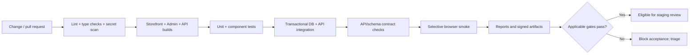
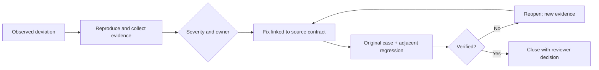

# SportZone — Testing & quality assurance specification

**Version:** 1.0\
**Status:** Final development baseline\
**Updated:** 17 October 2026

**Product reference:** [PRD](./PRD.md)\
**Technical reference:** [Architecture](./ARCHITECTURE.md)\
**Design reference:** [Design](./DESIGN.md)\
**Data reference:** [Database](./DATABASE.md)\
**HTTP reference:** [API](./API.md)\
**Delivery reference:** [Implementation Plan](./IMPLEMENTATION_PLAN.md)\
**Execution reference:** [Tasks](./TASKS.md)\
**Scope:** Single-store sports e-commerce platform for Bangladesh\
**Audience:** Software engineers, quality reviewers, development agents and release approvers

This document defines SportZone's **test strategy, reproducible verification procedures, expected invariants, traceability, evidence conventions and release-quality gates**. It defines verification procedures; §17 defines execution records. The PRD controls acceptance and business policy; Architecture controls system boundaries; Database and API control persistence and HTTP contracts; Design controls UI behavior. This file never treats a passing mock, undocumented assumption or draft acceptance matrix as proof that software or an external service works.

---

## Contents

- [1. Purpose, scope & quality objectives](#1-purpose-scope--quality-objectives)
- [2. Testing strategy & principles](#2-testing-strategy--principles)
- [3. Test levels & classification](#3-test-levels--classification)
- [4. Environments & configuration](#4-environments--configuration)
- [5. Tooling & test organization](#5-tooling--test-organization)
- [6. Test data, fixtures & test doubles](#6-test-data-fixtures--test-doubles)
- [7. Storefront & admin UI verification](#7-storefront--admin-ui-verification)
- [8. Backend & API contract verification](#8-backend--api-contract-verification)
- [9. Database, transactions & migration verification](#9-database-transactions--migration-verification)
- [10. Commerce workflow test cases](#10-commerce-workflow-test-cases)
- [11. Payments, returns & refunds test cases](#11-payments-returns--refunds-test-cases)
- [12. Security & privacy verification](#12-security--privacy-verification)
- [13. Performance, reliability & recovery](#13-performance-reliability--recovery)
- [14. Accessibility, responsiveness & compatibility](#14-accessibility-responsiveness--compatibility)
- [15. Automation & continuous integration](#15-automation--continuous-integration)
- [16. Test register & requirements traceability](#16-test-register--requirements-traceability)
- [17. Defect management & evidence reporting](#17-defect-management--evidence-reporting)
- [18. Release verification & acceptance](#18-release-verification--acceptance)
- [Appendix A — Test case writing template](#appendix-a--test-case-writing-template)
- [Appendix B — PRD acceptance checklist mapping](#appendix-b--prd-acceptance-checklist-mapping)
- [Appendix C — Test execution inputs](#appendix-c--test-execution-inputs)
- [Appendix D — Source & tool references](#appendix-d--source--tool-references)
- [Appendix E — API operation coverage register](#appendix-e--api-operation-coverage-register)

---

## 1. Purpose, scope & quality objectives

### 1.1 Testing responsibility

Verification covers the Next.js customer storefront, React + Vite admin portal, Express `/api/v1`, Mongoose/MongoDB persistence, backend jobs and privileged integrations. Test **behaviors and durable outcomes**, not just rendered screens or service mocks. No frontend application is allowed to independently establish price, order validity, final stock, payment status or refund completion.

| Primary source | What must be verified |
| --- | --- |
| `PRD.md` §§3, 5–6, 11–14, 18–19 | Functional/business rules, exclusions, exceptions, NFRs and acceptance conditions |
| `ARCHITECTURE.md` §§6–11, 13 | Trust boundaries, coordination, transactions, idempotency, retry/recovery design |
| `DATABASE.md` §§2–15 | Monetary arithmetic, data schema, indexes, immutable snapshots, allocation, states, retention/migration |
| `API.md` §§3–17, Appendix D | HTTP contracts, access, DTOs, errors, conditional requests, callbacks and retry semantics |
| `DESIGN.md` §§2–14 | Responsive/themed UI, critical journeys, interaction states, accessibility |
| `IMPLEMENTATION_PLAN.md` §§3, 6, 10–12 | Slice verification, staging regression, M1–M8 acceptance and environment separation |
| `TASKS.md` §§2, 4–8 | Task prerequisites, actual execution status, evidence and milestone handoff |

### 1.2 Release-critical properties

1. **No unauthorized access:** guest proof, sessions, roles and ownership isolate data and actions.
2. **No duplicate financial/commerce effects:** replay cannot create a second order, charge allocation, stock movement or confirmed refund.
3. **No overselling:** `available = physical − reserved − committed` stays nonnegative in all supported transitions.
4. **Faithful financial history:** integer poisha, original order-price/coupon snapshots, verified collections, source-funded refunds and corrections reconcile.
5. **No invented success:** redirects, IPN delivery, refund request acceptance and network timeouts are not payment or payout confirmation.
6. **Recoverability:** restarted jobs, interrupted requests, delayed provider verification and restored backups preserve observable, reconcilable states.
7. **Customer clarity:** checkout, deadlines, payment uncertainty, eligibility and accessible error states accurately reflect backend truth.

### 1.3 Coverage boundaries and status

Initial release is **one Bangladesh store, BDT, one primary admin role, guest/registered checkout, manual shipment updates and COD plus verified bKash, Nagad, Rocket**. Multi-vendor, courier automation, GPS tracking, loyalty, native apps and advanced roles are excluded (PRD §3). Do not add test acceptance for excluded features. Missing live merchant channel activation is a **release blocker**, not a test to silently skip.

**Execution status:** record `Not Run`, `Passed`, `Failed`, `Blocked`, `Skipped (approved)` or `Inconclusive` with the run evidence defined in §17.

---

## 2. Testing strategy & principles

### 2.1 Risk-based, incremental delivery

Every implemented feature slice follows:

`Confirm FR & API/DB contract → Write focused tests → Implement → Run affected checks → Integrate UI → Regression → Attach evidence → Review`.

The twelve phases in Implementation Plan §6 govern scheduling; Phase 10 is **integrated regression and release-candidate verification**, not the first time features are tested. Independent activity may run in parallel when prerequisites and isolation are in place.

| Risk tier | Characteristics | Verification emphasis |
| --- | --- | --- |
| **R0 — Release-blocking** | Money, allocation, authorization, secret exposure, unrecoverable writes | Unit + real DB integration + concurrency/failure injection + contract/E2E and human review |
| **R1 — Critical workflow** | Guest/COD checkout, catalog integrity, policy gates, fulfillment, return eligibility | Unit/integration + principal user journey + negative-state tests |
| **R2 — Standard behavior** | Catalog filters, profile edits, settings, notification display | Domain/API/component tests + targeted browser verification |
| **R3 — Presentation** | Copy, layout details, low-risk display states | Component/manual/accessibility checks and appropriate regression |

Severity of a failure depends on **impact**, not merely the tier assigned to the related component. Critical cases cannot be waived by an arbitrary global coverage percentage.

### 2.2 Required test characteristics

- Tests are **deterministic, independent and repeatable**: known fixture, explicit clock, clean environment, exact expected result.
- Assertions cover **HTTP result, stored side effects, forbidden side effects and audit/outbox evidence**, as relevant.
- Run distinct negative and concurrency paths; do not treat one happy-path checkout as transaction coverage.
- Record the version of requirements, source revision, code commit, environment, test data and tool configuration used.
- Prefer behavior-level checks over unstable CSS selectors or internal implementation coupling.
- Mock provider/network boundaries for fast unit checks; use isolated real MongoDB transactions and SSLCOMMERZ sandbox for acceptance claims.
- Do not deliberately stress, corrupt, refund or transmit live customer money/data in production testing.

### 2.3 Verification architecture



The diagram shows verification responsibilities, not a claim that test infrastructure exists.

---

## 3. Test levels & classification

| Level / type | Boundary | Representative assertions | Trigger |
| --- | --- | --- | --- |
| Domain unit | Pure services, transitions, numerical algorithms | Half-up coupon rounding; fixed allocation; invalid state; unit-ordinal refund value | Relevant commits/PR |
| Component | React components with controlled dependencies | Validation messages, disabled controls, keyboard/focus behavior | UI changes |
| API integration | Express with middleware and real test DB | Auth/CSRF/ownership, DTO allowlists, HTTP codes, durable writes | Backend changes/PR |
| Persistence/concurrency | Transaction-capable MongoDB and Mongoose | Unique/partial indexes, conditional update races, recovery after abort | DB/financial changes/CI |
| Contract | Versioned OpenAPI/DTO runtime validation and adapters | Request/response/error schema, compatibility, provider field mapping | Contract/provider changes |
| End-to-end | Deployed UI + API + isolated DB + test provider | Guest COD order; admin shipment; online payment; physical return/refund | Affected slices/staging |
| Security | Trusted/untrusted identities and origins | Session fixation/rotation, CSRF, guest proof misuse, admin bypass | Auth/API changes + staging |
| Performance | Representative seeded data and configured profiles | Browse/search/checkout response, error rate, resource consumption | Baseline and pre-release |
| Reliability/recovery | Jobs, DB restore, uncertain external calls | Job reentry, missed IPN, stale hold, unresolved refund attempt | Critical slices + staging |
| Accessibility/compatibility | Devices/browsers, light/dark | WCAG 2.2 AA target, navigation, link distinction, reflow | UI changes + release |
| Smoke/regression | Risk-based small or broad subset | No essential workflow broken by build/deployment | Each deploy and release candidate |

**Entry rule:** Choose the lowest layer that reliably proves each invariant and add a higher-level test for the real trust boundary or critical user journey. Test fixtures do not substitute for provider-level confirmation.

---

## 4. Environments & configuration

### 4.1 Environment matrix

| Environment | Permitted data/providers | Required checks | Restrictions |
| --- | --- | --- | --- |
| Local | Fabricated users/orders, local replica set, stubbed gateway/email | Unit, component, integration, concurrency | No live merchant secrets or production PII |
| CI | Ephemeral isolated transaction-capable MongoDB, deterministic fixtures and mock services | Lint, type/build, unit, API, DB/contract and selected E2E | Unique DB namespace per run; no shared mutable credentials |
| Staging | Dedicated MongoDB, test Cloudinary/email resources, SSLCOMMERZ sandbox with approved test credentials | Full user/admin E2E, provider checks, load, restoration, security and release regression | Never mix live cash, identifiers or customer PII; provider sandbox behavior must be distinguished from production |
| Production | Approved live configuration and data | Read-only health/monitoring and explicitly approved low-risk smoke | Never create artificial live charges/refunds/financial writes or destructive/load tests |

**Required capability:** Use a replica-set-capable MongoDB (or supported transactional topology) for integration tests involving multi-document atomicity. A standalone MongoDB instance is insufficient evidence for checkout/refund transactions.

### 4.2 Test environment prerequisites

- Isolated storefront/admin/API origins with validated credentialed cookies, CORS and CSRF behavior.
- Clock-control mechanism for holds, coupon windows, recovery tokens and delivery/refund deadlines; freeze both wall-clock and job scheduler triggers in deterministic tests.
- Seeded operator-approved **test** delivery areas, products/variants, active/inactive coupons, policy revisions and account roles.
- Gateway adapter capable of **controlled delayed/duplicate/forged/missing** notifications in local tests; genuine sandbox validation paths in staging.
- Structured request/correlation IDs, redacted logs, email capture, job outcome inspection, database session/transaction capability, and a dedicated evidence store.
- Independent resources and cleanup ownership; destructive test scripts refuse production connections by design.

**No invented operational configuration:** Final domain names, secrets, session TTLs, merchant account, backup schedule, provider limits, devices and load targets belong to approved configuration/`OPERATIONS.md`; this file specifies their tests, not their final values.

### 4.3 Environment readiness checklist

| Gate | Pass condition | Evidence |
| --- | --- | --- |
| `ENV-01` | Distinct database, secrets and services confirmed; no production identity data | Sanitized configuration diff/attestation |
| `ENV-02` | Real transaction commit/rollback and unique indexes proven | DB integration run |
| `ENV-03` | Test gateway callbacks and reconciliation reachable with correct origin/transport | Sandbox exchange, redacted |
| `ENV-04` | Browser session cookies and Origin/CSRF function across staging origins | Browser + API trace |
| `ENV-05` | Fixtures can create and clean up independent test scenarios | Seed/cleanup run |
| `ENV-06` | Job triggers and clocks are controllable without live side effects | Scheduler test run |

---

## 5. Tooling & test organization

### 5.1 Test tools

| Need | Tool | Integration requirement |
| --- | --- | --- |
| Repository CI guard regressions | Node.js built-in test runner | Existing `tests/ci.test.mjs`; validates tooling behavior only, not application acceptance |
| TypeScript unit/component | Vitest | Compatible with approved React, Vite, Next.js and backend versions |
| React behavior | React Testing Library + user-event | Accessible user interactions rather than component internals |
| Browser E2E and device projects | Playwright | Browser-project config verified against actual supported browsers |
| Express HTTP integration | Supertest or equivalent | Tests full Express middleware with real persistence |
| Schema/contract | OpenAPI validation plus runtime DTO/schema validators | Uses implemented `/api/v1` definitions and API Appendix D |
| Accessibility automation | axe-core integration | Supplements—not replaces—manual checks |
| Performance/load | k6 or equivalent | Selected after profile and hosting limits are agreed |
| Security and dependencies | SAST, dependency audit, secret scanner | CI availability and triage process agreed |
| CI | GitHub Actions or approved CI system | Matches npm-workspaces repository and deployment controls |

Node.js tooling tests, the GitHub Actions baseline, storefront layout/HTTP checks and admin DOM routing/HTTP checks exist. Other application
tools above are introduced with their
owning feature/tooling tasks; listing a tool is not evidence that it is installed. Use compatible supported releases,
commit exact versions and lockfile, and record installed versions in run evidence.

### 5.2 Test code organization

```text
backend/
  src/modules/<feature>/**/*.test.ts     # Pure feature tests near code
  tests/integration/                     # Express + isolated MongoDB
  tests/contracts/                       # Request/response and adapter schemas
  tests/concurrency/                     # Parallel writers, idempotency, jobs
storefront/
  src/**/*.test.tsx                       # UI behavior
admin/
  src/**/*.test.tsx                       # UI behavior
tests/
  ci.test.mjs                            # Existing repository/CI guard regressions
  e2e/                                   # Browser scenarios, fixtures, projects
  performance/                           # Reproducible load scenarios
  security/                              # Authorized security checks
  fixtures/                              # Synthetic identities and catalog
```

Storefront layout tests now exist in `storefront/tests/layouts.test.tsx`, with production route checks in
`storefront/tests/smoke.mjs`. Other application/E2E directories are introduced with their owning slices. Use this layout without duplicating business rules inside test helpers. `TESTING.md` governs case intent; source
validators and executable specs must be version-linked to `API.md`/`DATABASE.md`.

### 5.3 Standard execution interface

| Root script | Contract |
| --- | --- |
| `npm run lint` | Lint each configured workspace |
| `npm run typecheck` | Type-check all configured TypeScript projects |
| `npm run test:unit` | Run unit and component tests |
| `npm run test:integration` | Run API/DB tests with isolated transaction-capable MongoDB |
| `npm run test:contract` | Check schema and HTTP contracts, including compatibility |
| `npm run test:e2e` | Run browser tests against ephemeral or approved staging stack |
| `npm run test:security` | Perform approved automated security checks |
| `npm run test:coverage` | Produce coverage metrics with reproducible exclusion rules |
| `npm run build` | Build independently deployable workspaces |

This is the required application verification interface. Establish each command with its actual tooling during the
corresponding foundation/feature slice; do not create passing placeholders for an unavailable suite. Staging provider,
recovery and load checks have separately approved commands/workflows, not mandatory CI on every commit.

**Current executable baseline:**

| Root command | Current coverage / setup state |
| --- | --- |
| `npm run workspaces:check` | Three local workspace links; storefront/admin active, backend manifest-only |
| `npm run lint` | Repository JavaScript syntax, JSON, whitespace, Markdown structure/links and targeted credential checks |
| `npm run test:unit` | Twelve repository/CI guard regressions; no application tests are implied |
| `npm run ci` | Root checks plus every activated workspace check; machine-readable summary includes Not Configured app states |
| `npm run typecheck`, `test:integration`, `test:contract`, `test:e2e`, `test:security`, `test:coverage`, `build` | Not yet configured at root; implement with the owning tooling/slices before accepting the corresponding capability |

Storefront workspace commands now implement `lint` (Biome), `typecheck` (Next route types plus TypeScript), `test:unit`
(Vitest layout rendering), `build` (Next production Webpack) and `test:smoke` (real production HTTP routes/CSS/cache/404
checks). Run them with `npm run <command> --workspace=storefront`; smoke requires the build and manages its own temporary
server. The active CI inventory runs all five checks. These scaffold checks do not establish customer authentication,
backend ownership, real browser accessibility or commerce acceptance. Browser/theme/interaction suites extend with the UI tasks.

Admin commands use the same workspace-qualified lint/typecheck/unit/build/smoke interface with `--workspace=admin`.
Biome, strict TypeScript, Vitest/jsdom client navigation and Vite builds are configured. HTTP smoke checks verify built
JS/CSS, local preview SPA fallback and no-store/noindex headers; they do not execute browser JavaScript. DOM tests cover
entry redirect, direct nested access denial despite forged local flags, native-link/history navigation and unknown routes.
Admin shell tests additionally cover the five groups/14 destinations, active nested sections, one main/skip target,
HeroUI Drawer containment and Escape/Close focus recovery, route/desktop dismissal, reusable title/actions,
Appearance draft/URL preservation, offline cleanup and signed-out non-disclosure. HTTP checks cover direct navigation
URLs with the same SPA/no-store/noindex contract. Browser viewport reflow and native Tab cycling remain separate checks.
No backend authentication, production hosting or real-browser accessibility result is inferred from these checks.

HeroUI integration uses the existing workspace check inventory: lint, typecheck, unit tests, build and HTTP smoke.
Menu/close/retry interactions exercise HeroUI Buttons; admin sign-in remains disabled until authentication exists.
Verify shared token aliases in emitted CSS, 44px controls, explicit Light/Dark and CSS System mode. Browser checks must
cover native keyboard/focus behavior, responsive layouts and both themes; DOM/HTTP checks do not establish visual acceptance.
Integration evidence is recorded in [the HeroUI foundation review](./evidence/heroui-foundation.md).

Both workspaces run four semantic-token regressions from `tests/tokens.test.tsx`, using the shared
`tests/design-tokens.ts` assertions. They compare all 17 values with Design §2.2, check grayscale/invariant colors,
text/control contrast and app/Tailwind integration. Built CSS smoke checks require the shared variables and compiled
muted-text utility. Token swatch comparisons are distinct from browser layout/interaction acceptance.

Each workspace also runs 19 foundation cases: font/fallback and spacing/radius assertions, ten exact BDT examples,
six invalid numeric inputs and a nonnumeric-input rejection case. Shared HTTP checks fetch all three emitted WOFF2
assets, require same-origin 200 responses and compare their hashes with the licensed sources. Browser font-swap/CLS
checks remain distinct from static font contracts, glyph/shaping specimens and asset-serving checks.

Theme suites run 13 cases per app in jsdom: persisted pre-mount bootstrap, invalid/System fallback, HeroUI select
changes, draft/DOM/URL preservation, remount restore, blocked storage, same-origin storage synchronization/cleanup,
CSS reduced-motion contracts, SSR hydration and keyboard opening/option selection through the real HeroUI popup. HTTP smoke checks verify the blocking head script and its actual served
source. These DOM/HTML checks are distinct from browser first-paint filmstrips and native keyboard/OS-motion verification.

Storefront shell tests exercise mobile disclosure/ARIA and Escape/focus recovery, link/Close dismissal, route/breakpoint
changes, landmark/support-link structure, offline recovery and safe retry/loading/not-found states. Production smoke
checks all 11 unavailable/noindex destinations and 404 recovery. jsdom key events and mocked breakpoint changes do not
establish native browser tab order, viewport overflow or real assistive-technology acceptance.

[ci-workspaces.json](../ci-workspaces.json) assigns storefront setup to P02-001, admin to P02-002 and backend to P03-001.
Adding workspace source, scripts or dependencies requires active CI state and real lint/typecheck/unit/build scripts.
Extend that inventory and the root aliases with applicable API/DB contract, concurrency, browser and security checks as
the capabilities arrive. CI must fail for any missing or failing configured command; `--if-present` cannot establish a pass.
Run evidence and source revisions, not this availability table, determine actual Passed/Failed results.

---

## 6. Test data, fixtures & test doubles

### 6.1 Fixture catalog

| Fixture | States / distinguishing conditions |
| --- | --- |
| Customers | Valid, suspended, changed email, invalid session, separate owners A/B |
| Administrators | Authorized primary admin and unauthenticated/non-admin user; no public admin registration |
| Guests | Independent browser contexts, verified scoped proof and unverified/expired proof |
| Products | Active, inactive, no image, sale-priced, sold-out and multiple variants |
| Inventory | Zero, one remaining, contested stock, reserved, committed, shipped, returned uninspected |
| Coupons | Fixed, percentage, invalid/expired, exhausted global, per-customer capped, guest-ineligible |
| Checkout | COD, online, guest/customer, changed payload same key, changed price/zone, duplicate keys |
| Payments | Valid/invalid provider verification, late collection, risk flag, multiple distinct receipts, unmatched/excess funds |
| Claims/refunds | Physical received/unreceived, shortage, partial quantities, source-funded payout, failed/unknown payout |
| Orders/delivery | Pending, confirmed, processing, shipped, delivered, cancelled; failed-delivery disposition |
| Content/notifications | Published and draft policies, missing operator content, email retry/duplicate events |

Create fixtures with **stable IDs only inside each test**; assert semantics rather than relying on global deterministic ObjectIds. Use factories that return created record IDs and expected snapshots. No real customer contact details or real card/payment credentials.

### 6.2 Canonical numerical fixtures

| Fixture ID | Setup | Expected arithmetic |
| --- | --- | --- |
| `FX-MONEY-01` | Eligible subtotal 101 poisha; 50% coupon | `51`-poisha coupon discount, integer round-half-up |
| `FX-MONEY-02` | Eligible lines `201` + `100` poisha; fixed `100` coupon | Allocation `67 + 33` poisha, stable remainder tie break |
| `FX-MONEY-03` | One line net `101` poisha, quantity `3` | Unit-ordinal entitlements `34, 34, 33`; never exceed `101` |
| `FX-STOCK-01` | `physical=1`, `reserved=0`, `committed=0` | At most one checkout acquires allocation |
| `FX-STOCK-02` | `physical=10`, `reserved=3`, `committed=4` | Available = `3`; valid transitions preserve invariant |
| `FX-HOLD-01` | Online attempt, 15-minute reserved stock/coupon hold | Expiry/late payment respects precise state and reassessment |
| `FX-REFUND-01` | Source collection funded, prior pending + completed payouts | Next refund cannot exceed remaining **source and order** capacity |

For rounding and proportional allocation, generate property-based comparisons across randomized integer values; the explicit regression vectors above remain fixed. Store dates in UTC; use approved Bangladesh-local calendar logic for **calendar-day versus business-day** policies.

**Deterministic administration vectors** (synthetic; approved real zone/price data remains a dependency):

| Fixture | Input | Exact expected observation |
| --- | --- | --- |
| `FX-ZONE-01` | Zone Z1 active; charge R1 = 7,500 poisha effective at T0; existing order O1 accepted at T1 | O1 snapshot stays 7,500 after R2 = 9,000 takes effect at T2; new O2 at T3 uses 9,000; overlap for same coverage rejected |
| `FX-ZONE-02` | Z1 deactivated at T4; location A belongs only to Z1 | New checkout to A rejected; historical O1 retains delivery rule/amount; concurrent stale zone revision fails CAS |
| `FX-REPORT-01` | Period P: merchandise funded 100,000 poisha; COD verified 40,000 of those funds; merchandise refund completed 10,000; extra verified correction-only collection 5,000, correction refund completed 2,000 | Merchandise net after completed merchandise refunds = 90,000; linked collected cash before payouts = 105,000; cash net of both completed refund classes = 93,000; correction-only funds never treated as additional merchandise sales |
| `FX-REPORT-02` | Same events with payment/return timestamps straddling approved report cutoff; one refund still held but not paid | Group by specified report time basis; held refund shown as liability separately, not as completed cash outflow; totals tie to persisted source collections/refunds |
| `FX-REPORT-03` | Period with no collections and 10,000 poisha of verified refund completions from earlier-period receipts | `netLinkedCashFlowPoisha = -10,000`; signed safe-integer response accepted, original source refund caps unchanged |

`FX-REPORT-*` values are **isolated test vectors**; labels in the actual API reports must use the API §14.4 metric definitions. Compare exact integer amounts (including negative period net cash flow) for every report projection without silently inferring tax or additional order income.

### 6.3 Test double boundary

- **Allowed:** deterministic identity-free fake email delivery, local gateway adapter, frozen clock, Cloudinary sandbox/fake media store, injected failures.
- **Not sufficient alone:** a mocked `Paid`, `Refund Completed`, MongoDB transaction, real CSRF cookie semantics, or gateway channel activation.
- **Provider sandbox:** validate supported successful/failed/pending paths with the actual available sandbox interface. If a provider scenario cannot be induced, record **Blocked/Not Verifiable**; use locally injected cases for application robustness but never label provider behavior confirmed.
- **Cleanup:** isolate by test run; revert created test data/jobs/uploads, with a run-tag and auditable recovery if teardown fails.

---

## 7. Storefront & admin UI verification

### 7.1 Storefront functional UI matrix

| Surface | Assertions | Primary suites |
| --- | --- | --- |
| Home/navigation | Correct routes, categories, banners only when approved, header/cart/wishlist counters and support/policy links | `UI-HOME`, `UI-CONTENT` |
| Catalog/search | Active-only visibility, search, sorting, pagination, empty state, filters, revalidation after admin changes | `CAT-*`, `UI-CAT` |
| Product details | Correct SKU/variant selection, display price/availability, unavailable disables purchase | `CAT-*`, `UI-CAT` |
| Cart/wishlist | Guest cart behavior, authenticated persistence, dedupe/quantity limits, session boundaries | `SHP-*`, `UI-SHP` |
| Account/profile | Registration/recovery, address validation, protected histories, visible field errors | `IDN-*`, `UI-ACCOUNT` |
| Checkout | Guest/customer fields, Bangladesh contact validation, consent, authoritative quote, no stale price acceptance | `CHK-*`, `UI-CHECKOUT` |
| Payment result | Pending/uncertain result until verified server status; retry only where safe | `PAY-*`, `UI-PAY` |
| Orders/guest proof | Only authorized history/details, delivery basis/deadline, cancellation and status links | `ORD-*`, `SEC-*`, `UI-ORD` |
| Returns/refunds | Eligible quantities, physical/shortage distinction, pending versus completed payout | `RET-*`, `RFD-*`, `UI-AFTERSALES` |
| Support/policy | Correct approved policy revision/contact, complaint creation/tracking, no fictitious legal text | `ADM-*`, `UI-CONTENT` |

### 7.2 Admin portal matrix

| Surface | Assertions |
| --- | --- |
| Auth + navigation | No customer session reuse; API enforces admin role independent of route guard |
| Product/category/variant | Create/edit/deactivate, inline errors, conflict/revision checks, SKU/slug uniqueness |
| Inventory | Physical/reserved/committed/available clarity, audited adjustments, concurrent conflict |
| Orders/payments | Correct separation of fulfillment, financial collection, risk and unmatched receipts; audited state changes |
| Delivery/charges | Versioned future-only charges, activation/deactivation, no historical order rewrite |
| Coupons/reviews | Global/customer counters and moderation audit rather than only UI hiding |
| Returns/refunds | Approval/inspection, shortage handling, source collection balances, unknown payout not marked complete |
| Customers/support/settings | Scope-limited PII, suspension, complaint history, published policy versions, audit trail |
| Dashboard/reports | Cash-flow versus revenue labels, COD/refund reconciliation, filters and totals match DB records |

### 7.3 Targeted account, support and settings cases

These cases complement the UI matrices; verify real API/database state as well as accessible UI outcomes. They are **planned specifications**, not executed runs. Their identifiers remain stable when automated tests are added.

| ID | Setup / action | Required outcome / forbidden side effect | Sources |
| --- | --- | --- | --- |
| `ACC-01` | Customer updates own name/phone; second customer tampers with profile identifier or protected fields | Valid normalization persists once; another user's fields/role cannot be changed | FR-02; API §9 |
| `ACC-02` | Request email change, submit expired/used/wrong proof, then valid proof | Old email remains authoritative until verification; proof single-use; identity uniqueness holds and session effects follow approved contract | FR-02; API §9 |
| `ACC-03` | Add/edit/remove address; submit unsupported area/invalid phone | Owned address CRUD/default validation, bounded list, rejected input leaves no partial mutation | FR-02; API §9 |
| `ACC-04` | Change default address, delete nondefault/default, attempt cross-customer update | Exactly one valid default when addresses exist per contract; owner isolation; default conflict handled deterministically | FR-02; API §9 |
| `ACC-05` | Place order, then modify/delete profile and delivery address | Stored order recipient/zone/charge/deadline-rule snapshots remain immutable; private order view stays scoped | FR-02, FR-11; Database §7 |
| `SUP-01` | Customer creates complaint; anonymous/guest actor submits using allowed proof and order context | Minimal anonymous {contactName,contactEmail,issue} persists the exact normalized contact; missing/blank name or email fails without mutation. C/G omitted contact resolves from own principal/order only; forged order proof is denied. No fabricated contact or other reporter disclosure | PRD §3, FR-20, FR-26; API §14.4 |
| `SUP-02` | Admin lists, investigates and resolves open complaint with documented response | Authorized status transition, durable response/contact outcome, audit, and appropriate customer-visible history; repeated command not duplicate | FR-26; API §14.4 |
| `SUP-03` | Customer A/guest proof A probes B's complaint or B's order complaint list | Scope-safe denial; no private customer/complaint data leaked; no state mutation | PRD §9; API §14.4 |
| `SUP-04` | Late-delivery complaint under approved operator policy; retry notification delivery | Tracked acknowledgement/response and escalation evidence against **approved** deadline; no invented statutory SLA; notification failure does not delete complaint | PRD §6, FR-16, FR-26; API §§11.3, 14.3 |
| `SET-01` | Admin creates/edit policy draft, submits stale ETag, tries unauthorized write | Draft persists separately from published document; CAS rejects stale edit with no partial changes; activity auditable | FR-34; API §14.3 |
| `SET-02` | Authorized policy approval/publish/schedule for every PolicyType, including privacy, then public read before/after effective time | Only approved effective revision shown publicly; past published versions/history remain intact; no draft leaks | FR-34; API §14.3; DB policyDocuments |
| `SET-03` | Product/order already accepted under old policy; publish new version | Accepted order terms/policy references unchanged; future eligible orders reference newly effective policy | FR-34, FR-11; Database §7 |
| `SET-04` | Admin patches store contact, branding/low-stock threshold with stale and valid revisions | Allowlisted values validated; ETag advances only on valid write; public contact changes after update; old order snapshots stable | FR-34; API §14.3 |
| `ADM-01` | Admin searches, filters and pages customer records/history | Exact authorized masked fields, bounded stable pages; customer role cannot access admin records | FR-27; API §14.2 |
| `ADM-02` | Admin suspends active customer, then attempts new and existing authenticated actions | Status decision audited; existing protected sessions denied/revoked per source contract; no unauthorized write possible | FR-27, FR-01; API §14.2; SEC-03 |
| `ADM-03` | Admin reactivates customer with reason; replay suspend/reactivate command | Authorized transition recorded once; status accurate; no automatic recreation of revoked session without fresh valid authentication | FR-27; API §14.2 |
| `ADM-04` | Unauthorized actor targets suspend/reactivate route; admin submits invalid decision | Scope-safe denial/error; no status/audit spoofing or protected customer data exposure | FR-27; API §14.2 |
| `ADM-05` | Activate/deactivate zone, replace charge rule, quote unsupported area, then inspect old order | Global singleton guard serializes two-zone writers for the same coverageKey (different ruleVersions) and rejects overlapping scheduled windows before activation; same-zone/cross-zone insert, supersede, deactivate and activation races preserve one eligible rule; transaction abort leaves no partial window change; disabled region rejected; historical delivery charge unchanged | FR-28; API §14.3 |
| `ADM-06` | Seed COD-unpaid, verified COD receipt, merchandise refund held/paid, duplicate correction receipt across reporting interval boundaries | Validate full DashboardMetrics allowlist: all counts/status sums, outstanding COD, discounts, cutoff balances, pending physical returns, recentOrders/lowStockItems lists ≤20, and timezone/date basis; reject unreconstructible historical cutoff. Period financial sums agree with source records; separate sales, verified cash flow, corrections and refund classes | FR-22, FR-29, FR-33; API §14.4 |

### 7.4 Transactional notification event coverage

Each event below requires an **event-generation assertion**, separately testable **delivery attempt**, failure/retry behavior and a correct customer-facing status. A successful order/refund transaction must not be replayed to retry email.

| Evidence key | Event source | Expected behavior | Phase |
| --- | --- | --- | --- |
| `NTF-01` | Registration verification / email change / password reset / guest order proof | Safe single-use link, provider failure and re-send without leaking account existence | 03, 06 |
| `NTF-02` | Order receipt, confirmation, cancellation, shipment, delivery | Accurate state/order reference and deduplicated retry | 06 |
| `NTF-03` | Payment verified success/failure | Server-confirmed status, no duplicate email from repeat IPN | 07 |
| `NTF-04` | Return update; refund approval, rejection and confirmed completion | Return/refund statuses distinguished; Completed notice only after confirmed payout | 08 |

Recovery/guest-proof delivery tests cover API §16.3: hash plus challenge-local AEAD envelope, reference-only outbox, external key custody/rotation, tamper/key-loss denial, crash before/after send, delivery uncertainty, concurrent reissue/consume, expiry, replay denial and no plaintext or encrypted proof in notification payloads/logs. Provider send idempotency must be verified; one event intent is not proof of exactly-once delivery.

**Per-event verification cases** (run one distinct row for each event in the corresponding `NTF-*` family):

| Case ID | Trigger | Assertions including negative/retry path |
| --- | --- | --- |
| `NTC-01` | Registration verification requested | Correct recipient/single-use expiry, reference-only outbox/AEAD envelope, tamper/key-loss denial, safe retry/reissue and no account enumeration |
| `NTC-02` | Password reset requested | Correct token scope, no leaked account existence, used/expired links fail, resend safely rate-limited |
| `NTC-03` | Order confirmed | Distinct order_received at placement/Pending and order_confirmation at Confirmed; correct source reference, one intent per transition, provider idempotency or explicit send uncertainty; no early confirmed notice |
| `NTC-04` | Order cancelled | Verified cancellation reason/status; no notification from merely requested cancellation |
| `NTC-05` | Manual shipment confirmed | Shipped timestamp/status, one intent on transition, no duplicate from repeat admin action |
| `NTC-06` | Delivery marked completed | Delivered-only notification; failed delivery does not emit success |
| `NTC-07` | Server-verified payment success | Provider-verified collection/risk context; duplicate IPN does not create extra event |
| `NTC-08` | Verified payment failure/nonpayment state | Accurate failed/cancelled/expired/uncertain distinction; no false successful-collection message |
| `NTC-09` | Return/shortage claim status changes | Correct request, approval/rejection/inspection context; no fabricated physical receipt |
| `NTC-10` | Refund approved | Approval is not payout confirmation; correct eligible amount and reference |
| `NTC-11` | Refund rejected | Rejection reason/next action, no payout-completed message |
| `NTC-12` | Refund independently confirmed completed | Completed notice only after verified gateway/manual payout; replay-safe delivery |

For **every** `NTC-*`: assert persisted event type and record reference, scoped recipient, safe template/status, deduplication key, retry/backoff on transport failure, eventual delivery/visible undelivered status, and **no rollback or replay of committed business work**. A provider sandbox (where supported) supplements—not replaces—local fault tests.

`NTF-*` are planned evidence keys; actual automation is created with the relevant feature slice. Record undelivered notifications for operator visibility without rolling back confirmed business records.

### 7.5 UI test procedure

Use a seeded scenario → load as correct identity → perform keyboard/pointer journey → assert rendered and spoken status → verify API response → inspect corresponding backend state where high risk → repeat on error/timeout and in both themes for critical screens. For changes to a reusable component, rerun its consuming routes and mobile viewports.

Do not mistake a `200` network response for a usable page. Test validation focus, preserved field input, loading/empty/error/retry states, disabled controls, notification timing and session-expiry behavior.

---

## 8. Backend & API contract verification

### 8.1 Shared contract test matrix

| Contract | Tests / expected outcome |
| --- | --- |
| HTTP method, `/api/v1`, content type | Allowed method works; wrong method does not trigger a mutation; unsupported content rejected safely |
| Success/error envelopes | Response matches API §§3.3, 6–7 and Appendix D, including `requestId`, expected `data`/`meta` and stable error codes |
| Authentication | Required cookie present, valid, scoped and unexpired; anonymous access only for expressly public endpoints |
| Authorization | Verify owner/guest proof/primary admin and deny cross-user/cross-order/cross-role IDs, not just hide controls |
| CSRF and Origin | GET/HEAD safe; all browser mutations—including logout—validate approved Origin and CSRF context |
| Schema validation | Reject unknown/write-protected keys, malformed IDs, negative poisha, impossible quantities and unapproved status enums |
| Pagination/search | Default/max page sizing, deterministic tie-break, bounded filters, no leakage of private data via search |
| Resource revision | Strong ETag and `If-Match` required where API defines them; stale writes return correct `412`, missing precondition `428` |
| Idempotency | Same scoped key/fingerprint replays; changed fingerprint conflicts; old key never makes duplicate order |
| Response cache | Private responses `no-store`; public catalog safely revalidated after admin changes; no session cross-contamination |
| Provider endpoints | Verify callback transport/acknowledgment matrix; externally supplied body is untrusted until server verification |
| Fault responses | Network loss, DB conflict, provider timeout return recoverable state without fabricated success |

### 8.2 Endpoint inventory coverage procedure

1. Parse **all method+path operations** from API Appendix D and canonical route tables (current planned baseline: **164 unique operations**).
2. Reconcile every operation to **Appendix E** (`OPV-001` onward): method/path, role, success HTTP contract, API error-family profile, verification case and side-effect requirements. `OPV-*` are **per-route specification slots**, not runnable tests or pass evidence.
3. Join the operation slot to the generated OpenAPI/runtime-validator operation ID and to one or more **real test IDs** before marking covered; verify every implemented Express route exists in the contract and report undeclared/missing routes distinctly.
4. For every operation run a **valid case**, plus invalid-input and wrong-role/ownership cases when applicable; for mutations also test CSRF/Origin, unauthorized side effects and conflict/retry semantics.
5. Compare actual responses to runtime validators/OpenAPI where available; until a real suite, run artifact and assertion result are linked, keep that slot `Planned / Not Run` and report `Contract Pending`. For `IPN` and provider-return operations, use their special HTTP acknowledgment/redirect matrix, **not** browser envelopes.

Keep the operation inventory synchronized with API changes and attach actual results to each executed coverage slot.

### 8.3 API-specific high-risk cases

| ID | Scenario | Required observations |
| --- | --- | --- |
| `API-01` | Browser context bootstrap → login → authenticated mutation | CSRF bound correctly; auth context change invalidates stale proof; valid current session succeeds |
| `API-02` | Stolen/expired/revoked session or suspended owner | Request denied and no protected data leaked or state changed |
| `API-03` | Owner A requests Owner B's order/claim | Scope-safe denial; IDs/amounts/contact never disclosed |
| `API-04` | Strong `If-Match` stale version on delivery settings | `412` or specified conflict; no lost update; revision advances once on valid write |
| `API-05` | `202 Accepted` async provider or refund response | Poll/resource indicates pending; UI never labels Completed from `202` |
| `API-06` | Wrong DTO shape, unknown fields and huge request | Field-level validation response; no partially created business record |
| `API-07` | Anonymous logout with valid browser CSRF and Origin | Repeat logout safely clears session without requiring a live auth credential |
| `API-08` | Admin/customer histories across multiple orders | Bounded pagination, stable sort and strict scoped filters |
| `API-09` | Guest proof email challenge and scoped session | Proof grants only permitted order actions and is revoked/expired as specified |

---

## 9. Database, transactions & migration verification

### 9.1 Schema and index tests

| ID | Target | Expected result |
| --- | --- | --- |
| `DB-01` | Required/optional fields, enums, timestamps, normalized identity | Invalid writes rejected at model and service boundaries |
| `DB-02` | Unique email, SKU, slug, order number, checkout intent and provider references | Concurrent duplicates rejected by actual MongoDB indexes; distinct valid identities succeed |
| `DB-03` | Partial-unique indexes for optional/gateway-provided identifiers | Multiple genuinely absent references permitted; two equal present refs rejected |
| `DB-04` | Compound and query indexes | Explain plan inspected against approved representative fixture size; no unbounded collection scans in critical queries |
| `DB-05` | Real transaction commit/rollback for **each defined atomic transition** | Checkout order/hold, release, verified receipt linkage, refund commitment and payout-confirmation transitions separately commit/abort atomically; no open MongoDB transaction spans the entire order lifecycle or an external provider call |
| `DB-06` | Idempotency key tombstone and stale replay | Duplicate order impossible even after replay-response availability expires; no unsafe TTL purge |
| `DB-07` | Historical order/item snapshots | Product, delivery charge or coupon edits do not rewrite accepted order records |
| `DB-08` | Non-TTL financial movement, provider intake and audit components | Preserve append-only evidence without unauthorized rewrite or deletion **for the approved retention period**; test permitted erasure/redaction policy separately; no invented infinite retention |
| `DB-09` | Resource `revision`/CAS constraints | Concurrent stale mutation fails; one winner; successful revision advances once |
| `DB-10` | Versioned migration and restore compatibility | Apply/restart/rollback-or-forward-repair with representative historic snapshots; indexes validated |
| `DB-11` | Claim quantity/ordinal guards | Same purchased unit cannot be claimed/refunded twice through concurrent physical/shortage paths |
| `DB-12` | Refund source and order counters | Pending plus completed obligations never exceed verified collection capacity or permitted merchandise entitlement |

### 9.2 Transaction outcome inspection

For each multi-document financial/stock case, assert both **logical state** and **physical persisted records**:

- Before/after `physical`, `reserved`, `committed`; each movement/reservation operation key unique.
- One checkout intent → at most one order; order lines and totals immutable after acceptance.
- Coupon held/confirmed/released exactly once; account-scoped counters cannot leak guest identity.
- Each independently verified provider receipt has one deduplicated intake and an explained linked/unmatched allocation; no lost surplus cash.
- Each refund attempt records uncertain/provider outcomes without granting automatic terminal `Completed`.
- Outbox/audit events are persisted in the same business transaction where required; external email/provider calls occur **outside** the MongoDB transaction.

### 9.3 Schema evolution and recovery

Test mixed old/new records, migration reentrancy, incomplete batch repair, index backfill collisions, large existing orders and rollback compatibility. Database §15 sets migration design; [Operations §7](./OPERATIONS.md#7-database-operations) defines the execution procedure; platform-specific commands and access remain pending. A successful test restore must be followed by **payment/IPN/refund reconciliation for events after the backup cutoff**.

---

## 10. Commerce workflow test cases

Each scenario follows: **Fixture / action → expected HTTP+business outcome → persisted invariant**. IDs are stable for traceability; variants may be added as `-a`, `-b` without renumbering accepted cases.

### 10.1 Catalog, shopping and pricing

| ID | Fixture / action | Expected behavior and durable assertion | FR |
| --- | --- | --- | --- |
| `CAT-01` | Admin activates/deactivates product and category; public list/search/detail | Only eligible active records publicly appear; category/product association intact; slug uniqueness | 03–06, 23–24 |
| `CAT-02` | Multiple variants with different SKU, price and availability | Correct variant selected; out-of-stock cannot be submitted; SKU unique | 05–06, 13 |
| `CAT-03` | Search/filter/sort/paginate seeded active and inactive catalog | Stable pages and tie-break, correct facets/availability, no inactive leakage | 04 |
| `CAT-04` | Clear sale price/threshold override, remove category image, reparent a child to root with explicit null, then omit fields | Null performs only declared clear operations; omission retains current data; stored optional fields absent; stale ETag rejected. Later regular-price change uses regular price after sale cleared; old order snapshots unchanged | 06, 23–25 |
| `CAT-05` | Configure/change/remove homepage banner with approved and foreign/private/invalid media references | Public home shows only approved banner; internal href/alt enforced; logo unaffected; no arbitrary URL attachment; absent content does not waive FR-03 | 03, 23, 34 |
| `SHP-01` | Guest cart → user cart after login, quantities and repeated adds | Consistent permitted merge/persistence; cart does **not** reserve inventory | 07–08 |
| `SHP-02` | Customer A adds/re-adds item, logs out, starts a new session, logs back in, removes item and repeats login; Customer B and guest attempt access | Same item persists without duplicates across authenticated sessions; removal persists; inactive product behavior follows contract; guest and cross-owner access cannot expose A's list | 08 |
| `PRM-01` | `FX-MONEY-01/02` percentage/fixed coupons with sale prices | Server matches integer/rounding example, proportional largest remainder, delivery excluded | 09, 11 |
| `PRM-02` | Expired, deactivated, insufficient eligible subtotal, ineligible guest | Correct stable error; no redemption/hold side effect; per-customer coupons require account | 09 |
| `PRM-03` | Parallel users exceed final global/per-customer coupon slot | At most available capacity confirmed or held; rejected writers have no phantom redemption | 09 |
| `PRM-04` | Expired/failed attempt while another valid attempt uses coupon | Release only eligible hold once; never release another live or paid allocation | 09 |
| `REV-01` | Eligible completed purchase submits review; unauthorized buyer tries | Verified-purchase gating, moderation and ownership; no false verified badge | 10, 31 |

### 10.2 Checkout, order lifecycle and delivery

| ID | Fixture / action | Expected behavior and durable assertion | FR |
| --- | --- | --- | --- |
| `CHK-01` | Guest checkout with full name, Bangladesh phone, email, area, terms | Server validates all required fields; creates scoped guest order; email alone is not access proof | 11, 19 |
| `CHK-02` | Registered checkout with saved address, valid COD method | Charges and snapshots final at submit; physical stock allocation committed once; order stays `Pending` until admin confirmation; payment unpaid | 11–14 |
| `CHK-03` | Browser quote changed after product/zone/coupon change | Persisted scope-bound quoteId and identical draft required; QUOTE_CHANGED/QUOTE_EXPIRED before order/attempt; fresh quote requires explicit confirmation; same-key committed replay works after expiry; two keys cannot consume one quote twice (API §11.1 contract); no forged price accepted | 09, 11, 16 |
| `CHK-04` | Two concurrent identical checkout submissions with one key | Exactly one order and inventory/coupon effect; second receives safe replay/in-progress resolution | 11–13 |
| `CHK-05` | Same idempotency key but changed payload; or replay beyond window | Conflict or pointer to prior order; never second order | 11 |
| `INV-01` | `FX-STOCK-01`, two simultaneous competing checkouts | One allocation maximum; no negative availability, movement duplicated or stale winner | 13 |
| `INV-02` | Online checkout at 10:00, expiry at 10:15, safely reconciled retry/reacquisition at 10:20 | First hold releases once; new generation has heldAt 10:20 and expiry 10:35 for every stock line and coupon; replay does not extend expiry, expiry/payment races cannot double release/commit | 09, 12–13 |
| `INV-03` | Commit → shipment → inspected resellable return | Shipment reduces physical/committed once; only inspected recovered goods restocked | 13–14, 17 |
| `ORD-01` | Pending → Confirmed → Processing → Shipped → Delivered | Only guarded transitions succeed; timestamps/history accurate; invalid/replayed transition blocked | 14, 26 |
| `ORD-02` | Customer requests cancellation in Pending/Confirmed/Processing | Admin approves/rejects explicitly; before-dispatch recheck is atomic; not cancelled by request itself | 15 |
| `ORD-03` | Concurrent cancel approval and shipment | Exactly one eligible transition wins; no duplicate stock release or shipment reversal | 14–15 |
| `ORD-04` | Shipped delivery fails, retry then final non-delivery | Explicit custody/disposition; resellable inspected recovery only; refund obligation per policy | 14, 16–18 |
| `ORD-05` | Delivery charge version changes after order accepted | Existing snapshot unchanged; only future quote/order uses new active rule | 16, 28 |
| `ORD-06` | Order Confirmed later than placed; approved legal cap applies | Confirmation-based target and independent applicable legal cap combine into effective deadline; `awaiting_start` before start; no guessed absolute deadline | 16 |
| `ORD-07` | Guest order lookup with correct/expired/cross-order proof | Only verified scope can read permitted order and initiate eligible actions | 19 |
| `ORD-08` | Missing/unsupported area; inactive gateway channel | Checkout rejects unsupported destination or unavailable method, without order/financial mutation | 11–12, 16 |

### 10.3 Required order/delivery assertions

For `ORD-06`, compare `placedAt`, actual `confirmedAt`, snapshotted `deadlineBasis`, `targetDeadlineAt`, applicable `legalDeadlineAt` and final `effectiveDeadlineAt` per Database §7.2 and API §11.3. The ordinary target is 14 **calendar** days from confirmation unless an approved rule differs; any statutory cap requires an approved start event. If those decisions are missing, assert a correctly disclosed pending/under-review commitment rather than inventing a legal date.

---

## 11. Payments, returns & refunds test cases

### 11.1 Payment provider and COD scenarios

| ID | Stimulus | Expected outcome / invariant | FR |
| --- | --- | --- | --- |
| `PAY-01` | Active channel, correct BDT attempt, verified sandbox success | Collection recorded exactly once; order Paid only after server validation; fulfillment subject to allocation/risk gates | 12 |
| `PAY-02` | Browser redirects to success; no verified provider proof | Remains pending/uncertain; never mark Paid from redirect | 12 |
| `PAY-03` | Forged/tampered IPN or failed independent verification of merchant, transaction, amount or currency | Untrusted payload never creates a **verified** collection or order Paid state; capture only safe rejection/audit metadata, without crediting unverified funds | 12 |
| `PAY-04` | Same valid IPN 2+ times or out-of-order callbacks | One receipt/financial application, no duplicate allocation or notification; safe provider acknowledgment | 12 |
| `PAY-05` | Missing callback and interrupted verification | Scheduled status reconciliation resolves or keeps uncertain with operator visibility | 12 |
| `PAY-06` | Verified payment arrives after 15-minute stock hold expires | Receipt recorded first; eligible non-cancelled order reassesses stock + coupon atomically; shortfall holds fulfillment and prompts authorized resolution | 09, 12–13 |
| `PAY-07` | Payment verified after order cancellation | Order stays Cancelled; no new allocation/fulfillment; payment correction/refund obligation visible | 12, 14–15, 18 |
| `PAY-08` | Risk-flagged provider payment (`risk_level=1`) | Collection can be recorded but fulfillment held for explicit risk decision | 12 |
| `PAY-09` | Two independently verified paid attempts for one order | Both receipts retained; merchandise allocated/fulfilled at most once; excess linked to correction/refund and separately auditable | 12, 18 |
| `PAY-10` | **Independently verified** partial, excess, wrong-attempt, unmatched or amount-discrepant provider receipt | Persist one deduplicated provider-verified intake with exact positive verified amount, currency and reference; quarantine until matching/allocation rules permit linkage; never silently discard proven funds or automatically mark order Paid | 12, 18 |
| `PAY-11` | Payment initiation amount outside verified merchant/provider limit | Method unavailable/rejected before unsafe submission; no assumed gateway capability | 11–12 |
| `PAY-12` | COD order not collected; admin verifies collection later | COD financial status unpaid until genuine collection; one verified source record; duplicate admin action has no double credit | 12, 29 |
| `PAY-13` | Nonpayment IPNs: failed/cancelled/expired; repeats | Persist correct attempt outcome without removing independently verified later collection; response follows API §12.3 matrix | 12 |
| `PAY-14` | Same forged callback replayed versus same genuine discrepant receipt replayed | Forged payload remains unverified on every replay; genuinely verified discrepancy has **exactly one** quarantined intake/reconciliation job by provider identity, even after repeated IPNs or crashes | 12, 18 |

**Verification split:** `PAY-03` demonstrates rejection of unverified evidence; `PAY-10` and `PAY-14` demonstrate durable tracking of **verified but discrepant funds**. Inspect `providerReceiptIntake`, linked collections, order projections, audit and reconciliation queue independently. An invalid callback alone is never proof that money did not settle.

**Acceptance boundary:** Local adapter fault tests prove SportZone handling. **SSLCOMMERZ sandbox evidence** must separately prove integration fields/statuses actually supported. Merchant-specific live bKash/Nagad/Rocket availability and minimum/maximum amounts must be checked and recorded before release; sandbox success alone does not prove live enablement.

**Per-channel acceptance register** (each requires a **separate** successful sandbox/live-activation evidence record; current status is `Not Run`):

| Method | Evidence key | Provider / business verification | Status |
| --- | --- | --- | --- |
| bKash via SSLCOMMERZ | `GATE-BKASH` | Enabled merchant channel, real sandbox checkout and server-side transaction validation | Not Run |
| Nagad via SSLCOMMERZ | `GATE-NAGAD` | Enabled merchant channel, real sandbox checkout and server-side transaction validation | Not Run |
| Rocket via SSLCOMMERZ | `GATE-ROCKET` | Enabled merchant channel, real sandbox checkout and server-side transaction validation | Not Run |
| Store-managed COD | `GATE-COD` | Accepted stock commitment, still unpaid until verified admin collection | Not Run |

`GATE-*` are **acceptance evidence keys**, not provider credentials, route names or evidence of activation. Never infer availability of a named wallet solely from a generic SSLCOMMERZ sandbox success.

### 11.2 Returns, shortages and refunds

| ID | Stimulus | Expected outcome / invariant | FR |
| --- | --- | --- | --- |
| `RET-01` | Eligible delivered item requested within standard 7 calendar days | Correct item quantity/eligibility and persisted request; policy/legal exceptions respected | 17 |
| `RET-02` | Physical return request approved but not received/inspected | No merchandise refund approval or resale restock before required inspection | 17–18 |
| `RET-03` | Approved missing-item/shortage claim | No fabricated physical receipt or inspection; accurate missing quantity/related refund obligation | 17–18 |
| `RET-04` | Duplicate/overlapping physical and shortage claims on same unit ordinal | No second eligible claim for already reserved/resolved/refunded unit; database guard holds under race | 17–18 |
| `RET-05` | Return reviewed/rejected with reason; claim status changes | Required transition and audit; customer notification state matches actual result | 17, 32 |
| `RET-06` | Inspected returned quantity partly resellable | Only approved inspected units restocked once; others retained without phantom stock | 13, 17 |
| `RFD-01` | `FX-MONEY-03` partial refund one/two/all units | Amount based on original net entitlements `34,34,33`, not current product price | 09, 18 |
| `RFD-02` | Two concurrent refunds against same verified collection | Source capacity and whole-order financial limits respect pending + completed obligations | 18, 33 |
| `RFD-03` | Refund accepted by provider but payment status unknown | Stays Processing/uncertain; cannot mark Completed or blindly send another payout | 18 |
| `RFD-04` | Failed payout, safe authorized retry with new attempt identity | History persists; no duplicated confirmed disbursement, unknown case reconciled first | 18 |
| `RFD-05` | Duplicate verified payment excess refunded | Deduct from source collection correction capacity without consuming merchandise unit entitlement or changing merchandise status to Refunded | 12, 18 |
| `RFD-06` | COD refund request before COD collected | No payout eligible as collected funds are zero | 12, 18 |
| `RFD-07` | Manual payout with alternate channel | Customer consent, verified transfer evidence, separate approval and confirmed completion | 18 |
| `RFD-08` | Gateway refund request/response/status | Preserve original `bank_tran_id`, merchant-generated `refund_trans_id` and returned `refund_ref_id` where provided; confirmation from supported status mechanism | 18 |
| `RFD-09` | Refund approval, policy timing and notification | Refund DTO exposes approvedAt, items, public timeline and timing snapshot. Approval later than request anchors the target; replay/retry never resets it. Approved business-calendar/shorter-law basis governs targetAt; missing basis is under_review without date. No internal evidence leaks; timely notification and overdue provider delay remain visible | 18, 20 |

### 11.3 Payment/refund consistency flow



Critical checks distinguish **payment collection**, **merchandise allocation**, **refund obligation** and **actual disbursement**. Each can have a different state and evidence source. No provider call is executed while holding an open MongoDB transaction.

---

## 12. Security & privacy verification

### 12.1 Security test matrix

| ID | Attack / negative case | Expected protection |
| --- | --- | --- |
| `SEC-01` | Login brute force, enumeration and recovery-token replay | Bounded rate limits, generic responses, single-use timed recovery |
| `SEC-02` | Public attempt to register/promote admin or access admin-only API | No role escalation; backend rejects regardless of UI route |
| `SEC-03` | Session fixation, logout reuse, suspension or password change | Appropriate session rotation/revocation; no stale access |
| `SEC-04` | Browser mutation without/with invalid CSRF or forged Origin | Rejected without side effects, including on logout where contract requires CSRF |
| `SEC-05` | Guest-proof replay/expiry and cross-order ID probing | Proof scoped to allowed order and expiry; no side-channel data exposure |
| `SEC-06` | Customer A accesses B's order, address, complaint, review, refund or evidence | Server-enforced owner/relationship checks, scope-safe denial |
| `SEC-07` | Tampered price, coupon, totals, shipping charge, stock, role or payment status | Authoritative recomputation and rejection/audit, no privileged field mass assignment |
| `SEC-08` | Malicious upload payload, unsupported MIME, oversized/private evidence | Size/type/access validation, opaque scoped media ownership and safe retrieval |
| `SEC-09` | Malicious strings in descriptions/reviews/contact fields | Proper output encoding/sanitization; no stored/reflected script execution |
| `SEC-10` | Credentials, reset tokens, PII or provider secrets in error/log/URL | Redacted logs, no client secrets, restricted operator evidence |
| `SEC-11` | TLS/CORS/cookie misconfiguration across storefront/admin/API origins | HTTPS, appropriate Secure/HttpOnly/SameSite and narrow allowlist |
| `SEC-12` | Unauthorized reporting/export/audit APIs and excessive list filters | Restrict sensitive fields and list volume; record admin operations |
| `SEC-13` | Failed write/retry races causing replay or business privilege bypass | No duplicated money/stock state and no privilege downgrade on retry |

### 12.2 Testing method and limits

Run automated static checks and **authorized, bounded** dynamic tests in isolated environments. Include threat-oriented manual review for session/cookie trust, guest access, SSR/private cache, callback intake, upload ownership and refunds. Review security findings against the PRD, Architecture §11 and API §§4–5/17; avoid inventing security compliance certification.

Test snapshots, traces, screenshots and CI artifacts may contain personal/financial information. Use synthetic data by default; redact credentials, session tokens, provider transaction secrets, email links and identifying information before sharing. Retention, permissions and purging follow the approved Operations/Database policy; no numeric evidence retention is invented here.

---

## 13. Performance, reliability & recovery

### 13.1 Workload and measurement contract

PRD §12.1 requires **agreed targets before acceptance performance testing**; it does not specify a universal latency, throughput, page-weight or concurrency threshold. Record a signed profile with dataset size (products, variants, orders), customer/admin mix, load distribution, network/device classes, response-time/error budgets, and infrastructure limits before interpreting results.

| Profile ID | Representative path | Measures | Acceptance source |
| --- | --- | --- | --- |
| `PERF-CAT` | Public catalog, search, product page with realistic media | p50/p95/p99 response, DB query plan, image/core web experience | Approved workload/budget |
| `PERF-CART` | Cart, discount preview and repeated updates | Latency/error rate, unnecessary requests, cache correctness | Approved workload/budget |
| `PERF-CHK` | Quote and simultaneous checkout, near-last-unit SKU | Successful checkout latency, conflicts, stock consistency, idempotency | Approved workload/budget + invariant (no oversell) |
| `PERF-ADM` | Orders/payments/search with large history | Pagination query plan, response times, privacy | Approved workload/budget |
| `PERF-JOB` | Reservation expiry, reconciliation/notification backlog | Lag, throughput, dedupe, restart consistency | Approved operating budget |

Capture run-specific workload, commit, data seed, test machine, server shape, warm/cold cache condition, provider doubles versus sandbox and instrumentation. Do **not** compare results from unmatched profiles or falsely claim hosted third-party performance.

### 13.2 Fault injection and recovery cases

| ID | Fault | Required observable behavior |
| --- | --- | --- |
| `REL-01` | API crashes between checkout intent and response | Durable idempotency resolves to one eventual order or recoverable failure |
| `REL-02` | Mongo transaction abort/temporary network failure | All-or-nothing records; bounded retry only for safe transaction errors |
| `REL-03` | Scheduled expiry executes twice or concurrently | Single eligible release, no double counter decrement |
| `REL-04` | IPN missing, arrives late, duplicated or precedes redirect | Durable reconciliation, exactly-once business effect per verified collection |
| `REL-05` | Email provider rejects or times out | Notification marked retryable; business order/refund not rolled back/replayed |
| `REL-06` | Refund provider times out after possible request acceptance | Unknown result investigated before authorized retry; never assumed failed or completed |
| `REL-07` | Job restarts while holding lease / worker crashes | Lease recovery and monotonic progress; no duplicate fulfillment/refund |
| `REL-08` | Restore point precedes later gateway and locally committed changes | Identify loss window and freeze affected mutations; independently re-query externally verifiable payment/refund events, compare surviving logs/outbox/manual records, enumerate **unreconstructable gaps** and obtain authorized disposition before reopening writes |
| `REL-09` | Cloudinary missing/deleted or upload failed | No unauthorized image/evidence exposure; documented retry/orphan cleanup |
| `REL-10` | Delivery exception unresolved past approved target | Correct complaint/exception escalation and truthful customer-facing status |
| `REL-11` | Evidence upload/attachment races orphan cleanup, process crashes after provider call | Persisted mediaAssets intent; exact owner/order/item scope; quarantine until validated; one attach or deletion claimant wins CAS. Never delete referenced/legal-held evidence; unknown delete reconciles, private read reauthorizes |

### 13.3 Deployment and rollback rehearsal

| ID | Scenario | Required evidence / rejection condition |
| --- | --- | --- |
| `DEP-01` | Snapshot deployment inputs: previous known-good build + compatible schema, deploy candidate to isolated staging, run probes, trigger rollback and repeat probes | Record immutable build IDs, migration compatibility, deploy/rollback commands from Operations, pre/post API+UI smoke, job handling and exact result; no data loss or stale secret/hostname dependency |
| `DEP-02` | Candidate introduced schema expansion or migration affecting orders, balances or settings; roll application binaries back | Previous build still reads/writes permitted state, no destructive down-migration, financial/reconciliation balances checked with fixture evidence; if not backward-compatible **block release** and document forward-fix plan |

**Boundary:** `DEP-*` tests application deployment/rollback and migration compatibility, **not** a substitute for backup/restore `REL-08`. `OPERATIONS.md` owns actual platform commands and approval; no deploy success is claimed here.

### 13.4 Backup/restoration acceptance

On an **isolated staging restore**, record backup timestamp and restore point, integrity checks, collection/index counts, sample orders, immutable history, job checkpoints, financial/source-funded balances and reconciliation differences. Simulate events occurring **after** the backup boundary and classify them: (a) externally reconcilable gateway receipts/refund statuses, (b) independently evidenced local events (surviving audit/outbox/export/logs), and (c) **unreconstructable** missing changes such as manual stock adjustments, admin decisions, account updates or sent email when no durable independent evidence survives. Gateway reconciliation alone cannot recreate class (c). Report confirmed recoveries, unresolved financial/stock/account gaps, their impact and authorized reconstruction decisions. Do **not** resume unsafe writes or claim complete recovery without approved RPO/RTO and Operations runbook checks. `OPERATIONS.md` owns exact credentials, storage rotation, retention, RPO/RTO decisions and live incident procedures.

---

## 14. Accessibility, responsiveness & compatibility

### 14.1 Accessible experience matrix

| Test focus | Required proof |
| --- | --- |
| Keyboard navigation | All critical guest/customer/admin actions accessible without pointer; visible focus and skip/navigation order |
| Dialogs/menus/drawers | Focus moves in and returns correctly, Escape where appropriate, background focus managed |
| Forms | Programmatic labels, required/invalid states, associated errors, error summary/focus; input retained after failures |
| Announcements | Payment pending, validation, stock conflict and refund status communicated without color alone |
| Images/content | Product images have meaningful alternatives; purely decorative images not announced |
| Contrast and interaction | WCAG 2.2 AA target for text and controls, non-text contrast, target/focus checks in both modes |
| Motion & state | `prefers-reduced-motion`, theme choice persists without losing cart/form/navigation state |
| Responsive reflow | Mobile single-column checkout, readable tables/overflows, no clipped controls or horizontal traps |
| Locales/amounts | BDT formatting and optional Bengali fallbacks legible; calendar-day/business-day messaging accurate |

`DESIGN.md` §2 fixes **brand blue `#2563EB` + white button label in both themes**; light/dark surfaces are monochrome and dark-mode links use readable light text with a persistent blue indicator. UI tests assert the actual semantic computed styles for the approved tokens—not screenshots alone.

### 14.2 Device and browser sampling

Use Playwright browser projects for **Chromium, Firefox and WebKit**, selected desktop/mobile emulation and, where feasible, the actual stable **Chrome, Firefox, Edge, Brave and Safari** listed in PRD §12.7. Playwright WebKit is not identical proof of every Safari platform behavior; record real device/browser checks where needed. Define supported versions during release planning rather than inventing a pinned browser version in this document.

| Journey | Mobile + desktop | Light + dark | Keyboard/manual AT |
| --- | --- | --- | --- |
| Browse/search/product/variant | Required | Required | Required |
| Guest checkout / payment uncertainty | Required | Required | Required |
| Customer login, orders, returns/refunds | Required | Required | Required |
| Admin login, inventory, orders, refunds | Required | Required | Required |
| Policy, complaint, form errors | Required | Required | Required |

Automated accessibility scan is **supplementary**; keyboard review and at least appropriate screen-reader/manual verification are necessary for release evaluation. Record test browser/OS, viewport, theme, device capabilities, violation, workaround and retest evidence.

---

## 15. Automation & continuous integration

### 15.1 CI verification pipeline



Implement the pipeline during foundation setup. For independent changes, execute the relevant subset plus mandatory cross-cutting guards; gate an affected financial slice on its concurrency test suite.

### 15.2 Trigger and quality matrix

| Trigger | Required verification before acceptance |
| --- | --- |
| Any PR | Lint, typecheck, changed unit/component tests, secret/dependency check, affected build |
| Backend/API/DB PR | Relevant DB transactions/indexes, HTTP contract and authorization negatives |
| Checkout/inventory/coupon/payment/refund change | Financial arithmetic + concurrency + retry/recovery regression; no mock-only acceptance |
| UI/design change | Component, accessibility and critical browser checks for affected pages/themes |
| Merge to integrated staging | Full builds, smoke, core E2E and provider/DB availability checks |
| Phase 10 release candidate | FR-01–FR-34, NFR/security, concurrency/reconciliation, device/contrast and recovery evidence |
| Production release | Staging `DEP-01/02` rollback/migration rehearsal and explicit M7 approvals; production-safe smoke only, no unsafe live financial test |

### 15.3 Pipeline safeguards

- Do not silently ignore failing suites, disable assertions or check in `.only`/skips to obtain green CI.
- Retries help diagnose flakes, but a test passing **only on retry** is not proof of reliable behavior for release-critical flows; triage the root cause.
- Publish JUnit or equivalent machine-readable results, coverage artifact, failing traces/screenshots with redaction, and test-run metadata.
- Coverage percentages are **diagnostic measurements**, not a made-up global pass threshold. Set thresholds after module risk and baseline are evaluated; zero unverified critical invariants is mandatory.
- Secret access must be scoped to jobs; fork PRs and test artifacts must not expose gateway credentials or personal data.

---

## 16. Test register & requirements traceability

### 16.1 Stable identifiers and state

| Field | Convention |
| --- | --- |
| Test ID | `DOMAIN-NN` (`PAY-04`, `DB-12`); never reuse a retired ID |
| Source | PRD FR and §14 acceptance item; Architecture/API/Database section; affected task IDs |
| Level / environment | Unit, integration, contract, E2E, manual; local/CI/staging |
| Priority | R0–R3 based on business impact; mark release-blocking property explicitly |
| Execution status | `Not Run`, `Passed`, `Failed`, `Blocked`, `Skipped (approved)`, `Inconclusive` |
| Evidence | Build/run URL or artifact path, trace/log, snapshot/assertions and reviewer decision |
| Test owner | Assigned at execution; do not fabricate assignees or completion dates |
| Revision | Case spec revision and code/source version used at the run |

A `Blocked`/`Inconclusive` mandatory test is **not passed**. A required provider feature that cannot be verified blocks the relevant milestone unless product scope is formally changed in the authoritative documents.

**Identifier types and honest counting**

| Type | Examples | Count/reporting rule |
| --- | --- | --- |
| Scenario outlines | `ACC-01`, `PAY-03`, `DB-05`, `NTC-01` | Count unique defined scenario rows; **not** executable/pass totals |
| API operation slots | `OPV-001` in Appendix E | Exactly one per documented method+path; not implementation or test evidence |
| Suite aliases / profile names | `UI-ADMIN`, `UI-ACCOUNT`, `PERF-CAT`, `ADM-METRICS` | Workstream containers or profiles, not individually executed cases |
| Fixtures | `FX-MONEY-03`, `FX-STOCK-01` | Inputs/arithmetic vectors, not tests |
| Evidence/gate keys | `NTF-01`, `GATE-BKASH`, `ENV-01` | Artifacts or gates, not test executions |
| Executable tests | Committed test function with stable mapped case ID | Count only after implementation and test discovery |
| Executed tests | Run ID + actual result, environment, source revision, assertions | Count only real run evidence; **initially zero** |

The initially-zero rule refers to unexecuted application coverage slots. Repository/CI tooling regressions now have real
execution evidence in [P01-010](./evidence/P01-010-ci.md); they do not mark any application scenario or OPV slot Passed.
Detailed requirement/owner mappings are maintained in [P01-003](./evidence/P01-003-traceability.md),
[P01-004](./evidence/P01-004-nfr-release.md) and [P01-008](./evidence/P01-008-critical-scenarios.md).

For each acceptance row, the mapped `DOMAIN-NN` scenario must eventually resolve to a runnable case and execution artifact. Suite names and fixture/evidence keys alone never satisfy acceptance. Separately report: documented scenario outlines, API slots, implemented test functions, executed cases, passed cases, blocked cases and reviewed acceptance items. Do not aggregate these categories into one misleading “number of tests.”

### 16.2 Functional requirement coverage register

All FR rows below refer to planned scenario outlines and/or suite aliases, not executed tests. Applicable subrequirements and individual acceptance bullets are expanded in Appendix B and must be reconciled to actual executable case IDs at implementation time.

| FR | Feature | Primary test IDs / suites | Phase |
| --- | --- | --- | --- |
| FR-01 | Customer registration, session, reset | `API-01`, `API-02`, `SEC-01`, `SEC-03`, `UI-ACCOUNT` | 03 |
| FR-02 | Profile and addresses | `ACC-01`–`ACC-05`, `SEC-06`, `UI-ACCOUNT` | 03 |
| FR-03 | Homepage | `UI-HOME`, `UI-CONTENT`, `CAT-01` | 02, 04 |
| FR-04 | Catalog | `CAT-01`, `CAT-03`, `PERF-CAT`, `UI-CAT` | 04 |
| FR-05 | Product details | `CAT-01`, `CAT-02`, `UI-CAT` | 04 |
| FR-06 | Product variants | `CAT-02`, `DB-02`, `INV-01` | 04 |
| FR-07 | Shopping cart | `SHP-01`, `PERF-CART`, `UI-SHP` | 05 |
| FR-08 | Wishlist | `SHP-02`, `SEC-06`, `UI-SHP` | 05 |
| FR-09 | Discounts/coupons | `PRM-01`–`PRM-04`, `DB-05`, `FX-MONEY-*` | 05–06 |
| FR-10 | Reviews | `REV-01`, `SEC-06`, `UI-CAT` | 05, 08–09 |
| FR-11 | Checkout | `CHK-01`–`CHK-05`, `API-06`, `UI-CHECKOUT` | 06 |
| FR-12 | Payment methods/verification | `PAY-01`–`PAY-14`, `API-05`, `REL-04` | 07 |
| FR-13 | Inventory | `INV-01`–`INV-03`, `DB-05`, `DB-09` | 04, 06–07 |
| FR-14 | Order management | `ORD-01`–`ORD-04`, `UI-ORD` | 06 |
| FR-15 | Cancellation | `ORD-02`, `ORD-03`, `PAY-07` | 06–08 |
| FR-16 | Delivery | `ORD-04`–`ORD-06`, `REL-10` | 06, 09 |
| FR-17 | Returns | `RET-01`–`RET-06`, `DB-11` | 08 |
| FR-18 | Refunds | `RFD-01`–`RFD-09`, `DB-12`, `REL-06` | 08 |
| FR-19 | Guest order access | `ORD-07`, `API-09`, `SEC-05` | 06 |
| FR-20 | Notifications | `NTC-01`–`NTC-12`, `REL-05` | 03, 06–08 |
| FR-21 | Admin authentication | `SEC-02`–`SEC-04`, `UI-ADMIN-AUTH` | 03 |
| FR-22 | Admin dashboard | `ADM-06`, `PERF-ADM`, `UI-ADMIN` | 09 |
| FR-23 | Product administration | `CAT-01`, `CAT-02`, `API-04`, `UI-ADMIN` | 04, 09 |
| FR-24 | Category administration | `CAT-01`, `DB-02`, `UI-ADMIN` | 04 |
| FR-25 | Inventory administration | `DB-09`, `INV-01`–`INV-03`, `UI-ADMIN` | 04, 09 |
| FR-26 | Order administration | `ORD-01`–`ORD-04`, `SUP-01`–`SUP-04`, `UI-ADMIN` | 06, 09 |
| FR-27 | Customer administration | `ADM-01`–`ADM-04`, `API-08`, `SEC-06` | 09 |
| FR-28 | Delivery charges | `ADM-05`, `ORD-05`, `ORD-06`, `API-04` | 06, 09 |
| FR-29 | Payment administration | `PAY-05`, `PAY-09`–`PAY-13`, `UI-ADMIN` | 07, 09 |
| FR-30 | Coupon administration | `PRM-02`–`PRM-04`, `UI-ADMIN` | 05, 09 |
| FR-31 | Review moderation | `REV-01`, `UI-ADMIN` | 09 |
| FR-32 | Return administration | `RET-01`–`RET-06`, `UI-ADMIN` | 08–09 |
| FR-33 | Refund administration | `RFD-02`–`RFD-09`, `UI-ADMIN` | 08–09 |
| FR-34 | Store settings/policies | `SET-01`–`SET-04`, `ADM-05`, `SEC-12`, `UI-CONTENT` | 09 |

**Identifier conventions:** `UI-*` and `ADM-METRICS` name suites; assign their executable cases stable `DOMAIN-NN`
identifiers during implementation. `FX-*` identifies fixtures; `OPV-*` identifies operation coverage slots. Scenario
outlines define expected behavior; link them to executable tests and run evidence before reporting results.

### 16.3 Nonfunctional and source coverage

| PRD source | Test focus | Mandatory evidence |
| --- | --- | --- |
| §12.1 performance | `PERF-*`, query plan, media/navigation | Approved profile plus measured results |
| §§12.2, 12.8 security/privacy | `SEC-*`, credentials, redaction | Access-control negatives, authorized review artifacts |
| §§12.3–12.4 reliability/availability | `REL-*`, backups, scheduled work | Restart/failure/restore evidence and approved availability target |
| §§12.5–12.7 responsive/accessibility/browser | §14 matrix | Real browser/device accessibility report |
| §14.1 customer acceptance | Appendix B AC-C series | Per-item evidence linked to tests/tasks |
| §14.2 admin acceptance | Appendix B AC-A series | Per-item evidence linked to tests/tasks |
| §14.3 reliability/security acceptance | Appendix B AC-R series | Per-item evidence linked to tests/tasks; required financial negatives |
| §18 release | §18 gates | Approval, merchant/policy evidence and operations handoff |

---

## 17. Defect management & evidence reporting

### 17.1 Defect workflow and severity



| Severity | Examples | Acceptance disposition |
| --- | --- | --- |
| **S0 — Release blocker** | Unauthorized access, oversell, double refund/collection effect, unchecked payment, unrecoverable order or leak of secrets | Release blocked until corrected and verified; cannot waive a mandatory PRD gate |
| **S1 — High** | Core checkout unworkable, materially wrong delivery/refund guidance, pervasive inaccessible critical action | Resolve before affected milestone; explicit product impact review |
| **S2 — Medium** | Noncritical feature defect with documented workaround and no violated acceptance item | Owner/approver and disposition recorded |
| **S3 — Low** | Limited cosmetic/low-impact concern | Triage, record and schedule as approved |

Severity is assigned from actual affected data and workflows. Multiple low-severity symptoms must not hide an S0 system invariant violation.

### 17.2 Test evidence record

| Field | Required contents |
| --- | --- |
| `runId` / `caseId` | Stable unique run and case identifiers |
| `sourceRevision` | PRD/Architecture/Design/Database/API/Testing versions as applicable |
| `commit` / `build` | Exact code revision and deployed artifact identifier |
| `environment` | Local/CI/staging/prod-safe; DB topology and provider sandbox flag |
| `setup` | Fixture IDs, clock and role, approved workload/browser |
| `action` | Reproducible request/steps, concurrency workers/schedule or fault injected |
| `assertions` | Expected/actual HTTP, UI, records, invariant, event history |
| `result` | Passed, Failed, Blocked, Inconclusive, approved Skip |
| `artifacts` | Redacted trace, logs/request IDs, query explain, screenshot/test report |
| `owner/reviewer` | Real assigned people; sign-off status and date (not invented) |
| `defect/taskLink` | Existing `TASKS.md` ID, defect ID and approved exception/decision |

**Evidence handling:** Store only sanitized synthetic data in shared attachments, restrict sensitive provider logs, and never publish passwords, OTPs, session cookies, reset links, private evidence images or customer PII. A test skipped because activation/policy data is missing is **Blocked**, not Passed. Successful test output without source revision/fixture is not independently reproducible evidence.

### 17.3 Test reporting and definition of done

Publish a per-feature report: planned/executed/pass/fail/blocked counts, critical invariant results, open defects, source coverage, evidence URLs, residual risks and acceptance decision. Counts describe executed tests **only when evidence exists**. For a task, feature or milestone to be accepted, follow the full Implementation Plan §3.3 Definition of Done and PRD criteria; a green CI badge by itself is insufficient.

---

## 18. Release verification & acceptance

### 18.1 Phase milestones

| Gate | Minimum test evidence | Sign-off condition |
| --- | --- | --- |
| **M1 — Foundation Ready** | Build/type/lint; auth/CSRF, session split; DB/health, baseline CI and design token checks | Identity/infrastructure work proven with runnable evidence |
| **M2 — Catalog Ready** | Admin catalog CRUD, unique SKU/slug, variant/active visibility, inventory invariants | Public/admin catalog consistent |
| **M3 — COD Commerce Ready** | Guest/customer COD, quote snapshots, checkout replay, stock/coupon commitment and guest proof | Real backend COD flow correct; collection stays unpaid until verified |
| **M4 — Payment Ready** | Provider sandbox/IPN, retries, missed/late/duplicate collection, risk hold, source accounting | Required provider paths validated; no mock-only gateway approval |
| **M5 — After-Sales Ready** | Cancellation, inspected physical returns, shortage, partial refunds, payout confirmation, failed/unknown retry | Source/quantity caps and audit proven |
| **M6 — Release Candidate** | Every FR and PRD §14 item mapped to evidence, NFR, security, accessibility, concurrency, staging regression | No unresolved mandatory acceptance failures |
| **M7 — Production Ready** | Approved policies, 3 online channels + COD, HTTPS, monitoring, live-safe smoke, restore **REL-08** and deployment rollback **DEP-01/02** rehearsal evidence | Explicit release authorization; missing channels block unless PRD formally revised |
| **M8 — Handover Accepted** | Test/defect/evidence archive, runbooks, operator ownership, constraints, known issue disposition | Documented operations and support acceptance |

Milestone dependencies and Phase 10/11 scheduling are governed by Implementation Plan §11. Mark no milestone accepted in this planning revision.

### 18.2 Release blocking rules

Release is blocked when **any** mandatory PRD acceptance item lacks passing evidence; any S0 flaw persists; financial/stock/role isolation is unproven; a required provider channel is inactive/unverified; critical backup/restore or reconciliation is unverified; or operator/legal/policy decisions required for truthful customer commitments remain pending. Apply the corresponding merchant, policy and operational release gates.

Record test execution results and milestone acceptance in the task/run records.

### 18.3 Final review checklist

- [ ] Source versions and approved design decisions match executable tests.
- [ ] All FR-01–FR-34 and §14 criteria have actual case/result/evidence links.
- [ ] Every implemented API operation has contract and access tests.
- [ ] High-risk MongoDB indexes/transactions and concurrency tests passed against transactional topology.
- [ ] Gateway/COD/late-payment/unmatched-cash/refund scenarios have complete evidence.
- [ ] Staging devices, browsers, themes, security, restoration **and rollback rehearsal**, plus performance budgets checked.
- [ ] Critical/remaining defect triage and open external dependencies approved.
- [ ] Gate owner signs M1–M8 individually when applicable; no assumed completion.

---

## Appendix A — Test case writing template

Use this template for **each executable test** or parameterized set; never omit the initial state or the forbidden side effects for financial cases.

| Field | Required entry |
| --- | --- |
| Case ID / title | Stable `DOMAIN-NN`, one reviewable objective |
| Source and priority | PRD FR/AC, exact API/DB/Architecture/Design refs, R0–R3 |
| Test level / environment | Unit, integration, contract, E2E, manual and isolated runtime |
| Preconditions | Identity, data seed, provider status, clock, DB topology |
| Action steps | Repeatable ordered calls/UI steps or worker interleaving |
| Expected response | Exact status/DTO/error or visible state from source contract |
| Durable assertions | Order, payment/refund, stock/coupon balance, audit/notification effects |
| Forbidden effects | Cross-user data, duplicate order/movement/payout, speculative Paid/Completed |
| Cleanup | Fixture/job/upload removal or retained evidence with consent |
| Execution/evidence | Initially `Not Run`; attach actual run ID and reviewer later |

**Example `INV-01`:** Given `physical=1`, two independent customers and valid COD checkout inputs; concurrently submit two unique checkout intents for the same SKU. Assert one allocation/order maximum, the other a documented safe conflict, `available ≥ 0`, `reserved + committed ≤ physical`, each movement unique, no duplicate coupon confirmation and separate scoped customer responses. Repeat under realistic transaction scheduling, not merely sequential requests.

---

## Appendix B — PRD acceptance checklist mapping

The entries below preserve the **meaning and ordering** of PRD §14. They are planning slots to connect every acceptance bullet to executed cases and real evidence. `Mapped` does **not** mean passed. `AC-C`, `AC-A` and `AC-R` identifiers are local traceability IDs, not new product requirements.

### B.1 Customer acceptance (PRD §14.1)

| Acceptance ID | PRD acceptance condition | Planned cases / evidence | Status |
| --- | --- | --- | --- |
| `AC-C01` | Customers can register, log in, and reset passwords. | `API-01, SEC-01, SEC-03` | Not Run |
| `AC-C02` | Customers can manage profiles and addresses. | `ACC-01`–`ACC-05`, `SEC-06` | Not Run |
| `AC-C03` | Guests can place orders without creating accounts. | `CHK-01, ORD-07` | Not Run |
| `AC-C04` | Guests can access only their own orders after email verification. | `API-09, SEC-05, ORD-07` | Not Run |
| `AC-C05` | Product browsing, search, filtering, and sorting work. | `CAT-01, CAT-03, UI-CAT` | Not Run |
| `AC-C06` | Product variants and stock are handled correctly. | `CAT-02, INV-01` | Not Run |
| `AC-C07` | Shopping carts persist appropriately. | `SHP-01` | Not Run |
| `AC-C08` | Wishlists work across sessions. | `SHP-02` (cross-session persistence) | Not Run |
| `AC-C09` | Product discounts calculate correctly. | `PRM-01, FX-MONEY-01/02` | Not Run |
| `AC-C10` | Concurrent coupon use respects limits; expired holds are released. | `PRM-03, PRM-04, INV-02` | Not Run |
| `AC-C11` | Eligible customers can submit reviews. | `REV-01` | Not Run |
| `AC-C12` | Reviews are moderated appropriately. | `REV-01, UI-ADMIN` | Not Run |
| `AC-C13` | Checkout calculates accurate order totals. | `CHK-03, PRM-01` | Not Run |
| `AC-C14` | Customers can place COD orders. | `CHK-02, PAY-12, GATE-COD` | Not Run |
| `AC-C15` | bKash payments work through approved integration. | `PAY-01, GATE-BKASH` | Not Run |
| `AC-C16` | Nagad payments work through approved integration. | `PAY-01, GATE-NAGAD` | Not Run |
| `AC-C17` | Rocket payments work through approved integration. | `PAY-01, GATE-ROCKET` | Not Run |
| `AC-C18` | Online payments are verified server-side. | `PAY-01, PAY-02, PAY-03` | Not Run |
| `AC-C19` | Payment retries create no duplicate orders or repeated effects for the same collection; independently paid attempts remain recorded and excess collections enter correction/refund resolution. | `CHK-04, PAY-04, PAY-09, RFD-05` | Not Run |
| `AC-C20` | Customers can view order status. | `ORD-01, UI-ORD` | Not Run |
| `AC-C21` | Customers can request eligible cancellations. | `ORD-02, ORD-03` | Not Run |
| `AC-C22` | Customers can request eligible returns. | `RET-01, RET-05` | Not Run |
| `AC-C23` | Physical returns are inspected before related refunds are approved; approved missing-item/shortage claims do not require a fictional physical return. | `RET-02, RET-03` | Not Run |
| `AC-C24` | Guest coupon eligibility respects the account requirement for per-customer limits. | `PRM-02` | Not Run |
| `AC-C25` | COD placement commits allocation once and remains Pending until administrator confirmation. | `CHK-02, INV-01` | Not Run |
| `AC-C26` | Customers can track refund status. | `RFD-03, RFD-09, UI-AFTERSALES` | Not Run |
| `AC-C27` | Customers receive important transactional notifications. | `NTC-01`–`NTC-12`, `REL-05` | Not Run |

### B.2 Administrator acceptance (PRD §14.2)

| Acceptance ID | PRD acceptance condition | Planned cases / evidence | Status |
| --- | --- | --- | --- |
| `AC-A01` | Administrator authentication is secure. | `SEC-02, SEC-03, UI-ADMIN-AUTH` | Not Run |
| `AC-A02` | Products and variants can be managed. | `CAT-01, CAT-02, UI-ADMIN` | Not Run |
| `AC-A03` | Categories can be managed. | `CAT-01, UI-ADMIN` | Not Run |
| `AC-A04` | Physical, reserved, committed, and available stock remain consistent. | `INV-01, INV-03, DB-09` | Not Run |
| `AC-A05` | Delivery zones can be configured. | `ADM-05, ORD-05` | Not Run |
| `AC-A06` | Delivery charges can be changed. | `ADM-05, ORD-05, API-04` | Not Run |
| `AC-A07` | Updated charges apply only to future orders. | `ADM-05, ORD-05, DB-07` | Not Run |
| `AC-A08` | Orders can be managed. | `ORD-01, ORD-04, UI-ADMIN` | Not Run |
| `AC-A09` | Customer complaints can be recorded and resolved. | `SUP-01`–`SUP-04`, `REL-10` | Not Run |
| `AC-A10` | COD collections can be recorded. | `PAY-12` | Not Run |
| `AC-A11` | Payment records can be reviewed. | `PAY-05, PAY-09, UI-ADMIN` | Not Run |
| `AC-A12` | Coupons can be managed. | `PRM-02, PRM-03, UI-ADMIN` | Not Run |
| `AC-A13` | Reviews can be moderated. | `REV-01, UI-ADMIN` | Not Run |
| `AC-A14` | Return requests can be processed. | `RET-01, RET-05` | Not Run |
| `AC-A15` | Full and partial refunds can be processed. | `RFD-01, RFD-02, RFD-07` | Not Run |
| `AC-A16` | Refund history is preserved. | `DB-08, RFD-03, RFD-04` | Not Run |
| `AC-A17` | Dashboard metrics account for refunds and COD. | `ADM-06, RFD-05, PAY-12` | Not Run |
| `AC-A18` | Sensitive administrative actions are logged. | `SEC-12, DB-08` | Not Run |

### B.3 Reliability and security acceptance (PRD §14.3)

| Acceptance ID | PRD acceptance condition | Planned cases / evidence | Status |
| --- | --- | --- | --- |
| `AC-R01` | Duplicate checkout submissions do not create duplicate orders. | `CHK-04, CHK-05` | Not Run |
| `AC-R02` | Concurrent purchases cannot oversell stock. | `INV-01` | Not Run |
| `AC-R03` | Expired payment reservations are released. | `INV-02, REL-03` | Not Run |
| `AC-R04` | Duplicate payment callbacks do not duplicate financial effects. | `PAY-04` | Not Run |
| `AC-R05` | Combined pending and completed refunds never exceed the collected payment. | `RFD-02, DB-12` | Not Run |
| `AC-R06` | Duplicate refunds are prevented. | `RFD-02, RFD-04` | Not Run |
| `AC-R07` | Partial refunds use original item prices, discounts, and quantities. | `RFD-01, FX-MONEY-03` | Not Run |
| `AC-R08` | Unauthorized users cannot access protected data. | `API-03, SEC-06` | Not Run |
| `AC-R09` | Invalid order status transitions are rejected. | `ORD-01, ORD-03` | Not Run |
| `AC-R10` | Core customer and admin workflows pass functional testing. | `UI-HOME, UI-CAT, UI-CHECKOUT, UI-ADMIN` | Not Run |
| `AC-R11` | SSLCOMMERZ IPN and browser-return paths are independently reconciled with validated provider status. | `PAY-01, PAY-02, PAY-05` | Not Run |
| `AC-R12` | Payment validation rejects mismatched transaction reference, amount, currency or merchant account. | `PAY-03, PAY-10, PAY-14` | Not Run |
| `AC-R13` | Risk-flagged transactions remain on hold pending authorized review. | `PAY-08` | Not Run |
| `AC-R14` | Late verified payments recheck inventory and coupon capacity only for eligible non-cancelled orders; unavailable capacity holds fulfillment for refund or admin resolution. | `PAY-06` | Not Run |
| `AC-R15` | A verified payment after cancellation is recorded without reopening fulfillment. | `PAY-07` | Not Run |
| `AC-R16` | Duplicate collections remain recorded and can be refunded against their own source balance without duplicating fulfillment. | `PAY-09, RFD-05` | Not Run |
| `AC-R17` | Final failed-delivery closure records custody/disposition; only recovered inspected resellable goods are restocked. | `ORD-04, RET-06` | Not Run |
| `AC-R18` | Refund initiation and verified refund completion are recorded as distinct events. | `RFD-03, RFD-08` | Not Run |
| `AC-R19` | COD payment remains unpaid until collection is verified. | `PAY-12` | Not Run |
| `AC-R20` | Checkout shows applicable delivery deadlines; complaints receive a tracked response. | `ORD-06, SUP-04, REL-10` | Not Run |
| `AC-R21` | Payment and refund sandbox tests pass. | `PAY-01, RFD-08 + sandbox evidence` | Not Run |
| `AC-R22` | Database backup and restore procedures are verified. | `REL-08, DB-10` (loss-gap reconciliation) | Not Run |
| `AC-R23` | Production services use HTTPS. | `SEC-11, ENV-01` | Not Run |
| `AC-R24` | Website functions across supported devices and browsers. | `§14 device/browser matrix` | Not Run |

**Mapping rule:** `GATE-*` and `NTF-*` are planned evidence keys, and `+ sandbox evidence` is an external verification requirement—not a test ID. `FX-*` are fixtures and `UI-*`/`ADM-METRICS` are planned suites. Each acceptance row must be linked to an executable case, a real run artifact and a reviewer before acceptance. `Not Run` remains accurate until then.

---

## Appendix C — Test execution inputs

| Input | Required setup | Responsible area |
| --- | --- | --- |
| Toolchain | Locked dependencies, workspace scripts, test discovery and isolated run IDs | Engineering |
| Database | Transaction-capable MongoDB, real indexes, synthetic fixtures and repeatable cleanup | Backend / data |
| Browser security | Separate origins/principals, cookie/CSRF configuration and controllable expiry | Security / frontend |
| Provider | Sandbox merchant access, supported callbacks/statuses, channel and refund fixtures | Merchant / backend |
| Store configuration | Synthetic coverage/charges, versioned policies and business calendar | Store operations / QA |
| Media and email | Isolated resources, captured deliveries, upload validation and fault controls | Backend / security |
| Performance | Dataset, traffic/device/network profile and measurable budgets | Engineering / QA |
| Recovery | Isolated restore destination, backup point, writer fencing and credential invalidation | Platform / security |
| Evidence | Redacted artifacts, source revision, environment, reviewer and retention rules | QA / operations |

Create these inputs with the owning feature slice. Record each actual execution result using §17; fixture and operation
register entries define coverage and do not substitute for run evidence.

---

## Appendix D — Source & tool references

### D.1 Internal normative sources

- [Product Requirements](./PRD.md): §5 FR-01–FR-34, §11 exception states, §12 NFRs, §14 acceptance, §18 launch readiness.
- [Software Architecture](./ARCHITECTURE.md): §§6–11 trust, persistence and critical workflows; §13 deployment boundaries.
- [UI/UX Design](./DESIGN.md): §2 semantic design tokens, §§7–12 flows and accessibility.
- [Database Specification](./DATABASE.md): v1.0 §§2–15 schemas, financial arithmetic, allocation, retries, indexes and recovery.
- [API Specification](./API.md): v1.0 §§3–17 and Appendix D for operation contracts and schema definitions.
- [Implementation Plan](./IMPLEMENTATION_PLAN.md): §§3, 6, 10–12 and milestones M1–M8.
- [Task Register](./TASKS.md): phase tasks, evidence ownership and acceptance records.

### D.2 External methodological references (informative)

- [W3C WCAG 2.2](https://www.w3.org/TR/WCAG22/) — accessibility target and success criteria.
- [Playwright project and browser configurations](https://playwright.dev/docs/test-projects) — selected browsers, devices and test setups; not evidence that these projects have been configured.
- [OWASP Web Security Testing Guide](https://owasp.org/www-project-web-security-testing-guide/) — supplemental authorized security testing methodology.
- [MongoDB transactions documentation](https://www.mongodb.com/docs/manual/core/transactions/) — environment capability and transaction testing reference.
- [Vitest guide](https://vitest.dev/guide/) — indicative TypeScript unit-test tooling, subject to repository compatibility.

**Change control:** A new behavior or provider difference requires a cited source/decision update, new or revised stable test case, relevant executable assertions and impacted regression run. The PRD controls what is accepted; this testing plan controls how evidence is obtained.

## Appendix E — API operation coverage register

This register is derived from the **164 method+path entries** in `API.md` v1.0 Appendix D. `OPV-*` is a stable **operation verification slot** (a planned parameterized contract vector), **not an existing executable test**. The named scenario column links domain-specific cases; its ranges denote the source suite to select for this operation, not a claim that every member applies. Record execution status separately in the run records, linked to the test function, operation slot and reviewed result.

**Per-slot execution recipe:** use the API Appendix D typed request/response schema, send an authorized valid request and assert the listed success status and DTO/envelope; test invalid input against D.1 failure defaults and the listed operation-specific error families; test unauthenticated/incorrect-role and cross-owner access where applicable; for browser mutations test Origin+CSRF; for CAS/replay routes test missing/stale `If-Match` and repeated/changed idempotency payload; assert both allowed and forbidden persistent side effects. Provider callbacks use their special acknowledgment matrix; liveness/readiness use deployment-defined status without privileged data. A row may be marked Covered only after executable linkage; Passed only after real evidence.

| Operation slot | Method | API path (`/api/v1` prefix where applicable) | Access contract | Success | Error profile | Planned scenario / checks |
| --- | --- | --- | --- | --- | --- | --- |
| `OPV-001` | `GET` | `/auth/csrf` | Public | `200` | Base | API-01 / SEC-01–05 |
| `OPV-002` | `POST` | `/auth/register` | Public+CSRF | `201` | Base | API-01 / SEC-01–05 |
| `OPV-003` | `POST` | `/auth/login` | Public+CSRF | `200` | Base | API-01 / SEC-01–05 |
| `OPV-004` | `GET` | `/auth/session` | C | `200` | Base | API-01 / SEC-01–05 |
| `OPV-005` | `POST` | `/auth/logout` | Public+CSRF | `200` | Base | API-01 / SEC-01–05 |
| `OPV-006` | `POST` | `/auth/email-verifications` | Public+CSRF | `200` | Base | API-01 / SEC-01–05 |
| `OPV-007` | `POST` | `/auth/email-verifications/confirm` | Public+CSRF | `200` | Base | API-01 / SEC-01–05 |
| `OPV-008` | `POST` | `/auth/password-resets` | Public+CSRF | `200` | Base | API-01 / SEC-01–05 |
| `OPV-009` | `POST` | `/auth/password-resets/confirm` | Public+CSRF | `200` | Base | API-01 / SEC-01–05 |
| `OPV-010` | `GET` | `/me` | C | `200` | Base | ACC-01–05 / SEC-06 |
| `OPV-011` | `PATCH` | `/me` | C | `200` | Base | ACC-01–05 / SEC-06 |
| `OPV-012` | `POST` | `/me/email-changes` | C | `200` | Base + OWN | ACC-01–05 / SEC-06 |
| `OPV-013` | `POST` | `/me/email-changes/confirm` | C + proof | `200` | Base + OWN | ACC-01–05 / SEC-06 |
| `OPV-014` | `POST` | `/me/password-change` | C | `200` | Base + OWN | ACC-01–05 / SEC-06 |
| `OPV-015` | `GET` | `/me/addresses` | C | `200` | Base + OWN | ACC-01–05 / SEC-06 |
| `OPV-016` | `POST` | `/me/addresses` | C | `201` | Base + OWN | ACC-01–05 / SEC-06 |
| `OPV-017` | `PATCH` | `/me/addresses/{addressId}` | C | `200` | Base + OWN | ACC-01–05 / SEC-06 |
| `OPV-018` | `DELETE` | `/me/addresses/{addressId}` | C | `204` | Base + OWN | ACC-01–05 / SEC-06 |
| `OPV-019` | `POST` | `/me/addresses/{addressId}/default` | C | `200` | Base + OWN | ACC-01–05 / SEC-06 |
| `OPV-020` | `POST` | `/me/deletion-requests` | C | `200` | Base + OWN | API-06 / SEC-06 |
| `OPV-021` | `GET` | `/admin/auth/csrf` | Public | `200` | Base + OWN | API-01 / SEC-01–05 |
| `OPV-022` | `POST` | `/admin/auth/login` | Public+CSRF | `200` | Base + OWN | API-01 / SEC-01–05 |
| `OPV-023` | `GET` | `/admin/auth/session` | A | `200` | Base + OWN | API-01 / SEC-01–05 |
| `OPV-024` | `POST` | `/admin/auth/logout` | Public+CSRF (admin context) | `200` | Base + OWN | API-01 / SEC-01–05 |
| `OPV-025` | `POST` | `/admin/auth/password-resets` | Public+CSRF (admin context) | `200` | Base + OWN | API-01 / SEC-01–05 |
| `OPV-026` | `POST` | `/admin/auth/password-resets/confirm` | Public+CSRF (admin context) | `200` | Base + OWN | API-01 / SEC-01–05 |
| `OPV-027` | `POST` | `/guest-access/challenges` | Public+CSRF | `200` | Base | API-01 / SEC-01–05 |
| `OPV-028` | `POST` | `/guest-access/sessions` | Public+CSRF | `200` | Base + OWN | API-01 / SEC-01–05 |
| `OPV-029` | `GET` | `/guest-access/session` | G | `200` | Base + OWN | API-01 / SEC-01–05 |
| `OPV-030` | `POST` | `/guest-access/logout` | Public+CSRF (guest context) | `200` | Base | API-01 / SEC-01–05 |
| `OPV-031` | `GET` | `/storefront/home` | Public | `200` | Base | API-06 / SEC-06 |
| `OPV-032` | `GET` | `/categories` | Public | `200` | Base | CAT-01–03 / DB-02 |
| `OPV-033` | `GET` | `/categories/{slug}` | Public | `200` | Base | CAT-01–03 / DB-02 |
| `OPV-034` | `GET` | `/products` | Public | `200` | Base | CAT-01–03 / DB-02 |
| `OPV-035` | `GET` | `/products/{slug}` | Public | `200` | Base | CAT-01–03 / DB-02 |
| `OPV-036` | `GET` | `/products/{productId}/reviews` | Public | `200` | Base | REV-01 / SEC-06 |
| `OPV-037` | `GET` | `/storefront/policies/{type}` | Public | `200` | Base | SET-01–04 / SEC-12 |
| `OPV-038` | `GET` | `/storefront/contact` | Public | `200` | Base | API-06 / SEC-06 |
| `OPV-039` | `GET` | `/cart` | C | `200` | Base + OWN | SHP-01 / SEC-06 |
| `OPV-040` | `PUT` | `/cart/items/{variantId}` | C | `200` | Base + OWN + STOCK | SHP-01 / SEC-06 |
| `OPV-041` | `DELETE` | `/cart/items/{variantId}` | C | `200` | Base + OWN + STOCK | SHP-01 / SEC-06 |
| `OPV-042` | `POST` | `/cart/merge` | C | `200` | Base + OWN + STOCK | SHP-01 / SEC-06 |
| `OPV-043` | `GET` | `/wishlist` | C | `200` | Base + OWN | SHP-02 / SEC-06 |
| `OPV-044` | `PUT` | `/wishlist/products/{productId}` | C | `200` | Base + OWN | SHP-02 / SEC-06 |
| `OPV-045` | `DELETE` | `/wishlist/products/{productId}` | C | `200` | Base + OWN | SHP-02 / SEC-06 |
| `OPV-046` | `POST` | `/coupons/preview` | C or Public+CSRF | `200` | Base + STATE + STOCK | PRM-01–04 / SEC-07 |
| `OPV-047` | `POST` | `/products/{productId}/reviews` | C | `201` | Base | REV-01 / SEC-06 |
| `OPV-048` | `PATCH` | `/reviews/{reviewId}` | C owner | `200` | Base | REV-01 / SEC-06 |
| `OPV-049` | `GET` | `/me/reviews` | C | `200` | Base + OWN | REV-01 / SEC-06 |
| `OPV-050` | `GET` | `/delivery/areas` | Public | `200` | Base | ADM-05 / ORD-05–06 |
| `OPV-051` | `POST` | `/checkout/quotes` | C or Public+CSRF | `200` | Base + STATE + STOCK | CHK-01–05 / ORD-01–08 |
| `OPV-052` | `POST` | `/checkout/orders` | C or Public+CSRF | `201 (replay 200)` | Base + STATE + STOCK + REPLAY | CHK-01–05 / ORD-01–08 |
| `OPV-053` | `GET` | `/orders` | C | `200` | Base | CHK-01–05 / ORD-01–08 |
| `OPV-054` | `GET` | `/orders/{orderId}` | C owner or G-scoped | `200` | Base + OWN | CHK-01–05 / ORD-01–08 |
| `OPV-055` | `GET` | `/orders/{orderId}/status` | C owner or G-scoped | `200` | Base + OWN | CHK-01–05 / ORD-01–08 |
| `OPV-056` | `POST` | `/orders/{orderId}/cancellation-requests` | C owner or G-scoped | `201` | Base + OWN + STATE + REPLAY | CHK-01–05 / ORD-01–08 |
| `OPV-057` | `GET` | `/orders/{orderId}/cancellation-requests` | C owner or G-scoped | `200` | Base + OWN | CHK-01–05 / ORD-01–08 |
| `OPV-058` | `GET` | `/orders/{orderId}/delivery-events` | C owner or G-scoped | `200` | Base + OWN | CHK-01–05 / ORD-01–08 |
| `OPV-059` | `GET` | `/checkout/payment-methods` | Public | `200` | Base | PAY-01–14 / SEC-07 |
| `OPV-060` | `GET` | `/orders/{orderId}/payments` | C owner or G-scoped | `200` | Base + OWN + MONEY | PAY-01–14 / SEC-07 |
| `OPV-061` | `POST` | `/orders/{orderId}/payment-attempts` | C owner or G-scoped | `200 / 202` | Base + OWN + STATE + MONEY + REPLAY | PAY-01–14 / SEC-07 |
| `OPV-062` | `GET` | `/orders/{orderId}/payment-attempts/{attemptId}` | C owner or G-scoped | `200` | Base + OWN + MONEY | PAY-01–14 / SEC-07 |
| `OPV-063` | `POST` | `/webhooks/sslcommerz/ipn` | P-untrusted intake | `200 / 4xx / 5xx` | §12.3 matrix | PAY-01–14 / SEC-07 |
| `OPV-064` | `GET` | `/payment-returns/sslcommerz/{result}` | Provider/browser untrusted | `303` | Base | PAY-01–14 / SEC-07 |
| `OPV-065` | `POST` | `/payment-returns/sslcommerz/{result}` | Provider/browser untrusted | `303` | Base | PAY-01–14 / SEC-07 |
| `OPV-066` | `GET` | `/admin/payments` | A | `200` | Base + OWN + MONEY | PAY-01–14 / SEC-07 |
| `OPV-067` | `GET` | `/admin/payments/{paymentId}` | A | `200` | Base + OWN + MONEY | PAY-01–14 / SEC-07 |
| `OPV-068` | `POST` | `/admin/payments/{paymentId}/reconcile` | A | `200 / 202` | Base + OWN + MONEY + REPLAY | PAY-01–14 / SEC-07 |
| `OPV-069` | `POST` | `/admin/payments/{paymentId}/risk-decisions` | A | `200` | Base + OWN + MONEY + REPLAY | PAY-01–14 / SEC-07 |
| `OPV-070` | `POST` | `/admin/payments/{paymentId}/cod-collections` | A | `200` | Base + OWN + MONEY + REPLAY | PAY-01–14 / SEC-07 |
| `OPV-071` | `GET` | `/admin/provider-receipts` | A | `200` | Base + OWN + MONEY | PAY-01–14 / SEC-07 |
| `OPV-072` | `POST` | `/admin/provider-receipts/{intakeId}/link` | A | `200` | Base + OWN + MONEY + REPLAY | PAY-01–14 / SEC-07 |
| `OPV-073` | `POST` | `/admin/payment-collections/{collectionId}/allocate` | A | `200` | Base + OWN + CAS + MONEY + REPLAY | PAY-01–14 / SEC-07 |
| `OPV-074` | `GET` | `/me/claims` | C | `200` | Base + OWN | RET-01–06 / SEC-06 |
| `OPV-075` | `GET` | `/me/refunds` | C | `200` | Base + OWN + REFUND | RFD-01–09 / SEC-06 |
| `OPV-076` | `GET` | `/orders/{orderId}/claim-eligibility` | C owner or G-scoped | `200` | Base + OWN | RET-01–06 / SEC-06 |
| `OPV-077` | `POST` | `/orders/{orderId}/claims` | C owner or G-scoped | `201` | Base + OWN + STATE + REPLAY | RET-01–06 / SEC-06 |
| `OPV-078` | `GET` | `/orders/{orderId}/claims` | C owner or G-scoped | `200` | Base + OWN | RET-01–06 / SEC-06 |
| `OPV-079` | `GET` | `/claims/{claimId}` | C owner or G-scoped | `200` | Base + OWN | RET-01–06 / SEC-06 |
| `OPV-080` | `GET` | `/orders/{orderId}/refunds` | C owner or G-scoped | `200` | Base + OWN + REFUND | RFD-01–09 / SEC-06 |
| `OPV-081` | `POST` | `/orders/{orderId}/refund-requests` | C owner or G-scoped | `200` | Base + OWN + STATE + REFUND + REPLAY | RFD-01–09 / SEC-06 |
| `OPV-082` | `GET` | `/refunds/{refundId}` | C owner or G-scoped | `200` | Base + OWN + REFUND | RFD-01–09 / SEC-06 |
| `OPV-083` | `GET` | `/admin/claims` | A | `200` | Base + OWN | RET-01–06 / SEC-06 |
| `OPV-084` | `GET` | `/admin/claims/{claimId}` | A | `200` | Base + OWN | RET-01–06 / SEC-06 |
| `OPV-085` | `POST` | `/admin/claims/{claimId}/review` | A | `200` | Base + OWN + STATE + REPLAY | RET-01–06 / SEC-06 |
| `OPV-086` | `POST` | `/admin/claims/{claimId}/receipt` | A | `200` | Base + OWN + STATE + REPLAY | RET-01–06 / SEC-06 |
| `OPV-087` | `POST` | `/admin/claims/{claimId}/inspection` | A | `200` | Base + OWN + STATE + REPLAY | RET-01–06 / SEC-06 |
| `OPV-088` | `POST` | `/admin/claims/{claimId}/complete` | A | `200` | Base + OWN + STATE + REPLAY | RET-01–06 / SEC-06 |
| `OPV-089` | `GET` | `/admin/refunds` | A | `200` | Base + OWN + REFUND | RFD-01–09 / SEC-06 |
| `OPV-090` | `GET` | `/admin/refunds/{refundId}` | A | `200` | Base + OWN + REFUND | RFD-01–09 / SEC-06 |
| `OPV-091` | `POST` | `/admin/refund-groups` | A | `201` | Base + OWN + REFUND + REPLAY | RFD-01–09 / SEC-06 |
| `OPV-092` | `POST` | `/admin/refunds/{refundId}/review` | A | `200` | Base + OWN + STATE + REFUND + REPLAY | RFD-01–09 / SEC-06 |
| `OPV-093` | `POST` | `/admin/refunds/{refundId}/payout-attempts` | A | `200 / 202` | Base + OWN + STATE + REFUND + REPLAY | RFD-01–09 / SEC-06 |
| `OPV-094` | `POST` | `/admin/refunds/{refundId}/reconcile` | A | `200 / 202` | Base + OWN + STATE + REFUND + REPLAY | RFD-01–09 / SEC-06 |
| `OPV-095` | `POST` | `/admin/refunds/{refundId}/manual-confirmations` | A | `200` | Base + OWN + STATE + REFUND + REPLAY | RFD-01–09 / SEC-06 |
| `OPV-096` | `GET` | `/admin/products` | A | `200` | Base + OWN | CAT-01–03 / DB-02 |
| `OPV-097` | `POST` | `/admin/products` | A | `201` | Base + OWN | CAT-01–03 / DB-02 |
| `OPV-098` | `GET` | `/admin/products/{productId}` | A | `200` | Base + OWN | CAT-01–03 / DB-02 |
| `OPV-099` | `PATCH` | `/admin/products/{productId}` | A | `200` | Base + OWN + CAS | CAT-01–03 / DB-02 |
| `OPV-100` | `POST` | `/admin/products/{productId}/deactivate` | A | `200` | Base + OWN + CAS | CAT-01–03 / DB-02 |
| `OPV-101` | `GET` | `/admin/categories` | A | `200` | Base + OWN | CAT-01–03 / DB-02 |
| `OPV-102` | `POST` | `/admin/categories` | A | `201` | Base + OWN | CAT-01–03 / DB-02 |
| `OPV-103` | `PATCH` | `/admin/categories/{categoryId}` | A | `200` | Base + OWN + CAS | CAT-01–03 / DB-02 |
| `OPV-104` | `POST` | `/admin/categories/{categoryId}/deactivate` | A | `200` | Base + OWN + CAS | CAT-01–03 / DB-02 |
| `OPV-105` | `POST` | `/admin/products/{productId}/variants` | A | `201` | Base + OWN | CAT-01–03 / DB-02 |
| `OPV-106` | `PATCH` | `/admin/variants/{variantId}` | A | `200` | Base + OWN + CAS | CAT-01–03 / DB-02 |
| `OPV-107` | `POST` | `/admin/variants/{variantId}/deactivate` | A | `200` | Base + OWN + CAS | CAT-01–03 / DB-02 |
| `OPV-108` | `GET` | `/admin/inventory` | A | `200` | Base + OWN | INV-01–03 / DB-09 |
| `OPV-109` | `GET` | `/admin/inventory/{variantId}/movements` | A | `200` | Base + OWN | INV-01–03 / DB-09 |
| `OPV-110` | `POST` | `/admin/inventory/{variantId}/adjustments` | A | `200` | Base + OWN + STOCK + REPLAY | INV-01–03 / DB-09 |
| `OPV-111` | `GET` | `/admin/orders` | A | `200` | Base + OWN | CHK-01–05 / ORD-01–08 |
| `OPV-112` | `GET` | `/admin/orders/{orderId}` | A | `200` | Base + OWN | CHK-01–05 / ORD-01–08 |
| `OPV-113` | `POST` | `/admin/orders/{orderId}/fulfillment-transitions` | A | `200` | Base + OWN + STATE + REPLAY | CHK-01–05 / ORD-01–08 |
| `OPV-114` | `GET` | `/admin/cancellation-requests` | A | `200` | Base + OWN | API-06 / SEC-06 |
| `OPV-115` | `POST` | `/admin/cancellation-requests/{requestId}/decision` | A | `200` | Base + OWN + REPLAY | API-06 / SEC-06 |
| `OPV-116` | `GET` | `/admin/orders/{orderId}/delivery-exceptions` | A | `200` | Base + OWN | CHK-01–05 / ORD-01–08 |
| `OPV-117` | `POST` | `/admin/orders/{orderId}/delivery-exceptions` | A | `201` | Base + OWN + STATE + REPLAY | CHK-01–05 / ORD-01–08 |
| `OPV-118` | `POST` | `/admin/delivery-exceptions/{exceptionId}/resolve` | A | `200` | Base + OWN + REPLAY | API-06 / SEC-06 |
| `OPV-119` | `GET` | `/admin/customers` | A | `200` | Base + OWN | ADM-01–04 / SEC-12 |
| `OPV-120` | `GET` | `/admin/customers/{customerId}` | A | `200` | Base + OWN | ADM-01–04 / SEC-12 |
| `OPV-121` | `GET` | `/admin/customers/{customerId}/orders` | A | `200` | Base + OWN | ADM-01–04 / SEC-12 |
| `OPV-122` | `GET` | `/admin/customers/{customerId}/claims` | A | `200` | Base + OWN | ADM-01–04 / SEC-12 |
| `OPV-123` | `GET` | `/admin/customers/{customerId}/refunds` | A | `200` | Base + OWN + REFUND | ADM-01–04 / SEC-12 |
| `OPV-124` | `POST` | `/admin/customers/{customerId}/status-decisions` | A | `200` | Base + OWN + REPLAY | ADM-01–04 / SEC-12 |
| `OPV-125` | `GET` | `/admin/reviews` | A | `200` | Base + OWN | REV-01 / SEC-06 |
| `OPV-126` | `POST` | `/admin/reviews/{reviewId}/moderation` | A | `200` | Base + OWN + REPLAY | REV-01 / SEC-06 |
| `OPV-127` | `GET` | `/admin/delivery/zones` | A | `200` | Base + OWN | ADM-05 / ORD-05–06 |
| `OPV-128` | `POST` | `/admin/delivery/zones` | A | `201` | Base + OWN | ADM-05 / ORD-05–06 |
| `OPV-129` | `PATCH` | `/admin/delivery/zones/{zoneId}` | A | `200` | Base + OWN + CAS | ADM-05 / ORD-05–06 |
| `OPV-130` | `GET` | `/admin/delivery/charges` | A | `200` | Base + OWN | ADM-05 / ORD-05–06 |
| `OPV-131` | `POST` | `/admin/delivery/charges` | A | `201` | Base + OWN + STATE | ADM-05 / ORD-05–06 |
| `OPV-132` | `POST` | `/admin/delivery/charges/{chargeId}/activate` | A | `200` | Base + OWN + CAS + STATE + REPLAY | ADM-05 / ORD-05–06 |
| `OPV-133` | `POST` | `/admin/delivery/charges/{chargeId}/supersede` | A | `200` | Base + OWN + CAS + STATE + REPLAY | ADM-05 / ORD-05–06 |
| `OPV-134` | `POST` | `/admin/delivery/charges/{chargeId}/deactivate` | A | `200` | Base + OWN + CAS + STATE + REPLAY | ADM-05 / ORD-05–06 |
| `OPV-135` | `GET` | `/admin/coupons` | A | `200` | Base + OWN | PRM-01–04 / SEC-07 |
| `OPV-136` | `POST` | `/admin/coupons` | A | `201` | Base + OWN + STATE | PRM-01–04 / SEC-07 |
| `OPV-137` | `PATCH` | `/admin/coupons/{couponId}` | A | `200` | Base + OWN + CAS + STATE + STOCK | PRM-01–04 / SEC-07 |
| `OPV-138` | `POST` | `/admin/coupons/{couponId}/deactivate` | A | `200` | Base + OWN + CAS + STATE + STOCK | PRM-01–04 / SEC-07 |
| `OPV-139` | `GET` | `/admin/coupons/{couponId}/redemptions` | A | `200` | Base + OWN | PRM-01–04 / SEC-07 |
| `OPV-140` | `GET` | `/admin/settings` | A | `200` | Base + OWN | SET-01–04 / SEC-12 |
| `OPV-141` | `PATCH` | `/admin/settings` | A | `200` | Base + OWN + CAS | SET-01–04 / SEC-12 |
| `OPV-142` | `GET` | `/admin/settings/policies` | A | `200` | Base + OWN | SET-01–04 / SEC-12 |
| `OPV-143` | `POST` | `/admin/settings/policies` | A | `201` | Base + OWN | SET-01–04 / SEC-12 |
| `OPV-144` | `GET` | `/admin/settings/policies/{policyId}` | A | `200` | Base + OWN | SET-01–04 / SEC-12 |
| `OPV-145` | `PATCH` | `/admin/settings/policies/{policyId}` | A | `200` | Base + OWN + CAS | SET-01–04 / SEC-12 |
| `OPV-146` | `POST` | `/admin/settings/policies/{policyId}/approve` | A | `200` | Base + OWN + CAS + REPLAY | SET-01–04 / SEC-12 |
| `OPV-147` | `POST` | `/admin/settings/policies/{policyId}/publish` | A | `200` | Base + OWN + CAS + REPLAY | SET-01–04 / SEC-12 |
| `OPV-148` | `GET` | `/admin/dashboard` | A | `200` | Base + OWN | ADM-06 / API-08 |
| `OPV-149` | `GET` | `/admin/reports/sales` | A | `200` | Base + OWN | ADM-06 / API-08 |
| `OPV-150` | `GET` | `/admin/reports/collections` | A | `200` | Base + OWN | ADM-06 / API-08 |
| `OPV-151` | `GET` | `/admin/reports/refunds` | A | `200` | Base + OWN + REFUND | ADM-06 / API-08 |
| `OPV-152` | `POST` | `/complaints` | Public+CSRF or C or G | `201` | Base | SUP-01–04 / SEC-06 |
| `OPV-153` | `GET` | `/me/complaints` | C | `200` | Base + OWN | SUP-01–04 / SEC-06 |
| `OPV-154` | `GET` | `/orders/{orderId}/complaints` | C owner or G-scoped | `200` | Base + OWN | SUP-01–04 / SEC-06 |
| `OPV-155` | `GET` | `/admin/complaints` | A | `200` | Base + OWN | SUP-01–04 / SEC-06 |
| `OPV-156` | `POST` | `/admin/complaints/{complaintId}/resolve` | A | `200` | Base + OWN + REPLAY | SUP-01–04 / SEC-06 |
| `OPV-157` | `GET` | `/admin/audit-logs` | A | `200` | Base + OWN | API-06 / SEC-06 |
| `OPV-158` | `GET` | `/admin/notifications` | A | `200` | Base + OWN | NTC-01–12 / REL-05 |
| `OPV-159` | `POST` | `/admin/notifications/{notificationId}/retry` | A | `200` | Base + OWN + REPLAY | NTC-01–12 / REL-05 |
| `OPV-160` | `POST` | `/admin/media/uploads` | A | `200` | Base + OWN | SEC-08 / API-06 |
| `OPV-161` | `POST` | `/orders/{orderId}/claims/evidence-uploads` | C owner or G-scoped to exact order | `200` | Base + OWN + STATE | RET-01–06 / SEC-06 |
| `OPV-162` | `DELETE` | `/admin/media/{assetId}` | A | `204` | Base + OWN | SEC-08 / API-06 |
| `OPV-163` | `GET` | `/health/live` | Internal/operational | `200` | Base | API-06 / SEC-06 |
| `OPV-164` | `GET` | `/health/ready` | Restricted monitor | `200 / 503` | Restricted monitor; §16.4 | API §16.4 / no sensitive body; 503 when unready |

**Reconciliation rule:** Refresh this appendix from API Appendix D whenever that register changes; count and exact method/path sets must match. Operation rows with a source route lacking an explicit access profile must be reconciled against API §§4–5 and the canonical route table **before execution**. Any mismatch is `Blocked / Contract Pending`, not a passed test.

**Minimum operation evidence record:** `OPV-ID`, runtime/OpenAPI `operationId`, executable test ID(s), role/owner and expected DTO, happy/negative/CSRF/replay results where applicable, request ID, side-effect snapshot, build, run artifact, environment, reviewer and disposition. No row in this edition has that evidence.
