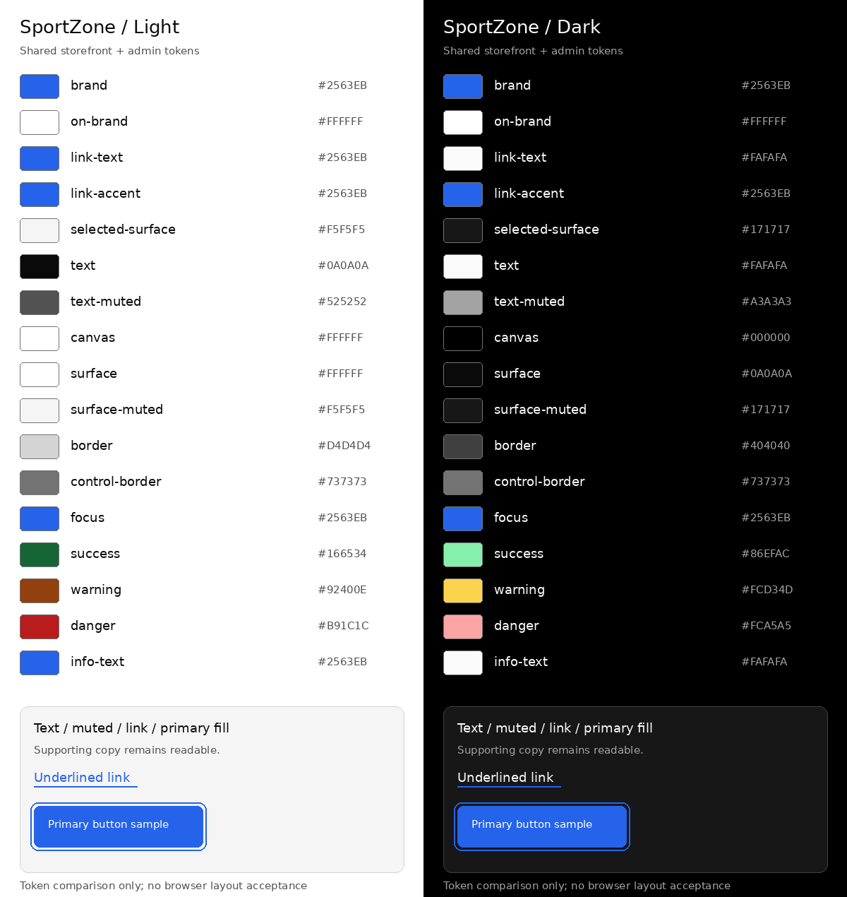

# P02-003 — Shared monochrome design tokens

**Reviewed:** 17 October 2026 (Asia/Dhaka)\
**Executor:** Codex\
**Task status:** Done\
**Prerequisites:** P02-001 and P02-002 Done

## Scope and implementation

Implemented all 17 light/dark color pairs from [Design §2.2](../DESIGN.md#22-light-and-dark-color-system).
[Shared tokens](../../styles/tokens.css) are imported by both application stylesheets. Semantic Tailwind mappings use
`@theme inline` with the standard color palette cleared, following [Tailwind theme variables](https://tailwindcss.com/docs/theme).
The same utilities resolve to the current semantic values in both applications; no shared UI component library or package
was introduced. Existing scaffold copy, routes, cache boundaries and access behavior are preserved.

| Area | Delivered behavior |
| --- | --- |
| Shared CSS | 17 semantic properties; light default, system-dark fallback and explicit root data-theme dark/light support |
| Brand | #2563EB and white on-brand text stay identical in both modes |
| Neutrals | Canvas, surface, muted/selected surfaces, text, muted text and both border types remain true grayscale |
| Links and focus | Light/dark readable link text, persistent blue underline color and separate focus token with offset |
| Tailwind | Semantic mappings such as bg-brand, text-on-brand, text-text-muted and border-control-border |
| Both app styles/components | Consume shared properties/utilities; duplicate palettes, legacy muted property and component inline colors removed |
| Test coverage | Four token assertions per workspace, plus built-CSS assertions in both HTTP smoke checks |
| Documentation | Design implementation mapping, README usage, Testing inventory and task/changelog evidence synchronized |

Explicit `data-theme="light"` excludes the system-dark override; `data-theme="dark"` applies the dark palette. With no
explicit light/dark value, dark OS preference applies the fallback. These selectors prepare the token layer only;
preference control, persistence and before-paint bootstrap remain assigned to P02-005. Typography remains P02-004.

## Verification

Environment: Node 24.20.0, npm 11.19.0, existing locked dependencies. No package dependency, lockfile, API, database,
backend/session behavior or deployment configuration changed.

| Command / check | Observed result |
| --- | --- |
| `npm run ci` | Passed: all 13 configured commands, both strict typechecks/builds, 12 tooling tests, 6 storefront tests and 8 admin tests |
| `npm run test:unit --workspace=storefront` | Passed: 2 layout and 4 token tests |
| `npm run test:unit --workspace=admin` | Passed after correcting the initial jsdom file-path compatibility issue: 4 routing and 4 token tests |
| Storefront production HTTP smoke (CI) | Passed: 3 groups including compiled muted utility and shared token declarations in served CSS |
| Admin built-app HTTP smoke (CI) | Passed: 2 groups including compiled muted utility and shared token declarations in served CSS |
| `npm run lint`, `python3 /tmp/p02-003-verify.py`, `git diff --check` | Passed: references/structure, task counts/dependencies, source/index preservation and clean diff whitespace |
| Rendered token comparison inspection | Passed: paired light/dark swatches, values and representative text/link/blue-fill samples inspected |
| Real-browser layout, keyboard and theme interaction checks | Not Run: UI surface inventory returned no browsers |

| Test key (each workspace) | Assertions |
| --- | --- |
| TOK-01 | All 17 light and dark values match the governing Design table; explicit and system-dark maps match; color-scheme declarations present |
| TOK-02 | Brand/on-brand invariant; all eight neutral categories have equal RGB channels; persistent blue link accent |
| TOK-03 | White-on-brand ≥4.5:1; seven text roles across four approved neutral surfaces ≥4.5:1; focus/control borders on those surfaces ≥3:1, both themes |
| TOK-04 | App imports shared source; semantic Tailwind mappings cover all tokens; link/focus/selection rules use tokens; no local hex palette |

These assertions cover the specified token combinations, not every future badge, overlay, chart or rendered control.
Browser cascade/interaction and complete WCAG acceptance are not inferred from static values or HTTP smoke results.

## Visual comparison

The PNG was generated directly from the shared CSS values with Python/Pillow and visually inspected. It is a token
comparison artifact, not a browser screenshot. It shows unchanged blue/white primary-fill samples, readable dark links
with a blue underline, grayscale surfaces and all 17 named swatches in each mode. Existing product/admin page screenshots
and persisted theme interaction belong to their later UI tasks. No temporary demo route was added to either application.

## Acceptance

The project owner accepted the design tokens and stated verification evidence on 17 October 2026: “Design tokens গ্রহণ করছি”.
P02-003 is Done under [TASKS §2](../TASKS.md#2-task-management-conventions) and
[AGENTS §13](../../AGENTS.md#13-task-completion--reporting). Milestone acceptance is unchanged.
