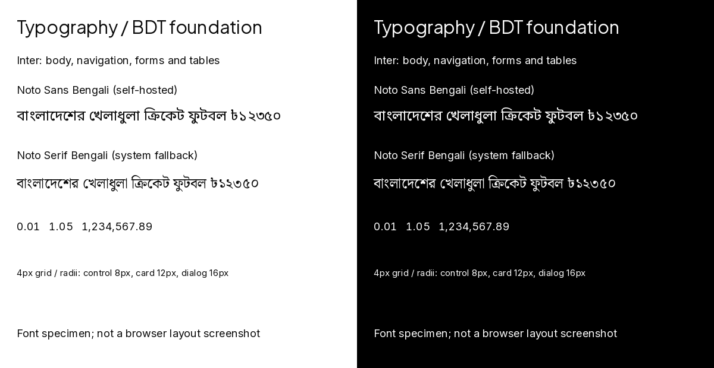

# P02-004 — Typography, dimensions and BDT display

**Reviewed:** 18 October 2026 (Asia/Dhaka)\
**Executor:** Codex\
**Task status:** Done\
**Prerequisite:** P02-003 Done

## Delivered scope

Implemented [Design §§2.3–2.5](../DESIGN.md#23-typography) for both applications through
[shared foundation CSS](../../styles/foundation.css), [licensed fonts](../../styles/fonts/README.md) and
[a pure BDT formatter](../../shared/format-bdt.ts). No backend calculation, API/database contract or authentication behavior
changed. Both app-local `src/lib/format-bdt.ts` modules expose the same implementation; no new workspace or runtime package
was introduced. Existing color tokens and accepted evidence remain intact.

| Area | Implementation |
| --- | --- |
| UI typography | Inter 400–600, 16px body and 1.5 line height with system/Bengali fallbacks |
| Headings | Plus Jakarta Sans 600–700 with Inter/system fallbacks; scaffold hero uses the specified 30–36px sizes |
| Bangla | Noto Sans Bengali 400–700; unicode subset includes Bengali digits/taka; explicit lang=bn stack includes Nirmala UI, Vrinda and Noto Serif Bengali |
| Loading | Three unmodified local WOFF2 subsets, font-display swap, no runtime font CDN or build-time font download |
| Dimensions | 4px spacing unit; 44px min-h-control; 1280px max-w-storefront; control/card/dialog radii 8/12/16px |
| Size scale | 12, 14, 16, 18, 20, 24, 30 and 36px Tailwind mappings |
| Numeric styling | numeric utility uses tabular-nums and lining-nums for monetary/numeric displays |
| Money formatting | Nonnegative safe integer poisha only; BigInt quotient/remainder preserves precision; en-BD grouping and taka symbol |
| Precision policy | Whole taka omit decimals; fractional taka show two digits, including trailing zero; invalid values throw RangeError without coercion |
| Build compatibility | Storefront TypeScript target raised from ES2017 to ES2020 for exact BigInt presentation arithmetic; pinned modern toolchain unchanged |

Examples: 0 → ৳0; 1 → ৳0.01; 100 → ৳1; 105 → ৳1.05; 150 → ৳1.50; 123450 → ৳1,234.50.
The formatter does not accept decimal BDT, calculate totals, allocate discounts or authorize a financial effect.

## Font provenance and review

All three source packages are Fontsource variable version **5.3.0**: Inter, Plus Jakarta Sans and Noto Sans Bengali.
Downloaded with exact `npm pack` versions; only required normal-weight Latin/Bengali files and original licenses were
vendored. [Asset manifest](../../styles/fonts/assets.json) records sizes and SHA-256 hashes. Original package unicode
ranges are retained. Variable files cover the declared weights without separate files per weight.

Setup references: [Fontsource installation](https://fontsource.org/docs/getting-started/install),
[font-display behavior](https://fontsource.org/docs/getting-started/display),
[Noto Sans Bengali license](https://fontsource.org/fonts/noto-sans-bengali/about).
These source downloads are not production font requests or application dependency additions.

Fontconfig verified Bengali sample glyph coverage in the vendored Noto Sans Bengali and the installed Noto Serif Bengali
system fallback. Pillow/RAQM rendered the actual WOFF2 files and fallback with Bengali shaping. Inter numeral advances
with tabular features were equal within 0.1px at the reviewed size. Availability of optional system fonts differs by device;
the self-hosted Bengali face remains the primary script fallback.

This is a font specimen, not a browser screenshot. Inspected for clipped/tofu glyphs and readable light/dark samples.
The Bengali specimen uses characters covered by the Bengali subset; Latin punctuation uses the Latin face in app stacks.

## Verification

Environment: Node 24.20.0 / npm 11.19.0, existing lockfile. Build and temporary loopback-server checks ran with the required
execution-environment permissions. No production data, provider account or deployment was changed.

| Command / check | Observed result |
| --- | --- |
| Official npm version queries / exact npm pack | Passed: three 5.3.0 font sources, original licenses and subset files |
| `npm run ci` | Passed: all 13 configured commands; 12 root, 25 storefront and 27 admin test cases; both typechecks/builds and all 5 HTTP smoke groups |
| Workspace foundation tests | Passed: 19 cases per app — 2 font/dimension, 10 exact amount outputs, 6 invalid-number cases and 1 untyped-input rejection case |
| Same-origin WOFF2 HTTP checks | Passed in both smoke commands: exactly three emitted fonts fetched 200, WOFF2 headers and source hashes match |
| `python3 /tmp/p02-004-font-review.py` | Passed: Bengali source/fallback glyphs and shaping specimen, tabular numeral advance; PNG visually inspected |
| `node_modules/.bin/biome lint shared/format-bdt.ts tests/typography.ts --error-on-warnings --vcs-enabled=false` | Passed: shared helper/assertions; direct root invocation avoids Biome outside-project VCS panic |
| `npm run lint`, `python3 /tmp/p02-004-verify.py`, `git diff --check` | Passed: references/structure, task/dependency counts, font hashes and unaffected source/index preservation |
| Browser font-swap/CLS, responsive viewport and keyboard checks | Not Run: no browser available in UI inventory |

Initial formatter test expectations used lakh grouping; actual en-BD output uses comma-separated three-digit groups.
Expectations were corrected to that explicit display policy and both suites passed. All valid outputs preserve exact poisha,
including Number.MAX_SAFE_INTEGER → ৳90,071,992,547,409.91. Strings, null, undefined, booleans, BigInt inputs, fractions,
negative values, nonfinite values and unsafe numbers are rejected.

Layouts use explicit line heights, readable fallback stacks, fluid content and reserved font weight ranges. No fixed-height
text boxes were introduced. Browser-measured layout shift/zero CLS or complete WCAG acceptance is not claimed from static
font contracts or specimens. Full UI/browser acceptance remains separately evidenced in its owning tasks.

## Acceptance

The project owner accepted the foundation and its stated verification evidence on 18 October 2026: “Typography/BDT foundation গ্রহণ করছি”.
P02-004 is Done under [TASKS §2](../TASKS.md#2-task-management-conventions) and
[AGENTS §13](../../AGENTS.md#13-task-completion--reporting). Milestone gates remain unchanged.
